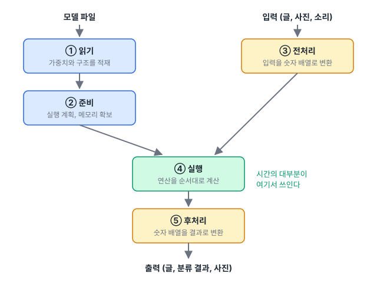

# 추론 엔진의 지형도

이 장에는 코드가 없습니다. 대신 책 전체에서 쓸 지도를 그립니다. 추론이
무엇인지, 추론 엔진이 어떤 일을 하는지, 세상에 어떤 엔진들이 있고 서로
어떻게 다른지, 그리고 엔진의 좋고 나쁨을 무엇으로 재는지를 차례로
살펴봅니다. 낯선 용어가 여럿 나오지만 지금은 이름과 위치만 익혀 두면
됩니다. 모두 뒤의 장에서 직접 만들어 보며 다시 만납니다.

## 1.1 모델은 숫자가 채워진 함수다

머신러닝 모델(model)은 함수입니다. 입력을 받아 출력을 내놓습니다. 사진을
받아 "고양이"라고 답하는 함수, 문장의 앞부분을 받아 다음 단어를 답하는
함수, 음성을 받아 글자를 답하는 함수입니다.

보통의 함수와 다른 점은 만드는 방법입니다. 프로그래머가 규칙을 손으로
쓰는 대신, 함수의 **형태**만 정해 두고 그 안의 **숫자**는 데이터에서
찾아냅니다. 가장 단순한 예를 봅시다.

```text
y = w × x + b
```

이 함수의 형태는 "곱하고 더한다"입니다. `w`와 `b`는 아직 정해지지 않은
숫자입니다. 이 숫자들을 파라미터(parameter) 또는 가중치(weight)라고
부릅니다. `w = 2`, `b = 1`로 정하면 이 함수는 `x = 3`에 `7`을 답합니다.
다른 값으로 정하면 다른 함수가 됩니다.

실제 모델도 원리는 같습니다. 규모가 다를 뿐입니다. 곱하고 더하는 단순한
연산을 수백 겹으로 쌓고, 그 안에 숫자가 수백만 개에서 수천억 개
들어갑니다. 이 책의 2부에서 돌릴 언어 모델에는 10억 개가 넘는 숫자가
들어 있습니다.

여기서 두 가지 용어를 구분해 둡니다.

- **아키텍처(architecture)**: 함수의 형태입니다. 어떤 연산을 어떤 순서로
  하는지를 정합니다.
- **가중치**: 그 형태 안에 채워진 숫자들입니다.

모델 파일을 내려받는다는 것은 대개 이 가중치를 내려받는다는 뜻입니다.
수 기가바이트에 이르는 파일의 거의 전부가 숫자입니다.

## 1.2 학습과 추론

모델의 일생은 두 단계로 나뉩니다.

**학습(training)** 은 가중치를 찾는 과정입니다. 입력과 정답의 쌍을 대량으로
보여 주고, 모델의 답이 정답에 가까워지도록 가중치를 조금씩 고칩니다. 이
과정을 수없이 반복합니다.

**추론(inference)** 은 찾아낸 가중치로 함수를 실제로 계산하는 과정입니다.
가중치는 더 이상 바뀌지 않습니다. 입력을 넣고 출력을 얻을 뿐입니다.

두 단계는 같은 모델을 다루지만 성격이 전혀 다릅니다.

| | 학습 | 추론 |
|---|---|---|
| 하는 일 | 가중치를 찾는다 | 가중치로 계산한다 |
| 가중치 | 계속 바뀐다 | 고정되어 있다 |
| 계산 방향 | 앞으로 계산한 뒤, 거꾸로 되짚으며 수정량을 구한다 | 앞으로만 계산한다 |
| 횟수 | 모델마다 한 번 (또는 몇 번) | 사용자가 요청할 때마다 |
| 실행 장소 | 대규모 GPU 장비 | 서버, 노트북, 폰, 브라우저, 초소형 기기 |
| 중요한 것 | 최종 모델의 품질 | 응답 속도, 비용, 메모리, 전력 |

표에서 눈여겨볼 것은 횟수와 장소입니다. 학습은 한 번이지만 추론은
모델이 쓰이는 내내 반복됩니다. 그리고 학습은 장비를 골라서 할 수 있지만
추론은 사용자가 있는 곳에서 해야 합니다. 그곳이 배터리로 움직이는
폰일 수도 있습니다.

앞으로만 계산한다는 점도 중요합니다. 입력에서 출력 방향으로 한 번
계산하는 것을 순전파(forward pass)라고 합니다. 학습에는 거꾸로 되짚는
과정과 그것을 위한 중간값 보관이 필요하지만, 추론에는 필요 없습니다.
그래서 추론만 하는 소프트웨어는 학습용 소프트웨어보다 훨씬 작고 단순하게
만들 수 있습니다. 이것이 추론 엔진이라는 별도의 소프트웨어가 존재하는
첫 번째 이유입니다.

이 책은 추론만 다룹니다. 학습은 [3장](ch03_neural_networks.md)에서 "가중치가 어디서 오는가"를
이해하는 데 필요한 만큼만 설명합니다.

## 1.3 추론 엔진이 하는 일

추론 엔진은 모델 파일과 입력을 받아 출력을 계산하는 프로그램입니다. 어떤
엔진이든 다음 다섯 가지 일을 합니다.



각 단계에서 무슨 일이 일어나는지, 그리고 이 책의 어디에서 다루는지
정리하면 다음과 같습니다.

| 단계 | 하는 일 | 이 책에서 |
|---|---|---|
| ① 읽기 | 모델 파일의 형식을 해석해 가중치를 메모리에 올린다 | [6장](ch06_model_files.md) |
| ② 준비 | 어떤 연산을 어떤 순서로 할지 정하고 필요한 메모리를 확보한다 | [4장](ch04_tensor.md), 26장 |
| ③ 전처리 | 글을 토큰 번호로, 사진을 숫자 배열로, 소리를 주파수 정보로 바꾼다 | [8장](../part2/ch08_tokenizer.md), 27장, 33장 |
| ④ 실행 | 행렬 곱셈 같은 연산을 수백에서 수천 번 수행한다 | [5장](ch05_operators.md)과 3부 전체 |
| ⑤ 후처리 | 모델이 내놓은 숫자를 글, 분류 결과, 사진으로 바꾼다 | [12장](../part2/ch12_sampling.md) 등 |

시간의 대부분은 ④에서 쓰입니다. 그리고 ④의 시간 대부분은 몇 안 되는
연산, 특히 행렬 곱셈에서 쓰입니다. 그래서 추론 엔진의 성능 작업은
결국 "많은 숫자를 곱하고 더하는 일을 주어진 하드웨어에서 얼마나 빨리
하는가"로 모입니다. 3부가 통째로 이 문제를 다룹니다.

엔진 안에서 이런 연산 하나를 특정 하드웨어에 맞춰 구현한 코드를
커널(kernel)이라고 부릅니다. 운영체제의 커널과는 관계없는, 이 분야의
용어입니다. "ARM CPU용 행렬 곱셈 커널"처럼 씁니다.

## 1.4 학습에 쓴 도구로 그냥 실행하면 안 되는가

모델은 대개 PyTorch[^pytorch] 같은 학습용 프레임워크로 만듭니다. 그
프레임워크도 순전파를 계산할 수 있으니, 추론도 그것으로 하면 될 것
같습니다. 실제로 그렇게 하는 경우도 많습니다. 하지만 다음과 같은 상황에서는
맞지 않습니다.

- **크기.** 학습용 프레임워크는 학습에 필요한 기능을 모두 담고 있어
  큽니다. 폰 앱에 넣거나 브라우저로 내려보내기에는 부담이 됩니다.
- **실행 환경.** Python 인터프리터가 필요합니다. 폰, 브라우저, 초소형
  기기에는 Python을 들고 가기 어렵습니다.
- **하드웨어.** 학습용 프레임워크는 학습에 쓰는 장비에 맞춰 다듬어져
  있습니다. 폰의 CPU나 전용 가속기를 잘 쓰려면 다른 종류의 최적화가
  필요합니다.
- **효율.** 가중치가 바뀌지 않는다는 사실을 알면 할 수 있는 최적화가
  많습니다. 숫자의 정밀도를 낮춰 모델을 줄이는 양자화(quantization),
  여러 연산을 하나로 합치는 융합(fusion), 메모리를 미리 계획해 재사용하는
  기법 등입니다.

마지막 항목이 추론 엔진이 존재하는 두 번째 이유입니다. 추론 엔진은
"가중치는 고정이고 앞으로만 계산한다"는 제약을 최대한 이용하도록 만든
전용 소프트웨어입니다.

이 이야기는 51장에서 측정과 함께 다시 다룹니다. 지금은 학습용
프레임워크와 추론 엔진이 서로 다른 문제를 푸는 도구라는 점만 기억해
둡시다. 이 책에서 PyTorch는 만들 대상이 아니라, 우리 엔진의 계산이
맞는지 확인하는 정답지 역할을 합니다.

## 1.5 추론 엔진의 세 계열

추론 엔진은 많지만, "모델의 아키텍처가 어디에 들어 있는가"를 기준으로
보면 세 계열로 나뉩니다. 이 구분은 책 전체에서 계속 쓰입니다.

### 첫째 계열: 아키텍처를 코드로 직접 쓴다

모델의 계산 순서를 엔진의 소스 코드로 직접 작성하는 방식입니다. 모델
파일에는 가중치와 약간의 설정값만 들어 있습니다.

대표는 llama.cpp[^llamacpp]입니다. 언어 모델을 실행하는 엔진으로, 지원하는
아키텍처마다 그 계산 순서를 적은 소스 파일이 따로 있습니다. 새로운
구조의 모델이 나오면 누군가 그 구조를 C++ 코드로 써넣어야 합니다. 음성
인식 모델 Whisper를 실행하는 whisper.cpp[^whispercpp]도 같은
방식입니다.

- **장점**: 특정 모델에 맞춘 최적화를 마음껏 할 수 있고, 엔진이 작고
  단순합니다.
- **단점**: 새 아키텍처를 지원하려면 엔진 코드를 고쳐야 합니다.

### 둘째 계열: 파일에 담긴 그래프를 해석한다

모델 파일에 가중치뿐 아니라 계산 순서까지 들어 있는 방식입니다. 계산
순서는 "이 연산의 출력을 저 연산의 입력으로 넣어라"는 식의 연결
관계이고, 이것을 계산 그래프(computation graph)라고 부릅니다. 엔진은
그래프를 읽어 거기 적힌 연산을 차례로 실행하는 범용 해석기입니다.

대표는 LiteRT[^litert]입니다. 2024년까지 TensorFlow Lite라는 이름으로
불리던 엔진으로, 폰과 임베디드 기기를 주된 대상으로 합니다. ONNX라는
공개 모델 형식을 실행하는 ONNX Runtime[^onnxruntime], PyTorch 모델을
기기에서 실행하기 위한 ExecuTorch[^executorch], 모바일 기기에 맞춰
다듬어진 NCNN[^ncnn]과 MNN[^mnn]도 이 계열입니다.

- **장점**: 엔진이 지원하는 연산들로 이루어진 모델이면 엔진을 고치지
  않고 실행할 수 있습니다.
- **단점**: 범용 해석기이므로 특정 모델만을 위한 최적화를 넣기 어렵고,
  지원하지 않는 연산이 하나라도 있으면 실행할 수 없습니다.

### 셋째 계열: 모델을 기계어로 컴파일한다

모델의 계산 그래프를 입력으로 받아, 특정 하드웨어에서 그 모델만 실행하는
전용 코드를 만들어 내는 방식입니다. 프로그래밍 언어의 컴파일러가 소스
코드를 기계어로 바꾸는 것과 같은 발상이며, ML 컴파일러라고 부릅니다.
Apache TVM[^tvm]과, MLIR[^mlir]이라는 컴파일러 기반 위에 만들어진
IREE[^iree]가 대표입니다.

- **장점**: 모델과 하드웨어의 조합마다 맞춤 코드를 얻을 수 있습니다.
- **단점**: 도구가 복잡하고, 컴파일에 시간이 들며, 문제가 생겼을 때
  원인을 찾기 어렵습니다.

### 한눈에 보기

| | 첫째: 코드로 직접 | 둘째: 그래프 해석 | 셋째: 컴파일 |
|---|---|---|---|
| 아키텍처가 있는 곳 | 엔진의 소스 코드 | 모델 파일 | 모델 파일 (컴파일 후에는 생성된 코드) |
| 새 모델을 지원하려면 | 엔진 코드를 쓴다 | 필요한 연산이 있으면 그대로 실행 | 다시 컴파일한다 |
| 대표 | llama.cpp, whisper.cpp | LiteRT, ONNX Runtime, ExecuTorch, NCNN, MNN | TVM, IREE |
| 이 책에서 | 2부에서 직접 구현 | 4부에서 직접 구현 | 52장에서 설명 |

현실의 엔진은 이 구분에 깔끔하게 들어맞지 않는 경우도 많습니다.
그래프를 해석하는 엔진이 실행 전에 그래프를 고쳐 쓰는 최적화를 하기도
하고, 일부 연산만 컴파일하기도 합니다. 그래도 낯선 엔진을 만났을 때
"아키텍처가 어디에 있는가"를 먼저 묻는 것은 좋은 출발점입니다.

우리는 첫째와 둘째 계열을 모두 직접 만듭니다. 2부에서 언어 모델의
아키텍처를 Rust 코드로 직접 쓰고, 4부에서 LiteRT의 모델 파일을 읽어
실행하는 그래프 해석기를 만듭니다. 두 방식을 모두 만들어 보면 각각의
장단점이 설명이 아니라 경험으로 남습니다.

### 이 책에 등장하는 엔진들

아래는 이 책이 비교하거나 분석하는 주요 엔진입니다. 공개일은 각
프로젝트의 GitHub 저장소가 만들어진 날짜이며, 프로젝트가 처음 발표된
날짜와는 다를 수 있습니다.

| 엔진 | 계열 | 주된 대상 | 저장소 생성 | 라이선스 |
|---|---|---|---|---|
| llama.cpp | 첫째 | 언어 모델, 개인 컴퓨터 | 2023-03 | MIT |
| whisper.cpp | 첫째 | 음성 인식 | 2022-09 | MIT |
| LiteRT | 둘째 | 폰, 임베디드 | 2024-09 (TensorFlow Lite에서 이름 변경) | Apache 2.0 |
| ONNX Runtime | 둘째 | 서버에서 기기까지 | 2018-11 | MIT |
| NCNN | 둘째 | 폰 | 2017-06 | BSD 3-Clause |
| MNN | 둘째 | 폰 | 2019-04 | Apache 2.0 |
| ExecuTorch | 둘째 | 폰, 임베디드 | 2022-02 | BSD 계열 |
| TVM | 셋째 | 다양한 하드웨어 | 2016-10 | Apache 2.0 |
| IREE | 셋째 | 다양한 하드웨어 | 2019-09 | Apache 2.0 |

서버에서 많은 사용자의 요청을 동시에 처리하는 데 특화된 엔진도
있습니다. 언어 모델 서빙에 널리 쓰이는 vLLM[^vllm]이 그 예입니다. 이런
엔진은 5부에서 다룹니다.

## 1.6 좋은 엔진을 재는 네 가지 저울

엔진이 "좋다"는 것은 무슨 뜻일까요. 이 분야에서는 네 가지를 잽니다.[^kiely]

**지연 시간(latency).** 요청 하나가 답을 받기까지 걸리는 시간입니다.
사용자가 체감하는 속도입니다.

**처리량(throughput).** 단위 시간에 처리하는 일의 양입니다. 서버라면 1초에
몇 건의 요청을, 또는 몇 개의 단어를 처리하는가입니다.

**비용(cost).** 그 일을 하는 데 드는 자원입니다. 서버에서는 장비 값과
전기 요금이고, 기기에서는 메모리 사용량, 배터리 소모, 앱의 크기입니다.

**품질(quality).** 모델이 내놓는 답이 얼마나 좋은가입니다. 엔진은 모델의
품질을 높이지는 못하지만 떨어뜨릴 수는 있습니다. 예를 들어 양자화는
모델을 작고 빠르게 만들지만 답을 조금 나쁘게 만들 수 있습니다.

이 네 가지는 서로 당깁니다. 몇 가지 예를 봅시다.

- 여러 요청을 묶어 한꺼번에 계산하면 처리량이 오르지만, 묶이기를
  기다리는 만큼 각 요청의 지연 시간은 늘어납니다. (지연 시간과 처리량)
- 양자화로 숫자의 정밀도를 낮추면 속도가 오르고 메모리가 줄지만,
  지나치면 답이 나빠집니다. (비용과 품질)
- 더 큰 모델은 답이 좋지만 느리고 메모리를 많이 씁니다. (품질과 나머지
  전부)

그래서 추론 엔지니어링에는 "가장 좋은 설정"이 없습니다. 있는 것은 "이
제품에 맞는 균형"입니다. 실시간 통역 앱은 지연 시간이 가장 중요하고,
밤새 문서 수백만 건을 요약하는 작업은 처리량과 비용이 중요합니다.
추론 엔지니어의 일은 요구사항을 이 네 저울의 눈금으로 옮기고, 그
눈금에 맞는 선택을 하고, 선택의 결과를 측정으로 확인하는 것입니다.

### 언어 모델의 두 가지 속도

언어 모델에서는 지연 시간을 두 구간으로 나누어 잽니다. 언어 모델은 답을
한 번에 내놓지 않고 단어 조각을 하나씩 차례로 만들어 내기 때문입니다. 이
조각을 토큰(token)이라고 하며 [8장](../part2/ch08_tokenizer.md)에서 자세히 다룹니다.

- **첫 토큰까지의 시간(time to first token, TTFT)**: 질문을 보낸 뒤 답의
  첫 조각이 나오기까지의 시간입니다. 이 구간에서 모델은 질문 전체를
  읽습니다.
- **초당 토큰 수(tokens per second, TPS)**: 첫 조각이 나온 뒤 나머지
  조각이 나오는 속도입니다.

두 숫자를 따로 재는 이유는 병목이 서로 다르기 때문입니다. 질문을 읽는
구간은 계산 능력이, 답을 만드는 구간은 메모리에서 데이터를 읽어 오는
속도가 발목을 잡습니다. 왜 그런지는 [11장](../part2/ch11_kv_cache.md)에서 구조를 보고, [15장](../part3/ch15_bottleneck.md)에서
계산과 측정으로 확인합니다. 지금은 "언어 모델의 속도는 숫자 두 개로
말한다"는 것만 기억해 둡시다.

다른 종류의 모델에는 그에 맞는 지표가 있습니다. 음성 인식에서는 음성
길이 대비 처리 시간의 비율을, 이미지 생성에서는 사진 한 장을 만드는
시간을 잽니다. 각 분야의 장에서 소개합니다.

## 1.7 추론은 어디에서 실행되는가

같은 모델이라도 실행하는 곳에 따라 문제가 달라집니다. 이 책은 세 환경을
다룹니다.

| 환경 | 특징 | 가장 큰 제약 | 이 책에서 |
|---|---|---|---|
| 서버와 데스크톱 | 메모리와 전력이 넉넉하고, 서버는 여러 사용자를 동시에 받는다 | 비용, 동시 처리 | 1~5부 |
| 폰 | 사용자 곁에서 실행되어 통신 지연이 없고 데이터가 기기를 떠나지 않는다 | 메모리, 발열, 배터리, 기기의 다양성 | 6부 |
| 브라우저 | 설치 없이 웹 페이지에서 실행된다 | 브라우저가 허용하는 자원, 모델 내려받기 | 6부 |

사용자의 기기에서 추론을 실행하는 것을 온디바이스(on-device) 추론이라고
합니다. 통신이 필요 없고, 개인 데이터가 밖으로 나가지 않으며, 서비스
제공자가 서버 비용을 내지 않아도 된다는 장점이 있습니다. 대신 쓸 수
있는 자원이 서버와는 비교할 수 없이 적습니다.

우리가 만드는 엔진은 하나이고, 그 하나를 세 환경에 모두 올려 봅니다.
그 과정에서 환경이 바뀔 때 무엇이 그대로이고 무엇이 달라지는지를 보게
됩니다.

## 1.8 우리가 만들 엔진, badak

이 책에서 만드는 엔진의 이름은 `badak`입니다. 다음 원칙으로 만듭니다.

- **Rust로 씁니다.** 메모리를 직접 다루는 저수준 코드를 쓰면서도
  컴파일러의 도움을 받을 수 있습니다.
- **표준 라이브러리만 씁니다.** 행렬 곱셈, 파일 파서, 스레드 풀을 모두
  직접 씁니다. 그래야 그 안에서 일어나는 일을 이해할 수 있습니다.
- **단순한 구현에서 시작합니다.** 먼저 가장 알기 쉬운 방법으로 동작하게
  만들고, 측정하고, 병목을 찾아 고칩니다. 느린 구현도 지우지 않고 남겨
  비교에 씁니다.
- **실전 엔진과 비교합니다.** 분야마다 그 분야의 대표 엔진과 같은
  기계에서 같은 모델로 겨룹니다.

`badak`은 이 책이 끝날 때까지 다음 순서로 자랍니다.

| 부 | 엔진에 더해지는 것 | 할 수 있게 되는 일 | 대결 상대 |
|---|---|---|---|
| 1부 | 숫자 배열과 연산 | 손글씨 숫자 분류 | |
| 2부 | 언어 모델 구조 | 문장 생성 | llama.cpp (첫 대결) |
| 3부 | 빠른 커널, 양자화 | 수십 배 빠른 생성 | llama.cpp (재대결) |
| 4부 | 그래프 해석기, 분야별 모델 | 이미지 분류, 음성 인식, 이미지 생성, 음성 합성 | LiteRT, NCNN, MNN, whisper.cpp |
| 5부 | 서버 | 여러 사용자 동시 처리 | |
| 6부 | 폰과 브라우저용 빌드 | 사용자의 기기에서 실행 | 웹 AI 엔진들 |

첫 대결에서 `badak`은 크게 집니다. 그것이 정상입니다. 그 격차를 하나씩
측정하고 줄여 가는 과정이 이 책의 중심 줄거리이고, 끝까지 줄이지 못한
격차가 어디서 오는지를 설명하는 것으로 책을 맺습니다.

## 정리

- 모델은 형태(아키텍처)와 숫자(가중치)로 이루어진 함수입니다.
- 학습은 가중치를 찾는 일이고, 추론은 찾은 가중치로 계산하는 일입니다.
  추론은 가중치가 고정이고 앞으로만 계산합니다.
- 추론 엔진은 읽기, 준비, 전처리, 실행, 후처리를 합니다. 시간의 대부분은
  실행에, 그중에서도 몇 안 되는 연산에 쓰입니다.
- 추론 엔진은 아키텍처가 어디에 있는가에 따라 세 계열로 나뉩니다. 엔진
  코드에 직접 쓰는 계열, 모델 파일의 그래프를 해석하는 계열, 모델을
  컴파일하는 계열입니다.
- 엔진의 좋고 나쁨은 지연 시간, 처리량, 비용, 품질로 잽니다. 넷은 서로
  당기므로 정답은 없고 제품에 맞는 균형이 있을 뿐입니다.
- 추론은 서버, 폰, 브라우저에서 실행되며 환경마다 제약이 다릅니다.

## 연습 문제

1. 여러분이 매일 쓰는 앱 가운데 모델 추론이 들어 있을 법한 기능을 세 개
   고르고, 각각이 서버에서 실행될지 기기에서 실행될지 추측해 보십시오.
   그렇게 추측한 근거를 1.7절의 제약으로 설명해 보십시오.
2. 다음 두 제품에서 네 가지 저울의 우선순위를 각각 매겨 보십시오.
   (가) 운전 중에 쓰는 음성 비서, (나) 쇼핑몰의 상품 수백만 개에 설명
   문구를 붙이는 야간 작업.
3. 새로운 구조의 언어 모델이 오늘 공개되었다고 합시다. 첫째 계열의
   엔진과 둘째 계열의 엔진에서 이 모델을 실행하려면 각각 어떤 일이
   필요할지 1.5절을 바탕으로 적어 보십시오.
4. 1.5절 각주의 저장소 가운데 하나를 열어, 모델의 아키텍처가 소스
   코드에 있는지 모델 파일에 있는지 직접 확인해 보십시오. llama.cpp라면
   `src/models/` 디렉터리를, LiteRT라면 모델 파일의 형식을 정의한
   `schema.fbs` 파일을 찾아보십시오.

## 참고 문헌

이 장의 엔진 관련 서술은 2026년 11월 16일에 각 저장소를 열어
확인했습니다. 저장소 생성일과 라이선스는 GitHub가 제공하는 저장소
정보에서 가져왔습니다.

[^pytorch]: A. Paszke 외, "PyTorch: An Imperative Style, High-Performance
    Deep Learning Library", NeurIPS 2019.
    [arXiv:1912.01703](https://arxiv.org/abs/1912.01703). PyTorch의 설계
    목표와 구조를 설명한 논문입니다. 저장소:
    <https://github.com/pytorch/pytorch>

[^llamacpp]: llama.cpp, <https://github.com/ggml-org/llama.cpp>.
    아키텍처별 소스 파일은 `src/models/` 디렉터리에 있습니다(커밋
    `b4c0e00a4fcc`, 2026-11-15 기준 182개 파일).

[^whispercpp]: whisper.cpp, <https://github.com/ggml-org/whisper.cpp>.
    Whisper의 계산 순서는 `src/whisper.cpp`에 직접 작성되어 있습니다(커밋
    `5922450fbce1`).

[^litert]: LiteRT, <https://github.com/google-ai-edge/LiteRT>. 모델 파일
    형식은 `tflite/converter/schema/schema.fbs`에 정의되어 있습니다(커밋
    `ee2d1defa34d`). 이름 변경 발표: "TensorFlow Lite is now LiteRT",
    Google Developers Blog, 2024-09-04,
    <https://developers.googleblog.com/en/tensorflow-lite-is-now-litert/>

[^onnxruntime]: ONNX Runtime, <https://github.com/microsoft/onnxruntime>.
    ONNX 형식 자체는 별도 프로젝트이며, 모델 파일의 구조는
    <https://github.com/onnx/onnx>의 `onnx/onnx.proto`에 정의되어
    있습니다(커밋 `c7609c4ad544`).

[^executorch]: ExecuTorch, <https://github.com/pytorch/executorch>.

[^ncnn]: NCNN, <https://github.com/Tencent/ncnn>. 라이선스는 저장소의
    `LICENSE.txt`에서 확인했습니다.

[^mnn]: MNN, <https://github.com/alibaba/MNN>. 설계를 설명한 논문:
    X. Jiang 외, "MNN: A Universal and Efficient Inference Engine", MLSys
    2020. [arXiv:2002.12418](https://arxiv.org/abs/2002.12418)

[^tvm]: T. Chen 외, "TVM: An Automated End-to-End Optimizing Compiler for
    Deep Learning", OSDI 2018.
    [arXiv:1802.04799](https://arxiv.org/abs/1802.04799). 저장소:
    <https://github.com/apache/tvm>

[^mlir]: C. Lattner 외, "MLIR: A Compiler Infrastructure for the End of
    Moore's Law", 2020.
    [arXiv:2002.11054](https://arxiv.org/abs/2002.11054)

[^iree]: IREE, <https://github.com/iree-org/iree>.

[^vllm]: vLLM, <https://github.com/vllm-project/vllm>.

[^kiely]: P. Kiely, *Inference Engineering*, Baseten Books, 2026.
    지연 시간, 처리량, 비용, 품질 사이의 균형이라는 관점과, 그 책
    1.4절의 지표 정의(TTFT, TPS)를 참고했습니다. 데이터센터에서 추론을 운영하는 관점을
    더 알고 싶은 독자에게 권합니다.
