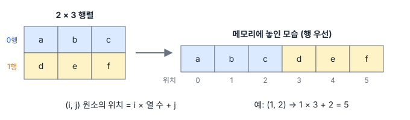
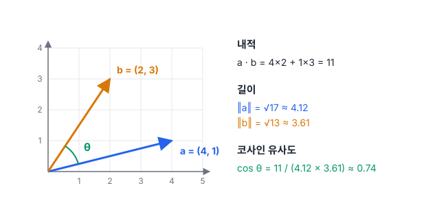
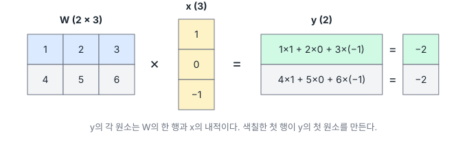
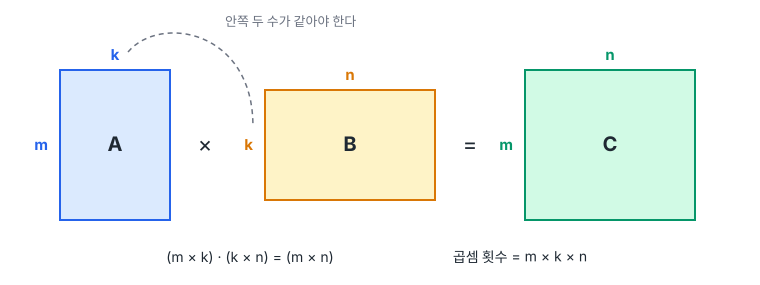
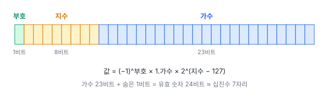

# 추론에 필요한 수학

[1장](ch01_landscape.md)에서 모델은 "곱하고 더하는 단순한 연산을 수없이 쌓은 함수"라고
했습니다. 이 장에서는 그 곱하고 더하는 연산을 정확히 정의하고 Rust로 직접
구현합니다. 추론에 필요한 수학은 생각보다 적습니다. 다음 네 가지면
충분합니다.

1. 벡터와 행렬, 그리고 그 사이의 곱셈
2. 연산의 횟수와 메모리 크기를 세는 법
3. 점수를 확률로 바꾸는 법
4. 컴퓨터의 실수(부동소수점)가 수학의 실수와 다르게 행동하는 방식

수학을 증명하지는 않습니다. 대신 모든 개념을 코드로 옮기고, 손으로 계산한
값과 맞는지 테스트로 확인합니다. 이 장에서 만드는 함수들은 가장 단순한
형태이지만 버려지지 않습니다. 뒤의 장에서 빠른 구현을 만들 때마다 "느리지만
확실히 맞는 기준"으로 다시 불려 나옵니다.

이 장부터 코드가 나옵니다. 저장소를 내려받아 다음 명령이 통과하는지 먼저
확인해 두십시오.

```bash
cargo test --workspace
```

이 장의 코드는 모두 `crates/badak_core/src/`의 `linalg.rs`, `prob.rs`,
`approx.rs`에 있습니다.

## 2.1 숫자를 담는 그릇

추론 엔진이 다루는 데이터는 결국 숫자의 배열입니다. 배열이 몇 개의 방향으로
뻗어 있는지에 따라 이름이 다릅니다.

| 이름 | 방향의 수 | 예 | 형상 |
|---|---|---|---|
| 스칼라(scalar) | 0 | 숫자 하나. `3.14` | `()` |
| 벡터(vector) | 1 | 숫자를 한 줄로 늘어놓은 것 | `(3)` |
| 행렬(matrix) | 2 | 숫자를 가로세로로 늘어놓은 것 | `(2, 3)` |
| 텐서(tensor) | 몇 개든 | 위의 것들을 일반화한 이름 | `(4, 3, 224, 224)` |

각 방향의 길이를 순서대로 적은 것을 형상(shape)이라고 합니다. 형상이
`(2, 3)`인 행렬은 2행 3열이고 원소가 6개입니다. 표의 마지막 예
`(4, 3, 224, 224)`는 "사진 [4장](ch04_tensor.md), 색 채널 3개, 세로 224, 가로 224"처럼
읽습니다. 원소의 개수는 형상의 숫자를 모두 곱한 값입니다.

텐서라는 말이 거창하게 들리지만, 이 책에서는 "형상이 붙어 있는 숫자
배열"이라는 뜻으로만 씁니다. 텐서를 다루는 자료구조는 [4장](ch04_tensor.md)에서 만듭니다.
이 장에서는 벡터와 행렬만 다루며, 둘 다 Rust의 슬라이스 `&[f32]`로
나타냅니다. `f32`는 32비트 실수형으로, 추론에서 가장 기본이 되는
자료형입니다.

### 행렬을 메모리에 놓는 법

메모리는 한 줄로 늘어선 칸입니다. 2차원인 행렬을 여기에 담으려면 한 줄로
펴야 합니다. 이 책은 첫 행을 먼저 적고, 이어서 둘째 행을 적는 방식을
씁니다. 이를 행 우선(row-major) 순서라고 합니다.



`i`행 `j`열 원소는 펼친 배열의 `i × 열 수 + j`번째 칸에 있습니다. 이 식은
이 장의 모든 행렬 코드에 등장합니다. [4장](ch04_tensor.md)에서 텐서를 만들 때 이 식을
일반화한 것이 스트라이드(stride)입니다.

## 2.2 벡터 연산

### 덧셈과 스칼라배

벡터끼리의 덧셈은 같은 자리의 원소끼리 더합니다. 벡터에 숫자 하나를 곱하는
스칼라배는 모든 원소에 그 숫자를 곱합니다.

```text
(1, 2) + (10, 20) = (11, 22)
3 × (1, −2)       = (3, −6)
```

```rust
{{#include ../../../crates/badak_core/src/linalg.rs:add_scale}}
```

덧셈은 두 벡터의 길이가 같아야만 정의됩니다. 길이가 다르면 프로그램의
오류이므로 `assert_eq!`로 즉시 멈추게 했습니다. 형상이 맞지 않는 연산은
추론 코드에서 가장 흔한 버그이고, 조용히 잘못된 값을 내는 것보다 그
자리에서 멈추는 편이 훨씬 찾기 쉽습니다.

### 내적

내적(dot product)은 두 벡터에서 같은 자리의 원소끼리 곱한 뒤 모두 더한
값입니다. 결과는 벡터가 아니라 숫자 하나입니다.

```text
(1, 2, 3) · (4, 5, 6) = 1×4 + 2×5 + 3×6 = 32
```

```rust
{{#include ../../../crates/badak_core/src/linalg.rs:dot}}
```

내적은 이 책에서 가장 중요한 연산입니다. 신경망이 하는 계산의 거의 전부가
내적으로 이루어져 있기 때문입니다. 바로 다음 절에서 보듯 행렬과 벡터의
곱은 내적을 여러 번 하는 것이고, 행렬끼리의 곱은 그것을 또 여러 번 하는
것입니다. 3부에서 엔진을 빠르게 만든다는 것은 결국 내적을 빠르게 만든다는
뜻입니다.

### 내적이 재는 것: 두 벡터가 얼마나 닮았는가

내적에는 기하학적인 의미가 있습니다. 벡터를 원점에서 뻗은 화살표로 보면,
내적은 두 화살표가 같은 방향을 가리킬수록 커집니다.



벡터의 길이는 자기 자신과의 내적에 제곱근을 씌운 값입니다. 노름(norm)이라고
부릅니다. 내적을 두 벡터의 길이로 나누면 길이의 영향이 사라지고 방향의
닮은 정도만 남습니다. 이 값이 두 화살표 사이 각도의 코사인이어서 코사인
유사도(cosine similarity)라고 부릅니다.

| 코사인 유사도 | 뜻 |
|---|---|
| 1 | 같은 방향 |
| 0 | 직각. 관계없음 |
| −1 | 정반대 방향 |

```rust
{{#include ../../../crates/badak_core/src/linalg.rs:norm_cosine}}
```

코사인 유사도는 34장에서 다시 주인공이 됩니다. 문장을 벡터로 바꾸는 임베딩
모델은 뜻이 비슷한 문장을 비슷한 방향의 벡터로 보내도록 학습되고, 검색은
질문 벡터와 코사인 유사도가 높은 문서 벡터를 찾는 일이 됩니다.

## 2.3 행렬과 벡터의 곱

행렬과 벡터의 곱은 행렬의 행마다 벡터와 내적을 한 번씩 하는 연산입니다.
행이 2개면 내적을 2번 하고, 결과는 길이 2인 벡터입니다.



형상의 규칙은 다음과 같습니다. 행렬의 열 수와 벡터의 길이가 같아야 하고,
결과의 길이는 행렬의 행 수입니다.

```text
(행 × 열) 행렬 · (열) 벡터 = (행) 벡터
```

코드는 이 정의를 그대로 옮긴 것입니다. 펼쳐진 행렬을 열 수만큼씩 잘라 행을
꺼내고, 행마다 내적을 구합니다.

```rust
{{#include ../../../crates/badak_core/src/linalg.rs:matvec}}
```

이 연산이 왜 중요한지는 [3장](ch03_neural_networks.md)에서 자세히 보지만 미리 말해 두면, 신경망의
층(layer) 하나가 하는 일의 핵심이 바로 이것입니다. 입력 벡터 `x`에 가중치
행렬 `W`를 곱해 새로운 벡터를 만듭니다. 길이 3인 입력이 길이 2인 출력으로
바뀌듯, 행렬은 벡터를 다른 길이의 벡터로 옮기는 함수 역할을 합니다. [1장](ch01_landscape.md)에서
본 `y = w × x + b`의 `w`가 숫자 하나에서 행렬로 커진 것입니다.

## 2.4 행렬과 행렬의 곱

행렬 곱(matrix multiplication)은 행렬과 벡터의 곱을 한 단계 더 확장한
것입니다. `A`와 `B`를 곱한 결과 `C`의 `i`행 `j`열 원소는 `A`의 `i`번째
**행**과 `B`의 `j`번째 **열**의 내적입니다.

```text
[1 2]   [5 6]   [1×5+2×7  1×6+2×8]   [19 22]
[3 4] · [7 8] = [3×5+4×7  3×6+4×8] = [43 50]
```

형상의 규칙이 중요합니다. 앞 행렬의 열 수와 뒤 행렬의 행 수가 같아야 하고,
결과는 앞 행렬의 행 수와 뒤 행렬의 열 수를 물려받습니다.



```rust
{{#include ../../../crates/badak_core/src/linalg.rs:matmul}}
```

삼중 반복문입니다. 바깥 두 반복문이 결과의 자리 `(i, j)`를 하나씩 고르고,
가장 안쪽 반복문이 그 자리의 내적을 계산합니다. `a[i * k + p]`와
`b[p * n + j]`는 2.1절의 위치 공식을 그대로 쓴 것입니다.

알아 둘 성질이 두 가지 있습니다.

- **순서를 바꿀 수 없습니다.** `A · B`와 `B · A`는 일반적으로 다릅니다.
  형상이 맞지 않아 한쪽은 계산조차 안 되는 경우도 많습니다.
- **행렬과 벡터의 곱은 행렬 곱의 특수한 경우입니다.** 길이 `k`인 벡터를
  `k × 1` 행렬로 보면 됩니다. 테스트에서 `matmul`과 `matvec`이 같은 답을
  내는지 확인합니다.

### 전치

전치(transpose)는 행렬의 행과 열을 맞바꾸는 연산입니다. `2 × 3` 행렬을
전치하면 `3 × 2` 행렬이 됩니다.

```text
[1 2 3]ᵀ   [1 4]
[4 5 6]  = [2 5]
           [3 6]
```

```rust
{{#include ../../../crates/badak_core/src/linalg.rs:transpose}}
```

전치는 [9장](../part2/ch09_transformer.md)의 어텐션 계산에서 쓰입니다. 그리고 [4장](ch04_tensor.md)에서 보듯, 실제 엔진은
전치를 할 때 숫자를 옮기지 않고 "읽는 순서"만 바꾸는 방법을 씁니다.

## 2.5 계산량과 메모리 세기

추론 엔지니어는 코드를 실행하기 전에 "이 연산은 얼마나 무거운가"를 암산할
수 있어야 합니다. 세는 법은 간단합니다.

**계산량.** `(m × k) · (k × n)` 행렬 곱은 결과의 자리가 `m × n`개이고
자리마다 곱셈을 `k`번 합니다. 따라서 곱셈은 `m × k × n`번, 덧셈도 거의 같은
횟수입니다. 정사각 행렬이면 크기를 두 배로 늘릴 때 계산량은 여덟 배가
됩니다.

**메모리.** 원소의 개수에 원소 하나의 크기를 곱합니다. `f32`는 4바이트이므로
`1024 × 1024` 행렬은 `1024 × 1024 × 4`바이트, 즉 4MiB입니다.

부동소수점 연산의 횟수를 FLOP(floating-point operation)이라는 단위로 세고,
1초에 처리하는 횟수를 FLOP/s로 적습니다. 곱셈 한 번과 덧셈 한 번을 합쳐
2 FLOP으로 셉니다.

### 첫 측정

방금 만든 `matmul`이 실제로 얼마나 걸리는지 재 봅시다. 정사각 행렬 두 개를
곱하는 시간을 크기별로 측정하는 예제입니다.

```bash
cargo run --release -p badak_core --example ch02_matmul_cost
```

기준 기계(Apple M4 Max)에서의 결과입니다.

```text
{{#include output/ch02_matmul_cost.txt}}
```

읽는 법은 다음과 같습니다.

- **곱셈 횟수**는 `n`이 두 배가 될 때마다 정확히 여덟 배가 됩니다.
- **시간**도 대체로 여덟 배씩 늘어납니다. `1024 × 1024` 행렬 한 쌍을 곱하는
  데 0.8초가 넘게 걸립니다.
- **GFLOP/s**는 1초에 처리한 부동소수점 연산이 몇십억 번인지입니다. 2에서
  3.5 사이에 머뭅니다.

0.8초는 심각한 숫자입니다. 2부에서 돌릴 언어 모델은 단어 조각 하나를 만들
때마다 큰 행렬 연산을 수백 번 합니다. 연산 하나가 이렇게 느려서는 쓸 만한
속도가 나오지 않습니다. 실제로 얼마나 느린지는 [13장](../part2/ch13_first_showdown.md)에서 잽니다.

다행히 이 숫자는 하드웨어의 한계가 아니라 구현의 한계입니다. 같은 기계에서
같은 계산을 훨씬 빠르게 할 수 있고, [16장](../part3/ch16_matmul.md)에서 18장에 걸쳐 그 방법을 하나씩
적용하며 이 표를 다시 잽니다. 그때 이 단순한 `matmul`은 정답을 확인하는
기준이자 출발점의 기록으로 남습니다.

> 이 측정은 초시계로 재는 수준의 거친 측정입니다. 여러 번 실행해 가장 빠른
> 값을 골랐을 뿐입니다. 측정을 제대로 설계하는 법은 [14장](../part3/ch14_measurement.md)에서 다룹니다.

## 2.6 점수를 확률로

분류 모델은 마지막에 후보마다 점수를 하나씩 내놓습니다. 손글씨 숫자
분류라면 0부터 9까지 열 개의 점수가, 언어 모델이라면 다음에 올 수 있는
단어 조각 수만 개 각각의 점수가 나옵니다. 이 점수를 로짓(logit)이라고
부릅니다. 로짓은 클수록 가능성이 높다는 뜻일 뿐, 음수일 수도 있고 합이
1도 아닙니다.

점수를 "몇 퍼센트의 가능성"으로 읽으려면 확률분포(probability
distribution)로 바꿔야 합니다. 확률분포는 두 조건을 만족하는 숫자들입니다.

1. 모든 값이 0 이상이다.
2. 모두 더하면 1이다.

### 소프트맥스

점수를 확률분포로 바꾸는 표준적인 방법이 소프트맥스(softmax)입니다. 두
단계로 이루어집니다.

1. 각 점수 `s`를 `exp(s)`로 바꾼다. `exp`는 자연상수 e의 거듭제곱으로,
   어떤 수를 넣어도 양수가 나온다. (조건 1을 만족)
2. 그 값들을 전체 합으로 나눈다. (조건 2를 만족)

```text
softmax(s)ᵢ = exp(sᵢ) / (exp(s₀) + exp(s₁) + ... + exp(sₙ₋₁))
```

이 정의를 그대로 옮기면 다음과 같습니다.

```rust
{{#include ../../../crates/badak_core/src/prob.rs:softmax_naive}}
```

실행해 보면 점수가 확률로 바뀌는 것을 볼 수 있습니다.

```bash
cargo run --release -p badak_core --example ch02_softmax
```

| 점수 | 2.0 | 1.0 | 0.1 | −1.0 | 합 |
|---|---|---|---|---|---|
| 소프트맥스 | 0.6381 | 0.2347 | 0.0954 | 0.0318 | 1.0000 |

점수의 순서는 그대로 유지되고, 가장 높은 점수가 가장 큰 확률을 가집니다.

`exp`를 쓰기 때문에 소프트맥스는 점수의 **차이**에 민감합니다. 같은
점수들을 두 배로 늘리거나 절반으로 줄여 보면 분포의 모양이 크게
달라집니다.

| 입력 | 확률 | 모양 |
|---|---|---|
| 점수 × 2 | 0.8619, 0.1166, 0.0193, 0.0021 | 1등에 쏠린다 |
| 점수 × 1 | 0.6381, 0.2347, 0.0954, 0.0318 | 기준 |
| 점수 × 0.5 | 0.4512, 0.2737, 0.1745, 0.1007 | 고르게 퍼진다 |

이 성질은 [12장](../part2/ch12_sampling.md)에서 그대로 쓰입니다. 언어 모델의 "온도(temperature)"라는
설정이 바로 소프트맥스에 넣기 전에 점수를 어떤 수로 나누는 것입니다.
온도를 낮추면 위 표의 첫 줄처럼 모델이 가장 유력한 단어만 고르게 되고,
높이면 셋째 줄처럼 다양한 단어를 고르게 됩니다.

### 넘침 문제와 해결

위의 단순한 구현에는 함정이 있습니다. 점수가 크면 망가집니다.

```text
{{#include output/ch02_softmax.txt:12:16}}
```

`exp(1000)`은 `f32`가 담을 수 있는 가장 큰 수를 훌쩍 넘습니다. 그러면
결과는 무한대(`inf`)가 되고, 무한대를 무한대로 나눈 값은 "숫자가
아님"을 뜻하는 `NaN`이 됩니다. 이렇게 값이 표현 범위를 넘는 것을
넘침(overflow)이라고 합니다. 점수 1000은 비현실적으로 보이지만, 수백 겹의
계산을 거친 실제 모델의 출력에서는 드물지 않게 나타납니다.[^goodfellow]

해결책은 소프트맥스의 성질 하나를 이용합니다. **모든 점수에 같은 수를
더하거나 빼도 결과가 변하지 않습니다.** 분자와 분모에 같은 값이 곱해져
약분되기 때문입니다.

```text
exp(sᵢ − c) / Σ exp(sⱼ − c)
  = (exp(sᵢ) / exp(c)) / (Σ exp(sⱼ) / exp(c))
  = exp(sᵢ) / Σ exp(sⱼ)
```

그러니 계산하기 전에 모든 점수에서 최댓값을 빼면 됩니다. 가장 큰 점수는
0이 되고 나머지는 음수가 됩니다. `exp(0)`은 1이고 음수의 `exp`는 0과 1
사이이므로 넘칠 수 없습니다.

```rust
{{#include ../../../crates/badak_core/src/prob.rs:softmax}}
```

합을 구하는 줄에 `sum_pairwise`라는 함수가 있습니다. 값을 차례로 더하지
않고 반씩 나누어 더하는 함수이고, 5.6절에서 만듭니다. 지금은 "더한다"로
읽으면 됩니다. 값이 10만 개쯤 되면 차례로 더한 합이 눈에 띄게 틀어지는데,
그 일은 [12장](../part2/ch12_sampling.md)에서 실제로 겪습니다.

수학적으로 같은 식인데 계산 순서에 따라 한쪽은 답을 내고 다른 쪽은
망가집니다. 이런 일은 추론 코드에서 계속 만나게 됩니다. 수식을 코드로
옮길 때는 "중간값이 표현 범위를 벗어나지 않는가"를 항상 따져야 합니다.

### 확률의 로그

확률 그 자체보다 확률의 로그가 필요한 경우가 많습니다. 21장에서 모델의
품질을 재는 지표도, 33장에서 여러 후보 문장의 점수를 비교하는 방법도 로그
확률로 계산합니다. 확률을 여러 번 곱하면 금세 0에 가까워져 다루기
어려운데, 로그를 취하면 곱셈이 덧셈으로 바뀌기 때문입니다.

소프트맥스를 구한 뒤 로그를 취해도 되지만, 확률이 아주 작으면 문제가
생깁니다. 확률이 0으로 반올림되고, 0의 로그는 음의 무한대입니다. 그래서
로그 소프트맥스는 식을 정리해 직접 계산합니다.

```text
log softmax(s)ᵢ = (sᵢ − max) − ln(Σ exp(sⱼ − max))
```

```rust
{{#include ../../../crates/badak_core/src/prob.rs:log_softmax}}
```

```text
{{#include output/ch02_softmax.txt:18:20}}
```

점수가 0과 200일 때 첫째 후보의 확률은 `exp(−200)` 수준으로, `f32`로는
0과 구분되지 않습니다. 소프트맥스를 거치면 정보가 사라지지만, 직접 계산한
로그 확률은 정확히 −200입니다.

### 가장 큰 값 고르기

확률에서 최종 답을 고르는 가장 단순한 방법은 가장 큰 값의 위치를 찾는
것입니다. 이 연산을 argmax라고 합니다.

```rust
{{#include ../../../crates/badak_core/src/prob.rs:argmax}}
```

소프트맥스는 순서를 바꾸지 않으므로, 가장 큰 것 하나만 필요하다면
소프트맥스를 건너뛰고 점수에 바로 argmax를 적용해도 결과가 같습니다. [7장](ch07_mnist.md)의
분류기가 이 지름길을 씁니다. 언어 모델은 가장 큰 것만 고르지 않고 확률에
따라 무작위로 뽑는데, 이 방법은 [12장](../part2/ch12_sampling.md)에서 다룹니다.

## 2.7 컴퓨터의 실수는 수학의 실수가 아니다

지금까지 `f32`를 실수처럼 다뤘지만, `f32`는 실수가 아닙니다. 32비트로
나타낼 수 있는 약 40억 가지 값 가운데 하나일 뿐입니다. 이 차이를 모르면
추론 엔진을 검증할 수 없습니다.

### f32의 구조

`f32`는 IEEE 754 표준[^ieee754]을 따르는 부동소수점(floating-point)
수입니다. 32비트를 세 부분으로 나누어 씁니다.



과학적 표기법 `1.23 × 10⁵`를 이진수로 옮긴 것으로 생각하면 됩니다.
가수(mantissa)가 유효 숫자를, 지수(exponent)가 자릿수를 담습니다. 유효
숫자가 이진수 24자리이므로 십진수로는 약 7자리까지만 정확합니다.

이 구조에서 세 가지 사실이 따라 나옵니다. 다음 예제로 하나씩 확인합니다.

```bash
cargo run --release -p badak_core --example ch02_float
```

### 사실 1: 대부분의 수는 정확히 담기지 않는다

```text
{{#include output/ch02_float.txt:1:4}}
```

`0.1`은 이진수로 끝없이 이어지는 순환소수여서 24자리에서 잘립니다. 저장된
값은 0.1에 가장 가까운 `f32`일 뿐 0.1이 아닙니다. `f32::EPSILON`은 1
바로 다음 수와 1 사이의 간격으로, 1 근처에서 `f32`가 구분할 수 있는 가장
작은 차이입니다.

수가 커지면 간격도 커집니다. 16777216(2의 24제곱)을 넘으면 간격이 2가
되어, 1을 더해도 값이 변하지 않습니다.

### 사실 2: 오차는 쌓인다

```text
{{#include output/ch02_float.txt:6:8}}
```

0.1을 천만 번 더하면 100만이 되어야 하지만 `f32`로는 1087937이 나옵니다.
8.8%나 틀립니다. 합이 커질수록 0.1을 더할 때 잘려 나가는 부분이 커지기
때문입니다. 64비트인 `f64`는 유효 숫자가 훨씬 많아 같은 계산에서 거의
정확한 값을 냅니다.

신경망은 수백만 개의 숫자를 더하는 일을 반복합니다. 그래서 이 현상은 예외적인
상황이 아니라 일상입니다.

### 사실 3: 계산 순서가 결과를 바꾼다

```text
{{#include output/ch02_float.txt:10:13}}
```

같은 숫자 천만 개를 더하는데 앞에서부터 더한 결과와 뒤에서부터 더한 결과가
8% 가까이 다릅니다. 큰 수부터 더하면 합이 일찍 커져서, 뒤에 오는 작은 수들이
잘려 나갑니다. 작은 수부터 더하면 작은 수들끼리 먼저 모여 살아남습니다.

더 단순한 예도 있습니다.

```text
{{#include output/ch02_float.txt:15:17}}
```

수학에서는 `(a + b) + c`와 `a + (b + c)`가 항상 같습니다. 이것이
결합법칙입니다. 부동소수점에서는 성립하지 않습니다. 둘째 줄에서는 1이 1억에
더해지는 순간 사라져 버립니다.

부동소수점의 성질을 더 깊이 알고 싶다면 Goldberg의 글[^goldberg]이
고전이고, 합산 오차를 줄이는 기법은 Higham의 책[^higham]이 자세히
다룹니다.

### 추론 엔진에 주는 교훈

사실 3은 이 책 전체에 영향을 미칩니다. 3부에서 엔진을 빠르게 만드는 기법의
대부분이 **계산 순서를 바꾸는 것**이기 때문입니다. 여러 값을 한꺼번에
처리하는 SIMD도, 일을 여러 스레드에 나누는 멀티스레딩도 덧셈의 순서를
바꿉니다. 따라서 다음이 성립합니다.

> 올바른 두 구현이 서로 다른 값을 낼 수 있다. 빠른 구현의 결과는 느린
> 구현의 결과와 비트 단위로 같지 않다.

같은 이유로, 우리 엔진의 출력은 PyTorch의 출력과도, llama.cpp의 출력과도
마지막 자리까지 같지는 않습니다. 둘 다 옳은데도 그렇습니다.

그러면 구현이 맞는지를 어떻게 확인할까요. `==` 대신 "충분히 가까운가"를
물어야 합니다.

### 허용 오차로 비교하기

"충분히 가깝다"를 정하는 기준은 두 가지입니다.

- **상대 오차(relative tolerance)**: 값의 크기에 비례해 허용하는
  오차입니다. 100만 근처에서 1의 차이는 작지만 0.001 근처에서 1의 차이는
  큽니다.
- **절대 오차(absolute tolerance)**: 값의 크기와 무관하게 허용하는
  오차입니다. 기준값이 0이면 상대 오차가 0이 되어 아무것도 통과하지
  못하므로, 0 근처의 값을 위해 필요합니다.

두 기준을 합친 규칙이 널리 쓰입니다. NumPy의 `allclose`가 쓰는 규칙이기도
합니다.[^numpy]

```text
|실제값 − 기준값| ≤ 절대 오차 + 상대 오차 × |기준값|
```

```rust
{{#include ../../../crates/badak_core/src/approx.rs:allclose}}
```

어디가 가장 많이 틀렸는지 알려 주는 함수도 함께 만들어 둡니다. 검증이
실패했을 때 원인을 찾는 데 씁니다.

```rust
{{#include ../../../crates/badak_core/src/approx.rs:max_abs_diff}}
```

허용 오차를 얼마로 잡을지는 계산의 깊이에 달려 있습니다. 연산 하나의
결과라면 `f32`의 정밀도에 가까운 `1e-6` 수준으로 엄격하게 잡을 수 있습니다.
수백 겹을 거친 모델의 최종 출력이라면 오차가 쌓이므로 더 느슨해야 합니다.
이 책에서는 장마다 사용한 허용 오차와 그렇게 잡은 근거를 밝힙니다. [5장](ch05_operators.md)에서
연산자를 검증하면서 이 문제를 다시 다룹니다.

`allclose`는 이 책에서 가장 자주 쓰이는 함수가 됩니다. 모든 장의 검증이 이
함수 위에 서 있습니다.

## 2.8 실전 엔진에서는

이 장에서 만든 연산들에는 수십 년 전부터 쓰여 온 표준 이름이 있습니다.
BLAS(Basic Linear Algebra Subprograms)라는 선형대수 연산 규격[^blas]의
이름입니다. 추론 엔진의 소스 코드와 문서에서 이 이름들이 그대로 쓰이므로
알아 두면 코드를 읽기 쉬워집니다.

| 이 장의 함수 | BLAS 이름 | 분류 | 하는 일 |
|---|---|---|---|
| `dot` | `dot` | 레벨 1 (벡터와 벡터) | 내적 |
| `add`, `scale` | `axpy`, `scal` | 레벨 1 | 벡터 덧셈, 스칼라배 |
| `matvec` | `gemv` | 레벨 2 (행렬과 벡터) | 행렬과 벡터의 곱 |
| `matmul` | `gemm` | 레벨 3 (행렬과 행렬) | 행렬 곱 |

이름 앞에 자료형을 뜻하는 글자가 붙습니다. `f32`는 `s`(single
precision)이므로 `f32` 행렬 곱은 `sgemm`이 됩니다. "GEMM"은 general
matrix multiply를 줄인 말로, 이 분야에서 행렬 곱을 가리키는 일상
용어입니다. [1장](ch01_landscape.md)에서 "추론 시간의 대부분은 몇 안 되는 연산에 쓰인다"고
했는데, 그 연산의 첫째가 GEMM입니다.

실전 엔진의 GEMM은 우리의 삼중 반복문과 같은 답을 내지만 구조가 전혀
다릅니다. 메모리 접근 순서를 캐시에 맞추고, 한 번에 여러 숫자를 처리하는
CPU 명령을 쓰고, 여러 코어에 일을 나눕니다. 이 차이가 2.5절의 0.8초를 얼마나
줄이는지 [16장](../part3/ch16_matmul.md)부터 직접 확인합니다.

## 정리

- 추론의 데이터는 형상이 붙은 숫자 배열입니다. 행렬은 행 우선 순서로 한
  줄로 펴서 저장하고, `(i, j)` 원소는 `i × 열 수 + j`번째에 있습니다.
- 내적은 같은 자리끼리 곱해 더하는 연산입니다. 행렬과 벡터의 곱은 내적을
  행마다 한 번씩, 행렬 곱은 결과의 자리마다 한 번씩 하는 것입니다.
- `(m × k) · (k × n)` 행렬 곱은 곱셈을 `m × k × n`번 합니다. 메모리는 원소
  수에 원소 크기를 곱한 값입니다.
- 단순한 행렬 곱은 기준 기계에서 `1024 × 1024` 한 쌍에 0.8초가 걸렸습니다.
  이것이 3부의 출발점입니다.
- 소프트맥스는 점수를 확률분포로 바꿉니다. 최댓값을 빼고 계산해야 넘치지
  않습니다.
- `f32`는 십진수 약 7자리의 정밀도를 가지며, 오차가 쌓이고, 계산 순서에
  따라 결과가 달라집니다. 그래서 구현의 검증은 `==`가 아니라 허용 오차로
  합니다.

## 연습 문제

1. 형상이 `(3, 4)`인 행렬과 `(4, 2)`인 행렬을 곱하면 결과의 형상은
   무엇이고, 곱셈은 몇 번 필요합니까. 순서를 바꿔 곱할 수 있습니까.
2. 형상이 `(4096, 4096)`인 `f32` 행렬 하나는 메모리를 얼마나 차지합니까.
   이런 행렬 두 개를 곱할 때의 곱셈 횟수를 구하고, 2.5절의 표에서 얻은
   GFLOP/s로 걸리는 시간을 추정해 보십시오. 그런 다음
   `ch02_matmul_cost` 예제의 크기 목록에 4096을 추가해 실제로 재 보고,
   추정과 얼마나 다른지 확인해 보십시오.
3. `matmul`의 반복문 순서는 `i`, `j`, `p`입니다. 순서를 `i`, `p`, `j`로
   바꾼 `matmul_ikj`를 작성해 보십시오. 결과가 원래 구현과 같은지
   `allclose`로 확인하고, 시간을 비교해 보십시오. 차이가 난다면 이유를
   추측해 보십시오. ([16장](../part3/ch16_matmul.md)에서 답합니다.)
4. `softmax`의 입력이 모두 같은 값이면 출력은 무엇이어야 합니까. 테스트를
   작성해 확인해 보십시오.
5. 2.7절의 "0.1을 천만 번 더하기"에서 `f32`의 오차를 줄이는 방법을
   생각해 보십시오. 힌트: 천만 개를 한 줄로 더하지 말고, 천 개씩 묶어 더한
   뒤 그 합들을 다시 더하면 어떻게 됩니까.
6. `allclose(&[1e-9], &[0.0], 1e-5, 0.0)`은 `false`입니다. 절대 오차 없이
   상대 오차만으로는 왜 이 비교가 통과할 수 없는지 설명해 보십시오.

## 참고 문헌

[^goodfellow]: I. Goodfellow, Y. Bengio, A. Courville, *Deep Learning*, MIT
    Press, 2016, 4.1절 "Overflow and Underflow". 소프트맥스를 넘침과
    아래넘침에 대비해 안정화해야 하는 대표적인 함수로 설명합니다.
    <https://www.deeplearningbook.org/contents/numerical.html> (2026-11-16
    확인)

[^ieee754]: IEEE, "IEEE Standard for Floating-Point Arithmetic", IEEE Std
    754-2019. [doi:10.1109/IEEESTD.2019.8766229](https://doi.org/10.1109/IEEESTD.2019.8766229).
    Rust의 `f32`가 이 표준의 binary32 형식이라는 점은 표준 라이브러리
    문서에 명시되어 있습니다.
    <https://doc.rust-lang.org/std/primitive.f32.html> (2026-11-16 확인)

[^goldberg]: D. Goldberg, "What Every Computer Scientist Should Know About
    Floating-Point Arithmetic", *ACM Computing Surveys*, 23(1), 1991.
    [doi:10.1145/103162.103163](https://doi.org/10.1145/103162.103163).
    부동소수점의 표현, 반올림 오차, 결합법칙이 깨지는 이유를 처음부터
    설명하는 고전입니다.

[^higham]: N. J. Higham, *Accuracy and Stability of Numerical Algorithms*,
    2판, SIAM, 2002.
    [doi:10.1137/1.9780898718027](https://doi.org/10.1137/1.9780898718027).
    4장이 합산의 오차와 이를 줄이는 알고리즘을 다룹니다.

[^numpy]: NumPy 문서, `numpy.allclose`. 비교 규칙
    `absolute(a - b) <= (atol + rtol * absolute(b))`가 명시되어 있습니다.
    <https://numpy.org/doc/stable/reference/generated/numpy.allclose.html>
    (2026-11-16 확인)

[^blas]: BLAS (Basic Linear Algebra Subprograms), Netlib.
    <https://www.netlib.org/blas/> (2026-11-16 확인). 레벨 1, 2, 3의 전체
    루틴 목록과 이름 규칙이 있습니다.
