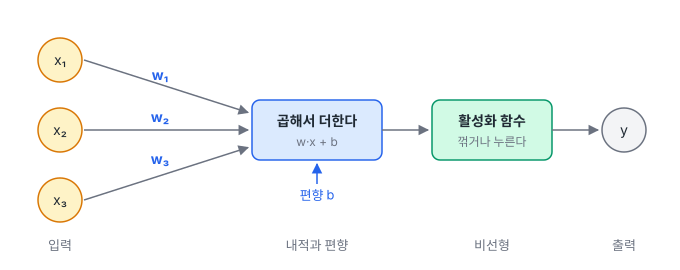
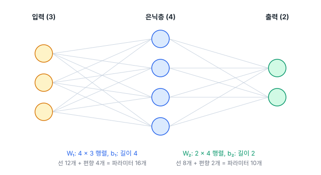
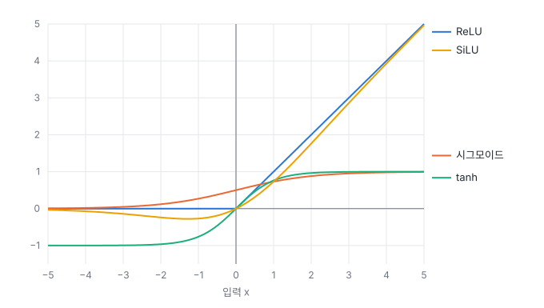
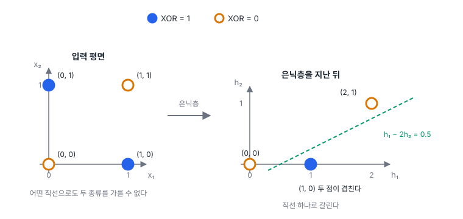
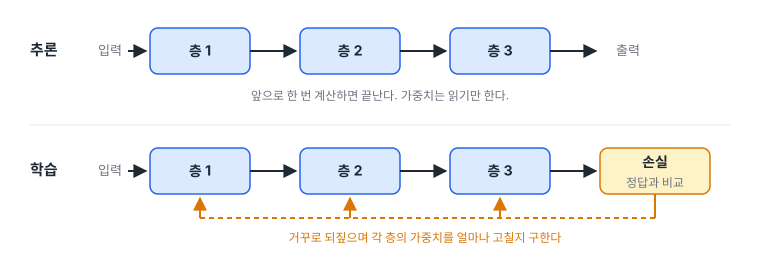

# 신경망은 함수다

[2장](ch02_math.md)에서 벡터와 행렬의 곱셈을 만들었습니다. 이 장에서는 그 연산들을 조립해
신경망(neural network)을 만듭니다. 신경망은 신비로운 것이 아닙니다. 행렬을
곱하고, 벡터를 더하고, 간단한 함수를 하나 통과시키는 일을 여러 번 반복하는
함수입니다.

이 장을 마치면 다음을 할 수 있습니다.

- 신경망의 층 하나가 하는 계산을 정확히 적는다.
- 층 사이에 왜 활성화 함수가 필요한지 설명한다.
- 여러 층으로 된 신경망의 순전파를 코드로 실행한다.
- 가중치가 어떤 과정으로 만들어지는지, 그리고 추론 엔진이 그 과정의 무엇을
  몰라도 되는지 설명한다.

이 장은 [2장](ch02_math.md)의 `matvec`과 허용 오차 비교 위에 서 있습니다. 코드는
`crates/badak_core/src/nn.rs`에 있습니다.

## 3.1 뉴런 하나

신경망의 가장 작은 단위는 뉴런(neuron)입니다. 뉴런 하나가 하는 일은 세
단계입니다.

1. 입력마다 가중치를 곱해 모두 더한다. [2장](ch02_math.md)에서 만든 내적입니다.
2. 편향(bias)이라는 숫자 하나를 더한다.
3. 결과를 활성화 함수(activation function)에 통과시킨다.



식으로 적으면 다음과 같습니다.

```text
y = f(w₁x₁ + w₂x₂ + w₃x₃ + b) = f(w · x + b)
```

[1장](ch01_landscape.md)에서 본 `y = w × x + b`와 거의 같습니다. 입력이 여러 개가 되어 곱셈이
내적으로 바뀌었고, 끝에 함수 `f`가 하나 붙었을 뿐입니다.

가중치 `w`는 각 입력을 얼마나 중요하게 볼지를 정합니다. 편향 `b`는 입력이
모두 0일 때의 출발점을 정합니다. 둘 다 학습으로 정해지는 숫자입니다.
활성화 함수 `f`가 무엇이고 왜 필요한지는 3.3절과 3.4절에서 다룹니다.

## 3.2 층: 뉴런을 한 줄로 세우기

뉴런 하나로는 할 수 있는 일이 적습니다. 그래서 같은 입력을 받는 뉴런을 여러
개 나란히 세웁니다. 이것이 층(layer)입니다. 뉴런이 4개면 출력도 4개가
나옵니다.



그림의 선 하나가 가중치 하나입니다. 입력 3개가 뉴런 4개에 모두 연결되므로
첫 층의 가중치는 12개이고, 뉴런마다 편향이 하나씩 있어 4개가 더해집니다.

여기서 [2장](ch02_math.md)이 쓰입니다. 뉴런마다 내적을 한 번씩 하는 것은 **행렬과 벡터의
곱**입니다. 뉴런 4개의 가중치를 한 행씩 쌓으면 `4 × 3` 행렬 `W`가 되고, 층
전체의 계산은 식 하나로 적힙니다.

```text
y = W x + b
```

이 계산을 하는 층을 선형 층(linear layer)이라고 합니다. 완전 연결
층(fully connected layer) 또는 밀집 층(dense layer)이라고도 부르며 모두
같은 것입니다.

```rust
{{#include ../../../crates/badak_core/src/nn.rs:linear}}
```

`forward`가 이 층의 순전파입니다. `matvec`으로 `W x`를 구하고 편향을
더합니다. 가중치 행렬의 형상이 `(출력 길이, 입력 길이)`라는 점에 유의하십시오.
행 하나가 뉴런 하나이기 때문입니다.

생성자는 가중치와 편향의 크기를 검사합니다. 모델 파일에서 읽어 온 숫자를
층에 넣을 때 크기가 어긋나면 여기서 바로 멈춥니다.

### 파라미터 수 세기

층의 파라미터 수는 다음과 같습니다.

```text
파라미터 수 = 출력 길이 × 입력 길이 + 출력 길이
              └──── 가중치 ────┘   └ 편향 ┘
```

모델의 크기를 말할 때 쓰는 "10억 파라미터" 같은 숫자는 이렇게 센 값을 모든
층에 대해 더한 것입니다. 파라미터 수에 숫자 하나의 크기를 곱하면 모델이
차지하는 메모리가 나옵니다. `f32`라면 파라미터 하나에 4바이트입니다.

예를 들어 보겠습니다. 가로세로 28픽셀인 흑백 사진(숫자 784개)을 받아 길이
128인 중간 벡터를 거쳐 10개의 점수를 내는 신경망이 있다고 합시다.

| 층 | 입력 길이 | 출력 길이 | 가중치 | 편향 | 파라미터 수 |
|---|---|---|---|---|---|
| 첫째 | 784 | 128 | 100,352 | 128 | 100,480 |
| 둘째 | 128 | 10 | 1,280 | 10 | 1,290 |
| 합계 | | | | | 101,770 |

약 10만 개의 숫자이고, `f32`로 약 400KB입니다. [7장](ch07_mnist.md)에서 실제로 이 정도
크기의 모델을 돌립니다.

같은 방식으로 계산량도 셀 수 있습니다. 선형 층의 순전파는 곱셈을 `출력
길이 × 입력 길이`번 합니다. 가중치마다 한 번씩입니다. 이 사실은 뒤에서
계속 쓰입니다. **선형 층 하나를 계산하려면 그 층의 가중치를 전부 한 번씩
읽어야 합니다.** 모델이 크면 읽어야 할 메모리도 그만큼 많고, [15장](../part3/ch15_bottleneck.md)에서
보듯 이것이 언어 모델의 속도를 결정하는 핵심 요인이 됩니다.

## 3.3 활성화 함수

활성화 함수는 층의 출력에 원소마다 적용하는 간단한 함수입니다. 벡터의 각
숫자를 따로따로 바꾸며, 벡터의 길이는 변하지 않습니다.

이 책에서 만나는 주요 활성화 함수는 다음과 같습니다.



| 이름 | 식 | 출력 범위 | 특징 |
|---|---|---|---|
| ReLU | `max(0, x)` | 0 이상 | 음수를 0으로 자른다. 가장 단순하고 계산이 싸다 |
| 시그모이드(sigmoid) | `1 / (1 + exp(−x))` | 0과 1 사이 | 값을 확률처럼 읽을 수 있게 누른다 |
| tanh | `tanh(x)` | −1과 1 사이 | 시그모이드와 모양이 같고 0을 중심으로 한다 |
| SiLU | `x × sigmoid(x)` | 약 −0.28 이상 | ReLU를 부드럽게 만든 모양. Swish라고도 한다[^silu] [^swish] |

```rust
{{#include ../../../crates/badak_core/src/nn.rs:activations}}
```

ReLU는 한 줄입니다. 시그모이드는 [2장](ch02_math.md)의 소프트맥스와 같은 함정이 있습니다.
`x`가 큰 음수이면 `exp(−x)`가 넘칩니다. 그래서 부호에 따라 수학적으로 같은
두 식 가운데 넘치지 않는 쪽을 골라 씁니다. 테스트에서 `sigmoid(-1000.0)`이
`NaN`이 아니라 0을 내는지 확인합니다.

이 밖에 GELU[^gelu]라는 함수도 널리 쓰입니다. 모양은 SiLU와 비슷합니다.
계산에 특수한 함수가 필요해서 이 장에서는 만들지 않고, 처음 필요해지는
[32장](../part4/ch32_vit_detection.md)에서 구현합니다.

어떤 활성화 함수를 쓸지는 모델을 설계하는 사람이 정합니다. 추론 엔진은
고를 수 없습니다. 모델이 SiLU로 학습되었으면 추론도 SiLU로 해야 같은 답이
나옵니다. 엔진이 할 일은 모델이 쓰는 함수를 정확하고 빠르게 계산하는
것입니다.

코드에서 종류를 고를 수 있도록 열거형으로 묶어 둡니다.

```rust
{{#include ../../../crates/badak_core/src/nn.rs:activation_enum}}
```

## 3.4 왜 활성화 함수가 필요한가

활성화 함수 없이 선형 층만 여러 개 쌓으면 어떻게 될까요. 결론부터 말하면
**아무리 많이 쌓아도 층 하나와 같습니다.**

선형 층 두 개를 이어 보겠습니다.

```text
h = W₁ x + b₁
y = W₂ h + b₂
  = W₂ (W₁ x + b₁) + b₂
  = (W₂ W₁) x + (W₂ b₁ + b₂)
```

마지막 줄을 보면 `W₂ W₁`은 그냥 행렬 하나이고 `W₂ b₁ + b₂`는 벡터
하나입니다. 층 두 개가 층 하나로 합쳐졌습니다. 테스트로 확인합니다. [2장](ch02_math.md)의
`matmul`로 두 가중치 행렬을 미리 곱해 층 하나를 만들고, 두 층을 차례로
통과시킨 결과와 비교합니다.

```rust
{{#include ../../../crates/badak_core/src/nn.rs:collapse_test}}
```

층 사이에 활성화 함수를 넣으면 이 합치기가 불가능해집니다. `W₂ f(W₁ x +
b₁)`에서 `f`가 가로막고 있어 두 행렬을 곱해 버릴 수 없습니다. 그래서 층을
쌓을수록 표현할 수 있는 함수가 실제로 늘어납니다. 활성화 함수가 직선이
아닌 함수여야 하는 이유이고, 그래서 이를 비선형성(nonlinearity)이라고
부릅니다.

> 방금 본 합치기는 추론 엔진의 최적화 기법이기도 합니다. 모델에 활성화
> 함수 없이 이어진 선형 연산이 있으면, 실행하기 전에 미리 곱해 하나로 합쳐
> 둘 수 있습니다. 가중치가 고정되어 있기 때문에 가능한 일입니다. [30장](../part4/ch30_graph_optimization.md)에서
> 이런 최적화를 다룹니다.

### XOR: 선형 층 하나로는 풀 수 없는 문제

비선형성이 무엇을 가능하게 하는지 보여 주는 고전적인 예가 XOR입니다.[^xor]
XOR은 두 입력이 서로 다를 때 1, 같을 때 0을 내는 함수입니다.

| x₁ | x₂ | XOR |
|---|---|---|
| 0 | 0 | 0 |
| 0 | 1 | 1 |
| 1 | 0 | 1 |
| 1 | 1 | 0 |

선형 층 하나로는 이 함수를 만들 수 없습니다. 아래 그림의 왼쪽이 그
이유입니다. 선형 층 하나가 할 수 있는 일은 평면에 직선 하나를 긋고 그
양쪽을 구분하는 것인데, 어떤 직선을 그어도 채워진 점 둘과 빈 점 둘을 가를
수 없습니다.



층을 하나 더 두고 그 사이에 ReLU를 넣으면 풀립니다. 첫 층은 입력을 다른
평면으로 옮깁니다. 그림의 오른쪽입니다. 옮겨진 평면에서는 채워진 두 점이
한곳에 겹치고, 직선 하나로 두 종류가 갈립니다. 둘째 층이 그 직선을
긋습니다.

입력과 출력 사이에 있는 층을 은닉층(hidden layer)이라고 합니다. 이 예에서
은닉층의 뉴런 두 개는 다음을 계산합니다.

```text
h₁ = relu(x₁ + x₂)        입력의 합
h₂ = relu(x₁ + x₂ − 1)    두 입력이 모두 1일 때만 1
y  = h₁ − 2 h₂
```

가중치를 손으로 정한 이 신경망을 코드로 옮기면 다음과 같습니다.

```rust
{{#include ../../../crates/badak_core/src/nn.rs:xor}}
```

실행해 봅니다.

```bash
cargo run --release -p badak_core --example ch03_xor
```

```text
{{#include output/ch03_xor.txt:1:6}}
```

네 가지 입력 모두에서 정답이 나옵니다. 같은 가중치에서 ReLU만 빼면 다음과
같이 됩니다.

```text
{{#include output/ch03_xor.txt:8:13}}
```

첫 줄부터 틀립니다. `h₂`가 `−1`이 되어도 0으로 잘리지 않기 때문입니다.
숫자 아홉 개와 ReLU 하나로 된 이 작은 모델이, 형태는 같지만 규모만 다른
수십억 파라미터 모델의 축소판입니다.

## 3.5 다층 퍼셉트론

선형 층을 차례로 쌓고 그 사이마다 활성화 함수를 넣은 신경망을 다층
퍼셉트론(multilayer perceptron, MLP)이라고 합니다. 가장 기본적인 신경망
구조이고, 방금 본 XOR 모델도 MLP입니다.

```rust
{{#include ../../../crates/badak_core/src/nn.rs:mlp}}
```

`forward`가 모델 전체의 순전파입니다. 층을 하나씩 통과시키며 벡터를
바꿔 나갑니다. 마지막 층 뒤에는 활성화 함수를 적용하지 않습니다. 마지막
층의 출력은 [2장](ch02_math.md)에서 본 점수(로짓)이고, 여기에 소프트맥스나 argmax를
적용하는 것은 모델 바깥의 후처리이기 때문입니다.

생성자는 이웃한 층의 크기가 이어지는지 검사합니다. 앞 층의 출력 길이와 뒤
층의 입력 길이가 다르면 행렬 곱의 형상 규칙이 깨집니다.

MLP는 충분히 큰 은닉층이 있으면 매우 넓은 범위의 함수를 원하는 만큼
가깝게 흉내 낼 수 있다는 것이 수학적으로 증명되어 있습니다.[^hornik] 다만
이 정리는 그런 가중치가 존재한다는 것만 말하고, 그 가중치를 찾는 방법은
알려 주지 않습니다. 찾는 일이 학습입니다.

MLP는 그 자체로도 쓰이지만, 더 큰 모델의 부품으로 더 자주 등장합니다.
[9장](../part2/ch09_transformer.md)에서 만들 언어 모델의 각 블록 안에는 MLP가 하나씩 들어 있고, 모델의
파라미터 대부분이 그 안에 있습니다.

## 3.6 가중치는 어디서 오는가

XOR 모델의 가중치는 손으로 정했습니다. 숫자가 아홉 개였으니 가능했습니다.
숫자가 10만 개, 10억 개가 되면 손으로는 불가능합니다. 이 숫자들은 학습으로
찾습니다. 이 책은 학습을 다루지 않지만, 가중치가 어디서 오는지 모르고서는
추론을 온전히 이해하기 어렵습니다. 그래서 가장 단순한 예로 한 번만
살펴봅니다.

### 학습의 세 요소

학습에는 세 가지가 필요합니다.

1. **데이터.** 입력과 정답의 쌍입니다.
2. **손실 함수(loss function).** 모델의 답이 정답에서 얼마나 먼지를 숫자
   하나로 나타냅니다. 클수록 많이 틀린 것입니다.
3. **가중치를 고치는 규칙.** 손실이 줄어드는 방향으로 가중치를 조금씩
   옮깁니다.

셋째에 쓰이는 표준적인 방법이 경사 하강법(gradient descent)입니다. 각
가중치에 대해 "이 숫자를 조금 키우면 손실이 얼마나 변하는가"를 구합니다.
이 값을 기울기(gradient)라고 합니다. 기울기가 양수이면 그 가중치를 키울수록
손실이 커진다는 뜻이므로 가중치를 줄이고, 음수이면 늘립니다. 한 번에
움직이는 폭을 학습률(learning rate)이라고 합니다.

### 숫자 두 개를 학습으로 찾기

[1장](ch01_landscape.md)의 함수 `y = w x + b`를 다시 꺼냅니다. `y = 2x + 1`에서 뽑은 데이터
11개를 주고, `w`와 `b`를 모두 0에서 시작해 경사 하강법으로 찾게 합니다.
모델은 정답이 `w = 2`, `b = 1`이라는 것을 모릅니다.

```rust
{{#include ../../../crates/badak_core/examples/ch03_training.rs:training}}
```

```bash
cargo run --release -p badak_core --example ch03_training
```

```text
{{#include output/ch03_training.txt}}
```

손실이 41에서 시작해 단계마다 줄어들고, `w`와 `b`가 정답인 2와 1로
다가갑니다. 200단계쯤에서 손실이 사실상 0이 됩니다. 이것이 학습의
전부입니다. 실제 모델의 학습은 숫자가 두 개가 아니라 수십억 개이고,
데이터가 11개가 아니라 수조 개일 뿐 하는 일은 같습니다.

### 여러 층의 기울기 구하기

숫자가 두 개일 때는 기울기 식을 손으로 유도할 수 있었습니다. 층이 여러
개이면 앞쪽 층의 가중치가 손실에 미치는 영향을 구하기가 복잡해집니다. 이를
효율적으로 계산하는 방법이 역전파(backpropagation)입니다.[^backprop] 출력
쪽에서 시작해 층을 거꾸로 되짚으며, 각 층의 기울기를 뒤 층의 기울기에서
이어 계산합니다.



거꾸로 되짚으려면 앞으로 갈 때 각 층이 내놓았던 중간값을 모두 기억하고
있어야 합니다. 학습이 추론보다 메모리를 훨씬 많이 쓰는 이유입니다.

### 추론 엔진이 몰라도 되는 것

이제 [1장](ch01_landscape.md)의 표를 구체적으로 다시 읽을 수 있습니다.

| | 학습에 필요 | 추론에 필요 |
|---|---|---|
| 순전파 | 예 | 예 |
| 손실 함수와 정답 | 예 | 아니오 |
| 기울기 계산(역전파) | 예 | 아니오 |
| 모든 층의 중간값 보관 | 예 | 아니오. 다음 층에 넘기면 버려도 된다 |
| 가중치 수정 | 예 | 아니오. 읽기만 한다 |

추론 엔진은 이 표의 오른쪽 열만 구현합니다. 그리고 "아니오"인 항목
하나하나가 최적화의 기회가 됩니다.

- 중간값을 버려도 되므로, 같은 메모리를 여러 층이 돌려 쓸 수 있습니다.
  ([26장](../part4/ch26_graph_interpreter.md)의 메모리 계획)
- 가중치가 바뀌지 않으므로, 파일을 메모리에 그대로 비춰 쓰거나([6장](ch06_model_files.md)) 숫자의
  정밀도를 낮춰 저장할 수 있습니다. ([19장](../part3/ch19_quantization_theory.md)의 양자화)
- 계산 순서가 미리 정해져 있으므로, 실행 전에 연산을 합치거나 순서를 바꿀
  수 있습니다. ([30장](../part4/ch30_graph_optimization.md)의 그래프 최적화)

학습이 끝나면 가중치를 파일로 저장합니다. 추론 엔진이 받는 모델 파일이
그것입니다. 파일의 형식은 [6장](ch06_model_files.md)에서 다룹니다.

## 3.7 실전 엔진에서는

이 장에서 만든 선형 층은 모든 프레임워크와 엔진에 있습니다. 이름과 세부
사항이 조금씩 다를 뿐입니다.

| | 이름 | 알아 둘 점 |
|---|---|---|
| badak | `Linear` | 가중치의 형상은 `(출력 길이, 입력 길이)` |
| PyTorch | `torch.nn.Linear` | 가중치의 형상이 우리와 같은 `(out_features, in_features)`[^pytorch-linear] |
| LiteRT | `FULLY_CONNECTED` | 활성화 함수를 층에 붙여 한 연산으로 처리하는 `fused_activation_function` 옵션이 있다[^litert-fc] |
| ONNX | `Gemm` | `Y = alpha × A′ × B′ + beta × C`. [2장](ch02_math.md)에서 본 BLAS의 GEMM에 편향 덧셈을 합친 연산이다[^onnx-gemm] |

두 가지를 눈여겨볼 만합니다.

**가중치 형상이 PyTorch와 같습니다.** 우연이 아닙니다. 우리는 PyTorch로
학습한 모델의 가중치를 읽어 올 것이므로, 같은 약속을 써야 파일의 숫자를
변환 없이 그대로 쓸 수 있습니다. [7장](ch07_mnist.md)에서 실제로 그렇게 합니다.

**LiteRT는 활성화 함수를 선형 층에 합칩니다.** 선형 층의 결과를 메모리에
썼다가 다시 읽어 ReLU를 적용하는 대신, 결과를 쓰기 직전에 ReLU까지 적용해
버립니다. 메모리를 한 번 덜 오갑니다. 이런 기법을 융합(fusion)이라고
하며, [24장](../part3/ch24_attention.md)과 [30장](../part4/ch30_graph_optimization.md)에서 직접 구현합니다. 지금 우리의 `Mlp::forward`는 층의
결과를 벡터로 만든 뒤 다시 훑으며 활성화 함수를 적용하므로, 이 최적화가
빠져 있는 상태입니다.

## 정리

- 뉴런은 내적, 편향 덧셈, 활성화 함수의 세 단계로 계산합니다.
- 층은 뉴런을 나란히 세운 것이고, 계산은 `y = W x + b`입니다. 가중치의
  형상은 `(출력 길이, 입력 길이)`입니다.
- 선형 층의 파라미터 수는 `출력 × 입력 + 출력`이고, 순전파는 가중치마다
  곱셈을 한 번씩 합니다.
- 활성화 함수가 없으면 여러 층이 층 하나로 합쳐집니다. 비선형성이 있어야
  층을 쌓는 의미가 있습니다.
- MLP는 선형 층과 활성화 함수를 번갈아 쌓은 구조이며, 더 큰 모델의 부품으로
  널리 쓰입니다.
- 가중치는 학습으로 찾습니다. 손실이 줄어드는 방향으로 가중치를 조금씩
  고치는 일을 반복합니다.
- 추론은 순전파만 하고, 중간값을 버려도 되며, 가중치를 읽기만 합니다. 이
  제약이 추론 엔진이 하는 최적화의 근거입니다.

## 연습 문제

1. 입력 길이 4096, 출력 길이 4096인 선형 층의 파라미터 수와 `f32`로
   저장했을 때의 크기를 구해 보십시오. 이 층의 순전파에서 곱셈은 몇 번
   일어납니까.
2. XOR 모델에서 활성화 함수를 ReLU 대신 시그모이드로 바꾸면 같은 가중치로도
   정답이 나옵니까. 예측해 본 뒤 `Activation::Sigmoid`로 바꿔 실행해
   확인하고, 결과를 설명해 보십시오.
3. `xor_mlp`와 같은 방식으로, 두 입력이 모두 1일 때만 1을 내는 AND 모델을
   만들어 보십시오. 은닉층이 필요합니까. 그림을 그려 판단해 보십시오.
4. 3.4절에서 선형 층 두 개가 하나로 합쳐지는 것을 보였습니다. 선형 층 세
   개를 하나로 합친 가중치와 편향의 식을 유도하고, 테스트를 작성해 확인해
   보십시오.
5. `ch03_training` 예제에서 학습률을 `0.02`에서 `0.1`로 올려 실행해
   보십시오. 그다음 `0.11`로도 실행해 보십시오. 무슨 일이 일어나며, 왜
   그럴지 추측해 보십시오.
6. `Mlp::forward`는 층마다 새 벡터를 만듭니다. 3.6절의 "중간값을 버려도
   된다"는 성질을 이용하면 필요한 벡터를 몇 개까지 줄일 수 있겠습니까.
   ([26장](../part4/ch26_graph_interpreter.md)에서 답합니다.)

## 참고 문헌

[^silu]: S. Elfwing, E. Uchibe, K. Doya, "Sigmoid-Weighted Linear Units for
    Neural Network Function Approximation in Reinforcement Learning", 2017.
    [arXiv:1702.03118](https://arxiv.org/abs/1702.03118). SiLU라는 이름이
    나온 논문입니다.

[^swish]: P. Ramachandran, B. Zoph, Q. V. Le, "Searching for Activation
    Functions", 2017. [arXiv:1710.05941](https://arxiv.org/abs/1710.05941).
    같은 함수를 Swish라는 이름으로 제안하고 여러 모델에서 ReLU와 비교한
    논문입니다.

[^gelu]: D. Hendrycks, K. Gimpel, "Gaussian Error Linear Units (GELUs)",
    2016. [arXiv:1606.08415](https://arxiv.org/abs/1606.08415)

[^xor]: I. Goodfellow, Y. Bengio, A. Courville, *Deep Learning*, MIT Press,
    2016, 6.1절 "Example: Learning XOR". 이 장의 XOR 모델과 같은 구조를
    자세히 풀이합니다.
    <https://www.deeplearningbook.org/contents/mlp.html> (2026-11-16 확인)

[^hornik]: K. Hornik, M. Stinchcombe, H. White, "Multilayer feedforward
    networks are universal approximators", *Neural Networks*, 2(5),
    359-366, 1989.
    [doi:10.1016/0893-6080(89)90020-8](https://doi.org/10.1016/0893-6080(89)90020-8)

[^backprop]: D. E. Rumelhart, G. E. Hinton, R. J. Williams, "Learning
    representations by back-propagating errors", *Nature*, 323, 533-536,
    1986. [doi:10.1038/323533a0](https://doi.org/10.1038/323533a0)

[^pytorch-linear]: PyTorch, `torch/nn/modules/linear.py`의 `Linear` 클래스
    문서 주석(커밋 `11b971398ac9`).
    <https://github.com/pytorch/pytorch/blob/11b971398ac9/torch/nn/modules/linear.py>

[^litert-fc]: LiteRT, `tflite/converter/schema/schema.fbs`의
    `FullyConnectedOptions` 테이블(커밋 `ee2d1defa34d`).
    <https://github.com/google-ai-edge/LiteRT/blob/ee2d1defa34d/tflite/converter/schema/schema.fbs>

[^onnx-gemm]: ONNX, `docs/Operators.md`의 Gemm 연산자 정의(커밋
    `c7609c4ad544`).
    <https://github.com/onnx/onnx/blob/c7609c4ad544/docs/Operators.md#Gemm>
