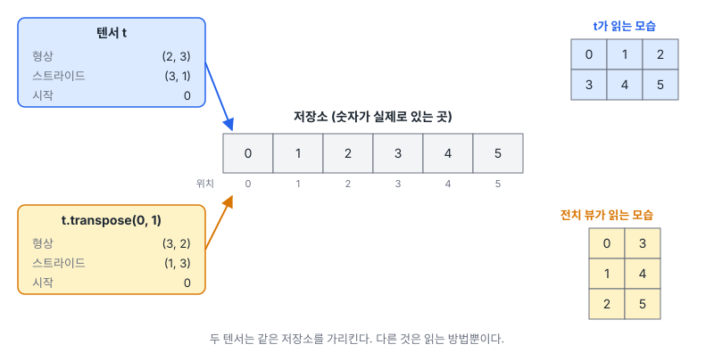
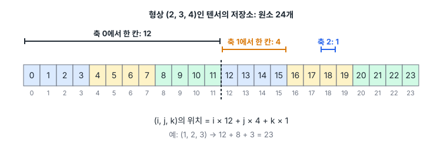
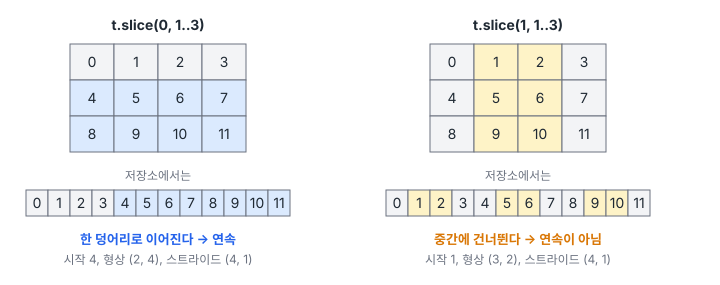
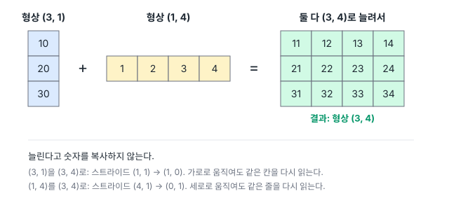

# 텐서 만들기

[2장](ch02_math.md)과 [3장](ch03_neural_networks.md)에서는 벡터와 행렬을 `&[f32]`와 행·열 개수로 따로 들고 다녔습니다.
`matmul(&a, &b, m, k, n)`처럼 숫자 세 개를 순서대로 넘기는 방식은 금세
한계에 닿습니다. 실제 모델의 데이터는 3차원, 4차원이 흔하고, 숫자의
종류도 실수만이 아닙니다.

이 장에서는 추론 엔진의 가장 기본이 되는 자료구조인 텐서(tensor)를
만듭니다. [2장](ch02_math.md)에서 텐서를 "형상이 붙어 있는 숫자 배열"이라고 했습니다. 이
장의 핵심은 그 문장을 구현하는 한 가지 설계입니다.

> 숫자가 들어 있는 저장소와, 그 저장소를 읽는 방법을 분리한다.

이렇게 나누면 전치, 자르기, 형상 바꾸기 같은 연산을 **숫자를 하나도 옮기지
않고** 할 수 있습니다. 64MiB짜리 텐서의 전치가 0.0001밀리초에 끝납니다. 이
장의 끝에서 직접 잽니다.

이 장은 [2장](ch02_math.md)의 행 우선 순서와 위치 공식 위에 서 있습니다. 코드는
`crates/badak_core/src/`의 `tensor.rs`와 `error.rs`에 있습니다.

## 4.1 텐서의 구조

텐서는 두 부분으로 이루어집니다.

- **저장소(storage)**: 숫자가 실제로 한 줄로 들어 있는 메모리.
- **메타데이터(metadata)**: 저장소를 어떻게 읽을지 적어 둔 몇 개의 숫자.



그림에서 텐서 `t`와 그 전치는 같은 저장소를 가리킵니다. 두 텐서가 다른
것은 메타데이터뿐입니다. 메타데이터는 다음 네 가지입니다.

| 항목 | 뜻 |
|---|---|
| 형상(shape) | 각 축의 길이 |
| 스트라이드(stride) | 각 축에서 한 칸 움직일 때 저장소에서 건너뛰는 원소 수 |
| 시작 위치(offset) | 첫 원소가 저장소의 몇 번째에 있는지 |
| 자료형(dtype) | 원소 하나가 어떤 종류의 숫자인지 |

```rust
{{#include ../../../crates/badak_core/src/tensor.rs:tensor}}
```

저장소를 `Arc`로 감쌌습니다. `Arc`는 여러 곳에서 함께 소유할 수 있는
포인터로, 마지막 소유자가 사라질 때 메모리를 해제합니다. 덕분에 텐서를
복제해도 저장소는 복사되지 않고 가리키는 텐서의 수만 하나 늘어납니다.

> 구조체에 보이는 `Handle`과 `Dims`는 [22장](../part3/ch22_memory.md)에서 들어온 것입니다. `Handle`은
> `Arc<Storage>`를 감싼 것이고, `Dims`는 수 몇 개를 담는 짧은 목록으로
> `Vec<usize>`와 같은 방법으로 씁니다. [22장](../part3/ch22_memory.md)까지는 각각 `Arc<Storage>`와
> `Vec<usize>`로 읽으면 됩니다. 이 책을 처음 쓸 때는 실제로 그랬습니다.

## 4.2 자료형

지금까지는 `f32`만 썼지만 추론에는 다른 종류의 숫자도 필요합니다.

```rust
{{#include ../../../crates/badak_core/src/tensor.rs:dtype}}
```

| 자료형 | 크기 | 쓰이는 곳 |
|---|---|---|
| `f32` | 4바이트 | 가중치와 중간 계산 |
| `i32` | 4바이트 | 언어 모델의 토큰 번호, 위치 |
| `u8` | 1바이트 | 사진의 픽셀 값 |

자료형은 책이 진행되면서 늘어납니다. [19장](../part3/ch19_quantization_theory.md)에서 16비트 실수를, 29장에서 8비트
부호 있는 정수를 추가합니다. 모델을 작게 만드는 양자화가 바로 "더 작은
자료형으로 저장하는 것"이기 때문에, 자료형은 뒤로 갈수록 중요해집니다.

### 자료형을 언제 정하는가

Rust로 텐서를 설계할 때 갈림길이 하나 있습니다. 자료형을 컴파일할 때
정할 것인가, 실행할 때 정할 것인가입니다.

| | 컴파일 시점: `Tensor<f32>` | 실행 시점: `Tensor` + `DType` |
|---|---|---|
| 자료형이 틀리면 | 컴파일 오류 | 실행 중 오류 |
| 여러 자료형의 텐서를 한 목록에 | 담기 어렵다 | 담을 수 있다 |
| 모델 파일에서 읽기 | 파일을 열기 전에 타입을 알아야 한다 | 파일에 적힌 대로 만든다 |

우리는 실행 시점을 택합니다. 추론 엔진은 모델 파일을 열어 봐야 텐서의
자료형을 알 수 있기 때문입니다. 같은 엔진이 어떤 파일에서는 `f32`
가중치를, 다른 파일에서는 8비트 정수 가중치를 읽습니다. 26장에서 만들
그래프 해석기는 자료형이 제각각인 텐서 수백 개를 한 목록에 담아 다룹니다.

저장소는 자료형마다 벡터를 하나씩 가진 열거형입니다.

```rust
{{#include ../../../crates/badak_core/src/tensor.rs:storage}}
    }
```

실행 시점에 자료형을 정하더라도, 숫자를 꺼내 계산하는 코드는 구체적인
타입이 필요합니다. 그 다리 역할을 하는 것이 `Element` 트레이트입니다.

```rust
{{#include ../../../crates/badak_core/src/tensor.rs:element}}
```

이 트레이트 덕분에 `tensor.to_vec::<f32>()`처럼 원하는 타입을 지정해 꺼낼
수 있고, 텐서의 실제 자료형과 다르면 오류가 납니다. `Element`는 우리가
정한 세 타입에만 구현되어 있으며 크레이트 밖에서는 구현할 수 없게 막아
두었습니다. 저장소의 열거형과 짝이 맞아야 하기 때문입니다.

### 패닉 대신 오류

[2장](ch02_math.md)과 [3장](ch03_neural_networks.md)에서는 형상이 맞지 않으면 `assert!`로 프로그램을 멈췄습니다.
텐서부터는 `Result`로 오류를 돌려줍니다. 형상과 자료형은 모델 파일과
사용자의 입력에 따라 정해지므로, 맞지 않는 것은 프로그램의 버그가 아니라
실행 중에 얼마든지 생길 수 있는 상황이기 때문입니다. 엔진을 쓰는
프로그램이 "이 모델 파일은 잘못되었습니다"라고 사용자에게 알릴 기회를
가져야 합니다.

```rust
{{#include ../../../crates/badak_core/src/error.rs:error}}
```

오류마다 무엇이 기대와 달랐는지를 담습니다. 형상 오류는 추론 코드에서
가장 자주 만나는 오류이고, "형상이 맞지 않습니다"라고만 하는 메시지와
"형상 `[3, 4]`와 `[5, 2]`는 맞지 않습니다"라고 하는 메시지는 디버깅
시간에서 큰 차이를 만듭니다.

## 4.3 텐서 만들기와 원소 읽기

벡터와 형상을 주면 텐서가 됩니다. 원소 수가 형상과 맞는지 검사합니다.

```rust
{{#include ../../../crates/badak_core/src/tensor.rs:from_vec}}
```

### 스트라이드

갓 만든 텐서의 스트라이드는 형상에서 계산됩니다. [2장](ch02_math.md)에서 2차원 행렬의
`(i, j)` 원소가 `i × 열 수 + j`번째에 있다고 했습니다. 스트라이드는 이
공식을 몇 차원에든 쓸 수 있게 일반화한 것입니다.



마지막 축에서 한 칸 움직이면 저장소에서도 한 칸 움직입니다. 그 앞 축에서
한 칸 움직이면 마지막 축의 길이만큼 건너뜁니다. 일반적으로 어떤 축의
스트라이드는 그 뒤에 있는 모든 축의 길이를 곱한 값입니다.

```rust
{{#include ../../../crates/badak_core/src/tensor.rs:contiguous_strides}}
```

원소의 위치는 축마다 `위치 × 스트라이드`를 구해 더하고, 시작 위치를 더한
값입니다.

```text
저장소에서의 위치 = 시작 위치 + i₀ × 스트라이드₀ + i₁ × 스트라이드₁ + ...
```

```rust
{{#include ../../../crates/badak_core/src/tensor.rs:get}}
```

이 공식이 이 장의 전부라고 해도 지나치지 않습니다. 뒤에 나오는 모든 뷰
연산은 **이 공식에 들어가는 숫자만 바꿔서** 같은 저장소를 다르게 읽는
방법입니다.

> 우리의 스트라이드는 원소 수를 단위로 셉니다. NumPy는 바이트 수를 단위로
> 셉니다.[^numpy-ndarray] 같은 개념이고 단위만 다릅니다. 다른 구현의
> 스트라이드를 읽을 때는 단위를 먼저 확인하십시오.

## 4.4 뷰: 숫자를 옮기지 않는 연산

저장소를 공유하면서 메타데이터만 다른 텐서를 뷰(view)라고 합니다. 뷰를
만드는 연산은 텐서의 크기와 무관하게 순식간에 끝납니다.

다음 예제는 `3 × 4` 텐서에 뷰 연산을 적용하며 메타데이터의 변화를
보여 줍니다.

```bash
cargo run --release -p badak_core --example ch04_tensor
```

```text
{{#include output/ch04_tensor.txt:1:6}}
```

가로로 긴 출력이니 열을 하나씩 짚어 보십시오. `공유`는 원본과 같은 저장소를
가리키는지, `연속`은 4.5절에서 설명할 성질입니다. 마지막 줄을 뺀 모든
연산이 저장소를 공유합니다. 아래에서 하나씩 살펴봅니다.

### 형상 바꾸기

`reshape`는 같은 원소를 다른 형상으로 읽습니다. `3 × 4`를 `2 × 6`으로 읽어도
저장소에 놓인 순서는 그대로이므로, 형상과 스트라이드만 새로 계산하면
됩니다.

```rust
{{#include ../../../crates/badak_core/src/tensor.rs:reshape}}
```

원소 수가 같아야 하고, 텐서가 "연속"이어야 합니다. 둘째 조건은 4.5절에서
설명합니다.

### 축 바꾸기

전치는 두 축을 맞바꿉니다. 형상과 스트라이드에서 해당하는 두 숫자의 자리를
바꾸는 것으로 끝납니다. 위 출력에서 `transpose(0, 1)`의 스트라이드가
`[4, 1]`에서 `[1, 4]`로 바뀐 것을 볼 수 있습니다.

왜 이것으로 충분한지는 위치 공식을 보면 알 수 있습니다. 원래 텐서에서
`(i, j)`는 `i × 4 + j × 1`에 있습니다. 전치한 텐서에서 `(j, i)`를 읽으면
스트라이드가 `(1, 4)`이므로 `j × 1 + i × 4`, 같은 자리입니다.

```rust
{{#include ../../../crates/badak_core/src/tensor.rs:permute}}
```

`permute`는 전치를 일반화해 축의 순서를 마음대로 바꿉니다. 사진 데이터를
"세로, 가로, 색" 순서에서 "색, 세로, 가로" 순서로 바꾸는 데 쓰이며,
27장에서 다시 만납니다.

[2장](ch02_math.md)의 `transpose`는 새 벡터를 만들어 숫자를 하나씩 옮겼습니다. 테스트에서
두 구현이 같은 결과를 내는지 확인합니다. [2장](ch02_math.md)에서 "실제 엔진은 전치를 할 때
숫자를 옮기지 않고 읽는 순서만 바꾼다"고 한 것이 이것입니다.

### 자르기

`slice`는 한 축에서 일부 구간만 남깁니다. 그 축의 길이를 줄이고, 시작
위치를 구간의 시작만큼 옮깁니다.

```rust
{{#include ../../../crates/badak_core/src/tensor.rs:slice}}
```



어느 축을 자르느냐에 따라 결과의 성질이 다릅니다. 행을 자르면 남은 원소가
저장소에서 한 덩어리로 이어지지만, 열을 자르면 중간중간을 건너뛰게 됩니다.

### 길이 1인 축 넣고 빼기

`unsqueeze`는 길이 1인 축을 끼워 넣고, `squeeze`는 없앱니다. 원소 수는
변하지 않고 형상의 표기만 달라집니다. 사진 한 장 `(3, 224, 224)`를 "사진
[1장](ch01_landscape.md)짜리 묶음" `(1, 3, 224, 224)`로 바꾸는 것이 대표적인 쓰임입니다.

```rust
{{#include ../../../crates/badak_core/src/tensor.rs:squeeze}}
```

## 4.5 연속인 텐서와 아닌 텐서

뷰는 공짜처럼 보이지만 대가가 있습니다. 뷰의 원소들은 저장소에서 순서대로
이어져 있지 않을 수 있습니다.

텐서를 행 우선으로 읽을 때 저장소를 처음부터 끝까지 한 칸씩 차례로 지나가게
되면 그 텐서를 연속(contiguous)이라고 합니다. 갓 만든 텐서는 연속입니다.
전치한 텐서는 연속이 아닙니다. 행 우선으로 읽으면 저장소의 0, 4, 8, 1, 5,
9 ... 순서로 뛰어다닙니다.

판별은 간단합니다. 스트라이드가 "형상에서 계산한 스트라이드"와 같은지
봅니다.

```rust
{{#include ../../../crates/badak_core/src/tensor.rs:is_contiguous}}
```

연속인지가 중요한 이유는 두 가지입니다.

**첫째, 슬라이스로 빌려줄 수 있습니다.** 연속인 텐서의 원소들은 저장소의 한
구간이므로 `&[f32]`로 그대로 내줄 수 있습니다. [2장](ch02_math.md)의 `dot`이나 `matmul`
같은 함수에 복사 없이 넘길 수 있다는 뜻입니다. 빠른 커널은 모두 연속인
메모리를 전제로 합니다.

```rust
{{#include ../../../crates/badak_core/src/tensor.rs:as_slice}}
```

**둘째, 빠릅니다.** CPU는 메모리를 순서대로 읽을 때 가장 빠릅니다. 이
효과는 4.7절에서 잽니다.

연속이 아닌 텐서의 원소를 순서대로 읽으려면 스트라이드를 따라가는 반복자가
필요합니다.

```rust
{{#include ../../../crates/badak_core/src/tensor.rs:iter_struct}}
```

자동차의 주행 거리계와 같은 방식입니다. 마지막 축을 한 칸 올리고, 끝에
닿으면 0으로 되돌리면서 앞 축을 한 칸 올립니다. 그때마다 저장소에서의
위치를 스트라이드만큼 더하거나 빼서 따라갑니다.

연속이 아닌 텐서를 연속으로 만들려면 원소를 새 저장소에 순서대로
복사합니다. 이미 연속이면 아무것도 하지 않습니다.

```rust
{{#include ../../../crates/badak_core/src/tensor.rs:contiguous}}
```

이제 `reshape`가 연속을 요구하는 이유를 알 수 있습니다. 전치한 `4 × 3`
텐서를 길이 12인 벡터로 읽고 싶다고 합시다. 기대하는 순서는 0, 4, 8, 1,
... 인데, 저장소에는 0, 1, 2, 3, ... 순서로 놓여 있습니다. 어떤 스트라이드
하나로도 이 순서를 표현할 수 없습니다. 그래서 먼저 `contiguous()`로
복사해야 합니다. 조용히 복사해 주는 대신 오류를 내도록 한 것은 의도한
설계입니다. 복사는 비싼 연산이므로 코드에 드러나 있어야 합니다.

위 예제 출력의 마지막 줄이 그 경우입니다.

```text
{{#include output/ch04_tensor.txt:6:6}}
```

스트라이드가 `[3, 1]`로 돌아왔고, `공유`가 `false`입니다. 새 저장소가
만들어졌습니다.

## 4.6 브로드캐스팅

형상이 다른 두 텐서를 계산해야 할 때가 많습니다. [3장](ch03_neural_networks.md)의 선형 층에서 편향을
더한 것이 그 예입니다. 출력이 한 번에 32개 묶음으로 나와 형상이 `(32,
10)`이고 편향의 형상이 `(10)`이라면, 편향을 32번 반복해 더해야 합니다.

이처럼 작은 텐서를 큰 텐서의 형상에 맞춰 늘려 쓰는 규칙을
브로드캐스팅(broadcasting)이라고 합니다. NumPy가 정착시킨 규칙이고
PyTorch를 비롯한 거의 모든 프레임워크가 따릅니다.[^numpy-broadcasting]

규칙은 두 줄입니다.

1. 두 형상을 **오른쪽 끝에 맞춰** 나란히 놓는다. 차원 수가 모자란 쪽은 앞에
   1이 있는 것으로 본다.
2. 축마다 비교해, 길이가 **같거나 한쪽이 1이면** 맞는 것이다. 결과의 길이는
   둘 중 큰 쪽이다. 둘 다 아니면 오류다.

| 왼쪽 | 오른쪽 | 맞춰 놓으면 | 결과 |
|---|---|---|---|
| `(3, 1)` | `(1, 4)` | `(3, 1)`과 `(1, 4)` | `(3, 4)` |
| `(32, 10)` | `(10)` | `(32, 10)`과 `(1, 10)` | `(32, 10)` |
| `(2, 1, 4)` | `(3, 1)` | `(2, 1, 4)`와 `(1, 3, 1)` | `(2, 3, 4)` |
| `(3)` | `(4)` | `(3)`과 `(4)` | 오류 |

```rust
{{#include ../../../crates/badak_core/src/tensor.rs:broadcast_shapes}}
```



### 스트라이드 0

늘린다고 해서 숫자를 복사할 필요는 없습니다. 길이 1인 축을 길이 4로 늘린다는
것은 "그 축에서 어디를 읽든 같은 원소가 나온다"는 뜻입니다. 위치 공식에서
그 축의 스트라이드를 **0**으로 두면 정확히 그렇게 됩니다. 아무리 움직여도
위치가 변하지 않습니다.

```rust
{{#include ../../../crates/badak_core/src/tensor.rs:broadcast_to}}
```

```text
{{#include output/ch04_tensor.txt:8:9}}
```

저장소에는 숫자가 세 개뿐인데, 뷰를 읽으면 열두 개가 나옵니다. 스트라이드
`[1, 0]`이 그 일을 합니다. 브로드캐스팅도 뷰입니다.

브로드캐스팅을 실제 덧셈과 곱셈에 적용하는 것은 [5장](ch05_operators.md)에서 합니다. 두 입력을
같은 형상의 뷰로 늘린 다음 원소끼리 계산하면 됩니다.

## 4.7 측정: 뷰의 값과 대가

뷰가 얼마나 싼지, 그리고 연속이 아닌 메모리를 읽는 것이 얼마나 비싼지 재
봅니다. `4096 × 4096` `f32` 텐서(64MiB)로 실험합니다.

```bash
cargo run --release -p badak_core --example ch04_view_cost
```

기준 기계(Apple M4 Max)에서의 결과입니다.

```text
{{#include output/ch04_view_cost.txt}}
```

두 가지를 읽을 수 있습니다.

**뷰는 복사보다 약 50만 배 쌉니다.** 전치 뷰를 만드는 데는 125나노초가
걸리고, 같은 결과를 새 저장소에 복사해 만드는 데는 62밀리초가 걸립니다.
뷰를 만드는 시간은 텐서의 크기와 무관합니다. 숫자 몇 개와 `Arc`의 참조
횟수만 건드리기 때문입니다.

**읽는 순서가 속도를 바꿉니다.** 같은 1,677만 개의 숫자를 더하는데 방법에
따라 여섯 배 넘게 차이가 납니다.

| 읽는 방법 | 메모리 | 원소를 찾는 방법 |
|---|---|---|
| 원본을 슬라이스로 | 연속 | 단순한 반복문. 포인터만 한 칸씩 옮긴다 |
| 원본을 반복자로 | 연속 | 원소마다 주행 거리계를 돌린다 |
| 전치 뷰를 반복자로 | 4096칸씩 건너뜀 | 원소마다 주행 거리계를 돌린다 |
| 전치 후 복사본을 반복자로 | 연속 (복사해서 되찾음) | 원소마다 주행 거리계를 돌린다 |

첫째와 둘째 줄의 차이는 반복자의 비용입니다. 스트라이드를 따라가는 범용
반복자는 원소마다 축 번호를 올리고 비교하는 일을 합니다. 연속인 메모리를
아는 코드는 그런 일 없이 포인터만 한 칸씩 옮깁니다. [5장](ch05_operators.md)에서 연산자를 만들
때 "연속이면 슬라이스로 처리하는 빠른 길"을 따로 두는 이유입니다.

둘째와 셋째 줄의 차이는 메모리 접근 순서의 비용입니다. 같은 반복자,
같은 숫자인데 읽는 순서만으로 두 배 넘게 느려집니다. CPU와 메모리 사이에는
최근에 읽은 근처의 데이터를 보관해 두는 캐시(cache)가 있고, 순서대로 읽으면
다음에 읽을 숫자가 이미 캐시에 와 있습니다. 4096칸씩 건너뛰면 그 도움을
받지 못합니다. 캐시가 어떻게 동작하고 이를 어떻게 이용하는지는 [16장](../part3/ch16_matmul.md)의
주제입니다.

여기서 실용적인 원칙이 하나 나옵니다.

> 뷰는 만들 때는 공짜지만 읽을 때 대가를 치를 수 있다. 여러 번 읽을 텐서는
> 한 번 복사해 연속으로 만들어 두는 편이 이득이다.

위 표에서 전치 뷰를 한 번 복사하는 데 62밀리초가 들지만, 그 뒤로는 읽을
때마다 약 26밀리초를 아낍니다. 세 번만 읽어도 본전입니다.

> 이 측정은 초시계로 재는 수준의 거친 측정입니다. 측정을 제대로 설계하는
> 법은 [14장](../part3/ch14_measurement.md)에서 다룹니다.

## 4.8 실전 엔진에서는

저장소와 메타데이터를 나누는 설계는 수치 계산 라이브러리의 표준입니다.
NumPy가 이 구조를 널리 퍼뜨렸고,[^numpy-nature] PyTorch의 텐서도 같은
구조여서 뷰를 만드는 연산과 복사하는 연산을 문서에서 구분해
안내합니다.[^pytorch-view]

추론 엔진들은 이 설계를 필요한 만큼만 가져갑니다. 두 엔진을 비교해 보면
흥미롭습니다.

| | badak | llama.cpp (ggml) | LiteRT |
|---|---|---|---|
| 형상 | `shape` | `ne` | `dims` |
| 스트라이드 | `strides` (원소 단위) | `nb` (바이트 단위) | 없음 |
| 뷰 | 저장소 공유 | `view_src`로 원본 텐서를 가리킴 | 없음 |
| 자료형 | 실행 시점 | 실행 시점 | 실행 시점 |

**llama.cpp**가 쓰는 텐서 라이브러리 ggml의 텐서는 우리와 같은 구조입니다.
형상과 스트라이드를 갖고, 뷰는 원본 텐서를 가리킵니다.[^ggml] 한 가지
주의할 점은 축의 순서입니다. ggml은 가장 빨리 변하는 축을 맨 앞(`ne[0]`)에
적습니다. 우리와 PyTorch는 맨 뒤에 적습니다. 같은 텐서의 형상이 반대
순서로 표기되므로, llama.cpp의 코드를 읽을 때 가장 헷갈리는 부분입니다.

**LiteRT**의 텐서에는 스트라이드가 없습니다.[^litert-tensor] 모든 텐서가
항상 연속입니다. 전치가 필요하면 `TRANSPOSE` 연산이 실제로 숫자를 옮겨 새
텐서를 만듭니다. 뷰의 유연함을 포기한 대신, 모든 커널이 "입력은 연속"이라고
가정할 수 있어 커널이 단순해집니다. 그래프 전체를 미리 알고 있는 엔진은
불필요한 전치를 실행 전에 찾아 없앨 수 있다는 점도 이 선택과 잘 맞습니다.
그런 최적화는 30장에서 다룹니다.

같은 문제에 두 엔진이 다른 답을 낸 것입니다. 모델의 계산 순서를 코드로 직접
쓰는 엔진은 뷰가 있으면 코드를 쓰기 편합니다. 그래프를 해석하는 엔진은
텐서를 단순하게 두고 그래프 수준에서 최적화합니다. [1장](ch01_landscape.md)에서 본 두 계열의
차이가 자료구조에까지 이어집니다.

## 정리

- 텐서는 숫자가 든 저장소와, 그 저장소를 읽는 방법(형상, 스트라이드, 시작
  위치, 자료형)으로 이루어집니다.
- 원소의 위치는 `시작 위치 + Σ 축별 위치 × 스트라이드`입니다.
- 형상 바꾸기, 축 바꾸기, 자르기, 브로드캐스팅은 메타데이터만 바꾼 뷰를
  만듭니다. 숫자를 옮기지 않으므로 텐서의 크기와 무관하게 빠릅니다.
- 브로드캐스팅은 형상을 오른쪽 끝에 맞춰 비교하고, 길이 1인 축을 스트라이드
  0으로 늘립니다.
- 행 우선으로 읽을 때 저장소를 순서대로 지나가는 텐서를 연속이라고 합니다.
  연속인 텐서만 슬라이스로 빌려줄 수 있고, 읽는 속도도 빠릅니다.
- 기준 기계에서 64MiB 텐서의 전치 뷰는 125나노초, 복사는 62밀리초가
  걸렸습니다. 연속이 아닌 뷰를 읽는 것은 연속인 텐서를 읽는 것보다 두 배
  넘게 느렸습니다.
- 자료형은 실행 시점에 정합니다. 모델 파일을 열어 봐야 알 수 있기
  때문입니다.

## 연습 문제

1. 형상이 `(4, 3, 224, 224)`인 `f32` 텐서의 스트라이드와 차지하는 메모리를
   구해 보십시오. `(2, 1, 100, 50)` 원소는 저장소의 몇 번째에 있습니까.
2. 형상 `(2, 3, 4)`인 텐서에 `permute(&[1, 2, 0])`을 적용한 뒤의 형상과
   스트라이드를 손으로 구하고, 코드로 확인해 보십시오. 이 뷰는
   연속입니까.
3. 다음 형상 쌍의 브로드캐스팅 결과를 구해 보십시오. 오류가 나는 것은
   어느 쌍입니까. `(8, 1, 6, 1)`과 `(7, 1, 5)`, `(5, 4)`와 `(1)`, `(5,
   4)`와 `(4, 5)`, `(15, 3, 5)`와 `(3, 1)`.
4. `slice`는 구간의 간격이 항상 1입니다. 간격을 받는 `slice_step(axis,
   range, step)`을 구현해 보십시오. 메타데이터의 어떤 값을 바꿔야
   합니까. 테스트로 `0..10`에서 간격 3으로 자른 결과가 `[0, 3, 6, 9]`인지
   확인해 보십시오.
5. `t.transpose(0, 1).transpose(0, 1)`은 원본과 같은 형상과 스트라이드를
   가집니다. 이 뷰는 연속입니까. `is_contiguous`의 구현을 보고 답한 뒤
   테스트로 확인해 보십시오.
6. `ch04_view_cost` 예제에서 텐서의 크기를 `256 × 256`으로 줄여 실행해
   보십시오. 전치 뷰를 읽는 것과 원본을 읽는 것의 차이가 어떻게
   달라집니까. 이유를 추측해 보십시오. ([16장](../part3/ch16_matmul.md)에서 답합니다.)

## 참고 문헌

[^numpy-ndarray]: NumPy 문서, "The N-dimensional array (ndarray)". 배열의
    내부 메모리 배치와 스트라이드를 설명합니다.
    <https://numpy.org/doc/stable/reference/arrays.ndarray.html>
    (2026-11-16 확인)

[^numpy-broadcasting]: NumPy 문서, "Broadcasting". 형상을 오른쪽 끝에서부터
    비교하고, 두 길이가 같거나 한쪽이 1이면 맞는다는 규칙이 명시되어
    있습니다.
    <https://numpy.org/doc/stable/user/basics.broadcasting.html>
    (2026-11-16 확인)

[^numpy-nature]: C. R. Harris, K. J. Millman, S. J. van der Walt 외, "Array
    programming with NumPy", *Nature*, 585, 357-362, 2020.
    [doi:10.1038/s41586-020-2649-2](https://doi.org/10.1038/s41586-020-2649-2).
    저장소, 형상, 스트라이드, 뷰, 브로드캐스팅을 그림과 함께 개관합니다.
    이 장의 내용을 다른 시각에서 한 번 더 읽고 싶을 때 좋습니다.

[^pytorch-view]: PyTorch 문서, "Tensor Views", `docs/source/tensor_view.md`
    (커밋 `11b971398ac9`).
    <https://github.com/pytorch/pytorch/blob/11b971398ac9/docs/source/tensor_view.md>

[^ggml]: llama.cpp, `ggml/include/ggml.h`의 `struct ggml_tensor` (커밋
    `b4c0e00a4fcc`). 원소 수 `ne`, 바이트 단위 스트라이드 `nb`, 뷰의 원본을
    가리키는 `view_src` 필드가 있습니다. `nb[0]`이 원소 하나의 크기라는
    주석에서 맨 앞 축이 가장 빨리 변하는 축임을 알 수 있습니다.
    <https://github.com/ggml-org/llama.cpp/blob/b4c0e00a4fcc/ggml/include/ggml.h>

[^litert-tensor]: LiteRT, `tflite/core/c/common.h`의 `TfLiteTensor` 구조체
    (커밋 `ee2d1defa34d`). 형상을 담는 `dims` 필드는 있지만 스트라이드에
    해당하는 필드는 없습니다. `TRANSPOSE` 연산은 같은 커밋의
    `tflite/converter/schema/schema.fbs`에 정의되어 있습니다.
    <https://github.com/google-ai-edge/LiteRT/blob/ee2d1defa34d/tflite/core/c/common.h>
