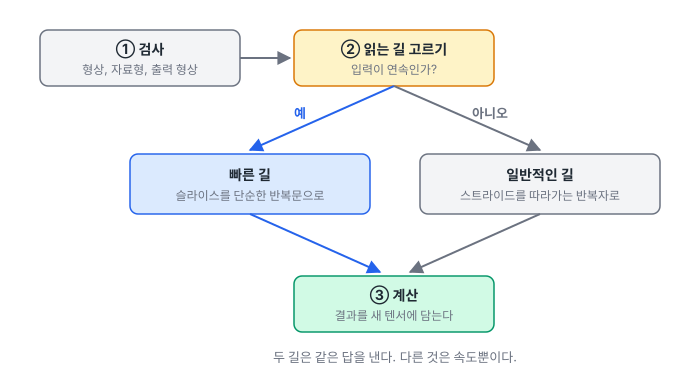
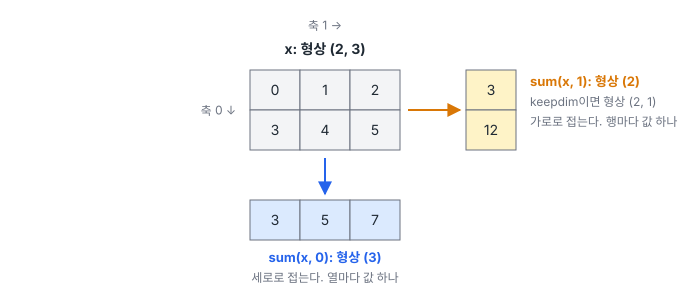
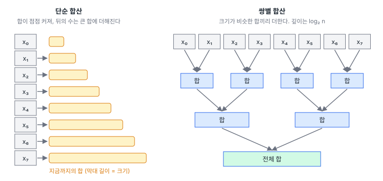
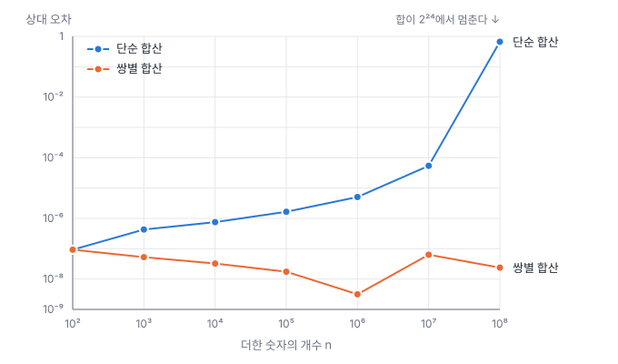

# 연산자 만들기

[4장](ch04_tensor.md)에서 숫자를 담는 텐서를 만들었습니다. 이 장에서는
텐서에 담긴 숫자를 계산하는 **연산자**<sup>operator</sup>를 만듭니다.
연산자는 텐서를 받아 새 텐서를 돌려주는 함수이며, 덧셈과 행렬 곱과
소프트맥스가 모두 연산자입니다.

모델은 연산자를 순서대로 늘어놓은 것입니다.
[3장](ch03_neural_networks.md)의 다층 퍼셉트론은 "선형 층, ReLU, 선형
층"이라는 연산자 세 개를 늘어놓은 것이었습니다. 수십억 파라미터의 언어
모델도 몇 종류 안 되는 연산자를 수없이 되풀이해 부릅니다. 그래서 추론
엔진을 만드는 일의 대부분은 연산자를 만드는 일입니다.

이 장에서 만드는 연산자는 세 종류입니다.

| 종류 | 예 | 형상의 변화 |
|---|---|---|
| 원소별 연산 | 덧셈, 곱셈, ReLU | 그대로 (브로드캐스팅 후) |
| 행렬 곱 계열 | 행렬 곱, 선형 층 | 마지막 축들이 바뀐다 |
| 축소 연산 | 합, 평균, 최댓값, argmax | 축 하나가 사라진다 |

연산자를 만들 때마다 "이 결과가 맞는지 어떻게 아는가"라는 질문이
따라옵니다. 이 질문은 [2장](ch02_math.md)에서 예고한 수치 오차와 함께 이
장의 후반에서 다룹니다.

이 장은 [4장](ch04_tensor.md)의 `Tensor`와 [2장](ch02_math.md),
[3장](ch03_neural_networks.md)의 슬라이스 함수를 바탕으로 합니다. 코드는
`crates/badak_core/src/ops.rs`에 있습니다.

## 5.1 연산자는 검사하고 읽는 길을 고르고 계산한다

우리가 만드는 연산자는 모두 같은 세 단계를 밟습니다.



1. **검사.** 입력의 형상과 자료형이 이 연산에 맞는지 확인하고, 출력의 형상을
   정합니다. 맞지 않으면 [4장](ch04_tensor.md)에서 만든 오류를 돌려줍니다.
2. **읽는 길 고르기.** 입력이 연속이면 슬라이스로, 아니면 반복자로 원소를
   읽습니다. [4장](ch04_tensor.md)의 측정에서 연속인 메모리를 슬라이스로 읽는 것이 훨씬
   빨랐습니다.
3. **계산.** 실제 숫자 계산을 하고 결과를 새 텐서에 담습니다.

3단계의 계산은 [2장](ch02_math.md)과 [3장](ch03_neural_networks.md)에서
`dot`, `matmul`, `relu`, `softmax` 같은 슬라이스 함수로 이미 만들어
두었습니다. 이 장의 연산자는 그 함수를 텐서에 이어 주는 얇은 껍질입니다.
실전 엔진도 이렇게 두 층으로 나누며, 안쪽의 계산 함수를
[1장](ch01_landscape.md)에서 커널이라고 불렀습니다.

| 층 | 하는 일 | 이 책에서 |
|---|---|---|
| 연산자 | 형상 검사, 출력 형상 결정, 커널 고르기 | 이 장의 `ops` |
| 커널 | 연속인 메모리 위에서 숫자 계산 | [2장](ch02_math.md)의 `linalg`, [3장](ch03_neural_networks.md)의 `nn` |

3부에서 엔진을 빠르게 만들 때는 커널을 바꾸고 연산자의 껍질은 거의
그대로 둡니다.

이 장의 연산자는 모두 `f32` 텐서만 받습니다. 다른 자료형의 연산은
필요해지는 장에서 추가합니다.

## 5.2 원소별 연산은 원소마다 따로 계산한다

### 입력이 하나인 연산은 형상을 바꾸지 않는다

모든 원소에 같은 함수를 적용하는 연산이며 형상은 변하지 않습니다.

```rust
{{#include ../../../crates/badak_core/src/ops.rs:map}}
```

코드에 세 단계가 그대로 보입니다. `as_slice`가 성공하면 빠른 길로 가고,
연속이 아니라는 오류가 나면 반복자를 쓰는 일반적인 길로 갑니다. 자료형이
`f32`가 아니면 그 오류를 그대로 돌려줍니다.

> `Tensor::build`는 결과를 담을 자리를 먼저 얻고, 넘겨받은 함수가 그 자리를
> 채우게 한 뒤, 텐서로 만들어 돌려줍니다. "길이가 맞는 벡터를 0으로 채워
> 만들고, 값을 적고, `Tensor::from_vec`에 넘긴다"와 결과가 같습니다. 이
> 책을 처음 쓸 때는 그렇게 적었습니다. 왜 자리를 얻는 일을 텐서 쪽에
> 맡겼는지는 22.11절에서 설명합니다.

[3장](ch03_neural_networks.md)의 활성화 함수는 이 함수를 써서 한
줄씩으로 만듭니다.

```rust
{{#include ../../../crates/badak_core/src/ops.rs:unary}}
```

### 입력이 둘인 연산은 브로드캐스팅으로 형상을 맞춘다

두 텐서의 같은 자리 원소끼리 계산합니다. 형상이 다르면
[4장](ch04_tensor.md)의 브로드캐스팅 규칙으로 맞춥니다.

```rust
{{#include ../../../crates/badak_core/src/ops.rs:zip}}
```

빠른 길의 조건은 "형상이 같고 둘 다 연속"입니다. 가장 흔한 경우이고,
이때는 슬라이스 두 개를 나란히 읽기만 하면 됩니다.

일반적인 길은 [4장](ch04_tensor.md)의 `broadcast_to`를 씁니다. 두 입력을
결과 형상의 뷰로 늘리면 둘의 형상이 같아지므로 반복자 두 개를 나란히
돌리면 됩니다. [4장](ch04_tensor.md)에서 브로드캐스팅을 뷰로 만들어
두었기 때문에 여기서는 따로 할 일이 없습니다.

사칙연산은 이 함수에 클로저를 하나씩 넘겨 만듭니다.

```rust
{{#include ../../../crates/badak_core/src/ops.rs:binary}}
```

`mul`은 원소별 곱셈입니다. 행렬 곱과는 다른 연산이니 혼동하지 마십시오.

### 두 길은 같은 답을 내야 한다

같은 연산을 두 가지 길로 구현하면 한쪽 길에만 있는 버그라는 새로운
종류의 버그가 생길 수 있습니다. 이런 버그를 막으려면 같은 값을 양쪽 길로
계산해 결과를 비교합니다.

```rust
{{#include ../../../crates/badak_core/src/ops.rs:two_paths_test}}
```

전치 뷰와 그 복사본은 값이 같지만 하나는 연속이 아니고 하나는
연속이어서, 같은 입력으로 두 길을 모두 지나가게 할 수 있습니다. 이
방법은 3부에서 계속 씁니다. 빠른 커널을 하나 추가할 때마다 "느리지만
확실한 구현과 같은 답을 내는가"를 확인합니다.

## 5.3 행렬 곱과 선형 층을 텐서로 감싼다

### 행렬 곱은 형상을 검사한 뒤 커널에 넘긴다

[2장](ch02_math.md)의 `matmul`을 텐서로 감쌉니다.

```rust
{{#include ../../../crates/badak_core/src/ops.rs:matmul}}
```

코드의 절반이 형상 검사입니다. 두 입력이 모두 2차원인지, 앞 행렬의 열
수와 뒤 행렬의 행 수가 같은지 확인합니다. [2장](ch02_math.md)에서는
호출하는 쪽이 `m`, `k`, `n`을 직접 넘겨야 했지만 이제 텐서가 자기 형상을
알고 있습니다.

계산은 `simd::linear`라는 함수가 합니다.
[16장](../part3/ch16_matmul.md)과 [17장](../part3/ch17_simd.md)에서
만드는 빠른 커널이고, 하는 일은 [2장](ch02_math.md)의 `matmul`과
같습니다. 이 커널은 내적할 두 벡터가 각각 메모리에 나란히 놓여 있어야
합니다. `a`의 행은 그렇지만 `b`의 열은 그렇지 않으므로, `b`를 전치한
뷰를 만들고 `contiguous()`로 옮겨 적습니다. 이 복사의 비용은 5.5절에서
잽니다.

> 이 책을 처음 쓸 때 이 자리의 코드는 [2장](ch02_math.md)의 `matmul`을 그대로 불렀습니다.
> 왜 지금의 모양이 되었는지는 16.6절에서 설명합니다.

### 선형 층은 마지막 축에 작용한다

[3장](ch03_neural_networks.md)의 `Linear`는 벡터 하나를 받았지만
실제로는 벡터 여러 개를 한꺼번에 넣습니다. 사진 서른두 장을 묶어 넣거나,
문장의 단어 조각 100개에 같은 층을 하나씩 적용하는 식입니다. 그래서 텐서
연산자로서의 선형 층은 **마지막 축**에 작용하고 앞쪽 축은 그대로 둡니다.

```text
x: (..., 입력 길이)   W: (출력 길이, 입력 길이)   b: (출력 길이)
y: (..., 출력 길이)
```

```rust
{{#include ../../../crates/badak_core/src/ops.rs:linear}}
```

입력을 연속으로 만든 뒤 벡터 전체를 통째로 `simd::linear`에 넘깁니다. 이
함수는 벡터마다 [2장](ch02_math.md)의 `matvec`을 부르는 것과 같은 일을
해서, 벡터 하나하나와 가중치의 행 하나하나를 내적합니다. 앞쪽 축이
`(32)`든 `(2, 100)`이든 메모리에서는 벡터가 차례로 놓여 있을 뿐이므로
구분할 필요가 없습니다.

테스트에서는 이 연산자가 [3장](ch03_neural_networks.md)의
`Linear::forward`를 벡터마다 부른 것과 같은 결과를 내는지 확인합니다. 또
[3장](ch03_neural_networks.md)의 XOR 모델을 텐서 연산자로 다시 조립해,
네 가지 입력을 형상 `(4, 2)`인 텐서 하나에 담아 한 번에 계산합니다.

> 이 책을 처음 쓸 때 이 자리의 코드는 벡터마다 `matvec`을 따로 불렀습니다.
> 같은 계산을 훨씬 빠르게 하도록 다시 짠 것이 `simd::linear`이고, [16장](../part3/ch16_matmul.md)과 [17장](../part3/ch17_simd.md)에서
> 만듭니다. 지금은 "벡터마다 `matvec`"이라고 읽어도 됩니다.

## 5.4 축소 연산은 축 하나를 값 하나로 줄인다

**축소 연산**<sup>reduction</sup>은 한 축을 따라 원소 여러 개를 값
하나로 줄입니다. 그 축은 사라지고 나머지 축은 남습니다.



"축 0을 따라 더한다"는 말이 처음에는 헷갈리는데, **지정한 축이
사라진다**고 기억하면 됩니다. 형상 `(2, 3)`에서 축 0을 따라 더하면 2가
사라져 `(3)`이 됩니다.

`keepdim` 옵션을 켜면 사라질 축을 길이 1로 남깁니다. `(2, 3)`에서 축 1을
줄이면 `(2, 1)`이 됩니다. 이렇게 해 두면 결과를 원래 텐서와 바로
브로드캐스팅할 수 있습니다. 예를 들어 행마다 평균을 빼는 계산은 다음 한
줄로 끝납니다.

```text
sub(x, mean(x, 1, keepdim = true))      (2, 3) − (2, 1) → (2, 3)
```

### 줄일 축을 맨 뒤로 보내 한 가지 경우로 만든다

어느 축이든 줄일 수 있어야 하는데 축마다 반복문을 따로 쓸 수는 없습니다.
[4장](ch04_tensor.md)의 뷰를 이용하면 한 가지 경우만 처리하면 됩니다.
**줄일 축을 맨 뒤로 보내고 연속으로 만들면** 그 축을 따라 놓인 원소가
메모리에서 한 줄로 이어집니다. 이 한 줄을 레인<sup>lane</sup>이라고
부르겠습니다. 그다음에는 메모리를 축의 길이만큼씩 잘라 줄마다 계산하면
됩니다.

```rust
{{#include ../../../crates/badak_core/src/ops.rs:lanes}}
```

줄일 축이 이미 맨 뒤에 있고 텐서가 연속이면 `permute`와 `contiguous`는
아무 일도 하지 않습니다. 그렇지 않으면 한 번 복사합니다.

이 도우미를 쓰면 축소 연산은 "줄 하나를 값 하나로 바꾸는 함수"만 서로
다릅니다.

```rust
{{#include ../../../crates/badak_core/src/ops.rs:reduce}}
```

`argmax`의 결과는 위치이므로 `i32` 텐서입니다. [4장](ch04_tensor.md)에서
자료형을 실행 시점에 정하도록 했으므로 연산자가 입력과 다른 자료형의
텐서를 돌려주어도 문제가 없습니다.

### 소프트맥스는 고른 축을 따라 적용한다

[2장](ch02_math.md)의 소프트맥스는 벡터 하나를 받았습니다. 텐서에서는
어느 축을 따라 확률을 만들지 정해야 합니다. 분류 모델의 출력이
`(사진 수, 종류 수)`라면 종류 축을 따라 적용해서 사진마다 확률의 합이
1이 되게 합니다.

```rust
{{#include ../../../crates/badak_core/src/ops.rs:softmax}}
```

축소 연산과 달리 형상이 변하지 않으므로, 줄마다 계산한 뒤 맨 뒤로 보냈던
축을 원래 자리로 되돌립니다.

### 연산자를 직접 써 본다

```bash
cargo run --release -p badak_core --example ch05_ops
```

```text
{{#include output/ch05_ops.txt}}
```

마지막 묶음은 [4장](ch04_tensor.md)에서 공들여 만든 오류 메시지이며,
어떤 연산에서 어떤 형상이 맞지 않았는지가 그대로 나옵니다.

가운데 묶음 "점수에서 답까지"는 분류 모델이 마지막에 하는 일 전체입니다.
점수에 편향을 더하고, 소프트맥스로 확률을 만들고, argmax로 답을
고릅니다. [7장](ch07_mnist.md)에서 이 연산자로 실제 모델을 돌립니다.

## 5.5 빠른 길은 일반적인 길보다 열두 배 넘게 빠르다

연산자가 어느 길로 처리되는지에 따라 시간이 얼마나 달라지는지 잽니다.

```bash
cargo run --release -p badak_core --example ch05_ops_cost
```

기준 기계(Apple M4 Max)에서 잰 결과입니다.

```text
{{#include output/ch05_ops_cost.txt}}
```

**덧셈.** 형상이 같고 연속인 두 텐서의 덧셈은 슬라이스를 직접 더하는
것과 같은 시간이 걸립니다. 연산자의 껍질이 더하는 비용이 측정되지 않을
만큼 작다는 뜻입니다. 반면 일반적인 길은 열두 배에서 쉰 배 넘게
느립니다. 행 하나를 브로드캐스팅하는 흔한 경우조차 열두 배 느립니다.

이 결과에서 두 가지를 알 수 있습니다. 빠른 길을 따로 둔 것은 옳았고,
지금의 일반적인 길은 너무 느립니다. 브로드캐스팅은
[3장](ch03_neural_networks.md)의 편향 덧셈처럼 모델에서 매우 자주
일어나는 연산이므로 이대로 둘 수 없습니다.
[17장](../part3/ch17_simd.md)에서 SIMD로 커널을 다시 쓸 때 자주 나오는
브로드캐스팅 모양을 위한 빠른 길을 추가합니다.

**행렬 곱.** 세 경우의 시간이 사실상 같습니다. 한쪽 입력이 전치 뷰여서
복사가 일어나도 차이가 보이지 않습니다. `512 × 512` 행렬을 복사하는 일은
1MiB를 옮기는 것이어서, 그 시간은 1억 3천만 번의 곱셈에 비하면 무시할
만합니다.

여기서 성능 작업의 기본 원칙 하나를 확인할 수 있습니다.

> 시간이 쓰이는 곳을 고쳐야 한다. 행렬 곱에서는 커널이 전부이고, 원소별
> 연산에서는 원소를 읽는 방법이 전부다.

어디에 시간이 쓰이는지를 추측하지 않고 재는 방법은 [14장](../part3/ch14_measurement.md)에서 다룹니다.

> 이 측정은 초시계로 재는 수준의 거친 측정입니다.

## 5.6 결과가 맞는지는 허용 오차로 확인한다

연산자를 만들었으면 맞는지 확인해야 합니다. 지금까지는 손으로 계산한
작은 예와 비교했습니다. 하지만 [2장](ch02_math.md)에서 보았듯 부동소수점
계산은 순서에 따라 결과가 달라지므로, 큰 입력에서는 "정답"조차 하나로
정해지지 않습니다. 가장 단순한 연산인 합으로 이 문제를 자세히 봅니다.

### 차례로 더하면 합이 커지면서 오차가 쌓인다

숫자 `n`개를 앞에서부터 차례로 더하면 덧셈을 `n − 1`번 합니다. 덧셈마다
결과가 `f32`에 맞게 반올림되면서 작은 오차가 생깁니다. 게다가 합이 점점
커집니다. 합이 커질수록 `f32`가 구분할 수 있는 간격도 커지므로 뒤에
더하는 작은 수는 점점 더 많이 잘려 나갑니다.

더하는 순서를 바꾸면 이 문제를 줄일 수 있습니다. 숫자를 반으로 나눠 각각
더한 뒤 두 합을 더하고, 각 절반도 같은 방식으로 더합니다. 이 방법을
**쌍별 합산**<sup>pairwise summation</sup>이라고 합니다.



쌍별 합산에서는 항상 크기가 비슷한 두 수를 더합니다. 또 어떤 숫자든 최종
합에 이르기까지 덧셈을 `n`번이 아니라 약 `log₂ n`번만 거칩니다. 100만
개를 더해도 스무 번입니다. 그래서 오차가 훨씬 느리게 쌓입니다.[^higham]

```rust
{{#include ../../../crates/badak_core/src/linalg.rs:sum_naive}}
```

```rust
{{#include ../../../crates/badak_core/src/linalg.rs:sum_pairwise}}
```

끝까지 둘로 쪼개지 않고 128개 이하가 되면 단순한 반복문으로 더합니다.
짧은 구간에서는 오차가 쌓일 틈이 없고, 함수 호출을 줄여 속도를 지킬 수
있기 때문입니다.

### 쌍별 합산의 오차는 n이 커져도 거의 늘지 않는다

0과 1 사이의 숫자 `n`개를 두 방법으로 더하고, 같은 숫자를 `f64`로 더한
값을 정답으로 삼아 상대 오차를 구합니다.

```bash
cargo run --release -p badak_core --example ch05_sum_error
```

```text
{{#include output/ch05_sum_error.txt}}
```



쌍별 합산의 상대 오차는 `n`이 100만 배가 되어도 `10⁻⁷` 아래에 머뭅니다.
`f32`의 정밀도 한계(`f32::EPSILON`, 약 `1.2 × 10⁻⁷`)와 같은 수준이니 더
줄일 수 없는 오차입니다.

단순 합산의 오차는 `n`과 함께 꾸준히 커지다가 마지막 줄에서 무너집니다.
1억 개를 더한 결과의 상대 오차가 0.66, 즉 **66%가 틀립니다.** 계산
실수가 아닙니다. [2장](ch02_math.md)에서 `16777216 + 1`이 `16777216`으로
남는 것을 보았습니다. 합이 2의 24제곱인 16,777,216에 이르면 그보다 작은
수를 더해도 값이 변하지 않으므로, 0과 1 사이의 수를 아무리 더해도 합은
그 값에 멈춰 있습니다. 정답은 약 5천만인데 1,677만에서 멈췄으니 66%가
사라졌습니다.

1억 개는 비현실적인 숫자가 아닙니다. `4096 × 4096` 텐서 여섯 장이면
원소가 1억 개입니다. 그래서 `ops::sum`을 비롯한 축소 연산은 모두 쌍별
합산을 씁니다. NumPy도 같은 이유로 합에 쌍별 합산을 씁니다.[^numpy-sum]

### 더 정밀한 계산을 정답으로 삼는다

이 실험에서는 `f64`로 계산한 값을 정답으로 삼았습니다. 이것이 수치
검증의 첫 번째 방법입니다.
검증의 첫 번째 방법입니다.

> 더 정밀한 자료형으로 같은 계산을 해서 기준으로 삼는다.

`f64`도 완벽하지는 않지만 `f32`보다 유효 숫자가 두 배 넘게 많으므로
`f32` 계산의 오차를 재는 기준으로는 충분합니다.

검증 방법을 정리하면 다음과 같습니다. 이 책은 상황에 따라 이 방법을 섞어
씁니다.

| 방법 | 기준이 되는 것 | 쓰는 곳 |
|---|---|---|
| 손 계산 | 종이로 푼 작은 예 | 연산의 뜻이 맞는지 (이 장의 테스트 대부분) |
| 성질 검사 | 수학적으로 성립해야 하는 관계 | 소프트맥스의 합이 1인지, 전치를 두 번 하면 원래대로인지 |
| 구현끼리 비교 | 느리지만 단순한 구현 | 빠른 길과 일반적인 길, 3부의 모든 빠른 커널 |
| 더 정밀한 계산 | `f64`로 한 같은 계산 | 오차의 크기를 잴 때 |
| 다른 엔진과 비교 | PyTorch 등의 출력 | 모델 전체가 맞는지 ([7장](ch07_mnist.md)부터) |

### 허용 오차는 계산의 종류에 따라 정한다

비교에는 허용 오차가 필요합니다. 얼마로 잡아야 할지는 위 실험에서 기준을
얻을 수 있습니다.

- **연산 하나, 원소별 계산.** 덧셈, 곱셈, 활성화 함수처럼 원소마다 따로
  계산하는 연산은 오차가 쌓일 곳이 없으므로 상대 오차 `1e-6` 수준으로
  엄격하게 잡습니다. 순서만 다른 같은 계산이라면 비트 단위로 같아야 하는
  경우도 많습니다.
- **연산 하나, 많은 수를 더하는 계산.** 합, 내적, 행렬 곱은 더하는
  순서에 따라 결과가 달라집니다. 위 표에서 보듯 올바른 두 구현 사이에도
  `1e-6`에서 `1e-5`의 차이가 날 수 있으므로 상대 오차 `1e-5` 수준으로
  잡습니다.
- **연산 수백 개를 거친 모델의 출력.** 층마다 생긴 오차가 다음 층으로
  전해지며 쌓입니다. 얼마나 쌓이는지는 모델마다 다르므로 층별로 오차를
  재서 정합니다. [7장](ch07_mnist.md)에서 처음 해 봅니다.

절대 오차도 함께 필요합니다. 기준값이 0에 가까우면 상대 오차만으로는
아무리 작은 차이도 통과하지 못하기 때문입니다. 이 책은 보통 텐서에서
가장 큰 값의 크기에 상대 오차를 곱한 정도를 절대 오차로 씁니다.

허용 오차가 너무 느슨하면 버그를 숨기고, 너무 엄격하면 올바른 구현을
틀렸다고 합니다. 그래서 허용 오차는 감으로 정하지 않고 위와 같은 근거를
대고 정합니다. 또 검증이 실패하면 어디가 얼마나 틀렸는지를 바로 볼 수
있어야 합니다.

### 비교 함수는 어디가 틀렸는지 알려 준다

[2장](ch02_math.md)의 `allclose`는 참과 거짓만 돌려줍니다. 원소가 100만
개인 텐서의 검증이 실패했을 때 "틀렸다"만으로는 할 수 있는 일이
없으므로, 보고서를 돌려주는 비교 함수를 만듭니다.

```rust
{{#include ../../../crates/badak_core/src/approx.rs:compare}}
```

보고서에는 틀린 원소가 몇 개인지, 가장 크게 틀린 곳이 어디이며 실제값과
기준값이 무엇인지가 담깁니다. 이 정보로 버그의 종류를 가를 수 있습니다.

| 보고서의 모습 | 의심할 것 |
|---|---|
| 거의 모든 원소가 조금씩 틀림 | 허용 오차가 너무 엄격하거나, 정밀도가 다른 계산 |
| 원소 몇 개만 크게 틀림 | 경계 처리, 특정 위치의 인덱스 오류 |
| 모든 원소가 크게 틀림 | 형상이나 축의 순서를 잘못 읽음, 다른 가중치를 읽음 |
| `NaN`이 섞여 있음 | 넘침. [2장](ch02_math.md)의 소프트맥스 같은 수치 불안정 |

[7장](ch07_mnist.md)에서 우리 엔진의 출력을 PyTorch와 처음으로 비교할 때
이 함수를 씁니다.

## 5.7 실전 엔진에서는

### 범용 엔진은 연산자를 수백 개 갖춘다

이 장에서 만든 연산자는 스무 개가 안 됩니다. 실전 엔진에는 연산자가
얼마나 많은지 소스 코드에서 직접 세어 보았습니다.

| 엔진 | 연산자 수 | 센 곳 |
|---|---|---|
| llama.cpp (ggml) | 98 | `enum ggml_op`의 항목[^ggml-ops] |
| LiteRT | 210 | `enum BuiltinOperator`의 항목[^litert-ops] |
| ONNX | 210 | 연산자 문서에 실린 항목[^onnx-ops] |

숫자의 차이는 [1장](ch01_landscape.md)에서 본 엔진의 계열에서 옵니다.
llama.cpp는 정해진 구조의 모델을 엔진 코드로 직접 쓰므로 그 모델이 쓰는
연산자만 있으면 됩니다. LiteRT와 ONNX는 어떤 모델이 들어올지 모르는 범용
해석기이므로 세상의 모델이 쓰는 연산자를 두루 갖춰야 합니다. LiteRT와
ONNX는 서로 다른 목록이고, 숫자가 같은 것은 우연입니다.

우리도 llama.cpp와 같은 방식을 택해, 모델을 올릴 때마다 그 모델에 필요한
연산자만 추가합니다. 4부에서 그래프 해석기를 만들 때 "연산자가 하나라도
없으면 모델을 실행할 수 없다"는 범용 엔진의 문제를 직접 겪게 됩니다.

### 커널은 연산자보다 훨씬 많다

실전 엔진에서는 연산자 하나에 커널이 여러 개 딸려 있습니다. LiteRT는
커널을 두 갈래로 관리해서, 읽기 쉽고 확실하게 맞는 `reference` 구현과
빠르지만 복잡한 `optimized` 구현을 디렉터리부터 나누어
둡니다.[^litert-kernels]

이 장에서 우리가 한 일도 같은 구조입니다. 느리지만 맞는 구현을 기준으로
두고, 빠른 구현을 그 옆에 추가한 뒤, 둘이 같은 답을 내는지 확인했습니다.
이 책이 [2장](ch02_math.md)의 단순한 `matmul`을 끝까지 지우지 않는 것도
같은 이유입니다.

커널의 수는 자료형과 하드웨어에 따라 곱절로 늘어납니다. 덧셈이라는 연산
하나에도 `f32`용과 8비트 정수용이 다르고, ARM용과 x86용이 다르고, 형상이
같을 때와 브로드캐스팅할 때가 다릅니다. 5.5절에서 "브로드캐스팅을 위한 빠른
길이 필요하다"고 한 것이 바로 이런 커널을 하나 더 만든다는 뜻입니다. [1장](ch01_landscape.md)에서
엔진의 성능 차이가 커널에서 온다고 한 이유이기도 합니다. 엔진 사이의 성능
경쟁은 자주 쓰이는 연산자의 커널을 얼마나 많은 경우에 대해 얼마나 잘
다듬었는가의 경쟁입니다.

## 정리

- 연산자는 텐서를 받아 새 텐서를 돌려주는 함수이고, 모델은 연산자의
  나열입니다.
- 연산자는 검사, 읽는 길 고르기, 계산의 세 단계로 이루어집니다. 계산은
  커널에 맡깁니다.
- 원소별 연산은 형상이 같고 연속이면 슬라이스로, 아니면 브로드캐스팅한 뷰를
  반복자로 처리합니다. 기준 기계에서 두 길의 속도는 열두 배에서 쉰 배
  차이가 났습니다.
- 축소 연산은 줄일 축을 맨 뒤로 보내 연속으로 만든 뒤 줄마다 계산합니다.
  지정한 축이 사라지고, `keepdim`이면 길이 1로 남습니다.
- 같은 연산을 두 길로 구현했으면 같은 입력을 양쪽에 흘려 결과를 비교합니다.
- 단순 합산은 `n`이 커지면 오차가 커지고, 합이 2의 24제곱에 이르면 더 이상
  커지지 않습니다. 쌍별 합산은 이 문제를 피합니다.
- 검증의 기준은 손 계산, 수학적 성질, 단순한 구현, 더 정밀한 계산, 다른
  엔진의 출력에서 얻습니다. 허용 오차는 오차가 쌓이는 방식을 근거로
  정합니다.

## 연습 문제

1. 형상 `(4, 3, 5)`인 텐서에 `sum(x, 1, false)`, `sum(x, 1, true)`,
   `argmax(x, 2)`, `softmax(x, 0)`을 적용한 결과의 형상을 각각 적어
   보십시오.
2. `ops::zip`에 빠른 길을 하나 더 추가해 보십시오. 한쪽이 원소 하나짜리
   텐서(스칼라)이고 다른 쪽이 연속인 경우입니다. `ch05_ops_cost`에 이
   경우의 측정을 추가해 효과를 확인하고, 5.2절의 방법으로 두 길이 같은
   답을 내는지 테스트해 보십시오.
3. 모든 원소의 평균을 구하는 `mean_all`을 만들어 보십시오. 그리고 한 축의
   분산을 구하는 `variance(x, axis, keepdim)`를 이 장의 연산자들만 조합해
   만들어 보십시오. `keepdim`이 왜 편리한지 알게 될 것입니다.
4. `sum_pairwise`의 `LEAF`를 1로 바꾸면 정확도와 속도가 어떻게 달라질지
   예측하고, `ch05_sum_error`를 고쳐 확인해 보십시오. 8192로 바꾸면
   어떻습니까.
5. 5.6절의 실험은 양수만 더했습니다. 크기가 비슷한 양수와 음수가 섞여 합이
   0에 가까운 경우에는 상대 오차가 어떻게 될지 생각해 보십시오. 이런
   현상을 상쇄(cancellation)라고 합니다. 예제를 고쳐 확인해 보십시오.
6. `matmul`의 결과를 `f64`로 계산한 값과 비교하는 테스트를 작성해
   보십시오. `256 × 256` 행렬에서 가장 큰 상대 오차는 얼마입니까. 그
   값은 5.6절에서 제안한 허용 오차 안에 들어옵니까.

## 참고 문헌

[^higham]: N. J. Higham, *Accuracy and Stability of Numerical Algorithms*,
    2판, SIAM, 2002, 4장 "Summation".
    [doi:10.1137/1.9780898718027](https://doi.org/10.1137/1.9780898718027).
    단순 합산과 쌍별 합산의 오차 한계를 유도합니다. 단순 합산의 한계는
    `n`에, 쌍별 합산의 한계는 `log₂ n`에 비례합니다.

[^numpy-sum]: NumPy 문서, `numpy.sum`의 Notes. 합을 구할 때 수치적으로 더
    나은 방법인 부분 쌍별 합산(partial pairwise summation)을 쓰는 경우가
    많다고 설명합니다.
    <https://numpy.org/doc/stable/reference/generated/numpy.sum.html>
    (2026-11-16 확인)

[^ggml-ops]: llama.cpp, `ggml/include/ggml.h`의 `enum ggml_op` (커밋
    `b4c0e00a4fcc`). 항목 100개 가운데 `GGML_OP_NONE`과 `GGML_OP_COUNT`를
    뺀 수입니다.
    <https://github.com/ggml-org/llama.cpp/blob/b4c0e00a4fcc/ggml/include/ggml.h>

[^litert-ops]: LiteRT, `tflite/converter/schema/schema.fbs`의
    `enum BuiltinOperator` (커밋 `ee2d1defa34d`). 0번부터 209번까지입니다.
    <https://github.com/google-ai-edge/LiteRT/blob/ee2d1defa34d/tflite/converter/schema/schema.fbs>

[^onnx-ops]: ONNX, `docs/Operators.md` (커밋 `c7609c4ad544`). 연산자별
    정의 항목의 수이며 미리보기 영역의 연산자를 포함합니다.
    <https://github.com/onnx/onnx/blob/c7609c4ad544/docs/Operators.md>

[^litert-kernels]: LiteRT, `tflite/kernels/internal/` 아래의 `reference`와
    `optimized` 디렉터리 (커밋 `ee2d1defa34d`). 예를 들어 `reference`에는
    `add.h`, `fully_connected.h`, `softmax.h`가 있습니다.
    <https://github.com/google-ai-edge/LiteRT/tree/ee2d1defa34d/tflite/kernels/internal>
