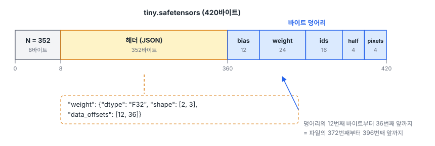
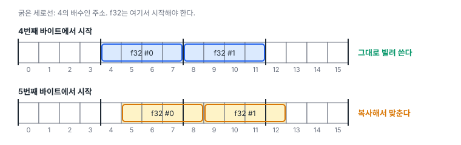
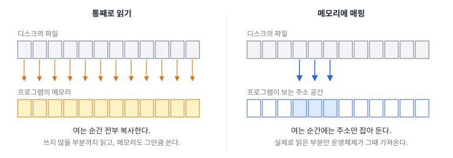
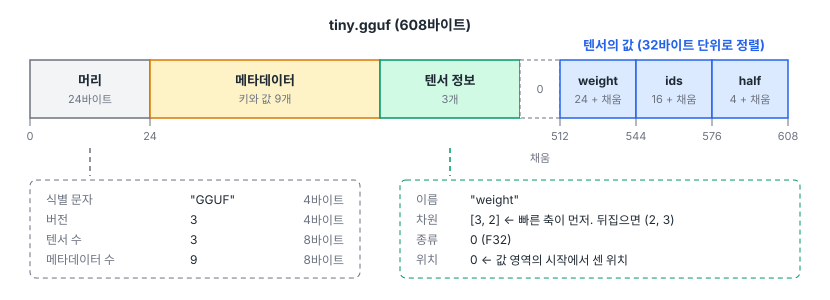

# 모델 파일 읽기

지금까지 가중치는 코드에 직접 적어 넣었습니다. [3장](ch03_neural_networks.md)의 XOR 모델은 숫자가
아홉 개였으니 가능했습니다. 실제 모델의 가중치는 파일에 들어 있고, 그 크기는
수백 메가바이트에서 수십 기가바이트에 이릅니다. 이 장에서는 그 파일을 읽는
코드를 만듭니다.

다룰 형식은 두 가지입니다.

- **safetensors**: PyTorch 생태계에서 가중치를 주고받는 데 널리 쓰이는
  형식입니다. [7장](ch07_mnist.md)에서 첫 모델을 이 형식으로 읽습니다.
- **GGUF**: llama.cpp가 쓰는 형식입니다. [8장](../part2/ch08_tokenizer.md)에서 단어 사전을 이 형식의
  파일에서 읽고, [13장](../part2/ch13_first_showdown.md)부터는 llama.cpp와 견줄 모델 파일을 이 형식으로
  다룹니다. (우리 엔진은 언어 모델의 가중치도 safetensors에서 읽습니다.)

그리고 두 형식에 공통으로 쓰이는 기법을 하나 만듭니다. 파일을 메모리로
복사하지 않고 그대로 비춰 쓰는 메모리 매핑(memory mapping)입니다. 1GiB짜리
파일을 여는 데 걸리는 시간이 약 90밀리초에서 약 4밀리초로 줄어드는 것을 이
장의 끝에서 잽니다.

이 장은 [4장](ch04_tensor.md)의 `Tensor` 위에 서 있습니다. 코드는 새 크레이트
`crates/badak_formats`에 있고, [4장](ch04_tensor.md)의 저장소에 새 종류를 하나 추가합니다.

## 6.1 모델 파일에는 무엇이 들어 있는가

모델 파일의 핵심은 텐서의 목록입니다. 텐서마다 다음 네 가지가 필요합니다.

| 항목 | 예 |
|---|---|
| 이름 | `layers.0.weight` |
| 자료형 | `F32` |
| 형상 | `(128, 784)` |
| 값 | 숫자 100,352개 |

앞의 세 가지는 [4장](ch04_tensor.md)에서 메타데이터라고 부른 것이고, 마지막이 저장소에 들어갈
내용입니다. 파일 형식이란 이 네 가지를 바이트로 어떻게 늘어놓을지에 대한
약속입니다.

형식마다 추가로 담는 것이 다릅니다. [1장](ch01_landscape.md)에서 본 엔진의 계열과 그대로
이어집니다.

| 형식 | 가중치 | 계산 순서(그래프) | 그 밖의 정보 | 주로 쓰는 엔진 |
|---|---|---|---|---|
| safetensors | 있음 | 없음 | 자유 형식의 문자열 몇 개 | PyTorch 생태계 |
| GGUF | 있음 | 없음 | 모델 설정, 단어 사전 등 풍부한 메타데이터 | llama.cpp |
| LiteRT (`.tflite`) | 있음 | 있음 | | LiteRT |
| ONNX (`.onnx`) | 있음 | 있음 | | ONNX Runtime |

이 장에서 다루는 두 형식에는 계산 순서가 없습니다. 아키텍처를 엔진 코드로
직접 쓰는 계열의 형식이기 때문입니다. 계산 순서까지 담긴 형식은 [26장](../part4/ch26_graph_interpreter.md)에서
다룹니다.

### 모델 파일은 믿을 수 없는 입력이다

모델 파일은 대개 인터넷에서 내려받습니다. 그 파일은 전송 중에 깨졌을 수도
있고, 누군가 악의적으로 만든 것일 수도 있습니다. 시니어 엔지니어라면 네트워크
패킷이나 사용자가 올린 이미지를 다룰 때와 같은 태도가 필요합니다.

이 문제는 가상의 우려가 아닙니다. PyTorch가 기본으로 쓰던 저장 방식은
Python의 pickle인데, pickle 파일은 읽는 과정에서 그 안에 담긴 임의의 코드를
실행할 수 있습니다. 모델 파일을 여는 것만으로 공격자의 코드가 돌아갈 수
있다는 뜻입니다. safetensors는 바로 이 문제를 없애려고 만든
형식입니다.[^safetensors] 이름의 "safe"가 그 뜻입니다.

우리가 다루는 두 형식은 데이터만 담으므로 코드가 실행될 일은 없습니다.
그래도 파서가 조심해야 할 것이 남습니다. 파일에는 "헤더의 길이는
얼마다", "이 텐서는 몇 번째 바이트부터다" 같은 숫자가 적혀 있고, 이 숫자들은
파일이 주장하는 값일 뿐입니다. 그대로 믿으면 다음과 같은 일이 생깁니다.

| 파일의 거짓말 | 믿으면 생기는 일 |
|---|---|
| 길이가 파일 크기보다 크다 | 범위를 벗어난 메모리를 읽는다 |
| 배열의 원소가 1조 개다 | 메모리를 모두 할당하려다 죽는다 |
| 형상의 곱이 정수 범위를 넘는다 | 넘친 값으로 계산해 엉뚱한 곳을 읽는다 |
| 두 텐서의 구간이 겹친다 | 한 텐서를 바꾸면 다른 텐서가 바뀐다 |
| 끝없이 중첩된 구조 | 재귀가 스택을 넘친다 |

이 장의 파서는 이 표의 모든 줄에 대한 검사와 테스트를 갖추고 있습니다. 이
장의 코드 가운데 절반은 "읽는 코드"가 아니라 "믿지 않는 코드"입니다.

오류의 종류부터 정해 둡니다.

```rust
{{#include ../../../crates/badak_formats/src/error.rs:error}}
```

형식에 맞지 않는 파일은 `Parse`가 되고, 문제가 생긴 바이트 위치를 함께
담습니다. `Unsupported`는 파일은 올바르지만 우리가 아직 다루지 못하는
경우입니다.

## 6.2 바이트를 차례로 읽기

파일은 바이트의 나열입니다. 여기서 4바이트 정수나 8바이트 길이를 읽으려면
두 가지를 정해야 합니다.

**바이트 순서.** 여러 바이트로 된 숫자를 어느 쪽부터 적는가입니다. 낮은
자리의 바이트를 먼저 적는 방식을 리틀 엔디언(little-endian)이라고 합니다.
숫자 352는 16진수로 `0x160`이고, 리틀 엔디언 8바이트로는 `60 01 00 00 00 00
00 00`이 됩니다. 이 장의 두 형식은 모두 리틀 엔디언이고, 우리가 쓰는 Apple
Silicon과 x86-64도 리틀 엔디언입니다. 파일의 바이트 순서와 CPU의 바이트
순서가 같다는 사실은 6.4절에서 중요해집니다.

**범위 검사.** 읽으려는 만큼의 바이트가 실제로 남아 있는지입니다. 모든 읽기를
한 곳을 거치게 하면 검사를 빠뜨릴 수 없습니다.

```rust
{{#include ../../../crates/badak_formats/src/reader.rs:reader}}
```

`take`가 유일한 관문입니다. 다른 모든 메서드는 `take`를 거쳐 바이트를
얻습니다. `take`는 길이를 더할 때의 넘침까지 `checked_add`로 확인합니다.
파일이 2의 64제곱에 가까운 길이를 주장하면 덧셈이 넘쳐 작은 수가 되고,
넘침을 검사하지 않으면 범위 검사를 통과해 버리기 때문입니다.

## 6.3 safetensors

### 구조

safetensors 파일은 세 부분으로 이루어집니다.[^safetensors]



1. **8바이트**: 헤더의 길이 `N`. 리틀 엔디언 64비트 정수.
2. **`N`바이트**: 헤더. UTF-8로 적힌 JSON 객체. 텐서마다 이름, 자료형, 형상,
   덩어리 안에서의 구간이 적혀 있다.
3. **나머지**: 모든 텐서의 값을 이어 붙인 바이트 덩어리.

구조가 단순하다는 것이 이 형식의 장점입니다. 헤더만 읽으면 어떤 텐서가
어디에 있는지 전부 알 수 있고, 값은 필요할 때 그 자리에서 읽으면 됩니다.

실제 파일의 앞부분을 봅시다. 이 장에서 쓰는 작은 시험용 파일입니다.

```text
{{#include output/ch06_xxd_safetensors.txt}}
```

첫 8바이트 `60 01 00 00 00 00 00 00`이 헤더의 길이 352입니다. 그 뒤로
`{"__metadata__":...`로 시작하는 JSON이 이어집니다.

### JSON 읽기

헤더가 JSON이므로 JSON 파서가 필요합니다. 표준 라이브러리만 쓴다는 원칙에
따라 직접 만듭니다. JSON은 문법이 작아서[^json] 필요한 만큼의 파서는 길지
않습니다.

JSON의 값은 여섯 종류입니다.

```rust
{{#include ../../../crates/badak_formats/src/json.rs:value}}
```

파서는 재귀 하강(recursive descent)이라는 방식을 씁니다. 값의 첫 글자를 보면
종류를 알 수 있으므로, 종류마다 함수를 하나씩 두고 서로 부르게 합니다. 배열
안에 객체가 있으면 배열을 읽는 함수가 값을 읽는 함수를 부르고, 그것이 다시
객체를 읽는 함수를 부릅니다.

```rust
{{#include ../../../crates/badak_formats/src/json.rs:parser}}
```

`nested`가 중첩의 깊이를 셉니다. 재귀 하강 파서는 입력의 중첩이 깊어지는
만큼 함수 호출이 쌓이므로, `[[[[...`를 10만 번 반복한 입력을 주면 스택이
넘쳐 프로그램이 죽습니다. 깊이를 64로 제한해 이를 막습니다. 테스트에서 실제로
10만 겹의 입력을 넣어 오류가 돌아오는지 확인합니다.

객체에 같은 키가 두 번 나오면 오류로 처리합니다. safetensors 규격이 중복
키를 금지하기 때문입니다.[^safetensors] 중복을 허용하면 "검사하는 코드는 첫째
값을 보고 사용하는 코드는 둘째 값을 보는" 식의 틈이 생길 수 있습니다.

숫자와 문자열을 읽는 나머지 부분은 저장소의 `json.rs`에 있습니다.

### 헤더 해석과 검증

이제 파일 전체를 해석합니다.

```rust
{{#include ../../../crates/badak_formats/src/safetensors.rs:parse}}
```

네 단계마다 검사가 붙어 있습니다. 1단계에서는 헤더 길이가 파일 크기를 넘지
않는지, 4단계에서는 텐서들의 구간이 겹치거나 빈틈을 남기지 않고 덩어리 전체를
정확히 덮는지 확인합니다. 구간을 시작 위치로 정렬한 뒤, 앞 구간의 끝이 다음
구간의 시작과 같은지를 차례로 봅니다. 규격은 덩어리에 어느 텐서에도 속하지
않는 구멍이 있으면 안 된다고 정하고 있습니다. 그런 구멍에 다른 형식의 파일을
숨겨, 한 파일이 두 가지 형식으로 읽히게 만드는 속임수를 막기
위해서입니다.[^safetensors]

텐서 하나의 항목은 다음과 같이 해석합니다.

```rust
{{#include ../../../crates/badak_formats/src/safetensors.rs:parse_info}}
```

마지막 검사가 중요합니다. 형상이 말하는 크기와 구간의 길이가 같아야 합니다.
형상의 곱을 구할 때는 `checked_mul`로 넘침을 확인합니다. 형상이 `(2³², 2³²,
2³²)`이라고 주장하는 파일은 곱이 넘쳐 0이 될 수 있고, 그러면 "0바이트짜리
구간"과 맞아떨어져 검사를 통과하게 됩니다. 테스트에 이 경우가 들어 있습니다.

## 6.4 복사하지 않고 텐서로 만들기

헤더를 읽었으니 값을 꺼낼 차례입니다. 가장 쉬운 방법은 구간의 바이트를 읽어
`Vec<f32>`로 복사하는 것입니다. 하지만 값은 이미 메모리에 있습니다. 한 번 더
복사하면 시간도 메모리도 두 배가 듭니다.

[4장](ch04_tensor.md)에서 텐서를 저장소와 메타데이터로 나눈 설계가 여기서 다시 쓰입니다.
저장소가 꼭 자기 소유의 벡터일 필요는 없습니다. **다른 누군가가 가진 바이트의
한 구간을 가리키기만 해도** 됩니다.

```rust
{{#include ../../../crates/badak_core/src/tensor.rs:storage_borrowed}}
```

`owner`는 그 바이트를 실제로 가진 쪽입니다. [4장](ch04_tensor.md)에서 저장소를 `Arc`로
공유했듯 여기서도 `Arc`로 주인을 붙듭니다. 텐서가 하나라도 살아 있는 동안에는
그 메모리가 해제되지 않습니다.

### 바이트를 숫자로 다시 읽기

문제는 바이트의 나열을 `f32`의 나열로 읽는 일입니다. 6.2절에서 본 대로
파일의 바이트 순서와 CPU의 바이트 순서가 같으므로, 파일의 4바이트는 이미
메모리 속 `f32`와 같은 모양입니다. 변환할 것이 없고, "여기부터는 `f32`로
읽겠다"고 선언하기만 하면 됩니다.

그런데 이 선언에는 조건이 하나 있습니다. **정렬(alignment)** 입니다. CPU와
컴파일러는 4바이트짜리 숫자가 4의 배수인 주소에서 시작한다고 가정합니다.
`f32`가 4의 배수가 아닌 주소에 걸쳐 있으면 그 메모리를 `&[f32]`로 다루는
것은 Rust에서 정의되지 않은 동작입니다.



그래서 주소를 확인해 정렬이 맞을 때만 빌려 쓰고, 맞지 않으면 복사합니다.

```rust
{{#include ../../../crates/badak_core/src/tensor.rs:cast_bytes}}
```

이 책의 첫 `unsafe`입니다. `unsafe`는 "컴파일러가 확인할 수 없는 조건을
프로그래머가 보장한다"는 표시입니다. 여기서 보장해야 하는 조건은 두
가지이고, 주석에 적은 대로 둘 다 성립합니다.

1. **정렬과 길이.** 표준 라이브러리의 `align_to`가 바이트 슬라이스를 앞,
   가운데, 뒤로 나누어 줍니다. 가운데 부분은 정렬이 맞고 길이가 원소 크기의
   배수임이 보장됩니다. 우리는 앞과 뒤가 비어 있을 때만, 즉 전체가 통째로
   맞을 때만 가운데를 씁니다.
2. **어떤 비트든 유효한 값인가.** `f32`, `i32`, `u8`은 어떤 비트 무늬든
   유효한 값입니다(뒤에 더하는 16비트 실수 둘도 그렇습니다). [4장](ch04_tensor.md)에서
   `Element`를 정해 둔 타입에만 구현하고 밖에서 구현할 수 없게 막아 둔
   것이 여기서 안전의 근거가 됩니다. `bool`처럼 0과
   1만 유효한 타입이었다면 이렇게 읽을 수 없습니다.

이 함수를 써서 바이트 구간을 텐서로 만듭니다.

```rust
{{#include ../../../crates/badak_core/src/tensor.rs:from_bytes}}
```

구간이 주인의 메모리 안에 있는지, 길이가 형상과 맞는지를 먼저 확인합니다.
그런 다음 정렬이 맞으면 `Borrowed` 저장소를, 아니면 값을 복사한 보통의
저장소를 만듭니다. 호출하는 쪽에서는 어느 쪽이든 같은 텐서로 쓰면 됩니다.
[4장](ch04_tensor.md)에서 만든 뷰 연산과 [5장](ch05_operators.md)의 연산자는 저장소의 종류를 모르므로 하나도 고칠
필요가 없습니다.

safetensors에서 텐서를 꺼내는 코드는 이제 몇 줄입니다.

```rust
{{#include ../../../crates/badak_formats/src/safetensors.rs:tensor}}
```

자료형이 `F32`, `I32`, `U8`이 아니면 `Unsupported` 오류를 냅니다. 16비트
실수 같은 자료형은 [19장](../part3/ch19_quantization_theory.md)에서 추가합니다.

## 6.5 메모리 매핑

남은 질문은 파일의 바이트를 어떻게 메모리에 올리느냐입니다. 방법은 두
가지입니다.



**통째로 읽기.** `std::fs::read`로 파일 전체를 벡터에 읽어 들입니다.
단순하지만 4GiB짜리 모델이면 여는 순간 4GiB를 복사하고, 그만큼의 메모리를
프로그램이 차지합니다.

**메모리에 비추기.** 운영체제에 "이 파일을 내 주소 공간의 이 범위에 비춰
달라"고 요청합니다. 운영체제는 주소 범위만 잡아 주고 아무것도 읽지 않습니다.
프로그램이 그 범위의 어떤 주소를 처음 읽는 순간, 운영체제가 해당하는 부분을
디스크에서 가져옵니다. 운영체제가 메모리를 관리하는 단위인 페이지(page)별로
이 일이 일어납니다. 이것이 메모리 매핑입니다.[^mmap]

메모리 매핑의 이점은 세 가지입니다.

- **여는 것이 빠릅니다.** 파일 크기와 거의 무관합니다.
- **쓰는 만큼만 읽습니다.** 텐서 100개 가운데 3개만 쓰면 3개만 읽습니다.
- **운영체제의 파일 캐시를 그대로 씁니다.** 운영체제는 최근에 읽은 파일의
  내용을 메모리에 보관해 둡니다. 비춘 메모리는 그 보관본을 직접 가리키므로
  복사본이 따로 생기지 않습니다. 메모리가 부족해지면 운영체제가 그 페이지를
  버렸다가 필요할 때 다시 읽을 수 있고, 같은 모델을 쓰는 프로그램 여럿이
  메모리를 공유합니다.

### 운영체제 함수 부르기

메모리 매핑은 Rust 표준 라이브러리에 없습니다. 운영체제의 `mmap` 함수를 직접
불러야 합니다. Rust에서 C 함수를 부르려면 그 함수의 모양을 선언합니다.

```rust
{{#include ../../../crates/badak_formats/src/mmap.rs:mmap_ffi}}
```

보통은 이런 선언을 모아 둔 `libc` 크레이트를 쓰지만, 우리는 필요한 두 함수만
직접 선언합니다. 상수의 값은 운영체제의 헤더 파일에 정해져 있습니다. macOS와
Linux에서 `PROT_READ`는 1, `MAP_PRIVATE`는 2로 같습니다.[^mman-values]

이 선언은 그 자체로 약속입니다. 인자의 타입이나 순서를 잘못 적어도 컴파일러는
알 수 없습니다. 그래서 선언에 `unsafe`가 붙습니다.

```rust
{{#include ../../../crates/badak_formats/src/mmap.rs:mmap_struct}}
```

```rust
{{#include ../../../crates/badak_formats/src/mmap.rs:mmap_map}}
```

`Mmap`은 포인터와 길이를 가진 작은 구조체입니다. `map`에서 매핑을 만들고
`drop`에서 해제합니다. Rust의 소유권 덕분에 해제를 잊거나 두 번 하는 일이
없습니다. `AsRef<[u8]>`을 구현해 두었으므로, 6.4절의 "바이트를 가진 주인"
자리에 그대로 들어갑니다.

코드에 보이는 `lead`와 `offset`은 [44장](../part6/ch44_on_the_phone.md)에서 더한 것입니다. 큰 파일 안에
든 모델을 그 구간만 비출 때 씁니다. 파일 전체를 비추는 이 장에서는
둘 다 0입니다.

`SafeTensors::open`은 이 둘을 잇는 한 줄입니다. 파일을 비추고, 그 바이트를
해석합니다. 텐서를 꺼내면 비춘 메모리를 빌린 텐서가 나옵니다. 파일에서 텐서의
값에 이르기까지 복사가 한 번도 일어나지 않습니다.

### 메모리 매핑의 약점

메모리 매핑에는 알아 두어야 할 약점이 있습니다.

**파일이 바뀌면 안 됩니다.** 비춘 메모리는 파일의 현재 내용을 보여 줍니다.
프로그램이 실행되는 동안 다른 프로세스가 그 파일을 짧게 잘라 버리면, 잘려
나간 부분을 읽는 순간 운영체제가 프로그램을 강제로 끝냅니다. Rust의 안전
장치로는 막을 수 없는 문제이며, 메모리 매핑을 쓰는 모든 프로그램이 안고 있는
위험입니다. 모델 파일은 실행 중에 바뀌지 않는다는 것을 전제로 합니다.

**첫 접근이 느립니다.** 처음 읽는 페이지는 그때 디스크에서 가져와야 합니다.
통째로 읽으면 이 비용을 열 때 한꺼번에 치르고, 비추면 처음 쓸 때 나누어
치릅니다. 응답 시간이 고르게 나와야 하는 서버에서는 미리 전부 읽어 두는
쪽을 택하기도 합니다. [22장](../part3/ch22_memory.md)에서 다시 다룹니다.

## 6.6 GGUF

### 구조

GGUF는 llama.cpp가 쓰는 형식입니다.[^gguf] safetensors와 목적은 같지만
설계가 다릅니다.



1. **머리**: 식별 문자 `GGUF`, 버전, 텐서 수, 메타데이터 항목 수.
2. **메타데이터**: 키와 값의 쌍. 값에는 종류가 붙어 있다.
3. **텐서 정보**: 텐서마다 이름, 차원, 저장 방식, 값의 위치.
4. **값**: 정렬 단위에 맞춰 놓인 텐서의 값.

```text
{{#include output/ch06_xxd_gguf.txt}}
```

첫 4바이트가 `GGUF`라는 글자입니다. 파일의 맨 앞에 두어 형식을 식별하게 하는
이런 값을 매직 넘버(magic number)라고 합니다. 이어서 버전 3, 텐서 수 3,
메타데이터 수 9가 나오고, 첫 메타데이터의 키 `general.architecture`가
보입니다.

두 형식의 차이를 정리하면 다음과 같습니다.

| | safetensors | GGUF |
|---|---|---|
| 머리 부분의 표현 | JSON 문자열 | 이진 데이터 |
| 메타데이터 | 문자열에서 문자열로 | 종류가 붙은 값. 숫자, 문자열, 배열 |
| 담는 범위 | 가중치만 | 가중치와 모델을 돌리는 데 필요한 정보 전부 |
| 값의 정렬 | 규격에 없음 | 기본 32바이트 |
| 양자화된 값 | 없음 | 있음 |

가장 큰 차이는 담는 범위입니다. safetensors는 가중치만 담으므로, 모델의
설정이나 단어 사전은 별도의 파일로 함께 배포됩니다. GGUF는 그 전부를
메타데이터에 넣어 **파일 하나로 모델을 돌릴 수 있게** 합니다. 예를 들어 언어
모델의 단어 사전은 `tokenizer.ggml.tokens`라는 키에 문자열 배열로 들어
있습니다.[^gguf] [8장](../part2/ch08_tokenizer.md)에서 이 배열을 읽어 토크나이저를 만듭니다.

### 메타데이터

메타데이터의 값은 열세 가지 종류 가운데 하나입니다.

```rust
{{#include ../../../crates/badak_formats/src/gguf.rs:metadata_value}}
```

파일에는 종류가 번호로 적혀 있고, 번호에 따라 읽을 바이트 수가 정해집니다.

```rust
{{#include ../../../crates/badak_formats/src/gguf.rs:read_value}}
```

배열을 읽는 부분에 주의하십시오. 파일은 배열의 원소 수를 먼저 적습니다. 이
수만큼 미리 메모리를 할당하면 편하지만, 그 수는 파일의 주장일 뿐입니다.
수십 바이트짜리 파일이 "원소가 1조 개"라고 적어 놓을 수 있습니다. 그래서 미리
할당하지 않고 원소를 하나씩 읽어 덧붙입니다. 원소 하나를 읽을 때마다 최소 1
바이트를 소비하므로, 거짓 개수를 주장하는 파일은 실제 바이트가 떨어지는
순간 6.2절의 `take`에서 오류가 납니다.

### 텐서 정보와 값의 위치

```rust
{{#include ../../../crates/badak_formats/src/gguf.rs:parse}}
```

세 가지를 짚어 둡니다.

**차원의 순서가 반대입니다.** [4장](ch04_tensor.md)에서 llama.cpp의 텐서는 가장 빨리 변하는
축을 맨 앞에 적는다고 했습니다. 파일에도 그 순서로 적혀 있습니다. NumPy에서
형상이 `(2, 3)`이던 텐서가 파일에는 `[3, 2]`로 적힙니다. 우리는 읽으면서
순서를 뒤집어, 책의 다른 곳과 같은 행 우선 순서로 맞춥니다. 값의 배치는
그대로이고 형상을 적는 순서만 다릅니다. 6.7절의 테스트가 이를 확인합니다.

**값의 위치는 정렬 단위의 배수입니다.** 텐서 정보가 끝난 뒤, 다음 정렬
단위의 배수가 되는 곳에서 값의 영역이 시작됩니다. 각 텐서의 값도 정렬 단위의
배수에서 시작합니다. 정렬 단위는 `general.alignment`라는 메타데이터에 적혀
있고, 없으면 32입니다.[^gguf] 32는 4의 배수이므로, GGUF에서 꺼낸 `f32`
텐서는 6.4절의 정렬 조건을 언제나 만족합니다. 이 형식이 처음부터 메모리
매핑을 염두에 두고 설계되었기 때문입니다.

**저장 방식이 여러 가지입니다.** 텐서의 종류 번호는 `f32`뿐 아니라 여러
양자화 방식을 가리킵니다. 규격에는 서른 가지가 넘는 번호가 정의되어
있습니다.[^gguf] 이 장에서는 번호를 읽어 두기만 하고, 값을 꺼낼 수 있는
것은 `f32`와 `i32`뿐입니다.

```rust
{{#include ../../../crates/badak_formats/src/gguf.rs:ggml_type}}
```

양자화된 텐서는 "원소 하나에 몇 바이트"로 셀 수 없습니다. 원소 여러 개를
묶어 한 블록으로 저장하기 때문입니다. 이 형식들은 [20장](../part3/ch20_weight_quantization.md)에서 하나씩
구현합니다.

## 6.7 검증: 공식 도구가 쓴 파일 읽기

파서가 맞는지 확인하는 가장 확실한 방법은 **그 형식을 만든 쪽의 도구가 쓴
파일**을 읽어 보는 것입니다. 우리가 쓴 파일을 우리가 읽는 것만으로는 부족합니다.
쓰는 쪽과 읽는 쪽이 같은 오해를 하고 있을 수 있기 때문입니다.

저장소의 `crates/badak_formats/tests/data`에 작은 파일 두 개가 있습니다.
Python의 `safetensors` 패키지와 `gguf` 패키지로 만든 것입니다. 만드는
스크립트는 `reference/ch06_fixtures.py`이고, 쓰인 패키지의 버전은
`reference/requirements.txt`에 고정되어 있습니다. 파일이 저장소에 들어
있으므로 Python을 설치하지 않아도 테스트를 돌릴 수 있습니다.

파일의 내용을 들여다보는 예제로 확인해 봅니다.

```bash
cargo run --release -p badak_formats --example ch06_inspect -- crates/badak_formats/tests/data/tiny.safetensors
```

```text
{{#include output/ch06_inspect_safetensors.txt}}
```

```bash
cargo run --release -p badak_formats --example ch06_inspect -- crates/badak_formats/tests/data/tiny.gguf
```

```text
{{#include output/ch06_inspect_gguf.txt}}
```

두 파일에는 같은 텐서를 넣었습니다. `weight`는 형상 `(2, 3)`이고 값이 0부터
5까지입니다. 두 형식에서 같은 형상과 같은 값으로 읽히고, 모두 복사 없이
빌려 온 것("빌림")을 볼 수 있습니다. 16비트 실수인 `half`는 정보는 읽히지만
아직 값을 꺼낼 수 없다고 나옵니다.

테스트는 이 내용을 하나하나 단언합니다.

```rust
{{#include ../../../crates/badak_formats/tests/official_files.rs:gguf}}
```

`weight.get(&[1, 0])`이 3.0인지 확인하는 줄이 차원 순서를 올바르게 뒤집었는지
검사합니다. 뒤집지 않았다면 형상이 `(3, 2)`가 되어 이 자리의 값은 2.0이
됩니다.

검증은 두 겹입니다.

| 겹 | 확인하는 것 | 방법 |
|---|---|---|
| 호환성 | 실제 도구가 쓴 파일을 읽는가 | 공식 패키지로 만든 파일 2개 |
| 견고함 | 잘못된 파일을 거부하는가 | 6.1절의 표에 있는 경우마다 테스트 |

견고함 테스트는 잘못된 파일을 코드로 직접 조립해 만듭니다. 길이가 2의 60제곱인
문자열, 원소가 2의 40제곱 개인 배열, 겹치는 구간, 넘치는 형상 등입니다. 이런
파일을 줘도 프로그램이 죽거나 멈추지 않고 오류를 돌려주는지 확인합니다.

## 6.8 측정: 파일을 여는 비용

메모리 매핑의 효과를 잽니다. 128MiB짜리 `f32` 텐서 여덟 개, 합쳐서 1GiB인
safetensors 파일을 만들어 두 가지 방법으로 엽니다.

```bash
cargo run --release -p badak_formats --example ch06_load_cost
```

기준 기계(Apple M4 Max)에서의 결과입니다.

```text
{{#include output/ch06_load_cost.txt}}
```

**여는 시간.** 통째로 읽으면 약 90밀리초, 비추면 약 4밀리초입니다. 스무 배
넘게 차이가 납니다. 통째로 읽는 쪽은 1GiB를 복사하는 시간이고, 비추는 쪽은
파일 크기와 거의 무관합니다.

**텐서 하나를 꺼내는 시간.** 1마이크로초가 안 됩니다. 텐서 구조체 하나를
만들 뿐이기 때문입니다. 128MiB의 값은 건드리지 않습니다.

**값을 읽는 시간.** 비춘 텐서를 처음 읽을 때는 다시 읽을 때보다 두 배 가까이
걸립니다. 6.5절에서 말한 첫 접근의 비용입니다. 파일이 이미 캐시에 있더라도,
페이지를 처음 건드릴 때마다 운영체제가 그 페이지를 프로그램의 주소 공간에
연결하는 일을 해야 합니다. 두 번째부터는 통째로 읽은 쪽과 같은 속도입니다.

이 측정에는 분명한 한계가 있습니다.

> **이 측정은 파일이 운영체제의 파일 캐시에 올라와 있는 상태에서 잰
> 것입니다.** 방금 쓴 파일이기 때문입니다. 컴퓨터를 막 켠 뒤처럼 캐시가
> 비어 있으면 두 방법 모두 디스크에서 실제로 읽어야 하므로 훨씬 오래
> 걸립니다. 그 경우는 재지 못했습니다. 캐시를 비우려면 관리자 권한이
> 필요하기 때문입니다. 다만 그때에도 "비추는 쪽은 쓰는 만큼만 읽는다"는
> 차이는 그대로입니다. 텐서 여덟 개 가운데 하나만 쓴다면 디스크에서 읽는
> 양이 여덟 배 차이 납니다.

모델을 여는 시간은 사용자가 체감하는 첫 응답 시간에 그대로 더해집니다.
앱을 켜고 첫 답이 나오기까지의 시간에서 모델 적재가 큰 부분을 차지하는
경우가 많습니다. [22장](../part3/ch22_memory.md)과 [43장](../part6/ch43_device_constraints.md)에서 이 문제를 다시 다룹니다.

## 6.9 실전 엔진에서는

**llama.cpp도 모델 파일을 메모리에 비춰 읽습니다.** 소스의
`src/llama-mmap.cpp`에서 우리와 같은 `mmap` 호출을 볼 수 있습니다.[^llama-mmap]
읽기 전용으로 비춘다는 점은 같고, 공유 방식을 가리키는 플래그만 다릅니다.
GGUF의 규격 문서는 텐서를 정렬하는 이유로 메모리 매핑을 들고
있습니다.[^gguf]

**파일 형식은 엔진의 설계를 드러냅니다.** safetensors는 "가중치만, 안전하게,
단순하게"를 택했습니다. 가중치 말고는 아무것도 약속하지 않으므로 어떤 모델이든
담을 수 있지만, 그 파일만으로는 모델을 돌릴 수 없습니다. GGUF는 "파일 하나로
끝까지"를 택했습니다. 대신 메타데이터의 키 이름을 엔진과 파일이 미리
약속해야 하고, 새로운 종류의 모델이 나오면 그 약속을 늘려야 합니다. 규격
문서의 대부분은 이 키들의 목록입니다.[^gguf]

**양자화가 형식에 들어 있다는 것은 큰 차이입니다.** GGUF는 텐서마다 저장
방식을 따로 적을 수 있어서, 한 파일 안에서 어떤 텐서는 4비트로, 어떤 텐서는
16비트 실수로 저장할 수 있습니다. 가중치 하나를 32비트에서 4비트 남짓으로
줄이면 파일은 약 8분의 1이 됩니다. 3부에서 llama.cpp와 겨룰 때 이
형식들을 읽을 수 있어야 같은 조건의 비교가 됩니다.

## 정리

- 모델 파일은 텐서의 이름, 자료형, 형상, 값을 바이트로 늘어놓은 것입니다.
  형식에 따라 계산 순서나 메타데이터를 더 담기도 합니다.
- 모델 파일은 믿을 수 없는 입력입니다. 파일에 적힌 길이, 개수, 위치는 모두
  검사한 뒤에 씁니다. 넘침, 범위 초과, 겹침, 과도한 중첩을 확인합니다.
- safetensors는 8바이트 길이, JSON 헤더, 바이트 덩어리의 세 부분입니다.
- GGUF는 머리, 종류가 붙은 메타데이터, 텐서 정보, 정렬된 값의 네
  부분입니다. 차원은 반대 순서로 적혀 있고, 모델을 돌리는 데 필요한 정보를
  파일 하나에 담습니다.
- 파일의 바이트 순서와 CPU의 바이트 순서가 같고 정렬이 맞으면, 바이트를
  복사하지 않고 그대로 숫자로 읽을 수 있습니다. 정렬이 맞지 않으면
  복사합니다.
- 메모리 매핑은 파일을 주소 공간에 비추고, 읽는 부분만 운영체제가 그때
  가져오게 합니다. 기준 기계에서 1GiB 파일을 여는 시간이 약 90밀리초에서 약
  4밀리초로 줄었습니다.
- 파서는 공식 도구가 쓴 파일로 호환성을, 일부러 망가뜨린 파일로 견고함을
  검증합니다.

## 연습 문제

1. 형상이 `(4096, 4096)`인 `f32` 텐서 하나만 담은 safetensors 파일의 크기를
   바이트 단위로 추정해 보십시오. 헤더는 100바이트 안팎이라고 가정하십시오.
2. `ch06_inspect` 예제로 여러분이 가진 safetensors나 GGUF 파일을 열어
   보십시오. GGUF 파일이라면 `general.architecture`와
   `general.alignment`의 값은 무엇입니까. 텐서의 저장 방식에는 어떤 번호들이
   나옵니까.
3. safetensors 파일의 첫 8바이트를 `ff ff ff ff ff ff ff ff`로 바꾸면 우리
   파서는 어떤 오류를 냅니까. 헥스 편집기나 짧은 스크립트로 직접 만들어
   확인해 보십시오. 그 검사가 없었다면 어떤 일이 생겼을지 설명해 보십시오.
4. `safetensors::write`는 원소가 큰 자료형의 텐서를 앞에 놓습니다. 이
   정렬을 없애고 `u8` 텐서 세 바이트 뒤에 `f32` 텐서를 놓으면, 읽을 때
   `is_borrowed`가 어떻게 됩니까. 6.4절의 그림으로 설명해 보십시오.
5. JSON 파서의 `MAX_DEPTH` 검사를 지우고 `rejects_deep_nesting` 테스트를
   실행하면 어떻게 됩니까. 실행하기 전에 예측해 보십시오.
6. GGUF의 `general.alignment`가 32가 아니라 1이라면 어떤 이점과 어떤 손해가
   있겠습니까. 파일 크기와 6.4절의 정렬 조건을 함께 생각해 보십시오.
7. `Gguf`에 메타데이터 키의 접두사로 항목을 찾는 메서드를 추가해
   보십시오. 예를 들어 `"tokenizer."`로 시작하는 모든 키를 돌려줍니다.
   `BTreeMap`의 어떤 메서드를 쓰면 전체를 훑지 않고 찾을 수 있습니까.

## 참고 문헌

[^safetensors]: safetensors 저장소의 `README.md` (커밋 `9e6f4d6c7af8`). "Format"
    절이 형식의 정의이고, "Yet another format?" 절이 pickle을 비롯한 다른
    형식과의 비교입니다. 중복 키 금지, 덩어리에 구멍이 없어야 한다는
    조건과 그 이유(여러 형식으로 읽히는 파일의 방지), 리틀 엔디언과 행 우선
    순서가 Notes에 명시되어 있습니다.
    <https://github.com/huggingface/safetensors/blob/9e6f4d6c7af8/README.md>

[^json]: T. Bray 편, "The JavaScript Object Notation (JSON) Data Interchange
    Format", RFC 8259, 2017.
    <https://www.rfc-editor.org/rfc/rfc8259> (2026-11-16 확인)

[^mmap]: The Open Group, "mmap — map pages of memory", *The Open Group Base
    Specifications Issue 8* (POSIX.1-2024).
    <https://pubs.opengroup.org/onlinepubs/9799919799/functions/mmap.html>
    (2026-11-16 확인)

[^mman-values]: macOS는 SDK의 `usr/include/sys/mman.h`에서 `PROT_READ`를
    `0x01`, `MAP_PRIVATE`를 `0x0002`, `MAP_FAILED`를 `((void *)-1)`로
    정의합니다(기준 기계의 Command Line Tools에서 확인). Linux는 커널의
    `include/uapi/asm-generic/mman-common.h`에서 `PROT_READ`를 `0x1`,
    `include/uapi/linux/mman.h`에서 `MAP_PRIVATE`를 `0x02`로 정의합니다.
    <https://github.com/torvalds/linux/blob/master/include/uapi/linux/mman.h>
    (2026-11-16 확인)

[^gguf]: ggml 저장소의 `docs/gguf.md` (커밋 `d9fe7bff3d2b`). GGUF의 규격
    문서입니다. 파일 구조, 메타데이터 값의 종류, `general.alignment`의
    기본값 32, 텐서 종류의 번호, 표준화된 메타데이터 키의 목록이 있습니다.
    <https://github.com/ggml-org/ggml/blob/d9fe7bff3d2b/docs/gguf.md>

[^llama-mmap]: llama.cpp, `src/llama-mmap.cpp` (커밋 `b4c0e00a4fcc`). 725번째
    줄 부근에서 `mmap(NULL, file->size(), PROT_READ, flags, fd, 0)`을
    호출하며, `flags`는 `MAP_SHARED`로 시작합니다.
    <https://github.com/ggml-org/llama.cpp/blob/b4c0e00a4fcc/src/llama-mmap.cpp>
