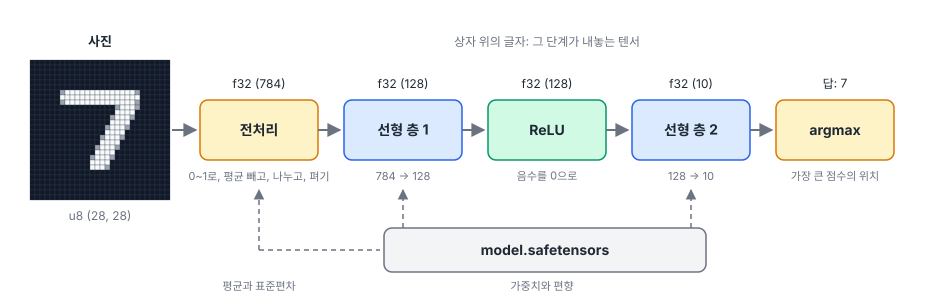
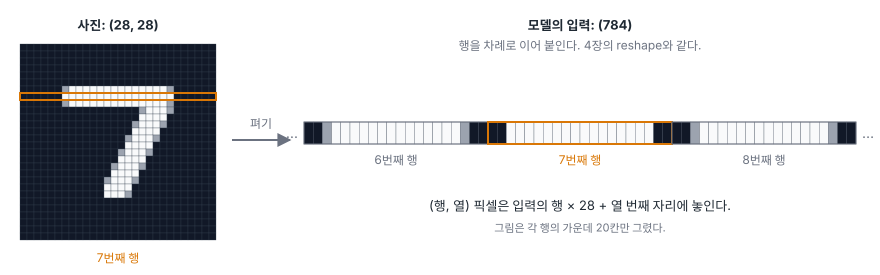
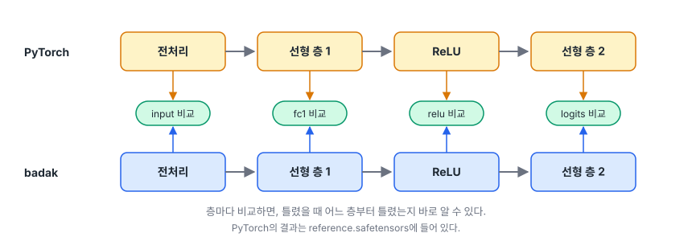

# 첫 완주: 손글씨 숫자 분류

1부의 마지막 장입니다. 지금까지 만든 부품을 모두 이어 붙여서, 손으로 쓴
숫자의 사진을 받아 어떤 숫자인지 답하는 실제 학습된 모델을 처음부터
끝까지 돌립니다.

이 장에서 하는 일은 이 책이 앞으로 모든 모델에서 되풀이할 절차를 작게
줄인 것입니다.

1. 모델과 데이터를 준비한다.
2. 모델의 계산 순서를 badak의 코드로 옮긴다.
3. 실행해서 답을 얻는다.
4. PyTorch의 계산과 층마다 대조해, 우리 계산이 맞는지 확인한다.
5. 속도를 재고 실전 도구와 비교한다.



결과를 미리 말하면, badak은 PyTorch와 1만 장 모두에서 같은 답을 내지만
400배 넘게 느립니다. 맞는 답을 내는 엔진을 만드는 일과 빠른 엔진을
만드는 일이 서로 다른 일이라는 것을 숫자로 확인하면서 1부를 마칩니다.

이 장은 [3장](ch03_neural_networks.md)의 다층 퍼셉트론,
[5장](ch05_operators.md)의 연산자, [6장](ch06_model_files.md)의 파일
읽기를 바탕으로 합니다. 코드는 새 크레이트 `crates/badak_models`에
있습니다.

### 모델과 데이터를 내려받는다

모델과 데이터를 내려받습니다. 내려받는 양은 약 12MB이고 압축을 풀면 약
56MB입니다.

```bash
sh scripts/download_mnist.sh
```

```bash
sh scripts/download_ch07.sh
```

두 스크립트는 파일을 `models/` 아래에 두고 해시를 확인합니다. 이
디렉터리는 Git이 관리하지 않습니다. 이 책은 어떤 모델도 저장소에 넣지
않고 공개된 곳에서 내려받습니다.

## 7.1 MNIST는 손글씨 숫자 사진 7만 장이다

MNIST는 손으로 쓴 숫자 사진 7만 장을 모은 데이터입니다.[^mnist] 6만 장이
학습용, 1만 장이 시험용이고, 사진마다 0부터 9까지의 정답이 붙어
있습니다. 사진은 가로세로 28픽셀의 흑백이며, 픽셀 하나는 0(검정)부터
255(흰색)까지의 값입니다. 숫자는 검은 바탕에 흰색으로 쓰여 있습니다.

딥러닝에서 가장 오래 쓰여 온 연습용 데이터여서 새 도구가 제대로
동작하는지 확인하는 첫 시험으로 흔히 쓰이고, 우리도 그렇게 씁니다.

### IDX 형식은 머리의 숫자를 빅 엔디언으로 적는다

MNIST는 IDX라는 단순한 형식의 파일 네 개로 배포됩니다.
[6장](ch06_model_files.md)에서 본 형식과 구조가 같아서, 머리에 형상이
있고 그 뒤로 값이 행 우선으로 이어집니다.

| 위치 | 내용 | 시험용 사진 파일의 값 |
|---|---|---|
| 0~1 | 항상 0 | `00 00` |
| 2 | 자료형 번호. `08`이 부호 없는 8비트 | `08` |
| 3 | 차원 수 | `03` |
| 4부터 | 차원별 길이. 4바이트씩, **빅 엔디언** | 10000, 28, 28 |
| 그 뒤 | 값 | 픽셀 7,840,000개 |

다른 점이 하나 있는데, 머리의 숫자가 빅 엔디언입니다.
[6장](ch06_model_files.md)의 형식과 반대로 높은 자리의 바이트를 먼저
적어서, 1만은 `00 00 27 10`으로 적혀 있습니다. 형식마다 바이트 순서가
다를 수 있으니 규격을 확인해야 합니다.

```rust
{{#include ../../../crates/badak_formats/src/idx.rs:idx}}
```

[6장](ch06_model_files.md)의 부품을 그대로 써서, 파일을 메모리에 비추고
값의 구간을 `Tensor::from_bytes`에 넘깁니다. `u8`은 정렬 조건이 없으므로
7.8MB의 픽셀이 복사 없이 텐서가 됩니다. 형상과 값의 길이가 맞는지는
`from_bytes`가 확인합니다.

## 7.2 모델은 층이 둘인 다층 퍼셉트론이다

모델은 [3장](ch03_neural_networks.md)에서 파라미터 수를 세어 본 바로 그
다층 퍼셉트론입니다.

| 층 | 입력 길이 | 출력 길이 | 파라미터 수 |
|---|---|---|---|
| 선형 층 1 | 784 | 128 | 100,480 |
| ReLU | 128 | 128 | 0 |
| 선형 층 2 | 128 | 10 | 1,290 |
| 합계 | | | 101,770 |

사진의 픽셀 784개를 한 줄로 펴서 넣으면 숫자 열 개마다 점수가 하나씩
나오고, 점수가 가장 높은 숫자가 답입니다.

### 가중치는 PyTorch로 학습한다

[3장](ch03_neural_networks.md)에서 말한 대로 이 책은 학습을 다루지
않으므로 가중치는 PyTorch로 학습합니다. 학습 스크립트에서 모델을
정의하는 부분은 다음과 같습니다.

```python
{{#include ../../../reference/ch07_train_mnist.py:model}}
```

Python을 몰라도 구조는 읽을 수 있습니다. `nn.Linear(784, 128)`이 첫 선형
층이고 `forward`가 순전파이며, [3장](ch03_neural_networks.md)의 `Mlp`와
같은 모양입니다.

학습 기록은 다음과 같습니다.

```text
{{#include output/ch07_train.txt}}
```

**에폭**<sup>epoch</sup>은 학습 데이터 전체를 한 번 훑는 것을 말합니다.
[3장](ch03_neural_networks.md)에서 본 대로 손실이 줄어들면서 정확도가
오릅니다. 다섯 번 훑은 뒤에는 시험용 사진 1만 장 가운데 9,764장을
맞힙니다. 학습은 이 책의 기준 기계에서 10초쯤 걸립니다.

직접 학습해 보고 싶다면 `notebooks/ch07_mnist.ipynb` 노트북을 Google
Colab에서 열어 실행하면 되고, Python을 설치할 필요가 없습니다. 다만 같은
코드로 학습해도 기계와 PyTorch 버전에 따라 가중치가 조금 다를 수 있어서,
정확도가 이 책의 숫자와 소수점 아래에서 다를 수 있습니다.

### 모델 파일에는 텐서가 네 개 들어 있다

학습한 가중치는 [6장](ch06_model_files.md)의 safetensors 형식으로
저장했습니다. [6장](ch06_model_files.md)에서 만든 도구로 내용을 봅니다.

```bash
cargo run --release -p badak_formats --example ch06_inspect -- models/mnist_mlp/model.safetensors
```

```text
{{#include output/ch07_inspect.txt}}
```

선형 층마다 가중치와 편향이 하나씩 있어서 텐서가 네 개입니다.
`fc1.weight`의 형상이 `[128, 784]`인 것을 확인하십시오.
[3장](ch03_neural_networks.md)에서 가중치의 형상을
`(출력 길이, 입력 길이)`로 정하면서 "PyTorch와 같은 약속을 써야 파일의
숫자를 변환 없이 쓸 수 있다"고 했는데, 그 약속이 여기서 지켜집니다.

메타데이터에는 전처리에 쓰는 평균과 표준편차를 넣어 두었습니다. 이 두
숫자는 7.3절의 전처리에서 씁니다.

이 파일은 Hugging Face Hub에 올려 두었습니다.[^hub] `download_ch07.sh`는
거기서 특정 버전을 지정해 내려받고 해시를 확인합니다.

> **같은 가중치, 다른 파일.** 이 책의 기준 기계에서는 학습을 다시 실행해도
> 가중치가 한 비트도 달라지지 않았습니다. 그런데 파일의 해시는 실행할
> 때마다 달라졌습니다. 헤더의 메타데이터가 적히는 순서가 매번 달랐기
> 때문입니다. 값이 같은 두 파일의 해시가 다를 수 있다는 점은 모델 파일을
> 다룰 때 알아 둘 만합니다. 그래서 직접 학습한 파일은 내려받기 스크립트의
> 해시 검사를 통과하지 못하며, 그것이 정상입니다.

## 7.3 모델의 계산 순서를 badak의 코드로 옮긴다

[1장](ch01_landscape.md)에서 추론 엔진의 첫째 계열은 "모델의 계산 순서를
엔진의 코드로 직접 쓴다"고 했는데, 지금부터 그 일을 합니다. 모델
파일에는 가중치만 있고, 그 가중치로 무엇을 할지는 우리가 Rust로
적습니다.

```rust
{{#include ../../../crates/badak_models/src/mnist.rs:model}}
```

### 가중치를 읽고 형상을 확인한다

```rust
{{#include ../../../crates/badak_models/src/mnist.rs:load}}
```

[6장](ch06_model_files.md)의 `SafeTensors`로 파일을 열고 이름으로 텐서를
꺼냅니다. 꺼낸 텐서는 메모리에 비춘 파일을 그대로 가리킵니다.

읽은 뒤에는 형상이 이 모델의 구조와 맞는지 확인합니다.
[6장](ch06_model_files.md)의 파서는 파일이 형식에 맞는지만 보므로, 그
파일이 **이 모델의 것인지**는 모델 코드가 확인해야 합니다. 다른 모델의
파일을 실수로 넣었을 때 순전파 도중에 알아보기 어려운 형상 오류가 나지
않고 읽는 시점에 분명한 오류가 나게 하려는 것입니다.

### 전처리는 학습할 때와 똑같이 한다

사진을 모델에 넣으려면 `u8` 픽셀을 `f32` 벡터로 바꿔야 합니다. 이 변환을
**전처리**<sup>preprocessing</sup>라고 하며 세 단계로 합니다.

1. 0~255의 정수를 0~1의 실수로 바꾼다. 255로 나눈다.
2. 평균을 빼고 표준편차로 나눈다. 이를
   **정규화**<sup>normalization</sup>라고 한다.
3. `(28, 28)`의 사진을 `(784)`의 벡터로 편다.



전처리는 **학습할 때 한 것과 정확히 같아야 합니다.** 모델의 가중치는
"평균을 빼고 표준편차로 나눈 입력"에 맞춰 학습되었으므로, 다른 방식으로
만든 입력을 넣으면 모델은 처음 보는 종류의 숫자를 받게 됩니다. 그래도
오류는 나지 않고 답만 조용히 나빠집니다.

학습 스크립트의 전처리는 이렇습니다.

```python
{{#include ../../../reference/ch07_train_mnist.py:preprocess}}
```

같은 계산을 Rust로 옮깁니다.

```rust
{{#include ../../../crates/badak_models/src/mnist.rs:preprocess}}
```

평균과 표준편차를 코드에 적지 않고 모델 파일의 메타데이터에서 읽는다는
점에 유의하십시오. 전처리의 값은 모델의 일부여서, 가중치와 떨어져 있으면
언젠가 어긋납니다. [6장](ch06_model_files.md)에서 본 GGUF가 "모델을
돌리는 데 필요한 정보 전부"를 파일 하나에 담는 것도 이 때문입니다.

### 순전파는 세 줄이다

```rust
{{#include ../../../crates/badak_models/src/mnist.rs:forward}}
```

순전파는 [5장](ch05_operators.md)의 `linear`, `relu`, `linear`를 차례로
부르는 세 줄이며, PyTorch의 `self.fc2(torch.relu(self.fc1(x)))`와 한
줄씩 대응합니다.

`trace`는 중간 결과를 버리지 않고 돌려줍니다. 추론만 하려면 필요 없지만
7.5절의 검증에 씁니다. `classify`는 전처리, 순전파, argmax를 이어 붙인
함수로, 사진을 받아 답을 내놓는 전체 과정입니다.

[5장](ch05_operators.md)의 `linear`가 마지막 축에 작용하도록 만들어
두었으므로 사진 한 장이든 1만 장이든 같은 코드로 처리됩니다. 입력의
형상이 `(1, 784)`이면 출력이 `(1, 10)`이고, `(10000, 784)`이면
`(10000, 10)`입니다. 이렇게 여러 입력을 묶어 한 번에 처리하는 것을
**배치**<sup>batch</sup> 처리라고 합니다.

## 7.4 1만 장 가운데 9,764장을 맞힌다

```bash
cargo run --release -p badak_models --example ch07_classify
```

```text
{{#include output/ch07_classify.txt:1:8}}
```

1만 장 가운데 9,764장을 맞힙니다. PyTorch의 학습 기록에 나온 숫자와
같습니다. 우리 엔진으로 실제 모델을 처음부터 끝까지 돌린 첫 결과입니다.

정확도를 구하는 코드는 다음과 같습니다.

```rust
{{#include ../../../crates/badak_models/examples/ch07_classify.rs:accuracy}}
```

### 정규화를 빼먹어도 오류는 나지 않는다

출력의 넷째 줄은 실험입니다. 전처리에서 정규화(평균을 빼고 표준편차로
나누기)만 빼먹은 채 같은 모델을 돌렸더니 정답이 9,764장에서 9,588장으로
줄었습니다. 틀린 사진은 236장에서 412장으로 1.7배가 되었습니다.

코드는 오류 없이 돌았고 답도 대부분 맞아서 더 위험합니다. 이런 버그는
테스트로 잡히지 않고 "모델이 생각보다 덜 정확하다"는 모호한 인상으로만
남습니다. 그래서 추론 엔진에 모델을 옮길 때는 전처리를 가장 먼저
의심해야 합니다. 7.5절의 층별 대조는 전처리부터 비교해 이런 어긋남을
바로 잡아냅니다.

### 직접 그린 숫자도 알아본다

데이터에 없는 사진도 넣어 봅시다. 예제에는 글자로 그린 숫자가 하나 들어
있습니다.

```rust
{{#include ../../../crates/badak_models/examples/ch07_classify.rs:art}}
```

```text
{{#include output/ch07_classify.txt:39:39}}
```

모델은 이 그림을 7로 알아봅니다. 예제는 같은 그림을 왼쪽 위로 6칸 옮긴
것도 넣어 보는데, 그것도 7로 답합니다. 소스의 그림을 고쳐 다른 숫자를
그려 보십시오. 연습 문제에서 이 모델이 어떤 그림에서 틀리는지
찾아봅니다.

## 7.5 PyTorch와 층마다 대조해 검증한다

정확도가 같다고 해서 계산이 같다는 보장은 없습니다. 틀린 계산을 하면서도
우연히 같은 수의 사진을 맞힐 수 있습니다. [5장](ch05_operators.md)에서
정리한 검증 방법 가운데 마지막인 "다른 엔진과 비교"를 처음으로 해
봅니다.

PyTorch가 같은 입력에서 계산한 값을 파일로 받아 우리 값과 층마다
비교합니다.



최종 출력만 비교하지 않고 층마다 비교하는 데는 이유가 있습니다. 최종
출력이 다르면 "어딘가 틀렸다"는 것만 알 수 있지만, 층마다 비교하면
**처음으로 어긋나는 층**이 바로 드러납니다. 층이 둘뿐인 이 모델에서는
차이가 작지만 층이 수백 개인 모델에서는 이 방법 없이는 버그를 찾기
어렵습니다.

학습 스크립트가 모델과 함께 만든 정답 파일 `reference.safetensors`에는
다음이 들어 있습니다.

| 이름 | 형상 | 내용 |
|---|---|---|
| `input` | `(16, 784)` | 앞의 열여섯 장을 전처리한 값 |
| `fc1` | `(16, 128)` | 첫 선형 층의 출력 |
| `relu` | `(16, 128)` | ReLU를 지난 뒤 |
| `logits` | `(16, 10)` | 최종 점수 |
| `all_logits` | `(10000, 10)` | 시험 데이터 전체의 점수 |
| `predictions` | `(10000)` | 시험 데이터 전체의 예측 |

층별 출력은 앞의 열여섯 장만, 최종 결과는 1만 장 전체를 담았습니다. 층별
출력을 전부 담으면 파일이 수십 메가바이트가 되기 때문입니다.

### 허용 오차는 상대 오차 1e-5로 잡는다

[5장](ch05_operators.md)에서 허용 오차를 정하는 기준을 세웠습니다. 선형
층은 많은 수를 더하는 계산이므로 상대 오차 `1e-5`를 씁니다. 절대 오차는
"텐서에서 가장 큰 값의 크기에 상대 오차를 곱한 것"으로 잡습니다.

```rust
{{#include ../../../crates/badak_models/examples/ch07_verify.rs:report}}
```

### 네 층 모두 허용 오차 안에서 일치한다

```bash
cargo run --release -p badak_models --example ch07_verify
```

```text
{{#include output/ch07_verify.txt}}
```

결과를 줄마다 읽어 봅니다.

**전처리의 오차는 0입니다.** 비트 단위로 같습니다. 전처리는 원소마다
나눗셈 두 번과 뺄셈 한 번을 하는 계산이어서 더하는 순서라는 것이
없습니다. [2장](ch02_math.md)에서 본 대로 부동소수점 연산 하나하나는
표준이 결과를 정해 두었으므로, 같은 연산을 같은 순서로 하면 PyTorch와
Rust가 같은 비트를 냅니다. [5장](ch05_operators.md)에서 "원소별 계산은
비트 단위로 같아야 하는 경우도 많다"고 한 경우에 해당합니다.

**선형 층의 오차는 0이 아니지만 허용 오차보다 훨씬 작습니다.** 최대
오차가 `4e-6` 정도이고 허용 오차는 `2e-4` 수준이니 70배쯤 여유가
있습니다. 첫 선형 층은 숫자 784개를 곱해서 더하는데, 우리는 앞에서부터
차례로 더하고 PyTorch는 다른 순서로 더하므로 마지막 자리가 달라집니다.
둘 다 옳은 계산입니다.

**오차가 층을 지나며 커지지 않습니다.** `fc1`에서 생긴 오차가 `relu`와
`logits`에서도 같은 크기에 머뭅니다. 층이 둘뿐이라 쌓일 틈이 없습니다.
2부에서 층이 수십 개인 모델을 대조할 때는 이 열이 아래로 갈수록 커지는
것을 보게 됩니다.

**1만 장 전체의 예측이 PyTorch와 한 장도 다르지 않습니다.** 점수의 최대
오차는 `1.1e-5`입니다. 가장 높은 두 점수의 차이가 이보다 작은 사진이
있었다면 예측이 갈릴 수 있었지만, 그런 사진은 없었습니다.

이 대조는 `cargo test`에도 들어 있어서, 모델 파일이 있으면 실행되고
없으면 건너뜁니다. GitHub에 코드를 올릴 때마다 자동 테스트가 모델을
내려받아 이 대조를 돌립니다.

### 대조가 실패하면 처음 어긋난 줄을 본다

이번에는 한 번에 통과했지만, 모델을 옮기는 작업에서 대조는 대개 처음에
실패합니다. 그때는 다음 표에서 버그의 위치를 찾습니다.

| 처음 실패하는 줄 | 의심할 곳 |
|---|---|
| 전처리 | 정규화 값, 나누는 순서, 펴는 순서(행 우선인가) |
| `fc1` | 가중치를 잘못 읽음. 형상을 뒤집어 읽었거나 다른 텐서를 읽음 |
| `relu` | 활성화 함수의 종류가 다름 |
| `logits` | 둘째 층의 가중치나 편향 |
| 전체 `logits`만 | 배치 처리. 여러 장을 묶을 때의 형상 처리 |

[5장](ch05_operators.md)의 `compare`가 돌려주는 보고서, 즉 몇 개가
얼마나 어디서 틀렸는지를 함께 보면 원인을 더 좁힐 수 있습니다. 7.4절의
"정규화를 빼먹은" 모델은 이 표의 첫 줄에서 바로 걸립니다.

## 7.6 badak은 PyTorch보다 400배 넘게 느리다

맞는 답을 낸다는 것을 확인했으니 속도를 잽니다. 시험 데이터 1만 장을
분류하는 시간을 재고, 같은 모델을 PyTorch로 실행하는 시간도 같은
방법으로 쟀습니다.

```bash
cargo run --release -p badak_models --example ch07_bench
```

측정 환경은 다음과 같습니다.

```text
{{#include ../../../bench/ch07/environment.txt}}
```

badak의 결과입니다.

```text
{{#include ../../../bench/ch07/badak.txt}}
```

PyTorch의 결과입니다.

```text
{{#include ../../../bench/ch07/pytorch.txt}}
```

[1장](ch01_landscape.md)에서 본 네 저울 가운데 두 가지 지표를 쟀습니다.

- **처리량**: 1만 장을 한 번에 넣었을 때 1초에 몇 장을 처리하는가.
- **지연 시간**: 한 장만 넣었을 때 답이 나오기까지 얼마나 걸리는가.

| | badak | PyTorch | 차이 |
|---|---|---|---|
| 1만 장을 한 번에 | 약 412 ms | 약 1 ms | 약 420배 |
| 한 장씩 | 약 41 µs | 약 6.5 µs | 약 6배 |

badak이 크게 집니다. [1장](ch01_landscape.md)에서 "첫 대결에서 badak은
크게 진다. 그것이 정상이다"라고 예고한 대로입니다. 이제 왜 지는지를 따져
봅니다.

> 이 절의 숫자는 1부를 쓸 때의 엔진으로 잰 것입니다. 지금 저장소의
> 엔진은 3부에서 만든 커널을 쓰므로, 같은 명령을 돌리면 훨씬 빠른 숫자가
> 나옵니다. 이 412밀리초가 어떻게 줄어드는지는 16.8절과 18.12절에서
> 다시 잽니다.

### 1만 장에서 420배 느린 까닭은 둘이다

이 모델에서 시간은 거의 전부 첫 선형 층에서 쓰입니다. 사진 한 장에
곱셈이 `784 × 128`번, 약 10만 번이므로 1만 장이면 10억 번입니다.
[2장](ch02_math.md)에서 배운 대로 세면 곱셈과 덧셈을 합쳐 약 20억
FLOP입니다.

badak은 이 계산을 0.41초에 합니다. 초당 약 50억 FLOP, 5GFLOP/s입니다.
[2장](ch02_math.md)에서 단순한 행렬 곱이 2~3.5GFLOP/s를 냈으니 같은
수준입니다. 우리의 `linear`는 [5장](ch05_operators.md)에서 밝힌 대로
사진마다 `matvec`을 따로 부르고, 그 안은 단순한 반복문입니다.

PyTorch는 같은 계산을 1밀리초에 합니다. 초당 약 2조 FLOP,
2TFLOP/s입니다. 여기서 눈여겨볼 것이 둘 있습니다.

**첫째, PyTorch는 스레드를 1개로 제한해도 12개일 때와 속도가 같습니다.**
스레드 수가 성능과 무관하다면 일을 하는 것이 우리가 생각하는 CPU 코어가
아닐 수 있습니다.

**둘째, 2TFLOP/s는 CPU 코어 하나가 보통의 방법으로 낼 수 있는 속도가
아닙니다.** 우리의 400배입니다.

측정 환경에 실마리가 있습니다. 이 PyTorch는 행렬 연산을 Apple의
Accelerate 프레임워크[^accelerate]에 맡기도록 만들어져 있고, 이 맥의
칩에는 SME라는 행렬 연산 전용 확장이 있습니다.

> **실측 아님.** Accelerate가 이 칩의 행렬 연산 전용 하드웨어를 쓴다는
> 것은 널리 알려진 이야기이지만, Apple의 공식 문서에서 확인하지는
> 못했습니다. 이 책이 직접 확인한 것은 두 가지입니다. PyTorch의 빌드
> 설정에 `BLAS_INFO=accelerate`가 있다는 것과, 운영체제가 이 칩에 SME가
> 있다고 보고한다는 것입니다. 스레드 수와 무관한 2 TFLOP/s라는 측정값은 이
> 설명과 잘 맞습니다.

그러니 420배는 두 가지 원인이 합쳐진 숫자입니다.

| 원인 | 설명 | 다루는 곳 |
|---|---|---|
| 우리 커널이 단순하다 | 캐시도, SIMD도, 여러 코어도 쓰지 않는다 | 16~18장 |
| 상대가 전용 하드웨어를 쓴다 | 일반 CPU 명령으로는 따라갈 수 없는 영역 | [13장](../part2/ch13_first_showdown.md), [23장](../part3/ch23_gpu.md), [31장](../part4/ch31_mobile_engines.md) |

첫째는 우리가 줄일 수 있는 격차이고 3부에서 줄입니다. 둘째는 성격이
다릅니다. 엔진을 비교할 때 **상대가 어떤 하드웨어를 쓰고 있는지**를
확인하지 않으면 엉뚱한 결론을 내리게 됩니다.
[13장](../part2/ch13_first_showdown.md)에서 llama.cpp와 처음 겨룰 때는
상대가 무엇을 쓰는지부터 확인하고, 조건을 맞춘 비교와 맞추지 않은 비교를
나누어 잽니다.

### 한 장씩 넣으면 계산 밖의 비용이 드러난다

한 장만 넣을 때는 차이가 6배로 줄어듭니다. 계산량이 10만 번의
곱셈뿐이어서 전용 하드웨어의 이점이 작아지고, 텐서를 새로 만드는 비용,
형상을 검사하는 비용, 함수를 부르는 비용 같은 다른 비용이 드러나기
때문입니다.

PyTorch의 한 장당 6.5마이크로초도 대부분 이런 비용일 것입니다. 1만 장을
한 번에 넣으면 장당 0.1마이크로초인데 한 장씩 넣으면 65배가 걸리니,
계산이 아닌 곳에 시간이 쓰인다는 뜻입니다.

이 숫자에서 배치 처리가 얼마나 이득인지 알 수 있습니다. 묶어서 넣으면
사진 한 장당 비용이 크게 줄어들지만, 묶이기를 기다려야 하므로 한 장의
답이 나오는 시간은 길어집니다. [1장](ch01_landscape.md)에서 본 지연
시간과 처리량의 맞바꿈이며, [40장](../part5/ch40_throughput.md)에서
서버를 만들 때 본격적으로 다룹니다.

> 이 측정은 초시계로 재는 수준의 거친 측정입니다. 여러 번 실행해 가장
> 빠른 값을 골랐을 뿐입니다. 측정을 제대로 설계하는 법은 [14장](../part3/ch14_measurement.md)에서
> 다룹니다.

## 7.7 실전 엔진에서는

이 장에서 한 일은 llama.cpp가 새 모델을 지원할 때 하는 일과 같은
종류입니다. 모델을 만든 쪽의 코드(대개 PyTorch)를 읽고, 그 계산 순서를
엔진의 코드로 옮기고, 가중치 파일의 이름과 형상을 맞추고, 원본과 출력을
대조합니다. [1장](ch01_landscape.md)에서 본 llama.cpp의 `src/models/`
디렉터리에 있는 파일 하나하나가 그런 작업의 결과입니다.

이 방식의 장단점을 직접 겪었습니다.

- **장점**: 모델 코드가 짧고 읽기 쉽습니다. 순전파가 세 줄이었습니다.
  모델에 맞춘 최적화를 넣기도 쉽습니다.
- **단점**: 모델마다 사람이 코드를 써야 합니다. 또 옮기는 과정에서
  전처리 같은 세부 사항이 어긋나기 쉽습니다.

둘째 계열의 엔진은 이 단점을 다른 방법으로 풉니다. 모델을 만든 도구가
계산 순서까지 파일에 적어 주므로 사람이 옮길 필요가 없습니다. 다만
전처리는 여전히 파일 밖에 있어서 같은 문제가 그대로 남습니다.
[26장](../part4/ch26_graph_interpreter.md)에서 그래프 해석기를 만들 때
다시 확인합니다.

## 1부를 마친다

빈 디렉터리에서 시작해 실제 모델을 돌리는 데까지 왔습니다. 1부에서 만든
것을 정리합니다.

| 장 | 만든 것 | 이 장에서 쓰인 곳 |
|---|---|---|
| [2장](ch02_math.md) | 내적, 행렬 곱, 소프트맥스, 허용 오차 비교 | 선형 층의 계산, 검증 |
| [3장](ch03_neural_networks.md) | 활성화 함수, 선형 층, 다층 퍼셉트론 | 모델의 구조 |
| [4장](ch04_tensor.md) | 텐서, 뷰, 브로드캐스팅 | 모든 데이터의 그릇 |
| [5장](ch05_operators.md) | 연산자, 축소, 비교 보고서 | 순전파, argmax, 층별 대조 |
| [6장](ch06_model_files.md) | 모델 파일 읽기, 메모리 매핑 | 가중치와 데이터 읽기 |
| 7장 | 모델 코드, 층별 대조, 첫 벤치마크 | |

지금의 badak은 **맞지만 느린** 엔진입니다. 맞다는 것은 PyTorch와의
대조로 확인했고, 느리다는 것은 400배라는 숫자로 확인했습니다.

2부에서는 이 엔진으로 훨씬 큰 모델을 돌립니다. 숫자 열 개 가운데 하나를
고르는 모델이 아니라, 수만 개의 단어 조각 가운데 다음에 올 것을 고르는
언어 모델입니다. 파라미터가 10만 개에서 10억 개로 늘어납니다. 지금의
속도로는 한 단어를 만드는 데 한참이 걸릴 것이고, 2부의 끝에서 그 느림을
llama.cpp와 나란히 놓고 잽니다. 3부에서는 그 격차를 줄입니다.

## 정리

- 모델을 엔진으로 옮기는 절차는 준비, 계산 순서 옮기기, 실행, 대조, 측정의
  다섯 단계입니다.
- 전처리는 학습할 때와 정확히 같아야 합니다. 어긋나도 오류는 나지 않고
  답만 나빠집니다. 정규화를 빼먹자 틀린 사진이 1.7배가 되었습니다.
- 전처리의 값은 모델의 일부이므로 모델 파일에 함께 둡니다.
- 검증은 층마다 합니다. 처음으로 어긋나는 층이 버그의 위치입니다.
- badak은 전처리에서 PyTorch와 비트 단위로 같고, 선형 층에서 `4e-6`의
  차이를 보이며, 1만 장 모두에서 같은 답을 냅니다.
- 기준 기계에서 1만 장을 분류하는 데 badak은 약 412밀리초, PyTorch는 약
  1밀리초가 걸렸습니다.
- 격차의 일부는 우리의 단순한 커널에서, 일부는 상대가 쓰는 전용
  하드웨어에서 옵니다. 비교할 때는 상대가 무엇을 쓰는지 확인해야 합니다.

## 연습 문제

1. `ch07_classify` 예제의 그림을 고쳐 숫자 1, 4, 8을 그려 보십시오. 모델이
   모두 알아봅니까. 틀리는 그림을 하나 찾아보고, 왜 틀렸을지 추측해
   보십시오. 선의 굵기와 숫자의 크기를 바꿔 가며 실험해 보십시오.
2. 그림의 흑백을 뒤집어(흰 바탕에 검은 숫자) 넣으면 어떻게 됩니까.
   7.3절의 "학습할 때와 똑같이"라는 원칙으로 결과를 설명해 보십시오.
3. 전처리에서 255로 나누는 것까지 빼먹으면 정확도가 얼마가 됩니까.
   `with_normalization`만으로는 실험할 수 없으니 `preprocess`를 고쳐야
   합니다. 실험한 뒤 `ch07_verify`를 실행해, 층별 대조의 어느 줄에서
   걸리는지 확인해 보십시오.
4. `fc1.weight`를 읽은 뒤 `transpose(0, 1)`을 적용한 모델을 만들면 어떤
   오류가 납니까. 오류가 나는 곳은 읽을 때입니까, 순전파 도중입니까.
   7.3절의 형상 검사가 없었다면 어땠을지도 생각해 보십시오.
5. 틀린 236장 가운데 몇 장을 골라 `art_from_image`로 출력해 보십시오.
   사람이 보기에도 헷갈리는 숫자입니까. 그 사진들의 점수에서 1등과 2등의
   차이는 맞힌 사진들과 비교해 어떻습니까.
6. `ch07_bench`에서 1만 장을 한 번에 넣는 대신 100장씩 100번에 나누어
   넣으면 전체 시간이 어떻게 달라집니까. 열 장씩 1,000번이면 어떻습니까.
   7.6절의 "한 장씩" 결과와 함께 놓고, badak에서 배치의 크기가 얼마나
   중요한지 판단해 보십시오.
7. 노트북으로 은닉층의 크기를 128에서 32로 줄인 모델을 학습해 보십시오.
   `MnistMlp::load`는 이 모델을 읽을 수 있습니까. 정확도와 속도는 각각
   어떻게 달라집니까. [1장](ch01_landscape.md)의 네 저울로 이 변화를 설명해 보십시오.

## 참고 문헌

[^mnist]: Y. LeCun, L. Bottou, Y. Bengio, P. Haffner, "Gradient-based
    learning applied to document recognition", *Proceedings of the IEEE*,
    86(11), 2278-2324, 1998.
    [doi:10.1109/5.726791](https://doi.org/10.1109/5.726791). MNIST를
    소개하고 여러 분류 방법을 비교한 논문입니다. 이 책은 데이터를 PyTorch
    프로젝트의 미러 `https://ossci-datasets.s3.amazonaws.com/mnist/`에서
    내려받습니다(2026-11-16 확인).

[^hub]: 이 책이 학습해 올린 모델.
    <https://huggingface.co/building-an-inference-engine-from-scratch/mnist-mlp>
    (버전 `ff9e117d7f1f`). 가중치, PyTorch 정답, 만든 방법을 적은 설명이
    있습니다.

[^accelerate]: Apple, "Accelerate" 프레임워크 문서.
    <https://developer.apple.com/documentation/accelerate> (2026-11-16
    확인). 벡터와 행렬 연산을 비롯한 수치 계산 라이브러리 모음입니다.
