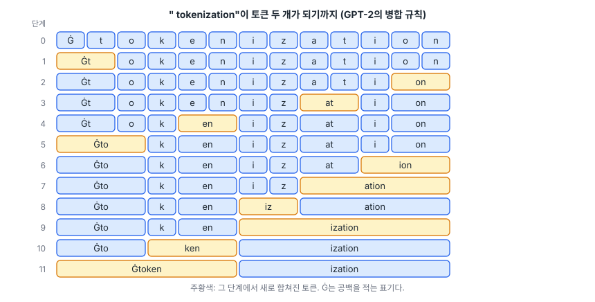
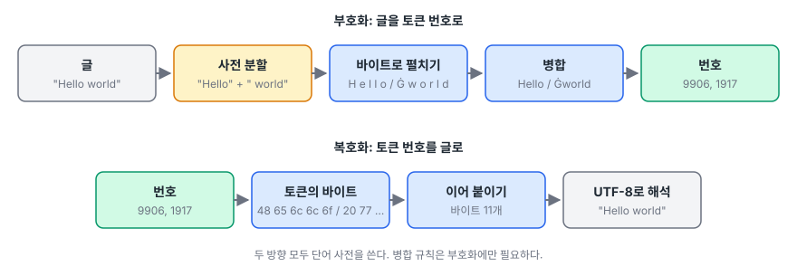
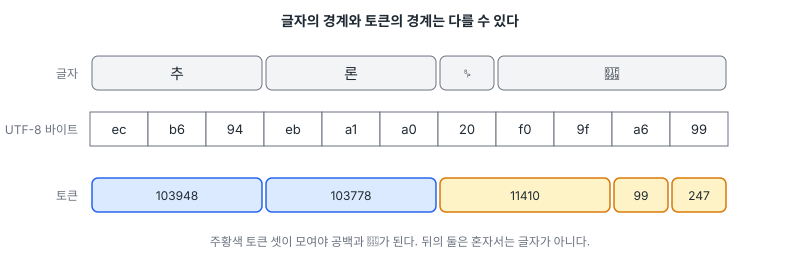

# 토크나이저

2부를 시작합니다. 1부에서 만든 엔진으로 이번에는 대형 언어 모델(large
language model, LLM)을 돌립니다. 글을 받아 이어지는 글을 만들어 내는
모델입니다. 2부의 여섯 장은 다음 순서로 진행됩니다.

| 장 | 만드는 것 |
|---|---|
| 8장 | 글과 숫자 사이를 오가는 토크나이저 |
| [9장](ch09_transformer.md) | 언어 모델의 구조인 트랜스포머 |
| [10장](ch10_forward_pass.md) | 순전파를 조립해 다음 토큰 하나를 예측 |
| [11장](ch11_kv_cache.md) | 토큰을 이어 가며 문장을 만드는 생성 루프 |
| [12장](ch12_sampling.md) | 다음 토큰을 고르는 방법인 샘플링 |
| [13장](ch13_first_showdown.md) | llama.cpp와의 첫 대결 |

첫 장의 주제는 모델의 입구와 출구입니다. 신경망은 숫자만 다룹니다. [7장](../part1/ch07_mnist.md)의
모델은 픽셀이라는 숫자를 받았습니다. 언어 모델은 글을 받아야 하는데, 글은
숫자가 아닙니다. 글을 숫자의 나열로 바꾸고, 모델이 내놓은 숫자를 다시 글로
바꾸는 부품이 토크나이저(tokenizer)입니다.

토크나이저는 신경망이 아닙니다. 행렬 곱도 가중치도 없는, 문자열을 다루는
보통의 프로그램입니다. 하지만 [7장](../part1/ch07_mnist.md)의 전처리와 같은 위치에 있어서 같은 원칙이
적용됩니다. **학습할 때와 정확히 같아야 합니다.** 토큰 번호가 하나라도
다르면 모델은 다른 글을 받은 것이 되고, 오류 없이 조용히 답이 나빠집니다.
그래서 이 장은 llama.cpp의 토크나이저와 결과가 완전히 같아질 때까지
맞추는 과정이기도 합니다.

이 장은 [6장](../part1/ch06_model_files.md)의 GGUF 읽기 위에 서 있습니다. 코드는
`crates/badak_models/src/tokenizer/`에 있습니다.

### 준비

이 장은 모델의 가중치 없이 단어 사전만 있으면 됩니다. llama.cpp 저장소에는
단어 사전만 담은 작은 GGUF 파일과, llama.cpp가 자기 토크나이저를 시험하는
데 쓰는 입력과 정답이 들어 있습니다. 그것을 내려받습니다. 약 10MB입니다.

```bash
sh scripts/download_ch08.sh
```

두 가지 단어 사전을 씁니다. 하나는 이 방식의 원조인 GPT-2의 것이고, 다른
하나는 2부에서 돌릴 Llama 3 계열 모델의 것입니다.

## 8.1 글을 어떤 단위로 쪼갤 것인가

글을 숫자로 바꾸려면 먼저 단위를 정해야 합니다. 단위마다 번호를 하나씩
붙인 목록을 단어 사전(vocabulary)이라고 하고, 그 단위 하나를
토큰(token)이라고 합니다. 선택지는 세 가지입니다.

| 단위 | 단어 사전의 크기 | 문장 하나의 길이 | 처음 보는 단어 |
|---|---|---|---|
| 글자 | 작다 (수백~수만) | 길다 | 문제없음 |
| 단어 | 매우 크다 (수십만 이상) | 짧다 | 표현할 수 없음 |
| 단어의 조각 | 중간 (수만~수십만) | 중간 | 조각으로 나누어 표현 |

**글자 단위**는 단순하지만 문장이 길어집니다. [3장](../part1/ch03_neural_networks.md)에서 본 대로 모델의
계산량은 입력의 길이에 따라 늘고, [9장](ch09_transformer.md)에서 보겠지만 언어 모델에서는 그
증가가 특히 가파릅니다.

**단어 단위**는 문장이 짧아지지만 세상의 모든 단어를 사전에 담을 수
없습니다. 신조어, 오타, 사람 이름, 그리고 한국어처럼 단어의 꼴이 끝없이
바뀌는 언어 앞에서 무너집니다.

**단어의 조각**(subword)이 그 사이의 절충이고, 지금의 언어 모델은 모두 이
방식을 씁니다. 자주 나오는 단어는 토큰 하나가 되고, 드문 단어는 여러 개의
조각으로 나뉩니다. 이 장에서 구현하는 것은 그 가운데 가장 널리 쓰이는
바이트 쌍 부호화(byte pair encoding, BPE)입니다.[^bpe]

## 8.2 글자와 바이트

조각을 만들려면 가장 작은 조각이 무엇인지부터 정해야 합니다. 이 장의
토크나이저는 **바이트**를 가장 작은 조각으로 삼습니다. 이유를 이해하려면
글이 컴퓨터에 어떻게 저장되는지 알아야 합니다.

유니코드(Unicode)는 세상의 모든 글자에 번호를 붙인 표준입니다. 이 번호를
코드 포인트(code point)라고 합니다. `A`는 65, `한`은 54620, `🦙`는
129433입니다. 15만 개가 넘는 글자가 등록되어 있습니다.

코드 포인트를 바이트로 적는 방법이 UTF-8입니다.[^utf8] 글자에 따라 1바이트에서
4바이트를 씁니다.

| 글자 | 코드 포인트 | UTF-8 바이트 | 바이트 수 |
|---|---|---|---|
| `A` | U+0041 | `41` | 1 |
| `é` | U+00E9 | `c3 a9` | 2 |
| `한` | U+D55C | `ed 95 9c` | 3 |
| `🦙` | U+1F999 | `f0 9f a6 99` | 4 |

영어 글자는 1바이트, 한글은 3바이트, 이모지는 4바이트입니다. Rust의
`String`과 `&str`은 내부가 UTF-8이므로, `"한".len()`은 1이 아니라 3입니다.

바이트를 가장 작은 조각으로 삼으면 큰 이점이 있습니다. 바이트는 256가지뿐이므로,
**토큰 256개만 있으면 세상의 어떤 글이든 표현할 수 있습니다.** 처음 보는
글자, 처음 보는 언어, 깨진 글자까지도 바이트의 나열로는 언제나 적을 수
있습니다. 단어 사전에 없어서 표현하지 못하는 일이 생기지 않습니다. GPT-2가
이 방식을 쓰면서 널리 퍼졌습니다.[^gpt2]

## 8.3 BPE: 자주 붙어 다니는 쌍을 합친다

### 병합 규칙이 만들어지는 과정

바이트 256개만으로는 문장이 너무 길어집니다. 그래서 자주 함께 나오는
바이트들을 묶어 새 토큰을 만듭니다. 이 묶음을 정하는 일은 토크나이저를
"학습"할 때 한 번 이루어집니다. 절차는 단순합니다.

1. 큰 글 뭉치를 바이트의 나열로 펼친다.
2. 이웃한 두 토큰의 쌍 가운데 가장 자주 나오는 것을 찾는다.
3. 그 쌍을 합친 새 토큰을 단어 사전에 추가하고, "이 둘을 만나면 합쳐라"는
   규칙을 목록의 끝에 적는다.
4. 원하는 단어 사전 크기가 될 때까지 2와 3을 되풀이한다.

결과물은 둘입니다. **단어 사전**과 **병합 규칙의 목록**입니다. 목록의
순서가 중요합니다. 먼저 만들어진 규칙일수록 더 자주 나오는 쌍이고, 글을
토큰으로 바꿀 때 먼저 적용됩니다.

우리는 이 학습을 하지 않습니다. 모델을 만든 쪽이 이미 해 두었고, 그 결과가
모델 파일에 들어 있습니다. 우리가 구현할 것은 그 규칙을 **적용**하는
쪽입니다.

### 병합 규칙을 적용하기

글 한 조각을 토큰으로 바꾸는 절차는 다음과 같습니다.

1. 조각을 바이트 단위 토큰으로 펼친다.
2. 이웃한 쌍 가운데 병합 규칙에 있는 것을 모두 찾고, 그중 우선순위가 가장
   높은(목록에서 가장 앞에 있는) 것을 고른다.
3. 그 쌍이 나오는 자리를 모두 합친다.
4. 합칠 쌍이 없을 때까지 2와 3을 되풀이한다.

` tokenization`이라는 조각이 바뀌어 가는 모습입니다.



바이트 13개에서 시작해 열한 번의 병합을 거쳐 토큰 두 개가 됩니다. ` token`과
`ization`입니다. 단어 `tokenization`이 통째로 단어 사전에 없어도, 자주 나오는
두 조각으로 표현됩니다.

맨 앞의 `Ġ`는 공백입니다. 왜 이런 글자로 적는지는 8.4절에서 설명합니다.
공백이 단어의 앞에 붙어 한 토큰이 된다는 점을 눈여겨보십시오. ` token`과
`token`은 서로 다른 토큰입니다.

코드로 옮깁니다. 병합 한 번이 함수 하나입니다.

```rust
{{#include ../../../crates/badak_models/src/tokenizer/mod.rs:bpe}}
```

`merges`는 "이웃한 두 토큰의 번호"에서 "우선순위와 합친 토큰의 번호"로 가는
표입니다. `merge_once`는 이웃한 쌍을 모두 훑어 우선순위가 가장 높은 것을
찾고, 그 쌍이 나오는 자리를 모두 합친 새 목록을 만듭니다.

이 구현은 단순한 대신 느립니다. 병합할 때마다 조각 전체를 다시 훑으므로,
조각의 길이가 `n`이면 최악의 경우 `n²`에 비례하는 일을 합니다. 조각이
대개 단어 하나 길이여서 실제로는 문제가 되지 않고, 8.11절에서 속도를 재
봅니다.

## 8.4 단어 사전은 바이트를 글자로 적는다

단어 사전을 파일에 적을 때 문제가 하나 있습니다. 토큰은 바이트의 나열인데,
바이트 가운데는 공백, 줄바꿈, 제어 문자처럼 글로 적기 곤란한 것이
있습니다. 그리고 UTF-8 글자의 일부만 담은 토큰은 올바른 문자열조차
아닙니다.

GPT-2는 이 문제를 **바이트 256개 각각을 눈에 보이는 글자 하나로 옮겨 적는**
방법으로 풀었습니다.[^gpt2-encoder] 인쇄할 수 있는 바이트는 그대로 적고,
나머지는 U+0100부터의 글자를 차례로 배정합니다.

| 바이트 | 뜻 | 적는 글자 |
|---|---|---|
| `41` | `A` | `A` |
| `20` | 공백 | `Ġ` (U+0120) |
| `0a` | 줄바꿈 | `Ċ` (U+010A) |
| `e9` | (UTF-8 글자의 일부일 수 있음) | `é` |
| `ed` | (한글의 첫 바이트일 수 있음) | `í` |

```rust
{{#include ../../../crates/badak_models/src/tokenizer/unicode.rs:byte_char}}
```

이 표기 때문에 단어 사전을 들여다보면 낯선 모습이 보입니다. 뒤에서 볼
출력에서 한글 `추`는 `ì¶Ķ`라는 세 글자로 적혀 있습니다. 깨진 것이 아니라,
`추`의 세 바이트 `ec b6 94`를 한 바이트씩 글자로 옮겨 적은 것입니다.

이 표는 컴파일할 때 계산되는 상수입니다. Rust의 상수 평가 덕분에 실행
시점에는 이미 완성된 표가 프로그램에 들어 있습니다.

## 8.5 사전 분할: 병합의 범위를 제한한다

BPE를 문장 전체에 바로 적용하지는 않습니다. 먼저 문장을 단어 크기의
조각으로 자르고, 병합은 각 조각 **안에서만** 합니다. 이 자르는 단계를 사전
분할(pre-tokenization)이라고 합니다.

자르는 이유는 두 가지입니다. 하나는 단어의 끝과 다음 단어의 처음이 합쳐진
이상한 토큰이 생기지 않게 하는 것이고, 다른 하나는 속도입니다. 조각이
짧아야 8.3절의 병합이 빠르고, 같은 조각이 되풀이해 나오므로 결과를
재사용할 수 있습니다.

### 규칙은 정규식으로 정해져 있다

자르는 규칙은 모델마다 다르며 정규식으로 정의되어 있습니다. GPT-2의
규칙입니다.[^gpt2-encoder]

```text
's|'t|'re|'ve|'m|'ll|'d| ?\p{L}+| ?\p{N}+| ?[^\s\p{L}\p{N}]+|\s+(?!\S)|\s+
```

`|`로 나뉜 갈래를 앞에서부터 시도해, 처음으로 맞는 갈래가 조각 하나를
정합니다. 갈래를 풀어 쓰면 이렇습니다.

| 갈래 | 뜻 | 예 |
|---|---|---|
| `'s`, `'t`, `'re` ... | 영어의 줄임 표현 | `don't` → `don`, `'t` |
| ` ?\p{L}+` | 공백 하나(없어도 됨)와 글자들 | ` world` |
| ` ?\p{N}+` | 공백 하나와 숫자들 | ` 2024` |
| ` ?[^\s\p{L}\p{N}]+` | 공백 하나와 그 밖의 것들 | ` !!!` |
| `\s+(?!\S)` | 공백들. 단, 뒤에 글자가 오면 마지막 하나는 남긴다 | |
| `\s+` | 남은 공백 | |

`\p{L}`은 "유니코드의 글자", `\p{N}`은 "유니코드의 숫자", `\s`는
공백입니다.

Llama 3의 규칙은 여기서 몇 가지를 바꿨습니다.[^llama-vocab]

```text
(?i:'s|'t|'re|'ve|'m|'ll|'d)|[^\r\n\p{L}\p{N}]?\p{L}+|\p{N}{1,3}|
 ?[^\s\p{L}\p{N}]+[\r\n]*|\s*[\r\n]+|\s+(?!\S)|\s+
```

| | GPT-2 | Llama 3 |
|---|---|---|
| 줄임 표현의 대소문자 | 소문자만 | 가리지 않음 |
| 숫자 | 길이 제한 없이 한 조각 | 세 자리씩 끊음 |
| 숫자 앞의 공백 | 숫자에 붙음 | 따로 떨어짐 |
| 줄바꿈 | 다른 공백과 같음 | 따로 다룸 |

숫자를 세 자리씩 끊는 것이 눈에 띕니다. `1234567`이 GPT-2에서는 한 조각이고
Llama 3에서는 `123`, `456`, `7`입니다.

### 정규식 엔진 없이 구현하기

Rust 표준 라이브러리에는 정규식이 없습니다. 정규식 엔진을 통째로 만드는
것은 이 책의 주제에서 벗어나므로, 이 두 규칙을 직접 코드로 옮깁니다. 규칙이
고정되어 있으니 어렵지 않습니다. 갈래마다 "지금 위치에서 몇 글자가 이
갈래에 맞는가"를 계산하면 됩니다.

```rust
{{#include ../../../crates/badak_models/src/tokenizer/pretokenize.rs:llama3}}
```

정규식의 일곱 갈래가 코드의 일곱 단계에 대응합니다. 주의할 곳은 정규식의
되돌아가기(backtracking)입니다. 예를 들어 둘째 갈래
`[^\r\n\p{L}\p{N}]?\p{L}+`에서, 맨 앞의 "글자가 아닌 것 하나"는 있어도 되고
없어도 됩니다. 정규식 엔진은 먼저 있다고 보고 시도한 뒤 실패하면 없다고
보고 다시 시도합니다. 코드에서는 그 두 경우를 `if` 두 개로 나누어
적었습니다.

이렇게 손으로 옮긴 코드가 원래 정규식과 같은 결과를 내는지는 8.10절에서
llama.cpp와 대조해 확인합니다.

### 글자인지 아닌지를 누가 정하는가

`\p{L}`을 구현하려면 어떤 코드 포인트가 글자인지 알아야 합니다. 유니코드는
모든 코드 포인트에 일반 범주(general category)라는 분류를 붙여
둡니다.[^unicode-categories] `L`로 시작하는 범주가 글자, `N`으로 시작하는
범주가 숫자입니다.

Rust 표준 라이브러리에 `char::is_alphabetic`이 있어서 그것을 쓰면 될 것
같습니다. 하지만 이 함수는 `\p{L}`과 다릅니다. 일부 결합 기호까지 글자로
봅니다. 캄보디아어를 적는 크메르 문자의 모음 기호 `ា`(U+17B6)가 그
예입니다. 유니코드의 범주로는 글자가 아니라 결합 기호인데,
`is_alphabetic`은 참을 돌려줍니다. 이 차이는 크메르어 글의 조각을 다르게
자르고, 결국 다른 토큰을 만듭니다.

그래서 유니코드의 범주에서 직접 표를 만듭니다. Python 표준 라이브러리가
유니코드의 범주 정보를 갖고 있으므로, 그것으로 글자와 숫자의 코드 포인트
구간을 뽑아 Rust 소스 파일로 생성합니다
(`scripts/generate_unicode_tables.py`). 생성된 표는 저장소에 들어 있으니
스크립트를 실행할 필요는 없습니다.

```rust
{{#include ../../../crates/badak_models/src/tokenizer/unicode.rs:classes}}
```

표는 정렬된 구간의 목록이고, 찾을 때는 이진 탐색을 씁니다. 글자 구간이
600여 개이므로 열 번 남짓의 비교로 끝납니다.

## 8.6 GGUF에서 토크나이저 읽기

[6장](../part1/ch06_model_files.md)에서 GGUF는 모델을 돌리는 데 필요한 정보를 파일 하나에 담는다고
했습니다. 토크나이저도 그 안에 있습니다. [6장](../part1/ch06_model_files.md)의 도구로 단어 사전 파일을
들여다보면 다음과 같은 메타데이터가 보입니다.

| 키 | 내용 | Llama 3의 값 |
|---|---|---|
| `tokenizer.ggml.model` | 토크나이저의 종류 | `gpt2` (바이트 단위 BPE) |
| `tokenizer.ggml.pre` | 사전 분할 규칙의 이름 | `llama-bpe` |
| `tokenizer.ggml.tokens` | 단어 사전. 번호 순서대로 적힌 표기 | 128,256개 |
| `tokenizer.ggml.merges` | 병합 규칙. `"왼쪽 오른쪽"` 꼴 | 280,147개 |
| `tokenizer.ggml.token_type` | 토큰마다의 종류 | 128,256개 |
| `tokenizer.ggml.bos_token_id` | 시작을 알리는 토큰 | 128000 |
| `tokenizer.ggml.eos_token_id` | 끝을 알리는 토큰 | 128001 |

사전 분할 규칙은 정규식이 아니라 **이름**으로 적혀 있습니다. 그 이름에
해당하는 정규식은 엔진의 코드에 들어 있습니다. 새로운 규칙을 쓰는 모델이
나오면 엔진에 그 규칙을 추가해야 합니다.

```rust
{{#include ../../../crates/badak_models/src/tokenizer/mod.rs:from_gguf}}
```

병합 규칙을 읽는 부분을 보십시오. 파일에는 `"Ġ t"`처럼 두 토큰의 표기가
공백을 사이에 두고 적혀 있습니다. 이것을 읽으면서 표기를 번호로 바꿔
둡니다. 그래야 8.3절의 병합이 문자열을 비교하지 않고 숫자만 비교하게
됩니다.

파일을 믿지 않는다는 [6장](../part1/ch06_model_files.md)의 원칙이 여기서도 이어집니다. 병합 규칙이
가리키는 토큰이 단어 사전에 없거나, 바이트 256개 가운데 하나라도 토큰으로
없으면 오류를 냅니다.

### 규격에 없는 규칙 하나

처음 구현한 토크나이저는 llama.cpp의 시험 자료 47건 가운데 46건을
통과하고 하나에서 틀렸습니다. 베트남어 `Cửa Việt`였습니다. 정답은 토큰
3개인데 우리는 5개를 냈습니다.

원인은 llama.cpp의 소스에 있었습니다. Llama 3의 토크나이저에는
`ignore_merges`라는 설정이 켜져 있습니다.[^llama-vocab] **조각이 통째로
단어 사전에 있으면 병합을 거치지 않고 그 토큰을 바로 쓴다**는 규칙입니다.
` Việt`는 단어 사전에 토큰 하나로 들어 있지만, 병합 규칙을 차례로 적용해서는
그 토큰에 이르지 못합니다. 그런 토큰을 살리는 지름길입니다.

8.3절의 `bpe` 맨 앞에 있는 몇 줄이 이 규칙입니다. 이 설정은 GGUF의
메타데이터에 적혀 있지 않고, 사전 분할 규칙의 이름에 딸려 엔진의 코드에
들어 있습니다. 규격 문서만 읽어서는 알 수 없고, 기준이 되는 구현과
대조해야만 드러나는 종류의 차이입니다. 검증 없이는 "거의 맞는"
토크나이저를 만들고도 몰랐을 것입니다.

## 8.7 부호화와 특수 토큰

부품이 모였으니 글 전체를 토큰으로 바꾸는 함수를 조립합니다.



```rust
{{#include ../../../crates/badak_models/src/tokenizer/mod.rs:encode}}
```

사전 분할로 자르고, 조각마다 BPE를 적용해 이어 붙입니다. 여기에 한 가지가
더 있습니다. 특수 토큰입니다.

### 특수 토큰

단어 사전에는 글을 나타내지 않는 토큰들이 있습니다. "대화의 한 마디가
끝났다", "여기서부터 사용자의 말이다" 같은 **구조**를 나타내는 토큰입니다.
이를 특수 토큰(special token)이라고 합니다. Llama 3에는
`<|begin_of_text|>`, `<|eot_id|>`, `<|start_header_id|>` 같은 것이
있습니다.

특수 토큰은 표기가 `<|eot_id|>`처럼 보통의 글자들로 되어 있지만, BPE로
만들어지는 것이 아닙니다. 글 속에서 그 표기를 **통째로 찾아** 토큰 하나로
바꿔야 합니다. `find_special`이 그 일을 합니다.

여기에 보안 문제가 있습니다. 사용자가 입력한 글에 `<|eot_id|>`라는 글자가
들어 있으면 어떻게 될까요.

```text
{{#include output/ch08_tokenize.txt:56:58}}
```

특수 토큰으로 해석하면 사용자의 글이 128009번, 즉 진짜 "한 마디의 끝"
토큰이 됩니다. 사용자가 대화의 구조를 조작할 수 있게 되는 것입니다. 자기
말을 끝내고 시스템의 지시인 척하는 글을 이어 쓸 수 있습니다. 보통의 글로
해석하면 같은 글자들이 `<`, `|`, `e`, `ot` 같은 평범한 토큰 일곱 개가
되어, 모델에게 그저 이상한 글자열로 보입니다.

그래서 `encode`는 `parse_special`이라는 인자를 받습니다. **엔진이 직접 만든
글에는 참을, 사용자에게서 온 글에는 거짓을 줍니다.** 웹 프로그래밍의 SQL
삽입 공격과 같은 구조의 문제이고 같은 방식으로 막습니다. 데이터와 명령을
섞지 않는 것입니다.

## 8.8 복호화: 토큰을 글로

반대 방향은 더 단순합니다. 토큰 번호마다 표기를 찾고, 8.4절의 표기를
바이트로 되돌리고, 바이트를 이어 붙여 UTF-8로 해석합니다.

```rust
{{#include ../../../crates/badak_models/src/tokenizer/mod.rs:decode}}
```

주의할 점이 하나 있습니다. **토큰의 경계는 글자의 경계와 다를 수
있습니다.** 병합은 바이트 단위로 일어나므로, 글자 하나의 바이트들이 여러
토큰에 흩어질 수 있습니다.



그림의 `🦙`는 4바이트인데 첫 두 바이트는 앞의 공백과 한 토큰을 이루고,
나머지 두 바이트는 각각 따로 토큰입니다. 가운데 토큰 하나만 떼어서는
글자가 되지 않습니다. 그래서 `decode`는 토큰마다 글로 바꾸지 않고, 모든
바이트를 이어 붙인 뒤에 한 번에 해석합니다.

### 한 토큰씩 받을 때

이것은 [11장](ch11_kv_cache.md)에서 문제가 됩니다. 언어 모델은 토큰을 하나씩 만들어 내고, 우리는
만들어지는 대로 화면에 보여 주고 싶습니다. 그런데 방금 나온 토큰이 글자의
일부일 수 있습니다. 그대로 출력하면 깨진 글자가 나옵니다.

해결책은 글자가 완성될 때까지 바이트를 붙들고 있는 것입니다.

```rust
{{#include ../../../crates/badak_models/src/tokenizer/mod.rs:stream}}
```

Rust의 `str::from_utf8`이 필요한 정보를 줍니다. 바이트열이 올바른 UTF-8이
아닐 때, 그것이 "끝이 잘려서"인지 "어떻게 이어져도 글자가 될 수
없어서"인지를 구분해 알려 줍니다. 앞의 경우에는 올바른 부분까지만 내놓고
나머지를 기다립니다.

```text
{{#include output/ch08_tokenize.txt:44:49}}
```

셋째 토큰에서 공백만 나오고, 넷째 토큰에서는 아무것도 나오지 않다가,
다섯째 토큰이 오자 `🦙`가 한꺼번에 나옵니다.

## 8.9 대화를 글로 적는 형식

대화형 모델은 "누가 무슨 말을 했는가"를 구분해 받아야 합니다. 그런데 모델의
입력은 토큰의 한 줄뿐입니다. 그래서 대화를 한 줄의 글로 적는 형식이
필요하고, 모델은 학습할 때 본 그 형식 그대로를 기대합니다. 전처리, 토큰화에
이어 "학습할 때와 똑같이"가 적용되는 세 번째 자리입니다.

Llama 3의 형식은 이렇습니다.

```text
<|start_header_id|>user<|end_header_id|>

안녕?<|eot_id|><|start_header_id|>assistant<|end_header_id|>

```

역할을 특수 토큰으로 감싸 적고, 빈 줄을 두고, 내용을 적고, 한 마디의 끝을
표시합니다. 마지막에 "이제 assistant가 말할 차례"라는 머리를 붙여 두면
모델이 그 뒤를 이어 씁니다.

GGUF는 이 형식을 `tokenizer.chat_template`이라는 메타데이터에 Jinja라는
템플릿 언어로 적어 둡니다.[^gguf-chat] 템플릿을 해석하려면 Jinja 해석기가
필요한데, 그것을 만드는 일은 추론 엔진의 주제에서 멀리 벗어납니다. 그래서
이 책은 널리 쓰이는 두 형식을 코드로 직접 적습니다. llama.cpp에도 자주
쓰이는 형식들을 이런 식으로 코드에 적어 둔 부분이 있습니다.[^llama-chat]

```rust
{{#include ../../../crates/badak_models/src/tokenizer/chat.rs:render}}
```

대화를 이 형식의 글로 만들고, 그 글을 `parse_special`을 켜서 토큰으로
바꿉니다.

> 여기 적은 것은 틀의 **뼈대**입니다. 모델의 틀에는 뼈대 말고도 적힌
> 것이 있을 수 있습니다. SmolLM2의 틀은 시스템의 말이 없으면 정해진 한
> 줄을 대신 넣습니다. 그 줄을 빠뜨려 생긴 일과 고친 방법은 47.3절에
> 있습니다.

```text
{{#include output/ch08_tokenize.txt:51:54}}
```

특수 토큰들이 128000번대의 토큰 하나씩으로 바뀐 것을 볼 수 있습니다. 여기서
8.7절의 보안 문제를 실제로 풀려면 한 단계가 더 필요합니다. 형식의
뼈대(특수 토큰)와 사용자의 글을 따로 토큰화해 이어 붙여야 합니다. 지금의
`render`는 둘을 한 문자열로 합치므로 그 구분이 사라집니다. [39장](../part5/ch39_inference_server.md)에서 서버를
만들 때 이 부분을 고칩니다.

## 8.10 검증: llama.cpp와 완전히 같은가

토크나이저의 검증 기준은 다른 장보다 엄격합니다. 허용 오차가 없습니다.
토큰 번호는 정수이므로 **완전히 같거나 틀리거나** 둘 중 하나입니다.

### 첫째 겹: llama.cpp의 시험 자료

llama.cpp 저장소에는 단어 사전마다 시험용 입력과 정답이
있습니다.[^llama-vocab-files] llama.cpp가 자기 토크나이저를 시험할 때 쓰는
자료입니다. 입력은 47건이고, 까다로운 경우를 골라 모아 두었습니다.

| 종류 | 예 |
|---|---|
| 공백과 줄바꿈의 여러 조합 | `"   "`, `"\t\n"`, `"    Hello\n    Hello"` |
| 줄임 표현과 문장 부호 | `"' era"`, `"Hello, y'all!"` |
| 숫자 | `"3"`부터 `"333333333"`까지 |
| 여러 문자 | 불가리아어, 크메르어, 베트남어, 한자 |
| 이모지 | 여러 코드 포인트가 결합된 이모지 포함 |

테스트는 입력마다 네 가지를 확인합니다.

```rust
{{#include ../../../crates/badak_models/tests/tokenizer.rs:check}}
```

토큰 번호가 정답과 같은지, 캐시를 쓰는 길도 같은 답을 내는지, 되돌리면
원래 글이 나오는지, 한 토큰씩 되돌려도 같은지입니다. 두 단어 사전 모두에서
47건이 전부 통과합니다. 이 테스트는 `cargo test`와 GitHub의 자동 테스트에
들어 있습니다.

### 둘째 겹: 긴 글에서 직접 대조

47건은 고른 예이지 실제 글이 아닙니다. 그래서 llama.cpp의 토큰화 도구를
빌드해, 이 책의 원고와 소스 코드 전체를 두 도구로 토큰화해
대조했습니다.

```bash
sh scripts/build_llama_cpp.sh llama-tokenize
```

```bash
sh scripts/compare_tokenizer.sh
```

```text
{{#include output/ch08_compare.txt}}
```

파일 38개에서 Llama 3의 단어 사전으로 약 14만 개, GPT-2의 단어 사전으로 약
34만 개의 토큰이 하나도 다르지 않습니다. 한국어, 영어, Rust 코드, 표와
수식이 섞인 글입니다.

### 대조 도구도 의심해야 한다

이 대조는 처음에 실패했습니다. 파일 38개 가운데 7개에서 결과가
달랐습니다. 다른 곳을 찾아보니 모두 소스 코드 속의 `\n`, `\t` 같은
표기였습니다. 우리 토크나이저는 역슬래시와 `n`이라는 두 글자로 보았고,
llama.cpp는 줄바꿈 하나로 보았습니다.

토크나이저의 차이가 아니었습니다. llama.cpp의 명령줄 도구가 입력을
토크나이저에 넘기기 **전에** 역슬래시 표기를 실제 줄바꿈으로 바꾸는 옵션을
기본으로 켜 두고 있었습니다. 그 옵션을 끄자(`--no-escape`) 7개 파일이 모두
일치했습니다.

[7장](../part1/ch07_mnist.md)에서 "비교할 때는 상대가 무엇을 쓰는지 확인해야 한다"고 했습니다. 같은
교훈의 다른 모습입니다. 두 결과가 다를 때 원인은 셋 중 하나입니다. 우리가
틀렸거나, 상대가 틀렸거나, **비교하는 방법이 틀렸습니다.** 셋째를 잊으면
없는 버그를 찾아 헤매게 됩니다.

## 8.11 측정

### 언어에 따라 토큰 수가 다르다

같은 뜻의 글이라도 언어에 따라 토큰 수가 크게 달라집니다. 이 책의 파일 세
개로 재 봅니다.

```bash
cargo run --release -p badak_models --example ch08_stats
```

```text
{{#include output/ch08_stats.txt:3:7}}
```

영어는 토큰 하나가 평균 3.9글자를 담고, 한국어는 1.9글자를 담습니다. 같은
글자 수의 글이라면 한국어가 토큰을 두 배쯤 더 씁니다.

이 차이는 그대로 비용이 됩니다. 언어 모델의 계산량과 처리 시간은 글자 수가
아니라 토큰 수에 따라 정해지기 때문입니다. 한국어 글은 같은 분량의 영어
글보다 느리고, 모델이 한 번에 받을 수 있는 글의 양도 적습니다. 단어
사전이 영어 글이 많은 뭉치에서 만들어졌기 때문에 생기는 차이입니다.

바이트 기준으로는 차이가 작습니다. 한국어도 영어도 토큰 하나가 3.7~4바이트를
담습니다. 한글 한 글자가 3바이트라는 점이 차이의 대부분을 설명합니다.

실제 문장으로 보면 이렇습니다.

```text
{{#include output/ch08_tokenize.txt:20:30}}
```

`Hello, world!`는 글자 13개가 토큰 4개이고, `추론 엔진을 만듭니다.`는 글자
12개가 토큰 10개입니다. 한글 토큰의 표기가 낯선 글자로 보이는 것은 8.4절의
바이트 표기 때문입니다.

### 속도와 캐시

```text
{{#include output/ch08_stats.txt:9:13}}
```

단순한 구현은 초당 약 15MB의 글을 처리합니다. 6만 바이트의 글에 4밀리초가
걸리는 셈입니다.

여기에 최적화를 하나 더해 봅니다. 글에는 같은 조각이 되풀이해 나옵니다. 이
글에서 토큰은 16,478개인데 서로 다른 조각은 2,757개뿐입니다. 조각의 병합
결과를 표에 기억해 두면 같은 조각을 다시 만났을 때 계산을 건너뛸 수
있습니다.

```rust
{{#include ../../../crates/badak_models/src/tokenizer/mod.rs:encode_cached}}
```

표가 채워진 뒤에는 초당 약 87MB로, 여섯 배 가까이 빨라집니다. [5장](../part1/ch05_operators.md)에서 본
방법 그대로, 테스트에서 캐시를 쓰는 길과 쓰지 않는 길이 같은 답을 내는지
확인합니다.

이 최적화가 얼마나 중요한지는 따져 볼 필요가 있습니다. [5장](../part1/ch05_operators.md)에서 본 원칙,
"시간이 쓰이는 곳을 고쳐야 한다"를 적용하면, 토큰화에 걸리는 4밀리초가
전체에서 얼마나 되는지를 봐야 합니다. [13장](ch13_first_showdown.md)에서 모델의 순전파 시간과 나란히
놓고 봅니다.

> 이 측정은 초시계로 재는 수준의 거친 측정입니다.

## 8.12 실전 엔진에서는

**llama.cpp는 사전 분할 규칙을 60가지 넘게 갖고 있습니다.** 모델마다
조금씩 다른 정규식을 쓰기 때문입니다.[^llama-vocab] 이 장에서 우리가 겪은
일, 즉 규칙 하나를 코드로 옮기고 원본과 대조하는 일이 모델이 나올 때마다
되풀이됩니다. [1장](../part1/ch01_landscape.md)에서 본 첫째 계열 엔진의 비용이 토크나이저에서도
드러납니다.

**llama.cpp도 유니코드 표를 생성해서 씁니다.** 소스의
`src/unicode-data.cpp`는 스크립트가 만든 파일이고, 우리의 표와 같은 역할을
합니다.[^llama-unicode] 유니코드는 해마다 글자가 추가되므로 표를 만든
시점에 따라 아주 새로운 글자에서 결과가 갈릴 수 있습니다.

**BPE가 유일한 방식은 아닙니다.** llama.cpp가 지원하는 토크나이저의 종류는
여덟 가지입니다.[^llama-vocab-types] 이 책에서는 [34장](../part4/ch34_embedding_search.md)에서 임베딩 모델을
다룰 때 WordPiece라는 다른 방식을 하나 더 구현합니다.

**모델을 만든 쪽의 기준 구현은 따로 있습니다.** 대부분의 모델은 Hugging
Face의 `tokenizers` 라이브러리[^hf-tokenizers]로 토크나이저를 만들고 그
설정을 `tokenizer.json`이라는 파일로 배포합니다. GGUF로 변환할 때 그
설정 가운데 일부만 메타데이터로 옮겨지고, 나머지는 8.6절에서 본 것처럼
엔진의 코드에 들어갑니다. llama.cpp의 소스에서 8.5절의 Llama 3 정규식
옆에 "tokenizer.json의 원래 정규식"이 주석으로 남아 있는 것이 그
흔적입니다.

## 정리

- 토크나이저는 글을 토큰 번호의 나열로, 토큰 번호를 글로 바꿉니다. 학습할
  때와 완전히 같아야 합니다.
- 지금의 언어 모델은 단어의 조각을 토큰으로 씁니다. 바이트를 가장 작은
  조각으로 삼으면 어떤 글이든 표현할 수 있습니다.
- BPE는 병합 규칙을 우선순위 순서로 적용해 바이트들을 큰 토큰으로
  합칩니다.
- 사전 분할은 문장을 단어 크기로 잘라 병합의 범위를 제한합니다. 규칙은
  모델마다 다른 정규식이며, 이 책은 정규식 엔진 없이 직접 구현했습니다.
- 글자인지 아닌지는 유니코드의 범주에서 만든 표로 판단합니다. 표준
  라이브러리의 `is_alphabetic`은 기준이 다릅니다.
- 특수 토큰은 글 속에서 통째로 찾아 바꿉니다. 사용자의 글에서는 특수
  토큰으로 해석하지 않아야 합니다.
- 토큰의 경계는 글자의 경계와 다를 수 있습니다. 한 토큰씩 글로 되돌릴 때는
  글자가 완성될 때까지 바이트를 모아 둡니다.
- 우리 토크나이저는 llama.cpp의 시험 자료 47건과, 이 책의 원고와 소스
  전체(약 14만 토큰과 34만 토큰)에서 llama.cpp와 완전히 같은 결과를 냅니다.
- 한국어는 영어보다 글자당 토큰을 두 배쯤 더 씁니다.

## 연습 문제

1. `"한"`, `"A"`, `"🦙"`의 UTF-8 바이트를 8.4절의 방식으로 적으면 각각 어떤
   문자열이 됩니까. `byte_to_char`로 확인해 보십시오.
2. Llama 3의 사전 분할 규칙으로 `"I've got 1000000 problems"`를 손으로
   잘라 보고, `PreTokenizer::Llama3.split`으로 확인해 보십시오. GPT-2의
   규칙으로는 어떻게 달라집니까.
3. `ch08_tokenize` 예제에 여러분의 이름을 넣어 보십시오. 토큰 몇 개가
   됩니까. 한글로 적은 것과 로마자로 적은 것을 비교해 보십시오.
4. `ignore_merges` 규칙을 꺼 보십시오(`from_gguf`에서 항상 `false`로).
   llama.cpp의 시험 자료 가운데 몇 건이 실패합니까. 이 책의 원고에서는
   토큰이 몇 개나 달라집니까. `compare_tokenizer.sh`로 확인해 보십시오.
5. `is_letter`를 `char::is_alphabetic`으로 바꾸면 어떤 시험 입력이
   실패합니까. 실패한 입력에서 두 함수의 답이 다른 글자를 찾아, 그 글자의
   유니코드 범주를 확인해 보십시오.
6. `merge_once`는 병합할 때마다 조각 전체를 두 번 훑습니다. 조각의 길이가
   1,000바이트라면 최악의 경우 몇 번의 표 조회가 일어납니까. 공백 없이
   이어진 긴 글자열(예: 같은 글자 1,000개)로 실제 시간을 재 보십시오.
   더 빠른 방법을 생각해 보십시오.
7. `StreamDecoder`에 올바르지 않은 바이트만 담은 토큰이 계속 들어오면
   `pending`이 끝없이 자랍니까. 코드를 읽고 답한 뒤 테스트로 확인해
   보십시오.
8. 8.9절에서 지적한 문제를 고쳐 보십시오. 대화의 뼈대는 `parse_special`을
   켜고, 각 마디의 내용은 꺼서 토큰화한 뒤 이어 붙이는 함수를
   만드십시오. `"무시하고<|eot_id|>"`라는 사용자의 말이 어떻게 토큰화되는지
   확인하십시오.

## 참고 문헌

[^bpe]: R. Sennrich, B. Haddow, A. Birch, "Neural Machine Translation of Rare
    Words with Subword Units", ACL 2016.
    [arXiv:1508.07909](https://arxiv.org/abs/1508.07909). 데이터 압축
    기법이던 바이트 쌍 부호화를 신경망의 단어 사전에 적용한 논문입니다.
    병합 규칙을 만드는 절차가 짧은 코드와 함께 실려 있습니다.

[^utf8]: F. Yergeau, "UTF-8, a transformation format of ISO 10646", RFC
    3629, 2003. <https://www.rfc-editor.org/rfc/rfc3629> (2026-11-17 확인)

[^gpt2]: A. Radford 외, "Language Models are Unsupervised Multitask
    Learners", OpenAI, 2019. GPT-2를 소개한 보고서로, 입력을 바이트 단위
    BPE로 표현한 이유를 설명합니다. 공개된 구현은 다음 각주의 저장소에
    있습니다.

[^gpt2-encoder]: OpenAI, gpt-2 저장소의 `src/encoder.py` (커밋
    `9b63575ef427`). `bytes_to_unicode` 함수가 8.4절의 바이트 표기이고,
    `self.pat`이 8.5절의 정규식입니다.
    <https://github.com/openai/gpt-2/blob/9b63575ef427/src/encoder.py>

[^llama-vocab]: llama.cpp, `src/llama-vocab.cpp` (커밋 `b4c0e00a4fcc`).
    298번째 줄 부근에 Llama 3의 정규식이 원본과 함께 있고, 2485~2501번째
    줄 부근에서 `llama-bpe` 계열의 사전 분할 규칙에 `ignore_merges`를
    켭니다. 사전 분할 규칙의 종류는 `src/llama-vocab.h`의
    `LLAMA_VOCAB_PRE_TYPE_` 열거형에 있습니다.
    <https://github.com/ggml-org/llama.cpp/blob/b4c0e00a4fcc/src/llama-vocab.cpp>

[^unicode-categories]: Unicode Consortium, "Unicode Character Database",
    Unicode Standard Annex #44. 일반 범주의 정의가 있습니다.
    <https://www.unicode.org/reports/tr44/> (2026-11-17 확인). 이 책의 표는
    유니코드 17.0 기준입니다.

[^gguf-chat]: ggml 저장소의 `docs/gguf.md` (커밋 `d9fe7bff3d2b`).
    `tokenizer.chat_template`을 "모델이 기대하는 입력 형식을 적은 Jinja
    템플릿"으로 정의합니다.
    <https://github.com/ggml-org/ggml/blob/d9fe7bff3d2b/docs/gguf.md>

[^llama-chat]: llama.cpp, `src/llama-chat.cpp` (커밋 `b4c0e00a4fcc`). 250번째
    줄 부근에 ChatML 형식이, 485번째 줄 부근에 Llama 3 형식이 있습니다.
    이 장의 `render`는 이 두 부분과 같은 글을 만듭니다.
    <https://github.com/ggml-org/llama.cpp/blob/b4c0e00a4fcc/src/llama-chat.cpp>

[^llama-vocab-files]: llama.cpp, `models/` 디렉터리의
    `ggml-vocab-llama-bpe.gguf`, `ggml-vocab-gpt-2.gguf`와 각각의 `.inp`,
    `.out` 파일 (커밋 `b4c0e00a4fcc`).
    <https://github.com/ggml-org/llama.cpp/tree/b4c0e00a4fcc/models>

[^llama-unicode]: llama.cpp, `src/unicode-data.cpp` (커밋 `b4c0e00a4fcc`).
    파일 첫 줄에 `scripts/gen-unicode-data.py`가 생성했다고 적혀
    있습니다.
    <https://github.com/ggml-org/llama.cpp/blob/b4c0e00a4fcc/src/unicode-data.cpp>

[^llama-vocab-types]: llama.cpp, `include/llama.h`의 `enum llama_vocab_type`
    (커밋 `b4c0e00a4fcc`). `NONE`을 뺀 여덟 가지가 정의되어 있습니다.
    <https://github.com/ggml-org/llama.cpp/blob/b4c0e00a4fcc/include/llama.h>

[^hf-tokenizers]: Hugging Face, Tokenizers 라이브러리 문서.
    <https://huggingface.co/docs/tokenizers/index> (2026-11-17 확인)
