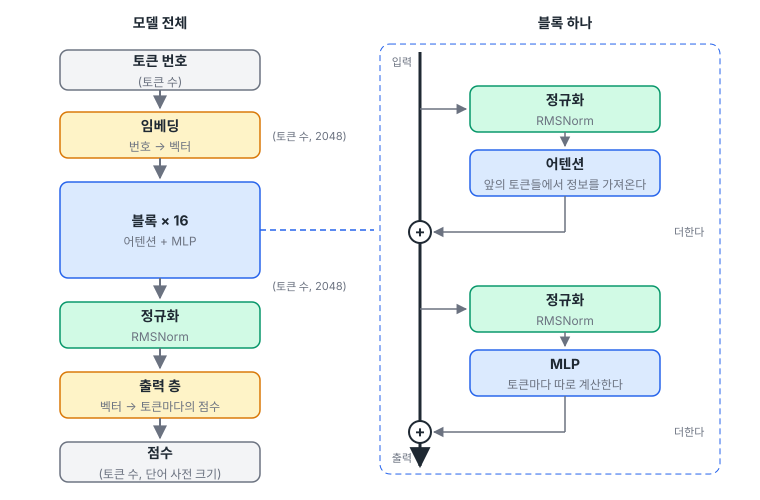
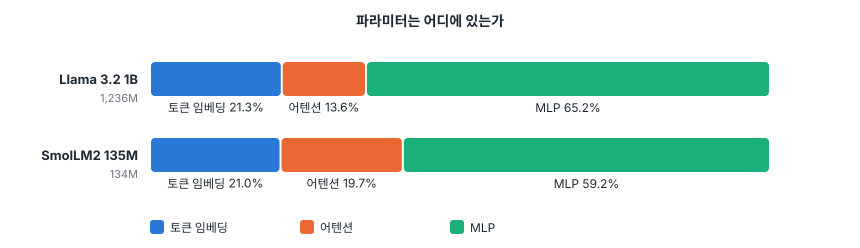
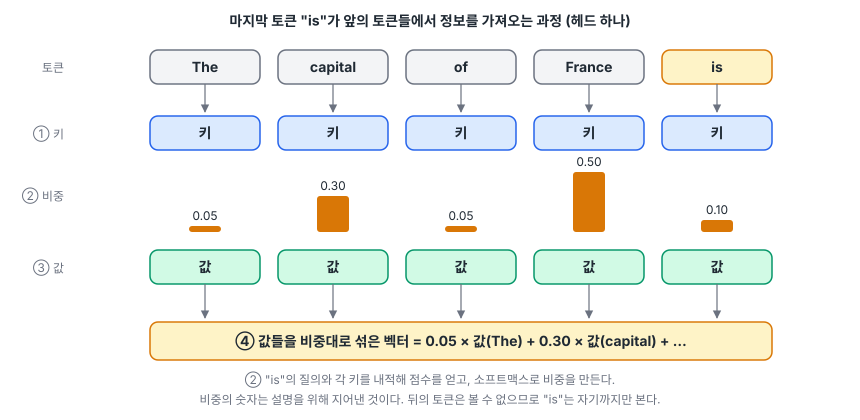
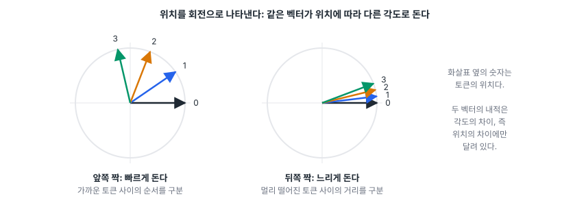
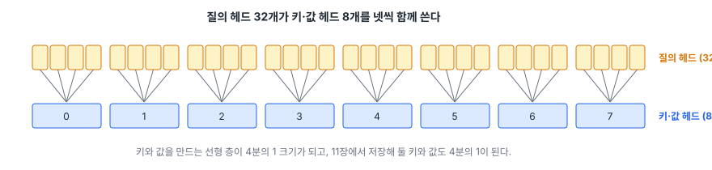

# 트랜스포머 해부

[8장](ch08_tokenizer.md)에서 글을 토큰 번호로 바꿨습니다. 이 장에서는 그 번호를 받아 계산하는
모델의 내부를 들여다봅니다. 지금의 언어 모델은 거의 모두 트랜스포머
(transformer)라는 구조를 씁니다.[^transformer] 이름은 거창하지만 부품은 다섯
가지뿐이고, 그중 셋은 이미 만들었습니다.

| 부품 | 하는 일 | 만든 곳 |
|---|---|---|
| 임베딩 | 토큰 번호를 벡터로 바꾼다 | 이 장 |
| 정규화 | 벡터의 크기를 고르게 맞춘다 | 이 장 |
| 어텐션 | 토큰이 앞의 토큰들에서 정보를 가져온다 | 이 장 |
| MLP | 토큰마다 벡터를 가공한다 | [3장](../part1/ch03_neural_networks.md) (조금 바뀐 형태) |
| 선형 층 | 위 부품들의 속을 채운다 | [3장](../part1/ch03_neural_networks.md), [5장](../part1/ch05_operators.md) |

이 장에서는 부품을 하나씩 만들고, 부품마다 PyTorch의 계산과 대조합니다.
부품을 쌓아 모델 전체의 순전파를 조립하는 일은 [10장](ch10_forward_pass.md)에서 합니다.

이 장은 [5장](../part1/ch05_operators.md)의 연산자, [6장](../part1/ch06_model_files.md)의 파일 읽기, [8장](ch08_tokenizer.md)의 토크나이저 위에 서 있습니다.
코드는 `crates/badak_models/src/llama/`에 있습니다.

### 2부에서 돌릴 모델

2부의 주 모델은 Meta의 **Llama 3.2 1B**입니다.[^llama32] 이름의 1B는
파라미터가 10억 개 남짓이라는 뜻입니다. 개인 컴퓨터에서 돌릴 수 있는
크기이면서 널리 쓰이는 구조를 그대로 갖추고 있습니다.

이 모델은 내려받기 전에 Hugging Face에서 Meta의 라이선스에 동의하고 승인을
받아야 합니다. 그 절차 없이 따라 하고 싶은 독자를 위해 보조 모델을 하나
둡니다. **SmolLM2 135M**입니다.[^smollm2] 구조가 Llama와 같아서 이 책의
코드가 그대로 돌아갑니다. 숫자만 다릅니다.

| | Llama 3.2 1B (주) | SmolLM2 135M (보조) |
|---|---|---|
| 내려받기 | Meta의 승인 필요 | 누구나 |
| 라이선스 | Llama 3.2 Community License | Apache 2.0 |
| 파라미터 | 약 12억 | 약 1.3억 |
| 가중치 파일 | 약 2.5GB | 약 270MB |

```bash
sh scripts/download_llama32.sh
```

```bash
sh scripts/download_smollm2.sh
```

본문의 숫자와 출력은 Llama 3.2 1B의 것입니다. 예제에 모델 이름을 주면
SmolLM2로 같은 결과를 볼 수 있습니다. 이 책의 자동 테스트는 SmolLM2로
돌아갑니다. 승인이 필요한 모델은 자동 테스트가 내려받을 수 없기
때문입니다.

## 9.1 언어 모델이 하는 일

언어 모델이 하는 일은 한 문장으로 말할 수 있습니다.

> 지금까지의 토큰들을 보고, 다음에 올 토큰을 예측한다.

예측은 [7장](../part1/ch07_mnist.md)의 숫자 분류기와 같은 형태입니다. 분류기가 숫자 열 개 각각에
점수를 냈듯, 언어 모델은 단어 사전의 **모든 토큰** 각각에 점수를 냅니다.
Llama 3.2라면 128,256개의 점수입니다. 점수가 높은 토큰이 다음에 올 가능성이
높은 토큰입니다.

입력과 출력의 형상은 이렇습니다.

```text
입력   토큰 번호   (토큰 수)
출력   점수        (토큰 수, 단어 사전 크기)
```

출력이 토큰마다 한 줄씩 있다는 점에 유의하십시오. `i`번째 줄은 "`i`번째
토큰까지 보았을 때 그다음에 올 토큰"에 대한 점수입니다. 글을 이어 쓸 때는
마지막 줄만 필요합니다. 나머지 줄은 학습할 때 쓰입니다.

문장을 만드는 것은 이 예측을 되풀이하는 일입니다. 다음 토큰을 하나 고르고,
그것을 입력의 끝에 붙이고, 다시 예측합니다. 이 되풀이는 [11장](ch11_kv_cache.md)에서 다루고,
이 장과 다음 장은 예측 한 번에 집중합니다.

## 9.2 전체 구조



토큰 번호는 임베딩을 거쳐 벡터가 됩니다. 그 벡터들이 같은 모양의
블록(block) 여러 개를 차례로 지납니다. 마지막에 정규화를 한 번 하고, 출력
층이 벡터를 토큰마다의 점수로 바꿉니다.

눈여겨볼 것은 **블록을 지나는 동안 텐서의 형상이 변하지 않는다**는
점입니다. 처음부터 끝까지 `(토큰 수, 2048)`입니다. 토큰마다 길이 2048인
벡터가 하나씩 있고, 블록은 그 벡터들을 조금씩 고쳐 나갑니다.

### 잔차 연결

그림의 오른쪽, 블록 내부를 보면 굵은 세로선이 위에서 아래로 곧장
지나갑니다. 어텐션과 MLP는 이 선에서 값을 읽어 계산한 뒤, 결과를 선 위의
값에 **더합니다.** 값을 바꿔치기하지 않고 더한다는 것이 핵심입니다.

```text
h   = x + 어텐션(정규화(x))
출력 = h + MLP(정규화(h))
```

이렇게 입력을 그대로 흘려보내면서 계산 결과를 더하는 구조를 잔차
연결(residual connection)이라고 합니다. 각 부품은 벡터 전체를 새로 만들
필요 없이 "무엇을 고칠지"만 계산하면 됩니다. 블록을 수십 개 쌓아도 학습이
잘 되는 것이 이 구조 덕분입니다.

추론 엔진의 관점에서는 덧셈 두 번이 추가될 뿐입니다. [5장](../part1/ch05_operators.md)의 `add`로
충분합니다.

### 설정

모델의 크기는 몇 개의 숫자로 정해집니다. 모델 파일 옆의 `config.json`에
적혀 있습니다. [6장](../part1/ch06_model_files.md)에서 만든 JSON 파서로 읽습니다.

```rust
{{#include ../../../crates/badak_models/src/llama/mod.rs:config}}
```

```text
{{#include output/ch09_anatomy_llama.txt:1:8}}
```

각 숫자가 무엇인지는 부품을 만들면서 하나씩 설명합니다.

## 9.3 파일로 보는 구조

구조를 이해하는 좋은 방법은 모델 파일을 직접 들여다보는 것입니다. [6장](../part1/ch06_model_files.md)의
도구로 가중치 파일의 텐서 목록을 봅니다.

```bash
cargo run --release -p badak_formats --example ch06_inspect -- models/llama32_1b/model.safetensors
```

```text
{{#include output/ch09_inspect.txt:7:22}}
```

이름이 구조를 그대로 말해 줍니다. 맨 위가 임베딩 표이고, 그 아래로
`layers.0`, `layers.1`처럼 블록마다 텐서가 아홉 개씩 있습니다.

| 텐서 | 형상 | 부품 |
|---|---|---|
| `input_layernorm.weight` | `(2048)` | 어텐션 앞의 정규화 |
| `self_attn.q_proj.weight` | `(2048, 2048)` | 어텐션: 질의 |
| `self_attn.k_proj.weight` | `(512, 2048)` | 어텐션: 키 |
| `self_attn.v_proj.weight` | `(512, 2048)` | 어텐션: 값 |
| `self_attn.o_proj.weight` | `(2048, 2048)` | 어텐션: 출력 |
| `post_attention_layernorm.weight` | `(2048)` | MLP 앞의 정규화 |
| `mlp.gate_proj.weight` | `(8192, 2048)` | MLP |
| `mlp.up_proj.weight` | `(8192, 2048)` | MLP |
| `mlp.down_proj.weight` | `(2048, 8192)` | MLP |

블록 16개에 아홉 개씩 144개, 여기에 임베딩과 마지막 정규화를 더해 파일의
텐서는 모두 146개입니다. [3장](../part1/ch03_neural_networks.md)에서 본 대로 가중치의 형상은 `(출력 길이,
입력 길이)`입니다. 그리고 편향이 하나도 없습니다. 이 모델의 선형 층은
`y = W x`뿐입니다.

코드에서는 블록 하나의 가중치를 구조체 하나로 묶습니다.

```rust
{{#include ../../../crates/badak_models/src/llama/mod.rs:block_weights}}
```

```rust
{{#include ../../../crates/badak_models/src/llama/mod.rs:weights}}
```

[7장](../part1/ch07_mnist.md)에서처럼 텐서를 읽을 때마다 형상이 설정과 맞는지 확인합니다. 파일을
여는 것은 메모리에 비추기만 하는 일이므로 2.5GB 파일도 바로 열리고, 값은
텐서를 꺼낼 때 그 텐서만 읽습니다.

### 파라미터는 어디에 있는가

텐서의 형상을 모두 곱해 더하면 파라미터 수가 나옵니다.

```text
{{#include output/ch09_anatomy_llama.txt:10:16}}
```



세 가지를 읽을 수 있습니다.

- **MLP가 파라미터의 3분의 2를 차지합니다.** 트랜스포머라고 하면 어텐션이
  먼저 떠오르지만, 숫자의 대부분은 MLP에 있습니다. [3장](../part1/ch03_neural_networks.md)에서 "MLP는 더 큰
  모델의 부품으로 더 자주 등장하고, 모델의 파라미터 대부분이 그 안에
  있다"고 한 대로입니다.
- **임베딩 표가 5분의 1입니다.** 토큰 128,256개에 벡터 2048개씩이니 2억 6천만
  개입니다. 그런데 9.4절에서 보듯 임베딩은 곱셈 없이 표에서 꺼내기만 하므로
  계산 시간에는 거의 기여하지 않습니다. 파라미터 수와 계산량은 같은 것이
  아닙니다.
- **정규화의 파라미터는 무시할 만합니다.**

### BF16: 절반 크기의 실수

위 목록에서 자료형이 `BF16`인 것을 보셨을 것입니다. [6장](../part1/ch06_model_files.md)의 파서는 `F32`,
`I32`, `U8`만 텐서로 꺼낼 수 있었습니다. 새 자료형이 하나 필요합니다.

BF16(bfloat16)은 16비트 실수입니다. 만드는 방법이 단순합니다. `f32`의 32비트
가운데 **위쪽 16비트만 남깁니다.** [2장](../part1/ch02_math.md)에서 본 `f32`의 구조로 말하면 부호
1비트와 지수 8비트는 그대로 두고, 가수 23비트를 7비트로 줄인 것입니다.

| | 부호 | 지수 | 가수 | 십진 유효 숫자 |
|---|---|---|---|---|
| `f32` | 1 | 8 | 23 | 약 7자리 |
| BF16 | 1 | 8 | 7 | 약 2~3자리 |

지수가 그대로이므로 나타낼 수 있는 수의 범위는 `f32`와 같고, 정밀도만
낮습니다. 파일 크기가 절반이 됩니다. 12억 개의 숫자가 4.6GiB가 아니라
2.3GiB에 담깁니다.

정밀한 16비트 계산은 19장에서 다룹니다. 이 장에서는 가장 단순한 방법을
씁니다. 읽을 때 `f32`로 펼칩니다. 아래쪽 16비트를 0으로 채우면 같은 값의
`f32`가 됩니다.

```rust
{{#include ../../../crates/badak_formats/src/safetensors.rs:bf16}}
```

값은 한 비트도 달라지지 않습니다. 대신 대가가 둘 있습니다. [6장](../part1/ch06_model_files.md)의 "복사
없이 빌려 쓰기"가 이 텐서들에는 통하지 않고, 메모리가 파일의 두 배
듭니다. 모델 전체를 펼치면 4.6GiB입니다. 이 맥에서는 문제가 없지만
폰에서는 그렇지 않습니다. 3부에서 이 문제로 돌아옵니다.

## 9.4 임베딩

모델의 첫 단계는 토큰 번호를 벡터로 바꾸는 것입니다. 임베딩 표는
`(단어 사전 크기, 벡터 길이)`인 행렬이고, 토큰 번호가 행 번호입니다.
번호가 791인 토큰의 벡터는 표의 791번째 행입니다.

```rust
{{#include ../../../crates/badak_core/src/ops.rs:embedding}}
```

계산이 없습니다. 행을 찾아 복사할 뿐입니다. 이 연산을 "찾아보기"라는
뜻에서 룩업(lookup)이라고도 부릅니다.

토큰 번호는 모델의 입력이므로 범위를 벗어난 값이 들어올 수 있습니다.
검사하지 않으면 표 밖의 메모리를 읽게 됩니다. 음수와 표의 크기 이상인
번호를 모두 오류로 처리합니다.

이 벡터가 무엇을 뜻하는지는 학습이 정합니다. 학습된 모델에서는 뜻이 비슷한
토큰들이 비슷한 방향의 벡터를 갖게 됩니다. [2장](../part1/ch02_math.md)에서 본 코사인 유사도로 재
볼 수 있고, 연습 문제에서 해 봅니다.

## 9.5 RMS 정규화

블록 안에서 어텐션과 MLP의 앞에는 정규화(normalization)가 하나씩 있습니다.
[7장](../part1/ch07_mnist.md)의 전처리에서 본 정규화와 목적이 같습니다. 숫자의 크기를 일정한 범위로
맞춥니다. 블록을 수십 개 지나는 동안 벡터의 크기가 한없이 커지거나
작아지면 계산이 불안정해지기 때문입니다.

Llama 계열이 쓰는 것은 RMS 정규화(RMSNorm)입니다.[^rmsnorm] 벡터의 원소들을
제곱해 평균을 내고 제곱근을 취한 값, 즉 제곱평균제곱근(root mean
square)으로 벡터를 나눕니다.

```text
rms = sqrt( (x₀² + x₁² + ... + xₙ₋₁²) / n + eps )
y   = x / rms × weight
```

나누고 나면 벡터의 "평균적인 크기"가 1이 됩니다. 그런 다음 원소마다 학습된
`weight`를 곱합니다. 정규화가 지워 버린 크기 정보 가운데 필요한 만큼을
모델이 되살릴 수 있게 하는 장치입니다. `eps`는 원소가 모두 0일 때 0으로
나누는 것을 막는 작은 수입니다.

```rust
{{#include ../../../crates/badak_core/src/ops.rs:rms_norm}}
```

제곱의 합을 구할 때 [5장](../part1/ch05_operators.md)의 쌍별 합산을 씁니다. 숫자 2048개를 더하는
일이므로 [5장](../part1/ch05_operators.md)의 원칙을 그대로 따랐습니다.

정규화는 벡터 하나하나에 따로 적용됩니다. 토큰이 다른 토큰의 값에 영향을
주지 않습니다.

## 9.6 어텐션

지금까지의 부품은 모두 토큰을 따로따로 다뤘습니다. 임베딩도 정규화도 한
토큰의 벡터만 봅니다. 그런데 언어를 이해하려면 토큰들이 서로를 봐야
합니다. "프랑스의 수도는"이라는 글에서 다음 토큰을 예측하려면 "수도"가
"프랑스"를 참조해야 합니다.

**토큰이 다른 토큰의 정보를 가져오는 유일한 통로가 어텐션(attention)입니다.**

### 질의, 키, 값

어텐션은 도서관에서 책을 찾는 일에 빗댈 수 있습니다. 찾는 사람은 원하는
것을 적은 쪽지를 들고 있고, 책마다 내용을 요약한 색인이 붙어 있습니다.
쪽지와 색인이 잘 맞는 책일수록 그 내용을 많이 가져옵니다.

토큰마다 벡터 세 개를 만듭니다.

| 이름 | 뜻 | 빗댄 것 |
|---|---|---|
| 질의(query) | 내가 찾는 것 | 쪽지 |
| 키(key) | 내가 가진 것의 요약 | 색인 |
| 값(value) | 내가 줄 수 있는 내용 | 책의 내용 |

셋 모두 토큰의 벡터에 선형 층을 하나씩 적용해 만듭니다. 9.3절에서 본
`q_proj`, `k_proj`, `v_proj`가 그 선형 층입니다.



어떤 토큰이 정보를 가져오는 절차는 다음과 같습니다.

1. 자기의 질의와, 자기를 포함한 앞선 토큰들의 키를 각각 **내적**한다.
   [2장](../part1/ch02_math.md)에서 본 대로 내적은 두 벡터가 닮은 정도를 잰다. 이것이 점수다.
2. 점수를 **소프트맥스**에 넣어 합이 1인 비중으로 바꾼다.
3. 앞선 토큰들의 **값**을 그 비중대로 곱해 더한다.

[2장](../part1/ch02_math.md)에서 만든 내적과 소프트맥스가 어텐션의 전부입니다. 새로운 계산은
없습니다.

### 뒤를 보지 않는다

토큰은 자기보다 **앞에 있는** 토큰만 봅니다. 다음 토큰을 예측하는 모델이
다음 토큰을 미리 볼 수 있다면 예측이 아니기 때문입니다. 이 제약을 인과적
마스킹(causal masking)이라고 합니다.

구현은 간단합니다. `i`번째 토큰의 점수를 구할 때 0번째부터 `i`번째까지의
키만 씁니다. 그 뒤의 토큰은 계산에 넣지 않습니다.

이 제약에는 추론 엔진에 아주 중요한 결과가 따라옵니다. 어떤 토큰의 계산
결과는 뒤에 무엇이 오든 변하지 않습니다. 그러니 한 번 계산한 것을 저장해
두면 다시 계산할 필요가 없습니다. [11장](ch11_kv_cache.md)의 주제인 KV 캐시가 바로 이
성질에서 나옵니다.

### 여러 헤드

한 번의 어텐션은 한 가지 기준으로만 앞을 볼 수 있습니다. 그래서 벡터를
여러 조각으로 나누어 조각마다 따로 어텐션을 합니다. 이 조각 하나를
헤드(head)라고 합니다. Llama 3.2 1B는 길이 2048인 벡터를 길이 64인 조각
32개로 나눕니다. 어떤 헤드는 바로 앞의 토큰을, 어떤 헤드는 문장의 주어를
보는 식으로 헤드마다 다른 것을 보게 학습됩니다.

헤드들의 결과를 다시 이어 붙여 길이 2048로 만들고, 선형 층 `o_proj`를 한 번
지나면 어텐션이 끝납니다.

### 구현

```rust
{{#include ../../../crates/badak_models/src/llama/attention.rs:attention}}
```

주석의 번호를 따라 읽으면 위의 설명과 그대로 대응합니다. 가장 안쪽을 보면
점수는 [2장](../part1/ch02_math.md)의 `dot`, 비중은 [2장](../part1/ch02_math.md)의 `softmax`입니다. `(0..=token)`이라는
범위가 "뒤를 보지 않는다"는 제약입니다.

2번의 "위치에 따라 돌린다"와 "질의 헤드 여럿이 키·값 헤드 하나를 함께
쓴다"는 다음 두 절에서 설명합니다.

### 어텐션의 비용

어텐션의 계산량에는 다른 부품에 없는 특징이 있습니다. 토큰이 `T`개이면
`i`번째 토큰은 `i + 1`개의 키와 내적을 하므로, 전체로는 약 `T² / 2`번의
내적이 필요합니다. **글이 두 배로 길어지면 이 부분의 계산은 네 배가
됩니다.** 다른 부품은 모두 글의 길이에 비례할 뿐입니다.

[8장](ch08_tokenizer.md)에서 "언어 모델에서는 입력의 길이에 따른 계산량의 증가가 특히
가파르다"고 한 것이 이것입니다. 긴 글에서 어텐션을 빠르게 하는 방법은
24장에서 다룹니다.

## 9.7 위치를 회전으로 나타내기

어텐션에는 빠진 것이 있습니다. 순서입니다. 내적과 소프트맥스는 토큰이
몇 번째에 있는지를 모릅니다. 이대로라면 "개가 사람을 물었다"와 "사람이
개를 물었다"를 구분할 수 없습니다.

Llama 계열은 회전 위치 임베딩(rotary position embedding, RoPE)으로 이
문제를 풉니다.[^rope] 발상은 이렇습니다. **질의와 키 벡터를 토큰의
위치만큼 회전시킨 뒤에 내적한다.**



벡터의 원소를 둘씩 짝지어 평면 위의 점으로 봅니다. 위치가 `p`인 토큰에서는
그 점을 `p × 회전 속도`만큼 돌립니다. 그러면 두 벡터의 내적이 두 각도의
**차이**에 따라 달라집니다. 위치 2와 5의 토큰이든 위치 10과 13의 토큰이든,
세 칸 떨어져 있다는 사실이 같으면 회전이 내적에 미치는 영향도 같습니다.
모델은 절대적인 위치가 아니라 **토큰 사이의 거리**를 보게 됩니다.

짝마다 회전 속도가 다릅니다. 앞쪽 짝은 빠르게 돌고 뒤쪽 짝은 느리게
돕니다. 시계의 초침, 분침, 시침과 같은 원리입니다. 빠른 짝은 가까운
토큰들의 순서를 정밀하게 구분하고, 느린 짝은 멀리 떨어진 토큰들 사이의
거리를 구분합니다.

```rust
{{#include ../../../crates/badak_models/src/llama/rope.rs:frequencies}}
```

회전 속도는 `theta^(-2i / 길이)`입니다. 설정에서 본 "회전의 기준 주기"가
`theta`이고, Llama 3.2에서는 500,000입니다. 첫 짝의 속도는 1이고, 뒤로
갈수록 느려져 마지막 짝은 한 바퀴 도는 데 200만 토큰이 넘게 걸립니다.

Llama 3는 여기에 조정을 하나 더합니다. 느리게 도는 짝을 더 느리게 만들어,
학습할 때보다 긴 글에서도 위치를 구분할 수 있게 합니다. 코드의 뒷부분이
그 조정이고, `config.json`의 `rope_scaling`에 필요한 숫자가 들어
있습니다. SmolLM2에는 이 조정이 없습니다.

```rust
{{#include ../../../crates/badak_models/src/llama/rope.rs:apply}}
```

회전의 식은 고등학교 수학의 회전 변환 그대로입니다. 점 `(a, b)`를 각도
`θ`만큼 돌리면 `(a cos θ − b sin θ, b cos θ + a sin θ)`가 됩니다.

테스트는 이 설계의 핵심 성질을 직접 확인합니다. 같은 두 벡터를 위치 (2,
5)에 놓았을 때와 (10, 13)에 놓았을 때 내적이 같은지, 그리고 회전이 벡터의
길이를 바꾸지 않는지입니다.

> **짝을 짓는 방법이 두 가지 있습니다.** 이 코드는 벡터를 앞 절반과 뒤
> 절반으로 나누어 같은 자리끼리 짝짓습니다. 길이 64인 벡터라면 0번과
> 32번이 짝입니다. 이웃한 두 원소를 짝짓는 방식(0번과 1번)도 있습니다.
> 수학적으로는 같지만 가중치가 어느 방식에 맞춰 학습되었는지에 따라
> 맞는 쪽이 정해집니다. 우리가 읽는 파일은 PyTorch 쪽 구현의 방식을
> 따르고,[^hf-llama] SmolLM2의 설정에는 `rope_interleaved: false`라고
> 적혀 있습니다. [13장](ch13_first_showdown.md)에서 llama.cpp와 겨룰 때 이 차이를 다시 만납니다.

회전은 질의와 키에만 적용하고 값에는 적용하지 않습니다. 위치는 "누구를
얼마나 볼 것인가"를 정하는 데만 쓰이고, 가져오는 내용에는 섞이지
않습니다.

## 9.8 키와 값을 함께 쓰기

9.3절의 표에서 `k_proj`와 `v_proj`의 형상이 `(512, 2048)`로 `q_proj`의
4분의 1이었습니다. 질의는 32개 헤드 몫을 만드는데, 키와 값은 8개 헤드
몫만 만듭니다.



질의 헤드 넷이 키·값 헤드 하나를 함께 씁니다. 이를 그룹 질의
어텐션(grouped-query attention, GQA)이라고 합니다.[^gqa] 코드에서는
`head / config.heads_per_kv()`라는 나눗셈 하나가 전부입니다. 질의 헤드
0~3번은 키·값 헤드 0번을, 4~7번은 1번을 씁니다.

키와 값을 줄이는 이유는 메모리입니다. [11장](ch11_kv_cache.md)에서 보겠지만 글을 이어 쓰는
동안 모든 토큰의 키와 값을 저장해 두어야 하고, 긴 글에서는 이것이 큰
부담이 됩니다. 키와 값이 4분의 1이면 그 저장 공간도 4분의 1입니다. 정확도를
거의 잃지 않으면서 메모리를 아끼는, 추론 비용을 염두에 둔 설계입니다.

## 9.9 MLP

블록의 뒤쪽 절반은 MLP입니다. [3장](../part1/ch03_neural_networks.md)의 다층 퍼셉트론과 같은 발상이지만
모양이 조금 다릅니다.

```text
MLP(x) = down( silu(gate(x)) × up(x) )
```

[3장](../part1/ch03_neural_networks.md)의 MLP는 선형 층 두 개 사이에 활성화 함수가 있었습니다. 여기서는 첫
층이 둘로 갈라져 있습니다. 같은 입력에 선형 층 `gate`와 `up`을 각각
적용하고, `gate` 쪽에만 활성화 함수([3장](../part1/ch03_neural_networks.md)의 SiLU)를 통과시킨 뒤 둘을 원소별로
곱합니다. `gate`가 `up`의 각 원소를 얼마나 통과시킬지 정하는 문 역할을
합니다. 이 구조를 SwiGLU라고 부릅니다.[^glu]

```rust
{{#include ../../../crates/badak_models/src/llama/mod.rs:mlp}}
```

[5장](../part1/ch05_operators.md)의 연산자 네 개, `linear` 셋과 `silu`, `mul`로 끝납니다.

가운데 층의 길이는 8192로 입력의 네 배입니다. 벡터를 넓게 펼쳐 계산한 뒤
다시 좁힙니다. 9.3절에서 MLP가 파라미터의 3분의 2를 차지한 이유가 이
넓이에 있습니다. `8192 × 2048` 크기의 행렬이 블록마다 세 개씩 있습니다.

MLP는 토큰마다 따로 계산됩니다. 어텐션이 다른 토큰에서 가져온 정보를 각
토큰이 자기 자리에서 소화하는 단계라고 볼 수 있습니다.

## 9.10 검증: 부품마다 따로 대조하기

[7장](../part1/ch07_mnist.md)에서는 층을 차례로 지나며 대조했습니다. 이 장에서는 방법을 조금
바꿉니다. **부품마다 PyTorch가 계산한 입력을 넣고, 그 부품의 출력만
대조합니다.**

이유는 버그의 위치를 더 정확히 가리기 위해서입니다. 층을 이어서 계산하면
앞 부품의 작은 오차가 뒤 부품의 입력에 섞여 들어갑니다. 부품을 떼어 놓고
같은 입력을 주면, 출력의 차이는 온전히 그 부품의 것입니다.

정답 파일에는 글 하나를 모델에 넣었을 때 첫 블록 안의 모든 중간 결과가
들어 있습니다. PyTorch 쪽에서 부품마다 출력을 가로채 저장한 것입니다
(`reference/ch09_llama_reference.py`).

```bash
cargo run --release -p badak_models --example ch09_anatomy
```

```text
{{#include output/ch09_anatomy_llama.txt:18:32}}
```

열 개의 부품이 모두 통과합니다. 몇 줄을 읽어 봅니다.

**임베딩과 블록 출력의 오차는 0입니다.** 임베딩은 복사이고, 블록 출력은
덧셈 한 번입니다. [7장](../part1/ch07_mnist.md)의 전처리처럼 더하는 순서가 없는 계산이므로 비트
단위로 같습니다. 이 0에는 뜻이 하나 더 있습니다. 9.3절에서 BF16을 `f32`로
펼친 것이 PyTorch와 완전히 같은 값을 냈다는 확인입니다.

**어텐션 비중이 통과했다는 것은 회전이 맞다는 뜻입니다.** 비중은 질의와
키를 회전시킨 뒤의 내적에서 나옵니다. 회전 속도, 짝짓는 방법, Llama 3의
주기 조정 가운데 하나라도 틀리면 이 줄에서 걸립니다. 실제로 이런 버그는
"질의, 키, 값은 통과하는데 어텐션 비중에서 실패"하는 모습으로 나타나므로,
대조표의 줄을 이렇게 나눈 것이 원인을 가리는 데 쓸모가 있습니다.

**오차는 모두 허용 오차의 수십분의 일입니다.** [5장](../part1/ch05_operators.md)에서 정한 기준, 상대
오차 `1e-5`를 그대로 썼습니다.

같은 코드가 SmolLM2에서도 통과합니다. 설정의 숫자가 다르고 주기 조정이
없지만 코드는 한 줄도 다르지 않습니다.

```bash
cargo run --release -p badak_models --example ch09_anatomy -- smollm2_135m
```

자동 테스트는 한 걸음 더 나아가, 부품을 이어서 블록 전체를 계산한 결과도
대조합니다. 그리고 어텐션 비중이 토큰마다 합이 1인지, 뒤의 토큰에 대한
비중이 정확히 0인지를 확인합니다.

### 어텐션이 무엇을 보는지 들여다보기

어텐션 비중은 모델의 계산 가운데 사람이 읽을 수 있는 드문 부분입니다.
마지막 토큰이 앞의 토큰 각각에 준 비중을 헤드에 걸쳐 평균하면 다음과
같습니다.

```text
{{#include output/ch09_anatomy_llama.txt:34:45}}
```

토큰의 표기가 낯선 것은 [8장](ch08_tokenizer.md)의 바이트 표기 때문입니다. 뒤의 네 토큰이
`추`, `론`, ` 엔`, `진`입니다. 마지막 토큰 `진`은 바로 앞의 ` 엔`을 가장
많이 보고, 자기 자신과 문장을 끝낸 마침표를 그다음으로 봅니다.

다만 이것은 블록 16개 가운데 첫 블록의, 헤드 32개를 평균한 값입니다.
여기서 모델의 "생각"을 읽으려 해서는 안 됩니다. 엔진을 만드는 우리에게
중요한 것은 이 숫자들이 PyTorch와 같다는 사실입니다.

### 8장의 토크나이저를 한 번 더 확인하기

정답 파일의 토큰 번호는 모델을 만든 쪽이 쓰는 Hugging Face의 토크나이저
라이브러리가 만든 것입니다. [8장](ch08_tokenizer.md)의 토크나이저로 같은 글을 토큰으로 바꾸면
같은 번호가 나오는지를 테스트에 넣었습니다. [8장](ch08_tokenizer.md)에서는 llama.cpp와
대조했으니, 이것으로 두 개의 독립된 기준과 일치함을 확인한 셈입니다.

## 9.11 측정: 시간은 어디에 쓰이는가

첫 블록의 부품별 시간입니다. 토큰 11개를 처리하는 데 걸린 시간이고,
여러 번 실행해 가장 빠른 값을 골랐습니다.

```text
{{#include output/ch09_anatomy_llama.txt:47:51}}
```

MLP가 어텐션의 다섯 배, 둘을 합쳐 블록 하나에 약 0.32초입니다. 임베딩과
정규화는 측정하기 어려울 만큼 짧습니다.

이 비율은 계산으로 예측할 수 있습니다. [3장](../part1/ch03_neural_networks.md)에서 "선형 층의 순전파는
가중치마다 곱셈을 한 번씩 한다"고 했습니다. 토큰 하나에 대한 곱셈 횟수를
세어 봅니다.

| 부품 | 선형 층 | 토큰당 곱셈 횟수 |
|---|---|---|
| 어텐션 | `q`, `o`: `2048 × 2048` 둘, `k`, `v`: `512 × 2048` 둘 | 약 1,050만 |
| MLP | `gate`, `up`, `down`: `8192 × 2048` 셋 | 약 5,030만 |

MLP가 4.8배입니다. 측정한 시간의 비율 5.0배와 거의 같습니다. 어텐션에서
내적과 소프트맥스에 쓰이는 시간은 토큰이 11개뿐인 지금은 선형 층에 비해
작습니다. 9.6절에서 본 대로 이 부분은 글이 길어지면 제곱으로 커집니다.

9.3절의 파라미터 비율과 비교해 보면 흥미롭습니다. 파라미터의 21%를 차지하는
임베딩은 시간을 거의 쓰지 않고, 시간의 대부분은 MLP와 어텐션의 선형 층,
즉 **행렬과 벡터의 곱**에 쓰입니다. [1장](../part1/ch01_landscape.md)에서 "추론 시간의 대부분은 몇 안
되는 연산에 쓰인다"고 한 것을 처음으로 숫자로 확인했습니다.

블록이 16개이니 모델 전체로는 약 5초가 걸릴 것으로 짐작할 수 있습니다.
토큰 11개의 다음 토큰 하나를 예측하는 데 5초입니다. [10장](ch10_forward_pass.md)에서 실제로
재고, 3부에서 줄입니다.

> 이 측정은 초시계로 재는 수준의 거친 측정입니다.

## 9.12 처음의 트랜스포머에서 달라진 것

트랜스포머는 2017년에 처음 제안되었습니다.[^transformer] 지금의 Llama
계열은 그 구조에서 부품 몇 개를 바꿨습니다. 다른 자료를 읽을 때 헷갈리지
않도록 정리해 둡니다.

| | 처음의 트랜스포머 | Llama 계열[^llama] |
|---|---|---|
| 정규화의 종류 | LayerNorm | RMSNorm[^rmsnorm] |
| 정규화의 위치 | 어텐션과 MLP의 뒤 | 앞 |
| 위치 정보 | 임베딩에 위치 벡터를 더함 | 회전 (RoPE)[^rope] |
| MLP | 선형 층 둘과 ReLU | SwiGLU[^glu] |
| 키와 값 | 헤드마다 따로 | 여러 헤드가 함께 (GQA)[^gqa] |
| 선형 층의 편향 | 있음 | 없음 |
| 전체 구성 | 인코더와 디코더 | 디코더만 |

바뀐 것은 부품이고 뼈대는 그대로입니다. 잔차 연결 위에 어텐션과 MLP를
번갈아 쌓는다는 구조는 처음과 같습니다.

### 전문가 혼합

부품을 하나 더 바꾼 구조가 최근 널리 쓰입니다. 전문가 혼합(mixture of
experts, MoE)입니다.[^mixtral] 블록의 MLP 하나를 여러 개의 MLP로 바꾸고,
토큰마다 그 가운데 몇 개만 골라 계산합니다. 고르는 일은 작은 선형 층이
합니다.

| | 보통의 블록 | 전문가 혼합 블록 |
|---|---|---|
| MLP의 수 | 1 | 여러 개 (예: 8) |
| 토큰 하나가 거치는 MLP | 1 | 그중 일부 (예: 2) |
| 파라미터 수 | 기준 | 여러 배 |
| 토큰 하나의 계산량 | 기준 | 조금만 늘어남 |

9.11절에서 본 사실, "MLP가 파라미터와 계산의 대부분"이 이 구조의
출발점입니다. 파라미터는 여러 배로 늘려 모델의 용량을 키우면서, 토큰
하나가 실제로 읽는 가중치는 일부로 제한합니다. [3장](../part1/ch03_neural_networks.md)에서 "선형 층을
계산하려면 그 층의 가중치를 전부 읽어야 한다"고 했는데, 전문가 혼합은
읽지 않아도 되는 가중치를 만드는 설계입니다.

추론 엔진에는 새로운 일이 생깁니다. 토큰마다 고른 MLP가 다르므로, 여러
토큰을 한 번에 계산하던 방식을 그대로 쓸 수 없습니다. 이 책은 전문가 혼합
모델을 직접 돌리지는 않습니다. 개인 컴퓨터에서 완주하기에는 큰 모델들이기
때문입니다. [15장](../part3/ch15_bottleneck.md)에서 병목을 계산할 때 이 구조가 왜 유리한지 다시
살펴봅니다.

## 9.13 실전 엔진에서는

**llama.cpp의 Llama 코드는 같은 뼈대입니다.** [1장](../part1/ch01_landscape.md)에서 본 `src/models/`
디렉터리의 `llama.cpp` 파일을 열면, 블록마다 정규화, 어텐션, 정규화,
MLP를 차례로 부르는 반복문이 있습니다.[^llamacpp-model] 우리 코드와 순서가
같습니다. 다른 점은 부품이 호출되는 즉시 계산되지 않는다는 것입니다.
llama.cpp는 먼저 "무엇을 계산할지"를 그래프로 만들어 두고 나중에 한꺼번에
실행합니다. 메모리를 미리 계획하고 계산을 GPU로 보내기 위해서입니다.
26장에서 이 방식을 다룹니다.

**기준 구현은 PyTorch 쪽에 있습니다.** 이 장의 부품은 Hugging Face
transformers 라이브러리의 Llama 구현을 기준으로 삼았습니다.[^hf-llama]
정규화의 식, 회전의 짝짓기, MLP의 구조가 그 코드에 정의되어 있습니다.
모델을 엔진으로 옮길 때는 논문이 아니라 이 코드가 최종 기준입니다. 논문과
코드가 다르면 가중치는 코드를 따라 학습되었기 때문입니다.

**같은 구조, 다른 숫자.** 이 장의 코드는 Llama 3.2 1B와 SmolLM2 135M을
구분하지 않습니다. 설정 파일의 숫자와 가중치만 다릅니다. Llama 3.2 3B나
다른 Llama 계열 모델도 같은 코드로 돌릴 수 있습니다. llama.cpp가 수많은
모델을 지원할 수 있는 것도, 모델들이 대부분 이 뼈대의 변형이기
때문입니다.

## 정리

- 언어 모델은 지금까지의 토큰을 보고 다음 토큰의 점수를 냅니다. 출력은
  `(토큰 수, 단어 사전 크기)`입니다.
- 트랜스포머는 임베딩, 블록 여러 개, 정규화, 출력 층으로 이루어집니다.
  블록을 지나는 동안 형상은 변하지 않습니다.
- 블록은 어텐션과 MLP가 각각 정규화를 앞세우고, 결과를 입력에 더하는
  구조입니다.
- 어텐션은 토큰이 앞의 토큰들에서 정보를 가져오는 유일한 통로입니다. 질의와
  키의 내적으로 비중을 정하고 값을 그 비중대로 섞습니다. 뒤의 토큰은 보지
  않습니다.
- 위치는 질의와 키를 위치만큼 회전시켜 나타냅니다. 내적이 토큰 사이의
  거리에 따라 달라집니다.
- 질의 헤드 여럿이 키·값 헤드 하나를 함께 써서 메모리를 줄입니다.
- MLP는 문이 달린 구조이고, 파라미터의 약 3분의 2가 여기에 있습니다.
- BF16은 `f32`의 위쪽 16비트입니다. 이 장에서는 `f32`로 펼쳐 읽습니다.
- Llama 3.2 1B의 첫 블록을 이루는 부품 열 개가 모두 PyTorch와
  일치합니다. 같은 코드가 SmolLM2에서도 통과합니다.
- 기준 기계에서 토큰 11개에 블록 하나가 약 0.32초 걸렸고, 그 대부분은
  MLP와 어텐션의 선형 층입니다.

## 연습 문제

1. Llama 3.2 1B의 블록 하나에 있는 파라미터 수를 9.3절의 형상에서
   직접 계산해 보십시오. 블록 16개와 임베딩, 정규화를 합쳐 예제가 출력한
   합계와 같은지 확인하십시오.
2. 임베딩 표에서 두 토큰의 벡터를 꺼내 코사인 유사도를 구하는 예제를
   만들어 보십시오. [8장](ch08_tokenizer.md)의 토크나이저로 ` Paris`, ` London`, ` banana`의
   번호를 찾아 서로 비교해 보십시오. 어느 쌍이 더 가깝습니까.
3. `rms_norm`에서 `eps`를 0으로 바꾸면 어떤 입력에서 문제가 생깁니까.
   그 입력을 만들어 결과를 확인해 보십시오.
4. `attention`에서 `(0..=token)`을 `(0..tokens)`로 바꾸면 모델이 뒤의
   토큰을 보게 됩니다. 9.10절의 대조표에서 어느 줄이 실패할지 예측하고
   확인해 보십시오. 마지막 토큰의 결과는 달라집니까. 이유를 설명해
   보십시오.
5. `rope::apply`를 이웃한 원소끼리 짝짓는 방식으로 바꿔 보십시오. 대조표의
   어느 줄에서 실패합니까. 회전의 수학적 성질을 확인하는 단위 테스트는
   여전히 통과합니까. 이 차이가 말해 주는 것은 무엇입니까.
6. Llama 3.2 1B에서 글의 길이가 11토큰일 때와 1,100토큰일 때, 블록 하나의
   어텐션에서 내적은 각각 몇 번 일어납니까. 선형 층의 곱셈 횟수와 비교해,
   어느 길이부터 내적이 선형 층보다 많아지는지 추정해 보십시오.
7. 키·값 헤드가 8개가 아니라 32개였다면 `k_proj`와 `v_proj`의 파라미터는
   몇 개가 됩니까. 모델 전체의 파라미터는 몇 퍼센트 늘어납니까.
8. SmolLM2로 `ch09_anatomy`를 실행해 같은 글의 토큰 수를 비교해
   보십시오. 한글 부분의 토큰 수가 왜 그렇게 다른지 [8장](ch08_tokenizer.md)의 내용으로 설명해
   보십시오.

## 참고 문헌

[^transformer]: A. Vaswani 외, "Attention Is All You Need", NeurIPS 2017.
    [arXiv:1706.03762](https://arxiv.org/abs/1706.03762). 트랜스포머를
    제안한 논문입니다.

[^llama32]: Meta, Llama 3.2 1B Instruct.
    <https://huggingface.co/meta-llama/Llama-3.2-1B-Instruct> (판
    `9213176726f5`). 내려받으려면 Llama 3.2 Community License에 동의하고
    승인을 받아야 합니다. 이 책의 2부는 이 모델로 만들었습니다(Built with
    Llama). 이 책이 PyTorch로 계산해 둔 정답 파일은
    <https://huggingface.co/building-an-inference-engine-from-scratch/llama32-1b-reference>에
    같은 라이선스로 공개되어 있습니다.

[^smollm2]: L. Ben Allal 외, "SmolLM2: When Smol Goes Big -- Data-Centric
    Training of a Small Language Model", 2025.
    [arXiv:2502.02737](https://arxiv.org/abs/2502.02737). 모델:
    <https://huggingface.co/HuggingFaceTB/SmolLM2-135M-Instruct> (판
    `12fd25f77366`). 설정 파일의 구조가 `LlamaForCausalLM`으로 적혀
    있습니다.

[^rmsnorm]: B. Zhang, R. Sennrich, "Root Mean Square Layer Normalization",
    NeurIPS 2019. [arXiv:1910.07467](https://arxiv.org/abs/1910.07467)

[^rope]: J. Su 외, "RoFormer: Enhanced Transformer with Rotary Position
    Embedding", 2021. [arXiv:2104.09864](https://arxiv.org/abs/2104.09864)

[^gqa]: J. Ainslie 외, "GQA: Training Generalized Multi-Query Transformer
    Models from Multi-Head Checkpoints", EMNLP 2023.
    [arXiv:2305.13245](https://arxiv.org/abs/2305.13245)

[^glu]: N. Shazeer, "GLU Variants Improve Transformer", 2020.
    [arXiv:2002.05202](https://arxiv.org/abs/2002.05202). 문이 달린 MLP의
    여러 변형을 비교하며, SwiGLU가 그 가운데 하나입니다.

[^llama]: H. Touvron 외, "LLaMA: Open and Efficient Foundation Language
    Models", 2023. [arXiv:2302.13971](https://arxiv.org/abs/2302.13971).
    정규화를 앞에 두고 RMSNorm, SwiGLU, 회전 위치 임베딩을 쓰는 구성을
    설명합니다.

[^mixtral]: A. Q. Jiang 외, "Mixtral of Experts", 2024.
    [arXiv:2401.04088](https://arxiv.org/abs/2401.04088)

[^hf-llama]: Hugging Face transformers,
    `src/transformers/models/llama/modeling_llama.py` (태그 `v5.23.0`).
    `LlamaRMSNorm`, `rotate_half`, `apply_rotary_pos_emb`, `LlamaMLP`가 이
    장의 부품에 대응합니다. Llama 3의 주기 조정은 같은 저장소의
    `src/transformers/modeling_rope_utils.py`에 있는
    `_compute_llama3_parameters`입니다.
    <https://github.com/huggingface/transformers/blob/v5.23.0/src/transformers/models/llama/modeling_llama.py>

[^llamacpp-model]: llama.cpp, `src/models/llama.cpp` (커밋 `b4c0e00a4fcc`).
    132번째 줄 부근부터 `build_norm`, `build_attn`, `build_norm`,
    `build_ffn`을 차례로 부릅니다.
    <https://github.com/ggml-org/llama.cpp/blob/b4c0e00a4fcc/src/models/llama.cpp>
