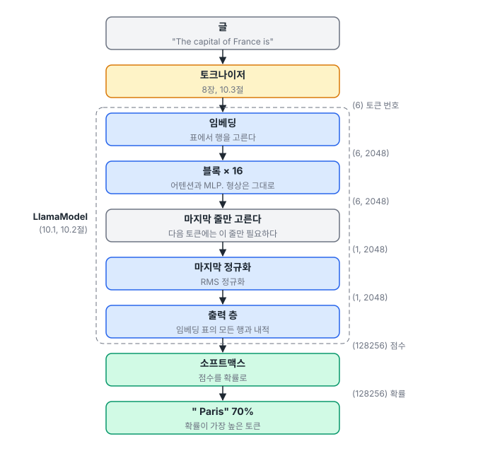
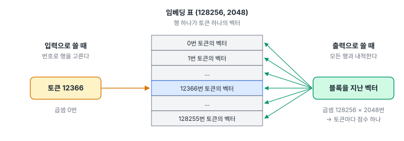
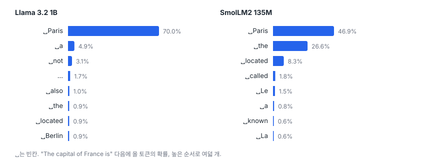
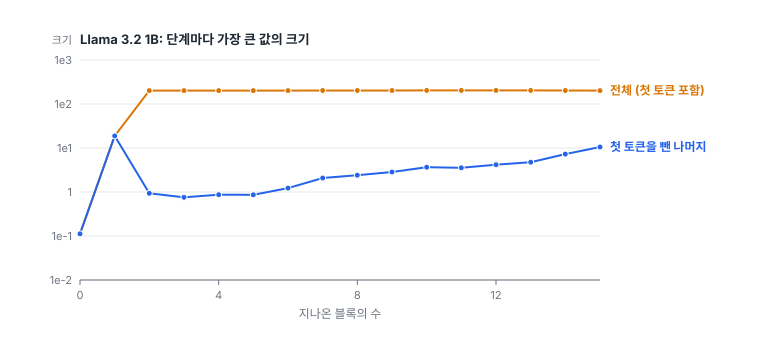
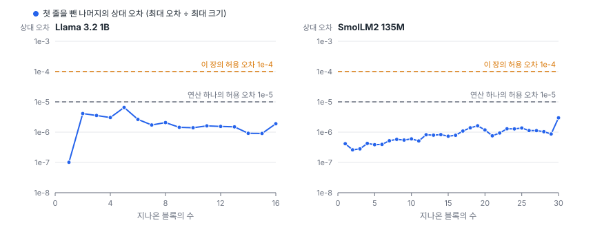

# 한 토큰 생성하기

[9장](ch09_transformer.md)에서 트랜스포머의 부품을 하나씩 만들고 따로따로 검증했습니다. 이 장에서는
그 부품을 쌓아 모델 전체를 조립하고, 글을 넣어 **다음에 올 토큰 하나**를
예측합니다. "The capital of France is"를 넣으면 " Paris"가 나오는 것을
확인하는 것이 이 장의 목표입니다.

새로 만드는 부품은 거의 없습니다. 이 장의 일은 조립과 확인입니다.

| 하는 일 | 절 |
|---|---|
| 블록을 쌓아 모델 전체의 순전파를 만든다 | 10.1, 10.2 |
| 가중치를 메모리에 올린다 | 10.3 |
| 모델을 만든 쪽의 토크나이저 설정을 읽는다 | 10.4 |
| 글을 넣어 다음 토큰을 예측한다 | 10.5, 10.6 |
| 블록을 이어 가며 PyTorch와 대조한다 | 10.7 |
| 시간과 메모리를 잰다 | 10.8 |

조립은 쉽습니다. 이 장에서 시간을 들일 곳은 따로 있습니다. 부품이 모두
옳아도 **부품 바깥의 약속**을 하나 어기면 모델은 틀린 답을 냅니다. 글 앞에
토큰 하나를 붙이느냐 마느냐로 답이 바뀌는 것을 10.6절에서 직접 봅니다.
그리고 검증에서는 "비교하는 방법"이 틀려서 실패하는 경우를 두 번 만납니다.

코드는 `crates/badak_models/src/llama/model.rs`에 있습니다.

## 10.1 블록을 쌓는다



9.2절에서 블록의 구조를 두 줄로 적었습니다. 어텐션과 MLP가 각각 정규화를
앞세우고, 결과를 입력에 더합니다. [9장](ch09_transformer.md)에서 만든 부품으로 옮기면 그대로 다섯
줄이 됩니다.

```rust
{{#include ../../../crates/badak_models/src/llama/mod.rs:block}}
```

모델은 이 블록에 넣을 가중치 묶음을 블록 수만큼 갖고, 앞뒤에 임베딩 표와
마지막 정규화의 가중치를 둡니다.

```rust
{{#include ../../../crates/badak_models/src/llama/model.rs:model}}
```

순전파의 몸통은 반복문 하나입니다. 임베딩으로 시작해서 블록을 하나 지날
때마다 결과를 목록에 덧붙입니다.

```rust
{{#include ../../../crates/badak_models/src/llama/model.rs:hidden_states}}
```

마지막 결과만 있으면 되는데 단계마다의 결과를 모두 모아 두는 것은 10.7절의
검증 때문입니다. 블록마다 PyTorch의 값과 대조하려면 중간 결과가 있어야
합니다. 텐서는 [4장](../part1/ch04_tensor.md)에서 본 대로 저장소를 함께 쓰는 손잡이이므로 목록에 넣는
일 자체에는 비용이 들지 않습니다. 다만 중간 결과가 해제되지 않고 남으므로
메모리를 그만큼 더 씁니다. `(토큰 수, 2048)`짜리 텐서 17개이니 지금은
무시할 만한 크기입니다.

블록을 지나는 동안 형상은 `(토큰 수, 2048)`로 변하지 않습니다(9.2절).
그래서 반복문 안에 형상을 맞추는 코드가 한 줄도 없습니다.

## 10.2 출력 층: 임베딩 표를 한 번 더 쓴다

블록을 모두 지난 벡터는 아직 길이 2048의 벡터입니다. 이것을 "단어 사전의
토큰마다 점수 하나"로 바꾸는 것이 출력 층입니다. 마지막 정규화를 한 번
하고, 선형 층을 한 번 지납니다.

```rust
{{#include ../../../crates/badak_models/src/llama/model.rs:logits}}
```

선형 층의 가중치 자리에 **임베딩 표**가 들어가 있습니다. 실수가 아닙니다.
9.3절에서 본 대로 Llama 3.2 1B의 가중치 파일에는 텐서가 146개 있습니다.
임베딩 표 하나, 블록마다 아홉 개씩 144개, 마지막 정규화 하나입니다. 출력
층의 가중치는 파일에 없습니다. 설정 파일에는
`"tie_word_embeddings": true`라고 적혀 있습니다. 입력의 임베딩 표와 출력
층의 가중치를 한 텐서로 함께 쓴다는 뜻입니다.



같은 표를 두 가지 방법으로 씁니다.

- **입력에서는** 토큰 번호로 행 하나를 고릅니다. 계산이 없습니다.
- **출력에서는** 벡터 하나를 표의 모든 행과 내적합니다. 행마다 점수가
  하나씩 나옵니다.

내적은 두 벡터가 같은 방향을 볼수록 큽니다([2장](../part1/ch02_math.md)). 그러니 출력 층이 하는
일은 "블록을 지난 벡터가 어느 토큰의 벡터와 가장 닮았는가"를 재는
것입니다. 입력에서 토큰을 나타내던 벡터가 출력에서는 그 토큰의 과녁
노릇을 합니다.

이렇게 표를 함께 쓰는 방법은 2016년에 제안되었습니다.[^tying] 같은 해에
다른 연구진도 같은 방법을 내놓았습니다.[^tying2]
추론 엔진에게 중요한 것은 크기입니다. 표는 `128256 × 2048`, 약 2.6억 개의
숫자입니다. 따로 두었다면 모델의 파라미터가 12.4억에서 15억으로 늘어납니다.

비용도 짚어 둡니다. 출력 층은 벡터 하나마다 곱셈을 `128256 × 2048`번, 약
2.6억 번 합니다. 9.11절에서 블록 하나가 토큰 하나에 쓰는 곱셈이 약
6,080만 번이었으니, **출력 층 한 줄이 블록 네 개 남짓**입니다. 블록이
16개인 모델에서 가볍지 않은 비용입니다.

### 마지막 줄만 계산한다

모델의 출력은 `(토큰 수, 단어 사전 크기)`입니다. 토큰마다 "그다음 토큰"의
점수가 한 줄씩 나옵니다(9.1절). 글을 이어 쓸 때 필요한 것은 그 가운데
**마지막 줄 하나**입니다. 앞의 줄들은 이미 알고 있는 토큰을 맞히는
점수이기 때문입니다.

그래서 순전파를 두 가지로 만들어 둡니다.

```rust
{{#include ../../../crates/badak_models/src/llama/model.rs:forward}}
```

`next_token_logits`는 [4장](../part1/ch04_tensor.md)의 `slice`로 마지막 줄만 떼어 출력 층에 넘깁니다.
복사가 없는 뷰입니다. 블록에서는 이렇게 할 수 없다는 점에 주의하십시오.
마지막 토큰의 어텐션은 앞의 모든 토큰을 보므로, 블록은 모든 줄을 계산해야
합니다. 줄일 수 있는 것은 출력 층뿐입니다. 얼마나 줄어드는지는 10.8절에서
잽니다.

## 10.3 가중치를 메모리에 올린다

`LlamaModel::load`는 [9장](ch09_transformer.md)의 `LlamaFiles`로 디렉터리를 열고 블록마다 가중치를
꺼냅니다. 코드는 10.1절에 이미 나왔습니다. 여기서는 그때 일어나는 일을
숫자로 봅니다.

| | Llama 3.2 1B | SmolLM2 135M |
|---|---|---|
| 가중치 파일의 크기 | 2.47GB | 0.27GB |
| 읽는 데 걸린 시간 | 0.45초 | 0.05초 |
| 프로그램이 쓴 메모리의 최댓값 | 5.02GB | 0.56GB |

메모리가 파일의 두 배입니다. 9.3절에서 정한 대로 파일의 BF16(2바이트)을
`f32`(4바이트)로 펼쳐 읽기 때문입니다. 파라미터 12.4억 개에 4바이트씩이면
4.94GB이고, 나머지는 토크나이저와 계산 중의 텐서입니다.

[6장](../part1/ch06_model_files.md)에서 파일을 메모리에 비추면 여는 데 시간이 거의 들지 않는다고 했습니다.
여기서는 0.45초가 듭니다. 값을 펼치려면 파일 전체를 읽어야 하기
때문입니다. 비추기의 이점을 스스로 버린 셈입니다. BF16을 그대로 두고
계산하는 방법은 19장과 22장에서 다룹니다.

> 메모리는 macOS의 `/usr/bin/time -l`이 알려 주는 "peak memory
> footprint"입니다. 같은 도구가 알려 주는 "maximum resident set size"는
> 7.4GB로 더 큽니다. 메모리에 비춘 파일의 쪽까지 세기 때문입니다. 그
> 쪽들은 운영체제가 필요하면 언제든 버릴 수 있습니다(6.8절).

## 10.4 토크나이저를 원본 설정에서 읽는다

[8장](ch08_tokenizer.md)에서는 토크나이저를 llama.cpp가 변환해 둔 GGUF 파일에서 읽었습니다.
llama.cpp의 시험 자료로 검증하기 위해서였습니다. 그런데 지금 우리가 가진
모델 디렉터리에는 GGUF가 없고, 모델을 만든 쪽이 배포한 `tokenizer.json`이
있습니다. Hugging Face의 tokenizers 라이브러리가 쓰는 형식입니다.[^tokenizers]
이 파일을 읽을 수 있어야 모델 디렉터리 하나로 일이 끝납니다.

파일의 뼈대는 이렇습니다. [6장](../part1/ch06_model_files.md)의 JSON 파서로 읽습니다.

| 항목 | 내용 | [8장](ch08_tokenizer.md)의 무엇에 해당하는가 |
|---|---|---|
| `model.vocab` | 토큰의 표기에서 번호로 가는 표 | 단어 사전 |
| `model.merges` | 병합 규칙. 앞에 있을수록 먼저 | 병합 규칙 |
| `model.ignore_merges` | 조각이 통째로 사전에 있으면 병합을 건너뛴다 | 8.6절의 규칙 |
| `added_tokens` | 덧붙인 토큰 | 특수 토큰 |
| `pre_tokenizer` | 사전 분할 규칙 | 사전 분할 |
| `post_processor` | 토큰화한 뒤에 덧붙일 것 | (이 장에서 처음 다룸) |

[8장](ch08_tokenizer.md)에서 만든 것과 같은 재료이므로, 토크나이저를 만드는 부분을 함수 하나로
떼어 내고 GGUF와 `tokenizer.json`이 그것을 함께 쓰게 했습니다. 읽는 쪽은
재료를 꺼내 넘기기만 합니다.

```rust
{{#include ../../../crates/badak_models/src/tokenizer/mod.rs:from_tokenizer_json}}
```

읽으면서 알게 된 것이 넷 있습니다.

**`ignore_merges`가 파일에 적혀 있습니다.** 8.6절에서 우리는 시험 47건
가운데 하나가 실패한 뒤에야 llama.cpp의 소스에서 이 규칙을 찾아냈습니다.
원본 설정에는 `"ignore_merges": true`라고 처음부터 적혀 있습니다. 변환된
파일에서 사라진 정보를, 변환한 쪽의 코드가 모델 이름을 보고 되살리고
있었던 것입니다. 모델을 엔진으로 옮길 때 원본 설정을 먼저 읽어야 하는
이유입니다.

**사전 분할 규칙은 정규 표현식으로 적혀 있습니다.** 우리는 정규 표현식
엔진을 만들지 않고 규칙을 손으로 옮겼습니다(8.5절). 그래서 파일의 규칙을
실행하지 않고, **어느 규칙인지 알아보기만** 합니다. Llama 3.2의 규칙에는
숫자를 세 자리까지 묶는 `\p{N}{1,3}`이 들어 있다는 것으로 구분합니다.
모르는 규칙을 만나면 틀린 결과를 내는 대신 오류를 냅니다.

**SmolLM2는 숫자를 한 글자씩 뗍니다.** SmolLM2의 설정에는 GPT-2의 규칙
앞에 `Digits`라는 단계가 하나 더 있습니다. "2026"이 토큰 네 개가 됩니다.
[8장](ch08_tokenizer.md)에는 없던 규칙이라 새로 만들었습니다.

```rust
{{#include ../../../crates/badak_models/src/tokenizer/pretokenize.rs:gpt2_digits}}
```

**바이트 하나짜리 토큰이 256개 다 있지 않을 수 있습니다.** 8.2절에서
"토큰 256개만 있으면 세상의 어떤 글이든 표현할 수 있다"고 했습니다.
바이트 하나짜리 토큰이 모두 사전에 있다는 전제입니다. Llama 3.2에서는 사실입니다. SmolLM2의 사전에는
21개가 없습니다. 여섯은 드문 제어 문자이고, 열다섯은 올바른 UTF-8에
나오지 않거나 아직 글자가 배정되지 않은 영역을 여는 바이트입니다. 그런
바이트를 만나면 원본 토크나이저는 토큰을 내지 않고 넘어갑니다. 우리도
그렇게 합니다. 이 경우 토큰을 글로 되돌려도 원래 글이 되지 않습니다.

### 글 앞에 붙이는 토큰

`post_processor`는 토큰화가 끝난 뒤 앞뒤에 덧붙일 토큰을 정합니다. Llama
3.2의 설정에는 이런 틀이 있습니다.

```json
"single": [
  {"SpecialToken": {"id": "<|begin_of_text|>", "type_id": 0}},
  {"Sequence": {"id": "A", "type_id": 0}}
]
```

"글 `A`의 앞에 `<|begin_of_text|>` 토큰 하나를 붙여라"는 뜻입니다. 8.7절에서
특수 토큰의 예로 들었던 토큰입니다. 모델을 만든 쪽이 글을 이렇게 시작하라고
정해 둔 것이므로, 추론할 때도 그대로 따라야 모델이 익숙한 입력이 됩니다.

SmolLM2의 설정에서 이 항목은 `null`입니다. 아무것도 붙이지 않습니다.

```rust
{{#include ../../../crates/badak_models/src/tokenizer/mod.rs:template_prefix}}
```

이 한 항목이 10.6절의 주인공입니다.

### 검증

[8장](ch08_tokenizer.md)에서는 llama.cpp의 시험 자료를 정답으로 삼았습니다. 이번에는 원본
라이브러리로 정답을 만듭니다. `reference/ch10_tokenizer_vectors.py`가
tokenizers 라이브러리로 `tokenizer.json`을 읽어 글 57개의 토큰 번호를
기록합니다. llama.cpp의 시험 입력 47개에 숫자, 한글, 코드, 특수 토큰,
사전에 없는 바이트가 든 글 열 개를 더한 것입니다.

```rust
{{#include ../../../crates/badak_models/tests/tokenizer.rs:check_json}}
```

두 모델 모두 57개가 일치합니다. 테스트는 하나를 더 확인합니다. Llama
3.2에 대해 `tokenizer.json`에서 만든 토크나이저와 [8장](ch08_tokenizer.md)의 GGUF에서 만든
토크나이저가 같은 결과를 내는지입니다. 서로 다른 두 파일, 서로 다른 두
기준 구현이 같은 답을 가리킵니다.

## 10.5 다음 토큰 하나

이제 모두 잇습니다.

```rust
{{#include ../../../crates/badak_models/examples/ch10_next_token.rs:predict}}
```

점수를 확률로 바꾸는 `softmax`는 [2장](../part1/ch02_math.md)에서 만든 것입니다. 점수가 가장 높은
토큰만 알고 싶다면 소프트맥스 없이 `argmax`로 충분합니다. 소프트맥스는
순서를 바꾸지 않기 때문입니다. 여기서는 후보들이 얼마나 유력한지 보려고
확률로 바꿨습니다.

```bash
sh scripts/download_llama32.sh
cargo run --release -p badak_models --example ch10_next_token
```

```text
{{#include output/ch10_next_token_llama32.txt:1:16}}
```

**" Paris"가 70%입니다.** 우리가 만든 엔진이 처음으로 글의 뜻에 맞는 답을
냈습니다. 행렬 곱 하나에서 시작해 여기까지 왔습니다.



후보의 목록을 읽어 보면 모델이 무엇을 하고 있는지 감이 옵니다.

- 2위와 3위는 " a"와 " not"입니다. "is a city of…", "is not…"처럼 문장이
  다르게 이어질 가능성입니다. 모델은 사실을 조회하는 것이 아니라 **이어질
  글**을 예측합니다.
- 8위에 " Berlin"이 있습니다. 틀린 답에도 확률이 조금 있습니다.
- 10위까지의 확률을 더하면 약 85%입니다. 나머지 15%는 12만 8천 개의 다른
  토큰에 흩어져 있습니다.

보조 모델 SmolLM2도 같은 답을 냅니다. 확신은 덜합니다.

```bash
cargo run --release -p badak_models --example ch10_next_token -- smollm2_135m
```

```text
{{#include output/ch10_next_token_smollm2.txt:1:11}}
```

한글도 넣어 봅니다. 둘째 인자로 글을 줍니다.

```bash
cargo run --release -p badak_models --example ch10_next_token -- llama32_1b "대한민국의 수도는"
```

```text
{{#include output/ch10_next_token_korean.txt:1:13}}
```

" 서울"이 1위이지만 확률은 5%에 그치고, 3위에 " Seoul"이 따로 있습니다.
같은 답이 두 토큰으로 갈라져 있습니다. 여기서 뽑힌 토큰 하나를 입력에
덧붙여 다시 예측하기를 되풀이하면 문장이 됩니다. [11장](ch11_kv_cache.md)의 일입니다. 1위만
고를지, 확률대로 뽑을지는 [12장](ch12_sampling.md)의 주제입니다.

## 10.6 실험: 토큰 하나의 차이

10.4절에서 "글 앞에 붙이는 토큰"을 설정 파일에서 읽었습니다. 이 약속을
어기면 어떻게 되는지 봅니다. 예제의 셋째 인자로 앞에 붙일 토큰 번호를
직접 정할 수 있습니다.

SmolLM2의 설정은 아무것도 붙이지 않는다고 했습니다. 그런데 모델의
`config.json`에는 `"bos_token_id": 1`이라고 적혀 있습니다. 글의 시작을
알리는 토큰이 1번이라는 뜻입니다. "Llama도 붙였으니 여기도 붙여야겠지"
하고 1번 토큰을 붙여 봅니다.

```bash
cargo run --release -p badak_models --example ch10_next_token -- smollm2_135m "The capital of France is" 1
```

```text
{{#include output/ch10_prefix_smollm2.txt:3:9}}
```

" Paris"가 1위에서 사라졌습니다. 47%였던 확률이 7.7%로 떨어져 4위가
되었습니다. 토큰 하나를 더 넣었을 뿐입니다.

이 실험은 지어낸 것이 아닙니다. 이 장을 쓰면서 처음 만든 예제가 바로
이렇게 `config.json`의 번호를 무조건 붙였고, SmolLM2가 " the"라고
답했습니다. PyTorch로 같은 글을 넣어 보니 " Paris"가 나왔고, 토큰 수가
하나 다른 것을 보고서야 원인을 알았습니다. 10.7절의 블록별 대조는 이
버그를 잡지 못합니다. 순전파는 한 치도 틀리지 않았기 때문입니다. **틀린
것은 모델에 넣은 입력이었습니다.**

반대 방향도 해 봅니다. Llama 3.2에서 시작 토큰을 뺍니다. 셋째 인자에 빈
문자열을 줍니다.

```bash
cargo run --release -p badak_models --example ch10_next_token -- llama32_1b "The capital of France is" ""
```

```text
{{#include output/ch10_prefix_llama32.txt:3:9}}
```

이번에는 거의 달라지지 않습니다. 70.0%가 70.2%가 되었습니다. 그렇다고
빼도 된다는 뜻은 아닙니다. 이 글 하나에서 그랬을 뿐이고, 한쪽 모델에서
괜찮았던 것이 다른 모델에서는 답을 바꿨습니다.

정리하면 이렇습니다.

- 모델은 학습할 때 본 형식의 입력에서만 제 성능을 냅니다. 형식은 가중치가
  아니라 **토크나이저 설정**에 적혀 있습니다.
- 모델마다 다릅니다. 다른 모델의 관례를 옮겨 오면 안 됩니다.
- 이런 버그는 오류를 내지 않습니다. 출력이 조금 나빠질 뿐입니다. 숫자를
  대조하는 검증으로는 잡히지 않고, **같은 글을 기준 구현에 넣어 토큰
  번호부터 비교해야** 잡힙니다.

8.9절의 대화 형식도 같은 종류의 약속입니다. 실전에서 "모델을 옮겼더니
품질이 떨어졌다"는 문제의 상당수가 계산이 아니라 이런 약속에서 나옵니다.

## 10.7 검증: 블록을 이어서 대조하기

9.10절에서는 부품마다 PyTorch가 계산한 입력을 넣어 따로 대조했습니다.
버그의 위치를 가리기 좋은 방법이지만, 그것만으로는 모델 전체가 옳다고
말할 수 없습니다. 이번에는 **우리 출력을 다음 블록에 그대로 넘기며**
블록마다 대조합니다. 7.5절에서 했던 방법이고, 그때 "층이 수십 개인 모델을
대조할 때는 오차가 아래로 갈수록 커지는 것을 보게 된다"고 예고했습니다.

정답 파일의 `hidden_states`에는 PyTorch가 남긴 단계별 결과가 들어
있습니다. 형상은 `(블록 수 + 1, 토큰 수, 2048)`입니다. 글은 [9장](ch09_transformer.md)과 같은
"The capital of France is Paris. 추론 엔진", 토큰 11개입니다.

### 허용 오차를 다시 정한다

[5장](../part1/ch05_operators.md)에서 연산 하나에 허용한 상대 오차는 `1e-5`였습니다. 블록 16개를 이어
지나면 블록마다 그만한 오차가 새로 생겨 쌓일 수 있으므로 같은 기준을 쓸
수 없습니다. 열 배의 여유를 둡니다.

```rust
{{#include ../../../crates/badak_models/examples/ch10_verify.rs:tolerance}}
```

"왜 열 배인가"에 엄밀한 답은 없습니다. 기준은 이렇게 잡습니다. 진짜
버그는 오차를 `1e-4`가 아니라 `1e-1`이나 그 이상으로 만듭니다. 9.10절의
회전 버그처럼 값이 통째로 달라집니다. 반올림에서 오는 오차와 버그에서
오는 오차 사이에는 넓은 빈 땅이 있고, 허용 오차는 그 사이 어디에 두어도
됩니다. 실제 오차가 이 기준에서 얼마나 떨어져 있는지는 아래에서 봅니다.

### 첫 시도: 마지막 블록에서 실패한다

처음 만든 대조는 단계마다 우리 값과 `hidden_states`의 값을 비교했습니다.
결과는 이랬습니다.

```text
블록 15           201.864     2.136e-4     1.058e-6     통과
블록 16            37.079      8.666e1      2.337e0     실패
점수               21.737     5.579e-5     2.567e-6     통과
```

마지막 블록에서 값이 통째로 다릅니다. 그런데 그 뒤의 점수는 통과합니다.
마지막 블록이 틀렸다면 점수가 맞을 수 없습니다.

[7장](../part1/ch07_mnist.md)의 원칙을 꺼냅니다. 결과가 다르면 우리가 틀렸거나, 상대가 틀렸거나,
**비교 방법이 틀린 것**입니다. 정답 파일을 열어 보면 답이 나옵니다.
`hidden_states`의 마지막 원소와, 따로 저장해 둔 "마지막 정규화의 출력"이
한 비트도 다르지 않습니다. PyTorch 쪽 라이브러리가 돌려주는 단계별 결과의
마지막 원소는 블록의 출력이 아니라 **마지막 정규화까지 거친 값**이었던
것입니다.[^hf-llama] 우리는 정규화 전의 값을 정규화 후의 값과 비교하고
있었습니다.

비교하는 쪽을 고칩니다. 마지막 단계만은 우리 값에 마지막 정규화를 적용한
뒤 비교합니다.

```rust
{{#include ../../../crates/badak_models/examples/ch10_verify.rs:chain}}
```

기준 구현의 중간 결과를 가져다 쓸 때는 그것이 **정확히 어느 지점의
값인지**부터 확인해야 합니다. 이름만 보고 짐작하면 이렇게 됩니다.

### 둘째 문제: 큰 값 하나가 나머지를 가린다

위의 표에서 이상한 점이 하나 더 있습니다. 블록 15의 "최대 크기"가 201입니다.
블록 1에서는 18이었습니다. 정답 파일을 살펴보면 이 큰 값은 **첫 토큰의
한 자리**에 있습니다. 첫 토큰의 벡터에서 2048개의 숫자 가운데 하나가
둘째 블록부터 200 근처로 뛰어올라 끝까지 유지됩니다. 나머지 토큰의 값은
같은 시점에 1 안팎입니다.



우리 코드의 버그가 아닙니다. PyTorch의 값이 그렇습니다. 언어 모델에서
널리 관찰되는 현상이고, 글의 첫 토큰 같은 특정 위치의 특정 자리에 다른
값보다 훨씬 큰 값이 나타난다고 보고되어 있습니다.[^massive]
SmolLM2에서는 이 값이 24,000에 이릅니다.

문제는 이것이 **검증을 무디게 만든다**는 점입니다. [5장](../part1/ch05_operators.md)에서 절대 허용
오차를 "상대 허용 오차 × 가장 큰 값의 크기"로 정했습니다. 가장 큰 값이
201이면 절대 허용 오차는 `1e-4 × 201 = 0.02`입니다. 그런데 나머지 토큰의
값은 1 안팎입니다. 거기서 0.02의 오차는 2%입니다. 첫 토큰의 큰 값 하나
때문에, 나머지 열 개 토큰에서는 2%나 틀려도 통과하는 검증이 된 것입니다.

그래서 비교를 두 번 합니다. 전체를 한 번, 첫 줄을 뺀 나머지를 한 번
비교하고 둘 다 통과해야 통과로 칩니다.

```rust
{{#include ../../../crates/badak_models/examples/ch10_verify.rs:report}}
```

허용 오차의 기준을 "텐서 전체의 최댓값"으로 잡는 규칙은 값의 크기가
고른 텐서를 가정합니다. 그 가정이 깨지는 곳에서는 기준을 다시 잡아야
합니다.

### 결과

```bash
cargo run --release -p badak_models --example ch10_verify
```

```text
{{#include output/ch10_verify_llama32.txt}}
```

열여덟 줄이 모두 통과합니다. 표를 읽어 봅니다.

**임베딩의 오차는 0입니다.** 9.10절에서 본 대로 복사이기 때문입니다.

**절대 오차는 아래로 갈수록 커집니다.** 첫 줄을 뺀 나머지의 최대 오차가
블록 1에서 `1.9e-6`, 블록 15에서 `9.5e-6`입니다. 다섯 배입니다. 7.5절의
예고대로입니다.

**그런데 상대 오차는 커지지 않습니다.** 값의 크기도 함께 커지기
때문입니다. 나머지 줄의 최대 크기가 0.9에서 10.5로 자라는 동안 상대
오차는 블록 2부터 `1e-6`에서 `7e-6` 사이에 머뭅니다. 연산 하나에 쓰던 기준 `1e-5`조차
넘지 않습니다.



블록이 30개인 SmolLM2에서도 같습니다. 상대 오차가 `4e-7`에서 시작해
`3e-6`으로 끝납니다. 일곱 배로 늘었지만 허용 오차와는 여전히 30배 넘게
떨어져 있습니다.

```bash
cargo run --release -p badak_models --example ch10_verify -- smollm2_135m
```

오차가 왜 더 빠르게 쌓이지 않는지는 이 측정만으로 단정할 수 없습니다.
짐작할 수 있는 이유는 둘입니다. 반올림 오차는 방향이 제멋대로여서 서로
상쇄되기도 합니다. 그리고 블록은 값을 바꿔치기하지 않고 더하므로(9.2절),
앞에서 생긴 오차가 블록을 지나며 증폭되지 않고 그대로 실려 갑니다. 이
설명은 측정으로 확인한 것이 아니라 해석입니다.

**가장 높은 점수의 토큰이 열한 자리 모두에서 같습니다.** 사용자에게
중요한 것은 결국 이것입니다. 점수의 상대 오차는 `2.6e-6`이고, 1위와
2위의 점수 차이는 그보다 훨씬 큽니다. 다만 점수 차이가 아주 작은 두
후보가 있다면 이 정도의 오차로도 순위가 뒤집힐 수 있습니다. 그것은
버그가 아닙니다. 서로 다른 두 엔진이 같은 모델에서 다른 글을 만들어 낼
수 있는 이유이고, [12장](ch12_sampling.md)에서 재현성을 다룰 때 다시 봅니다.

### 자동 테스트

같은 대조가 `crates/badak_models/tests/llama_forward.rs`에 테스트로
들어 있습니다. 세 가지를 더 확인합니다. 토크나이저가 정답 파일과 같은
토큰 번호를 내는지, 가장 높은 점수의 토큰이 모두 같은지, 그리고 마지막
줄만 계산한 점수가 전체를 계산했을 때의 마지막 줄과 비트 단위로 같은지
입니다.

Llama 3.2는 승인을 받아야 내려받을 수 있어 CI에서는 SmolLM2만
실행합니다. 모델 파일이 없으면 테스트는 건너뜁니다.

테스트는 최적화 없이 빌드되는 것이 기본값인데, 모델 전체를 돌리기에는
너무 느립니다. 작업 공간의 `Cargo.toml`에 `[profile.test]`의
`opt-level = 2`를 넣어 테스트도 최적화해서 빌드하게 했습니다.

## 10.8 측정: 다음 토큰 하나의 값

토큰 6개를 넣어 다음 토큰 하나를 예측하는 데 걸린 시간입니다. 순전파의
두 부분은 세 번 실행해 가장 빠른 값을 골랐습니다.

```text
{{#include output/ch10_next_token_llama32.txt:18:24}}
```

| | Llama 3.2 1B | SmolLM2 135M |
|---|---|---|
| 블록 전체 | 2.76초 | 0.20초 |
| 출력 층, 마지막 줄만 | 0.12초 | 0.01초 |
| 출력 층, 모든 줄 | 0.72초 | 0.05초 |

**9.11절의 짐작이 맞았습니다.** 그때 토큰 11개에 블록 하나가 0.32초였고,
모델 전체는 약 5초일 것이라고 했습니다. 토큰 하나가 블록 하나를 지나는 데
0.029초라는 뜻입니다. 이번 측정은 토큰 6개, 블록 16개에 2.76초이니 역시
0.029초입니다. 시간이 토큰 수와 블록 수에 정확히 비례합니다. 지금의
시간은 거의 전부 선형 층의 곱셈이라는 9.11절의 분석과 맞아떨어집니다.

**마지막 줄만 계산하면 출력 층이 여섯 배 빨라집니다.** 여섯 줄 가운데
한 줄만 계산하니 당연한 결과입니다. 전체로 보면 3.48초가 2.88초가 되어
17%가 줄었습니다. 글이 길수록 이 차이는 커집니다. 토큰이 1,000개라면
모든 줄의 출력 층은 2분이 걸리지만 마지막 줄은 여전히 0.12초입니다.

**출력 층 한 줄은 블록 네 개만큼입니다.** 10.2절에서 곱셈 횟수로 계산한
그대로입니다. 한 줄에 0.12초, 블록 하나가 토큰 하나에 0.029초입니다.

### PyTorch와 견주기

같은 토큰을 PyTorch에 넣어 봅니다. 가중치를 `f32`로 펼치고 CPU에서
계산하게 해서 조건을 맞췄습니다(`reference/ch10_bench_pytorch.py`).

```text
{{#include output/ch10_bench_pytorch_llama32.txt}}
```

| | badak | PyTorch (CPU) | 배수 |
|---|---|---|---|
| Llama 3.2 1B, 토큰 6개 | 2.88초 | 0.075초 | 38배 |
| SmolLM2 135M, 토큰 5개 | 0.21초 | 0.015초 | 14배 |

**38배 느립니다.** 7.6절에서 MNIST로 본 격차가 그대로 따라왔습니다.
원인도 같습니다. 시간의 거의 전부를 쓰는 선형 층이, 우리 쪽은 [2장](../part1/ch02_math.md)의
단순한 반복문이고 PyTorch 쪽은 손으로 다듬은 행렬 곱 라이브러리입니다.
PyTorch의 스레드 수를 1로 줄여도 시간이 변하지 않는 것도 7.6절에서 본
모습 그대로입니다. 그때의 해석, 곧 행렬 곱을 Apple의 Accelerate가 맡고
있다는 설명이 여기에도 해당할 것으로 보입니다. 이 장에서 따로 확인한
것은 아닙니다.

이 격차를 줄이는 것이 3부 전체의 일입니다. [13장](ch13_first_showdown.md)에서 llama.cpp와 정식으로
견주고, [16장](../part3/ch16_matmul.md)부터 행렬 곱을 다시 만듭니다.

> 이 측정은 초시계로 재는 수준의 거친 측정입니다. 기준 기계는 서문에 적은
> Apple M4 Max입니다. 측정 방법은 [14장](../part3/ch14_measurement.md)에서 제대로 세웁니다.

### 다음 장으로 넘기는 문제

토큰 하나에 2.88초입니다. 100개짜리 답을 쓰려면 이 순전파를 100번 해야
합니다. 게다가 글이 한 토큰씩 길어지므로 뒤로 갈수록 더 오래 걸립니다.
여섯째 토큰까지의 계산은 이미 했는데, 일곱째 토큰을 예측하려고 처음부터
다시 계산하는 셈입니다. 이 낭비를 없애는 것이 [11장](ch11_kv_cache.md)의 KV 캐시입니다.

## 10.9 실전 엔진에서는

**llama.cpp는 어느 토큰의 점수를 낼지 토큰마다 정하게 합니다.** llama.cpp에
토큰을 넘기는 구조체 `llama_batch`에는 `logits`라는 배열이 있습니다. 토큰마다
0 또는 1을 적고, 0인 토큰의 점수는 계산하지 않습니다. 이 배열을 주지
않으면 마지막 토큰만 계산합니다.[^llamacpp-batch] 우리가
`next_token_logits`로 한 일의 일반형입니다. 10.8절에서 본 대로 출력 층이
블록 여러 개만큼 비싸기 때문에 모든 엔진이 이 최적화를 합니다.

**글 앞에 토큰을 붙일지는 모델 파일에 적혀 있습니다.** GGUF에는
`tokenizer.ggml.add_bos_token`이라는 메타데이터가 있고, llama.cpp는 이것을
읽어 시작 토큰을 붙일지 정합니다.[^llamacpp-bos] 10.6절의 약속이 변환된
파일에도 따라갑니다. 변환 도구가 이 값을 틀리게 적으면 10.6절의 버그가
모든 사용자에게 생깁니다.

**기준 구현의 중간 결과에는 저마다의 관례가 있습니다.** 10.7절에서 본 대로
transformers의 `hidden_states`는 마지막 원소에만 정규화가 적용되어
있습니다. 다른 라이브러리, 다른 모델에서는 또 다를 수 있습니다. 엔진을
만드는 사람들이 기준 구현에 직접 갈고리를 걸어 원하는 지점의 값을 뽑는
것은 이 때문입니다. [9장](ch09_transformer.md)의 정답 파일도 그렇게 만들었습니다.

**입력과 출력의 표를 함께 쓰지 않는 모델도 있습니다.** 그런 모델의 파일에는
출력 층의 가중치가 따로 들어 있습니다. 설정의 `tie_word_embeddings`를
확인해야 하고, 우리 코드는 지금 함께 쓰는 경우만 다룹니다.

## 정리

- 모델 전체의 순전파는 임베딩, 블록을 도는 반복문, 마지막 정규화, 출력
  층입니다. 새 부품은 없습니다.
- 출력 층은 임베딩 표를 그대로 씁니다. 블록을 지난 벡터를 표의 모든 행과
  내적해 토큰마다 점수를 냅니다. 한 줄의 비용이 블록 네 개만큼입니다.
- 다음 토큰을 예측할 때는 마지막 줄의 점수만 계산합니다. 블록은 모든 줄을
  계산해야 합니다.
- 토크나이저는 모델 디렉터리의 `tokenizer.json`에서 읽습니다. 사전 분할
  규칙, `ignore_merges`, 글 앞에 붙이는 토큰이 모두 여기에 적혀 있습니다.
- "The capital of France is" 다음 토큰으로 Llama 3.2 1B는 " Paris"에
  70%를, SmolLM2 135M은 47%를 줍니다.
- 글 앞에 붙이는 토큰 하나를 잘못 다루면 SmolLM2의 답이 바뀝니다. 계산이
  아니라 입력의 약속에서 생기는 버그이고, 오류 없이 품질만 떨어뜨립니다.
- 블록을 이어 가며 대조한 결과 두 모델의 모든 단계가 PyTorch와 일치합니다.
  상대 오차는 `1e-5`를 넘지 않고, 가장 높은 점수의 토큰이 모든 자리에서
  같습니다.
- 검증에서 두 번 걸려 넘어졌습니다. 기준 구현의 마지막 중간 결과는 정규화를
  거친 값이었고, 첫 토큰의 큰 값 하나가 허용 오차를 무디게 만들고
  있었습니다. 둘 다 비교 방법의 문제였습니다.
- 토큰 6개에서 다음 토큰 하나를 예측하는 데 2.88초가 걸립니다. PyTorch는
  0.075초입니다. 38배 차이입니다.
- 메모리는 5.0GB를 씁니다. 가중치 파일의 두 배입니다.

## 연습 문제

1. `ch10_next_token`에 다른 글을 넣어 보십시오. "1 + 1 =", "Once upon a",
   "fn main() {" 다음에 무엇이 오는지, 1위의 확률이 얼마나 다른지 비교해
   보십시오. 어떤 글에서 모델이 확신하고 어떤 글에서 망설입니까.
2. " Paris"와 " Berlin"의 점수(소프트맥스 전의 값)를 출력하도록 예제를
   고쳐 보십시오. 두 점수의 차이와 10.7절에서 잰 점수의 최대 오차를
   비교하면, 오차 때문에 두 후보의 순위가 뒤집힐 여지가 있습니까.
3. 10.2절에서 출력 층 한 줄의 곱셈이 블록 하나의 약 네 배라고 했습니다.
   SmolLM2의 설정(`hidden_size` 576, `intermediate_size` 1536, 블록 30개,
   단어 사전 49152)으로 같은 비율을 계산해 보십시오. 10.8절의 측정과
   맞습니까.
4. `hidden_states`가 중간 결과를 모으지 않고 마지막 결과만 돌려주도록
   고친 함수를 만들어 보십시오. 시간이 달라집니까. 메모리는 얼마나
   달라질 것으로 예상합니까.
5. `ch10_verify`의 `report`에서 "첫 줄을 뺀 나머지" 비교를 지우고,
   `block` 함수의 MLP 결과에 1.01을 곱하는 버그를 일부러 넣어 보십시오.
   어느 단계에서 실패합니까. 비교를 되살리면 어떻게 달라집니까.
6. Llama 3.2에 시작 토큰을 두 번 붙여 보십시오(셋째 인자에
   `128000,128000`). 예측이 달라집니까. 대화 형식(8.9절)을 만들 때
   토크나이저가 붙이는 토큰과 형식에 이미 들어 있는 토큰이 겹치지 않게
   하려면 무엇을 조심해야 합니까.
7. 10.7절의 대조표에서 "전체"의 최대 오차는 블록 2부터 15까지
   `2.14e-4`로 변하지 않습니다. 왜 그렇습니까. 그림과 블록의 구조(9.2절)를
   함께 보고 설명해 보십시오.
8. 토큰이 100개인 글의 다음 토큰을 예측하는 데 걸릴 시간을 10.8절의
   숫자로 예상해 보고, 실제로 재어 보십시오. 예상과 다르다면 9.6절에서
   말한 어텐션의 비용이 어느 정도 보이기 시작한 것입니까.

## 참고 문헌

[^tying]: O. Press, L. Wolf, "Using the Output Embedding to Improve
    Language Models", EACL 2017.
    [arXiv:1608.05859](https://arxiv.org/abs/1608.05859). 출력 층의 가중치도
    쓸 만한 단어 임베딩이며, 입력의 임베딩과 묶어 쓰기를 권합니다.

[^tying2]: H. Inan, K. Khosravi, R. Socher, "Tying Word Vectors and Word
    Classifiers: A Loss Framework for Language Modeling", 2016.
    [arXiv:1611.01462](https://arxiv.org/abs/1611.01462). 같은 시기에 같은
    방법을 다른 근거로 제안한 논문입니다.

[^tokenizers]: Hugging Face tokenizers. <https://github.com/huggingface/tokenizers>.
    `tokenizer.json`은 이 라이브러리가 토크나이저 전체를 저장하는
    형식입니다. 이 장의 시험 자료는 `reference/requirements.txt`에 고정한
    transformers 5.23.0과 함께 설치되는 판으로 만들었습니다.

[^massive]: M. Sun, X. Chen, J. Z. Kolter, Z. Liu, "Massive Activations in
    Large Language Models", 2024.
    [arXiv:2402.17762](https://arxiv.org/abs/2402.17762). 아주 적은 수의
    값이 다른 값보다 훨씬(예를 들어 10만 배) 크고, 입력이 달라져도 거의
    일정하게 유지된다는 관찰을 보고합니다.

[^hf-llama]: Hugging Face transformers,
    `src/transformers/models/llama/modeling_llama.py` (태그 `v5.23.0`).
    `LlamaModel.forward`는 블록을 모두 지난 뒤 `self.norm`을 적용한 값을
    돌려줍니다. `hidden_states`의 마지막 원소가 이 값과 같다는 것은 이 책의
    정답 파일에서 직접 확인했습니다(두 텐서의 최대 차이 0).
    <https://github.com/huggingface/transformers/blob/v5.23.0/src/transformers/models/llama/modeling_llama.py>

[^llamacpp-batch]: llama.cpp, `include/llama.h` (커밋 `b4c0e00a4fcc`).
    `llama_batch` 구조체의 설명(268번째 줄 부근)과 `llama_get_logits`,
    `llama_get_logits_ith`의 설명(1119번째 줄 부근).
    <https://github.com/ggml-org/llama.cpp/blob/b4c0e00a4fcc/include/llama.h>

[^llamacpp-bos]: llama.cpp, `src/llama-vocab.cpp` (커밋 `b4c0e00a4fcc`).
    3009번째 줄 부근에서 `LLM_KV_TOKENIZER_ADD_BOS`
    (`tokenizer.ggml.add_bos_token`)를 읽습니다.
    <https://github.com/ggml-org/llama.cpp/blob/b4c0e00a4fcc/src/llama-vocab.cpp>
