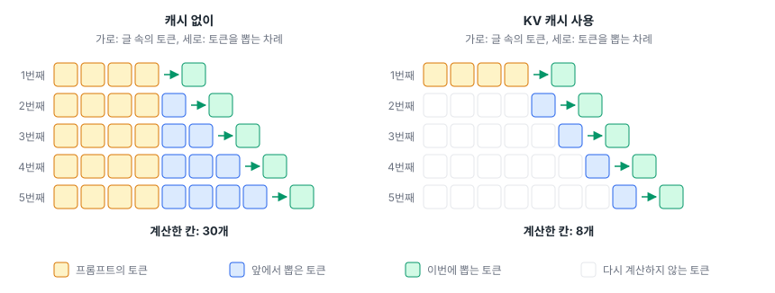
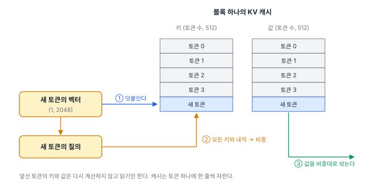
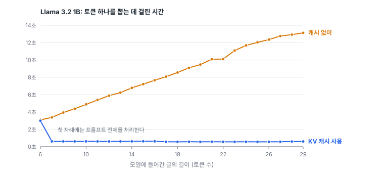
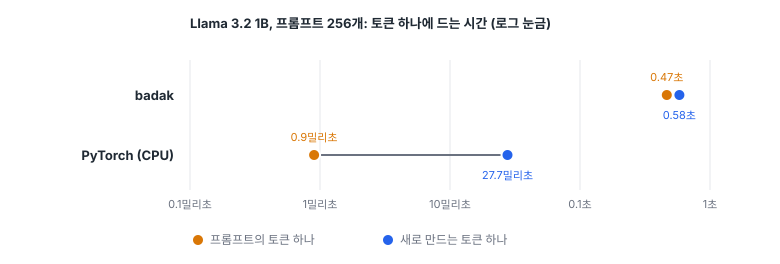

# KV 캐시와 생성 루프

[10장](ch10_forward_pass.md)에서 다음 토큰 하나를 예측했습니다. 이 장에서는 그 예측을 되풀이해
**글을 이어 씁니다.** 토큰을 하나 뽑고, 그것을 입력의 끝에 붙이고, 다시
예측합니다. 이 되풀이를 생성 루프(generation loop)라고 합니다.

루프 자체는 열 줄 남짓입니다. 문제는 속도입니다. 10.8절에서 본 대로
토큰을 하나 뽑을 때마다 글 전체를 처음부터 다시 계산하면, 글이 길어질수록
한 토큰이 점점 비싸집니다. 이 장의 절반은 그 낭비를 없애는 **KV 캐시**에
씁니다. 언어 모델 추론에서 가장 중요한 최적화이고, 이것 없이 도는 엔진은
없습니다.

| 하는 일 | 절 |
|---|---|
| 캐시 없이 글을 이어 쓰고, 얼마나 느린지 잰다 | 11.1, 11.2 |
| 무엇을 다시 계산하지 않아도 되는지 따져 본다 | 11.3 |
| KV 캐시를 만든다 | 11.4, 11.5 |
| 캐시가 결과를 바꾸지 않았는지 검증한다 | 11.6 |
| 대화 형식으로 질문하고 답을 받는다 | 11.7 |
| 프롬프트 처리와 토큰 생성의 비용을 견준다 | 11.8, 11.9 |

코드는 `crates/badak_models/src/llama/`의 `generate.rs`와 `cache.rs`에
있습니다.

## 11.1 생성 루프

9.1절에서 언어 모델이 하는 일을 "지금까지의 토큰을 보고 다음 토큰의 점수를
낸다"고 했습니다. 글을 쓰는 것은 그 일을 되풀이하는 것입니다. 자기가 낸
출력을 다시 입력으로 받는다고 해서 자기회귀(autoregressive) 생성이라고
부릅니다.

```rust
{{#include ../../../crates/badak_models/src/llama/generate.rs:generate_without_cache}}
```

[10장](ch10_forward_pass.md)의 `next_token_logits`를 그대로 부릅니다. 정할 것은 셋입니다.

**어느 토큰을 고를 것인가.** 여기서는 점수가 가장 높은 토큰을 고릅니다.
가장 단순한 방법이고, 같은 입력에 늘 같은 글이 나오므로 검증하기 좋습니다.
확률에 따라 뽑는 방법들은 [12장](ch12_sampling.md)에서 다룹니다.

**언제 멈출 것인가.** 두 가지 경우에 멈춥니다. 정해 둔 개수만큼 뽑았을
때, 그리고 모델이 "글이 끝났다"는 토큰을 뽑았을 때입니다. 뒤의 것은
`config.json`의 `eos_token_id`에 적혀 있습니다. [10장](ch10_forward_pass.md)에서 설정을 읽을 때
번호 하나일 수도, 여러 개일 수도 있게 해 둔 그 값입니다. Llama 3.2에는
셋이 있습니다.

| 번호 | 표기 |
|---|---|
| 128001 | `<\|end_of_text\|>` |
| 128008 | `<\|eom_id\|>` |
| 128009 | `<\|eot_id\|>` |

셋째가 8.9절의 대화 형식에서 한 사람의 말이 끝날 때마다 적던 그 토큰입니다.
SmolLM2에는 하나, `<|im_end|>`가 있습니다.

끝을 알리는 토큰은 결과에 넣지 않습니다. 사용자에게 보여 줄 글이 아니기
때문입니다.

**만든 토큰을 어떻게 내보낼 것인가.** 토큰이 나올 때마다 호출하는 쪽이 준
함수 `on_token`을 부릅니다. 글이 다 만들어질 때까지 기다리지 않고 나오는
대로 화면에 보여 주기 위해서입니다. 8.8절에서 만든 `StreamDecoder`가 여기서
쓰입니다. 토큰 하나가 글자의 일부일 수 있어서, 글자가 완성될 때까지 바이트를
붙들어 두는 도구였습니다.

## 11.2 캐시 없이 재 보기

`ch11_bench` 예제가 "The capital of France is" 뒤에 토큰 24개를 이어 쓰면서,
토큰 하나를 뽑을 때마다 걸린 시간을 적습니다. 표의 "캐시 없이" 열을 먼저
봅니다.

```bash
cargo run --release -p badak_models --example ch11_bench
```

```text
{{#include output/ch11_bench_llama32.txt:1:14}}
   …
{{#include output/ch11_bench_llama32.txt:27:28}}
```

첫 토큰에 3.1초, 스물넷째 토큰에 13.1초입니다. 글이 한 토큰 길어질 때마다
약 0.44초씩 늘어납니다. 10.8절에서 잰 "토큰 하나가 블록 16개를 지나는
시간" 0.46초와 거의 같습니다. 글이 `n`토큰이면 한 토큰을 뽑는 데 `n`에 비례하는
시간이 들고, 토큰 `n`개를 뽑는 데는 `n`의 **제곱**에 비례하는 시간이
듭니다. 24개에 200초가 걸렸습니다. 이 속도라면 1,000토큰짜리 답은 이틀
넘게 걸립니다.

## 11.3 무엇을 다시 계산하고 있는가



그림의 왼쪽이 지금 하고 있는 일입니다. 다섯째 토큰을 뽑으려고 앞의 여덟
토큰을 처음부터 다시 계산합니다. 그 가운데 일곱은 바로 앞 차례에도
계산했던 것입니다.

다시 계산한 값은 앞 차례의 값과 같을까요. 9.6절에서 이미 답했습니다.
어텐션은 뒤의 토큰을 보지 않습니다. 그러니 **어떤 토큰의 계산 결과는
뒤에 무엇이 오든 변하지 않습니다.** 넷째 토큰의 벡터는 다섯째 토큰이
무엇이든, 있든 없든, 모든 블록에서 같은 값입니다. 우리는 이미 아는 값을
매번 다시 구하고 있었습니다.

그렇다면 새 토큰 하나만 계산하면 됩니다. 블록 안의 부품을 하나씩 따져
봅니다.

| 부품 | 새 토큰을 계산할 때 앞 토큰의 무엇이 필요한가 |
|---|---|
| 임베딩 | 없음 |
| 정규화 | 없음. 토큰마다 따로 계산한다 |
| MLP | 없음. 토큰마다 따로 계산한다 |
| 어텐션 | **앞 토큰들의 키와 값** |

앞 토큰이 필요한 곳은 어텐션 하나뿐입니다. 9.6절의 식을 떠올리면, 새
토큰은 자기 질의를 앞 토큰들의 **키**와 내적해 비중을 구하고, 그 비중으로
앞 토큰들의 **값**을 섞습니다. 앞 토큰의 질의는 쓰이지 않습니다. 앞
토큰의 블록 출력도 쓰이지 않습니다.

그래서 저장해 둘 것은 블록마다 토큰들의 키와 값, 둘뿐입니다. 키(key)와
값(value)의 머리글자를 따서 이 저장소를 KV 캐시라고 부릅니다.

## 11.4 KV 캐시 만들기



캐시는 블록마다 하나씩, 키와 값을 담는 배열 두 개입니다.

```rust
{{#include ../../../crates/badak_models/src/llama/cache.rs:cache}}
```

토큰이 하나 들어올 때마다 블록마다 키 한 줄, 값 한 줄이 늘어납니다. 한
줄의 길이는 `키·값 헤드 수 × head_dim`, Llama 3.2 1B에서는 `8 × 64 = 512`
입니다.

어텐션은 [9장](ch09_transformer.md)의 것을 고쳐 캐시를 쓰게 합니다. 바뀌는 곳은 세 군데입니다.

```rust
{{#include ../../../crates/badak_models/src/llama/cache.rs:attention_cached}}
```

**새 토큰만 받습니다.** 입력 `x`의 줄 수가 "글의 길이"가 아니라 "새로
들어온 토큰의 수"입니다. 질의, 키, 값을 만드는 선형 층 셋이 새 토큰에
대해서만 돕니다.

**회전의 시작 위치가 0이 아닙니다.** 9.7절에서 질의와 키를 토큰의 위치만큼
돌렸습니다. 새 토큰의 위치는 캐시에 이미 든 토큰의 수, `past`입니다.
[9장](ch09_transformer.md)에서 `rope::apply`에 `first_position`이라는 인자를 넣어 두고 늘 0을
넘겼는데, 이 자리를 위한 것이었습니다. 이것을 빠뜨리면 새 토큰이 모두
"글의 첫 토큰"인 것처럼 계산되고, 오류 없이 엉뚱한 글이 나옵니다.

**키는 돌린 뒤에 저장합니다.** 회전은 그 토큰의 위치에만 달려 있고, 위치는
나중에 바뀌지 않습니다. 돌린 결과를 저장해 두면 다시 돌릴 필요가 없습니다.

나머지는 [9장](ch09_transformer.md)과 같습니다. 점수를 내고, 소프트맥스로 비중을 만들고, 값을
섞습니다. 다만 키와 값을 읽는 곳이 방금 만든 텐서가 아니라 캐시입니다.

블록도 어텐션만 바꾸면 됩니다.

```rust
{{#include ../../../crates/badak_models/src/llama/cache.rs:block_cached}}
```

모델의 순전파는 캐시에 든 토큰 수를 읽어 `past`로 넘기고, 끝나면 새 토큰의
수만큼 늘립니다.

```rust
{{#include ../../../crates/badak_models/src/llama/model.rs:forward_cached}}
```

이 함수는 토큰을 **몇 개든** 받습니다. 프롬프트를 처음 넣을 때는 여러 개를
한꺼번에, 그 뒤로는 하나씩 넣습니다. 따로 나눌 필요가 없는 것은 어텐션이
"새 토큰마다, 자기까지의 모든 토큰"을 보도록 적혀 있기 때문입니다.

> [9장](ch09_transformer.md)의 `attention`과 [10장](ch10_forward_pass.md)의 `block`은 고치지 않고 그대로 두었습니다.
> 캐시를 쓰는 판이 그 옆에 따로 있습니다. 같은 계산이 두 벌 있는 셈인데,
> 이 책에서는 앞 장의 코드가 그 장에서 설명한 모습 그대로 남아 있는 쪽을
> 택했습니다. 두 벌이 같은 결과를 내는지는 11.6절의 테스트가 지킵니다.

## 11.5 캐시를 쓰는 생성 루프

```rust
{{#include ../../../crates/badak_models/src/llama/generate.rs:generate}}
```

11.1절의 루프와 다른 곳은 모델에 넣는 것뿐입니다. 처음에는 프롬프트
전체를, 그다음부터는 방금 뽑은 토큰 하나를 넣습니다.

`prompt[cache.len()..]`이라는 표현을 눈여겨보십시오. 캐시에 프롬프트의
앞부분이 이미 들어 있으면 나머지만 넣습니다. 지금은 늘 빈 캐시로 시작하므로
차이가 없지만, 11.9절에서 이것이 쓸모 있어집니다.

11.2절의 표를 다시 봅니다. 이번에는 오른쪽 열입니다.

```text
{{#include output/ch11_bench_llama32.txt:4:9}}
   …
{{#include output/ch11_bench_llama32.txt:27:31}}
```



첫 차례는 프롬프트 전체를 처리해야 하므로 캐시가 없을 때와 같은 3.0초가
듭니다. 그 뒤로는 **글이 길어져도 한 토큰에 0.6초로 일정합니다.** 24개를
뽑는 데 200초가 16.5초가 되었습니다. 12배입니다. 글이 길수록 이 배수는
커집니다.

0.6초는 10.8절의 숫자로 설명됩니다. 토큰 하나가 블록 16개를 지나는 데
0.46초, 출력 층 한 줄이 0.12초입니다. 합치면 0.58초입니다. 이제 한 토큰의
값은 글의 길이가 아니라 **모델의 크기**로 정해집니다.

엄밀히 말하면 글의 길이에 비례하는 부분이 조금 남아 있습니다. 새 토큰의
질의를 앞의 모든 키와 내적하는 일입니다. 9.6절에서 말한 어텐션의 비용이
이것인데, 지금 글의 길이에서는 선형 층의 곱셈에 비하면 보이지 않을 만큼
작습니다.

## 11.6 검증: 캐시는 결과를 바꾸지 않아야 한다

캐시는 계산을 **건너뛰는** 최적화입니다. 결과를 근사하는 것이 아닙니다.
그러니 검증의 기준도 분명합니다. 캐시를 쓴 결과가 쓰지 않은 결과와
같아야 합니다.

얼마나 같아야 할까요. 우리 엔진에서는 **비트 단위로** 같아야 합니다.
이유는 이렇습니다. [5장](../part1/ch05_operators.md)의 `linear`는 벡터마다 따로 곱셈을 합니다. 토큰 열
개를 한꺼번에 넣든 하나씩 넣든, 어떤 토큰의 계산에 쓰이는 덧셈과 곱셈의
순서는 같습니다. 정규화도, MLP도, 어텐션도 그렇습니다. 계산 순서가 같으면
부동소수점의 결과도 같습니다. 그래서 허용 오차 없이 `assert_eq!`로
비교합니다.

```rust
{{#include ../../../crates/badak_models/tests/llama_generate.rs:cache_is_exact}}
```

토큰을 두 개, 세 개, 한 개씩 번갈아 나누어 넣으면서, 그때마다 글 전체를
캐시 없이 계산한 점수와 비교합니다. 11.4절에서 조심하라고 한 회전의
시작 위치가 틀리면 여기서 바로 걸립니다. 끝에서는 캐시의 뒤쪽을 잘라
내고 다른 토큰을 이어 본 뒤에도 같은지 확인합니다.

이 "비트 단위로 같다"는 성질은 당연한 것이 아닙니다. 토큰 여럿을 행렬
하나로 묶어 한 번에 곱하는 엔진에서는 묶음의 크기에 따라 덧셈의 순서가
달라질 수 있고, 그러면 마지막 자리가 달라집니다. llama.cpp의 서버 문서는
프롬프트를 처리할 때와 토큰을 생성할 때의 점수가 비트 단위로 같다고
보장하지 않는다고 적어 두었습니다.[^llamacpp-server] 우리도 16장에서 행렬
곱을 다시 만들면 이 테스트를 허용 오차가 있는 비교로 바꿔야 할 수
있습니다. 그때 다시 봅니다.

### PyTorch와 같은 글을 쓰는가

검증을 하나 더 합니다. 같은 글을 PyTorch에 넣고 같은 방법으로 이어 쓰게
해서, **뽑힌 토큰이 하나도 다르지 않은지** 봅니다.
`reference/ch11_generation_reference.py`가 글 두 개에 대해 토큰을 40개까지
이어 쓰고 결과를 `generation.json`에 적어 둡니다.

10.7절에서 가장 높은 점수의 토큰이 열한 자리 모두 같다는 것을 봤지만,
그때는 PyTorch와 같은 입력을 넣은 결과였습니다. 이번에는 우리가 뽑은
토큰이 다음 입력이 됩니다. 한 번이라도 다른 토큰을 뽑으면 그 뒤의 글은
완전히 달라집니다. 10.7절에서 "점수 차이가 아주 작은 두 후보가 있다면
순위가 뒤집힐 수 있다"고 했던 그 위험입니다.

그래서 정답 파일에는 뽑을 때마다의 **1위와 2위의 점수 차이**도 적어
두었습니다. Llama 3.2에서 가장 작았던 차이가 0.016입니다. 10.7절에서 잰
우리 점수의 최대 오차는 `5.6e-5`였습니다. 약 300배의 여유가 있으니 이 글에서는
뒤집힐 일이 없습니다. 테스트는 두 모델, 두 글 모두에서 통과합니다.

테스트는 세 가지를 확인합니다.

- 토크나이저가 PyTorch 쪽과 같은 토큰 번호를 낸다. 글 앞에 붙이는 토큰을
  포함해서다(10.6절).
- 캐시를 쓰는 생성이 PyTorch와 같은 토큰을 뽑는다.
- 캐시 없는 생성도 같은 토큰을 뽑는다. 느리므로 앞의 네 개만 본다.

SmolLM2의 테스트는 기준 기계에서 10초가 걸리고 CI에서 실행됩니다. Llama
3.2의 테스트는 2분 남짓 걸리고 로컬에서만 실행됩니다.

## 11.7 글을 쓰게 해 보기

`ch11_generate` 예제가 글을 이어 쓰고, 나오는 대로 화면에 보여 줍니다.

```rust
{{#include ../../../crates/badak_models/examples/ch11_generate.rs:stream}}
```

```bash
cargo run --release -p badak_models --example ch11_generate
```

```text
{{#include output/ch11_generate_llama32.txt}}
```

처음으로 문장이 나왔습니다. 화면에는 0.6초에 토큰 하나씩 글이 찍힙니다.

글은 40개를 채우고 끊겼습니다. 모델이 끝을 알리는 토큰을 뽑지 않았기
때문입니다. 이런 글에는 정해진 끝이 없습니다. 모델은 그럴듯한 다음 토큰을
계속 댈 뿐입니다. 내용도 보십시오. 파리에 관한 문장을 비슷한 꼴로 되풀이하고
있습니다. 늘 1위만 고르면 이렇게 되기 쉽습니다. [12장](ch12_sampling.md)에서 다룹니다.

### 대화

Llama 3.2 1B Instruct는 대화하도록 학습된 모델입니다. 질문에 답하게
하려면 8.9절의 대화 형식으로 감싸야 합니다. 예제는 글이 `chat:`으로
시작하면 그 뒤를 사용자의 말로 보고 형식을 입힙니다.

```rust
{{#include ../../../crates/badak_models/examples/ch11_generate.rs:prompt}}
```

형식은 특수 토큰의 표기를 포함한 글이므로 `parse_special`을 참으로 주어
토큰으로 바꿉니다(8.7절). 글 앞에 붙이는 토큰은 10.4절에서 읽은 대로
토크나이저 설정을 따릅니다.

```bash
cargo run --release -p badak_models --example ch11_generate -- llama32_1b "chat:What is the capital of South Korea? Answer in one sentence."
```

```text
{{#include output/ch11_chat_english.txt}}
```

이번에는 여덟 토큰을 쓰고 **스스로 멈췄습니다.** 답을 마친 뒤 `<|eot_id|>`를
뽑았고, 루프가 그것을 보고 끝냈습니다. 대화 형식 안에서는 "한 차례의
끝"이 학습되어 있기 때문입니다.

같은 질문을 한국어로 해 봅니다.

```bash
cargo run --release -p badak_models --example ch11_generate -- llama32_1b "chat:대한민국의 수도는 어디인가요? 한 문장으로 답해 주세요."
```

```text
{{#include output/ch11_chat_korean.txt:3:5}}
```

틀렸습니다. 엔진의 버그일까요. 아닙니다. 이 글은 11.6절의 정답 파일에
들어 있는 두 글 가운데 하나이고, PyTorch도 같은 토큰 네 개를 뽑았습니다.
**엔진은 옳고, 모델이 틀린 것입니다.** 파라미터 12억 개짜리 작은 모델이
한국어에서 보이는 한계입니다. 10.5절에서 "대한민국의 수도는" 다음 토큰으로
" 서울"의 확률이 5%에 그쳤던 것과 같은 맥락입니다.

기준 구현과 대조해 두는 것의 쓸모가 여기 있습니다. 출력이 이상할 때
"엔진 탓인가, 모델 탓인가"를 가릴 수 있습니다. 대조가 없었다면 이 답을
보고 어텐션부터 의심했을 것입니다.

보조 모델도 같은 예제로 돌아갑니다. SmolLM2는 ChatML 형식을 씁니다.

```bash
cargo run --release -p badak_models --example ch11_generate -- smollm2_135m "chat:What is the capital of France? Answer in one sentence."
```

```text
{{#include output/ch11_chat_smollm2.txt:3:11}}
```

## 11.8 측정: 두 가지 시간

위의 출력들에서 시간을 두 가지로 나누어 적었습니다. **첫 토큰까지의
시간**과 **그 뒤 토큰 하나마다의 시간**입니다. 언어 모델의 속도를 말할 때는
늘 이 둘을 따로 봅니다. [1장](../part1/ch01_landscape.md)에서 TTFT와 TPS라는 이름으로 소개한 두
숫자입니다.

- 첫 토큰까지의 시간은 프롬프트를 처리하는 시간입니다. 프롬프트가 길수록
  깁니다. 사용자가 질문을 보내고 화면에 첫 글자가 뜰 때까지 기다리는
  시간입니다.
- 그 뒤의 시간은 토큰을 하나씩 만드는 시간입니다. 답이 길수록 깁니다.
  글이 화면에 흘러나오는 속도입니다.

한국어 질문의 출력을 다시 보면 차이가 드러납니다.

```text
{{#include output/ch11_chat_korean.txt:6:11}}
```

프롬프트가 28토큰이라 첫 토큰까지 13초를 기다립니다. 그 뒤로는 토큰마다
0.58초입니다. 프롬프트의 길이를 바꿔 가며 재 봅니다.

```bash
cargo run --release -p badak_models --example ch11_prompt_bench
```

```text
{{#include output/ch11_prompt_bench_llama32.txt}}
```

우리 엔진에서는 프롬프트의 토큰 하나와 새로 만드는 토큰 하나의 값이 거의
같습니다. 0.47초와 0.58초이고, 차이는 출력 층 한 줄의 0.12초입니다.
프롬프트의 토큰에는 출력 층이 필요 없기 때문입니다(10.2절). 토큰 256개의
프롬프트는 2분이 걸립니다.

같은 토큰을 PyTorch에 넣으면 전혀 다른 모습이 나옵니다
(`reference/ch11_bench_pytorch.py`).

```text
{{#include output/ch11_bench_pytorch_llama32.txt}}
```



PyTorch에서는 새 토큰 하나를 만드는 데 28밀리초가 걸리는데, 프롬프트의
토큰 하나는 0.9밀리초입니다. **30배 차이**입니다. 프롬프트가 길수록 토큰당
시간이 줄어든다는 점도 눈에 띕니다. 16개일 때 4.8밀리초, 256개일 때
0.9밀리초입니다.

이유는 일의 성격이 다르기 때문입니다.

- **프롬프트 처리**는 토큰 256개를 한꺼번에 계산합니다. 토큰들은 같은
  가중치 행렬과 곱해지므로, 256개를 행렬 하나로 묶어 "행렬 × 행렬"로
  계산할 수 있습니다. 가중치를 한 번 읽는 동안 256개 분의 일을 합니다.
- **토큰 생성**은 한 번에 토큰 하나입니다. "행렬 × 벡터"입니다. 가중치
  12억 개를 처음부터 끝까지 읽어서 토큰 하나 분의 일만 합니다. 다음
  토큰은 방금 뽑은 토큰을 알아야 시작할 수 있으므로 묶을 수도 없습니다.

[1장](../part1/ch01_landscape.md)에서 "질문을 읽는 구간은 계산 능력이, 답을 만드는 구간은 메모리에서
데이터를 읽어 오는 속도가 발목을 잡는다"고 했던 것이 이 구조에서 나옵니다.
묶어서 계산할 때는 읽어 온 가중치 하나로 곱셈을 256번 하니 곱셈의 속도가
한계가 되고, 하나씩 계산할 때는 곱셈 한 번마다 새 가중치를 읽어 와야 하니
읽는 속도가 한계가 됩니다. 실제로 그런지는 [15장](../part3/ch15_bottleneck.md)에서 계산과 측정으로
확인합니다.

우리 엔진에 이 차이가 없는 것은 자랑이 아니라 결함입니다. 5.3절에서 만든
`linear`가 벡터마다 `matvec`을 따로 부르기 때문에, 256개를 한꺼번에
넣어도 "행렬 × 벡터"를 256번 할 뿐입니다. 묶어서 얻을 수 있는 이득을
전혀 얻지 못합니다.

| Llama 3.2 1B | badak | PyTorch (CPU) | 배수 |
|---|---|---|---|
| 프롬프트 256토큰 처리 | 119초 | 0.24초 | 490배 |
| 새 토큰 하나 | 0.58초 | 0.028초 | 21배 |

격차가 두 가지입니다. 토큰 생성의 21배는 "행렬 × 벡터" 하나를 얼마나
빨리 하느냐의 차이이고, 프롬프트 처리의 490배는 거기에 "묶어서 계산하지
못한다"는 차이가 곱해진 것입니다. 16장에서 행렬 곱을 다시 만들 때 둘을
따로 좁힙니다.

이 구분은 엔진을 쓰는 쪽에도 중요합니다. 긴 문서를 넣고 짧은 답을 받는
일과 짧은 질문에 긴 답을 받는 일은 토큰 수가 같아도 걸리는 시간이 전혀
다릅니다. 속도를 재는 지표와 방법은 [14장](../part3/ch14_measurement.md)에서 정식으로
다룹니다.

> 이 측정은 초시계로 재는 수준의 거친 측정입니다. PyTorch 쪽은 세 번
> 실행해 가장 빠른 값을 골랐고, badak 쪽은 한 번 잰 값입니다.

### 캐시의 크기

속도를 얻은 대신 메모리를 씁니다. 토큰 하나가 캐시에서 차지하는 크기는
계산할 수 있습니다.

```text
블록 수 × 2(키와 값) × 키·값 헤드 수 × head_dim × 4바이트
= 16 × 2 × 8 × 64 × 4 = 65,536바이트
```

토큰 하나에 64KB입니다. 위의 출력에서 토큰 45개에 2.95MB였으니 맞습니다.

| 글의 길이 | 캐시의 크기 |
|---|---|
| 1,000토큰 | 66MB |
| 8,192토큰 | 537MB |
| 131,072토큰 (이 모델이 받을 수 있는 최대 길이) | 8.6GB |

가중치가 4.9GB인 모델에서 캐시가 8.6GB까지 자랄 수 있습니다. 긴 글을
다룰 때는 가중치가 아니라 **캐시가 메모리의 주인**이 됩니다.

9.8절에서 "키와 값의 헤드를 줄이는 이유는 메모리"라고 했던 것이 여기서
숫자가 됩니다. 이 모델은 질의 헤드 32개가 키·값 헤드 8개를 함께 씁니다.
그렇게 하지 않았다면 토큰 하나에 262KB, 최대 길이에서 34GB였을 것입니다.

지금의 구현에는 손볼 곳이 둘 있습니다. 캐시를 `Vec`으로 두고 덧붙이기
때문에, 자리가 모자랄 때마다 더 큰 자리를 잡아 전체를 옮깁니다. 그리고
글이 모델의 최대 길이를 넘는지 확인하지 않습니다. 실전 엔진은 처음에
최대 길이만큼의 자리를 잡아 두고 그 안에서만 씁니다. 22장에서 메모리를
다룰 때 고칩니다.

## 11.9 실전 엔진에서는

**캐시의 정밀도를 낮춥니다.** 우리는 키와 값을 `f32`로 저장합니다. llama.cpp는
기본값이 16비트 실수입니다. 컨텍스트 설정의 `type_k`와 `type_v`가 캐시의
자료형이고 둘 다 기본값이 `GGML_TYPE_F16`입니다.[^llamacpp-kv-type] 같은
글에 캐시가 절반입니다. 정밀도를 낮추는 일은 19장의 주제입니다.

**캐시를 잘라 내고, 복사하고, 저장합니다.** llama.cpp의 캐시는 덧붙이기만
하는 배열이 아닙니다. 어떤 위치 구간의 토큰을 지우는 함수
(`llama_memory_seq_rm`)와 한 글의 캐시를 다른 글로 복사하는 함수
(`llama_memory_seq_cp`)가 있습니다.[^llamacpp-memory] 우리 캐시의
`truncate`는 그 가장 단순한 꼴입니다.

**앞부분이 같은 요청은 캐시를 다시 씁니다.** 대화가 이어질 때마다 서버는
지금까지의 대화 전체를 다시 받습니다. 앞부분은 지난번과 같습니다.
llama.cpp의 서버는 새 요청을 지난번 것과 비교해서 달라진 뒷부분만
계산합니다. `cache_prompt`라는 설정이고 기본값이 켜짐입니다.[^llamacpp-server]
11.5절에서 `prompt[cache.len()..]`으로 열어 둔 자리가 이것입니다. 11.8절의
표를 떠올리면 효과가 짐작됩니다. 긴 시스템 프롬프트를 요청마다 다시
처리하지 않아도 됩니다. 서빙을 다루는 5부에서 직접 만듭니다.

**PyTorch 쪽에도 같은 것이 있습니다.** transformers에서는 모델을 부를 때
`use_cache=True`를 주면 출력에 `past_key_values`가 딸려 나오고, 다음에
부를 때 그것을 넘깁니다. 11.8절의 PyTorch 측정이 그렇게 한 것입니다.
담는 그릇은 `DynamicCache`와 `StaticCache` 두 가지가 있습니다.[^hf-cache]
이름대로 하나는 자라고 하나는 크기를 미리 잡아 둡니다.

**캐시를 못 쓰는 경우도 있습니다.** 캐시는 "앞의 토큰은 변하지 않는다"는
전제에 서 있습니다. 글의 중간을 고치면 그 뒤의 캐시는 모두 버려야
합니다. 대화가 최대 길이를 넘어 앞부분을 잘라 낼 때도 마찬가지입니다.
앞이 바뀌면 뒤의 모든 토큰이 바뀐 앞을 보고 다시 계산되어야 하기
때문입니다.

## 정리

- 글을 쓰는 것은 다음 토큰 예측을 되풀이하는 일입니다. 뽑은 토큰을 입력
  끝에 붙이고, 끝을 알리는 토큰이 나오거나 정한 개수를 채우면 멈춥니다.
- 캐시 없이는 토큰을 하나 뽑을 때마다 글 전체를 다시 계산합니다. 한
  토큰의 값이 글의 길이에 비례하고, 전체는 제곱에 비례합니다.
- 어텐션이 뒤를 보지 않으므로 앞 토큰의 계산 결과는 변하지 않습니다. 새
  토큰을 계산할 때 앞 토큰에서 필요한 것은 블록마다의 키와 값뿐입니다.
- KV 캐시는 그 키와 값을 저장합니다. 새 토큰만 블록에 넣고, 어텐션은
  캐시에서 키와 값을 읽습니다. 회전의 시작 위치를 캐시의 길이로 주어야
  합니다.
- 캐시를 쓰면 한 토큰의 값이 글의 길이와 무관하게 0.6초로 일정해집니다.
  24개를 뽑는 시간이 200초에서 16.5초로 줄었습니다.
- 캐시는 결과를 바꾸지 않습니다. 우리 엔진에서는 캐시를 쓴 점수가 쓰지
  않은 점수와 비트 단위로 같습니다. 그리고 두 모델 모두 PyTorch와 같은
  토큰을 뽑습니다.
- 대화 형식으로 감싸면 모델이 답을 마치고 스스로 멈춥니다. 답이 틀릴 수는
  있습니다. 기준 구현과 대조해 두면 엔진 탓인지 모델 탓인지 가릴 수
  있습니다.
- 속도는 "첫 토큰까지의 시간"과 "그 뒤 토큰마다의 시간"으로 나누어
  봅니다. PyTorch에서는 프롬프트의 토큰이 새 토큰보다 30배 쌉니다. 우리
  엔진에서는 거의 같고, 그것은 묶어서 계산하지 못하기 때문입니다.
- 캐시는 토큰 하나에 64KB를 씁니다. 최대 길이에서는 8.6GB로 가중치보다
  큽니다.

## 연습 문제

1. `attention_cached`에서 `rope::apply`에 `past` 대신 0을 넘기도록 고치고
   `ch11_generate`를 실행해 보십시오. 어떤 글이 나옵니까. 테스트는 어느
   줄에서 실패합니까.
2. 11.2절의 "캐시 없이" 열에서 이웃한 두 줄의 차이를 구해 보십시오. 그
   값이 10.8절의 어느 숫자와 같아야 하는지 설명해 보십시오.
3. 프롬프트가 `p`토큰이고 새 토큰 `n`개를 뽑을 때, 캐시가 없으면 토큰이
   블록을 지나는 횟수는 모두 몇 번입니까. 캐시가 있으면 몇 번입니까.
   `p = 6`, `n = 24`를 넣어 비율을 구하고, 11.5절에서 잰 12배와 왜 다른지
   설명해 보십시오.
4. SmolLM2 135M의 설정(블록 30개, 키·값 헤드 3개, `head_dim` 64)으로 토큰
   하나의 캐시 크기를 계산해 보십시오. `ch11_generate`의 출력과 맞습니까.
5. `ch11_generate`를 고쳐, 같은 캐시로 질문을 두 번 이어서 하게 해
   보십시오. 첫 답이 끝난 뒤 대화 전체를 다시 형식에 맞춰 적고 `generate`에
   넘기면 됩니다. 둘째 질문의 "첫 토큰까지" 시간이 얼마나 줄어듭니까.
   주의할 점이 하나 있습니다. `generate`가 끝났을 때 마지막에 뽑은 토큰은
   캐시에 들어 있지 않습니다.
6. 캐시 없는 생성과 있는 생성의 결과가 비트 단위로 같다는 것은 [5장](../part1/ch05_operators.md)의
   `linear`가 벡터마다 따로 계산하기 때문이라고 했습니다. 토큰 여럿을
   행렬로 묶어 곱하되 덧셈 순서를 바꾸지 않는 방법이 있겠습니까. 있다면
   무엇을 포기해야 합니까.
7. `KvCache`가 `Vec`에 덧붙이는 대신 처음에 최대 길이만큼 자리를 잡도록
   고쳐 보십시오. Llama 3.2 1B에서 최대 길이를 4,096으로 잡으면 얼마가
   필요합니까. 131,072로 잡으면 어떻게 됩니까. 6.8절에서 본 운영체제의
   동작을 떠올려 답해 보십시오.
8. 대화가 길어져 최대 길이를 넘으면 앞부분을 버려야 합니다. 맨 앞의
   시스템 프롬프트는 남기고 그다음의 오래된 대화만 버린다면, 캐시의 어느
   부분을 다시 계산해야 합니까. 왜 그렇습니까.

## 참고 문헌

[^llamacpp-server]: llama.cpp, `tools/server/README.md` (커밋
    `b4c0e00a4fcc`). `cache_prompt` 항목(602번째 줄 부근)이 앞부분이 같은
    요청의 캐시를 다시 쓴다고 설명하고, 묶음의 크기가 다르면 점수가 비트
    단위로 같다고 보장되지 않는다는 점을 함께 적어 두었습니다.
    <https://github.com/ggml-org/llama.cpp/blob/b4c0e00a4fcc/tools/server/README.md>

[^llamacpp-kv-type]: llama.cpp, `include/llama.h`와 `src/llama-context.cpp`
    (커밋 `b4c0e00a4fcc`). `llama_context_params`의 `type_k`, `type_v`
    (`llama.h` 405번째 줄 부근)와 그 기본값 `GGML_TYPE_F16`
    (`llama-context.cpp` 4445번째 줄 부근).
    <https://github.com/ggml-org/llama.cpp/blob/b4c0e00a4fcc/include/llama.h>

[^llamacpp-memory]: llama.cpp, `include/llama.h` (커밋 `b4c0e00a4fcc`).
    761번째 줄 부근부터 `llama_memory_clear`, `llama_memory_seq_rm`,
    `llama_memory_seq_cp`가 있습니다. 캐시의 구현은 `src/llama-kv-cache.cpp`에
    있습니다.
    <https://github.com/ggml-org/llama.cpp/blob/b4c0e00a4fcc/include/llama.h>

[^hf-cache]: Hugging Face transformers, `src/transformers/cache_utils.py`
    (태그 `v5.23.0`). `DynamicCache`와 `StaticCache`가 정의되어 있습니다.
    <https://github.com/huggingface/transformers/blob/v5.23.0/src/transformers/cache_utils.py>
