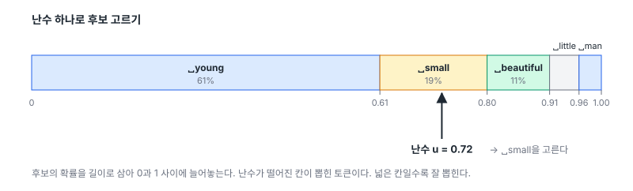
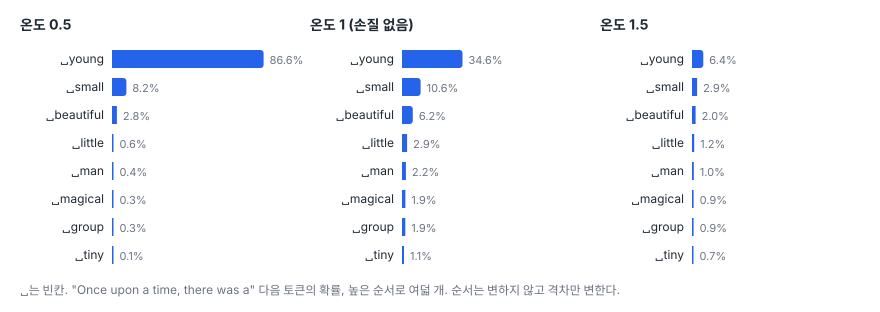
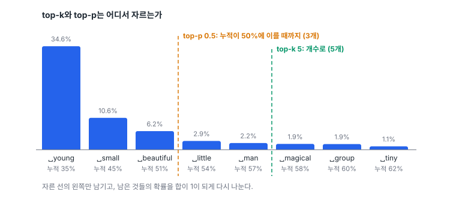
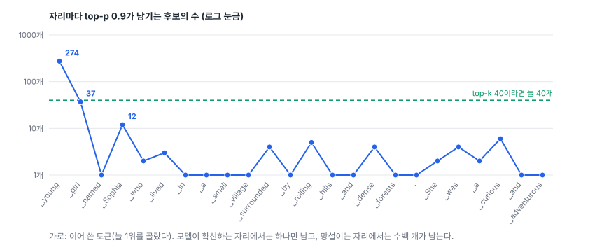

# 샘플링

[11장](ch11_kv_cache.md)의 생성 루프는 늘 점수가 가장 높은 토큰을 골랐습니다. 결과는 같은
말을 되풀이하는 글이었습니다. 이 장에서는 그 한 줄, "다음 토큰을
고른다"를 갈아 끼웁니다. 점수를 확률로 보고 **확률에 따라 뽑는** 것을
샘플링(sampling)이라고 합니다.

이 장은 지금까지와 성격이 조금 다릅니다. 모델의 가중치는 한 번도 쓰지
않습니다. 모델이 낸 점수 12만 8천 개를 받아 토큰 하나를 내놓기까지,
엔진이 혼자 하는 일을 다룹니다.


| 하는 일 | 절 |
|---|---|
| 확률에 따라 뽑는다. 난수 생성기를 만든다 | 12.1, 12.2 |
| 온도로 분포를 좁히거나 편다 | 12.3 |
| top-k와 top-p로 후보를 추린다 | 12.4 |
| 반복 벌점으로 되풀이를 줄인다 | 12.5 |
| 걸러 낸 뒤의 확률분포를 기준 구현과 대조한다 | 12.6 |
| 같은 글을 다시 얻을 수 있는지 따져 본다 | 12.7 |
| 샘플러가 쓰는 시간을 잰다 | 12.8 |

검증에서는 뜻밖의 일을 겪습니다. 기준으로 삼던 PyTorch의 계산이
정확하지 않았고, [2장](../part1/ch02_math.md)에서 만든 우리 `softmax`는 그보다 더 틀려
있었습니다.

코드는 `crates/badak_models/src/sampling.rs`와
`crates/badak_core/src/random.rs`에 있습니다.

## 12.1 왜 1위만 고르면 안 되는가

11.7절의 글을 다시 봅니다.

```text
{{#include output/ch12_penalty.txt:2:2}}
```

"… is located in Paris. … is also located in Paris. The famous French …
was born in Paris. The famous French …". 틀린 문장은 아닌데 같은 틀을
되풀이합니다. 늘 가장 유력한 토큰만 고르는 방법을 탐욕적(greedy)
선택이라고 하는데, 이렇게 밋밋하고 되풀이하는 글이 나오기 쉽다는 것은
잘 알려진 문제입니다.[^nucleus]

이유는 직관적으로 이렇습니다. 사람이 쓴 글은 자리마다 가장 뻔한 낱말만
고른 글이 아닙니다. 가끔 덜 뻔한 낱말이 들어가야 글이 앞으로 나아갑니다.
1위만 고르면 그런 일이 한 번도 일어나지 않고, 한번 들어선 틀에서
벗어나지 못합니다.

모델이 낸 것은 원래 "정답 하나"가 아니라 **확률분포**입니다. 10.5절에서
"The capital of France is" 다음에 " Paris"가 70%, " a"가 5%였습니다. 이
분포를 그대로 따른다면 열 번에 일곱 번은 " Paris"를, 스무 번에 한 번은
" a"를 골라야 합니다. 그렇게 하는 것이 샘플링입니다.

## 12.2 확률에 따라 뽑기

### 난수 하나로 고르기



후보들의 확률을 길이로 삼아 0과 1 사이의 선분에 차례로 늘어놓습니다.
그리고 0 이상 1 미만의 수 하나를 고르게 뽑아, 그 수가 떨어진 칸의 후보를
고릅니다. 확률이 61%인 후보는 선분의 61%를 차지하므로 61%의 경우에
뽑힙니다.

```rust
{{#include ../../../crates/badak_models/src/sampling.rs:sampler}}
```

`pick`이 그 일을 합니다. 확률을 앞에서부터 더해 가다가 합이 난수를 넘는
순간의 후보를 돌려줍니다. 끝의 한 줄은 반올림에 대비한 것입니다. 확률의
합이 정확히 1이 아니라 0.9999999일 수 있고, 난수가 그 틈에 떨어지면
반복문이 아무것도 고르지 못한 채 끝납니다. 드문 일이지만 12만 개짜리
분포를 수백만 번 뽑다 보면 일어납니다.

`distribution`은 점수를 손질해 후보와 확률을 만드는 부분이고, 12.3절부터
한 단계씩 설명합니다.

### 난수 생성기

"고르게 뽑은 수"가 필요합니다. Rust의 표준 라이브러리에는 난수 생성기가
없습니다. 이 책의 엔진은 표준 라이브러리만 쓰기로 했으므로 직접 만듭니다.

컴퓨터가 만드는 난수는 진짜 우연이 아닙니다. 정해진 식으로 수를 차례로
만들어 내는데, 그 수열이 우연처럼 보일 뿐입니다. 그래서 의사 난수
(pseudorandom number)라고 부릅니다. 시작하는 값을 씨앗(seed)이라고 하고,
**씨앗이 같으면 같은 수열이 나옵니다.** 이 성질이 12.7절에서 중요해집니다.

PCG64라는 생성기를 만듭니다.[^pcg] 열 줄 남짓이면 되고 통계적 품질이
좋으며, NumPy의 기본 생성기이기도 해서 결과를 대조할 상대가 있습니다.[^numpy-pcg]

```rust
{{#include ../../../crates/badak_core/src/random.rs:pcg64}}
```

하는 일은 둘입니다.

- **한 걸음 나아가기**: 128비트 상태에 큰 수를 곱하고 홀수를 더합니다.
  넘치는 자리는 버립니다. 이것만으로도 상태는 2의 128제곱 가지 값을 한
  번씩 모두 거칩니다.
- **수를 꺼내기**: 상태를 그대로 내놓으면 규칙이 드러나므로 섞어서
  내놓습니다. 위 절반과 아래 절반을 XOR하고, 상태의 맨 위 여섯 비트가
  가리키는 만큼 비트를 돌립니다.

0과 1 사이의 실수는 64비트 정수에서 위쪽 53비트를 떼어 2의 53제곱으로
나누어 만듭니다. 53은 `f64`가 정수를 빠짐없이 나타낼 수 있는 비트
수입니다. 이렇게 하면 결과가 1이 되는 일이 없습니다.

### 검증

난수 생성기도 검증합니다. "우연처럼 보이는가"는 눈으로 판단할 수 없지만,
**기준 구현과 같은 수를 내는가**는 판단할 수 있습니다.
`reference/ch12_rng_vectors.py`가 NumPy의 PCG64에 같은 상태를 넣고 수를
뽑아 봅니다.

```text
씨앗 42: 정수 ['0x3f042f649083f6aa', '0x649af5df021045f2'], 실수 ['0.24615760998905478', '0.3929895085767052', '0.10740772453548153']
```

우리 생성기가 씨앗 42로 내는 첫 정수 둘, 첫 실수 셋이 이것과 한 비트도
다르지 않습니다. 씨앗 0과 가장 큰 씨앗에서도 같습니다. 이 값들이
테스트에 들어 있습니다. 곱하는 수의 한 자리만 틀려도, 비트를 돌리는
방향만 틀려도 여기서 걸립니다.

테스트는 두 가지를 더 봅니다. 0과 1 사이를 열 칸으로 나누어 20만 개를
뽑았을 때 칸마다 2만 개 안팎이 들어가는지, 그리고 샘플러로 20만 번 뽑은
토큰의 빈도가 확률과 맞는지입니다.

## 12.3 온도

분포를 그대로 따라 뽑으면 어떻게 될까요. 예제의 기본 설정이 그것입니다.

```bash
cargo run --release -p badak_models --example ch12_sample -- llama32_1b "Once upon a time, there was a" 40 temperature=1.0 seed=1
```

```text
{{#include output/ch12_temperature.txt:11:12}}
```

1위만 골랐을 때보다 글이 살아 있습니다. 그런데 분포를 그대로 따르는 것이
늘 좋지는 않습니다. 분포의 꼬리가 길기 때문입니다. 토큰 하나하나의 확률은
아주 낮아도 그런 토큰이 12만 개 있으면 합쳐서는 무시할 수 없는 확률이
됩니다. 엉뚱한 토큰이 가끔 뽑히고, 한번 뽑히면 그 뒤의 글은 그 토큰을
전제로 이어집니다.

그래서 분포를 손질합니다. 첫째 도구가 온도(temperature)입니다. **점수를
온도로 나눈 뒤** 소프트맥스를 합니다.[^temperature]

```text
확률ᵢ = exp(점수ᵢ / T) / Σ exp(점수ⱼ / T)
```

- `T`가 1보다 작으면 점수 사이의 차이가 커집니다. 유력한 토큰에 확률이
  더 몰립니다.
- `T`가 1보다 크면 차이가 줄어듭니다. 확률이 고르게 퍼집니다.
- `T`가 0에 가까워지면 1위가 확률을 독차지합니다. 탐욕적 선택과 같아집니다.
  0으로 나눌 수는 없으므로 코드에서는 온도 0을 "1위를 고른다"로 따로
  처리합니다.



"Once upon a time, there was a" 다음 토큰의 확률입니다. 1위 " young"의
확률이 온도 0.5에서 87%, 1에서 35%, 1.5에서 6%입니다. **순서는 변하지
않습니다.** 변하는 것은 격차입니다.

글로 보면 차이가 분명합니다.

```text
{{#include output/ch12_temperature.txt:6:7}}
```

```text
{{#include output/ch12_temperature.txt:14:15}}
```

온도 0.7의 글은 차분하고, 1.5의 글은 몇 낱말 만에 무너졌습니다. 여러
언어의 조각이 뒤섞여 나옵니다. 온도 1.5에서는 1위의 확률이 6%뿐이고
나머지 94%가 12만 개의 토큰에 퍼져 있어서, 엉뚱한 토큰이 뽑히는 쪽이
오히려 보통이 됩니다.

## 12.4 후보 추리기: top-k와 top-p

온도는 꼬리를 낮추거나 높일 뿐 없애지 못합니다. 꼬리를 **잘라 내는**
도구가 둘 있습니다.



### top-k

점수가 높은 순서로 `k`개만 남기고 나머지는 버립니다.[^topk]

```rust
{{#include ../../../crates/badak_models/src/sampling.rs:top_k}}
```

12만 8천 개를 모두 정렬할 필요는 없습니다. 필요한 것은 "높은 `k`개가
무엇인가"뿐이고, 버릴 것들 사이의 순서는 알 필요가 없습니다. 표준
라이브러리의 `select_nth_unstable_by`가 그 일을 합니다. `k`번째로 큰 값을
제자리에 놓고 그보다 큰 것들을 앞쪽에 모읍니다. 그 뒤에 남긴 `k`개만
정렬합니다. 얼마나 차이가 나는지는 12.8절에서 잽니다.

### top-p

top-k는 개수가 고정입니다. 그런데 모델이 얼마나 확신하는지는 자리마다
다릅니다. 확신하는 자리에서는 후보가 하나면 충분하고, 망설이는 자리에서는
40개로도 모자랄 수 있습니다.

top-p는 개수 대신 **확률의 합**으로 자릅니다. 확률이 높은 순서로 더해
가다가 합이 `p`에 이르면 거기까지만 남깁니다. 핵 샘플링(nucleus
sampling)이라고도 부릅니다.[^nucleus]

```rust
{{#include ../../../crates/badak_models/src/sampling.rs:top_p}}
```

실제로 후보가 몇 개나 남는지 봅니다. `ch12_distribution` 예제가 글을
이어 가면서 자리마다 top-p 0.9가 남기는 후보의 수를 셉니다.

```bash
cargo run --release -p badak_models --example ch12_distribution
```



첫 자리에서는 274개가 남습니다. "옛날 옛적에 … 가 있었습니다"의 빈칸에는
무엇이든 올 수 있기 때문입니다. " girl" 다음의 " named"에서는 하나만
남습니다. 그 자리에 올 말이 사실상 정해져 있어서 1위 하나가 97%를
차지합니다. 스물네 자리 가운데 열두 자리에서 후보가 하나입니다. top-k
40이었다면 이 모든 자리에서 40개를 남겼을 것입니다.

### 손질의 순서

단계가 여럿이면 순서가 문제가 됩니다. 온도와 top-p를 함께 쓸 때 특히
그렇습니다.

- **온도를 먼저** 적용하면, top-p는 온도로 펴진(또는 좁혀진) 분포를 보고
  자릅니다.
- **온도를 나중에** 적용하면, top-p는 모델의 원래 분포를 보고 자르고,
  온도는 남은 후보들 사이의 격차만 바꿉니다.

온도 1.5와 top-p 0.9로 두 순서를 비교합니다.

```text
{{#include output/ch12_distribution_llama32.txt:55:57}}
   …

{{#include output/ch12_distribution_llama32.txt:65:67}}
   …
```

온도를 먼저 적용하면 후보가 8,091개 남습니다. 분포가 펴져서 합이 90%가
되려면 그만큼 많이 더해야 하기 때문입니다. 온도를 나중에 적용하면
274개입니다. 글로 보면 이렇습니다.

```text
{{#include output/ch12_truncation.txt:4:5}}
```

```text
{{#include output/ch12_truncation.txt:7:8}}
```

같은 온도, 같은 top-p, 같은 씨앗인데 한쪽은 무너지고 한쪽은 (조금
별나지만) 글이 됩니다. top-k는 사정이 다릅니다. 온도는 점수의 순서를
바꾸지 않으므로 top-k가 남기는 후보는 온도와 무관합니다. 온도 1.5에
top-k 40만 써도 글이 유지됩니다.

```text
{{#include output/ch12_truncation.txt:1:2}}
```

이 순서는 엔진마다 다릅니다. Hugging Face transformers는 온도를 먼저
적용하고[^hf-order], llama.cpp는 기본 설정에서 온도를 맨 뒤에
둡니다.[^llamacpp-sampling] **같은 설정값을 주어도 엔진에 따라 다른 글이
나오는 이유 가운데 하나입니다.** "온도 1.5, top-p 0.9"라는 설정은 순서를
함께 말하지 않으면 뜻이 정해지지 않습니다.

우리 샘플러는 transformers의 순서를 기본으로 하고, 설정으로 온도를 뒤로
보낼 수 있게 했습니다. 12.6절에서 transformers와 대조하기 위해서입니다.

```rust
{{#include ../../../crates/badak_models/src/sampling.rs:config}}
```

`distribution`의 코드(12.2절)에서 top-k가 온도보다 앞에 있는 것은 위에서
말한 대로 결과가 같기 때문입니다. 12만 개를 온도로 나누는 대신 남은
후보만 나누면 되므로 그쪽이 쌉니다.

## 12.5 반복 벌점

되풀이를 직접 겨냥하는 도구도 있습니다. 이미 나온 토큰의 점수를 깎는
것입니다.[^ctrl]

```rust
{{#include ../../../crates/badak_models/src/sampling.rs:penalty}}
```

점수가 양수이면 벌점으로 나누고 음수이면 곱합니다. 식이 둘인 이유는 어느
쪽이든 점수를 **내려야** 하기 때문입니다. 음수를 1보다 큰 수로 나누면
0에 가까워져 오히려 올라갑니다.

12.1절의 글에 벌점 1.3을 줍니다. 온도는 0, 곧 늘 1위를 고르게 두었습니다.

```bash
cargo run --release -p badak_models --example ch12_sample -- llama32_1b "The capital of France is" 40 temperature=0 repetition_penalty=1.3
```

```text
{{#include output/ch12_penalty.txt:4:7}}
```

"is located in Paris"의 되풀이가 사라졌습니다. 난수를 쓰지 않고도 글이
달라졌다는 점을 눈여겨보십시오. 벌점은 뽑기가 아니라 점수를 고치는
단계입니다.

부작용도 있습니다. 벌점은 "나온 적이 있는가"만 봅니다. 마침표, 조사, "the"
같은 토큰은 좋은 글에서도 여러 번 나와야 하는데 똑같이 깎입니다. 벌점이
크면 글이 어색해집니다. 그래서 실전 엔진은 최근 몇 개의 토큰만 보는
식으로 범위를 제한합니다(12.9절). 우리 구현은 프롬프트를 포함한 모든
토큰을 봅니다. transformers의 기본 동작과 같습니다.

## 12.6 검증: 걸러 낸 뒤의 분포를 대조한다

샘플링의 결과는 난수에 달려 있어서 PyTorch와 토큰 단위로 맞출 수
없습니다. 난수 생성기가 다르고, 같다고 해도 난수를 쓰는 방법이 다릅니다.
그래서 검증의 대상을 바꿉니다. **뽑기 직전의 확률분포**를 대조합니다.
분포가 같으면 남은 것은 12.2절에서 따로 검증한 "난수 하나로 고르기"뿐입니다.

`reference/ch12_sampling_reference.py`가 transformers의 구현으로 분포를
계산합니다. 입력은 [9장](ch09_transformer.md)의 정답 파일에 든 마지막 줄의 점수입니다. 모델을
다시 실행하지 않으므로 샘플러만 따로 검증됩니다. 설정은 일곱 가지입니다.

```rust
{{#include ../../../crates/badak_models/tests/sampling.rs:check}}
```

### 첫 시도: 온도에서 실패한다

처음 돌렸을 때 가장 단순한 설정, 온도 0.7 하나에서 실패했습니다.

```text
설정 0: 원소 128256개 중 16개가 허용 오차를 벗어남. 가장 큰 차이 6.207824e-5
(위치 34804: 실제 0.17660342, 기준 0.17654134)
```

1위 토큰의 확률이 0.17660과 0.17654입니다. 상대 오차로 `3.5e-4`입니다.
나눗셈 한 번과 소프트맥스 한 번뿐인 계산에서 나올 차이가 아닙니다.

8.10절의 원칙대로 세 가지를 의심합니다. 우리가 틀렸는가, 상대가 틀렸는가,
비교 방법이 틀렸는가. 답을 가리려면 **더 믿을 만한 셋째 값**이 필요합니다.
같은 계산을 `f64`로 해 봅니다.

| 1위 토큰의 확률 (Llama 3.2 1B, 온도 0.7) | 값 | `f64`와의 상대 오차 |
|---|---|---|
| `f64`로 계산 | 0.176517 | |
| PyTorch, `f32` | 0.176541 | `1.4e-4` |
| badak, `f32` (처음의 구현) | 0.176603 | `4.9e-4` |

**둘 다 틀렸습니다.** 우리가 더 많이 틀렸을 뿐입니다. PyTorch가 `f32`로
계산한 확률을 모두 더하면 1이 아니라 1.000135가 나옵니다.

원인은 5.6절에서 이미 만난 것입니다. 소프트맥스의 분모는 `exp` 값
12만 8천 개의 합입니다. [2장](../part1/ch02_math.md)의 `softmax`는 이것을 앞에서부터 차례로
더했습니다. 합이 커진 뒤에 더해지는 작은 값들은 자릿수가 모자라 일부가
잘려 나갑니다. `ch12_bench` 예제가 같은 값들을 세 가지 방법으로 더해
봅니다.

```rust
{{#include ../../../crates/badak_models/examples/ch12_bench.rs:sum}}
```

```text
{{#include output/ch12_bench_llama32.txt:3:7}}
```

차례로 더하면 합이 최대 `3.8e-4`만큼 모자랍니다. 5.6절의 쌍별 합산으로
더하면 오차가 천 분의 일로 줄어듭니다. 그 함수는 [5장](../part1/ch05_operators.md)에서 만들어 놓고도
[2장](../part1/ch02_math.md)의 `softmax`에는 쓰지 않고 있었습니다. 값이 10개일 때([7장](../part1/ch07_mnist.md))나 수십 개일
때([9장](ch09_transformer.md)의 어텐션)는 차이가 없어서 드러나지 않았을 뿐입니다.

고친 것은 두 가지입니다.

- **우리 `softmax`가 쌍별 합산을 쓰게 했습니다.** [2장](../part1/ch02_math.md)의 코드가 한 줄
  바뀌었습니다.
- **정답을 `f64`로 계산하게 했습니다.** 기준 구현이 `f32`로 낸 값은 이
  계산에서 정답이 될 만큼 정확하지 않습니다.

고친 뒤에는 일곱 설정이 모두 통과합니다. 남은 토큰의 집합이 같고, 확률이
상대 오차 `1e-5` 안에서 같습니다.

```text
{{#include output/ch12_reference_llama32.txt:1:7}}
```

마지막 열이 PyTorch가 `f32`로 계산했을 때의 어긋남입니다. top-k나 top-p로
후보를 추린 뒤에는 더할 값이 적어서 오차가 거의 없습니다. 12만 개를 모두
더하는 설정에서만 문제가 됩니다.

이 일로 [10장](ch10_forward_pass.md)의 숫자도 고쳤습니다. " Paris"의 확률을 69.99%라고 적었는데
정확한 값은 69.95%였습니다. 본문에서 "70%"라고 부른 것은 그대로
맞지만, 출력의 둘째 자리는 틀려 있었습니다.

여기서 얻을 것은 셋입니다.

- **기준 구현도 틀릴 수 있습니다.** [9장](ch09_transformer.md)부터 PyTorch의 값을 정답으로
  써 왔습니다. 대부분의 계산에서 그래도 됩니다. 하지만 값 10만 개를
  `f32`로 더하는 계산에서는 기준 구현의 답에도 넷째 자리에 오차가
  있었습니다. 둘이 다를 때 어느 쪽이 맞는지 모르겠다면 더 정밀한 셋째
  계산이 필요합니다.
- **허용 오차를 넓히는 것은 마지막 수단입니다.** 처음의 실패를 허용 오차
  `1e-3`으로 덮을 수도 있었습니다. 그랬다면 우리 `softmax`의 결함은 계속
  남았을 것입니다.
- **작은 입력에서 통과한 코드가 큰 입력에서도 옳다는 보장은 없습니다.**
  `softmax`는 [2장](../part1/ch02_math.md)부터 여러 테스트를 통과해 왔습니다. 값이 12만 개인
  입력은 이 장이 처음이었습니다.

## 12.7 같은 글을 다시 얻을 수 있는가

샘플링을 쓰면 실행할 때마다 다른 글이 나옵니다. 창작에는 좋지만 엔진을
만드는 사람에게는 곤란합니다. 버그를 재현할 수 없고, 고친 뒤에 결과가
달라졌는지 비교할 수 없습니다. 그래서 **씨앗을 고정하면 같은 글이
나와야** 합니다.

```text
{{#include output/ch12_seed.txt}}
```

씨앗 7로 두 번 실행한 글이 같고, 씨앗 8의 글은 다릅니다. 우리 엔진에서
이것이 성립하는 이유는 세 가지가 모두 정해져 있기 때문입니다. 모델의
점수가 실행마다 비트 단위로 같고(11.6절), 난수의 수열이 씨앗으로 정해지고,
토큰 하나에 난수를 정확히 하나씩 씁니다.

마지막 조건은 놓치기 쉽습니다. 후보가 하나뿐인 자리에서는 난수가 필요
없으니 뽑지 않고 넘어가는 최적화를 생각할 수 있습니다. 그러면 그 뒤의
모든 토큰이 다른 난수를 받게 됩니다. 결과는 여전히 올바른 샘플링이지만
이전 판과 같은 글은 나오지 않습니다. 난수를 언제 몇 개 쓰는지도 엔진의
동작에 속합니다.

### 엔진이 다르면

같은 모델, 같은 설정, 같은 씨앗을 다른 엔진에 주면 같은 글이 나올까요.
나오지 않습니다. 이유가 층층이 있습니다.

1. **난수 생성기가 다릅니다.** 우리는 PCG64를, llama.cpp는 C++ 표준
   라이브러리의 메르센 트위스터를 씁니다.[^llamacpp-sampler] 씨앗 42가
   뜻하는 수열이 서로 다릅니다.
2. **난수를 쓰는 방법이 다릅니다.** 생성기가 같아도 정수를 실수로 바꾸는
   방법, 후보를 늘어놓는 순서가 다르면 다른 토큰이 뽑힙니다.
3. **손질의 순서와 기본값이 다릅니다**(12.4절).
4. **점수가 조금 다릅니다.** 10.7절에서 우리 점수와 PyTorch의 점수는
   상대 오차 `3e-6`만큼 달랐습니다.

1번부터 3번까지는 맞추려고 하면 맞출 수 있습니다. 4번은 그럴 수 없습니다.
엔진이 다르면 덧셈의 순서가 다르고, 같은 엔진도 스레드 수나 묶음의 크기에
따라 달라질 수 있습니다(11.6절). 그렇다면 이 작은 차이가 글을 얼마나
바꿀까요. 실험해 봅니다.

```rust
{{#include ../../../crates/badak_models/examples/ch12_reproducibility.rs:write}}
```

같은 씨앗으로 글을 두 번 씁니다. 한 번은 그대로, 한 번은 점수마다 작은
잡음을 더합니다. 잡음이 "다른 엔진의 계산 오차" 노릇을 합니다. 토큰
80개를 쓰는 동안 두 글이 갈리는지, 갈린다면 몇 번째 토큰에서인지 셉니다.
빠른 SmolLM2로 씨앗 20개를 돌렸습니다.

```bash
cargo run --release -p badak_models --example ch12_reproducibility
```

```text
{{#include output/ch12_reproducibility_smollm2.txt}}
```

읽어 보면 이렇습니다.

- **잡음 0.0001에서는 한 글도 갈리지 않았습니다.** 10.7절에서 잰 SmolLM2
  점수의 실제 오차가 이 크기입니다. 엔진 사이의 계산 오차 정도로는 토큰
  80개짜리 글이 대부분 유지된다는 뜻입니다.
- **잡음 0.01에서는 스무 글 가운데 아홉이 갈렸습니다.** 갈린 자리의
  중앙값이 54번째입니다. 처음에는 같다가 어느 순간 달라집니다.
- **늘 1위를 고르는 쪽이 더 잘 버팁니다.** 잡음 0.01에서도 갈리지
  않았습니다. 1위와 2위의 점수 차이가 잡음보다 크면 순위가 그대로이기
  때문입니다. 샘플링은 사정이 다릅니다. 난수가 두 후보의 경계 근처에
  떨어지면 경계가 조금만 움직여도 다른 토큰이 뽑힙니다.

"대부분 유지된다"를 "늘 유지된다"로 읽으면 안 됩니다. 스무 글에서 한 번도
갈리지 않았다는 것은 갈릴 확률이 낮다는 뜻이지 0이라는 뜻이 아닙니다.
글이 길수록, 요청이 많을수록 언젠가 갈립니다. 그리고 **한 번 갈리면 그
뒤는 완전히 다른 글입니다.** 다른 토큰이 입력으로 들어가 그 뒤의 모든
점수를 바꾸기 때문입니다.

엔진을 만드는 사람이 기억할 것은 이렇습니다.

- 같은 엔진, 같은 설정, 같은 씨앗에서는 같은 글이 나와야 합니다. 이것은
  지킬 수 있고 지켜야 하는 약속입니다. 테스트로 묶어 둡니다.
- 엔진이 다르거나 엔진의 판이 다르면 같은 글을 약속할 수 없습니다.
  행렬 곱을 빠르게 고치는 것만으로도 덧셈의 순서가 바뀝니다. 3부에서
  우리가 하게 될 일입니다.
- 그래서 엔진 사이의 검증은 글이 아니라 **점수와 분포**로 합니다. [10장](ch10_forward_pass.md)과
  이 장에서 한 방법입니다.

## 12.8 측정: 샘플러의 값

토큰 하나를 뽑는 데 걸리는 시간입니다. 점수 12만 8천 개에 대해 200번
되풀이한 평균입니다.

```text
{{#include output/ch12_bench_llama32.txt:9:15}}
```

**지금은 어느 것도 문제가 되지 않습니다.** 모델이 토큰 하나에 580밀리초를
쓰는데(11.8절) 샘플러는 가장 느린 경우에도 1.5밀리초입니다. 0.3%입니다.

그래도 숫자를 읽어 둘 만합니다.

- **전체를 정렬하면 1.5밀리초, top-k 40이면 0.15밀리초입니다.** 열 배
  차이입니다. 12.4절에서 "높은 `k`개만 가려내고 나머지는 정렬하지
  않는다"고 한 것의 값입니다. top-p만 쓸 때는 후보를 미리 줄일 수 없어
  전체를 정렬합니다.
- **모델이 빨라지면 사정이 달라집니다.** 11.8절에서 PyTorch는 토큰 하나를
  28밀리초에 만들었습니다. 거기에 1.5밀리초는 5%입니다. 더 빠른 엔진,
  더 작은 모델에서는 비중이 더 커집니다. 실전 엔진이 샘플러의 정렬을
  공들여 다듬는 이유입니다(12.9절).
- **가장 높은 것 하나를 고르는 일이 top-k 40보다 느립니다.** 뜻밖의
  결과입니다. [2장](../part1/ch02_math.md)에서 만든 `argmax`는 `NaN`을 건너뛰느라 값마다 분기를
  둡니다. 그것이 원인일 것으로 짐작하지만 확인하지는 않았습니다. 측정
  도구를 갖추는 [14장](../part3/ch14_measurement.md)에서 다시 봅니다. (14.10절에서 원인을 찾아 고쳤습니다.
  위의 출력은 고치기 전의 것입니다.)

> 이 측정은 초시계로 재는 수준의 거친 측정입니다.

## 12.9 실전 엔진에서는

**샘플러는 갈아 끼우는 부품의 사슬입니다.** llama.cpp에서는 손질 단계
하나하나가 `llama_sampler`라는 부품이고, 사슬에 원하는 순서로
꿰어 씁니다. 이 장의 넷 말고도 종류가 많습니다. 확률이 1위의 일정 비율에
못 미치는 후보를 버리는 min-p[^minp], 문법에 맞는 토큰만 남기는 것([41장](../part5/ch41_control_and_speed.md)에서
만듭니다), 특정
토큰의 점수를 올리거나 내리는 것 등이 있습니다.[^llamacpp-sampler-api]
우리 `Sampler`는 단계와 순서가 코드에 박혀 있습니다. 단계가 더 늘어나면
이 구조로 바꿔야 합니다.

**기본값이 엔진의 성격을 정합니다.** llama.cpp의 기본 설정은 top-k 40,
top-p 0.95, min-p 0.05, 온도 0.8이고, 반복 벌점은 꺼져 있으며 켜더라도
최근 64개의 토큰만 봅니다.[^llamacpp-sampling] 사용자가 아무 설정도 주지
않으면 이 값으로 글이 나옵니다. 같은 모델이 엔진에 따라 "말투가 다르게"
느껴지는 이유의 상당 부분이 여기에 있습니다.

**정렬을 피합니다.** llama.cpp의 top-k는 전체를 정렬하지 않습니다. 점수를
구간으로 나눈 통에 담아 위쪽 통부터 필요한 만큼만 꺼내 정렬합니다.
[^llamacpp-sampler] 12.8절에서 본 비용을 줄이려는 것입니다.

**모델이 권하는 설정이 있습니다.** 모델을 만든 쪽이 샘플링의 권장값을
`generation_config.json`이라는 파일로 함께 배포하기도 합니다. Llama 3.2 1B
Instruct의 파일에는 온도 0.6과 top-p 0.9가 적혀 있습니다.[^llama-generation]
SmolLM2 135M의 파일에는 샘플링 설정이 없습니다. 10.6절의 "글 앞에 붙이는
토큰"과 같은 종류의, 가중치 바깥의 약속입니다. 우리 엔진은 아직 이 파일을
읽지 않습니다.

**여러 글을 한꺼번에 탐색하는 방법도 있습니다.** 이 장의 방법은 모두
토큰을 하나 뽑으면 되돌아가지 않습니다. 후보 글 여러 개를 나란히 키워
가며 전체 확률이 높은 것을 고르는 빔 탐색(beam search)은 [33장](../part4/ch33_speech_recognition.md)에서
음성 인식과 함께 다룹니다.

## 정리

- 모델은 점수까지만 냅니다. 점수에서 토큰 하나를 고르는 일은 엔진의
  몫이고, 그 방법에 따라 같은 모델이 전혀 다른 글을 씁니다.
- 늘 1위를 고르면 글이 되풀이됩니다. 확률에 따라 뽑으려면 난수가
  필요합니다. 난수 생성기 PCG64를 만들었고 NumPy와 같은 수를 냅니다.
- 온도는 점수를 나누어 분포를 좁히거나 폅니다. 순서는 바꾸지 않습니다.
  온도가 높으면 꼬리의 엉뚱한 토큰이 뽑혀 글이 무너집니다.
- top-k는 개수로, top-p는 확률의 합으로 꼬리를 잘라 냅니다. top-p가
  남기는 후보는 자리에 따라 1개에서 수백 개까지 변합니다.
- 온도와 top-p는 순서에 따라 결과가 다릅니다. transformers는 온도를
  먼저, llama.cpp는 나중에 적용합니다.
- 반복 벌점은 이미 나온 토큰의 점수를 깎습니다. 난수 없이도 글을
  바꿉니다.
- 샘플링은 토큰이 아니라 뽑기 직전의 분포로 검증합니다. 일곱 가지
  설정에서 transformers의 구현과 일치합니다.
- 그 검증에서 [2장](../part1/ch02_math.md)의 `softmax`가 값 12만 개를 차례로 더하다 오차를 내는
  것을 찾았습니다. PyTorch의 `f32` 계산에도 같은 종류의 오차가
  있었습니다. 쌍별 합산으로 고치고 정답을 `f64`로 계산했습니다.
- 같은 엔진에서는 씨앗이 같으면 같은 글이 나옵니다. 엔진이 다르면
  약속할 수 없습니다. 점수의 작은 차이는 대부분 글을 바꾸지 않지만,
  한 번 바꾸면 그 뒤가 모두 달라집니다.
- 샘플러의 시간은 지금은 모델의 0.3%입니다. 모델이 빨라지면 비중이
  커집니다.

## 연습 문제

1. `ch12_sample`로 같은 프롬프트에 씨앗만 바꿔 가며 다섯 번 실행해
   보십시오. 온도 0.3과 온도 1.0에서 각각 해 보고, 다섯 글이 서로 얼마나
   다른지 비교해 보십시오.
2. top-p가 0.9일 때 후보가 하나만 남는 자리에서는 온도가 얼마이든 결과가
   같습니다. 왜 그렇습니까. 온도를 먼저 적용할 때와 나중에 적용할 때
   모두 그렇습니까.
3. 온도 2와 top-k 1을 함께 주면 어떤 글이 나옵니까. 실행하기 전에 예상해
   보고 확인해 보십시오.
4. `penalize_repetition`이 최근 `n`개의 토큰만 보도록 고쳐 보십시오.
   `n`을 8과 64로 두고 12.5절의 글이 어떻게 달라지는지 보십시오.
5. min-p를 만들어 보십시오. 1위 확률의 `min_p`배에 못 미치는 후보를
   버립니다. 12.4절의 그림에서 `min_p`가 0.1이면 몇 개가 남습니까.
   top-p와 마찬가지로 자리에 따라 후보의 수가 달라지는지 확인해
   보십시오.
6. `Pcg64::next_f64`를 `f32`로 바꾸어 위쪽 24비트만 쓰게 하면 무엇이
   달라집니까. 확률이 1억 분의 1인 토큰이 뽑힐 수 있습니까.
7. `ch12_bench`의 합산 실험에서, 차례로 더하되 **작은 값부터** 더하면
   오차가 어떻게 됩니까. 정렬한 뒤 더해 보고, 쌍별 합산과 견주어
   보십시오. 그 방법을 `softmax`에 쓰지 않는 이유는 무엇이겠습니까.
8. 12.7절의 실험을 온도 0.3과 1.2로 바꿔 돌려 보십시오. 어느 쪽이
   잡음에 더 잘 버팁니까. 이유를 12.2절의 그림으로 설명해 보십시오.

## 참고 문헌

[^nucleus]: A. Holtzman, J. Buys, L. Du, M. Forbes, Y. Choi, "The Curious
    Case of Neural Text Degeneration", ICLR 2020.
    [arXiv:1904.09751](https://arxiv.org/abs/1904.09751). 확률이 가장 높은
    글을 찾는 방법이 밋밋하고 되풀이하는 글을 낸다는 것을 보이고 핵
    샘플링(top-p)을 제안했습니다.

[^pcg]: M. E. O'Neill, "PCG: A Family of Simple Fast Space-Efficient
    Statistically Good Algorithms for Random Number Generation", Harvey Mudd
    College 기술 보고서 HMC-CS-2014-0905, 2014.
    <https://www.pcg-random.org/paper.html>

[^numpy-pcg]: NumPy, "Permuted congruential generator (64-bit, PCG64)".
    <https://numpy.org/doc/stable/reference/random/bit_generators/pcg64.html>.
    이 장의 시험 값은 `reference/requirements.txt`에 고정한 NumPy 2.3.4에서
    얻었습니다.

[^temperature]: G. Hinton, O. Vinyals, J. Dean, "Distilling the Knowledge in
    a Neural Network", NIPS 2014 Deep Learning Workshop.
    [arXiv:1503.02531](https://arxiv.org/abs/1503.02531). 소프트맥스의
    점수를 온도로 나누어 분포를 부드럽게 만드는 식이 실려 있습니다.

[^topk]: A. Fan, M. Lewis, Y. Dauphin, "Hierarchical Neural Story
    Generation", 2018. [arXiv:1805.04833](https://arxiv.org/abs/1805.04833).
    글을 생성할 때 확률이 높은 `k`개에서만 뽑는 방법을 썼습니다.

[^ctrl]: N. S. Keskar, B. McCann, L. R. Varshney, C. Xiong, R. Socher,
    "CTRL: A Conditional Transformer Language Model for Controllable
    Generation", 2019. [arXiv:1909.05858](https://arxiv.org/abs/1909.05858).
    이미 나온 토큰의 점수를 깎는 벌점을 제안했습니다.

[^minp]: M. N. Nguyen, A. Baker, C. Neo, A. Roush, A. Kirsch, "Turning Up
    the Heat: Min-p Sampling for Creative and Coherent LLM Outputs", ICLR
    2025. [arXiv:2407.01082](https://arxiv.org/abs/2407.01082)

[^llama-generation]: Meta, Llama 3.2 1B Instruct의 `generation_config.json`
    (판 `9213176726f5`). `"do_sample": true`, `"temperature": 0.6`,
    `"top_p": 0.9`가 적혀 있습니다.
    <https://huggingface.co/meta-llama/Llama-3.2-1B-Instruct>. SmolLM2 135M
    Instruct의 같은 파일(판 `12fd25f77366`)에는 토큰 번호만 있습니다.

[^hf-order]: Hugging Face transformers,
    `src/transformers/generation/utils.py`와 `logits_process.py` (태그
    `v5.23.0`). `utils.py`의 1613번째 줄 부근에서 온도, top-k, top-p,
    min-p의 순서로 처리기를 덧붙이고, 반복 벌점은 그보다 앞(1472번째 줄
    부근)에서 덧붙입니다. 이 장의 `penalize_repetition`, `top_k`, `top_p`는
    `logits_process.py`의 `RepetitionPenaltyLogitsProcessor`,
    `TopKLogitsWarper`, `TopPLogitsWarper`에 대응합니다.
    <https://github.com/huggingface/transformers/blob/v5.23.0/src/transformers/generation/utils.py>

[^llamacpp-sampling]: llama.cpp, `common/common.h` (커밋 `b4c0e00a4fcc`).
    237번째 줄 부근에 샘플링 설정의 기본값(`top_k = 40`, `top_p = 0.95`,
    `min_p = 0.05`, `temp = 0.80`, `penalty_last_n = 64`,
    `penalty_repeat = 1.00`)이, 268번째 줄 부근에 기본 순서(벌점, …, top-k,
    …, top-p, min-p, …, 온도)가 있습니다.
    <https://github.com/ggml-org/llama.cpp/blob/b4c0e00a4fcc/common/common.h>

[^llamacpp-sampler]: llama.cpp, `src/llama-sampler.cpp` (커밋
    `b4c0e00a4fcc`). 136번째 줄 부근의 `llama_token_data_array_partial_sort`가
    점수를 128개의 통에 나누어 담는 부분 정렬이고, 218번째 줄 부근의
    `llama_sample_dist`가 `std::mt19937`로 토큰을 뽑습니다.
    <https://github.com/ggml-org/llama.cpp/blob/b4c0e00a4fcc/src/llama-sampler.cpp>

[^llamacpp-sampler-api]: llama.cpp, `include/llama.h` (커밋 `b4c0e00a4fcc`).
    1483번째 줄 부근부터 `llama_sampler_init_greedy`, `_dist`, `_top_k`,
    `_top_p`, `_min_p`, `_temp`, `_grammar`, `_penalties`, `_logit_bias`
    등이 있습니다.
    <https://github.com/ggml-org/llama.cpp/blob/b4c0e00a4fcc/include/llama.h>
