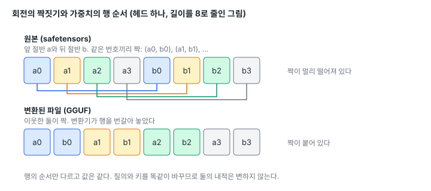
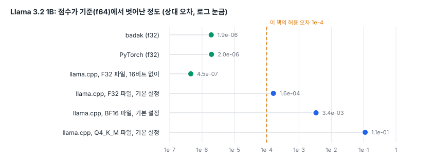
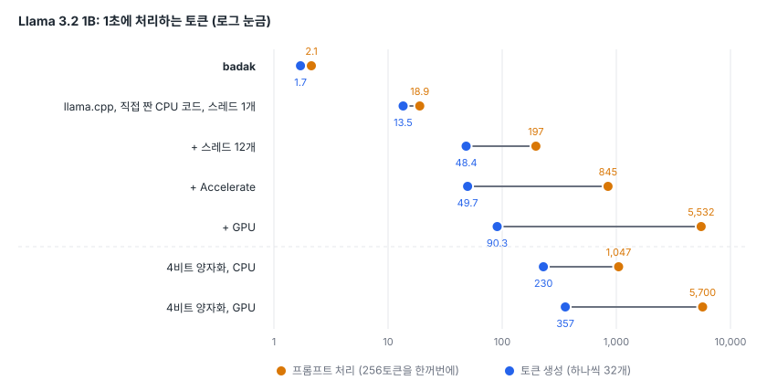

# 첫 대결: llama.cpp

2부에서 우리는 글을 토큰으로 바꾸고, 트랜스포머를 조립하고, KV 캐시로
글을 이어 쓰고, 샘플링으로 토큰을 뽑았습니다. `badak`은 이제 언어 모델을
끝까지 돌리는 엔진입니다. 이 장에서는 같은 모델을 llama.cpp로 돌려 둘을
나란히 놓습니다.

지금까지 견준 상대는 PyTorch였습니다. PyTorch는 계산이 옳은지 확인하는
기준으로는 좋지만, 추론 엔진으로서의 경쟁 상대는 아닙니다. llama.cpp는
우리와 같은 일을 하려고 만든 엔진입니다. 다른 라이브러리에 기대지 않는
것을 내세우고, 모델의 계산을 코드로 직접 적고, 개인 컴퓨터에서 언어 모델을
돌립니다.[^llamacpp] 이 책이 가려는 곳에 이미 가 있는 엔진입니다.

이 장이 답하려는 질문은 셋입니다.

| 질문 | 절 |
|---|---|
| 두 엔진이 같은 답을 내는가 | 13.2, 13.3 |
| 얼마나 차이 나는가. 그것을 어떻게 재야 하는가 | 13.4, 13.5, 13.6 |
| 차이는 어디에서 오는가 | 13.5, 13.7 |

결과를 미리 말하면, 답은 같고 속도는 수백 배 다릅니다. 이 장의 일은 그
"수백 배"를 한 덩어리로 두지 않고 원인별로 쪼개는 것입니다. 쪼갠 조각
하나하나가 3부의 장이 됩니다.

이 장에는 새로운 엔진 코드가 없습니다. 재는 도구와 견주는 도구만
만듭니다.

## 13.1 준비

llama.cpp를 받아 빌드하고, 우리 모델을 llama.cpp가 읽는 형식으로 바꿉니다.

```bash
sh scripts/build_llama_cpp.sh           # llama.cpp를 고정된 커밋으로 받아 빌드
sh scripts/build_llama_cpp.sh --plain   # GPU와 외부 행렬 라이브러리를 뺀 판
sh scripts/build_ch13_tools.sh          # 점수를 꺼내는 작은 도구
sh scripts/convert_to_gguf.sh           # 모델을 GGUF로 변환
```

**빌드를 두 벌 만듭니다.** macOS에서 llama.cpp를 그냥 빌드하면 GPU를 쓰는
Metal 백엔드와 Apple의 행렬 라이브러리 Accelerate가 함께 들어갑니다. 그
상태로 재면 llama.cpp가 직접 짠 코드의 속도와 Apple의 라이브러리, GPU의
속도가 뒤섞입니다. 7.6절에서 PyTorch와 겨뤘을 때 "상대가 어떤
하드웨어를 쓰는지 확인하지 않으면 엉뚱한 결론을 내린다"는 것을 배웠습니다.
그래서 그것들을 뺀 판을 `build_plain`에 따로 빌드합니다. 왜 필요한지는 13.5절에서 분명해집니다.

**모델은 직접 변환합니다.** 인터넷에는 누군가 변환해 둔 GGUF 파일이
많습니다. 그것을 받지 않고 llama.cpp의 변환기로 우리 손에 있는
`model.safetensors`를 직접 바꿉니다. 두 엔진이 **같은 가중치**에서
출발했다는 것을 확실히 하기 위해서입니다. 남이 변환한 파일은 어느 판의
가중치를 어떤 설정으로 바꿨는지 알기 어렵습니다.

세 가지 파일을 만듭니다.

| 파일 | 내용 | 크기 (Llama 3.2 1B) |
|---|---|---|
| `model_f32.gguf` | 가중치를 `f32`로 펼친 것 | 4.95GB |
| `model_bf16.gguf` | 원본과 같은 BF16 | 2.48GB |
| `model_q4_k_m.gguf` | 가중치 하나를 4비트 남짓으로 줄인 것 | 0.81GB |

`badak`은 가중치를 `f32`로 펼쳐 계산합니다(9.3절). 조건을 맞춘 비교에는
첫째 파일을 씁니다. 셋째 파일은 llama.cpp를 쓰는 사람들이 실제로 가장
많이 쓰는 종류입니다. 가중치의 정밀도를 낮추는 일을 양자화
(quantization)라고 하고, [19장](../part3/ch19_quantization_theory.md)부터 다룹니다. 여기서는 "실제로 쓰이는
설정은 어떤 모습인가"를 보려고 함께 잽니다.

## 13.2 같은 모델, 다른 파일

변환된 파일을 [6장](../part1/ch06_model_files.md)에서 만든 GGUF 리더로 열어 봅니다. [6장](../part1/ch06_model_files.md)의 리더가 처음으로
진짜 모델 파일을 읽습니다.

```bash
cargo run --release -p badak_models --example ch13_compare
```

```text
{{#include output/ch13_compare_llama32.txt:3:8}}
```

익숙한 것들이 보입니다.

- **`tokenizer.ggml.pre`는 `llama-bpe`입니다.** 8.6절에서 본 사전 분할
  규칙의 이름입니다. SmolLM2의 파일에는 `smollm`이라고 적힙니다. 10.4절에서
  만든 "숫자를 한 글자씩 떼는" 규칙입니다.
- **`tokenizer.ggml.add_bos_token`은 `true`입니다.** 10.6절의 "글 앞에
  붙이는 토큰"입니다. SmolLM2의 파일에는 `false`로 적힙니다. 변환기가
  `tokenizer.json`의 약속을 옮겨 적은 것입니다. 10.6절에서 우리가 틀렸던
  바로 그 설정을 llama.cpp는 이 한 줄에서 읽습니다.
- **텐서가 147개입니다.** 원본은 146개였습니다(10.2절). 하나가 늘었습니다.
  9.7절의 "Llama 3의 주기 조정"을 미리 계산한 표를 변환기가 텐서 하나로
  넣어 둔 것입니다.[^convert]

### 행의 순서가 다르다

가중치의 값은 같을까요. 첫 블록에서 질의를 만드는 가중치를 원본과
견줍니다.

```rust
{{#include ../../../crates/badak_models/examples/ch13_compare.rs:layout}}
```

```text
{{#include output/ch13_compare_llama32.txt:10:12}}
```

**같지 않습니다.** 값은 모두 있는데 행의 순서가 다릅니다.



9.7절에서 질의와 키 벡터의 값을 둘씩 짝지어 회전시켰습니다. 그때 짝을
짓는 방법으로 "앞 절반과 뒤 절반에서 같은 자리의 둘"을 골랐습니다.
PyTorch 쪽 구현이 그렇게 하기 때문입니다. llama.cpp는 "이웃한 둘"을
짝짓습니다. 어느 쪽이든 일관되기만 하면 계산은 같지만, 가중치는 한쪽
방식에 맞춰 학습되어 있습니다.

그래서 변환기가 질의와 키를 만드는 가중치의 **행을 재배열합니다.**
[^convert] 헤드마다 앞 절반의 행과 뒤 절반의 행을 번갈아 놓습니다. 그러면
원래 멀리 떨어져 있던 짝이 이웃하게 됩니다. 질의와 키를 똑같이
재배열하므로 둘의 내적은 변하지 않고, 어텐션의 결과도 그대로입니다.

이 일에서 기억할 것이 있습니다. **"같은 모델"이라도 파일 형식이 다르면
가중치의 배치가 다를 수 있습니다.** GGUF 파일의 가중치를 우리 엔진에
그대로 넣으면 오류 없이 엉뚱한 글이 나옵니다. 10.6절의 시작 토큰과 같은
종류의 함정입니다. 형식을 옮길 때는 값만이 아니라 **그 값을 읽는 쪽의
약속**까지 옮겨야 합니다.

## 13.3 같은 답을 내는가

속도를 재기 전에 답부터 확인합니다. 틀린 답을 빨리 내는 엔진과 속도를
견주는 것은 뜻이 없습니다.

### 기준을 정한다

12.6절에서 기준 구현의 `f32` 계산도 틀릴 수 있다는 것을 배웠습니다.
엔진 셋(badak, PyTorch, llama.cpp)을 견주는 이번에는 처음부터 더 정밀한
기준을 둡니다. `reference/ch13_logits_reference.py`가 가중치를 `f64`로
바꿔 "The capital of France is"의 다음 토큰 점수를 계산합니다. 모든
엔진의 점수를 이 기준과 견줍니다.

```rust
{{#include ../../../crates/badak_models/examples/ch13_compare.rs:truth}}
```

기준을 `f32` 둘로 나누어 저장한 것은 우리 safetensors 리더가 `f64`를
읽지 못하기 때문입니다. 큰 부분과, 그것을 `f32`로 반올림할 때 잘려 나간
나머지를 따로 적어 두고 읽을 때 더합니다.

### llama.cpp의 점수를 꺼낸다

llama.cpp의 실행 파일들은 글을 내놓을 뿐 점수를 내놓지 않습니다. 그래서
llama.cpp의 라이브러리를 직접 부르는 작은 프로그램을 만들었습니다
(`bench/ch13/llama_logits.cpp`). 토큰 번호를 받아 한꺼번에 넣고, 마지막
토큰 다음의 점수를 파일에 적고, 늘 1위를 골라 글을 이어 씁니다. [11장](ch11_kv_cache.md)의
`generate`와 같은 일을 llama.cpp로 하는 80줄 남짓의 프로그램입니다.

우리 예제가 이 프로그램을 불러 결과를 받아 옵니다.

```rust
{{#include ../../../crates/badak_models/examples/ch13_compare.rs:logits}}
```

### 결과

```text
{{#include output/ch13_compare_llama32.txt:14:21}}
```



마지막 열은 늘 1위를 골라 40토큰을 이어 썼을 때 우리 글과 앞에서부터
몇 개가 같은지입니다. 한 줄씩 읽습니다.

**badak과 PyTorch는 같은 정도로 정확합니다.** 둘 다 기준에서 `2e-6`
벗어나 있습니다. `f32`로 블록 16개를 계산하면 이 정도의 오차가 쌓입니다.

**llama.cpp도 일치합니다. 16비트 실수를 거치지 않게 하면 그렇습니다.**
이 설정에서 상대 오차는 `4.5e-7`이고 이어 쓴 40토큰이 모두 같습니다.
서로 다른 사람들이 서로 다른 언어로 만든 세 엔진이, 같은 가중치에서 같은
점수를 냅니다. [9장](ch09_transformer.md)에서 시작한 검증이 여기서 닫힙니다.

**기본 설정의 llama.cpp는 `1.6e-4`만큼 다릅니다.** 처음 비교했을 때 본
숫자가 이것이었습니다. PyTorch와는 `2e-6`으로 맞던 점수가 llama.cpp와는
백 배 가까이 더 벌어져 있었습니다. 우리가 틀렸는지, llama.cpp가 다르게
계산하는지 가려야 했습니다.

11.9절에서 llama.cpp가 KV 캐시를 16비트 실수로 저장한다고 했으므로 그것부터
의심했습니다. 캐시를 `f32`로 바꿨는데 점수가 한 비트도 달라지지
않았습니다. 가설이 틀렸습니다. 설정을 하나씩 바꿔 가며 다시 재 보니
원인은 **플래시 어텐션**(flash attention)이라는 경로였습니다. 어텐션의
여러 단계를 하나로 묶어 계산하는 최적화이고 [24장](../part3/ch24_attention.md)에서 다룹니다. llama.cpp는
가능하면 이 경로를 쓰고, 이 경로는 키와 값이 `f32`여도 16비트 실수로
바꿔서 계산합니다.[^flash] 캐시의 자료형을 바꿔도 소용없던 이유입니다. 이것을 끄고 캐시도 `f32`로 두어야 `4.5e-7`이 나옵니다.

16비트 실수는 유효숫자가 서너 자리입니다. 그것을 거친 결과가 넷째 자리
에서 다른 것은 자연스럽습니다. **llama.cpp가 틀린 것이 아니라 정밀도와
속도·메모리를 맞바꾼 것입니다.** 이어 쓴 글은 40토큰 모두 같습니다.

**BF16 파일은 `3.4e-3`입니다.** 이상해 보입니다. BF16 파일의 가중치는
원본과 완전히 같은 값인데 `f32`로 펼친 파일보다 스무 배 부정확합니다.
이유는 가중치가 아니라 **계산하는 쪽**에 있습니다. llama.cpp는 BF16
가중치와 내적할 때 상대편 벡터도 BF16으로 바꿔서 계산합니다.[^bf16]
블록을 지나는 벡터가 선형 층마다 유효숫자 두세 자리로 깎이는 셈입니다.
그래도 글은 40토큰 모두 같습니다.

**4비트 양자화는 `0.11`입니다.** 점수가 10% 넘게 다릅니다. 1위 토큰은
여전히 " Paris"이지만, 이어 쓴 글은 **셋째 토큰에서 갈라집니다.** 12.7절의
실험에서 점수에 큰 잡음을 넣었을 때 본 모습 그대로입니다. 양자화한
모델은 원래 모델과 "거의 같은" 모델이지 같은 모델이 아닙니다. 그 "거의"를
어떻게 재는지가 [21장](../part3/ch21_quantization_quality.md)의 주제입니다.

정리하면 이렇습니다.

- 조건을 맞추면 세 엔진은 같은 답을 냅니다.
- llama.cpp의 기본 설정은 조건이 맞지 않습니다. 정밀도를 조금 내주고
  속도를 얻는 선택이 기본값에 들어 있습니다.
- 그러니 **"엔진 A와 B의 결과가 다르다"는 말은 설정을 함께 말해야 뜻이
  있습니다.** 12.4절에서 샘플링의 순서에 대해 한 말과 같습니다.

보조 모델 SmolLM2에서도 같은 모습입니다. 16비트를 거치지 않으면
`9.4e-7`, 기본 설정에서 `3.9e-4`입니다.

```bash
cargo run --release -p badak_models --example ch13_compare -- smollm2_135m
```

## 13.4 재는 규칙

이제 속도를 잽니다. 그 전에 규칙을 정합니다. 벤치마크는 숫자를 내기는
쉽고 뜻 있는 숫자를 내기는 어렵습니다. 두 엔진을 견줄 때 이 장이 지키는
규칙은 일곱 가지입니다.

**1. 답이 같은지 먼저 확인한다.** 13.3절에서 했습니다.

**2. 같은 일을 시킨다.** 같은 가중치, 같은 정밀도, 같은 토큰 수여야
합니다. 11.8절에서 본 대로 프롬프트 처리와 토큰 생성은 성격이 다른
일이므로 따로 잽니다. 프롬프트 256토큰을 한꺼번에 처리하는 속도(pp)와
토큰 32개를 하나씩 만드는 속도(tg)입니다.

**3. 무엇이 켜져 있는지 적는다.** 13.3절에서 기본 설정에 플래시 어텐션이
숨어 있었습니다. 속도에도 같은 일이 있습니다. 스레드가 몇 개인지, GPU를
쓰는지, 외부 라이브러리가 들어 있는지에 따라 숫자가 수백 배 달라집니다.
"llama.cpp는 초당 몇 토큰"이라는 말은 이것들을 함께 적지 않으면 뜻이
없습니다.

**4. 한 번에 한 가지만 바꾼다.** `badak`은 스레드 하나로, CPU에서, 외부
라이브러리 없이 돕니다. llama.cpp의 기본 설정과 곧장 견주면 차이가
어디서 오는지 알 수 없습니다. 조건을 `badak`과 가장 가깝게 맞춘
설정에서 시작해 하나씩 풀어 갑니다.

**5. 여러 번 재고 흩어진 정도를 함께 적는다.** 한 번 잰 숫자는 그날
그 순간의 숫자입니다. 여러 번 재서 평균과 표준편차를 적습니다.
표준편차가 평균에 비해 크면 그 측정은 믿을 수 없습니다.

**6. 준비 운동을 한다.** 처음 한 번은 느립니다. 파일이 아직 메모리에
올라오지 않았고(6.8절), 스레드가 깨어나지 않았습니다. 첫 실행을 버리고
그다음부터 잽니다.

**7. 환경을 적어 둔다.** 기계, 운영체제, 컴파일러, 상대 엔진의 정확한
판, 빌드 설정을 적습니다. `bench/ch13/environment.txt`에 있습니다.

llama.cpp에는 이 규칙들을 지키는 도구 `llama-bench`가 들어 있습니다.
[^llama-bench] 프롬프트 처리와 토큰 생성을 따로 재고, 준비 운동을 하고,
기본으로 다섯 번 되풀이해 평균과 표준편차를 냅니다. 토큰으로는 아무
번호나 씁니다. 어떤 토큰이든 계산량이 같기 때문입니다.

`badak` 쪽도 같은 규칙으로 잽니다.

```rust
{{#include ../../../crates/badak_models/examples/ch13_bench.rs:measure}}
```

```rust
{{#include ../../../crates/badak_models/examples/ch13_bench.rs:statistics}}
```

`badak`은 한 번 재는 데 2분이 걸려서 세 번만 되풀이했습니다. 준비
운동은 따로 하지 않았습니다. 가중치를 읽을 때 파일 전체를 이미 한 번
훑기 때문입니다(10.3절).

## 13.5 속도

```bash
cargo run --release -p badak_models --example ch13_bench
sh scripts/bench_llama_cpp.sh
```

```text
{{#include ../../../bench/ch13/badak_llama32.txt:1:4}}
```

llama.cpp는 설정을 한 가지씩 바꿔 가며 여섯 번 쟀습니다. 측정 기록
전체는 `bench/ch13/llama_cpp_llama32.txt`에 있습니다.

| 단계 | 설정 | 프롬프트 처리 (토큰/초) | 토큰 생성 (토큰/초) |
|---|---|---|---|
| | **badak** | 2.13 ± 0.03 | 1.71 ± 0.01 |
| 1 | llama.cpp, 직접 짠 CPU 코드만, 스레드 1개 | 18.95 ± 0.11 | 13.54 ± 0.03 |
| 2 | + 스레드 12개 | 197.3 ± 4.9 | 48.35 ± 1.26 |
| 3 | + Accelerate (기본 빌드, CPU만) | 845.1 ± 18.1 | 49.74 ± 0.84 |
| 4 | + GPU | 5,532 ± 32 | 90.35 ± 0.17 |
| 5 | 4비트 양자화, CPU만 | 1,047 ± 18 | 229.6 ± 6.9 |
| 6 | 4비트 양자화, GPU | 5,700 ± 39 | 357.3 ± 3.8 |

1단계부터 4단계까지는 모두 `f32` 파일입니다. 5단계와 6단계는 3단계와
4단계에서 파일만 바꾼 것입니다.



가로축이 로그 눈금이라는 점에 주의하십시오. 눈금 한 칸이 열 배입니다.

### 한 줄로 말하면

같은 정밀도, llama.cpp의 기본 설정(4단계)과 견주면 `badak`은 프롬프트
처리에서 **2,600배**, 토큰 생성에서 **53배** 느립니다. 사람들이 실제로
쓰는 설정(6단계)과 견주면 2,700배와 209배입니다.

이 숫자만 보면 막막합니다. 사다리를 한 칸씩 올라가며 보면 사정이
달라집니다.

### 한 칸씩 읽기

**badak에서 1단계로: 9배와 8배.** 조건이 가장 가까운 비교입니다. 둘 다
스레드 하나, CPU, `f32`, 외부 라이브러리 없음입니다. 남는 차이는 **행렬
곱을 어떻게 짰는가**입니다. 우리는 [2장](../part1/ch02_math.md)의 반복문 그대로이고, llama.cpp는
CPU의 벡터 명령으로 값을 여러 개씩 한꺼번에 계산합니다. [16장](../part3/ch16_matmul.md)과 [17장](../part3/ch17_simd.md)에서
이 칸을 다룹니다.

**1단계에서 2단계로: 스레드.** 스레드를 12개로 늘리면 프롬프트 처리는
10.4배 빨라지는데 토큰 생성은 3.6배에 그칩니다. 같은 12개의 코어가
한쪽 일은 잘 나눠 하고 다른 쪽 일은 그러지 못합니다. [18장](../part3/ch18_multithreading.md)에서 스레드
풀을 만듭니다.

**2단계에서 3단계로: Accelerate.** 프롬프트 처리가 4.3배 더 빨라지고
토큰 생성은 그대로입니다. Accelerate는 "행렬 × 행렬"에 쓰입니다. 토큰
생성은 "행렬 × 벡터"라서 덕을 보지 못합니다. 7.6절에서 PyTorch의 속도를
보고 "일반 CPU 명령으로는 따라갈 수 없는 영역"이라고 했던 것이 이 칸입니다. 11.8절에서 PyTorch가
프롬프트의 토큰을 새 토큰보다 30배 싸게 처리하던 것과 같은 현상입니다.

**3단계에서 4단계로: GPU.** 프롬프트 처리가 6.5배, 토큰 생성이 1.8배
빨라집니다. [23장](../part3/ch23_gpu.md)에서 다룹니다.

**3단계에서 5단계로: 양자화.** 파일만 4비트로 바꾸면 토큰 생성이 4.6배
빨라집니다. 프롬프트 처리는 1.2배입니다. 계산을 더 영리하게 한 것이
아닙니다. 가중치가 6분의 1로 줄었을 뿐입니다.

### 두 가지 일, 두 가지 병목

사다리를 세로로 읽으면 무늬가 보입니다.

| 무엇을 바꿨는가 | 프롬프트 처리 | 토큰 생성 |
|---|---|---|
| 스레드 1개 → 12개 | 10.4배 | 3.6배 |
| Accelerate 추가 | 4.3배 | 1.0배 |
| GPU 추가 | 6.5배 | 1.8배 |
| 가중치를 6분의 1로 (CPU) | 1.2배 | 4.6배 |

**계산 능력을 늘리는 수단은 프롬프트 처리를 빠르게 하고, 가중치를
줄이는 수단은 토큰 생성을 빠르게 합니다.** [1장](../part1/ch01_landscape.md)에서 "질문을 읽는 구간은
계산 능력이, 답을 만드는 구간은 메모리에서 데이터를 읽어 오는 속도가
발목을 잡는다"고 했습니다. 11.8절에서 그 구조를 설명했고, 여기서 처음으로
측정이 그 설명과 맞아떨어집니다. 토큰 하나를 만들 때마다 가중치 전체를
메모리에서 읽어 와야 한다면, 코어를 늘려도 읽어 오는 통로가 넓어지지는
않습니다. 가중치를 줄이면 읽을 것이 줄어듭니다.

이것은 아직 맞아떨어지는 정황입니다. 증명이 아닙니다. 이 맥의 메모리가
1초에 얼마나 읽을 수 있는지, 그 한계에 정말 닿아 있는지는 [15장](../part3/ch15_bottleneck.md)에서
계산하고 측정합니다.

### PyTorch는 어디에 있었나

11.8절의 PyTorch 숫자를 같은 단위로 바꾸면 프롬프트 처리 약 1,050토큰/초,
토큰 생성 36토큰/초입니다. 사다리의 3단계(845와 50) 근처입니다. PyTorch도
CPU에서 Accelerate를 쓰고 있었으니(7.6절) 같은 자리에 놓이는 것이
자연스럽습니다. 지금까지 "PyTorch의 몇 배"라고 적어 온 숫자가 llama.cpp의
CPU 기본 설정과도 거의 같은 뜻이었습니다.

## 13.6 메모리와 시작 시간

속도만이 지표는 아닙니다. 짧은 실행 하나, 프롬프트 22토큰 뒤에 토큰
16개를 만드는 일의 전체 시간과 메모리입니다.

```text
{{#include ../../../bench/ch13/memory.txt:5:12}}
```

**시작부터 끝까지 20초와 1초.** 사용자가 체감하는 차이입니다.

**메모리는 뜻밖의 모습입니다.** llama.cpp가 기본 설정에서 4.55GB를 쓰고,
가중치가 0.8GB뿐인 4비트 파일로 바꿔도 줄지 않습니다. 원인은 문맥 길이의
기본값입니다. llama.cpp는 문맥 길이를 따로 주지 않으면 모델이 받을 수
있는 최대 길이, 이 모델에서는 131,072토큰을 잡고, 그만큼의 KV 캐시를
**처음에 한꺼번에** 마련합니다. 11.8절에서 계산한 대로 이 모델의 캐시는
`f32`로 토큰 하나에 64KB였습니다. 16비트 실수면 32KB이고, 131,072토큰이면
4.3GB입니다. 문맥 길이를 4,096으로 주면 0.39GB로 내려갑니다.

11.8절에서 "긴 글에서는 가중치가 아니라 캐시가 메모리의 주인이 된다"고
했는데, 실전 엔진의 기본 설정에서 그 모습을 그대로 보게 됩니다.

**0.39GB에는 가중치가 들어 있지 않습니다.** 가중치 파일이 4.95GB인데
프로그램의 메모리가 0.39GB일 수는 없습니다. llama.cpp는 가중치 파일을
메모리에 비춰서 씁니다(6.8절). 이 표의 숫자는 운영체제가 "이 프로그램이
스스로 마련한 메모리"로 치는 것만 세고, 파일에서 비춘 쪽은 세지
않습니다. 그 쪽들도 물리 메모리를 차지하기는 하지만, 운영체제가 필요하면
버렸다가 파일에서 다시 읽어 올 수 있습니다. `badak`의 5.02GB는 사정이
다릅니다. BF16을 `f32`로 펼쳐 새로 마련한 메모리이므로(10.3절) 버릴 수
없습니다. 같은 "메모리 5GB"라도 성질이 다릅니다. [22장](../part3/ch22_memory.md)에서 다룹니다.

> 4비트 파일을 CPU로 돌릴 때 메모리가 0.8GB 더 드는 것(5.35GB, 1.19GB)은
> llama.cpp가 양자화된 가중치를 CPU에 맞는 배치로 다시 꾸려 복사해 두기
> 때문으로 보입니다. 이 장에서 확인하지는 않았습니다.

### 토큰화의 비중

8.11절에서 미뤄 둔 질문이 하나 있었습니다. 글을 토큰으로 바꾸는 시간은
전체에서 얼마나 될까요.

```text
{{#include ../../../bench/ch13/badak_llama32.txt:6:7}}
```

토큰 261개짜리 글을 토큰으로 바꾸는 데 0.02밀리초입니다. 같은 길이의
프롬프트를 `badak`이 처리하는 데는 120초가 걸립니다. 6백만 분의
1입니다. llama.cpp의 가장 빠른 설정(0.045초)에 견주어도 2천 분의 1
입니다. **지금은 물론이고 엔진이 수천 배 빨라진 뒤에도 토큰화는 병목이
아닙니다.** 이 빚은 여기서 갚은 것으로 칩니다.

## 13.7 격차의 지도

2부를 마치며 지금의 위치를 적어 둡니다. `badak`은 옳게 동작합니다. 세
엔진의 점수가 일치하고, 같은 글을 씁니다. 그리고 느립니다. 얼마나, 왜
느린지를 이제 조각으로 말할 수 있습니다.

| 격차의 조각 | 이 장에서 본 크기 | 다루는 곳 |
|---|---|---|
| 재는 방법이 거칠다 | 초시계 수준의 측정 | [14장](../part3/ch14_measurement.md) |
| 병목이 계산인지 메모리인지 모른다 | 정황만 있음 | [15장](../part3/ch15_bottleneck.md) |
| 행렬 곱이 단순한 반복문이다 | 스레드 1개에서 8~9배 | [16장](../part3/ch16_matmul.md), [17장](../part3/ch17_simd.md) |
| 토큰을 묶어 계산하지 못한다 | 프롬프트 처리에서만 추가로 4배 이상 | [16장](../part3/ch16_matmul.md) |
| 스레드를 하나만 쓴다 | 프롬프트 처리 10배, 생성 3.6배 | [18장](../part3/ch18_multithreading.md) |
| 가중치를 `f32`로만 다룬다 | 생성 4.6배 (4비트일 때) | 19~21장 |
| 메모리를 두 배 쓰고, 버릴 수 없는 메모리로 쓴다 | 5.0GB 대 0.4GB | [22장](../part3/ch22_memory.md) |
| GPU를 쓰지 않는다 | 프롬프트 처리 6.5배, 생성 1.8배 | [23장](../part3/ch23_gpu.md) |
| 어텐션을 묶어 계산하지 않는다 | 이 글 길이에서는 보이지 않음 | [24장](../part3/ch24_attention.md) |

조각들을 곱하면 처음의 숫자가 됩니다. 프롬프트 처리는 `8.9 × 10.4 × 4.3
× 6.5`로 약 2,600배, 토큰 생성은 `7.9 × 3.6 × 1.0 × 1.8`로 약
53배입니다. 막막하던 숫자가 **각각 이유가 있는 서너 개의 곱**이
되었습니다. 3부는 이 표를 위에서부터 한 줄씩 지워 가는 과정입니다.

[25장](../part3/ch25_rematch.md)에서 llama.cpp와 다시 겨룹니다. 그때 이 표의 숫자를 다시 재서 어느
조각을 얼마나 좁혔는지, 남은 것은 무엇인지 확인합니다.

한 가지를 덧붙입니다. 이 표에 **"모델의 계산이 틀렸다"는 줄은
없습니다.** 2부에서 장마다 검증에 공을 들인 덕분입니다. 3부에서 코드를
고칠 때마다 [9장](ch09_transformer.md)부터 쌓아 온 테스트가 "빨라졌지만 여전히 옳다"는 것을
확인해 줍니다. 옳은 엔진을 빠르게 만드는 일은 빠른 엔진을 옳게 만드는
일보다 훨씬 쉽습니다.

## 13.8 남의 벤치마크를 읽을 때

추론 엔진을 다루다 보면 "엔진 A가 B보다 몇 배 빠르다"는 글을 자주
만납니다. 이 장에서 겪은 것을 물음으로 바꿔 두면 그런 숫자를 가려 읽을
수 있습니다.

- **모델과 정밀도가 같은가.** `f32`와 4비트는 생성 속도가 4.6배
  달랐습니다. 양자화한 모델과 원본을 견준 숫자는 엔진의 차이가 아닙니다.
- **프롬프트 처리인가 토큰 생성인가.** 같은 엔진에서 둘은 60배
  달랐습니다(4단계). 어느 쪽인지 말하지 않는 "초당 토큰"은 어느 쪽으로도
  읽힙니다.
- **CPU인가 GPU인가. 스레드는 몇 개인가.** 같은 엔진, 같은 파일에서 1단계와
  4단계는 290배 달랐습니다.
- **답이 같은가.** 기본 설정의 정밀도가 엔진마다 다릅니다. 품질을
  함께 견주지 않은 속도 비교는 반쪽입니다.
- **문맥 길이와 글의 길이는 얼마인가.** 메모리는 문맥 길이에 따라
  0.4GB에서 4.6GB까지 달라졌습니다. 속도도 글이 길어지면 달라집니다
  (9.6절).
- **몇 번 쟀는가. 흩어진 정도는 얼마인가.**
- **어느 판인가.** llama.cpp는 하루에도 여러 번 바뀝니다. 이 책이 커밋을
  고정해 두는 이유입니다.

우리 숫자도 같은 물음 앞에 서야 합니다. 이 장의 측정은 기계 한 대,
모델 하나, 글 길이 하나에서 잰 것입니다. x86 CPU나 다른 GPU에서는 사다리
칸의 크기가 다를 것입니다. 그 측정은 다음 판으로 미뤄 두었습니다.

## 정리

- 모델을 llama.cpp의 변환기로 직접 GGUF로 바꿔, 두 엔진이 같은 가중치에서
  출발하게 했습니다.
- 변환된 파일은 질의와 키를 만드는 가중치의 행 순서가 원본과 다릅니다.
  회전의 짝을 짓는 방법이 엔진마다 다르기 때문입니다. 형식을 옮길 때는
  값을 읽는 쪽의 약속까지 옮겨야 합니다.
- `f64`로 계산한 기준과 견주면 badak, PyTorch, llama.cpp가 모두 `2e-6`
  안에서 일치하고, 늘 1위를 골라 쓴 40토큰이 같습니다. 단, llama.cpp는
  16비트 실수를 거치지 않게 설정했을 때입니다.
- llama.cpp의 기본 설정은 플래시 어텐션에서 16비트 실수를 써서 `1.6e-4`
  만큼 다릅니다. BF16 파일은 `3.4e-3`, 4비트 양자화는 `0.11`이고, 4비트는
  셋째 토큰부터 다른 글을 씁니다.
- 속도는 답이 같은지 확인한 뒤에, 같은 일을 시키고, 켜진 것을 적고, 한
  번에 한 가지만 바꾸고, 여러 번 재서 견줍니다.
- 같은 정밀도에서 `badak`은 llama.cpp의 기본 설정보다 프롬프트 처리가
  2,600배, 토큰 생성이 53배 느립니다. 조건을 가장 가깝게 맞추면 9배와
  8배입니다.
- 나머지는 스레드, Accelerate, GPU가 한 칸씩 차지합니다. 계산 능력을
  늘리는 수단은 프롬프트 처리를, 가중치를 줄이는 수단은 토큰 생성을
  빠르게 합니다.
- llama.cpp는 기본 설정에서 최대 문맥 길이만큼의 KV 캐시를 미리 잡아
  4.5GB를 씁니다. 가중치는 파일을 메모리에 비춰 쓰므로 프로그램의
  메모리로 잡히지 않습니다.
- 토큰화는 프롬프트 처리 시간의 6백만 분의 1입니다.
- 격차는 원인별 조각의 곱으로 쪼개졌고, 조각마다 3부의 장이 있습니다.

## 연습 문제

1. `sh scripts/bench_llama_cpp.sh smollm2_135m`으로 보조 모델의 사다리를
   재 보십시오. 모델이 9분의 1로 작아지면 어느 칸의 크기가 달라집니까.
   GPU의 이득은 커집니까, 작아집니까.
2. 13.5절의 표에서 스레드를 1, 2, 4, 8, 12개로 바꿔 가며 다시 재
   보십시오(`llama-bench`의 `-t 1,2,4,8,12`). 프롬프트 처리와 토큰 생성이
   각각 몇 개에서 더 빨라지지 않습니까.
3. `ch13_compare`에서 변환된 파일의 **키** 가중치(`blk.0.attn_k.weight`)도
   같은 방식으로 재배열되어 있는지 확인해 보십시오. 헤드의 수가 질의와
   다르다는 점에 주의하십시오(9.8절). 값을 만드는 가중치는 어떻습니까.
   왜 그래야 합니까.
4. 행을 재배열해도 내적이 변하지 않는 이유를 식으로 적어 보십시오.
   재배열을 질의에만 하고 키에는 하지 않으면 무엇이 달라집니까.
5. 13.3절에서 BF16 파일의 오차가 `f32` 파일보다 큰 이유를 "계산하는
   쪽"에서 찾았습니다. 길이 2048인 벡터 둘의 내적에서 한쪽만 BF16일 때와
   둘 다 BF16일 때의 오차를 `badak`으로 실험해 보십시오. 9.3절의 BF16
   변환 코드를 거꾸로 쓰면 됩니다.
6. 문맥 길이가 4,096일 때 llama.cpp의 KV 캐시가 차지할 크기를 11.8절의
   식으로 계산해 보십시오(16비트 실수). 13.6절의 0.39GB 가운데 얼마가
   캐시입니까.
7. 13.7절의 표에서 조각들을 곱해 전체 격차를 구했습니다. 이 곱셈은
   조각들이 서로 독립일 때만 맞습니다. 독립이 아닐 만한 조합을 하나
   들어 보십시오. 예를 들어 4비트 양자화의 이득은 스레드 수와 무관할까요.
8. 13.4절의 일곱 규칙 가운데 이 책의 지금까지의 측정(2.5절, 7.6절, 9.11절,
   10.8절, 11.8절)이 지키지 않은 것은 무엇입니까. [14장](../part3/ch14_measurement.md)에서 무엇을 고쳐야
   할지 적어 보십시오.

## 참고 문헌

[^llamacpp]: llama.cpp. <https://github.com/ggml-org/llama.cpp>. 이 장은
    커밋 `b4c0e00a4fcc`(태그 `b12428`)을 썼습니다. 빌드 설정과 측정 환경은
    이 책 저장소의 `bench/ch13/environment.txt`에 있습니다.

[^convert]: llama.cpp, `conversion/llama.py` (커밋 `b4c0e00a4fcc`).
    177번째 줄 부근의 `permute`가 행을 재배열하는 함수이고, 261번째 줄
    부근에서 `q_proj`와 `k_proj`에 적용합니다. 327번째 줄 부근에서 주기
    조정의 표를 `rope_freqs` 텐서로 내보냅니다.
    <https://github.com/ggml-org/llama.cpp/blob/b4c0e00a4fcc/conversion/llama.py>

[^flash]: llama.cpp, `ggml/src/ggml-cpu/ops.cpp` (커밋 `b4c0e00a4fcc`).
    9363번째 줄 부근의 `ggml_compute_forward_flash_attn_ext_f16`이 CPU의
    플래시 어텐션 구현입니다. `src/llama-graph.cpp` 3045번째 줄 부근에서는
    플래시 어텐션을 쓸 때 키와 값이 `f32`이면 `GGML_TYPE_F16`으로
    바꿉니다. 캐시를 `f32`로 두어도 점수가 달라지지 않았던 이유입니다.
    이 경로를 끄고 켰을 때 점수가 달라지는 것은 이 책의 `ch13_compare`
    예제로 직접 확인했습니다.
    <https://github.com/ggml-org/llama.cpp/blob/b4c0e00a4fcc/ggml/src/ggml-cpu/ops.cpp>

[^bf16]: llama.cpp, `ggml/src/ggml-cpu/ggml-cpu.c` (커밋 `b4c0e00a4fcc`).
    404번째 줄 부근의 자료형 표에서 `GGML_TYPE_BF16`의 내적 상대
    자료형(`vec_dot_type`)이 `GGML_TYPE_BF16`으로 적혀 있습니다.
    <https://github.com/ggml-org/llama.cpp/blob/b4c0e00a4fcc/ggml/src/ggml-cpu/ggml-cpu.c>

[^llama-bench]: llama.cpp, `tools/llama-bench/README.md`와
    `llama-bench.cpp` (커밋 `b4c0e00a4fcc`). README의 94번째 줄 부근이
    되풀이와 평균·표준편차를 설명하고, 소스의 2171번째 줄 부근
    `test_prompt`와 2201번째 줄 부근 `test_gen`이 아무 토큰이나 골라 넣는
    부분입니다.
    <https://github.com/ggml-org/llama.cpp/blob/b4c0e00a4fcc/tools/llama-bench/README.md>
