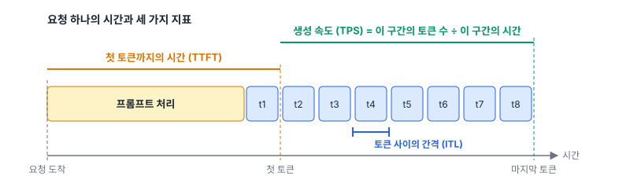
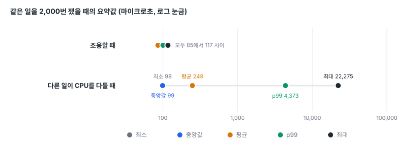
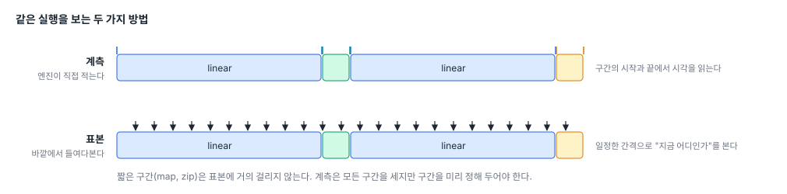
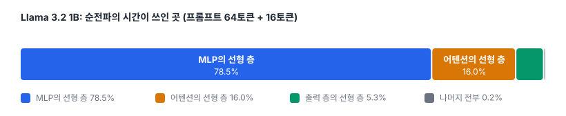

# 측정과 프로파일링

3부의 목표는 [13장](../part2/ch13_first_showdown.md)에서 그린 격차의 지도를 한 줄씩 지워 가는 것입니다.
그 일은 고치고, 재고, 견주는 일의 되풀이입니다. 그런데 2부의 측정에는
매번 같은 꼬리표가 붙어 있었습니다. "이 측정은 초시계로 재는 수준의 거친
측정입니다." 엔진을 9배 빠르게 만들 때는 그 정도로 충분하지만, 3%를 더
짜낼 때는 3%를 가려낼 수 있는 자가 필요합니다.

이 장에서는 엔진을 고치지 않습니다. **자를 만듭니다.**

| 하는 일 | 절 |
|---|---|
| 무엇을 재는지 정한다 | 14.1 |
| 측정을 망치는 것들을 하나씩 겪어 본다 | 14.2, 14.3 |
| 여러 번 잰 숫자를 요약하는 방법을 정한다 | 14.4 |
| 측정 도구를 만든다 | 14.5 |
| 언어 모델의 지표를 잰다 | 14.6 |
| 시간이 어디에 쓰이는지 본다: 계측과 표본 | 14.7, 14.8 |
| 프로세서가 세어 주는 숫자를 읽는다 | 14.9 |
| 만든 도구로 묵은 숙제를 푼다 | 14.10 |
| 3부 내내 견줄 기준을 고정한다 | 14.11 |

코드는 새 크레이트 `crates/badak_bench`와 `crates/badak_core/src/profile.rs`에
있습니다.

## 14.1 무엇을 재는가

13.4절에서 측정의 규칙 일곱 가지를 세웠습니다. 그 첫머리는 "같은 일을
시킨다"였습니다. 그러려면 먼저 "일"과 "빠르다"의 뜻을 정해야 합니다.
언어 모델에서 흔히 쓰는 지표는 셋입니다.



- **첫 토큰까지의 시간**(time to first token, TTFT): 요청을 받은 때부터
  첫 토큰이 나올 때까지입니다. 프롬프트를 처리하는 시간이 거의 전부입니다.
  사용자가 "응답이 시작됐다"고 느끼는 순간까지의 기다림입니다.
- **토큰 사이의 간격**(inter-token latency, ITL): 토큰 하나가 나오고 다음
  토큰이 나올 때까지입니다. 글이 화면에 흘러나오는 리듬입니다.
- **생성 속도**(tokens per second, TPS): 첫 토큰 뒤로 1초에 나오는 토큰의
  수입니다. 토큰 사이의 간격을 평균 낸 것의 역수와 같습니다.

[1장](../part1/ch01_landscape.md)에서 앞의 둘을 소개했고 11.8절에서 "첫 토큰까지"와 "그 뒤 토큰마다"로
나누어 쟀습니다. [13장](../part2/ch13_first_showdown.md)의 pp와 tg는 이 둘을 요청 하나의 시간이 아니라 1초에
처리하는 토큰 수로 나타낸 것입니다.

생성 속도와 토큰 사이의 간격은 같은 것을 다르게 요약한 숫자입니다. 그런데
둘을 따로 두는 이유가 있습니다. **평균이 같아도 리듬은 다를 수 있기
때문입니다.** 1초에 20토큰이 고르게 나오는 것과, 0.9초 동안 멈췄다가
한꺼번에 쏟아지는 것은 생성 속도가 같습니다. 사용자의 경험은 전혀
다릅니다. 그래서 토큰 사이의 간격은 평균이 아니라 분포로 봅니다(14.4절).

이 밖에 메모리와 시작 시간이 있고(13.6절), 여러 요청을 동시에 받는
서버에서는 1초에 처리하는 요청의 수가 더해집니다. 뒤의 것은 5부에서
다룹니다.

## 14.2 시계

시간을 재는 도구는 `std::time::Instant`입니다. 실행 중에 뒤로 가지 않는
시계의 한 시점을 나타냅니다.[^instant] 재려는 일의 앞뒤에서 한 번씩
읽어 차이를 구합니다. 이 시계가 얼마나 정밀한지부터 잽니다.

```rust
{{#include ../../../crates/badak_bench/examples/ch14_pitfalls.rs:clock}}
```

```bash
cargo run --release -p badak_bench --example ch14_pitfalls
```

```text
{{#include output/ch14_pitfalls.txt:1:3}}
```

시각을 한 번 읽는 데 약 20나노초가 들고, 구별되는 가장 짧은 간격은
41나노초입니다. 여기서 두 가지를 알 수 있습니다.

- **수십 나노초짜리 일은 이 시계로 한 번에 잴 수 없습니다.** 재려는 일이
  시계의 눈금보다 짧으면 0이나 41 가운데 하나가 나올 뿐입니다. 그런
  일은 수천 번 되풀이한 전체를 재서 나눕니다.
- **시계를 읽는 것도 일입니다.** 20나노초짜리 일의 앞뒤에서 시각을 읽으면
  재는 비용이 재려는 일만큼 듭니다. 14.7절에서 엔진 안에 시계를 넣을
  때 이 점을 다시 따집니다.

우리가 재려는 순전파는 밀리초에서 초 단위이므로 시계의 정밀도는
넉넉합니다. 문제는 다른 곳에 있습니다.

## 14.3 측정을 망치는 것들

### 컴파일러가 일을 지운다

1부터 1억까지 더하는 데 걸리는 시간을 재 봅니다.

```rust
{{#include ../../../crates/badak_bench/examples/ch14_pitfalls.rs:optimizer}}
```

```text
{{#include output/ch14_pitfalls.txt:5:9}}
```

**0나노초.** 1억 번의 덧셈이 시계의 눈금보다 빨리 끝났습니다. 물론 그럴
리 없습니다. 컴파일러가 반복문을 지운 것입니다.

첫째 줄은 짐작할 만합니다. 입력이 상수이니 컴파일러가 답을 미리 계산해
넣었습니다. 둘째 줄이 더 교훈적입니다. `std::hint::black_box`로 입력을
가려서[^black-box] 컴파일러가 `n`의 값을 모르게 했는데도 0나노초입니다.
컴파일러는 값을 몰라도 이 반복문이 `n × (n + 1) ÷ 2`와 같다는 것을
알아보고 곱셈 한 번으로 바꿔 놓았습니다. 반복문 안의 값을 하나하나
가린 셋째 줄에서야 29밀리초, 덧셈 하나에 0.29나노초가 나옵니다.

벤치마크는 대개 "결과를 쓰지 않는 계산"입니다. 컴파일러가 보기에는
지워도 되는 코드입니다. 지켜야 할 것은 두 가지입니다.

- 입력과 출력을 `black_box`에 넣어, 컴파일러가 입력을 알지 못하고 출력을
  버리지 못하게 합니다.
- **결과가 믿기지 않게 빠르면 믿지 않습니다.** 덧셈 1억 번이 0나노초라는
  숫자를 보고 기뻐하면 안 됩니다. 14.9절의 "실행한 명령 수"가 이런 때
  쓸모 있습니다. 일을 했다면 명령이 실행되었을 것입니다.

### 첫 실행은 느리다

같은 행렬 곱을 여섯 번 연달아 잽니다.

```rust
{{#include ../../../crates/badak_bench/examples/ch14_pitfalls.rs:cold}}
```

```text
{{#include output/ch14_pitfalls.txt:11:18}}
```

첫 번이 10.7밀리초, 그 뒤가 7.8밀리초입니다. 첫 번에만 3밀리초가 더
들었습니다. 0으로 채운 큰 메모리를 달라고 하면 운영체제는 주소만 내주고,
실제 메모리는 그 쪽에 **처음 닿는 순간**에 붙여 줍니다. 6.8절에서 파일을
메모리에 비출 때 본 것과 같은 방식입니다. 그 일이 첫 실행의 시간에
섞였습니다.

처음에만 드는 비용은 이것 말고도 많습니다. 파일이 아직 디스크에 있고,
프로세서가 저전력 상태에서 깨어나는 중이고, 분기 예측기가 이 코드를 본
적이 없습니다. 그래서 측정 전에 **준비 운동**을 합니다. 몇 번 실행해
버리고 그다음부터 잽니다.

단, 준비 운동으로 버린 시간이 무의미한 것은 아닙니다. 사용자가 프로그램을
켜고 첫 질문을 할 때 겪는 것이 바로 그 시간입니다. "한창 돌아갈 때의
속도"와 "처음 시작할 때의 속도"는 다른 지표이고, 둘 다 잴 가치가
있습니다. 섞지만 않으면 됩니다.

### 다른 일이 끼어든다

같은 일을 2,000번 잽니다. 한 번은 조용할 때, 한 번은 다른 스레드 32개가
CPU를 다투게 해 놓고 잽니다.

```rust
{{#include ../../../crates/badak_bench/examples/ch14_pitfalls.rs:noise}}
```

```text
{{#include output/ch14_pitfalls.txt:20:23}}
```

조용할 때는 2,000번이 모두 85에서 117마이크로초 사이에 있습니다. 시끄러울
때는 대부분이 99마이크로초인데 가장 느린 것은 22,000마이크로초입니다.
운영체제가 우리 스레드를 멈추고 다른 스레드에게 CPU를 넘긴 순간이 측정에
들어간 것입니다.

실제 측정에서 소음은 이렇게 요란하지 않습니다. 브라우저의 탭 하나,
백그라운드에서 도는 색인 작업, 메신저의 알림 같은 것입니다. 그래서 더
알아채기 어렵습니다. 대책은 둘입니다. 재는 동안 기계를 조용히 두고,
**소음에 덜 흔들리는 방법으로 요약하는 것**입니다. 뒤의 것이 14.4절의
주제입니다.

### 어느 코어에서 도는가

이 맥의 프로세서에는 성능 코어 12개와 효율 코어 4개가 있습니다. 운영체제는
중요하지 않다고 본 일을 뒤로 미루고 느리게 돌립니다. macOS의 `taskpolicy
-b`는 프로그램을 그런 "배경 작업"으로 실행합니다.[^taskpolicy] 같은 일을
두 가지로 돌려 봅니다.

```bash
./target/release/examples/ch14_pitfalls work
taskpolicy -b ./target/release/examples/ch14_pitfalls work
```

```text
{{#include output/ch14_cores_performance.txt}}
```

```text
{{#include output/ch14_cores_efficiency.txt}}
```

중앙값이 91마이크로초에서 317마이크로초로 3.5배 느려졌습니다. 마지막 두
줄은 14.9절에서 만드는 도구로 읽은 것인데, 프로세서가 돈 속도가
3.8GHz에서 1.2GHz로 떨어져 있습니다. 같은 프로그램, 같은 기계인데
전혀 다른 프로세서에서 돈 것과 같습니다.

> 배경 작업이 효율 코어로 간다는 것은 Apple 실리콘에 대해 널리 알려진
> 이야기이지만, 이 실험이 확인한 것은 "느려졌고 클록 속도가 낮았다"까지
> 입니다. 어느 코어에서 돌았는지는 직접 확인하지 않았습니다.

벤치마크를 일부러 배경 작업으로 돌리는 사람은 없습니다. 하지만 비슷한
일은 저절로 일어납니다. 노트북이 배터리로 돌 때, 저전력 모드일 때, 뜨거워져
속도를 낮출 때, 터미널 창이 뒤로 가 있을 때 운영체제는 프로그램을 다르게
대합니다. 그래서 **측정할 때마다 환경을 적어 두고**, 가능하면 프로세서가
실제로 돈 속도를 함께 확인합니다.

이 장을 쓰는 동안 실제로 그런 일이 있었습니다. [13장](../part2/ch13_first_showdown.md)의 측정은 전원을
연결한 상태에서 했는데, 이 장의 측정 도중 환경 기록에 "배터리"가
찍혔습니다. 누가 알려 주지 않았다면 모르고 지나갔을 것입니다. 얼마나
달랐는지는 14.11절에서 전원을 연결하고 다시 재서 견줍니다.

## 14.4 숫자 여러 개를 하나로

2,000번을 재면 숫자가 2,000개 나옵니다. 보고할 때는 몇 개로 줄여야
합니다. 무엇으로 줄이느냐에 따라 같은 측정이 다른 이야기가 됩니다.



14.3절의 소음 실험을 다시 봅니다. 시끄러울 때의 2,000개를 요약하면
이렇습니다.

| 요약값 | 값 (마이크로초) | 말해 주는 것 |
|---|---|---|
| 최소 | 98.5 | 방해가 전혀 없었을 때 |
| 중앙값 | 98.9 | 보통의 경우 |
| 평균 | 248.2 | 전체 시간을 횟수로 나눈 것 |
| 90 분위 (p90) | 228.7 | 열 번 가운데 한 번은 이보다 느리다 |
| 99 분위 (p99) | 4,373 | 백 번 가운데 한 번은 이보다 느리다 |
| 최대 | 22,275 | 가장 운이 나빴을 때 |

**평균은 중앙값의 2.5배입니다.** 2,000번 가운데 대부분은 99마이크로초에
끝났는데, 몇십 번의 긴 멈춤이 평균을 끌어올렸습니다. "평균 248마이크로초"는
틀린 숫자가 아니지만, 실제로 248마이크로초가 걸린 실행은 거의 없습니다.

어느 요약값을 쓸지는 **무엇을 알고 싶은가**에 달려 있습니다.

- **코드가 빨라졌는지 알고 싶다면 최소나 중앙값을 봅니다.** 엔진을 고치기
  전과 후를 견줄 때 알고 싶은 것은 코드의 속도이지 그날의 소음이
  아닙니다. 소음은 시간을 늘리기만 하고 줄이지는 못하므로, 가장 빠른
  값이 코드 자체의 속도에 가장 가깝습니다. 2부에서 "여러 번 실행해 가장
  빠른 값을 골랐다"고 한 것이 이 생각입니다. 중앙값은 그보다 조금
  보수적이면서 소음에 거의 흔들리지 않습니다.
- **사용자가 겪는 것을 알고 싶다면 높은 분위를 봅니다.** 서비스에서는
  백 번에 한 번의 느린 응답도 누군가는 겪습니다. 평균이 좋아도 99 분위가
  나쁘면 그 서비스는 "가끔 멈추는 서비스"입니다. 추론 벤치마크의 표준인
  MLPerf도 지연 시간을 평균이 아니라 높은 분위로 제한합니다.[^mlperf]
- **전체 처리량을 알고 싶다면 평균을 봅니다.** 요청 백만 개를 처리하는
  데 드는 전체 시간은 평균에 백만을 곱한 것입니다.
- **측정을 믿을 수 있는지는 흩어진 정도로 봅니다.** 표준편차를 평균으로
  나눈 값이 1%이면 믿을 만하고 30%이면 무엇인가 끼어든 것입니다.

분위수를 구하는 방법은 단순합니다. 정렬해서 그 순위의 값을 고릅니다.

```rust
{{#include ../../../crates/badak_bench/src/stats.rs:percentile}}
```

값 사이를 보간하는 방법도 있지만, 여기서는 실제로 측정된 값 가운데
하나를 돌려주는 "가장 가까운 순위" 방법을 씁니다. 표본이 100개가 안 되면
99 분위는 그냥 최댓값입니다. 높은 분위를 말하려면 표본이 그만큼 많아야
합니다.

```rust
{{#include ../../../crates/badak_bench/src/stats.rs:summary}}
```

마지막으로, 요약은 정보를 버리는 일입니다. 요약값이 이상하면 원래의
숫자들을 다시 봐야 합니다. 벤치마크가 잘못된 결론으로 이끄는 경우의
상당수는 계산이 아니라 측정의 조건에서 나온다는 것이 오래전부터 지적되어
왔습니다. 환경 변수의 크기나 링크 순서처럼 무관해 보이는 것이 결과를
뒤집을 수 있습니다.[^wrong-data]

## 14.5 측정 도구 만들기

지금까지의 교훈을 도구에 담습니다. 하는 일은 넷입니다.

**되풀이해서 잰다.** 준비 운동을 하고, 정한 횟수만큼 실행하고, 한 번
한 번의 시간을 모두 돌려줍니다. 결과는 `black_box`를 거칩니다.

```rust
{{#include ../../../crates/badak_bench/src/timing.rs:measure}}
```

시간을 하나로 줄이지 않고 모두 돌려주는 것에 주의하십시오. 요약은 부르는
쪽이 목적에 맞게 합니다.

**요약한다.** 14.4절의 `Summary`입니다.

**환경을 적는다.** 프로세서, 코어 수, 메모리, 운영체제, 컴파일러, 전원과
전력 모드, 빌드 종류를 모읍니다.

```rust
{{#include ../../../crates/badak_bench/src/environment.rs:environment}}
```

마지막 항목 "빌드"를 넣은 데는 이유가 있습니다. Rust는 `--release`를 붙이지
않으면 최적화 없이 빌드합니다. 그 상태로 잰 숫자는 수십 배 느리고 아무
뜻이 없습니다. 벤치마크에서 가장 흔한 실수 가운데 하나라서 기록에 늘
찍히게 했습니다.

**프로세서의 카운터를 읽는다.** 14.9절에서 다룹니다.

외부 라이브러리를 쓴다면 Rust에는 이런 일을 훨씬 정교하게 해 주는
Criterion 같은 도구가 있습니다.[^criterion] 우리는 표준 라이브러리만 쓰기로
했고, 무엇보다 **측정 도구가 무엇을 하는지 아는 것**이 이 장의 목적이라서
직접 만들었습니다. 100줄 남짓입니다.

## 14.6 언어 모델의 지표 재기

14.1절의 세 지표를 잽니다. 같은 질문을 여러 번 처리하면서 토큰이 나온
시각을 모두 적습니다.

```rust
{{#include ../../../crates/badak_models/examples/ch14_metrics.rs:collect}}
```

[11장](../part2/ch11_kv_cache.md)에서 `generate`가 토큰이 나올 때마다 함수를 부르게 해 둔 것이 여기서
쓰입니다. 그 함수에서 시각을 읽기만 하면 됩니다.

```bash
cargo run --release -p badak_models --example ch14_metrics
```

```text
{{#include output/ch14_metrics_smollm2.txt}}
```

보조 모델 SmolLM2로 같은 질문을 여덟 번 처리한 결과입니다.

- **첫 토큰까지 836밀리초.** 여덟 번의 최소와 최대가 835와 839입니다.
  0.4% 안에서 같습니다.
- **토큰 사이의 간격은 중앙값 49.4밀리초, 99 분위 50.5밀리초.** 표본 504개
  가운데 가장 느린 것도 55.9밀리초입니다.
- **생성 속도 20.2토큰/초.** 간격의 평균 49.47밀리초의 역수입니다.

토큰 사이의 간격이 이렇게 고른 것은 엔진이 단순하기 때문입니다. 스레드가
하나이고, 메모리를 미리 잡아 두지도, 다른 요청과 자원을 나누지도
않습니다. 토큰마다 정확히 같은 일을 합니다. 3부에서 스레드를 늘리고
5부에서 여러 요청을 함께 처리하게 되면 이 분포가 넓어집니다. 그때
중앙값과 99 분위를 따로 보는 일이 필요해집니다.

주 모델의 숫자입니다. 토큰 32개씩 세 번입니다.

```text
{{#include output/ch14_metrics_llama32.txt}}
```

첫 토큰까지 9.8초, 그 뒤 0.56초마다 한 토큰입니다. 표본이 세 개뿐이라
"첫 토큰까지"의 99 분위는 최댓값과 같습니다. 14.4절에서 말한 대로입니다.

## 14.7 시간은 어디에 쓰이는가: 계측

"토큰 하나에 0.56초"는 무엇을 고쳐야 하는지 말해 주지 않습니다. 그
0.56초가 어디에 쓰이는지 알아야 합니다. 그것을 알아내는 일을
프로파일링(profiling)이라고 하고, 방법은 크게 둘입니다.



첫째는 **계측**(instrumentation)입니다. 재고 싶은 구간의 시작과 끝에
시계를 읽는 코드를 넣습니다. 엔진이 스스로 적습니다.

```rust
{{#include ../../../crates/badak_core/src/profile.rs:scope}}
```

쓰는 쪽은 함수의 첫 줄에 한 줄을 넣습니다. [5장](../part1/ch05_operators.md)의 `linear`는 이렇게
시작하게 되었습니다.

```rust
pub fn linear(x: &Tensor, weight: &Tensor, bias: Option<&Tensor>) -> Result<Tensor> {
    // 14장: 프로파일러가 켜져 있으면 이 함수에 쓴 시간을 적는다.
    let _scope = profile::scope("linear");
```

`_scope`는 함수가 끝날 때 사라지고, 그때 `Drop`이 걸린 시간을 적습니다.
함수가 중간에 `?`로 빠져나가도 빠짐없이 적힙니다. 이 한 줄을 넣은 곳은
[5장](../part1/ch05_operators.md)의 연산자 다섯 개(`linear`, `rms_norm`, `embedding`, `map`, `zip`)와
모델 쪽의 넷(`mlp`, `attention_cached`, `rope::apply`, `logits`)입니다.

구현에서 눈여겨볼 것이 둘 있습니다.

**구간이 겹칩니다.** `mlp`는 안에서 `linear`를 세 번 부릅니다. `mlp`에
들어가서 나올 때까지의 시간에는 `linear`의 시간이 들어 있습니다. 그대로
더하면 같은 시간을 두 번 세게 됩니다. 그래서 기록에 두 가지를 적습니다.

```rust
{{#include ../../../crates/badak_core/src/profile.rs:record}}
```

안쪽 구간이 끝날 때 바깥 구간에게 "이만큼은 내가 썼다"고 알려 주고,
바깥 구간은 자기 시간에서 그것을 뺍니다. "직접 쓴 시간"을 모두 더하면
전체 시간이 되고 겹치는 것이 없습니다. 그리고 기록의 이름을 `mlp/linear`
처럼 **경로**로 적어, 같은 `linear`라도 누가 불렀는지에 따라 나누어
봅니다.

**꺼져 있을 때의 비용.** 프로파일러를 쓰지 않을 때 이 코드가 엔진을
느리게 하면 안 됩니다. 꺼져 있으면 `scope`는 플래그 하나를 읽고 바로
돌아갑니다. 연산자 하나가 밀리초 단위의 일을 하므로 그 비용은 측정되지
않을 만큼 작습니다.

### 결과

```bash
cargo run --release -p badak_models --example ch14_profile
```

프롬프트 64토큰을 한꺼번에 처리하고 16토큰을 하나씩 더 처리했습니다.

```text
{{#include output/ch14_profile_llama32.txt:3:16}}
```



**선형 층이 99.8%입니다.** 9.11절에서 곱셈의 수를 세어 "시간의 대부분은
MLP와 어텐션의 선형 층에 쓰인다"고 추정했고, 10.8절에서 시간이 그 추정에
비례하는 것을 봤습니다. 이번에는 추정이 아니라 측정입니다. 정규화,
회전, 활성화 함수, 덧셈, 어텐션의 점수 계산을 **모두 합쳐서 0.2%**입니다.

비율도 계산과 맞습니다. 9.11절에서 MLP의 곱셈이 어텐션의 4.8배라고
했습니다. 측정된 시간은 78.5%와 16.0%, 4.9배입니다.

이 표가 3부의 순서를 정해 줍니다. **행렬과 벡터의 곱 하나를 빠르게
만들기 전에는 다른 무엇을 고쳐도 소용이 없습니다.** 정규화를 두 배
빠르게 만들어 봐야 전체의 0.003%가 줄어듭니다. 반대로 선형 층이 지금의
100분의 1이 되면 나머지 0.2%가 20%가 되고, 그때는 그것들이 다음
과녁이 됩니다. 프로파일은 한 번 보고 끝나는 것이 아니라 고칠 때마다
다시 봐야 합니다.

### 재는 일이 결과를 바꾸는가

```text
{{#include output/ch14_profile_llama32.txt:29:32}}
```

프로파일러를 켠 실행이 끈 실행보다 느리지 않습니다. 0.1초 차이는
소음입니다. 구간이 4,700번쯤 기록되었는데 시계를 두 번씩 읽어도
0.2밀리초가 안 됩니다. 넷째 줄도 봐 둘 만합니다. 어느 구간에도 들지 않은
시간이 없습니다. 계측한 아홉 곳이 순전파의 전부를 덮고 있다는 뜻입니다.

늘 이렇지는 않습니다. 계측은 구간이 짧고 많을수록 비쌉니다. `dot`처럼
수십 나노초짜리 함수에 구간을 넣으면 시계 읽는 비용(14.2절)이 재려는
일보다 커지고, 프로파일이 "가장 느린 것은 프로파일러"라고 말하게
됩니다. 그래서 구간은 연산자 단위로만 넣었습니다.

## 14.8 시간은 어디에 쓰이는가: 표본

둘째 방법은 **표본**(sampling)입니다. 프로그램에는 손을 대지 않고, 바깥에서
일정한 간격으로 "지금 어느 함수를 실행 중인가"를 들여다봅니다. 천 번
들여다봐서 700번이 어떤 함수 안이었다면 시간의 70%가 거기에 쓰인
것입니다.

macOS에는 이 일을 하는 `sample`이라는 도구가 들어 있습니다. 실행 중인
프로세스를 1밀리초마다 멈추고 호출 스택을 받아 적습니다.[^sample]

```bash
sh scripts/profile_sample.sh llama32_1b 5
```

글을 이어 쓰는 예제를 띄워 놓고 5초 동안 표본을 뜹니다. `sample`은 Rust의
함수 이름을 컴파일러가 바꿔 놓은 꼴 그대로 보여 주므로, 읽을 수 있게
줄이는 스크립트(`scripts/sample_report.py`)를 하나 붙였습니다.

```text
{{#include output/ch14_sample_llama32.txt:8:36}}
```

들여쓰기가 "누가 누구를 불렀는가"입니다. 계측의 결과와 견주어 봅니다.

- **MLP의 선형 층 셋이 각각 21~22%.** 계측에서는 `mlp/linear` 한 줄로
  뭉쳐 있던 것이 셋으로 나뉘어 보입니다. 표본은 호출한 자리까지
  구별하기 때문입니다. `gate`, `up`, `down`의 크기가 같으니 시간도
  같습니다.
- **출력 층이 22%.** 계측에서는 5%였습니다. 재는 일이 달라서입니다.
  이번에는 프롬프트 없이 토큰을 하나씩 만드는 동안만 봤습니다. 10.8절에서
  출력 층 한 줄이 블록 네 개만큼이라고 했고, 블록이 16개이니 5분의
  1입니다.
- **맨 안쪽은 한 함수가 99.8%.**

```text
{{#include output/ch14_sample_llama32.txt:38:39}}
```

이름이 `matvec`도 `dot`도 아닙니다. [2장](../part1/ch02_math.md)의 `matvec`은 `chunks_exact`와
`map`과 `collect`로 적혀 있고 그 안에서 `dot`을 부릅니다. 컴파일러가
그것들을 한 덩어리로 합쳐(인라인) 놓았고, 남은 이름이 표준 라이브러리의
`collect` 구현입니다. **표본 프로파일러는 소스 코드가 아니라 컴파일된
결과를 보여 줍니다.** 함수가 합쳐지면 이름이 사라집니다.

계측에서 0.1%를 차지하던 활성화 함수와 어텐션의 점수 계산은 여기에
아예 나오지 않습니다. 5초에 4,219번 들여다봤으니 0.1%면 네 번쯤 걸렸을
텐데, 2%에 못 미치는 줄은 보고서에서 뺐습니다.

두 방법을 정리합니다.

| | 계측 | 표본 |
|---|---|---|
| 프로그램을 고치는가 | 고친다 | 고치지 않는다 |
| 무엇이 보이는가 | 미리 정한 구간만 | 실행된 모든 함수 |
| 횟수를 세는가 | 센다 (정확하다) | 세지 못한다 |
| 짧은 일 | 재는 비용이 커진다 | 표본에 걸리지 않는다 |
| 이름 | 우리가 붙인 이름 | 컴파일러가 남긴 이름 |
| 언제 쓰는가 | 구조를 알 때, 늘 켜 둘 수 있게 | 어디가 느린지 모를 때 |

둘은 서로를 확인해 줍니다. 계측의 "선형 층 99.8%"와 표본의 "한 함수
99.8%"는 서로 다른 방법으로 얻은 같은 숫자입니다.

리눅스에서는 `perf`가 같은 일을 합니다.[^perf] 이 책은 리눅스에서의
측정을 다음 판으로 미뤄 두었습니다.

## 14.9 프로세서가 세어 주는 숫자

시간은 결과입니다. 원인을 알려면 프로세서가 그 시간 동안 **무엇을
했는지**를 봐야 합니다. 프로세서에는 일어난 일의 횟수를 세는 장치가
들어 있고, 하드웨어 카운터라고 부릅니다. 가장 기본이 되는 것이 둘입니다.

- **명령의 수**(instructions): 실행을 마친 기계어 명령의 수입니다. 같은
  프로그램, 같은 입력이면 거의 같은 값이 나옵니다. 소음에 흔들리지 않는
  지표입니다.
- **사이클의 수**(cycles): 프로세서의 클록이 뛴 횟수입니다. 시간에 클록
  속도를 곱한 것입니다.

둘을 나누면 **IPC**(instructions per cycle), 사이클 하나에 실행한 명령의
수가 나옵니다. 지금의 프로세서는 한 사이클에 명령 여러 개를 동시에
실행할 수 있습니다. IPC가 높으면 프로세서가 막힘 없이 일한 것이고, 낮으면
무엇인가를 기다린 것입니다. 메모리에서 값이 오기를 기다리거나, 앞
계산의 결과를 기다리거나, 분기 예측이 틀려 일을 다시 한 경우입니다.

이 카운터를 읽는 것은 운영체제마다 다르고 대개 특별한 권한이 필요합니다.
macOS에서는 권한 없이 읽을 수 있는 길이 하나 있습니다. 프로세스가 쓴
자원을 알려 주는 `proc_pid_rusage`라는 함수가 명령과 사이클의 수를 함께
돌려줍니다.[^rusage] 13.6절에서 메모리를 잴 때 쓴 `/usr/bin/time -l`이
이 숫자를 보여 줍니다. [6장](../part1/ch06_model_files.md)에서 `mmap`을 직접 선언해 불렀던 것처럼 이
함수도 직접 선언해 부릅니다.

```rust
{{#include ../../../crates/badak_bench/src/counters.rs:macos}}
```

구조체의 필드를 하나하나 적지 않고 "64비트 수 35개"로 두었습니다. 읽을
것은 그 가운데 둘뿐이기 때문입니다. 몇 번째인지는 macOS의 헤더에서 세어
확인했습니다.

```rust
{{#include ../../../crates/badak_bench/src/counters.rs:counters}}
```

한계가 있습니다. 이 값은 **프로세스 전체**의 것입니다. 스레드별로 나뉘지
않습니다. 그리고 명령과 사이클뿐입니다. 캐시에서 값을 못 찾은 횟수나
분기 예측이 틀린 횟수는 이 길로는 읽을 수 없고, 그것을 보려면 Apple의
Instruments나 리눅스의 `perf`가 필요합니다. 리눅스에서는 이 함수가
없으므로 지금은 `None`을 돌려줍니다.

그래도 이 둘만으로 할 수 있는 일이 많습니다. 14.7절의 예제가 순전파
동안의 카운터를 읽습니다.

```text
{{#include output/ch14_profile_llama32.txt:34:40}}
```

마지막 줄부터 봅니다. 사이클 수를 시간으로 나누면 **4.50GHz**입니다.
측정하는 동안 프로세서가 이 속도로 돌았다는 뜻입니다. 14.3절의 배경 작업
실험에서 1.2GHz가 나왔던 것과 견주어 보십시오. 이 숫자 하나가 "이
측정은 정상적인 조건에서 했다"는 증거가 됩니다.

다음은 **곱셈 하나에 명령 2.4개, 사이클 2.0개**입니다. 선형 층의 일은
"가중치 하나와 값 하나를 곱해 더하는 것"의 되풀이입니다. 그 한 번에
명령이 2.4개 들고 사이클이 2개 듭니다. 4.5GHz에서 사이클 2개는
0.45나노초입니다. 이 숫자가 [16장](ch16_matmul.md)과 [17장](ch17_simd.md)의 출발점입니다. 명령 하나로 값
여러 개를 곱하면(SIMD) "곱셈당 명령"이 줄고, 프로세서가 기다리지 않게
하면 "명령당 사이클"이 줄어듭니다.

**IPC는 1.17입니다.** 이 프로세서는 한 사이클에 명령을 여럿 실행할 수
있는데 하나 남짓밖에 하지 못했습니다. 무엇인가를 기다리고 있습니다.
SmolLM2에서 같은 것을 재면 1.48이고 곱셈 하나에 1.67사이클입니다.

| | 곱셈당 명령 | 곱셈당 사이클 | IPC |
|---|---|---|---|
| SmolLM2 135M | 2.47 | 1.67 | 1.48 |
| Llama 3.2 1B | 2.40 | 2.04 | 1.17 |

같은 코드이므로 명령의 수는 같습니다. 그런데 큰 모델에서 사이클이 20%
더 듭니다. 가중치가 0.5GB와 4.9GB이니 큰 쪽이 메모리를 더 오래 기다리는
것이라고 짐작할 수 있습니다. 13.5절에서 본 "토큰 생성은 메모리에서 읽어
오는 속도가 발목을 잡는다"는 정황과도 맞아 보입니다.

이것은 짐작입니다. 두 모델은 크기만 다른 것이 아니고, 이 측정은 무엇이
원인인지 가려 주지 않습니다. [15장](ch15_bottleneck.md)에서 변수를 하나씩 바꿔 가며 확인합니다.
(미리 말해 두면, 이 짐작은 틀렸습니다.)

## 14.10 숙제: argmax는 왜 느렸나

12.8절에서 이상한 측정을 하나 남겨 두었습니다. 점수 12만 8천 개에서
가장 큰 것 하나를 찾는 `argmax`가 0.50밀리초인데, 상위 40개를 가려내는
top-k는 0.15밀리초였습니다. 더 쉬운 일이 더 느렸습니다. "분기 때문일
것"이라고 짐작만 하고 넘어갔습니다. 이제 잴 수 있습니다.

같은 일을 하는 구현 셋을 놓고 시간과 카운터를 함께 봅니다.

```rust
{{#include ../../../crates/badak_bench/examples/ch14_argmax.rs:variants}}
```

```bash
cargo run --release -p badak_bench --example ch14_argmax
```

```text
{{#include output/ch14_argmax.txt:1:6}}
```

**14배 차이입니다.** 카운터가 이유를 둘로 나누어 보여 줍니다.

- **명령이 14개에서 5개로 줄었습니다.** [2장](../part1/ch02_math.md)의 구현은 가장 좋은 후보를
  `Option<(usize, f32)>`에 담았습니다. 값 하나를 볼 때마다 "후보가 있는가",
  "`NaN`인가", "더 큰가"를 따지고 후보를 갈아 넣습니다. `Option` 없이 두
  변수에 담으면 7개, 두 번에 나누면 5개입니다.
- **IPC가 1.08에서 5.4로 올랐습니다.** 이쪽이 더 큽니다. [2장](../part1/ch02_math.md)의 구현은
  값 하나에 13사이클이 듭니다. 명령 14개에 13사이클이니 프로세서가
  명령을 거의 하나씩 차례로 실행했다는 뜻입니다. 두 번에 나눈 구현은
  값 하나에 0.9사이클입니다.

왜 차례로 실행했을까요. 한 번에 하는 구현에서는 값을 볼 때마다 "지금까지의
최댓값"과 견주고, 크면 최댓값과 그 자리를 함께 바꿉니다. 다음 값을
견주려면 방금의 결과가 나와 있어야 합니다. 반복 하나하나가 앞 반복에
매여 있어서 프로세서가 여러 개를 동시에 진행하지 못합니다. 두 번에
나누면 첫 반복문은 "가장 큰 값"만 구합니다. 자리를 기억하는 일이 없어서
의존이 짧아집니다. 둘째 반복문은 그 값과 같은 것을 찾기만 하므로 반복
사이에 의존이 없습니다.

> 명령과 사이클의 수는 측정한 것입니다. "앞 반복에 매여 있다"는 설명은
> 그 숫자와 코드의 모양에서 끌어낸 해석이고, 기계어를 읽어 확인한 것은
> 아닙니다.

두 번에 나눈 구현을 `prob::argmax`로 삼았습니다. `NaN`을 건너뛰고 빈
입력에 `None`을 돌려주는 동작은 그대로입니다(`f32::max`가 `NaN`을
무시합니다). 표의 넷째 줄이 고친 뒤의 `argmax`입니다.

12.8절의 표를 다시 재면 0.50밀리초가 0.04밀리초가 됩니다. 이제 "가장 큰
것 하나"가 "상위 40개"보다 빠릅니다. 당연한 순서로 돌아왔습니다.

이 숙제에서 가져갈 것은 속도가 아닙니다. 토큰 하나에 580밀리초를 쓰는
엔진에서 0.46밀리초는 아무것도 아닙니다. 가져갈 것은 **방법**입니다.
"이상하다"를 "명령이 몇 개, 사이클이 몇 개"로 바꾸면 짐작이 측정이
됩니다. 그리고 이 작은 예에 3부의 주제가 들어 있습니다. 같은 일을
하는 코드가 14배 차이 나는 것, 그 차이의 대부분이 "프로세서가 동시에
일할 수 있게 해 주었는가"에서 온다는 것입니다. 행렬 곱에서 같은 일을
더 큰 규모로 하게 됩니다.

## 14.11 기준을 고정한다

마지막으로 3부 내내 견줄 기준을 잽니다. [13장](../part2/ch13_first_showdown.md)과 같은 두 가지 일,
프롬프트 256토큰 처리(pp256)와 토큰 32개 생성(tg32)을 이 장의 도구로
다시 잽니다.

```rust
{{#include ../../../crates/badak_models/examples/ch14_baseline.rs:baseline}}
```

```bash
cargo run --release -p badak_models --example ch14_baseline -- llama32_1b 3
```

```text
{{#include ../../../bench/baseline/badak_llama32_ch14.txt}}
```

이 기록이 `bench/baseline/`에 들어 있습니다. [13장](../part2/ch13_first_showdown.md)의 측정(2.13과
1.71토큰/초)과 3% 안에서 같습니다. 보조 모델의 기록도 함께 있습니다.

```text
{{#include ../../../bench/baseline/badak_smollm2_ch14.txt:13:15}}
```

### 배터리로 잰 기준

이 기준은 두 번 쟀습니다. 처음 쟀을 때 환경 기록에 "배터리"가 찍혀
있었습니다(14.3절). 그 기록을 `_battery`라는 이름으로 남겨 두고, 전원을
연결한 뒤 다시 잰 것이 위의 표입니다. 둘을 나란히 놓습니다. 괄호 안은
흩어짐입니다.

| | 배터리 | 전원 연결 | 차이 |
|---|---|---|---|
| Llama 3.2 1B, pp256 (토큰/초) | 2.162 (0.56%) | 2.163 (1.76%) | 0.0% |
| Llama 3.2 1B, tg32 | 1.724 (1.33%) | 1.757 (0.17%) | +1.9% |
| SmolLM2 135M, pp256 | 24.38 (1.30%) | 24.53 (0.07%) | +0.6% |
| SmolLM2 135M, tg32 | 19.07 (2.54%) | 19.74 (0.22%) | +3.6% |
| Llama 3.2 1B, 프롬프트 토큰당 명령 | 23.55억 | 23.52억 | −0.1% |

- **차이는 크지 않았습니다.** 토큰 생성이 2~4% 느렸고 프롬프트 처리는
  같았습니다. 이 기계에서 배터리는 속도를 크게 낮추지 않습니다. 하지만
  3부에서 가려내려는 개선 가운데는 3%짜리도 있을 것입니다. 모르고
  지나갔다면 그만큼의 개선을 놓치거나 없는 개선을 봤을 것입니다.
- **흩어짐이 달랐습니다.** 배터리에서 1~2.5%이던 것이 전원을 연결하면
  대부분 0.2% 아래입니다. 평균만이 아니라 측정의 고르기도 환경에 달려
  있습니다. 예외가 하나 있습니다. 전원을 연결하고 잰 Llama의 pp256은
  1.76%인데, 세 번 가운데 한 번이 115.5초로 유난히 빨랐기 때문입니다.
  되풀이가 세 번뿐이면 하나가 흩어짐을 좌우합니다.
- **명령의 수는 같았습니다.** 0.1% 차이입니다. 같은 코드가 같은 일을
  했으니 당연합니다. 시간은 환경을 타지만 명령의 수는 타지 않습니다.
  코드를 고친 효과를 볼 때 이 숫자를 함께 보는 이유입니다.

### 이 자의 눈금

- **흩어짐은 0.2%에서 2% 사이입니다.** 엔진을 고쳐서 0.5% 빨라졌다면 이
  측정 한 번으로는 가려낼 수 없습니다. 5% 빨라졌다면 믿어도 됩니다.
- **토큰당 명령 수가 있습니다.** 프롬프트의 토큰 하나에 명령 23.5억 개,
  새 토큰 하나에 29.6억 개입니다. 차이는 출력 층입니다.
- **환경이 함께 적혀 있습니다.** 견줄 때는 전원 상태부터 맞춥니다.

3부의 장마다 엔진을 고친 뒤 이 예제를 다시 실행해 견줍니다. 25장에서
llama.cpp와 다시 겨룰 때까지 이 표가 출발선입니다.

## 14.12 실전 엔진에서는

**엔진이 지표를 직접 냅니다.** llama.cpp는 실행이 끝날 때 가중치를 읽은
시간, 프롬프트 처리 시간과 토큰 수, 생성 시간과 토큰 수를 출력합니다.
그 값을 프로그램에서 받아 갈 수 있는 구조체도 있습니다.[^llamacpp-perf]
14.1절의 지표가 엔진의 API에 들어 있는 것입니다. 엔진을 쓰는 쪽이
시계를 따로 댈 필요가 없고, 무엇보다 엔진이 "프롬프트 처리"와 "생성"의
경계를 정확히 알고 있습니다.

**벤치마크 도구가 엔진과 함께 배포됩니다.** [13장](../part2/ch13_first_showdown.md)에서 쓴 `llama-bench`가
그 예입니다. 준비 운동, 되풀이, 평균과 표준편차, 환경 기록을 도구가
해 주고, 결과를 JSON으로 내보내 다른 날의 측정과 견줄 수 있게
합니다.[^llama-bench] 이 장에서 만든 것과 같은 구성입니다.

**성능 회귀를 자동으로 잡습니다.** 엔진을 고칠 때마다 기준과 견주어
느려졌으면 알려 주는 체계를 두는 프로젝트가 많습니다. 우리 CI는 지금
정확성만 확인합니다. CI의 기계는 다른 작업과 자원을 나눠 쓰는
가상 기계라서 14.3절의 "시끄러운" 환경이고, 거기서 잰 시간은 믿기
어렵습니다. 그런 환경에서도 쓸 수 있는 것이 **명령의 수**입니다. 소음에
흔들리지 않기 때문입니다. 다만 우리 카운터는 아직 macOS에서만 읽힙니다.

## 정리

- 언어 모델의 속도는 첫 토큰까지의 시간, 토큰 사이의 간격, 생성 속도로
  나누어 잽니다. 간격은 평균이 아니라 분포로 봅니다.
- 시계를 한 번 읽는 데 20나노초가 들고, 눈금은 41나노초입니다.
- 측정을 망치는 것들을 겪었습니다. 컴파일러는 쓰이지 않는 계산을
  지우고, 첫 실행은 느리고, 다른 일이 끼어들면 일부 측정이 수백 배
  길어지고, 운영체제가 프로그램을 느린 조건에서 돌릴 수 있습니다.
- 코드의 속도를 견줄 때는 최소나 중앙값을, 사용자가 겪는 것을 볼 때는
  높은 분위를, 측정을 믿을 수 있는지는 흩어진 정도를 봅니다.
- 측정 도구 `badak_bench`를 만들었습니다. 준비 운동과 되풀이, 요약,
  환경 기록, 하드웨어 카운터입니다.
- 계측 프로파일러로 재니 순전파 시간의 99.8%가 선형 층입니다. MLP가
  78.5%, 어텐션이 16.0%, 출력 층이 5.3%입니다. 표본 프로파일러도 같은
  결론을 냅니다.
- 계측은 미리 정한 구간을 정확히 세고, 표본은 손대지 않은 프로그램의
  전체를 봅니다. 표본은 컴파일된 결과를 보여 주므로 합쳐진 함수의
  이름은 사라집니다.
- 프로세서가 세어 주는 명령과 사이클의 수를 macOS에서 권한 없이
  읽습니다. 선형 층의 곱셈 하나에 명령 2.4개, 사이클 2.0개가 들고
  IPC는 1.17입니다. 큰 모델에서 곱셈당 사이클이 더 듭니다.
- `argmax`가 느린 이유를 카운터로 찾았습니다. 명령이 많았고, 반복이
  서로 매여 있어 IPC가 낮았습니다. 두 번에 나누어 14배 빠르게
  고쳤습니다.
- 3부의 기준 측정을 `bench/baseline/`에 고정했습니다. 배터리로 잰 것과
  전원을 연결하고 잰 것은 생성 속도가 2~4% 달랐고, 명령의 수는
  같았습니다.

## 연습 문제

1. `ch14_pitfalls`의 시계 실험을 여러 번 실행해 보십시오. "구별되는 가장
   짧은 간격"은 늘 같습니까. 그 값의 역수는 몇 헤르츠입니까.
2. 14.3절의 합 구하기에서, 입력만 가렸을 때 컴파일러가 반복문을 식으로
   바꿨습니다. 더하는 대신 `sum ^= i * i`처럼 바꾸면 어떻게 됩니까.
   컴파일러가 알아보지 못하는 계산과 알아보는 계산의 차이를 짐작해
   보십시오.
3. `Summary`에 보간하는 분위수를 추가해 보십시오. 표본이 10개일 때 90
   분위가 두 방법에서 어떻게 다릅니까. 표본이 10,000개일 때는 어떻습니까.
4. `ch14_metrics`를 다른 프로그램(예: 동영상 재생)을 켜 둔 채로 실행해
   보십시오. 토큰 사이의 간격의 중앙값과 99 분위 가운데 어느 쪽이 더
   많이 달라집니까.
5. `profile::scope`를 `linalg::dot`에 넣고 `ch14_profile`을 실행해
   보십시오. 전체 시간이 얼마나 늘어납니까. `dot`이 몇 번 불렸는지와
   14.2절의 숫자로 그 증가를 설명해 보십시오.
6. 14.7절의 계측은 스레드마다 기록을 따로 둡니다(`thread_local!`).
   스레드가 여럿이면 `report`는 무엇을 돌려줍니까. 18장에서 스레드 풀을
   만든 뒤 이 프로파일러를 어떻게 고쳐야 할지 생각해 보십시오.
7. `ch14_argmax`에 값이 정렬되어 있는 입력(오름차순, 내림차순)을 넣어
   보십시오. 구현마다 시간이 어떻게 달라집니까. 어느 구현이 입력에
   민감합니까. 이유를 분기 예측과 연결해 설명해 보십시오.
8. 14.11절의 기준에서 프롬프트의 토큰 하나에 명령이 23.5억 개 듭니다.
   14.9절의 "곱셈 하나에 명령 2.4개"와 9.11절의 "토큰 하나가 블록
   하나에서 하는 곱셈 6,080만 번"으로 이 숫자를 설명해 보십시오.

## 참고 문헌

[^instant]: Rust 표준 라이브러리, `std::time::Instant`.
    <https://doc.rust-lang.org/std/time/struct.Instant.html>. 운영체제마다
    어떤 시계를 쓰는지가 문서에 적혀 있습니다.

[^black-box]: Rust 표준 라이브러리, `std::hint::black_box`.
    <https://doc.rust-lang.org/std/hint/fn.black_box.html>

[^taskpolicy]: macOS 설명서, `taskpolicy(8)`. `man taskpolicy`. `-b`는
    프로그램을 `PRIO_DARWIN_BG`로 실행한다고 적혀 있습니다.

[^mlperf]: V. J. Reddi 외, "MLPerf Inference Benchmark", 2019.
    [arXiv:1911.02549](https://arxiv.org/abs/1911.02549). 추론 벤치마크의
    시나리오와 지연 시간 제약을 정의합니다.

[^wrong-data]: T. Mytkowicz, A. Diwan, M. Hauswirth, P. F. Sweeney,
    "Producing Wrong Data Without Doing Anything Obviously Wrong!", ASPLOS
    2009. [doi:10.1145/1508244.1508275](https://doi.org/10.1145/1508244.1508275).
    측정 환경의 사소해 보이는 차이가 성능 실험의 결론을 바꿀 수 있음을
    보였습니다.

[^criterion]: Criterion.rs. <https://github.com/bheisler/criterion.rs>.
    Rust의 통계 기반 벤치마크 라이브러리입니다.

[^sample]: macOS 설명서, `sample(1)`. `man sample`. 기본 간격이
    1밀리초이고, 표본 사이에 실행되고 끝난 함수는 놓칠 수 있다고 적혀
    있습니다.

[^perf]: perf: Linux profiling with performance counters.
    <https://perfwiki.github.io/main/>

[^rusage]: macOS SDK, `<libproc.h>`의 `proc_pid_rusage`와
    `<sys/resource.h>`의 `struct rusage_info_v4`. 구조체의
    `ri_instructions`와 `ri_cycles`가 명령과 사이클의 수입니다. 이 장의
    코드는 Command Line Tools의 SDK에 든 헤더로 필드의 순서를 확인했습니다.

[^llamacpp-perf]: llama.cpp, `include/llama.h` (커밋 `b4c0e00a4fcc`).
    1683번째 줄 부근의 `llama_perf_context_data`에 가중치를 읽은 시간
    (`t_load_ms`), 프롬프트 처리 시간과 토큰 수(`t_p_eval_ms`,
    `n_p_eval`), 생성 시간과 토큰 수(`t_eval_ms`, `n_eval`)가 있습니다.
    <https://github.com/ggml-org/llama.cpp/blob/b4c0e00a4fcc/include/llama.h>

[^llama-bench]: llama.cpp, `tools/llama-bench/README.md` (커밋
    `b4c0e00a4fcc`). 출력 형식(`-o json` 등)과 기록되는 항목이 적혀
    있습니다.
    <https://github.com/ggml-org/llama.cpp/blob/b4c0e00a4fcc/tools/llama-bench/README.md>
