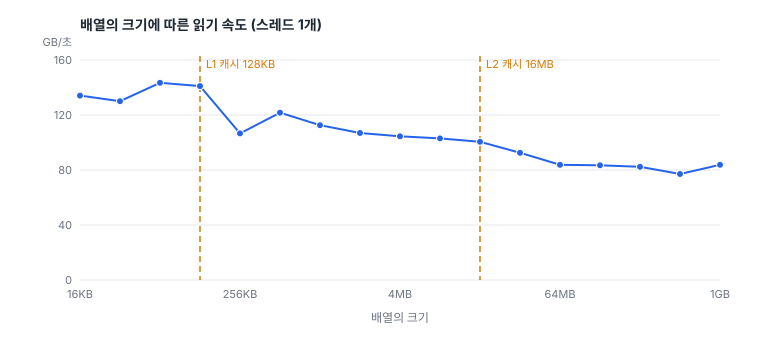
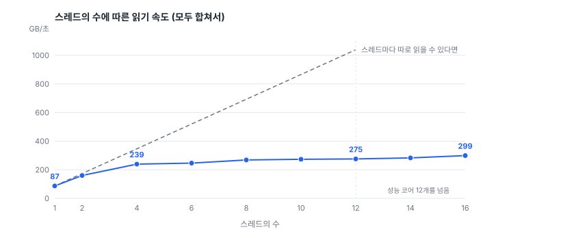
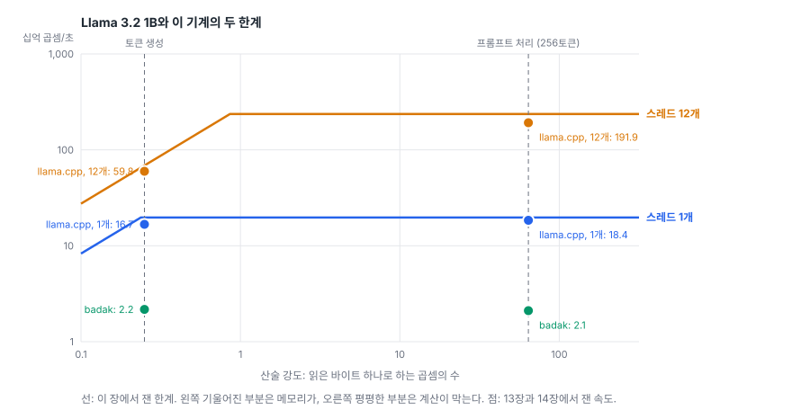

# 병목 계산하기

[14장](ch14_measurement.md)에서 자를 만들었습니다. 이 장에서는 그 자로 엔진이 아니라 **기계**를
잽니다. 이 맥이 1초에 곱셈을 몇 번 할 수 있는지, 메모리에서 1초에 몇
바이트를 읽을 수 있는지를 알아내고, 그 두 숫자로 언어 모델이 낼 수 있는
속도의 **상한**을 계산합니다.

고치기 전에 상한부터 계산하는 데는 이유가 있습니다. 상한을 알면 지금
어디에 서 있는지, 얼마나 더 갈 수 있는지, 어느 방향이 막혀 있는지를 알
수 있습니다. 상한이 없으면 "10% 빨라졌다"는 숫자가 큰 진전인지 헛수고인지
알 수 없습니다.

[13장](../part2/ch13_first_showdown.md)에서 이상한 무늬를 봤습니다. 스레드를 열두 배로 늘렸는데 프롬프트
처리는 10배 빨라지고 토큰 생성은 3.6배만 빨라졌습니다. 가중치를 4비트로
줄이면 반대로 토큰 생성만 크게 빨라졌습니다. 이 장이 끝나면 그 숫자들을
종이 위의 계산으로 미리 맞힐 수 있게 됩니다.

| 하는 일 | 절 |
|---|---|
| 속도를 막는 두 가지를 구분한다 | 15.1 |
| 메모리에서 1초에 읽을 수 있는 양을 잰다 | 15.2 |
| 1초에 할 수 있는 곱셈의 수를 잰다 | 15.3 |
| 지금의 행렬 곱이 무엇에 막혀 있는지 본다 | 15.4 |
| 토큰 하나에 드는 곱셈과 메모리를 센다 | 15.5 |
| 상한을 계산하고 [13장](../part2/ch13_first_showdown.md)의 측정과 견준다 | 15.6 |
| 3부의 순서를 다시 본다 | 15.7 |

이 장에서도 엔진은 고치지 않습니다. 측정 예제는
`crates/badak_bench/examples/`의 `ch15_memory.rs`와 `ch15_compute.rs`에
있습니다.

## 15.1 두 가지 한계

선형 층이 하는 일은 "가중치 하나를 가져와서, 값 하나와 곱하고, 더한다"의
되풀이입니다([3장](../part1/ch03_neural_networks.md)). 이 일에는 두 가지가 필요합니다.

- **가중치를 가져오는 일.** 가중치는 메모리에 있습니다. 프로세서까지
  실어 와야 합니다.
- **곱하고 더하는 일.** 프로세서 안에서 일어납니다.

두 일은 서로 다른 부품이 하고, 속도의 한계도 따로 있습니다. 가져오는 쪽의
한계를 메모리 대역폭(memory bandwidth)이라고 합니다. 메모리에서 프로세서로
1초에 옮길 수 있는 바이트의 수입니다. 계산하는 쪽의 한계는 1초에 할 수
있는 곱셈의 수입니다.

공장에 빗대면 조립 라인의 속도와 부품을 실어 오는 트럭의 속도입니다.
라인이 아무리 빨라도 부품이 오지 않으면 서 있어야 하고, 부품이 쌓여 있어도
라인이 느리면 소용없습니다. **전체의 속도는 둘 가운데 느린 쪽이
정합니다.** 그리고 어느 쪽이 느린지에 따라 해야 할 일이 정반대입니다.
라인이 병목인데 트럭을 늘리면 헛돈을 쓴 것입니다.

프로세서는 빨라지는데 메모리가 그만큼 빨라지지 못해서 결국 메모리가
성능을 정하게 된다는 문제는 오래전에 "메모리 장벽"이라는 이름으로
지적되었습니다.[^memory-wall] 언어 모델은 그 장벽에 정면으로 부딪히는
일입니다. 가중치가 수 기가바이트이고, 토큰 하나를 만들 때마다 그것을
처음부터 끝까지 읽어야 하기 때문입니다.

## 15.2 메모리에서 얼마나 읽을 수 있는가

대역폭을 재는 방법은 단순합니다. 큰 배열을 처음부터 끝까지 읽고, 읽은
양을 걸린 시간으로 나눕니다. 이런 측정의 표준은 STREAM이라는
벤치마크입니다.[^stream] 우리는 읽기만 하는 가장 단순한 꼴을 만듭니다.

```rust
{{#include ../../../crates/badak_bench/examples/ch15_memory.rs:read}}
```

정수의 합을 구하는 데는 이유가 있습니다. 14.3절에서 컴파일러가 결과를
쓰지 않는 계산을 지워 버리는 것을 봤으므로 무엇인가 계산은 해야 합니다.
그런데 계산이 느리면 메모리가 아니라 계산을 재게 됩니다. 정수의 덧셈은
순서를 바꿔도 결과가 같아서 컴파일러가 값 여러 개를 한꺼번에 더하는
코드를 만들어 줍니다. 계산은 거의 공짜가 되고 읽는 속도만 남습니다.

### 가까운 메모리와 먼 메모리

먼저 배열의 크기를 바꿔 가며 잽니다.

```bash
cargo run --release -p badak_bench --example ch15_memory
```



배열이 작을수록 빨리 읽힙니다. 프로세서와 메모리 사이에는 캐시(cache)라는
작고 빠른 저장소가 여러 층 있습니다. 한 번 읽은 값은 캐시에 남고, 다시
읽을 때는 메모리까지 가지 않아도 됩니다. 이 맥의 성능 코어에는 128KB짜리
L1 캐시와 16MB짜리 L2 캐시가 있습니다(`sysctl hw.perflevel0`로 확인할 수
있습니다). 그림의 세로선이 그 경계입니다.

| 배열이 들어가는 곳 | 읽기 속도 |
|---|---|
| L1 캐시 (128KB까지) | 약 140GB/초 |
| L2 캐시 (16MB까지) | 약 105GB/초 |
| 메모리 | 약 83GB/초 |

단이 생각보다 완만합니다. 캐시에 들어가지 않는 배열도 L1의 60% 속도로
읽힙니다. 차례로 읽기 때문입니다. 프로세서는 "이 프로그램이 주소를
차례로 읽고 있다"는 것을 알아채고 다음에 읽을 부분을 미리 가져다
놓습니다. 차례로 읽는 일은 메모리에게 가장 쉬운 일입니다. 가중치를
처음부터 끝까지 읽는 선형 층이 바로 그런 일입니다.

우리에게 중요한 숫자는 맨 아래 줄입니다. 가중치 4.9GB는 어느 캐시에도
들어가지 않습니다. **스레드 하나가 메모리에서 읽을 수 있는 양은 1초에 약
83GB입니다.**

### 스레드를 늘리면

스레드마다 256MB짜리 배열을 하나씩 주고 동시에 읽게 합니다.

```rust
{{#include ../../../crates/badak_bench/examples/ch15_memory.rs:threads}}
```

```text
{{#include output/ch15_memory.txt:21:31}}
```



**스레드 12개가 읽는 양은 하나의 12배가 아니라 3.2배입니다.** 스레드
넷에서 이미 239GB/초에 이르고 그 뒤로는 거의 늘지 않습니다. 스레드마다
가져가는 몫이 87에서 23으로 줄어듭니다.

코어는 열두 개이지만 메모리로 가는 길은 함께 씁니다. 코어 넷이면 그 길이
거의 찹니다. 나머지 여덟은 줄을 서 있을 뿐입니다.

이 숫자를 기억해 두십시오. **13.5절에서 llama.cpp의 토큰 생성이 스레드
12개로 3.6배 빨라졌습니다.** 같은 모양입니다. 15.6절에서 이 둘을
잇습니다.

> 이 측정은 읽기만 잰 것입니다. 쓰기는 대개 더 느립니다. 그리고 한 번
> 잰 값이 아니라 여러 번 가운데 가장 빠른 값입니다. 여기서 알고 싶은 것은
> 기계의 한계이므로 가장 좋았을 때를 봅니다(14.4절).

## 15.3 곱셈을 얼마나 할 수 있는가

다음은 계산 쪽입니다. 메모리의 영향을 없애려고 L1 캐시에 다 들어가는
작은 벡터 둘(길이 4096, 합쳐 32KB)의 내적을 잽니다.

[2장](../part1/ch02_math.md)의 `dot`부터 재면 곱셈 하나에 2.2사이클이 듭니다. 14.9절에서 본
숫자입니다. 이것이 기계의 한계일까요. 14.10절에서 `argmax`를 고치며 배운
것을 떠올립니다. 반복이 서로 매여 있으면 프로세서가 한 번에 하나씩밖에
하지 못합니다. `dot`도 그렇습니다.

```rust
{{#include ../../../crates/badak_core/src/linalg.rs:dot}}
```

합이 하나입니다. 곱셈은 서로 독립이지만 덧셈은 앞의 합이 나와야 할 수
있습니다. 덧셈 하나하나가 줄을 서 있습니다. 합을 여러 변수에 나누어
담으면 줄이 여러 개가 됩니다.

```rust
{{#include ../../../crates/badak_bench/examples/ch15_compute.rs:lanes}}
```

```bash
cargo run --release -p badak_bench --example ch15_compute
```

```text
{{#include output/ch15_compute.txt:1:8}}
```

**합을 16개로 나누면 열 배 빨라집니다.** 곱셈 하나에 2.16사이클이
0.22사이클이 됩니다. 1초에 하는 곱셈이 19억 번에서 197억 번으로 늘어납니다.
두 가지가 함께 일어났습니다.

- **사이클이 줄었습니다.** 줄이 16개가 되니 프로세서가 여러 덧셈을
  동시에 진행합니다.
- **명령이 줄었습니다.** 2.47개에서 1.1개가 되었습니다. 곱셈 하나에 명령이
  하나 남짓이라는 것은 명령 하나가 값 여러 개를 처리한다는 뜻입니다.
  합을 나누어 놓으니 컴파일러가 값 여러 개를 한꺼번에 곱하고 더하는
  명령(SIMD)을 쓸 수 있게 된 것입니다. [17장](ch17_simd.md)의 주제입니다.

32개로 나눠도 더 빨라지지 않고 64개로 나누면 오히려 느려집니다. 16개
근처에 이 방법의 천장이 있습니다.

여기서 얻은 숫자는 이것입니다. **스레드 하나가 1초에 할 수 있는 곱셈은
약 197억 번입니다.** 이 장에서는 이것을 계산의 한계로 씁니다.

> 197억은 "이 장에서 닿은 값"이지 이 프로세서의 진짜 한계가 아닙니다.
> [16장](ch16_matmul.md)과 [17장](ch17_simd.md)에서 더 공들여 짜면 더 올라갈 수 있습니다. 그리고 [13장](../part2/ch13_first_showdown.md)에서
> 본 Accelerate는 일반 명령으로는 닿을 수 없는 속도를 냈습니다. 상한을
> 계산할 때 이 점을 기억해야 합니다. 계산한 상한은 "우리가 잰 한계 안에서의
> 상한"입니다.

합을 나누면 더하는 순서가 달라지므로 결과의 마지막 자리가 `dot`과
다릅니다(5.6절). 그래서 이 함수는 측정용으로만 두고 엔진에는 넣지
않았습니다. 넣으면 11.6절의 "비트 단위로 같다"는 검증을 다시 손봐야
합니다. [16장](ch16_matmul.md)에서 합니다.

## 15.4 지금의 행렬 곱은 무엇에 막혀 있는가

이제 우리 엔진을 봅니다. 14.9절에서 이런 표를 얻었습니다.

| | 곱셈당 사이클 |
|---|---|
| SmolLM2 135M (가중치 0.5GB) | 1.67 |
| Llama 3.2 1B (가중치 4.9GB) | 2.04 |

그리고 "큰 모델이 무엇인가를 더 오래 기다린다. 메모리일 것이다"라고
짐작했습니다. 짐작은 재 보면 됩니다. [2장](../part1/ch02_math.md)의 `matvec`에 크기가 다른 행렬을
넣어 봅니다. 한 행의 길이는 2048로 두고 행의 수만 늘립니다.

```text
{{#include output/ch15_compute.txt:10:20}}
```

**행렬이 32KB이든 2GB이든 곱셈 하나에 2.0사이클입니다.** L1 캐시에
들어가는 행렬과 그보다 6만 배 큰 행렬의 속도가 같습니다. 메모리를
기다리고 있지 않습니다.

14.9절의 짐작은 틀렸습니다. 그러면 두 모델의 차이는 어디서 왔을까요.
크기 말고 다른 것이 하나 더 다릅니다. **한 행의 길이**입니다. SmolLM2의
가중치는 한 행이 576이나 1536이고 Llama는 2048이나 8192입니다. 이번에는
행렬 전체의 크기를 128MB로 두고 한 행의 길이만 바꿉니다.

```text
{{#include output/ch15_compute.txt:22:30}}
```

이것이었습니다. 한 행이 576이면 1.57사이클, 2048이면 2.02사이클입니다.
14.9절의 두 숫자와 맞습니다. 행이 짧을수록 빠릅니다.

이유는 15.3절의 "줄 서기"로 설명됩니다. `dot`의 덧셈은 한 행 안에서는
줄을 서지만, 행이 바뀌면 새 합으로 다시 시작합니다. 프로세서는 앞 행의
덧셈이 아직 줄을 서 있는 동안 다음 행의 덧셈을 미리 시작할 수 있습니다.
행이 짧으면 그렇게 겹치는 구간의 비중이 큽니다. 행이 64이면 0.63사이클까지
내려갑니다.

> 사이클의 수는 측정한 것입니다. "행의 경계에서 겹쳐 실행된다"는 설명은
> 그 숫자에서 끌어낸 해석입니다.

여기서 세 가지를 얻습니다.

- **지금의 `badak`은 메모리에 막혀 있지 않습니다.** 덧셈의 줄 서기에
  막혀 있습니다. 1초에 21억 번쯤 곱하는데, 그러려면 1초에 9GB를 읽으면
  됩니다. 스레드 하나가 읽을 수 있는 83GB의 10분의 1입니다. 트럭은 한가하고
  라인이 느립니다.
- **그럴듯한 짐작도 틀립니다.** 14.9절의 짐작은 [13장](../part2/ch13_first_showdown.md)의 정황과 맞아
  보였고, 15.1절의 이야기와도 맞았습니다. 그런데 틀렸습니다. 변수 둘이
  함께 변했는데 하나만 본 것입니다. 측정에서 **한 번에 한 가지만
  바꾼다**(13.4절)는 규칙은 남의 엔진만이 아니라 자기 짐작에도
  적용해야 합니다.
- **메모리가 문제가 되는 것은 계산이 빨라진 뒤입니다.** 이것이 다음
  절부터의 이야기입니다.

## 15.5 토큰 하나의 값

상한을 계산하려면 토큰 하나를 만드는 데 무엇이 얼마나 드는지 알아야
합니다. 9.11절과 10.2절에서 센 것을 모읍니다.

```rust
{{#include ../../../crates/badak_models/examples/ch15_budget.rs:budget}}
```

```bash
cargo run --release -p badak_models --example ch15_budget
```

```text
{{#include output/ch15_budget_llama32.txt:1:5}}
```

새 토큰 하나를 만들려면 곱셈을 12.4억 번 하고, 그러려고 가중치 4.9GB를
처음부터 끝까지 읽습니다. 가중치 하나는 4바이트이고 한 번 곱해지므로,
**읽은 바이트 하나로 하는 곱셈은 0.25번**입니다.

이 비율이 이 장의 열쇠입니다. "가져온 데이터로 계산을 얼마나 하는가"를
산술 강도(arithmetic intensity)라고 합니다.[^roofline] 산술 강도가 낮은
일은 조금 계산하려고 많이 실어 와야 하는 일입니다. 메모리에 막히기
쉽습니다. 높은 일은 한 번 실어 온 것으로 오래 계산하는 일이고, 계산에
막힙니다.


**토큰 생성은 산술 강도가 0.25로 고정되어 있습니다.** 토큰을 하나씩
만들기 때문입니다. 가중치를 한 번 읽어 한 번 쓰고, 다음 토큰을 위해 또
읽습니다. 4.9GB는 어느 캐시에도 남지 않으므로 매번 메모리에서 와야
합니다.

**프롬프트 처리는 다릅니다.** 토큰 256개를 한꺼번에 처리한다면, 가중치
한 행을 읽어 와서 256개의 토큰에 차례로 곱할 수 있습니다. 읽은 바이트
하나로 곱셈을 64번 합니다. 산술 강도가 256배입니다. 11.8절에서 "프롬프트
처리는 행렬 × 행렬, 토큰 생성은 행렬 × 벡터"라고 한 것이 이 차이입니다.

단, 이것은 그렇게 **짰을 때**의 이야기입니다. 지금의 `linear`는 토큰마다
가중치 전체를 따로 훑습니다(5.3절). 토큰 256개를 주어도 4.9GB를 256번
읽습니다. 산술 강도가 0.25 그대로입니다. 프롬프트 처리가 계산에만 막히게
만드는 것이 [16장](ch16_matmul.md)에서 할 일 가운데 하나입니다.

## 15.6 상한을 계산한다

이제 숫자가 모두 모였습니다.

| | 스레드 1개 | 스레드 12개 |
|---|---|---|
| 계산의 한계 (15.3절) | 197억 곱셈/초 | 197억 × 12 = 2,364억 곱셈/초 |
| 메모리의 한계 (15.2절) | 83GB/초 | 275GB/초 |

계산의 한계에 12를 곱한 것은 코어마다 따로 계산할 수 있다고 본
것입니다. 메모리의 한계는 15.2절에서 본 대로 12배가 되지 않습니다.

메모리의 한계를 곱셈의 수로 바꿉니다. 토큰 생성에서는 4바이트를 읽어야
곱셈을 한 번 할 수 있으므로, 1초에 83GB를 읽으면 곱셈을 208억 번까지
할 수 있습니다.

```rust
{{#include ../../../crates/badak_models/examples/ch15_budget.rs:bounds}}
```

```text
{{#include output/ch15_budget_llama32.txt:7:9}}
```

읽어 봅니다.

**스레드가 하나일 때는 두 한계가 거의 같습니다.** 계산이 197억, 메모리가
208억입니다. 우연이지만 뜻이 있습니다. 코어 하나가 낼 수 있는 계산
속도가 딱 메모리 한 줄기를 다 쓸 만큼이라는 것입니다. 토큰 생성의
상한은 15.9토큰/초입니다.

**스레드가 열둘이면 메모리가 먼저 막힙니다.** 계산은 2,364억까지 갈 수
있는데 메모리가 688억에서 막습니다. 3.4배 차이입니다. 코어 열두 개 가운데
여덟 개 분의 계산 능력은 쓸 곳이 없습니다. 토큰 생성의 상한은
55.6토큰/초입니다.

**프롬프트 처리는 메모리에 막히지 않습니다.** 스레드 12개에서
243토큰/초입니다. 토큰 생성의 네 배가 넘습니다.

### 13장의 측정과 견주기

13.5절에서 llama.cpp를 "직접 짠 CPU 코드만" 쓰도록 빌드해 쟀습니다.
외부 라이브러리도 GPU도 없는, 이 장의 계산과 조건이 같은 측정입니다.

| Llama 3.2 1B, 토큰/초 | 계산한 상한 | llama.cpp (13.5절) | 상한의 몇 % | badak (14.11절) |
|---|---|---|---|---|
| 토큰 생성, 스레드 1개 | 15.9 | 13.54 | 85% | 1.76 |
| 토큰 생성, 스레드 12개 | 55.6 | 48.35 | 87% | |
| 프롬프트 처리, 스레드 1개 | 20.2 | 18.95 | 94% | 2.16 |
| 프롬프트 처리, 스레드 12개 | 243 | 197.3 | 81% | |

**llama.cpp는 네 경우 모두 상한의 81~94%에 있습니다.** 이 표에서 왼쪽
열은 llama.cpp를 한 번도 실행하지 않고 얻은 숫자입니다. 배열을 읽는
속도와 작은 내적의 속도, 그리고 모델의 크기에서 나왔습니다. 그것이
실제 엔진의 속도를 20% 안에서 맞힙니다.

이제 [13장](../part2/ch13_first_showdown.md)의 무늬가 설명됩니다.

- **스레드를 12개로 늘려도 토큰 생성이 3.6배만 빨라진 이유.** 메모리
  대역폭이 3.2배만 늘기 때문입니다(15.2절). llama.cpp의 토큰 생성은
  스레드 하나일 때부터 이미 메모리 한 줄기를 거의 다 쓰고 있었습니다.
  13.54토큰/초는 1초에 67GB를 읽는다는 뜻이고, 스레드 하나의 한계가
  83GB입니다.
- **프롬프트 처리는 10배 빨라진 이유.** 메모리에 막히지 않으므로 코어를
  늘린 만큼 빨라집니다.
- **4비트로 줄이면 토큰 생성이 4.6배 빨라진 이유.** 읽어야 할 양이
  6분의 1이 됩니다. 메모리에 막혀 있던 일이므로 읽을 것을 줄이면 그대로
  빨라집니다. 6배가 아니라 4.6배인 것은, 가중치가 줄면 이번에는 계산이
  (4비트를 풀어 곱하는 일이) 발목을 잡기 시작하기 때문일 것입니다. 20장에서
  확인합니다.

[1장](../part1/ch01_landscape.md)에서 "질문을 읽는 구간은 계산 능력이, 답을 만드는 구간은 메모리에서
데이터를 읽어 오는 속도가 발목을 잡는다"고 했고, 13.5절에서 "아직 정황"
이라고 했습니다. 이제 정황이 아닙니다. 두 한계를 따로 재서 계산한 값이
실제 엔진의 측정과 맞습니다.

### 한 장의 그림으로



가로축이 산술 강도, 세로축이 1초에 하는 곱셈의 수입니다. 선이 이 기계의
한계입니다. 왼쪽의 기울어진 부분에서는 메모리가 막습니다. 읽어 온 만큼만
계산할 수 있으므로 산술 강도에 비례합니다. 오른쪽의 평평한 부분에서는
계산이 막습니다. 지붕처럼 생겨서 이런 그림을 루프라인(roofline)이라고
부릅니다.[^roofline]

점은 실제로 잰 속도입니다. 그림에서 읽을 것이 셋 있습니다.

- **토큰 생성(왼쪽 세로선)은 지붕의 기울어진 부분 바로 아래에 있습니다.**
  스레드가 12개일 때 llama.cpp의 점은 메모리의 한계에 닿아 있고, 계산의
  한계(평평한 부분)와는 멀리 떨어져 있습니다.
- **프롬프트 처리(오른쪽 세로선)는 평평한 부분 바로 아래에 있습니다.**
- **`badak`의 두 점은 지붕에서 한참 아래에 있고, 높이가 같습니다.**
  토큰 생성이든 프롬프트 처리든 1초에 21억 번쯤 곱합니다. 어느 지붕에도
  닿지 않았으니 어느 쪽에도 막혀 있지 않습니다. 15.4절에서 본 대로
  덧셈의 줄 서기에 막혀 있습니다.

### 상한 밖의 숫자들

13.5절에는 이 상한보다 빠른 측정이 있었습니다.

| 13.5절의 측정 | 토큰/초 | 이 장의 상한 | |
|---|---|---|---|
| Accelerate, 프롬프트 처리 | 845 | 243 | 3.5배 |
| GPU, 프롬프트 처리 | 5,532 | 243 | 23배 |
| GPU, 토큰 생성 | 90.4 | 55.6 | 1.6배 |

상한이 틀린 것이 아니라 **상한의 전제가 다른 것**입니다. 이 장의 계산
한계는 "일반 CPU 명령으로, 이 장에서 짠 정도로 짰을 때"의 값입니다.
Accelerate는 7.6절에서 본 대로 다른 종류의 하드웨어를 쓰는 것으로
보이고, GPU는 계산 장치 자체가 다릅니다.

GPU의 토큰 생성이 CPU의 메모리 한계를 넘는 것은 눈여겨볼 만합니다.
90.4토큰/초는 1초에 447GB를 읽는다는 뜻입니다. CPU 코어 열두 개가 함께
읽어도 275GB였습니다. 같은 메모리인데 GPU 쪽에서는 더 많이 읽힙니다.
CPU에서 잰 대역폭은 "CPU 코어들이 끌어올 수 있는 양"이지 메모리 자체의
한계가 아니었던 것입니다. 23장에서 GPU를 다룰 때 다시 잽니다.

상한은 전제와 함께 읽어야 합니다. 전제를 바꾸면(다른 하드웨어, 더 작은
가중치) 상한이 움직입니다. 그것이 곧 최적화의 길입니다.

## 15.7 3부의 지도를 다시 본다

13.7절에서 격차를 조각으로 나누었습니다. 이제 조각마다 **얼마나 갈 수
있는지**를 미리 말할 수 있습니다. Llama 3.2 1B의 토큰 생성을 따라가
봅니다.

| 단계 | 하는 일 | 예상 (토큰/초) | 막는 것 | 다루는 곳 |
|---|---|---|---|---|
| 지금 | | 1.76 | 덧셈의 줄 서기 | |
| 1 | 행렬 곱을 다시 짠다 | 16 근처 | 계산과 메모리가 함께 | [16장](ch16_matmul.md), [17장](ch17_simd.md) |
| 2 | 스레드를 쓴다 | 56 근처 | 메모리 | 18장 |
| 3 | 가중치를 줄인다 | 상한이 올라간다 | | 19~21장 |
| 4 | GPU를 쓴다 | 상한이 올라간다 | | 23장 |

**1단계에 아홉 배가 있습니다.** 지금의 1.76에서 16까지입니다. 가장 큰
한 걸음이고, 다음 두 장의 일입니다.

**2단계는 세 배 남짓입니다.** 코어가 열두 개인데도 그렇습니다. 그리고
스레드 넷이면 거의 다 얻습니다. 18장에서 스레드 풀을 만들 때 "토큰
생성에는 코어를 다 쓰지 않는 편이 낫다"는 결론에 이를 수 있습니다.

**그 뒤로는 계산을 더 빠르게 해도 소용없습니다.** 토큰 생성이 메모리에
닿은 뒤에는 읽을 양을 줄이는 것만이 길입니다. 양자화가 "모델을 작게
만드는 기술"이기 전에 **"토큰 생성을 빠르게 만드는 거의 유일한 기술"**인
이유입니다.

프롬프트 처리는 사정이 다릅니다. 토큰을 묶어 계산하게 짜면 메모리에
막히지 않고, 코어를 늘린 만큼 빨라집니다. [16장](ch16_matmul.md)에서 묶는 법을, 18장에서
나누는 법을 다룹니다.

이 표는 계획이지 약속이 아닙니다. [16장](ch16_matmul.md)부터 하나씩 해 보면서, 예상과
측정이 어긋나는 곳에서 무엇을 놓쳤는지 배우게 될 것입니다. 이 장에서
14.9절의 짐작이 그랬던 것처럼 말입니다.

## 15.8 실전 엔진에서는

**스레드의 기본값은 성능 코어의 수입니다.** [13장](../part2/ch13_first_showdown.md)에서 쓴 `llama-bench`의
도움말에는 스레드의 기본값이 12로 나옵니다. 이 맥의 코어는 16개이지만
성능 코어가 12개입니다. 이 장의 15.2절을 보면 그 12개도 토큰 생성에는
많습니다. 메모리로 가는 길이 스레드 넷에서 차기 때문입니다. 스레드를 몇
개 쓰는 것이 좋은지, 효율 코어를 섞으면 어떻게 되는지는 18장에서 직접
재 봅니다.

**하드웨어를 고를 때 보는 숫자가 달라집니다.** 언어 모델을 돌릴 기계를
고를 때 코어의 수나 클록 속도보다 메모리 대역폭이 토큰 생성 속도를 더
잘 예측합니다. 이 장의 계산을 뒤집으면 됩니다. 대역폭을 토큰 하나가
읽는 양으로 나누면 그 기계의 토큰 생성 상한이 나옵니다.

**토큰을 묶으면 사정이 바뀝니다.** 서버가 여러 사용자의 요청을 한꺼번에
처리하면, 가중치를 한 번 읽어 여러 요청의 토큰에 쓸 수 있습니다. 15.5절의
프롬프트 처리와 같은 원리입니다. 요청 하나의 토큰 생성은 메모리에
막혀 있지만 요청 여덟 개를 묶으면 산술 강도가 여덟 배가 됩니다. 5부에서
서빙을 다룰 때 이 계산이 다시 나옵니다.

**읽지 않아도 되는 가중치를 만드는 구조가 있습니다.** 9.12절에서 전문가
혼합(mixture of experts) 모델을 소개하면서 이 장에서 다시 보겠다고
했습니다. 그런 모델은 블록마다 MLP를 여러 벌 두고, 토큰마다 그 가운데
몇 개만 골라 씁니다. 이 장의 눈으로 보면 뜻이 분명합니다. 토큰 생성의
속도를 정하는 것은 모델의 크기가 아니라 **토큰 하나를 만들 때 읽는
가중치의 양**입니다(15.5절). 전문가가 여덟이고 둘만 고른다면, MLP의
가중치는 여덟 벌이 메모리에 있어도 토큰 하나가 읽는 것은 두 벌입니다.
파라미터를 늘려 품질을 얻으면서 토큰 생성의 상한은 덜 내려갑니다. 메모리
대역폭이 병목인 일에 맞춘 설계입니다.

**루프라인은 설계 도구입니다.** 이 장에서는 이미 있는 측정을 설명하는
데 썼지만, 원래의 쓰임은 반대입니다. 어떤 최적화를 하기 전에 "이 일의
산술 강도가 얼마이고 지붕의 어디에 있는가"를 보면, 그 최적화가 효과가
있을지 미리 알 수 있습니다.[^roofline]

## 정리

- 속도를 막는 것은 둘입니다. 계산의 속도와, 메모리에서 데이터를 가져오는
  속도입니다. 전체는 느린 쪽이 정합니다.
- 이 맥에서 스레드 하나는 메모리에서 1초에 83GB를 읽습니다. 스레드
  12개가 읽는 양은 275GB로 3.2배이고, 스레드 넷에서 이미 거의 찹니다.
- [2장](../part1/ch02_math.md)의 `dot`은 곱셈 하나에 2.2사이클이 듭니다. 합을 16개의 변수에
  나누면 0.22사이클이 됩니다. 스레드 하나가 1초에 197억 번 곱합니다.
- 지금의 `badak`은 메모리에 막혀 있지 않습니다. 행렬이 32KB이든
  2GB이든 속도가 같습니다. 14.9절의 짐작은 틀렸고, 두 모델의 차이는 한
  행의 길이에서 왔습니다.
- 새 토큰 하나에 곱셈 12.4억 번과 가중치 4.9GB가 듭니다. 읽은 바이트
  하나로 곱셈을 0.25번 합니다. 프롬프트를 묶어 처리하면 이 비율이
  토큰 수만큼 커집니다.
- 두 한계로 계산한 상한은 토큰 생성이 스레드 1개에서 15.9, 12개에서
  55.6토큰/초이고, 프롬프트 처리가 20.2와 243토큰/초입니다. llama.cpp의
  측정은 이 상한의 81~94%에 있습니다.
- 토큰 생성은 메모리에, 프롬프트 처리는 계산에 막힙니다. [13장](../part2/ch13_first_showdown.md)에서 본
  스레드와 양자화의 효과가 이것으로 설명됩니다.
- Accelerate와 GPU는 이 상한을 넘습니다. 상한은 전제와 함께 읽어야
  합니다.
- `badak`의 토큰 생성은 행렬 곱을 다시 짜면 9배, 스레드로 3배 남짓 더
  갈 수 있고, 그 뒤로는 가중치를 줄여야 합니다.

## 연습 문제

1. `ch15_memory`를 자신의 기계에서 실행해 보십시오. 스레드 하나의 읽기
   속도와, 더 늘지 않게 되는 스레드의 수를 구하십시오. 그 숫자로
   `ch15_budget`에 인자를 주어 자신의 기계에서의 상한을 계산해 보십시오.
2. SmolLM2 135M의 상한은 토큰 생성이 스레드 1개에서 147토큰/초입니다
   (`ch15_budget smollm2_135m`). 14.11절의 기준은 19.7토큰/초입니다.
   Llama보다 격차가 큽니까, 작습니까. 15.4절의 "행의 길이"로 설명해
   보십시오.
3. 가중치가 BF16(2바이트)이라면 토큰 생성의 산술 강도는 얼마입니까.
   스레드 12개에서의 상한은 어떻게 달라집니까. 4비트라면 어떻습니까.
   13.5절의 측정(4비트, CPU에서 230토큰/초)은 그 상한의 몇 %입니까.
4. `ch15_memory`의 `read_all`을 `f32`의 합으로 바꾸면 읽기 속도가
   어떻게 됩니까. 왜 그렇습니까. 15.3절의 내용으로 설명해 보십시오.
5. 15.3절에서 합을 64개로 나누면 16개일 때보다 느려졌습니다. 14.9절의
   카운터로 원인을 좁혀 보십시오. 명령이 늘었습니까, 사이클이
   늘었습니까.
6. 프롬프트가 16토큰일 때와 256토큰일 때, 묶어서 처리한다면 산술 강도는
   각각 얼마입니까. 스레드 12개의 지붕에서 메모리에 막히는 쪽에서 계산에
   막히는 쪽으로 넘어가는 지점은 토큰 몇 개입니까.
7. 서버가 요청 여덟 개의 토큰 생성을 묶어 한꺼번에 처리한다고 합시다.
   스레드 12개에서 요청 하나가 받는 속도와 서버 전체의 속도는 각각
   얼마가 상한입니까. 묶는 요청을 늘리면 언제부터 계산에 막힙니까.
8. 15.6절의 표에서 llama.cpp는 상한의 81~94%에 있습니다. 100%가 되지
   못하는 이유로 생각할 수 있는 것을 셋 적어 보십시오. 그 가운데 [14장](ch14_measurement.md)의
   도구로 확인할 수 있는 것은 무엇입니까.

## 참고 문헌

[^memory-wall]: W. A. Wulf, S. A. McKee, "Hitting the Memory Wall:
    Implications of the Obvious", ACM SIGARCH Computer Architecture News,
    23(1), 20–24, 1995.
    [doi:10.1145/216585.216588](https://doi.org/10.1145/216585.216588)

[^stream]: J. D. McCalpin, "STREAM: Sustainable Memory Bandwidth in High
    Performance Computers". <https://www.cs.virginia.edu/stream/>. 메모리
    대역폭을 재는 표준 벤치마크입니다. 이 장의 측정은 그 가운데 읽기만
    흉내 낸 것입니다.

[^roofline]: S. Williams, A. Waterman, D. Patterson, "Roofline: An
    Insightful Visual Performance Model for Multicore Architectures",
    Communications of the ACM, 52(4), 65–76, 2009.
    [doi:10.1145/1498765.1498785](https://doi.org/10.1145/1498765.1498785).
    산술 강도와 두 한계로 성능의 상한을 그리는 방법을 제안했습니다. 원래는
    부동소수점 연산의 수(FLOP)로 그리는데, 이 책은 지금까지 써 온 대로
    곱셈의 수로 그렸습니다.
