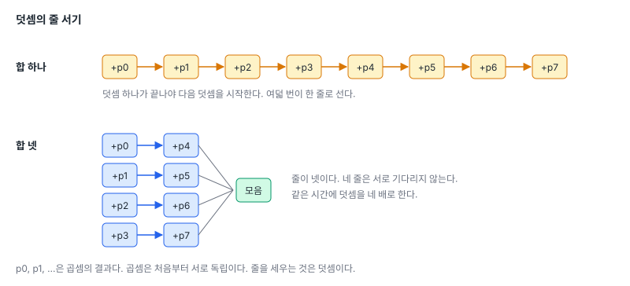
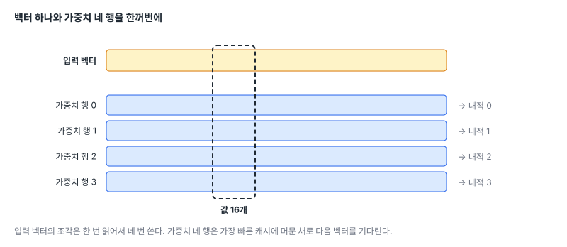
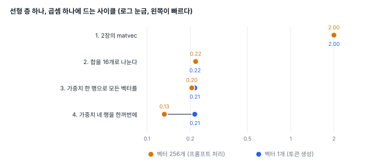
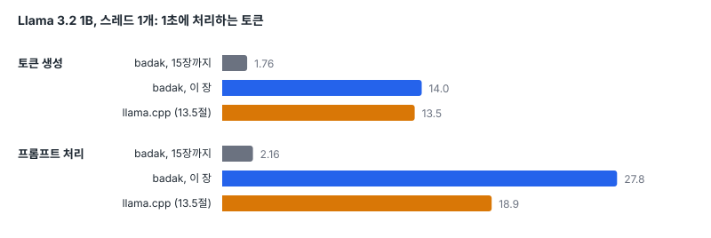

# 행렬 곱 최적화

[14장](ch14_measurement.md)에서 측정 도구를 만들고
[15장](ch15_bottleneck.md)에서 기계를 쟀습니다. 이 장에서 처음으로
엔진을 빠르게 만듭니다.

고칠 곳은 하나입니다. 14.7절의 프로파일에서 순전파 시간의 99.8%가 선형
층이었습니다. 선형 층은 내적을 되풀이하고, 내적은
[2장](../part1/ch02_math.md)에서 쓴 다섯 줄짜리 함수입니다.
[15장](ch15_bottleneck.md)에서 그 함수가 곱셈 하나에 2사이클을 쓰는데
같은 기계에서 0.22사이클이면 된다는 것을 확인했고, 그렇게 고치면 토큰
생성이 1.76에서 16토큰/초 근처까지 빨라질 수 있다고 계산했습니다. 이제
그 계산이 맞는지 확인합니다.

| 하는 일 | 절 |
|---|---|
| 내적을 다시 짠다: 합을 나누어 담는다 | 16.1 |
| 내적 여러 개를 한꺼번에 계산하는 커널을 만든다 | 16.2 |
| 커널의 모양을 측정으로 고른다 | 16.3 |
| 선형 층을 다시 짠다: 가중치를 한 번만 읽는다 | 16.4 |
| 토큰 생성에서는 왜 다르게 해야 하는지 본다 | 16.5 |
| 캐시에 맞춰 입력을 끊어 본다 | 16.6 |
| 결과가 여전히 옳은지 확인한다 | 16.7 |
| 전체를 다시 잰다 | 16.8 |

이 장에서는 **보통의 Rust 코드만 쓴다**는 제약을 둡니다. 프로세서의 벡터
명령을 직접 부르지 않고, 컴파일러가 알아서 쓰도록 코드를 짭니다. 직접
부르는 일은 [17장](ch17_simd.md)으로 남깁니다. 그렇게 했을 때 무엇을
얻고 무엇을 잃는지도 이 장에서 봅니다.

코드는 `crates/badak_core/src/kernel.rs`에 있습니다.

## 16.1 합을 16개로 나누어 담는다

[2장](../part1/ch02_math.md)의 내적입니다.

```rust
{{#include ../../../crates/badak_core/src/linalg.rs:dot}}
```

15.3절에서 이 함수가 느린 이유를 찾았습니다. 합이 하나라서 덧셈 하나가
끝나야 다음 덧셈을 시작할 수 있습니다.



컴파일러가 알아서 나누어 주지 않는 이유도 알아 둡니다. 실수의 덧셈은
순서를 바꾸면 결과의 마지막 자리가 달라집니다(2.7절, 5.6절). 컴파일러는
프로그램의 결과를 바꾸는 변환을 하지 않으므로, 우리가 "차례로 더하라"고
쓰면 차례로 더하는 코드를 만듭니다. 15.2절에서 정수의 합이 저절로 빨랐던
것은 정수의 덧셈이 순서와 무관하기 때문입니다.

그러니 순서를 바꿔도 좋다는 것을 **코드로** 말해 주어야 합니다. 합을
여러 변수에 나누어 담으면 그렇게 말한 것이 됩니다.

```rust
{{#include ../../../crates/badak_core/src/kernel.rs:reduce}}
```

합 16개는 마지막에 하나로 모읍니다. 이웃한 둘씩 더하기를 되풀이하며,
5.6절의 쌍별 합산과 같은 방식입니다. 순서를 코드에 정해 두었으므로 같은
입력에는 늘 같은 비트가 나옵니다.

이렇게 하면 15.3절에서 본 대로 두 가지를 한꺼번에 얻습니다.

- 줄이 16개가 되어 프로세서가 덧셈 여러 개를 동시에 진행합니다.
- 컴파일러가 값 여러 개를 한꺼번에 곱하고 더하는 명령을 씁니다. 합 16개가
  "값 넷씩 네 묶음"으로 처리됩니다.

## 16.2 커널은 내적 여러 개를 한꺼번에 계산한다

선형 층은 내적 하나가 아니라 내적의 격자입니다. 입력 벡터마다, 가중치의
행마다 내적이 하나씩 있습니다. 그 가운데 몇 개를 한꺼번에 계산하는
함수를 만듭니다.

```rust
{{#include ../../../crates/badak_core/src/kernel.rs:dots}}
```

입력 벡터 `M`개와 가중치 행 `N`개를 받아 내적 `M × N`개를 돌려줍니다.
`M`, `N`, `L`은 타입에 붙는 상수여서, 컴파일러는 숫자의 조합마다 그
모양에 맞춘 코드를 따로 만듭니다. 맨 안쪽 반복문의 횟수가 컴파일할 때
정해지므로 반복문 자체가 사라지고 곱셈과 덧셈만 남습니다.

한꺼번에 계산하면 **읽어 온 값을 여러 번 쓸 수 있습니다.** 내적 하나를
계산할 때는 곱셈 한 번에 값을 둘(입력 하나, 가중치 하나) 읽습니다. 입력
벡터 하나와 가중치 네 행을 함께 계산하면 입력의 값은 한 번 읽어 네 번
쓰므로, 곱셈 네 번에 값을 다섯 개 읽습니다.



행렬 곱 라이브러리에서는 이런 함수를
**마이크로커널**<sup>microkernel</sup>이라고 부릅니다. 전체 행렬 곱에서
가장 안쪽에 있고 가장 많이 실행되는 작은 계산을 떼어 내 그 프로세서에
맞게 공들여 짠 것입니다. 나머지 코드는 이 커널을 부르는 순서를 정할
뿐입니다.[^goto][^blis]

### 내적 하나는 어떤 묶음에서든 같은 순서로 계산한다

이 함수의 주석에 눈여겨볼 문장이 있습니다. "내적 하나가 계산되는 순서는
`M`과 `N`에 상관없이 같다." 내적 하나의 합은 늘 `L`개로 나뉘고 늘 같은
순서로 모입니다. 다른 내적과 함께 계산되든 혼자 계산되든 같습니다.

그래서 **어떤 묶음으로 계산해도 같은 비트가 나옵니다.** 테스트가
확인합니다.

```rust
{{#include ../../../crates/badak_core/src/kernel.rs:same_bits}}
```

이 약속을 왜 지키는지는 16.7절에서 봅니다.

## 16.3 커널의 모양은 측정으로 고른다

`M`, `N`, `L`을 얼마로 할지는 계산으로 정할 수도 있겠지만 재 보는 것이
빠르고 확실합니다. 길이 2048인 벡터로 여러 모양을 잽니다. 모두 L1 캐시에
들어가는 크기입니다.

```bash
cargo run --release -p badak_bench --example ch16_shapes
```

```text
{{#include output/ch16_shapes.txt}}
```

표를 읽어 봅니다.

**합을 16개로 나누면 [2장](../part1/ch02_math.md)의 `dot`보다 8배
빠릅니다.** 2.05사이클이 0.245사이클이 되어 15.3절의 결과와 같습니다.
32개로 나눠도 더 빨라지지 않습니다.

**입력 하나를 가중치 네 행과 함께 계산하면 0.144사이클입니다.** 여기서
1.7배를 더 얻어 처음의 14배가 됩니다.

**그런데 표가 고르지 않습니다.** 가중치 네 행은 0.144사이클인데 두 행은
0.522, 세 행은 0.460입니다. 더 작은 일이 더 느립니다. 이유는 명령의
수에서 드러납니다. 네 행은 곱셈 하나에 명령 0.94개인데 두 행은
3.07개입니다. 곱셈 하나에 명령이 셋이라는 것은 컴파일러가 값을 하나씩
처리하는 코드를 만들었다는 뜻입니다. 같은 함수에 숫자만 바꿨는데, 어떤
조합에서는 컴파일러가 벡터 명령으로 바꾸고 어떤 조합에서는 바꾸지
못했습니다.

우리는 컴파일러에게 "이렇게 계산해도 좋다"고 허락했을 뿐 "이렇게
계산하라"고 시키지 않았습니다. 허락을 어떻게 쓸지는 컴파일러가 판단하고,
그 판단은 코드의 사소한 모양이나 컴파일러의 판에 따라 달라집니다.
**컴파일러에게 맡긴 최적화는 얻기 쉬운 만큼 잃기도 쉽습니다.** 이 표는
Rust 1.100에서 잰 것이고, 다른 판에서는 다른 줄이 가장 빠를 수 있습니다.

그래서 이 장은 모양을 계산이 아니라 측정으로 고르고, 고른 결과를 상수로
적어 둡니다.

```rust
{{#include ../../../crates/badak_core/src/kernel.rs:shape}}
```

입력 벡터 하나와 가중치 네 행, 합은 16개입니다. 입력을 여러 개 묶는
모양(`3 × 4`, 합 8개)도 비슷하게 빠르지만 고르지 않았습니다. 합의 수가
다르면 더하는 순서가 달라지기 때문이며, 16.7절에서 설명합니다.

원하는 명령을 컴파일러의 판단에 맡기지 않고 직접 적는 방법은
[17장](ch17_simd.md)에서 다룹니다.

## 16.4 선형 층은 가중치를 한 번만 읽는다

커널이 생겼으니 선형 층을 다시 짭니다. 지금까지의 `linear`는 입력
벡터마다 `matvec`을 불렀습니다(5.3절).

```text
벡터마다:
    가중치의 행마다:
        내적
```

토큰 256개의 프롬프트를 처리하면 가중치 전체를 256번 읽습니다.
15.5절에서 이것을 "산술 강도가 0.25에 머문다"고 했습니다. 반복문의
안팎을 바꾸면 가중치를 한 번만 읽습니다.

```text
가중치의 네 행마다:
    벡터마다:
        내적 네 개 (커널)
```

가중치 네 행을 읽어 온 김에 모든 벡터와 내적합니다. 네 행은 32KB쯤이라
L1 캐시에 들어가고, 벡터 256개를 계산하는 동안 캐시에 남아 있습니다.

```rust
{{#include ../../../crates/badak_core/src/kernel.rs:linear}}
```

[5장](../part1/ch05_operators.md)의 `ops::linear`는 입력 전체를 이
함수에 넘기도록 바뀌었습니다. 편향을 더하는 일과 형상을 따지는 일은
그대로입니다.

### 합을 나눈 것이 개선의 대부분을 차지한다

개선을 한 단계씩 따로 재 봅니다. Llama 3.2 1B의 MLP가 벡터를 펼치는 층과
같은 크기, `(8192, 2048)`의 가중치 64MB로 잽니다.

```rust
{{#include ../../../crates/badak_bench/examples/ch16_linear.rs:steps}}
```

```bash
cargo run --release -p badak_bench --example ch16_linear
```

```text
{{#include output/ch16_linear.txt:8:13}}
```



벡터 256개일 때의 결과입니다.

- **1에서 2로: 2.00에서 0.22로.** 합을 나눈 것만으로 9배입니다. 이
  장에서 얻는 것의 대부분이 여기서 나옵니다.
- **2에서 3으로: 0.22에서 0.21로.** 반복문의 순서를 바꿔 가중치를 한
  번만 읽게 했는데 거의 달라지지 않습니다. 뜻밖의 결과입니다.
- **3에서 4로: 0.21에서 0.13으로.** 네 행을 한꺼번에 계산하는 커널이
  1.6배를 더합니다.

둘째 줄을 설명해야 합니다. 15.5절에서 "토큰을 묶으면 가중치를 다시 쓸 수
있어서 메모리에 막히지 않는다"고 했는데, 묶지 않은 2단계와 묶은 3단계가
거의 같습니다.

[15장](ch15_bottleneck.md)의 숫자로 따져 보면 이유가 나옵니다. 2단계는
1초에 182억 번 곱하고, 곱셈마다 가중치 4바이트를 메모리에서 읽으므로
1초에 73GB를 읽습니다. 스레드 하나가 읽을 수 있는 양이 83GB였으니
**가까스로 한계 안입니다.** 계산이 조금만 더 빨랐다면 메모리에 막혔을
것입니다. 실제로 4단계의 커널은 1초에 300억 번을 곱합니다. 가중치를 매번
메모리에서 읽어서는 낼 수 없는 속도이고, 반복문의 순서를 바꿔 두었기
때문에 그 속도가 나옵니다.

순서를 바꾼 것은 지금 당장의 이득보다 **다음 개선을 막지 않으려는**
것이었습니다. 스레드를 늘리는 [18장](ch18_multithreading.md)에서는
효과가 더 분명해집니다. 스레드 열둘이 저마다 가중치를 읽기 시작하면
메모리의 한계에 곧바로 닿기 때문입니다.

## 16.5 토큰을 하나씩 만들 때는 한 행씩 읽는다

벡터가 하나일 때의 측정을 봅니다.

```text
{{#include output/ch16_linear.txt:1:6}}
```

네 방법 가운데 뒤의 셋이 같습니다. 벡터가 하나뿐이니 반복문의 순서를
바꿀 것도, 가중치를 다시 쓸 것도 없습니다. 그런데 4번이 256개일 때의
0.13이 아니라 0.22입니다. 네 행을 한꺼번에 계산하는 커널을 일부러 쓰지
않았기 때문입니다.

처음에는 벡터가 몇 개이든 네 행 커널을 썼습니다. 그렇게 하고 모델 전체를
쟀더니 프롬프트 처리는 12.8배 빨라졌는데 토큰 생성은 5.4배에 그쳐서,
[15장](ch15_bottleneck.md)이 예상한 9배에 한참 못 미쳤습니다. 원인을
찾으려고 가중치를 한 행씩 읽을 때와 네 행씩 읽을 때를 벡터의 수를 바꿔
가며 쟀습니다.

```text
{{#include output/ch16_linear.txt:15:26}}
```

**벡터가 하나일 때는 네 행씩 읽는 쪽이 1.7배 느립니다.** L1 캐시
안에서는 네 행 커널이 훨씬 빨랐는데(16.3절) 여기서는 반대입니다.

차이는 가중치를 **어디에서 읽어 오느냐**에 있습니다. 16.3절의 측정에서는
가중치가 이미 캐시에 있었지만, 여기서는 64MB짜리 가중치를 메모리에서
읽어 옵니다. 15.2절에서 메모리를 차례로 읽으면 프로세서가 다음에 읽을
부분을 미리 가져다 놓는다고 했습니다. 한 행씩 읽으면 가중치 전체가
처음부터 끝까지 이어지는 **한 줄기**입니다. 네 행씩 읽으면 네 줄기를
번갈아 읽게 되고, 한 줄기가 8KB(한 행)밖에 안 되어서 프로세서가 차례로
읽고 있다는 것을 알아챌 만하면 끝나 버립니다.

> 사이클의 수는 측정한 것입니다. "미리 가져오기가 짧은 줄기에서 잘 듣지
> 않는다"는 설명은 그 숫자와 15.2절의 관찰에서 끌어낸 해석입니다.

벡터가 여럿이면 사정이 달라집니다. 네 행을 처음 읽어 올 때는 느리지만,
그 뒤로는 캐시에 있는 네 행을 나머지 벡터가 빠르게 씁니다. 벡터가 다섯
개가 되면 네 행 쪽이 더 빨라지고, 많아질수록 차이가 벌어집니다.

그래서 벡터의 수에 따라 길을 나눴습니다. 16.3절의 상수
`MIN_VECTORS_FOR_ROWS`가 그 경계이고, 위의 표에서 고른 값이 5입니다.
`linear_blocked`의 `while` 조건에 들어 있습니다.

이 일에서 세 가지를 배웁니다.

- **커널만 따로 재서는 알 수 없는 것이 있습니다.** 16.3절의 표는
  데이터가 캐시에 있을 때의 속도였습니다. 같은 커널이 데이터를
  메모리에서 읽어 올 때는 다르게 동작합니다. 작은 측정으로 고른 것은 큰
  측정으로 다시 확인해야 합니다.
- **예상이 있어서 이상을 알아챘습니다.** 5.4배는 그것만 보면 훌륭한
  숫자입니다. [15장](ch15_bottleneck.md)에서 "9배가 가능하다"고 계산해
  두지 않았다면 만족하고 넘어갔을 것입니다. 상한을 먼저 계산해 두면 이런
  것을 알아챌 수 있습니다.
- **같은 연산에 길이 둘 필요할 수 있습니다.** 토큰 생성과 프롬프트
  처리는 같은 선형 층을 지나지만, 한쪽은 메모리에서 읽는 일이고 다른
  쪽은 캐시 안에서 계산하는 일입니다. [15장](ch15_bottleneck.md)에서 본
  두 가지 병목 때문에 코드에도 길이 둘 생겼습니다.

## 16.6 캐시에 맞춰 입력을 끊어도 빨라지지 않는다

행렬 곱 최적화의 교과서에는 **블로킹**<sup>blocking</sup>이라는 기법이
빠지지 않고 나옵니다. 큰 행렬을 캐시에 들어가는 조각으로 끊어서, 한
조각이 캐시에 있는 동안 그 조각으로 할 수 있는 계산을 다 하고 넘어가는
것입니다.[^goto]

우리에게 해당하는 경우를 생각해 봅니다. 16.4절의 반복문에서 가중치 네
행은 L1 캐시에 남아 있습니다. 입력 벡터는 어떨까요. 벡터 256개에
2048씩이면 2MB이고 L2 캐시(16MB)에 들어갑니다. 벡터가 4,096개라면
32MB라서 들어가지 않고, 가중치 네 행을 처리할 때마다 입력 32MB를
메모리에서 다시 읽어야 합니다. 입력을 L2에 들어가는 크기로 끊어서, 한
덩어리가 캐시에 있는 동안 가중치를 한 번 훑으면 어떨까요.

`linear_blocked`의 마지막 인자가 그 덩어리의 크기입니다. 바꿔 가며 잽니다.

```text
{{#include output/ch16_linear.txt:28:36}}
```

**아무 차이가 없습니다.** 입력을 128KB씩 끊든 32MB를 통째로 두든 곱셈
하나에 0.13사이클입니다.

교과서의 기법이 효과가 없는 이유는 [15장](ch15_bottleneck.md)의 계산으로
설명됩니다. 가중치 네 행을 처리하는 동안 입력을 한 번 훑습니다. 곱셈 네
번에 입력의 값 하나(4바이트), 곧 곱셈 하나에 1바이트를 읽습니다. 1초에
300억 번 곱하니 1초에 30GB를 읽고, 스레드 하나가 메모리에서 읽을 수 있는
83GB에 한참 못 미칩니다. 게다가 입력을 처음부터 끝까지 차례로 읽으므로
프로세서가 미리 가져다 놓기도 쉽습니다. **메모리가 병목이 아니니
메모리를 아끼는 기법은 효과가 없습니다.**

그래서 기본값은 "끊지 않는다"로 두었습니다.

```rust
pub fn linear(x: &[f32], count: usize, w: &[f32], rows: usize, cols: usize, y: &mut [f32]) {
    // 입력을 끊지 않고 한 덩어리로 다룬다. 끊어도 빨라지지 않았다(16.6절).
    linear_blocked(x, count, w, rows, cols, y, count.max(1));
}
```

끊는 기능 자체는 남겨 두었습니다. 스레드 열둘이 동시에 입력을 읽으면
30GB의 열두 배가 필요하고, 그것은 이 기계의 한계 275GB를 넘습니다.
[18장](ch18_multithreading.md)에서 다시 재 봅니다.

### 패킹은 읽을 순서대로 옮겨 적는다

교과서의 기법이 하나 더 있습니다. **패킹**<sup>packing</sup>입니다.
일반적인 행렬 곱 `C = A × B`에서 결과의 한 칸은 `A`의 행과 `B`의
**열**의 내적입니다. 행은 메모리에 나란히 놓여 있지만 열은 한 행씩
건너뛰며 흩어져 있습니다. 그래서 고성능 라이브러리는 계산하기 전에 `B`의
조각을 커널이 읽는 순서대로 새 메모리에 옮겨 적습니다. 그것이
패킹입니다.[^goto]

**선형 층에는 이 문제가 없습니다.**
[3장](../part1/ch03_neural_networks.md)에서 가중치의 형상을
`(출력 길이, 입력 길이)`로 정했으므로 한 행이 곧 내적 하나에 쓰이는
값이고, 커널이 읽을 순서대로 이미 놓여 있습니다. 선형 층의 계산은
`X × Wᵀ`인데 가중치가 처음부터 전치된 채로 저장되어 있는 셈입니다. 모델
파일도 그 형상 그대로 저장합니다.

llama.cpp의 CPU 행렬 곱도 같은 경우를 겨냥합니다. 소스의 머리말은 이
코드가 "흔한 연속 배치인 `C = Aᵀ × B`"를 위한 것이고 캐시를 채우는
일이나 메모리 할당 같은 부담을 지우지 않는다고 적고 있습니다.[^tinyblas]

**일반적인 행렬 곱에는 패킹이 필요합니다.**
[5장](../part1/ch05_operators.md)의 `ops::matmul`이 그 경우입니다.
2.5절에서 `1024 × 1024` 행렬 둘을 곱하는 데 0.84초가 걸렸고 "16장부터 이
숫자를 줄인다"고 했습니다. `B`를 전치해 옮겨 적으면 `B`의 열이 행이
되므로 선형 층의 커널을 그대로 쓸 수 있습니다.

```rust
{{#include ../../../crates/badak_core/src/ops.rs:matmul}}
```

[4장](../part1/ch04_tensor.md)에서 만든 `transpose`와 `contiguous`가 그
일을 합니다. `transpose`는 복사 없이 읽는 방향만 바꾸고, `contiguous`가
그 방향대로 메모리에 옮겨 적습니다.

```text
{{#include output/ch16_linear.txt:37:41}}
```

**0.84초가 0.038초가 되어 22배 빨라졌습니다.** 옮겨 적는 데 든 시간은
2.9밀리초로 전체의 8%입니다. 4MB를 한 번 옮겨 적는 비용으로 계산 전체를
20배 넘게 빠르게 했습니다.

[2장](../part1/ch02_math.md)과 [4장](../part1/ch04_tensor.md)의 연습
문제에 남겨 둔 질문에도 이제 답할 수 있습니다.

- **[2장](../part1/ch02_math.md) 연습 문제 3: 반복문의 순서를 `i`, `p`,
  `j`로 바꾸면 왜 빨라지는가.** 원래의 순서에서는 맨 안쪽 반복문이 합
  하나에 차례로 더합니다. 이 장의 첫머리에서 본 "덧셈의 줄 서기"입니다.
  순서를 바꾸면 맨 안쪽 반복문이 결과의 한 행 전체를 훑으며 칸마다
  하나씩 더합니다. 서로 다른 칸에 더하는 덧셈은 서로 기다리지 않습니다.
  게다가 `B`를 열이 아니라 행으로 읽게 되어 메모리를 차례로 읽습니다.
  합을 나누어 담는 것과 같은 효과를 반복문의 순서만으로 얻습니다.
- **[4장](../part1/ch04_tensor.md) 연습 문제 6: 작은 텐서에서는 전치
  뷰를 읽어도 왜 덜 느린가.** `256 × 256`의 텐서는 256KB입니다. 전치
  뷰를 읽으면 메모리를 건너뛰며 읽지만, 텐서 전체가 캐시에 들어 있으면
  어디를 읽든 빠릅니다. 4.7절의 큰 텐서는 캐시에 들어가지 않아서 건너뛸
  때마다 메모리까지 가야 했습니다(15.2절).

## 16.7 빨라진 뒤에도 결과는 옳다

빨라진 것은 확인했으니 옳은지 확인할 차례입니다. 걱정할 것이 둘
있습니다.

### 더하는 순서가 바뀌어도 검증은 모두 통과한다

합을 나누면 결과의 마지막 자리가 달라지므로, 엔진의 모든 선형 층의
결과가 이전과 조금씩 다릅니다. [9장](../part2/ch09_transformer.md)부터
쌓아 온 검증은 이럴 때 쓰려고 만든 것입니다. 전체 테스트를 돌립니다.

```bash
cargo test --workspace
```

모두 통과하며, 고친 테스트는 하나도 없습니다.
[9장](../part2/ch09_transformer.md)의 부품별 대조,
[10장](../part2/ch10_forward_pass.md)의 블록별 대조,
[11장](../part2/ch11_kv_cache.md)의 "PyTorch와 같은 토큰을 뽑는다",
[12장](../part2/ch12_sampling.md)의 분포 대조,
[7장](../part1/ch07_mnist.md)의 "MNIST 1만 장의 예측이 모두 같다"가
그대로 통과합니다. 허용 오차를 쓰는 검증은 마지막 자리의 변화를 견디도록
만들어져 있었습니다(5.6절).

오차가 커졌는지 작아졌는지도 봅니다. 13.3절에서 `f64`로 계산한 기준과
견주는 도구를 만들어 두었습니다.

```bash
cargo run --release -p badak_models --example ch13_compare
```

```text
{{#include output/ch16_accuracy_llama32.txt}}
```

`badak`의 상대 오차가 `1.9e-6`에서 `6.2e-7`로 **줄었습니다.** 빨라지면서
더 정확해졌고, 우연이 아닙니다. 합 하나에 2048개를 차례로 더하면 합이
커진 뒤에 더해지는 값이 자릿수를 잃습니다. 16개로 나누면 합마다
128개씩만 더하므로 그 손실이 줄어듭니다. 5.6절과 12.6절에서 본 것과 같은
효과입니다. 13.3절에서 llama.cpp가 우리와 PyTorch보다 정확했던
것(`4.5e-7`)도 아마 같은 이유였을 것입니다.

### 묶음의 크기가 달라도 같은 비트가 나온다

둘째 걱정이 더 까다롭습니다. 11.6절에서 KV 캐시를 검증할 때 이렇게
적었습니다.
> 이 "비트 단위로 같다"는 성질은 당연한 것이 아닙니다. 토큰 여럿을 행렬
> 하나로 묶어 한 번에 곱하는 엔진에서는 묶음의 크기에 따라 덧셈의 순서가
> 달라질 수 있고 … 우리도 16장에서 행렬 곱을 다시 만들면 이 테스트를
> 허용 오차가 있는 비교로 바꿔야 할 수 있습니다.

지금 우리가 바로 그 일을 했습니다. 프롬프트를 한꺼번에 처리할 때는 벡터
256개가 묶여 네 행 커널을 지나고, 토큰을 하나씩 만들 때는 벡터 하나가 한
행씩 지납니다. 서로 다른 코드입니다. 같은 토큰의 계산 결과가 두 길에서
다르면 11.6절의 테스트는 깨집니다.

그러나 깨지지 않습니다. 16.2절의 약속 때문입니다. 내적 하나는 어떤 길로
계산되든 **같은 순서로** 계산됩니다. 합 16개로 나누고, 같은 순서로
모으고, 남은 끝부분을 차례로 더합니다. 네 행을 함께 계산하든 한 행만
계산하든, 벡터가 하나든 256개든 같습니다.
```rust
{{#include ../../../crates/badak_core/src/kernel.rs:split}}
```

그래서 11.6절의 테스트를 고치지 않았습니다. 캐시를 쓴 점수와 쓰지 않은
점수는 여전히 비트 단위로 같습니다.

이 약속에는 대가가 있었습니다. 16.3절에서 `3 × 4`, 합 8개 모양이
프롬프트 처리에 조금 더 빨랐는데 고르지 않았습니다. 합이 8개인 길과
16개인 길이 섞이면 같은 내적이 길에 따라 다른 비트를 내기 때문입니다.
**속도를 조금 내주고 "어떻게 계산해도 같은 답"을 얻었습니다.**

이 책은 그만한 가치가 있다고 봅니다.

- 검증이 단순해집니다. 캐시가 옳은지를 허용 오차 없이 확인할 수
  있습니다. 허용 오차를 쓰면 "오차 안에 숨은 버그"를 늘 의심해야 합니다.
- 재현성이 생깁니다. 12.7절에서 "같은 엔진, 같은 씨앗이면 같은 글"을
  약속했습니다. 프롬프트를 어떻게 끊어 넣느냐에 따라 글이 달라진다면 그
  약속을 지키기 어렵습니다.

실전 엔진은 다르게 선택합니다. 11.6절에서 인용한 대로 llama.cpp는 묶음의
크기가 다르면 결과가 비트 단위로 같다고 보장하지 않습니다. 속도를 위해
경우마다 가장 빠른 커널을 고르기 때문입니다. 어느 쪽이 옳다기보다 무엇을
우선하느냐의 차이입니다. 우리도 [18장](ch18_multithreading.md)에서
스레드를 넣을 때와 GPU를 쓸 때 이 약속을 계속 지킬 수 있을지 다시 따져야
합니다.

## 16.8 토큰 생성이 8배, 프롬프트 처리가 13배 빨라졌다

14.11절의 기준과 같은 측정을 다시 합니다. 전원을 연결한 상태입니다.

```bash
cargo run --release -p badak_models --example ch14_baseline
```

```text
{{#include ../../../bench/baseline/badak_llama32_ch16.txt:13:15}}
```



| Llama 3.2 1B, 스레드 1개 | [15장](ch15_bottleneck.md)까지 | 이 장 | 배수 | llama.cpp (13.5절) | [15장](ch15_bottleneck.md)의 상한 |
|---|---|---|---|---|---|
| 토큰 생성 (토큰/초) | 1.76 | 14.03 | 8.0배 | 13.54 | 15.9 |
| 프롬프트 처리 (토큰/초) | 2.16 | 27.77 | 12.8배 | 18.95 | 20.2 |

**토큰 생성이 8배, 프롬프트 처리가 13배 빨라졌습니다.**
[2장](../part1/ch02_math.md)부터 써 온 내적 다섯 줄을 고쳐서 얻은
결과입니다.

**llama.cpp의 스레드 하나와 같은 수준이 되었습니다.** 13.5절에서 "조건을
가장 가깝게 맞춘 비교"에서 9배와 8배 뒤져 있었습니다. 토큰 생성은 이제
같고(14.0 대 13.5), 프롬프트 처리는 더 빠릅니다(27.8 대 19.0). 벡터
명령을 한 줄도 직접 쓰지 않고 얻은 결과입니다.

**토큰 생성은 [15장](ch15_bottleneck.md)의 예상과 맞습니다.** 상한
15.9의 88%이고, 15.7절의 표에 "16 근처"라고 적었던 값입니다.

**프롬프트 처리는 [15장](ch15_bottleneck.md)의 상한을 넘었습니다.**
20.2가 상한이라고 했는데 27.8이 나왔습니다. 계산이 틀린 것이 아니라
전제가 바뀌었습니다. 15.3절은 계산의 한계를 "곱셈 하나에 0.22사이클"로
잡으면서 이것은 "이 장에서 닿은 값"이지 진짜 한계가 아니라고 적었습니다.
네 행을 한꺼번에 계산하는 커널이 0.13사이클을 냈으니 상한도 그만큼
올라갑니다. 15.6절에서 말한 대로 상한은 전제와 함께 읽어야 하고,
**최적화는 전제를 바꾸는 일입니다.**

보조 모델도 같은 폭으로 빨라졌습니다. SmolLM2 135M은 토큰 생성이
19.7에서 121토큰/초, 프롬프트 처리가 24.5에서 222토큰/초가 되었습니다.

### 명령은 줄고 IPC는 다섯 배가 되었다

기록의 뒤쪽 열도 읽어 봅니다.

| | [15장](ch15_bottleneck.md)까지 | 이 장 |
|---|---|---|
| 프롬프트의 토큰 하나에 드는 명령 | 23.5억 | 8.8억 |
| IPC (프롬프트 처리) | 1.18 | 6.09 |
| IPC (토큰 생성) | 1.17 | 4.50 |

명령은 2.7분의 1이 되었고 IPC는 5배가 되었습니다. 14.10절에서 `argmax`를
고칠 때와 같은 양상입니다. **명령을 줄인 것보다 프로세서가 동시에 일하게
해 준 것의 효과가 더 컸습니다.**

토큰 생성의 IPC가 프롬프트 처리보다 낮은 것은
[15장](ch15_bottleneck.md)에서 본 대로 토큰 생성이 메모리에서 가중치가
오기를 기다리기 때문입니다.

기록에는 설명하지 못한 것도 하나 있습니다. 프로세서가 돈 속도가
14.11절의 4.35GHz에서 4.0GHz로 낮게 찍혔습니다. 전원은 같은 조건이고, 왜
그런지는 확인하지 못했습니다. 위의 배수는 이 차이가 섞인 채로 잰
것입니다.

### 프로파일에서 선형 층이 아닌 부분이 보이기 시작한다

14.7절에서 "프로파일은 고칠 때마다 다시 봐야 한다"고 했습니다.

```bash
cargo run --release -p badak_models --example ch14_profile
```

```text
{{#include output/ch16_profile_llama32.txt:3:16}}
```

같은 일(프롬프트 64토큰과 16토큰)이 37.4초에서 3.5초가 되었습니다. 선형
층의 비중은 99.8%에서 97.8%로 내려왔고, 어텐션의 점수 계산과 활성화
함수가 0.1%에서 1.0%로 올라왔습니다. 아직은 선형 층이 압도적이지만
나머지가 보이기 시작했습니다. 선형 층이 지금보다 열 배 더
빨라지면(스레드를 쓰면 그렇게 됩니다) 나머지가 20%를 차지하게 됩니다.

### 7장의 MNIST 분류기도 12배 빨라졌다

7.6절에서 MNIST 분류기가 PyTorch보다 420배 느리다는 것을 봤습니다. 그
모델도 `ops::linear`를 쓰므로 아무것도 고치지 않았는데 빨라졌습니다.

```bash
cargo run --release -p badak_models --example ch07_bench
```

| MNIST | [7장](../part1/ch07_mnist.md) | 이 장 | PyTorch (7.6절) |
|---|---|---|---|
| 1만 장을 한 번에 | 412밀리초 | 34.5밀리초 | 0.99밀리초 |
| 한 장씩 (장당) | 40.5마이크로초 | 6.0마이크로초 | 6.7마이크로초 |

한 번에 처리하는 쪽은 12배 빨라졌고 PyTorch와의 격차는 420배에서 35배로
줄었습니다. 남은 35배는 7.6절에서 본 대로 Accelerate가 쓰는 것으로
보이는 하드웨어와 스레드에서 옵니다. 한 장씩 처리하는 쪽은 PyTorch보다
조금 빨라졌습니다. 그쪽은 계산보다 연산 하나하나를 부르는 비용이 큰
경우였고(7.6절), 그 비용은 우리가 더 작습니다.

## 16.9 실전 엔진에서는

**커널은 프로세서마다 따로 짭니다.** 고성능 행렬 곱 라이브러리는
마이크로커널을 프로세서의 종류마다 따로 두고, 대개 어셈블리나 벡터
명령으로 직접 적습니다. BLIS라는 라이브러리는 이 구조를 전면에 내세워서,
프로세서에 따라 달라지는 것은 작은 커널 몇 개뿐이고 나머지는 모두 공통
코드입니다.[^blis] 16.3절에서 컴파일러에 맡긴 결과가 고르지 않았던 것을
보면 왜 직접 적는지 알 수 있습니다.

**llama.cpp는 커널을 여러 크기로 둡니다.** llama.cpp의 CPU 행렬 곱은
한꺼번에 계산하는 내적의 격자 크기를 여러 가지로 준비해 두고, 남은
행렬의 크기에 맞는 것을 골라 씁니다.[^tinyblas] 우리의
`dots::<M, N, L>`과 같은 발상입니다. 다만 벡터 명령을 직접 쓰고,
16.7절에서 본 대로 묶음에 따라 결과가 같아야 한다는 제약을 두지
않습니다.

**외부 라이브러리를 부르는 방법도 있습니다.** 13.5절에서 llama.cpp에
Accelerate를 붙이면 프롬프트 처리가 4.3배 빨라졌습니다. 행렬 곱은 워낙
오래 연구된 문제라 운영체제나 칩 제조사가 잘 다듬은 라이브러리를 내놓고,
PyTorch가 그것을 씁니다(7.6절). 엔진이 직접 짠 커널과 외부 라이브러리
가운데 무엇을 쓸지는 배포의 문제이기도 합니다. 외부 라이브러리는
빠르지만 엔진이 어디서나 같은 결과를 내기 어렵게 만듭니다.

**토큰 생성과 프롬프트 처리에 다른 길을 둡니다.** 16.5절에서 벡터의 수에
따라 길을 나눴는데, 실전 엔진도 그렇게 합니다. 행렬 × 벡터와 행렬 ×
행렬은 병목이 달라서([15장](ch15_bottleneck.md)) 같은 코드로 둘 다
잘하기 어렵습니다. llama.cpp의 설정에 생성용 스레드 수와 프롬프트 처리용
스레드 수가 따로 있는 것도 같은 이유입니다.[^llamacpp-threads]

## 정리

- [2장](../part1/ch02_math.md)의 내적은 합이 하나라서 덧셈이 줄을 섰습니다. 합을 16개의 변수에
  나누어 담으니 곱셈 하나가 2.0사이클에서 0.22사이클이 되었습니다.
- 컴파일러는 실수 덧셈의 순서를 스스로 바꾸지 않습니다. 순서를 바꿔도
  좋다는 것을 코드의 모양으로 말해 주어야 합니다.
- 내적 여러 개를 한꺼번에 계산하는 커널을 만들었습니다. 입력 벡터 하나와
  가중치 네 행을 함께 계산하면 0.13사이클입니다.
- 컴파일러에 맡긴 벡터화는 고르지 않습니다. 가중치 네 행은 빠른데 두
  행과 세 행은 느렸습니다. 모양은 측정으로 골랐습니다.
- 선형 층의 반복문 순서를 바꿔 가중치를 한 번만 읽게 했습니다. 스레드가
  하나인 지금은 이득이 작지만, 더 빠른 커널과 여러 스레드의 전제가
  됩니다.
- 토큰을 하나씩 만들 때는 가중치를 한 행씩 읽는 쪽이 빠릅니다. 메모리에서
  한 줄기로 읽히기 때문입니다. 벡터가 다섯 개 이상일 때만 네 행 커널을
  씁니다.
- 입력을 캐시에 맞춰 끊는 블로킹은 효과가 없었습니다. 메모리가 병목이
  아니었기 때문입니다. 패킹은 선형 층에는 필요 없습니다. 가중치가 이미
  커널이 읽을 순서로 놓여 있습니다. 일반적인 행렬 곱에는 패킹을 넣어
  2.5절의 0.84초를 0.038초로 줄였습니다.
- 내적 하나는 어떤 묶음으로 계산해도 같은 순서로 계산됩니다. 그래서 캐시를
  쓴 결과와 쓰지 않은 결과가 여전히 비트 단위로 같고, 테스트를 하나도
  고치지 않았습니다. 더 빠른 모양 하나를 포기한 값입니다.
- `f64` 기준과의 오차는 `1.9e-6`에서 `6.2e-7`로 줄었습니다.
- Llama 3.2 1B의 토큰 생성이 1.76에서 14.0토큰/초로, 프롬프트 처리가
  2.16에서 27.8토큰/초로 빨라졌습니다. 스레드 하나의 llama.cpp와 같거나
  앞섭니다.

## 연습 문제

1. `ch16_shapes`를 자신의 기계와 컴파일러에서 실행해 보십시오. 가장 빠른
   모양이 이 책과 같습니까. 다르다면 `kernel.rs`의 상수를 바꿔 기준
   측정을 다시 해 보십시오.
2. 16.3절의 표에서 `1 × 2`가 `1 × 4`보다 느렸습니다. `cargo rustc
   --release -p badak_bench --example ch16_shapes -- --emit asm`으로
   기계어를 내어, 두 모양의 맨 안쪽 반복문이 어떻게 다른지 찾아
   보십시오. 값 넷을 한꺼번에 다루는 명령이 쓰였습니까.
3. `reduce`가 합을 모으는 순서를 "앞에서부터 차례로"로 바꾸면 무엇이
   달라집니까. 속도는 달라집니까. 정확도는 어떻습니까. 16.7절의 "같은
   비트" 약속은 지켜집니까.
4. 16.5절의 경계값 5는 가중치의 한 행이 2048일 때 잰 것입니다. 한 행이
   8192일 때(`down_proj`)는 경계가 어디입니까. `ch16_linear`의 상수를
   바꿔 재 보고, 15.2절의 내용으로 차이를 설명해 보십시오.
5. 16.6절에서 블로킹이 효과가 없었습니다. 효과가 나타나려면 무엇이
   달라져야 합니까. [15장](ch15_bottleneck.md)의 숫자로 "스레드가 몇 개일 때부터 입력을
   읽는 양이 메모리의 한계에 닿는가"를 계산해 보십시오.
6. `ops::matmul`은 `B` 전체를 뒤집어 옮겨 적습니다. 행렬이 `8192 ×
   8192`라면 옮겨 적을 메모리가 256MB입니다. `B`를 열 몇 개씩 끊어서 옮겨
   적고 계산하기를 되풀이하도록 고쳐 보십시오. 속도는 어떻게 달라집니까.
   메모리는 얼마나 줄어듭니까.
7. 16.7절에서 "합 8개인 길과 16개인 길이 섞이면 같은 내적이 다른 비트를
   낸다"고 했습니다. 실제로 그런 예를 만들어 보십시오. `dots::<1, 1, 8>`과
   `dots::<1, 1, 16>`의 결과가 다른 벡터 쌍을 찾고, 차이가 얼마나 되는지
   보십시오.
8. 16.8절에서 선형 층이 열 배 더 빨라지면 나머지가 20%를 차지한다고
   했습니다. 지금의 프로파일에서 선형 층 다음으로 큰 두 항목은
   무엇입니까. 그 코드([11장](../part2/ch11_kv_cache.md)의 `attention_cached`, [5장](../part1/ch05_operators.md)의 `map`)를 읽고
   이 장의 방법 가운데 무엇을 적용할 수 있을지 생각해 보십시오.

## 참고 문헌

[^goto]: K. Goto, R. A. van de Geijn, "Anatomy of High-Performance Matrix
    Multiplication", ACM Transactions on Mathematical Software, 34(3), 1–25,
    2008. [doi:10.1145/1356052.1356053](https://doi.org/10.1145/1356052.1356053).
    캐시의 층마다 맞춘 블로킹과 패킹, 그리고 가장 안쪽 커널로 이루어진
    행렬 곱의 구조를 설명합니다.

[^blis]: F. G. Van Zee, R. A. van de Geijn, "BLIS: A Framework for Rapidly
    Instantiating BLAS Functionality", ACM Transactions on Mathematical
    Software, 41(3), 1–33, 2015.
    [doi:10.1145/2764454](https://doi.org/10.1145/2764454). 프로세서에 따라
    달라지는 부분을 작은 마이크로커널로 좁힌 설계를 제안합니다.

[^tinyblas]: llama.cpp, `ggml/src/ggml-cpu/llamafile/sgemm.cpp` (커밋
    `b4c0e00a4fcc`). 파일 머리말이 이 구현의 대상을 "the common contiguous
    use case C = Aᵀ * B"라고 밝히고 있습니다.
    <https://github.com/ggml-org/llama.cpp/blob/b4c0e00a4fcc/ggml/src/ggml-cpu/llamafile/sgemm.cpp>

[^llamacpp-threads]: llama.cpp, `include/llama.h` (커밋 `b4c0e00a4fcc`).
    384번째 줄 부근의 `n_threads`는 "generation"에, `n_threads_batch`는
    "batch processing"에 쓰는 스레드의 수라고 적혀 있습니다.
    <https://github.com/ggml-org/llama.cpp/blob/b4c0e00a4fcc/include/llama.h>
