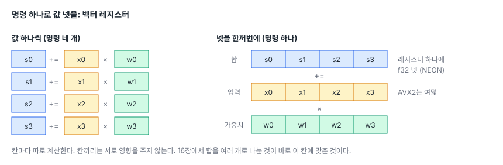
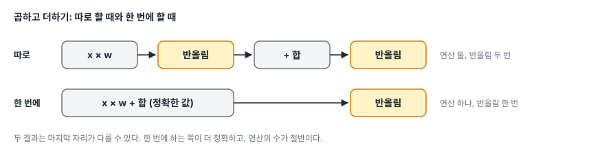
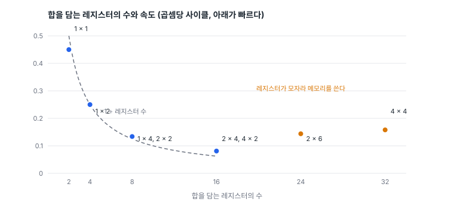

# SIMD

[16장](ch16_matmul.md)에서는 벡터 명령을 쓰는 일을 컴파일러에게
맡겼습니다. 합을 여러 변수에 나누어 담아 "순서를 바꿔도 좋다"고 알려
주면 컴파일러가 값 여러 개를 한꺼번에 처리하는 명령을 골라 썼습니다.
결과는 좋았지만 고르지 않아서, 가중치 네 행은 빨랐고 두 행은
느렸습니다(16.3절).

이 장에서는 맡기지 않고 **직접 적습니다.** 값 여러 개를 한꺼번에
처리하는 명령을 **SIMD**<sup>single instruction, multiple data</sup>라고
합니다. Rust에서는 그 명령 하나하나가 함수로 나와 있고, 그 함수를 부르면
컴파일러가 정확히 그 명령을 냅니다.

결과를 미리 적어 둡니다. 프롬프트 처리가 1.5배, 토큰 생성이 1.3배
빨라집니다. [16장](ch16_matmul.md)의 13배와 8배에 견주면 작습니다. 이
장에서는 숫자보다 **왜 그 숫자인지**를 더 크게 얻습니다. 컴파일러가 만든
코드가 이미 어디까지 해 놓았고 그 밖에 무엇이 남아 있었는지를 알게
됩니다.

| 하는 일 | 절 |
|---|---|
| 벡터 레지스터와 내장 함수를 본다 | 17.1 |
| 곱하고 더하기를 한 번의 연산으로 한다 | 17.2 |
| 계산의 정의를 먼저 정한다 | 17.3 |
| NEON으로 커널을 짠다 | 17.4 |
| 커널의 모양과 가중치를 걷는 방법을 다시 고른다 | 17.5 |
| x86을 위한 커널을 짜고, 실행할 때 고른다 | 17.6 |
| 결과가 여전히 옳은지, 기계가 달라도 같은지 확인한다 | 17.7 |
| 전체를 다시 잰다 | 17.8 |

코드는 `crates/badak_core/src/simd/`에 있습니다.

## 17.1 벡터 레지스터에는 값이 여러 개 들어간다

프로세서가 계산할 값을 잠시 담아 두는 곳을
**레지스터**<sup>register</sup>라고 합니다. 보통의 레지스터에는 수
하나가 들어가고, 벡터 레지스터에는 여러 개가 들어갑니다.



벡터 레지스터 둘을 더하는 명령은 **같은 칸끼리** 더합니다. 첫 칸은 첫
칸과, 둘째 칸은 둘째 칸과 더하므로 명령은 하나인데 덧셈은 네 번
일어납니다. [16장](ch16_matmul.md)에서 합을 여러 개로 나눈 것은 이 칸에
맞춘 것이었고, 합 넷이 레지스터 하나의 네 칸에 들어갑니다.

프로세서의 종류마다 벡터 명령의 이름과 레지스터의 크기가 다릅니다.

| | 명령의 이름 | 레지스터 하나에 `f32` | 레지스터의 수 | 어디에 있는가 |
|---|---|---|---|---|
| ARM (64비트) | NEON | 4개 | 32개 | 모든 64비트 ARM 프로세서 |
| x86 | AVX2 | 8개 | 16개 | 2013년 무렵 이후의 프로세서 대부분 |

이 책의 기준 기계는 ARM이므로 주로 NEON을 다루고, x86은 17.6절에서
다룹니다.

Rust는 이 명령을 `core::arch` 모듈의 함수로 내놓으며,[^core-arch] 이런
함수를 **내장 함수**<sup>intrinsic</sup>라고 부릅니다. 보통의 함수처럼
생겼지만 부르면 함수 호출이 아니라 명령 하나가 됩니다. 이름은 프로세서를
만든 쪽이 정한 것을 그대로 씁니다.[^arm-intrinsics]

| 내장 함수 (NEON) | 하는 일 |
|---|---|
| `vdupq_n_f32(0.0)` | 네 칸이 모두 0인 레지스터를 만든다 |
| `vld1q_f32(pointer)` | 메모리에서 `f32` 넷을 읽어 레지스터에 담는다 |
| `vaddq_f32(a, b)` | 칸끼리 더한다 |
| `vfmaq_f32(sum, a, b)` | 칸마다 `sum + a × b` |
| `vst1q_f32(pointer, a)` | 레지스터의 네 칸을 메모리에 적는다 |

이름이 암호 같지만 규칙이 있습니다. `v`는 벡터, `q`는 128비트 레지스터,
`f32`는 칸의 자료형이고, 가운데가 하는 일입니다(`ld`는 load, `add`,
`fma`, `st`는 store).

## 17.2 FMA는 곱하고 더하기를 한 번에 한다

위의 표에서 이 장이 주로 쓰는 것은 `vfmaq_f32`입니다. 내적은 "곱해서
더한다"를 되풀이하는데, 이 명령은 그 둘을 한 번에 합니다.
**FMA**<sup>fused multiply-add</sup>라고 부릅니다.



따로 하면 곱셈의 결과를 `f32`에 담으면서 한 번 반올림하고, 덧셈의 결과를
담으면서 또 한 번 반올림합니다. 한 번에 하면 곱셈의 결과를 반올림하지
않은 채로 더하고 마지막에 한 번만 반올림합니다. 이 연산은 부동소수점
표준에 정의되어 있습니다.[^ieee754]

FMA로 두 가지를 얻습니다.

- **연산이 절반입니다.** 명령 둘이 하나가 됩니다.
- **더 정확합니다.** 반올림이 한 번 줄어듭니다.

잃는 것도 있습니다. **결과의 비트가 달라집니다.** 반올림을 한 번 덜
하므로 마지막 자리가 다를 수 있습니다. 극단적인 예를 테스트에 넣어
두었습니다.

```rust
{{#include ../../../crates/badak_core/src/simd/mod.rs:fma}}
```

`(1 + e) × (1 − e) − 1`의 정확한 값은 `−e²`입니다. 따로 계산하면 곱셈의
결과가 1로 반올림되어 답이 0이 되고, 한 번에 계산하면 작은 값이
남습니다.

Rust에서 `a * b + c`라고 쓰면 컴파일러는 결과가 달라지기 때문에 이것을
FMA로 바꾸지 않습니다. 16.1절에서 컴파일러가 덧셈의 순서를 스스로 바꾸지
않던 것과 같은 원칙입니다. FMA를 쓰려면 `a.mul_add(b, c)`라고 명시해야
합니다.

FMA를 쓰면 [16장](ch16_matmul.md)의 커널과는 다른 비트가 나옵니다.
그러면 16.7절에서 애써 지킨 "어떻게 계산해도 같은 답"을 어떻게 지킬지가
문제가 되고, 다음 절에서 다룹니다.

## 17.3 계산의 정의를 먼저 정한다

16.7절의 약속은 "내적 하나는 어떤 묶음으로 계산되든 같은 순서로
계산되고, 그래서 같은 비트가 나온다"였습니다. 이 장에서는 구현이
NEON으로 짠 것, AVX2로 짠 것, 벡터 명령을 쓰지 않는 것으로 여럿이 되고,
프로세서에 따라 다른 구현이 돕니다. 그래서 약속을 한 단계 넓혀야 합니다.

> 내적 하나는 **어느 구현으로** 계산되든 같은 비트를 낸다.

그러려면 순서를 뒤집어야 합니다. 빠른 구현을 짜고 나서 결과가 같은지
보는 것이 아니라, **계산의 정의를 먼저 정하고** 모든 구현이 그 정의를
따르게 합니다. 정의는 가장 단순한 코드로 적습니다.

```rust
{{#include ../../../crates/badak_core/src/simd/mod.rs:contract}}
```
이 함수는 느립니다. 빠르게 계산하려고 둔 것이 아니라 **기준**으로 둔
것입니다. "합 여덟 개에 나누어, 한 번의 연산으로 곱하고 더하고, 정해진
순서로 모은다"가 `badak`의 내적입니다. NEON 커널이든 AVX2 커널이든 이
함수와 같은 비트를 내야 하고, 테스트가 그것을 확인합니다.

정의에서 세 가지를 정했습니다.

**합은 여덟 개.** [16장](ch16_matmul.md)에서는 16개였습니다. 여덟은 두
프로세서에 모두 맞아서 골랐습니다. AVX2는 레지스터 하나가 정확히 여덟
칸이고, NEON은 레지스터 둘입니다. 17.5절에서 보겠지만 합의 수가 적으면
남는 레지스터로 내적을 더 많이 한꺼번에 계산할 수 있습니다.

**곱하고 더하기는 한 번의 연산.** FMA를 정의에 넣었고, 기준 구현의
`mul_add`가 그것입니다. FMA가 없는 프로세서에서는 `mul_add`가 같은
결과를 소프트웨어로 계산해서, 느리지만 같은 비트를 냅니다. 그런
프로세서는 x86 가운데 오래된 것뿐이고, 정확성을 지키는 대신 그
기계에서의 속도를 내줍니다.

**모으는 순서.** `reduce`가 정합니다. `i`번째와 `i + 4`번째를 먼저
더하는 것은 AVX2에서 레지스터의 아래 절반과 위 절반을 더하는 명령
하나이고, NEON에서 레지스터 둘을 더하는 명령 하나이기 때문입니다. 두
프로세서에서 모두 싸게 할 수 있는 순서를 골랐습니다.

정의를 먼저 두면 검증이 쉬워집니다. 빠른 구현이 옳은지는 허용 오차 없이
"기준 구현과 비트가 같은가"만 확인하면 됩니다.

## 17.4 기준 구현을 NEON 커널로 옮긴다

기준 구현을 NEON으로 옮깁니다. 16.2절의 `dots`와 같은 모양으로, 내적
`M × N`개를 한꺼번에 계산합니다.

```rust
{{#include ../../../crates/badak_core/src/simd/neon.rs:dots}}
```

기준 구현과 나란히 놓고 읽으면 한 줄씩 대응합니다. 합 여덟 개가 레지스터
둘(`sums[r][c][0]`과 `[1]`)이 되었고, 값을 여덟 개씩 읽던 것이 네 개씩
두 번이 되었고, `mul_add`가 `vfmaq_f32`가 되었습니다. 모으는 순서도
같아서, 레지스터 둘을 더하면 `i`번째와 `i + 4`번째가 더해집니다.

이 코드에는 지금까지의 엔진 코드에 없던 것이 둘 있습니다.

**`unsafe`.** `vld1q_f32`는 포인터를 받아 그 주소에서 `f32` 넷을 읽으며,
슬라이스처럼 범위를 확인해 주지 않습니다. 범위를 벗어난 곳을 읽으면
Rust가 막아 주던 종류의 버그가 그대로 일어납니다. 그래서 이 함수는
`unsafe` 블록 안에서만 부를 수 있고, 블록마다 **왜 안전한지**를 주석으로
적었습니다. 함수의 첫머리에서 모든 벡터의 길이가 같다는 것을 확인하고
반복문이 그 길이를 넘지 않는다는 것이 근거입니다.
[6장](../part1/ch06_model_files.md)에서 `mmap`을 부를 때와 같은
규칙입니다.

**`#[target_feature]`.** 이 표시는 컴파일러에게 "이 함수 안에서는 NEON
명령을 써도 된다"고 알립니다. 표시가 있는 함수는 같은 표시가 있는
함수에서만 안전하게 부를 수 있습니다.[^target-feature] NEON은 모든
64비트 ARM 프로세서에 있으므로 형식적인 절차에 가깝지만, x86에서는 이
표시가 실제로 필요합니다(17.6절).

엔진에서 가장 많이 실행되는 코드에 `unsafe`가 들어왔으므로 범위를 좁게
두었습니다. `unsafe`인 것은 메모리를 읽고 쓰는 줄뿐이고 그 바깥은 보통의
Rust입니다. 또 이 함수가 옳은지는 `unsafe`가 없는 기준 구현과 비트를
견주어 확인합니다.

## 17.5 커널의 모양을 다시 고른다

커널을 직접 짰으니 16.3절의 측정을 다시 합니다. 이번에는 컴파일러의
판단이 끼어들지 않으므로 어떤 모양이든 우리가 적은 명령 그대로 나옵니다.

```bash
cargo run --release -p badak_bench --example ch17_shapes
```

```text
{{#include output/ch17_shapes.txt}}
```

16.3절의 고르지 않던 표와 달리 규칙이 분명합니다. "합 레지스터"는 그
모양이 합을 담는 데 쓰는 레지스터의 수입니다. 내적 하나에 둘이므로
`1 × 4`는 여덟, `2 × 4`는 열여섯입니다.



**레지스터가 16개가 될 때까지, 곱셈당 사이클은 레지스터 수의 역수를
따라갑니다.** 둘이면 0.45, 넷이면 0.25, 여덟이면 0.135, 열여섯이면
0.08입니다.

16.1절의 "덧셈의 줄 서기"가 여기서도 그대로 나타납니다. 합 레지스터
하나는 한 줄이어서, 그 레지스터에 더하는 연산이 끝나야 같은 레지스터에
다음 연산을 할 수 있습니다. 표의 숫자는 그 연산 하나가 네 사이클쯤
걸린다고 보면 맞습니다. 레지스터가 둘이면 네 사이클에 연산 둘, 곧 값
여덟 개를 처리하니 곱셈 하나에 0.5사이클입니다. 열여섯이면
0.0625사이클이어야 하는데 0.08에서 멈춥니다. 거기서부터는 줄 서기가
아니라 프로세서가 한 사이클에 할 수 있는 연산의 수가 한계가 됩니다.

> 사이클의 수는 측정한 것입니다. "연산 하나가 네 사이클쯤 걸린다"는
> 것은 이 숫자들에서 거꾸로 끌어낸 값이고, 프로세서의 설명서에서 확인한
> 것이 아닙니다.

**레지스터가 24개, 32개인 모양은 오히려 느립니다.** NEON의 레지스터는
32개입니다. 합에 24개를 쓰고 입력과 가중치를 읽어 올 레지스터까지 더하면
모자랍니다. 모자라는 만큼은 메모리에 두었다가 다시 읽어야 하고, 그것이
줄 서기보다 더 느립니다.

그래서 **`2 × 4`, 입력 벡터 둘과 가중치 네 행**을 골랐습니다. 합
레지스터 16개를 정확히 채우는 모양입니다.

### 16장의 커널에는 FMA와 입력 묶기가 없었다

이제 [16장](ch16_matmul.md)의 결과를 다시 읽을 수 있습니다. 16.3절에서
컴파일러가 만든 코드는 가장 좋을 때 곱셈 하나에 0.13사이클이었고, 모양을
어떻게 바꿔도 그 아래로 내려가지 않았습니다.

이 장의 `1 × 4`도 0.135입니다. 손으로 짰는데 컴파일러와 같습니다.
**컴파일러는 그 모양에서 이미 할 수 있는 만큼 하고 있었습니다.**
[16장](ch16_matmul.md)의 커널에 없던 것은 벡터 명령이 아니었습니다. 벡터
명령은 컴파일러가 잘 골라 썼습니다. 없던 것은 둘입니다.

- **FMA.** [16장](ch16_matmul.md)의 커널은 곱하고 더하기를 따로
  했습니다. 컴파일러는 결과를 바꾸는 변환을 하지 않으므로 FMA로 바꿔
  주지 않았고, 곱셈 하나에 연산이 둘이었습니다.
- **입력 벡터를 묶는 것.** [16장](ch16_matmul.md)에서 `3 × 4` 모양이
  조금 빨랐지만 "같은 비트" 약속 때문에 쓰지 못했습니다(16.7절).
  이번에는 합의 수를 처음부터 여덟으로 정했으므로 입력을 묶는 모양을 쓸
  수 있습니다.

내장 함수를 직접 써서 얻은 것은 "컴파일러보다 빠른 명령"이 아니었습니다.
**원하는 계산을 정확히 정하고, 그것이 그대로 나온다고 믿을 수 있다**는
것입니다. 16.3절의 표에서 `1 × 2`가 느렸던 일은 이제 일어나지 않습니다.

### 가중치를 걷는 방법은 벡터의 수에 따라 셋이다

16.5절에서 벡터의 수에 따라 길을 둘로 나눠서, 벡터가 적으면 가중치를 한
행씩, 많으면 네 행씩 읽었습니다. 커널이 바뀌었으니 다시 재야 하고, 그
과정에서 길이 셋이 되었습니다.


문제는 토큰을 하나씩 만들 때, 곧 벡터가 하나일 때였습니다. 입력을 묶을
수 없으니 가중치 행을 여럿 묶어야 레지스터를 채울 수 있습니다. 그런데
16.5절에서 본 대로 이웃한 네 행을 번갈아 읽으면 프로세서가 메모리를 미리
가져오지 못합니다. 이웃한 두 행까지는 괜찮았지만 그러면 레지스터를
넷밖에 쓰지 못합니다.

그래서 **멀리 떨어진 행을 묶었습니다.** 행렬을 네 부분으로 나누고,
부분마다 한 행씩 꺼내 네 행을 함께 계산합니다. 다음에는 부분마다 그다음
행을 꺼냅니다. 프로세서가 보기에는 메모리의 네 곳을 각각 처음부터 끝까지
차례로 읽는 것입니다. 16.5절에서 문제가 된 것은 줄기가 여럿이라는 점이
아니라 줄기 하나하나가 8KB로 짧다는 점이었습니다. 이렇게 하면 줄기
하나가 행렬의 4분의 1만큼 길게 이어집니다.

```rust
{{#include ../../../crates/badak_core/src/simd/mod.rs:tuning}}
```

세 방법을 벡터의 수를 바꿔 가며 잽니다.

```bash
cargo run --release -p badak_bench --example ch17_kernels
```

```text
{{#include output/ch17_kernels.txt}}
```

- **벡터 하나: 네 줄기가 0.17사이클.** [16장](ch16_matmul.md)의
  커널(0.27)보다, 이웃한 두 행(0.26)보다 1.5배 빠릅니다.
- **벡터 256개: 네 행씩이 0.082사이클.** [16장](ch16_matmul.md)(0.134)의
  1.6배입니다.
- **그 사이: 벡터가 여덟 개가 될 때부터 네 행씩이 더 빠릅니다.**
- **기준 구현은 0.37사이클.** 벡터 명령을 직접 쓰지 않으면 이
  속도입니다. NEON 커널이 같은 비트를 4.5배 빠르게 냅니다.

### 15장의 83GB는 줄기 하나의 한계였다

벡터 하나일 때의 0.17사이클은 이상한 숫자입니다. 15.6절은 스레드 하나의
토큰 생성이 메모리에 막힌다고 했고, 그 한계가 1초에 83GB였습니다.
0.17사이클로 곱하면 1초에 읽는 양이 그것을 넘습니다.

15.2절의 측정에서는 배열을 **한 줄기로** 읽었습니다. 같은 배열을 여러
줄기로 나누어 읽으면 어떻게 되는지 재 봅니다.

```rust
{{#include ../../../crates/badak_bench/examples/ch17_streams.rs:read}}
```

```text
{{#include output/ch17_streams.txt}}
```

**한 줄기로는 90GB를 읽고, 여러 줄기로는 100~120GB를 읽습니다.**
스레드는 여전히 하나입니다. 15.2절의 83GB는 "스레드 하나의 한계"가
아니라 "줄기 하나의 한계"에 가까웠습니다.

표가 고르지는 않아서, 줄기가 4개, 8개, 16개일 때 그 앞뒤보다 느립니다.
이 배열을 그 수로 나누면 줄기의 시작 주소가 2의 거듭제곱만큼씩
떨어지는데, 그런 주소는 캐시 안에서 같은 칸을 놓고 다투기 쉽습니다.
그것이 원인일 것으로 짐작하지만 확인하지는 않았습니다.

15.6절에서 "상한은 전제와 함께 읽어야 한다"고 했습니다.
[15장](ch15_bottleneck.md)의 상한에는 "가중치를 한 줄기로 읽는다"는,
그때는 알아채지 못한 전제가 들어 있었습니다. 그 상한을 넘는 측정이 나온
뒤에야 전제가 드러났습니다.

## 17.6 x86에는 AVX2 커널을 짜고 실행할 때 고른다

이 책의 독자가 모두 ARM 기계를 쓰지는 않으므로, x86의 벡터 명령인 AVX2로
같은 커널을 짭니다.[^intel-intrinsics]

```rust
{{#include ../../../crates/badak_core/src/simd/avx2.rs:dots}}
```

NEON 커널과 같은 구조입니다. 다만 레지스터 하나에 여덟 칸이 들어가서 합
여덟 개가 레지스터 하나에 담깁니다. 모을 때는 레지스터의 아래 절반과 위
절반을 꺼내 더합니다. 17.3절에서 `reduce`의 순서를 그렇게 정해 둔 것은
이 때문입니다.

### AVX2가 있는지 실행할 때 물어본다

NEON과 달리 AVX2는 모든 x86 프로세서에 있지 않습니다. 없는 프로세서에서
AVX2 명령을 실행하면 프로그램이 그 자리에서 죽으므로, **실행할 때**
프로세서에 물어봅니다.

```rust
{{#include ../../../crates/badak_core/src/simd/mod.rs:backend}}
```

`is_x86_feature_detected!`가 프로세서에 묻는
매크로입니다.[^feature-detect] 답은 컴파일할 때가 아니라 실행할 때
정해지므로, 같은 실행 파일이 새 프로세서에서는 AVX2 커널로, 오래된
프로세서에서는 기준 구현으로 돕니다.

`#[target_feature]`는 여기서 실제로 필요합니다. 컴파일러는 보통 "모든
x86 프로세서에서 도는 코드"만 만들고 AVX2 명령은 쓰지 않습니다. 이
표시가 붙은 함수 안에서만 AVX2 명령을 씁니다. 그런 함수를 표시가 없는
곳에서 부르려면 `unsafe`가 필요합니다. "이 프로세서에 AVX2가 있다는 것을
내가 확인했다"는 약속을 요구하는 것입니다.

```rust
{{#include ../../../crates/badak_core/src/simd/mod.rs:linear_with}}
```

`linear_with`의 `match`가 이 약속을 지킵니다. AVX2 커널을 부르는 줄은
바로 앞에서 프로세서에 물어본 뒤에만 실행됩니다.

### 반복문은 매크로로 구현마다 찍어 낸다

선형 층의 반복문, 곧 가중치를 걷는 세 방법은 구현마다 같으므로 한 번만
적고 싶습니다. 그런데 이 반복문을 보통의 함수로 만들면 문제가 생깁니다.
커널은 `#[target_feature]`가 붙은 함수이고, 그런 함수는 표시가 없는 함수
안으로 합쳐지지(인라인) 않습니다. 내적 하나마다 함수 호출이 일어나면
레지스터에 담아 둔 값을 매번 메모리에 내렸다 올려야 해서 커널을 쓰는
의미가 없어집니다.

그래서 반복문 전체가 표시가 붙은 함수 **안에** 있어야 합니다. 구현마다
함수가 하나씩 필요하고 그 몸통은 같습니다. 같은 몸통을 여러 번 찍어 내는
데는 매크로를 씁니다.

```rust
{{#include ../../../crates/badak_core/src/simd/mod.rs:drive}}
```

```rust
{{#include ../../../crates/badak_core/src/simd/avx2.rs:linear}}
```

`$dots` 자리에 구현마다의 커널이 들어가서, NEON용, AVX2용, 기준
구현용으로 세 번 찍혀 나옵니다.

### AVX2 커널은 CI에서 실행해 확인한다

이 절의 코드에는 곤란한 점이 있습니다. 이 책을 쓰는 기계는 ARM이라서
AVX2 커널을 **실행해 볼 수 없습니다.** x86용 코드는 x86으로 빌드할 때만
컴파일되므로 컴파일조차 되지 않습니다.

돌려 본 적 없는 코드를 책에 실을 수는 없어서 CI를 썼습니다. 이 저장소의
CI는 macOS(ARM)와 리눅스(x86) 두 기계에서 테스트를 돌립니다. x86 쪽에서
17.7절의 테스트가 AVX2 커널을 기준 구현과 견줍니다. 어느 구현이
선택되었는지 눈으로 볼 수 있도록 작은 예제를 하나 두고 CI가 실행하게
했습니다.

```bash
cargo run --release -p badak_bench --example ch17_backend
```

CI의 로그에서 옮긴 출력입니다.

```text
{{#include output/ch17_backend_ci.txt}}
```

x86 기계가 AVX2 커널을 골랐고 기준 구현과 같은 비트를 냈습니다. 마지막
줄은 다음 절에서 봅니다.

이 책이 x86에서 확인한 것은 **정확성**까지이고, 속도는 재지 않았습니다.
CI의 기계는 다른 작업과 자원을 나눠 쓰는 가상 기계라서 거기서 잰 시간은
믿기 어렵습니다(14.12절). x86에서의 측정은 다음 판으로 미뤄 두었습니다.

## 17.7 구현이 달라도 기계가 달라도 같은 비트가 나온다

### 구현이 달라도 같은 비트를 낸다

17.3절의 약속을 테스트가 확인합니다.

```rust
{{#include ../../../crates/badak_core/src/simd/mod.rs:same_bits}}
```

벡터의 수, 행의 수, 길이를 바꿔 가며 일곱 가지 크기를 잽니다. 벡터가
홀수 개여서 짝이 남는 경우, 행이 넷으로 나누어떨어지지 않는 경우, 길이가
여덟으로 나누어떨어지지 않는 경우가 모두 들어 있습니다. 크기마다 걷는
방법 셋과 구현 둘, 여섯 가지 조합이 모두 같은 비트를 내야 합니다.

이 테스트는 ARM에서는 NEON 커널을, x86에서는 AVX2 커널을 기준 구현과
견줍니다. 테스트 하나가 기계에 따라 다른 구현을 검증합니다.

### 기계가 달라도 같은 비트를 낸다

NEON 커널이 기준 구현과 같고 AVX2 커널도 기준 구현과 같다면 **NEON
커널과 AVX2 커널은 서로 같아야 합니다.** 서로 다른 회사가 만든 서로 다른
프로세서에서 같은 비트가 나와야 합니다.

17.6절의 출력에 있던 "결과의 지문"이 그것을 보여 줍니다. 선형 층 하나의
결과 전체를 숫자 하나로 줄인 것입니다.

| 기계 | 구현 | 결과의 지문 |
|---|---|---|
| 이 책의 기준 기계 (Apple M4 Max) | NEON | `7ca8a60337244d8d` |
| CI의 macOS 기계 (ARM) | NEON | `7ca8a60337244d8d` |
| CI의 리눅스 기계 (x86) | AVX2 | `7ca8a60337244d8d` |

세 기계의 지문이 같습니다. 부동소수점 계산은 기계마다 조금씩 다르다는
것이 통념이지만, 연산의 순서와 종류를 정확히 정해 두면 그렇지 않습니다.
덧셈, 곱셈, FMA는 표준이 결과를 비트 단위로 정해 놓은
연산입니다.[^ieee754]

이 약속의 범위는 분명히 해 둡니다. **선형 층의 커널**만 약속하며, 모델
전체의 출력이 기계마다 같다고 약속하지는 않습니다. 활성화 함수와
소프트맥스에 들어가는 지수 함수는 운영체제의 수학 라이브러리가 계산하고,
그 결과는 라이브러리마다 마지막 자리가 다를 수 있습니다. 거기까지 같게
하려면 지수 함수도 직접 짜야 하는데, 3부에서는 하지 않습니다.
([32장](../part4/ch32_vit_detection.md)에서 속도 때문에 지수 함수의
근사를 직접 짜게 되지만, 그것은 "빠른 길"에서만 쓰고 기본 길의 약속과는
따로입니다.)

### 엔진 전체의 검증도 그대로 통과한다

엔진 전체의 검증도 다시 돌립니다.

```bash
cargo test --workspace
```

이번에도 고친 테스트는 없습니다. PyTorch와의 대조가 그대로 통과하고,
11.6절의 "캐시를 쓴 결과가 비트 단위로 같다"도 그대로입니다. 벡터 하나를
네 줄기로 계산한 결과와 벡터 256개를 네 행씩 계산한 결과가 같은 비트이기
때문입니다.

`f64` 기준과의 오차는 이렇습니다.

| | 상대 오차 |
|---|---|
| [15장](ch15_bottleneck.md)까지 (합 하나) | `1.9e-6` |
| [16장](ch16_matmul.md) (합 16개) | `6.2e-7` |
| 이 장 (합 8개, FMA) | `5.9e-7` |

합의 수를 반으로 줄였는데 오차는 늘지 않았습니다. FMA가 반올림을 한 번
덜 해서 그만큼을 상쇄했습니다.

## 17.8 프롬프트 처리가 1.5배, 토큰 생성이 1.3배 빨라졌다

```bash
cargo run --release -p badak_models --example ch14_baseline
```

```text
{{#include ../../../bench/baseline/badak_llama32_ch17.txt:13:15}}
```

, [16장](ch16_matmul.md), 이 장, 그리고 llama.cpp](../images/ch17/result.svg)

| Llama 3.2 1B, 스레드 1개 | [15장](ch15_bottleneck.md)까지 | [16장](ch16_matmul.md) | 이 장 | [16장](ch16_matmul.md) 대비 | llama.cpp (13.5절) |
|---|---|---|---|---|---|
| 토큰 생성 (토큰/초) | 1.76 | 14.03 | 18.06 | 1.29배 | 13.54 |
| 프롬프트 처리 (토큰/초) | 2.16 | 27.77 | 42.41 | 1.53배 | 18.95 |

**프롬프트 처리가 1.5배.** 입력 벡터 둘과 가중치 네 행을 FMA로 묶은
커널에서 나온 개선입니다.

**토큰 생성이 1.3배.** 벡터 명령이 아니라 가중치를 네 줄기로 읽어서 얻은
개선입니다. 1초에 89GB를 읽고 있어서, [15장](ch15_bottleneck.md)이
스레드 하나의 한계라고 한 83GB를 넘었습니다.

**스레드 하나의 llama.cpp보다 토큰 생성이 1.3배, 프롬프트 처리가 2.2배
빠릅니다.** [13장](../part2/ch13_first_showdown.md)에서 9배와 8배 뒤져
있던 비교입니다. 단, 이것은 [13장](../part2/ch13_first_showdown.md)에서
잰 llama.cpp의 숫자와 견준 것이고, llama.cpp가 스레드를 여럿 쓰면 사정이
전혀 다릅니다. [25장](ch25_rematch.md)에서 다시 겨룹니다.

무엇이 바뀌었는지는 카운터에서 드러납니다.

| | [16장](ch16_matmul.md) | 이 장 |
|---|---|---|
| 프롬프트의 토큰 하나에 드는 명령 | 8.8억 | 5.1억 |
| 새 토큰 하나에 드는 명령 | 12.8억 | 8.0억 |
| IPC (프롬프트 처리) | 6.09 | 5.37 |

명령이 줄었습니다. 곱하고 더하기가 한 명령이 되었고, 읽어 온 값을 여러
번 쓰기 때문입니다. IPC는 조금 내려갔는데, 명령 하나가 하는 일이
많아졌으니 당연합니다. IPC는 높을수록 좋은 숫자가 아니라 **명령의 수와
함께** 읽어야 하는 숫자입니다.

프로파일도 다시 봅니다.

```text
{{#include output/ch17_profile_llama32.txt:3:16}}
```

14.7절에서 37.4초, 16.8절에서 3.5초였던 일이 2.3초가 되었습니다. 선형
층의 비중은 96.8%이고, 어텐션의 점수 계산이 1.4%, 활성화 함수가
1.5%입니다. 16.8절의 1.0%에서 조금씩 올라오고 있습니다.

### 5장에서 미룬 브로드캐스팅의 빠른 길을 넣는다

5.5절에서 약속을 하나 했습니다. 형상이 다른 두 텐서를 더할 때, 흔한
경우인 "행 하나를 모든 행에 더하기"가 형상이 같을 때보다 열두 배 느렸고,
17장에서 빠른 길을 추가하겠다고 했습니다.

추가했는데, 벡터 명령은 직접 쓰지 않았습니다.

```rust
{{#include ../../../crates/badak_core/src/ops.rs:zip}}
```

가운데의 조건문이 새로 넣은 길입니다. 오른쪽 텐서의 형상이 왼쪽 형상의
끝부분과 같으면, 왼쪽을 오른쪽의 길이만큼씩 끊어 덩어리마다 나란히
읽습니다. 한 일은 그것뿐입니다.

```bash
cargo run --release -p badak_core --example ch05_ops_cost
```

```text
{{#include output/ch17_ops_cost.txt:1:5}}
```

26.2밀리초가 1.5밀리초가 되어 17배 빨라졌습니다. 형상이 같을 때보다도
빠른데, 오른쪽의 행 하나(16KB)가 캐시에 남아 있기 때문입니다.

이 연산에는 이 장의 내적과 다른 점이 있습니다. **줄을 서는 덧셈이
없습니다.** 칸마다 따로 더하고 결과도 따로 적습니다. 순서를 바꿔도
결과가 같으므로 컴파일러가 스스로 벡터 명령을 씁니다. 컴파일러가 그럴 수
있도록 메모리를 차례로 읽는 단순한 반복문을 주기만 하면 되었습니다.
일반적인 길은 원소마다 "지금 어디를 읽을 차례인가"를 계산하느라 그러지
못했습니다(5.2절).

**모든 것을 손으로 짤 필요는 없습니다.** 내장 함수는 컴파일러가 할 수
없는 일(FMA, 순서를 바꾸는 일)이 있고 시간의 대부분이 쓰이는 곳에만
씁니다. 지금은 선형 층의 커널 하나가 그런 곳입니다. 덧붙이면, 이 빠른
길은 모델의 속도에는 영향이 없습니다. 프로파일에서 이 연산은 0.1%도 되지
않습니다. 5.5절에서 약속했기 때문에 넣었습니다.

같은 출력의 아래쪽에는 5.5절의 행렬 곱도 있습니다. `512 × 512`의 곱이
80.6밀리초에서 2.9밀리초가 되었습니다. 16.6절에서 넣은 패킹과 이 장의
커널이 합쳐진 결과입니다.

## 17.9 실전 엔진에서는

**llama.cpp는 프로세서마다의 차이를 매크로 한 겹으로 감춥니다.**
`GGML_F32_VEC_FMA` 같은 이름을 두고, ARM에서는 그것이 `vfmaq_f32`가 되고
x86에서는 `_mm256_fmadd_ps`가 되게 합니다. 커널은 그 이름으로 한 번만
적습니다.[^llamacpp-simd] 같은 파일에 512비트 레지스터를 쓰는 AVX-512용
정의도 있습니다. 우리가 17.6절에서 반복문을 매크로로 찍어 낸 것과 같은
문제를 다른 방법으로 푼 것이고, FMA를 쓴다는 점도 같습니다.

**어느 명령을 쓸지 정하는 때가 다릅니다.** 우리는 실행할 때 프로세서에
물어봅니다. llama.cpp는 기본 설정에서 **빌드할 때** 그 기계의 프로세서에
맞춥니다. 빌드 설정의 `GGML_NATIVE`가 그것이고, 다른 기계용으로 빌드하는
경우가 아니면 켜져 있습니다.[^llamacpp-native] 그렇게 빌드한 실행 파일은
그 기계에서 가장 빠르지만 더 오래된 프로세서로 가져가면 돌지 않을 수
있습니다. 직접 빌드해 쓰는 사람에게는 빌드할 때 정하는 쪽이 맞고, 실행
파일을 여러 기계에 배포하는 쪽에는 실행할 때 정하는 쪽이 맞습니다.
6부에서 휴대 기기에 엔진을 올릴 때 이 선택을 다시 합니다.

**"같은 비트"를 약속하는 엔진은 드뭅니다.** 17.7절의 표 같은 것을 내놓는
엔진은 많지 않습니다. 대부분은 프로세서마다 가장 빠른 방법을 쓰고, 그
결과가 조금씩 다른 것을 받아들입니다. 11.6절에서 본 llama.cpp의 문서가
그 예입니다. 우리는 반대로 골랐습니다. 16.7절에서 적은 이유(검증이
단순해지고 재현성이 생긴다)에 더해, 이 책에서는 **x86에서 실행해 보지
못한 코드를 믿을 근거**가 필요했기 때문입니다. "기준 구현과 같은
비트인가"는 CI가 대신 확인해 줄 수 있지만 "충분히 빠른가"는 그럴 수
없습니다.

**더 넓은 레지스터, 더 특별한 명령이 있습니다.** x86에는 레지스터 하나에
`f32` 열여섯이 들어가는 AVX-512가 있고, ARM에는 레지스터의 크기가
프로세서마다 다른 SVE와, 행렬 연산을 위한 SME가 있습니다. 7.6절과
13.5절에서 Accelerate가 낸 속도는 그런 것을 쓴 결과로 보입니다. 3부는
어디에나 있는 NEON과 AVX2까지만 직접 짭니다. SME는
[31장](../part4/ch31_mobile_engines.md)에서 다시 만나고, 거기서는 직접
짭니다.

## 정리

- 벡터 레지스터에는 값 여러 개가 들어가고, 명령 하나가 칸마다 따로
  계산합니다. NEON은 `f32` 넷, AVX2는 여덟입니다. Rust에서는 그 명령들을
  `core::arch`의 내장 함수로 직접 부릅니다.
- FMA는 곱하고 더하기를 한 번의 연산으로 합니다. 연산이 절반이 되고
  반올림이 한 번 줄어듭니다. 결과의 비트가 달라지므로 컴파일러가 알아서
  써 주지는 않습니다.
- 계산의 정의를 먼저 정했습니다. 합 여덟 개, FMA, 정해진 순서로 모으기.
  기준 구현이 그 정의이고, NEON 커널과 AVX2 커널은 기준 구현과 같은
  비트를 냅니다.
- 손으로 짠 커널의 속도는 합을 담는 레지스터의 수를 따라갑니다.
  레지스터 16개를 채우는 `2 × 4` 모양이 곱셈당 0.08사이클입니다.
- [16장](ch16_matmul.md)의 커널이 0.13사이클에서 멈춘 것은 벡터 명령이 모자라서가 아니라
  FMA를 쓰지 않았고 입력을 묶지 못했기 때문입니다.
- 가중치를 걷는 방법이 셋입니다. 벡터가 하나면 멀리 떨어진 네 줄기를,
  몇 개면 이웃한 두 행을, 여덟 개부터는 이웃한 네 행을 함께 읽습니다.
- 스레드 하나가 메모리를 여러 줄기로 읽으면 한 줄기일 때보다 많이
  읽습니다. [15장](ch15_bottleneck.md)의 83GB는 줄기 하나의 한계였습니다.
- AVX2는 프로세서에 있는지 실행할 때 물어보고 씁니다. 이 책의 기계에서는
  실행할 수 없어서 CI의 x86 기계에서 정확성을 확인했습니다. 속도는 재지
  않았습니다.
- ARM의 NEON 커널과 x86의 AVX2 커널이 같은 비트를 냅니다. 이 약속은
  선형 층의 커널에 대한 것입니다.
- Llama 3.2 1B의 토큰 생성이 14.0에서 18.1토큰/초로, 프롬프트 처리가
  27.8에서 42.4토큰/초로 빨라졌습니다.

## 연습 문제

1. `ch17_shapes`를 x86 기계에서 실행해 보십시오. AVX2에서는 합 레지스터가
   내적 하나에 하나입니다. 가장 빠른 모양은 무엇입니까. 레지스터가 16개인
   x86에서 `2 × 4`는 레지스터를 몇 개 씁니까. 이 책의 선택(`2 × 4`)이
   x86에서도 좋은 선택입니까.
2. 17.5절에서 "연산 하나가 네 사이클쯤 걸린다"고 추정했습니다. 표의
   `1 × 1`, `1 × 2`, `1 × 4`의 숫자로 이 추정을 직접 계산해 보십시오. 세
   모양에서 같은 값이 나옵니까.
3. `dots_portable`에서 `mul_add`를 `x * w + sum`으로 바꾸면 어느 테스트가
   실패합니까. 실패하지 않는 테스트는 왜 통과합니까.
4. `reduce`가 모으는 순서를 `((0 + 1) + (2 + 3)) + ((4 + 5) + (6 + 7))`로
   바꾼다면 NEON 커널과 AVX2 커널을 어떻게 고쳐야 합니까. 명령이 더
   필요합니까. 17.3절에서 지금의 순서를 고른 이유를 확인해 보십시오.
5. NEON 커널의 `unsafe` 블록 가운데 하나에서 `offset`을 `offset + 1`로
   바꿔 보십시오. 테스트는 무엇을 잡아냅니까. 잡아내지 못하는 경우가
   있습니까. 길이가 여덟의 배수가 아닌 입력에서 어떤 일이 일어날 수
   있는지 생각해 보십시오.
6. `Walk::FourStreams`는 행렬을 정확히 넷으로 나눕니다. 17.5절에서
   줄기의 시작 주소가 2의 거듭제곱만큼 떨어지면 느릴 수 있다고
   짐작했습니다. 부분의 크기를 조금 어긋나게(예: 행 몇 개만큼) 잡도록
   고치고 `ch17_kernels`로 재 보십시오. 짐작이 맞습니까.
7. FMA가 없는 x86 프로세서에서는 기준 구현이 돕니다. `mul_add`가
   소프트웨어로 계산되어 매우 느립니다. "같은 비트"를 포기하고 그런
   프로세서에서 [16장](ch16_matmul.md)의 `kernel::linear`를 쓰게 한다면 무엇을 얻고 무엇을
   잃습니까. 어느 쪽을 고르겠습니까.
8. 프로파일에서 올라오고 있는 활성화 함수(`mlp/map`, 1.5%)는 `silu`를
   값 하나씩 계산합니다. 이것을 벡터 명령으로 짜려면 무엇이 필요합니까.
   17.7절에서 말한 지수 함수의 문제와 어떻게 이어집니까.

## 참고 문헌

[^core-arch]: Rust 표준 라이브러리, `core::arch`.
    <https://doc.rust-lang.org/core/arch/index.html>. 프로세서의 종류마다
    하위 모듈(`aarch64`, `x86_64` 등)에 내장 함수가 있습니다.

[^arm-intrinsics]: Arm, "Intrinsics".
    <https://developer.arm.com/architectures/instruction-sets/intrinsics/>.
    NEON 내장 함수의 이름과 동작을 찾아볼 수 있는 공식 자료입니다.

[^intel-intrinsics]: Intel, "Intel Intrinsics Guide".
    <https://www.intel.com/content/www/us/en/docs/intrinsics-guide/index.html>.
    AVX2와 FMA를 포함한 x86 내장 함수의 공식 자료입니다.

[^ieee754]: IEEE, "IEEE Standard for Floating-Point Arithmetic", IEEE Std
    754-2019. [doi:10.1109/IEEESTD.2019.8766229](https://doi.org/10.1109/IEEESTD.2019.8766229).
    덧셈, 곱셈과 함께 `fusedMultiplyAdd`를 올바르게 반올림되어야 하는
    연산으로 정의합니다.

[^target-feature]: The Rust Reference, "Code generation attributes"의
    `target_feature` 항목.
    <https://doc.rust-lang.org/reference/attributes/codegen.html>

[^feature-detect]: Rust 표준 라이브러리, `is_x86_feature_detected!`.
    <https://doc.rust-lang.org/std/arch/macro.is_x86_feature_detected.html>

[^llamacpp-simd]: llama.cpp, `ggml/src/ggml-cpu/simd-mappings.h` (커밋
    `b4c0e00a4fcc`). 366번째 줄 부근에서 `GGML_F32x4_FMA`를 `vfmaq_f32`로,
    617번째 줄 부근에서 `GGML_F32x8_FMA`를 `_mm256_fmadd_ps`로 정의하고,
    509번째 줄 부근에 16칸짜리 정의가 있습니다.
    <https://github.com/ggml-org/llama.cpp/blob/b4c0e00a4fcc/ggml/src/ggml-cpu/simd-mappings.h>

[^llamacpp-native]: llama.cpp, `ggml/CMakeLists.txt` (커밋 `b4c0e00a4fcc`).
    123번째 줄 부근의 `GGML_NATIVE` 설정은 "optimize the build for the
    current system"이라고 설명되어 있습니다. 실행할 때 프로세서의 기능을
    묻는 함수(`ggml_cpu_has_avx2` 등)는 `ggml/include/ggml-cpu.h`에
    있습니다.
    <https://github.com/ggml-org/llama.cpp/blob/b4c0e00a4fcc/ggml/CMakeLists.txt>
