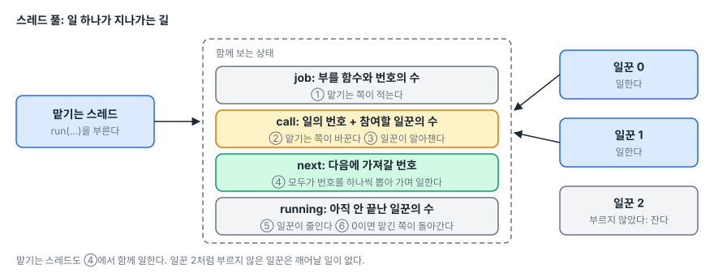
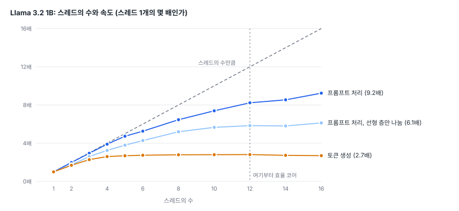

# 멀티스레딩

지금까지의 엔진은 코어 하나만 썼습니다. 이 책의 기계에는 성능 코어
열둘과 효율 코어 넷, 모두 열여섯 개의 코어가 있으니 열다섯 개가 놀고
있었습니다.

이 장에서는 일을 여러 코어에 나눕니다. 운영체제가 코어에 올려 실행하는
일의 단위를 **스레드**<sup>thread</sup>라고 합니다. 스레드를 여럿 만들어
저마다 일의 한 조각을 맡기면 코어 여러 개가 동시에 일합니다.

[15장](ch15_bottleneck.md)에서 이 장의 결과를 미리 계산해 두었습니다.
토큰 생성은 메모리에 막혀 "세 배 남짓"이고 "스레드 넷이면 거의 다
얻는다"고 했고, 프롬프트 처리는 "코어를 늘린 만큼 빨라진다"고
했습니다(15.7절). 결과를 미리 적어 둡니다. 토큰 생성은 2.8배 빨라지고
정말로 스레드 넷에서 거의 멈춥니다. 프롬프트 처리는 9배 빨라집니다. 왜
열여섯 배가 아닌지는 이 장의 뒷부분에서 찾습니다.

스레드를 쓰는 코드는 Rust에서 보통 `rayon` 같은 라이브러리로
짭니다.[^rayon] 이 책은 표준 라이브러리만으로 직접 만듭니다. 만들어 보면
"스레드를 쓴다"는 한마디 안에 결정할 것이 얼마나 많은지 알게 됩니다.

| 하는 일 | 절 |
|---|---|
| 가장 쉬운 방법으로 나눠 보고 그 값을 잰다 | 18.1 |
| 스레드를 미리 만들어 두는 풀을 만든다 | 18.2 |
| 일이 없을 때 스레드가 무엇을 할지 정한다 | 18.3 |
| 선형 층의 일을 무엇으로 나눌지 정한다 | 18.4 |
| 몇 조각으로 나눌지 정한다 | 18.5 |
| 나누지 않을 만큼 작은 일을 가려낸다 | 18.6 |
| 스레드끼리 방해하는 경우를 본다 | 18.7 |
| 스레드의 수에 따른 속도를 잰다 | 18.8 |
| 나누지 않은 일이 발목을 잡는 것을 보고 고친다 | 18.9 |
| 스레드를 몇 개 쓸지 정한다 | 18.10 |
| 결과가 여전히 같은 비트인지 확인하고 전체를 다시 잰다 | 18.11, 18.12 |

코드는 `crates/badak_core/src/threads.rs`에 있습니다.

## 18.1 스레드를 매번 만들면 69마이크로초가 든다

Rust의 표준 라이브러리에는 스레드를 만드는 함수가 `std::thread::spawn`과
`std::thread::scope` 둘 있습니다. `std::thread::spawn`으로 만든 스레드는 만든 쪽보다
오래 살 수 있어서 만든 쪽의 변수를 빌려 쓸 수 없습니다. `scope` 안에서
만든 스레드는 `scope`가 끝나기 전에 모두 끝난다는 것이 보장되므로 바깥의
변수를 빌려 쓸 수 있습니다.[^scope] 가중치와 입력을 빌려서 계산해야 하는
우리에게는 `scope`가 맞습니다.

```rust
{{#include ../../../crates/badak_bench/examples/ch18_pool.rs:spawn}}
```

스레드 열한 개를 만들어 조각을 하나씩 맡기고, 부르는 스레드도 조각
하나를 맡습니다. `scope`가 끝날 때 열한 개가 모두 끝나기를 기다립니다.
선형 층의 반복문을 이렇게 감싸면 멀티스레딩이 됩니다.

문제는 비용입니다. 아무 일도 하지 않는 조각 열두 개를 이렇게 나눠 주는
데 걸리는 시간을 쟀습니다.

```bash
cargo run --release -p badak_bench --example ch18_pool
```

```text
{{#include output/ch18_pool.txt:1:3}}
```

**69마이크로초입니다.** 스레드를 만들고 없애는 일은 운영체제가 합니다.
스레드마다 스택으로 쓸 메모리를 마련하고, 실행할 코어를 정하고, 끝나면
거두어야 합니다.

이 비용이 큰지 작은지는 일의 크기에 달렸습니다. Llama 3.2 1B는 토큰
하나를 만들 때 선형 층을 113번 지납니다. 블록 열여섯 개에 일곱
번씩(어텐션에 넷, MLP에 셋), 그리고 출력 층에 한 번입니다.
[17장](ch17_simd.md)의 엔진은 토큰 하나에 55밀리초를 썼고, 이 장이
끝나면 20밀리초를 씁니다. 선형 층마다 69마이크로초를 쓰면 토큰 하나에
7.8밀리초입니다. **계산은 20밀리초인데 스레드를 만들고 없애는 데
8밀리초를 쓰게 됩니다.**

## 18.2 스레드 풀은 스레드를 만들어 두고 계속 쓴다

스레드를 매번 만들지 말고 **한 번 만들어 두고 계속 씁니다.** 미리 만들어
둔 스레드의 모임을 **스레드 풀**<sup>thread pool</sup>이라고 합니다.
풀에 속한 스레드를 이 책에서는 일꾼이라고 부르겠습니다.

풀이 할 일은 하나입니다. "`0`부터 `count - 1`까지의 번호마다 이 함수를
한 번씩 불러 달라"는 요청을 받아, 번호를 일꾼에게 나누고, 모두 끝나면
돌아옵니다.



### 맡기는 쪽과 일꾼은 상태를 함께 본다

맡기는 쪽과 일꾼은 서로 다른 스레드이므로, 일을 주고받으려면 양쪽이 함께
보는 메모리가 있어야 합니다.

```rust
{{#include ../../../crates/badak_core/src/threads.rs:job}}
```

여러 스레드가 같은 변수를 동시에 읽고 쓰면 값이 깨질 수 있습니다. 한
스레드가 "읽고, 1을 더하고, 쓰는" 사이에 다른 스레드가 같은 일을 하면
1이 한 번만 더해집니다. 이것을 막는 도구가 **원자적**<sup>atomic</sup>
변수입니다. `AtomicUsize`의 `fetch_add`는 "읽고, 더하고, 쓰기"를 다른
스레드가 끼어들 수 없는 한 동작으로 합니다.[^atomics] `Shared`의 필드는
`job` 하나만 빼고 모두 원자적 변수이거나 잠금입니다.

`job`만은 보통의 필드입니다. 여기에 "부를 함수"가 들어가는데, 이
필드에는 Rust의 규칙으로 보면 무리한 점이 두 가지 있습니다.

**첫째, 빌린 함수를 수명 없이 담습니다.** 맡기는 쪽이 넘기는 함수는
가중치와 입력을 빌리고 있는 클로저입니다. 일꾼 스레드는 풀과 수명이
같아서 그 클로저보다 오래 삽니다. Rust는 오래 사는 스레드에 잠깐 사는
것을 넘기지 못하게 합니다. 18.1절의 `scope`는 그 규칙 안에서 빌려 쓰는
방법이었지만 스레드를 매번 만들어야 했습니다. 스레드를 오래 살려 두면서
빌린 것을 넘기려면 그 규칙을 벗어나야 합니다. 그래서 포인터로 바꿔
수명을 지우고, 컴파일러가 해 주던 보장을 직접 합니다. **"일꾼이 이
포인터를 쓰는 동안에는 `run`이 돌아가지 않는다."** 이 한 문장이 지켜지면
안전합니다.

**둘째, 잠금 없이 여러 스레드가 봅니다.** 맡기는 쪽이 쓰고 일꾼이
읽습니다. 쓰는 때와 읽는 때가 겹치지 않으면 안전하고, 나머지 필드가
그것을 보장합니다.

- `call`은 일의 번호와 참여할 일꾼의 수를 한 값에 담습니다. 맡기는 쪽은
  `job`을 다 적은 **뒤에** `call`을 바꿉니다. 일꾼은 `call`이 바뀐 것을
  본 **뒤에** `job`을 읽습니다.
- `running`은 아직 끝나지 않은 일꾼의 수입니다. 맡기는 쪽은 이것이 0이
  될 때까지 돌아가지 않고, 다음 일을 적지도 않습니다.
- `busy`는 지금 누군가 일을 맡겨 두었다는 표시입니다. 한 번에 한
  스레드만 `job`을 쓸 수 있게 합니다.

`call`에 두 값을 함께 담은 데는 이유가 있습니다. 일꾼은 "새 일이
왔는가"와 "내가 거기 참여하는가"를 알아야 합니다. 둘을 따로 읽으면 그
사이에 다음 일이 올 수 있고, 그러면 앞의 일의 번호와 뒤의 일의 인원을
짝지어 읽게 됩니다. 한 값이면 한 번에, 어긋남 없이 읽습니다.

### 맡기는 쪽은 일꾼이 끝날 때까지 돌아가지 않는다

```rust
{{#include ../../../crates/badak_core/src/threads.rs:run}}
```

`unsafe`가 두 번 나오고, 주석에 각각의 근거를 적었습니다. 둘 다 위에서
말한 "`run`은 일꾼이 끝나기 전에 돌아가지 않는다"에 기대며, `Wait`가
그것을 지킵니다.

```rust
{{#include ../../../crates/badak_core/src/threads.rs:wait}}
```

기다리는 일을 함수 끝에 적지 않고 `Drop`에 둔 것은 패닉 때문입니다.
맡기는 쪽이 자기 몫을 하다가 패닉을 일으키면 함수의 나머지 줄은 실행되지
않지만 지역 변수의 `Drop`은 실행됩니다. 그래서 어떤 경로로 `run`을
떠나든 일꾼이 끝나기를 기다리게 됩니다.

풀이 이미 일하고 있을 때 또 일을 맡기면(다른 스레드가 맡겼거나, 일
안에서 다시 `run`을 불렀으면) 나누지 않고 혼자 다 합니다. 기다렸다가
나누는 것보다 단순하고, 서로 기다리다 멈추는 일이 없습니다.

번호를 뽑아 가는 코드는 짧습니다.

```rust
{{#include ../../../crates/badak_core/src/threads.rs:claim}}
```

`fetch_add`가 지금 값을 돌려주고 1을 올리므로, 스레드 열둘이 동시에
불러도 같은 번호를 받는 스레드는 없습니다. **어느 번호를 누가 맡을지
미리 정하지 않고,** 먼저 온 스레드가 다음 번호를 가져갑니다. 이렇게 한
효과는 18.5절에서 드러납니다.

### 일꾼은 기다리고, 잠들고, 일하고, 알린다

```rust
{{#include ../../../crates/badak_core/src/threads.rs:work}}
```

일꾼은 네 가지를 되풀이합니다. 깨어서 잠깐 기다리고, 그래도 부르지
않으면 잠들고, 부르면 일하고, 끝났다고 알립니다.

잠드는 데는 조건 변수(`Condvar`)를 씁니다. 조건 변수는 "누가 깨워 줄
때까지 이 스레드를 재워 달라"고 운영체제에 요청하는 도구입니다. 까닭
없이 깨어나는 일이 있을 수 있어서 깨어나면 조건을 다시 확인해야
하고,[^condvar] `while !called()`가 그 확인입니다.

잠들기 직전에 일이 오면 어떻게 될까요. 일꾼이 "일이 없다"고 확인한 뒤
잠들기 전에 맡기는 쪽이 `call`을 바꾸고 깨우는 신호를 보내면, 신호는
아무도 받지 못하고 일꾼은 영영 잡니다. 그래서 순서를 맞춥니다. 일꾼은
먼저 `asleep`에 자기를 적고, 잠금을 쥐고, 조건을 **다시** 확인한 뒤에
잠듭니다. 맡기는 쪽은 `call`을 바꾼 뒤에 `asleep`을 보고, 참여할 일꾼이
잠들어 있으면 잠금을 쥐고 깨웁니다. 어느 쪽이 먼저 움직이든 일꾼은 새
`call`을 보거나 신호를 받습니다.

이 논증이 성립하려면 서로 다른 두 변수(`call`과 `asleep`)를 쓰고 읽는
일이 모든 스레드에게 같은 순서로 보여야 합니다. 원자적 변수의 연산에
붙는 `Ordering::SeqCst`가 그 보장을 요구하는 표시입니다. 번호를 뽑는
`next`처럼 변수 하나만 보면 되는 곳에는 더 느슨한 `Relaxed`를
썼습니다.[^atomics]

참여하지 않는 일꾼은 아무것도 하지 않습니다. 스레드 여섯 개만 쓰는 일이
계속 오면 일곱째부터의 일꾼은 한 번 잠든 뒤 깨어나지 않습니다. 처음에는
모든 일꾼이 일마다 "봤다"고 알리게 짰는데, 열여섯 개짜리 풀에서 여섯
개만 쓸 때 일 하나를 나눠 주는 데 14마이크로초가 들었습니다. 쉬는 일꾼
열 개를 깨우고 기다리는 시간입니다. 지금의 방식으로 고치고 4마이크로초가
되었습니다.

풀이 제대로 도는지는 테스트로 확인합니다. 번호마다 정확히 한 번
실행되는지, 요청한 수보다 많은 스레드가 일하지 않는지, 일이 패닉을
일으켜도 풀이 살아 있는지, 일 안에서 풀을 다시 불러도 멈추지 않는지,
여러 스레드가 한꺼번에 맡겨도 괜찮은지를 봅니다.

> **직접 만든 동시성 코드는 조심해서 믿어야 합니다.** 스레드가 얽히는
> 순서는 실행할 때마다 다르고, 테스트가 백 번 통과해도 백한 번째에 틀릴
> 수 있습니다. 위의 논증을 글로 적어 둔 것은 그래서입니다. 테스트는
> 논증을 대신하지 못하고, 논증에 빈틈이 있는지 찔러 볼 뿐입니다. 이 풀은
> 이 책의 엔진이 쓰는 한 가지 모양의 일(번호를 나눠 실행하고 기다린다)만
> 다룹니다. 그만큼만 다루기 때문에 한 장에 다 적을 수 있었습니다.

## 18.3 일꾼은 0.2밀리초 동안 양보하며 기다린 뒤 잠든다

일꾼이 일을 끝내면 다음 일을 기다리고, 맡기는 쪽은 일꾼이 끝나기를
기다립니다. 기다리는 방법이 세 가지 있습니다.

```rust
{{#include ../../../crates/badak_core/src/threads.rs:waiting}}
```

- **곧바로 잠든다.** 운영체제에 "깨워 달라"고 요청하고 코어를
  내놓습니다. 기다리는 동안 전기를 쓰지 않지만 깨어나는 데 시간이
  걸립니다.
- **코어를 쥐고 기다린다.** 반복문을 돌며 변수를 계속 확인합니다. 일이
  오면 곧바로 알지만 기다리는 내내 코어 하나를 다 씁니다. `spin_loop`는
  "지금 헛돌고 있다"고 프로세서에 알려 주는 명령입니다.[^spin]
- **양보하며 기다린다.** 반복문을 돌되, 돌 때마다 `yield_now`로 "다른
  스레드가 이 코어를 쓰겠다면 내주겠다"고 운영체제에 알립니다.[^yield]

뒤의 둘은 정한 시간(0.2밀리초) 동안만 그렇게 하고, 그 뒤에는 잠듭니다.

다음은 18.1절의 측정 전체입니다. 빈 일을 열두 스레드에 나눠 주고 모두
끝날 때까지의 시간을, 일과 일 사이를 쉬지 않을 때, 0.1밀리초 쉴 때,
10밀리초 쉴 때로 나누어 쟀습니다.
```text
{{#include output/ch18_pool.txt}}
```

**쉬지 않고 일이 올 때.** 스레드를 매번 만들면 69마이크로초, 풀을 쓰되
곧바로 잠들면 27마이크로초, 깨어서 기다리면 2마이크로초입니다. 풀만으로
2.6배, 잠들지 않는 것으로 다시 13배 빨라집니다. 잠든 스레드를 깨우는
비용이 스레드를 새로 만드는 비용의 40%쯤이나 됩니다.

**10밀리초씩 쉴 때.** 깨어서 기다리는 시간(0.2밀리초)이 지나 모두 잠든
뒤입니다. 곧바로 잠드는 쪽과 양보하는 쪽은 둘 다 잠든 스레드를 깨워야
해서 75마이크로초로 같습니다. 잠든 지 오래된 스레드는 방금 잠든
스레드보다 깨우는 데 오래 걸립니다(27 대 75).

**코어를 쥐고 기다리는 쪽은 10밀리초를 쉰 뒤에 678마이크로초가
걸립니다.** 다른 방법의 아홉 배입니다. 일꾼은 똑같이 잠들어 있었으므로
차이는 깨운 뒤에 생깁니다. 맡기는 스레드가 코어를 쥔 채 헛도는 것이 막
깨어나는 일꾼이 코어를 얻는 것을 늦추는 것으로 짐작하지만 확인하지는
않았습니다. 양보하는 쪽에는 이 현상이 없습니다.

빈 일로 잰 숫자가 실제 일에서도 뜻이 있는지 봐야 합니다. 이 장의 끝에서
완성되는 엔진으로, 기다리는 방법만 바꿔 Llama 3.2 1B의 속도를
쟀습니다(스레드의 수에 따른 측정은 18.8절에서 설명합니다).
```text
{{#include output/ch18_waiting.txt}}
```

**토큰 생성이 기다리는 방법에 민감합니다.** 스레드 여섯 개에서 곧바로
잠들면 41.0토큰/초, 깨어서 기다리면 50.3토큰/초입니다. 토큰 하나에
24.4밀리초와 19.9밀리초입니다. 토큰 하나에 선형 층이 113번이니 일도
113번 넘게 맡깁니다. 그때마다 일꾼을 깨우고, 일꾼이 끝나기를 기다리던
맡긴 쪽도 다시 깨어나야 합니다. 수십 마이크로초가 백 번 넘게 쌓여
4.5밀리초가 됩니다.

**코어를 쥐고 기다리는 쪽은 스레드가 많을 때 크게 느려집니다.** 스레드
열여섯 개에서 38.7토큰/초입니다. 코어가 열여섯 개인 기계에서 열여섯
스레드가 모두 코어를 쥐고 있으면, 다른 프로그램은 물론이고 방금 일을
받은 우리 스레드조차 코어를 얻으려고 기다려야 합니다. 양보하는 쪽은
49.7토큰/초를 유지합니다.

프롬프트 처리는 어느 방법이든 비슷합니다. 일 하나가 길어서(수 밀리초)
나눠 주는 비용이 드러나지 않습니다.

**기본값은 "0.2밀리초 동안 양보하며 기다리고, 그 뒤에 잠든다"로
정합니다.** 일이 잇달아 올 때는 깨어 있는 스레드가 받고, 일이 끊기면
0.2밀리초 뒤에 모두 잠듭니다. 대가는 있습니다. 마지막 일이 끝난 뒤
0.2밀리초 동안, 그리고 일과 일 사이의 짧은 틈마다 스레드가 하는 일 없이
전기를 씁니다.

## 18.4 선형 층은 가중치의 행으로 나눈다

이제 선형 층을 나눕니다. 선형 층은 입력 벡터 `count`개와 가중치의 행
`rows`개를 하나씩 짝지어 내적합니다. 내적 `count × rows`개는 서로 상관이
없으므로 어떻게 나눠도 됩니다. 나누는 방향이 둘 있습니다.


**벡터를 나누면** 스레드마다 입력 벡터 몇 개를 맡아 가중치 전체와
곱합니다. 결과의 줄이 벡터의 순서대로 놓여 있어서 스레드마다 결과의 한
구간을 맡으면 되므로 짜기 쉽습니다.

**행을 나누면** 스레드마다 가중치의 한 구간을 맡아 모든 입력 벡터와
곱합니다.

둘 다 짜서 쟀습니다. 가중치는 Llama 3.2 1B의 MLP에서 가장 큰 것과 같은
`(8192, 2048)`, 64MB입니다.

```bash
cargo run --release -p badak_bench --example ch18_split
```

```text
{{#include output/ch18_split.txt:1:5}}
```

**행을 나누는 쪽이 어느 경우에나 빠릅니다.** 벡터 256개에서 1.26배,
64개에서 1.6배, 16개에서 3.9배입니다.

이유는 16.6절에서 본 것과 같습니다. 벡터를 나누면 스레드 열둘이 저마다
64MB를 처음부터 끝까지 읽어서, 같은 가중치를 메모리에서 열두 번
가져옵니다. 행을 나누면 스레드 하나가 맡는 가중치가 한 조각,
1.4MB쯤입니다(8,192행을 48조각으로). 그 조각이 캐시에 남아 있는 동안
입력 벡터 256개를 모두 계산하므로 가중치는 메모리에서 한 번만 읽습니다.

벡터 16개에서 차이가 유난히 큰 데는 이유가 하나 더 있습니다. 17.5절에서
가중치 네 행을 함께 읽는 커널은 벡터가 여덟 개는 되어야 효과가 있다고
했습니다. 그래서 벡터를 나눌 때 조각 하나에 여덟 개 이상을 주게 했는데,
그러면 16개는 두 조각뿐이고 스레드 둘만 일합니다. 행은 8,192개나 있어서
그런 문제가 없습니다.

> 16.6절에서 입력을 끊어 읽는 블로킹이 스레드 하나에서는 효과가 없었고,
> "18장에서 다시 재 볼 일"이라고 적었습니다. 다시 재지 않아도 되었습니다.
> 행을 조각내어 스레드에 나누는 것이 곧 가중치 쪽의 블로킹입니다. 조각이
> 캐시에 들어가는 크기이므로 따로 끊을 것이 없습니다.

행을 나누는 코드입니다. 먼저 조각마다 한 스레드만 쓰게 하는 도구가
필요합니다.

```rust
{{#include ../../../crates/badak_core/src/threads.rs:run_chunks}}
```

> [22장](ch22_memory.md)에서 이 함수를 잠금 없는 것으로 바꿉니다. 지금의 코드에서는 여기
> 보이는 판이 `run_chunks_with_locks`라는 이름으로 남아 있고, 엔진은 새
> `run_chunks`를 씁니다.

결과를 담을 슬라이스를 조각내어 조각마다 함수를 부릅니다. 스레드마다
**다른** 조각에 쓰므로 쓰기가 겹칠 일이 없습니다. 사람이 보기에는
분명한데 컴파일러는 "번호 `index`로 조각을 고른다"는 코드에서 그것을
알아내지 못합니다. 그래서 조각마다 잠금(`Mutex`)을 씌웁니다. 잠금은 "한
번에 한 스레드만 쓴다"를 실행할 때 보장하므로 컴파일러가 받아들입니다.
조각마다 한 번씩만 잠그니 기다리는 스레드는 없고, 드는 비용은 조각당
수십 나노초입니다. `unsafe`를 쓰면 그 비용도 없앨 수 있지만 조각이 수십
개뿐인 일에서는 얻을 것이 없습니다.

```rust
{{#include ../../../crates/badak_core/src/simd/mod.rs:split}}
```

벡터가 하나일 때는 간단합니다. 결과가 행의 순서대로 놓이므로 조각이
결과의 한 구간을 그대로 채웁니다. 조각 안에서는 17.5절의 방법대로 네
줄기로 읽습니다.

벡터가 여럿일 때는 문제가 하나 있습니다. 결과의 모양이
`(count, rows)`라서, 가중치의 한 조각에서 나온 값이 결과에서는
**벡터마다 흩어져** 있습니다. `run_chunks`는 이어진 구간만 나눠 줄 수
있으므로 두 단계로 합니다. 먼저 조각마다 자기 결과를
`(count, 조각의 행 수)` 모양으로 따로 모으고, 그다음 벡터마다 조각의
결과를 순서대로 이어 붙입니다. 옮겨 적는 양은 결과의 크기만큼이고,
곱셈에 견주면 `cols`분의 1이라 잴 만한 시간이 들지 않습니다. 옮겨 적는
일도 스레드에 나눕니다.

`linear_with`는 [17장](ch17_simd.md)에서 만든, 스레드 하나로 계산하는
함수 그대로입니다. **커널은 건드리지 않았습니다.** 스레드는 커널에
무엇을 줄지만 정합니다.

## 18.5 스레드 하나에 네 조각씩 나눈다

스레드가 열둘이면 열두 조각으로 나누는 것이 당연해 보입니다. 조각의 수를
바꿔 가며 쟀습니다. 가로줄의 "4조각"은 스레드 하나에 네 조각씩, 곧
스레드 열둘이면 마흔여덟 조각이라는 뜻입니다.

```text
{{#include output/ch18_split.txt:7:14}}
```

**스레드 열여섯 개에서 한 조각씩 주면 열두 개만 쓸 때보다 느립니다.**
벡터 256개에서 스레드 열둘이 508인데 열여섯이 439입니다. 스레드를 넷 더
썼는데 느려졌습니다.

열셋째부터의 스레드는 효율 코어에서 돌고, 효율 코어는 성능 코어보다
느립니다. 일을 똑같이 열여섯으로 나누면 성능 코어 열둘은 자기 몫을 먼저
끝내고 **효율 코어 넷이 끝나기를 기다립니다.** 전체의 속도가 가장 느린
스레드의 속도에 맞춰집니다.

**조각을 잘게 나누면 이 문제가 풀립니다.** 스레드 하나에 네 조각씩이면
552, 열여섯 조각씩이면 590입니다. 18.2절의 `claim`은 먼저 끝낸 스레드가
다음 조각을 가져가게 되어 있으므로, 성능 코어가 조각을 더 많이 가져가고
효율 코어는 가져간 만큼만 보탭니다. 누가 얼마나 빠른지 엔진이 알 필요가
없습니다.

성능 코어만 쓰는 열두 스레드에서도 잘게 나눈 쪽이 조금 빠릅니다(508 대
548). 같은 종류의 코어라도 그 순간에 다른 일을 하느라 늦는 코어가 있기
때문일 것입니다.

조각을 너무 잘게 나누면 조각마다 번호를 뽑는 비용이 쌓이고, 18.7절에서
볼 문제도 생깁니다. 그래서 **스레드 하나에 네 조각**으로 정했습니다.
표에서 이득의 대부분은 거기까지에서 나옵니다.

표의 위쪽 절반, 벡터 하나일 때는 결과가 다릅니다. **스레드가 여섯이든
열둘이든 72 근처입니다.** 1초에 곱셈 720억 번이면 가중치를 1초에 288GB
읽는 것입니다. 15.2절에서 잰 이 기계의 메모리 대역폭이 275GB였으니,
코어가 아니라 메모리가 막고 있습니다. [15장](ch15_bottleneck.md)에서
예고한 그대로입니다.

## 18.6 작은 일은 나누지 않는다

일을 나눠 주는 데 비용이 들므로, 일이 그 비용보다 작으면 나누는 쪽이
손해입니다. 정사각형 가중치의 크기를 바꿔 가며, 혼자 할 때와 여섯
스레드에 나눌 때를 쟀습니다.

```text
{{#include output/ch18_split.txt:16:25}}
```

**나누는 데 4마이크로초쯤 듭니다.** `(128, 128)`은 혼자 하면
0.5마이크로초인데 나누면 3.8마이크로초로 일곱 배 느려집니다.
`(384, 384)`에서 두 방법의 시간이 같아지고, 그보다 크면 나누는 쪽이
빠릅니다.

시간이 같아지는 곳의 곱셈 수가 15만쯤입니다. 여유를 두어 **곱셈 26만
번(2의 18제곱) 미만이면 나누지 않기로** 합니다.

```rust
{{#include ../../../crates/badak_core/src/simd/mod.rs:linear}}
```

`work`는 받은 수를 모두 곱한 값입니다. 그냥 곱하지 않고 함수를 거치는
까닭은 [49장](../part6/ch49_browser_gpu.md)에서 나옵니다. 주소가
32비트인 곳에서는 이 곱이 넘칩니다.

엔진의 다른 코드는 이 `linear`만 부릅니다.
[5장](../part1/ch05_operators.md)의 `ops::linear`도,
[16장](ch16_matmul.md)에서 손본 `ops::matmul`도 이 함수를 지나므로 따로
고칠 것이 없습니다.

Llama 3.2 1B에는 이 임계값에 걸리는 선형 층이 없습니다. 가장 작은 것이
키와 값을 만드는 `(512, 2048)`로 곱셈 105만 번입니다. SmolLM2 135M에는
있어서, 키와 값의 `(192, 576)`이 11만 번이라 혼자 합니다.

## 18.7 스레드는 캐시 줄을 두고 서로 방해할 수 있다

지금까지는 스레드가 서로 다른 메모리에 쓰면 서로 상관없다고 했는데,
정확히는 그렇지 않은 경우가 있습니다.

다음은 스레드마다 자기 카운터를 하나씩 두고 그것만 올리는
프로그램입니다. 카운터끼리는 아무 상관이 없고, 카운터가 메모리의 어디에
놓이느냐만 다릅니다.

```rust
{{#include ../../../crates/badak_bench/examples/ch18_false_sharing.rs:layout}}
```

```rust
{{#include ../../../crates/badak_bench/examples/ch18_false_sharing.rs:count}}
```

```bash
cargo run --release -p badak_bench --example ch18_false_sharing
```

```text
{{#include output/ch18_false_sharing.txt}}
```

**카운터를 붙여 놓으면 스레드 열둘에서 134배 느립니다.** 떼어 놓으면
스레드가 몇이든 33~37밀리초입니다. 저마다 자기 일만 하니 당연합니다.
붙여 놓으면 스레드를 늘릴수록 느려져서, 열두 스레드가 같은 일을 하는 데
5초가 걸립니다.

프로세서의 캐시는 메모리를 바이트 하나씩 가져오지 않고 정해진 크기의
덩어리로 가져옵니다. 이 덩어리를 **캐시 줄**<sup>cache line</sup>이라고
합니다. 이 기계에서 한 줄은 128바이트입니다(`sysctl hw.cachelinesize`).
8바이트짜리 카운터 열두 개는 96바이트라 한 줄이나 두 줄에 다 들어갑니다.
코어가 어떤 줄에 쓰려면 그 줄을 혼자 차지해야 합니다. 열두 코어가 같은
줄에 쓰려 하므로 줄이 코어에서 코어로 쉴 새 없이 옮겨 다닙니다. 변수는
나눠 쓰지 않는데 줄을 나눠 쓰는 이 현상을 **거짓
공유**<sup>false sharing</sup>라고 합니다.[^false-sharing]

`#[repr(align(128))]`은 이 구조체를 128바이트 경계에 맞춰 놓으라는
표시입니다. 이렇게 하면 카운터마다 줄 하나를 혼자 씁니다.

우리 엔진에서 이 문제가 생길 수 있는 곳을 짚어 봅니다.

- **결과를 쓰는 곳.** 스레드마다 결과의 다른 조각에 씁니다. 조각의
  경계에서 두 조각이 한 줄을 나눠 쓸 수 있지만, 조각 하나가 수백에서
  수천 개의 `f32`이므로 경계의 한 줄은 전체에 견주어 아주 작습니다.
  조각을 잘게 나눌수록 경계가 늘어나며, 18.5절에서 조각을 무작정 잘게
  나누지 않은 이유 가운데 하나입니다.
- **번호를 뽑는 `next`.** 모든 스레드가 실제로 함께 쓰는 변수입니다.
  거짓 공유가 아니라 진짜 공유이고, 쓸 때마다 줄이 옮겨 다니는 것은
  같습니다. 조각마다 한 번만 건드리므로 견딜 만합니다. 내적 하나마다
  번호를 뽑았다면 위의 표처럼 되었을 것입니다.

두 경우 모두 **조각을 크게 잡으면** 해결됩니다.

## 18.8 토큰 생성은 스레드 넷에서 멈추고 프롬프트 처리는 5.8배에 그친다

이제 모델 전체를 잽니다. [14장](ch14_measurement.md)의 기준 측정과 같은
두 가지 일을, 선형 층만 나눈 상태에서 스레드의 수를 바꿔 가며 쟀습니다.

```bash
cargo run --release -p badak_models --example ch18_scaling
```

```text
{{#include output/ch18_scaling_linear_only.txt:12:23}}
```

**토큰 생성은 스레드 넷에서 2.66배가 되고 거기서 멈춥니다.** 넷에서
48.9토큰/초, 열둘에서 50.9토큰/초입니다. 여덟 개를 더 넣어 4%를 얻었고,
열여섯에서는 오히려 내려갑니다.

15.6절이 계산한 토큰 생성의 상한이 55.6토큰/초였습니다. 메모리에서
가중치를 읽어 오는 속도가 정하는 값이고, 지금 그 92%에 있습니다.
15.7절의 예상("세 배 남짓", "스레드 넷이면 거의 다")이 맞았습니다.
**토큰 생성에서는 계산을 더 잘 나눠서 얻을 것이 더 없습니다.** 토큰
생성을 더 빠르게 하려면 읽을 양을 줄여야 하고,
[19장](ch19_quantization_theory.md)부터 그 일을 합니다.

**프롬프트 처리는 계속 오르지만 열두 스레드에서 5.8배입니다.** 메모리에
막히지 않는 일인데 스레드를 열두 개 넣어 여섯 배가 안 됩니다. 15.7절은
"코어를 늘린 만큼 빨라진다"고 했으니, 그 예상에서 무엇인가 빠져
있습니다.

## 18.9 나누지 않은 7%가 상한을 정한다

[14장](ch14_measurement.md)의 프로파일러로 프롬프트 256토큰을 처리하는
시간을 나눠 봅니다. 스레드 하나일 때입니다.

```bash
BADAK_THREADS=1 cargo run --release -p badak_models --example ch14_profile -- llama32_1b 256 0
```

```text
{{#include output/ch18_profile_pp_one_thread.txt:18:21}}
```

선형 층이 92.5%입니다. 스레드를 다 쓰면 이렇게 됩니다.

```text
{{#include output/ch18_profile_pp_linear_only.txt:18:21}}
```

**선형 층은 5.63초에서 0.49초로 11.4배 빨라져서, 잘 나뉘고 있었습니다.**
그런데 어텐션은 0.317초 그대로, `map`은 0.11초 그대로입니다. 나누지
않았으니 당연합니다. 스레드 하나일 때 7%이던 두 연산이 이제 전체의
46%입니다.


이 현상에는 이름이 있습니다. 일의 일부만 빠르게 할 수 있을 때 전체가
얼마나 빨라지는지를 적은 식을 **암달의
법칙**<sup>Amdahl's law</sup>이라고 합니다.[^amdahl] 전체 가운데 빠르게
할 수 있는 부분의 비율이 `p`이고 그 부분이 `s`배 빨라지면 전체는
다음만큼 빨라집니다.

```text
전체가 빨라지는 배수 = 1 ÷ ((1 − p) + p ÷ s)
```

`p = 0.925`, `s = 11.4`를 넣으면 6.4배입니다. 측정은 6.09초에서 0.93초로
6.5배이니 식이 측정을 설명합니다. `s`를 아무리 키워도 `1 ÷ (1 − p)`, 곧
13배를 넘지 못한다는 것도 이 식에서 나옵니다. **나누지 않은 7%가 상한을
정합니다.**

17.8절에서 프로파일을 보며 어텐션과 활성화 함수의 비중이 "조금씩
올라오고 있다"고 적었습니다. 1%에서 1.5%로 오를 때는 문제가 되지
않았지만, 선형 층이 열 배 빨라지자 가장 큰 병목이 되었습니다.

### 어텐션을 토큰마다 나눈다

어텐션의 점수 계산은 새 토큰마다 따로 할 수 있습니다. 토큰 하나의 질의를
앞선 토큰의 키와 내적하고, 소프트맥스를 하고, 값을 섞습니다. 다른 토큰의
계산과 주고받는 것이 없습니다.

```rust
{{#include ../../../crates/badak_models/src/llama/cache.rs:by_tokens}}
```

[11장](../part2/ch11_kv_cache.md)의 반복문에서 바깥과 안을 바꿔, 토큰이
바깥에 오고 헤드가 안에 옵니다. 결과의 한 줄이 토큰 하나의 것이므로
`run_chunks`로 줄마다 나눕니다.

이 일은 조각의 크기가 고르지 않습니다. 첫 토큰은 키 하나와 내적하고
256번째 토큰은 256개와 내적합니다. 일을 스레드 수만큼 똑같이 잘랐다면
뒤쪽을 맡은 스레드가 훨씬 오래 걸렸을 것입니다. 번호를 하나씩 뽑아
가므로 그런 일이 없습니다. 18.5절에서 효율 코어 때문에 고른 방법이
여기서도 도움이 됩니다.

새 토큰이 하나뿐일 때(토큰 생성)는 조각이 하나이므로 `run`이 나누지 않고
부른 스레드에서 바로 실행합니다.

> 위의 코드는 24.4절에서 한 번 더 고친 모습입니다. 일의 단위가 토큰에서
> (토큰, 키·값 헤드)로 바뀌어, 새 토큰이 하나여도 여덟 조각으로 나뉩니다.
> 이 절의 설명은 "토큰"을 "단위"로 바꿔 읽으면 그대로 맞습니다.

### 원소마다의 함수를 나눈다

`map`은 텐서의 원소마다 함수를 부르며, MLP의 활성화 함수 SiLU가 이 길로
계산됩니다. 원소끼리 상관이 없으므로 아무 데서나 자르면 됩니다.

```rust
{{#include ../../../crates/badak_core/src/ops.rs:map_threaded}}
```

원소가 4,096개보다 적으면 18.6절과 같은 이유로 나누지 않습니다.

### 나눈 뒤에는 프롬프트 처리가 9.2배 빨라진다

```text
{{#include output/ch18_profile_pp.txt:18:24}}
```

어텐션이 0.317초에서 0.032초로, `map`이 0.109초에서 0.013초로 줄었고,
전체는 0.93초에서 0.57초가 되었습니다.

```text
{{#include output/ch18_scaling_llama32.txt:12:23}}
```



**프롬프트 처리가 열두 스레드에서 8.2배, 열여섯에서 9.2배입니다.** 선형
층만 나눴을 때의 5.8배, 6.1배에서 올라왔습니다. 토큰 생성은 달라지지
않았습니다. 메모리에 막혀 있는 일이라 어텐션을 나눠도 얻을 것이
없습니다.

그래도 열여섯 배는 아닙니다. 까닭을 셋 꼽을 수 있습니다. 코어 넷은 느린
효율 코어입니다. 아직 나누지 않은 연산(`zip`, `rms_norm`, `rope`)이 남아
있고, 그 비중이 이제 3%에 가깝습니다. 또 선형 층 자체가 열여섯
스레드에서 11배였습니다. 암달의 법칙은 한 번 쓰고 끝나는 식이 아닙니다.
**하나를 고치면 다음으로 작은 것이 드러납니다.**

> **프로파일러는 고치지 않았습니다.** 14.7절의 프로파일러는 기록을
> 스레드마다 따로 둡니다. [14장](ch14_measurement.md)의 연습 문제에서 "스레드가 여럿이면
> 어떻게 되는가"를 물었습니다. 답은 "지금의 쓰임에서는 그대로 맞다"입니다.
> 구간(`profile::scope`)은 모두 일을 맡기는 스레드에서 열리고 닫히고,
> 그 사이의 시간에는 일꾼들이 끝나기를 기다린 시간이 들어 있습니다.
> 사람이 기다린 시간으로는 옳은 값입니다. 일꾼이 실행하는 함수 안에서
> 구간을 열면 그 기록은 일꾼의 것이 되어 보고서에 나오지 않습니다. 그런
> 곳에는 구간을 두지 않았습니다.

## 18.10 토큰 생성에는 스레드 여섯, 프롬프트 처리에는 전부를 쓴다

두 가지 일에 알맞은 스레드의 수가 다릅니다.

**프롬프트 처리에는 있는 대로 다 씁니다.** 열여섯에서 가장 빠릅니다.

**토큰 생성에는 다 쓰지 않습니다.** 넷에서 47.9, 여섯에서 50.6, 열둘에서
51.8토큰/초입니다. 여섯에서 열둘로 가면 코어 여섯 개를 더 써서 2%를
얻습니다. 그 코어는 계산을 하지 않고 메모리에서 값이 오기를 기다립니다.
열여섯에서는 49.7로 내려갑니다. **기본값을 여섯으로 정합니다.** 남는
코어는 다른 프로그램이 쓸 수 있고 전기도 덜 씁니다.

```rust
{{#include ../../../crates/badak_core/src/threads.rs:global}}
```

엔진 전체가 풀 하나를 함께 씁니다. 풀의 크기는 이 기계가 동시에 돌릴 수
있는 스레드의 수이고(`available_parallelism`),[^parallelism] 환경 변수
`BADAK_THREADS`로 바꿀 수 있습니다. 일에 쓸 스레드의 수는 입력 벡터가
하나인지 여럿인지로 가릅니다. 하나이면 토큰 생성, 여럿이면 프롬프트
처리로 봅니다.

이 기본값은 Llama 3.2 1B와 이 기계에 맞춘 것이고, 작은 모델에서는 알맞은
값이 다릅니다.

```text
{{#include output/ch18_scaling_smollm2.txt:12:23}}
```

SmolLM2 135M의 프롬프트 처리는 열둘에서 가장 빠르고(2,731토큰/초) 효율
코어를 넣으면 내려갑니다. 토큰 생성은 열에서 280토큰/초였다가 열여섯에서
200토큰/초로 떨어집니다. 가중치가 작아서 일 하나가 수십 마이크로초이고,
그런 일에서는 스레드를 맞추는 비용과 느린 코어를 기다리는 비용이 크게
드러납니다. **스레드를 더 넣으면 느려지는 구간이 있습니다.**

표준 라이브러리에는 성능 코어의 수를 알려 주는 함수가 없고,
`available_parallelism`은 16이라고만 답합니다. 그래서 프롬프트 처리의
기본값은 "전부"이고, SmolLM2에서는 그것이 가장 좋은 값이 아닙니다.
`BADAK_THREADS=12`로 고칠 수 있고, 모델과 기계가 바뀌면 다시 재야
합니다.

## 18.11 스레드를 써도 결과는 같은 비트다

[16장](ch16_matmul.md)과 [17장](ch17_simd.md)에서 약속을 지켜 왔습니다.
벡터를 몇 개씩 묶어 계산하든, 어느 프로세서에서 계산하든 선형 층의
결과가 비트 단위로 같습니다. 16.7절은 "18장에서 스레드를 넣을 때 이
약속을 계속 지킬 수 있을지 다시 따져야 한다"고 했습니다.

**지킵니다.** 스레드는 "어느 내적을 누가 계산하는가"만 정합니다. 내적
하나를 계산하는 방법, 곧 합 여덟 개에 차례로 더하고 정해진 순서로 모으는
일은 17.3절의 정의 그대로이고 어느 스레드가 하든 같습니다.
[17장](ch17_simd.md)에서 "벡터를 어떻게 묶어도 같은 비트"를 지켜
두었으므로, 조각마다 묶이는 벡터와 행이 달라져도 결과가 달라지지
않습니다.

```rust
{{#include ../../../crates/badak_core/src/simd/mod.rs:thread_bits}}
```

스레드의 수, 조각의 수, 나누는 방향을 바꿔 가며 기준 구현과 비트를
견줍니다. 어텐션과 `map`은 원래 토큰마다, 원소마다 따로 계산하던 것을
나눈 것이라 달라질 것이 없습니다.

그래서 [11장](../part2/ch11_kv_cache.md)의 테스트("캐시를 쓴 결과와 쓰지
않은 결과가 비트 단위로 같다")도,
[10장](../part2/ch10_forward_pass.md)의 대조도 고치지 않고 통과합니다.
스레드를 몇 개 쓰든 같은 글이 나옵니다.
[13장](../part2/ch13_first_showdown.md)의 기준과도 다시 견줍니다.

```text
{{#include output/ch18_accuracy_llama32.txt}}
```

상대 오차 `5.9e-7`은 17.7절의 값과 같습니다.

스레드를 쓰는 엔진에서 이것은 당연한 일이 아닙니다. 스레드마다 부분의
합을 구해 마지막에 더하는 식으로 나누면, 스레드의 수가 바뀔 때마다
덧셈의 순서가 바뀌고 마지막 자리가 달라집니다. 우리는 **합을 나누지 않고
내적을 나눴기** 때문에 그 문제를 피했습니다.

## 18.12 토큰 생성이 2.8배, 프롬프트 처리가 9.2배 빨라졌다

```bash
cargo run --release -p badak_models --example ch14_baseline -- llama32_1b 15
```

```text
{{#include ../../../bench/baseline/badak_llama32_ch18.txt:13:15}}
```

| Llama 3.2 1B | [17장](ch17_simd.md) (스레드 1개) | 이 장 (기본값) | [17장](ch17_simd.md) 대비 |
|---|---|---|---|
| 토큰 생성 (토큰/초) | 18.06 | 50.54 | 2.80배 |
| 프롬프트 처리 (토큰/초) | 42.41 | 388.9 | 9.17배 |

기본값은 토큰 생성에 스레드 여섯, 프롬프트 처리에 열여섯입니다.

13.5절에서 llama.cpp를 스레드 열두 개로 쟀으므로 같은 수로 견줍니다.

, 이 장, 그리고 llama.cpp](../images/ch18/result.svg)

| Llama 3.2 1B, 스레드 12개 | 이 장 | llama.cpp (13.5절) | 15.6절의 상한 |
|---|---|---|---|
| 토큰 생성 (토큰/초) | 51.8 | 48.35 | 55.6 |
| 프롬프트 처리 (토큰/초) | 347.0 | 197.3 | 243 |

**토큰 생성은 llama.cpp와 거의 같습니다.** 1.07배입니다. 둘 다 메모리
대역폭이라는 같은 한계에 막혀 있고, 상한의 93%와 87%입니다. 엔진을
어떻게 짜든 이 한계는 같습니다.

**프롬프트 처리는 1.76배 빠릅니다.**
[13장](../part2/ch13_first_showdown.md)에서 90배 넘게 뒤져 있던
비교입니다. 다만 이것은 llama.cpp에서 Accelerate와 GPU를 뺀 판과의
비교입니다. 13.5절에서 Accelerate를 쓴 llama.cpp는 845토큰/초였습니다.
[25장](ch25_rematch.md)에서 조건을 맞춰 다시 겨룹니다.

**프롬프트 처리가 15.6절의 상한 243을 넘었습니다.** 17.5절에서 본 것과
같은 일입니다. 그 상한은 "코어 하나가 1초에 197억 번 곱한다"는 15.3절의
측정에서 나왔고, 그것은 [15장](ch15_bottleneck.md)의 커널로 잰
값이었습니다. [17장](ch17_simd.md)의 커널은 곱셈 하나에 0.08사이클, 코어
하나로 1초에 490억 번쯤을 곱합니다. 전제가 바뀌었으니 상한도 올라갑니다.
열두 코어가 모두 그 속도를 낸다면 600토큰/초쯤이고, 지금은 그 58%에
있습니다.

카운터도 봅니다.

| | [17장](ch17_simd.md) | 이 장 |
|---|---|---|
| 프롬프트의 토큰 하나에 드는 명령 | 5.07억 | 5.16억 |
| 새 토큰 하나에 드는 명령 | 7.99억 | 9.03억 |
| IPC (토큰 생성) | 3.61 | 1.95 |
| 사이클 수 ÷ 시간 (토큰 생성) | 3.99GHz | 23.4GHz |

**명령의 수는 거의 그대로입니다.** 스레드는 일을 줄이지 않고 같은 일을
여러 곳에서 동시에 할 뿐입니다. 토큰 생성에서 13% 늘어난 것은 기다리는
반복문이 실행한 명령입니다.

**토큰 생성의 IPC가 반으로 떨어졌습니다.** 코어가 계산할 값을 기다리는
시간이 늘었다는 뜻입니다. 14.9절에서 IPC가 낮으면 프로세서가 무엇인가를
기다린 것이라고 했습니다. 여섯 코어가 메모리 하나에서 값이 오기를
기다립니다.

**"사이클 수 ÷ 시간"이 23.4GHz입니다.** 코어 하나가 4GHz쯤이니 코어 여섯
개 가까이가 내내 돌았다는 뜻입니다. 시간은 2.8분의 1이 되었는데 1초에
쓰는 사이클이 5.9배이므로, 토큰 하나에 쓴 사이클은 2.1배로 늘었습니다.
**토큰 하나에 드는 전기도 그만큼 늘었을 것입니다.** 빨라진 것과 효율이
좋아진 것은 다른 일입니다. 6부에서 배터리로 도는 기기를 다룰 때 이
숫자를 다시 봅니다.

### 앞 장에서 미룬 숫자를 다시 잰다

앞의 장에서 "뒤에서 빠르게 만든다"고 적어 둔 숫자 가운데 스레드가 있어야
줄일 수 있던 것을 다시 잽니다.

```bash
cargo run --release -p badak_models --example ch07_bench
```

```text
{{#include output/ch18_mnist.txt}}
```

| | 처음 잰 값 | [17장](ch17_simd.md)까지 | 이 장 | PyTorch (CPU) |
|---|---|---|---|---|
| MNIST 1만 장을 한 번에 (7.6절) | 412밀리초 | 34.5밀리초 | 3.9밀리초 | 0.99밀리초 |
| 프롬프트 256토큰 (11.8절) | 119초 | 6.04초 | 0.66초 | 0.24초 |
| 새 토큰 하나 (11.8절) | 0.58초 | 0.055초 | 0.020초 | 0.028초 |

**새 토큰 하나를 만드는 시간이 PyTorch보다 짧아졌습니다.** 11.8절에서
21배 뒤져 있던 비교입니다. PyTorch 쪽은
[11장](../part2/ch11_kv_cache.md)에서 거칠게 잰 값이라는 것을 감안해야
합니다. 프롬프트 처리와 MNIST는 아직 PyTorch가 세 배에서 네 배 빠릅니다.
7.6절에서 본 대로 PyTorch는 이 기계에서 Accelerate를 쓰는 것으로 보이고,
13.5절에서 Accelerate는 우리가 쓰는 명령으로는 낼 수 없는 속도를
냈습니다.

### 코어를 모두 쓰면 측정이 더 흔들린다

위의 기준 측정에서 프롬프트 처리의 "흩어짐"이 4.9%입니다.
[17장](ch17_simd.md)에서는 0.5%였습니다. 최소가 0.574초, 중앙값이
0.658초입니다. 그래서 되풀이 횟수를 5번에서 15번으로 늘렸습니다.

같은 측정을 이어서 여러 번 해 보면 규칙이 보입니다. 프로그램을 막 시작한
처음 몇 초는 빠르고(열여섯 스레드에서 415~445토큰/초), 그 뒤로는
360~390토큰/초에 머뭅니다. 코어 열여섯 개를 한꺼번에 오래 돌리면
프로세서가 클록을 낮추는 것으로 짐작합니다. 기준 측정의 "사이클 수 ÷
시간"도 빠를 때 48.7GHz, 느릴 때 43.8GHz였습니다. 일의 양(명령의 수)과
IPC는 같은데 1초에 쓴 사이클이 줄었습니다. 원인이 열인지 전력 관리인지는
확인하지 않았습니다.

토큰 생성은 흔들리지 않습니다(0.11%). 메모리에 막힌 일은 클록이 조금
내려가도 달라지지 않습니다.

[14장](ch14_measurement.md)에서 세운 규칙에 하나를 더합니다. **코어를
모두 쓰는 측정은 몇 초 넘게 되풀이하고, 처음의 빠른 값이 아니라 안정된
뒤의 값을 적습니다.** 이 장의 표는 그렇게 잰 값입니다. 18.9절의
프로파일(0.57초)은 한 번 실행한 값이라 빠른 쪽에 가깝습니다.

## 18.13 실전 엔진에서는

**llama.cpp의 스레드 풀은 우리 것과 놀랄 만큼 닮았습니다.** 같은 문제를
풀면 같은 설계에 이르는 것 같습니다.

- **깨어서 기다리다가 잠듭니다.** 일꾼은 정한 횟수만큼 반복문을 돌며 새
  일이 왔는지 확인하고, 그래도 없으면 조건 변수로 잠듭니다. 얼마나 오래
  깨어 있을지를 `--poll` 옵션(0에서 100)으로 정하고 기본값은
  50입니다.[^llamacpp-poll] 우리의 `Waiting`과 같은 설정입니다.
- **일의 번호와 스레드의 수를 한 값에 담습니다.** `n_graph`라는 원자적
  변수의 아래 16비트가 그 일에 쓸 스레드의 수이고, 일꾼은 자기 번호가
  그보다 작을 때만 일합니다.[^llamacpp-poll] 우리의 `call`입니다.
- **행렬 곱을 조각내어 번호로 뽑아 갑니다.** 조각의 번호를 담은 원자적
  변수 `current_chunk`를 스레드들이 `fetch_add`로 올려 가며 가져갑니다.
  조각의 수가 "스레드 수의 네 배"보다 적으면 조각내기를 그만두고 스레드
  수대로 나눕니다.[^llamacpp-chunk] 스레드 하나에 네 조각이라는 우리의
  기준과 같은 숫자입니다.
- **토큰 생성과 프롬프트 처리의 스레드 수를 따로 정합니다.**
  `--threads`와 `--threads-batch`입니다.[^llamacpp-threads] 18.10절의
  이유 그대로입니다.

다른 점도 있습니다. llama.cpp에는 스레드를 특정 코어에 묶는
옵션(`--cpu-mask`)과 스레드의 우선순위를 올리는 옵션(`--prio`)이
있습니다.[^llamacpp-threads] 우리는 스레드를 어느 코어에 올릴지를
운영체제에 맡겼습니다. 18.12절에서 측정이 흔들린 것도 그 때문일 수
있습니다.

**직접 만들지 않는 엔진도 많습니다.** C와 C++에는 반복문 위에 한 줄을
적으면 컴파일러가 스레드에 나눠 주는 OpenMP가 있고, llama.cpp도 OpenMP로
빌드할 수 있습니다(위의 풀은 OpenMP 없이 빌드할 때 쓰는 코드로,
`#ifndef GGML_USE_OPENMP` 안에 있습니다). Rust에는 서두에서 말한
`rayon`이 있어서 이 장의 `run_chunks` 같은 일을 한 줄로 해 줍니다.
실전에서는 그것을 쓰는 편이 옳습니다. 이 책이 직접 만든 것은 18.3절부터
18.7절까지의 결정이 라이브러리 안에 숨어 있다는 것을 보기 위해서입니다.
라이브러리를 써도 "조각을 얼마나 크게", "스레드를 몇 개", "기다릴 때
무엇을"은 여전히 쓰는 사람이 정해야 합니다.

**스레드로 해결되지 않는 곳이 있습니다.** 이 장에서 토큰 생성은
2.8배에서 멈췄습니다. 코어를 더 사도, 스레드를 더 잘 짜도 달라지지
않습니다. 가중치 4.9GB를 토큰마다 읽어야 하는 한 그렇습니다. 그래서 실전
엔진은 양자화를 선택이 아니라 기본으로 삼고, 3부의 나머지도 그 방향으로
갑니다.

## 정리

- 스레드를 매번 만들면 열두 개에 69마이크로초가 듭니다. 토큰 하나에
  선형 층을 113번 지나는 모델에는 큰 값입니다. 미리 만들어 두고 계속
  쓰는 스레드 풀을 표준 라이브러리만으로 만들었습니다.
- 풀은 `0..count`의 번호를 스레드들이 하나씩 뽑아 가게 합니다. 누가
  어느 번호를 맡을지 미리 정하지 않습니다.
- 오래 사는 스레드에 빌린 함수를 넘기려면 `unsafe`가 필요합니다. "`run`은
  일꾼이 끝나기 전에 돌아가지 않는다"는 약속이 그 근거이고, 패닉이 나도
  지켜지게 `Drop`으로 짰습니다.
- 일이 없을 때 곧바로 잠들면 깨우는 데 25마이크로초가 들고 토큰 생성이
  18% 느려집니다. 코어를 쥐고 기다리면 스레드가 많을 때 무너집니다.
  0.2밀리초 동안 양보하며 기다리다 잠드는 것을 기본값으로 정했습니다.
- 선형 층은 입력 벡터가 아니라 가중치의 행을 나눕니다. 스레드마다
  가중치의 한 조각만 읽고, 조각이 캐시에 머무는 동안 모든 벡터가
  지나갑니다.
- 스레드 하나에 네 조각씩 나눕니다. 빠른 코어가 조각을 더 가져가므로
  효율 코어가 섞여도 느려지지 않습니다. 한 조각씩이면 열여섯 스레드가
  열둘보다 느립니다.
- 곱셈 26만 번 미만의 일은 나누지 않습니다. 나누는 데 4마이크로초가
  듭니다.
- 서로 다른 변수라도 같은 캐시 줄에 있으면 스레드끼리 방해합니다. 거짓
  공유입니다. 카운터 열두 개가 134배 느려졌습니다. 조각을 굵게 잡는
  것이 답입니다.
- 토큰 생성은 스레드 넷에서 2.6배가 되고 멈춥니다. 메모리 대역폭이
  막습니다. [15장](ch15_bottleneck.md)이 계산한 상한의 93%에 있습니다.
- 프롬프트 처리는 선형 층만 나누면 6배에서 멈춥니다. 나누지 않은 7%가
  발목을 잡습니다(암달의 법칙). 어텐션과 `map`을 나눠 9배가
  되었습니다.
- 토큰 생성에는 스레드 여섯, 프롬프트 처리에는 전부를 기본값으로 씁니다.
  작은 모델에서는 스레드를 늘리면 느려지는 구간이 있습니다.
- 스레드를 몇 개 쓰든 결과는 비트 단위로 같습니다. 합을 나누지 않고
  내적을 나눴기 때문입니다.
- Llama 3.2 1B의 토큰 생성이 18.1에서 50.5토큰/초로, 프롬프트 처리가
  42.4에서 389토큰/초로 빨라졌습니다. 스레드 열두 개로 견주면
  llama.cpp(직접 짠 CPU 코드만)보다 토큰 생성이 1.07배, 프롬프트 처리가
  1.76배 빠릅니다.
- 빨라졌지만 토큰 하나에 쓰는 사이클은 늘었습니다. 속도와 효율은 다른
  숫자입니다.

## 연습 문제

1. `BADAK_WAITING=sleep`과 `BADAK_WAITING=spin`으로 `ch11_generate`를
   실행하면서 활성 상태 보기(Activity Monitor)나 `top`으로 CPU 사용률을
   보십시오. 글을 다 쓴 뒤 프로그램이 끝나기 전까지의 사용률이 어떻게
   다릅니까. 깨어서 기다리는 시간을 0.2밀리초에서 20밀리초로 늘리면
   무엇을 얻고 무엇을 잃습니까.
2. `ThreadPool::run`에서 `Wait`를 없애고 함수 끝에서 직접 기다리도록
   고친다고 합시다. 어떤 경우에 일꾼이 이미 사라진 함수를 부르게
   됩니까. 그 경우를 일으키는 테스트를 적어 보십시오(실행하면 무슨
   일이 일어날지 모르므로 적기만 하십시오).
3. `work`에서 일꾼이 `asleep`에 자기를 적는 줄과 잠금을 쥐는 줄의 순서를
   바꾸면 18.2절의 논증이 여전히 성립합니까. `SeqCst`를 모두 `Relaxed`로
   바꾸면 어느 문장이 무너집니까.
4. 18.5절의 표를 `PIECES_PER_THREAD`가 64, 256일 때까지 늘려 재
   보십시오. 어디서부터 느려집니까. 벡터 하나일 때와 256개일 때
   느려지는 곳이 다릅니까.
5. `ch18_false_sharing`에서 `Padded`의 정렬을 128에서 64로 바꿔 재
   보십시오. 이 책의 기계에서는 어떻게 됩니까. x86 기계가 있다면
   거기서도 재 보십시오. 캐시 한 줄의 크기를 코드에 적어 넣는 것이 왜
   곤란한 일입니까.
6. 18.9절의 식에 `p = 0.925`를 넣고 `s`를 2, 4, 8, 16, 무한대로 바꿔
   가며 계산해 보십시오. 어텐션과 `map`을 나눈 뒤의 `p`는 얼마입니까.
   그때 `s = 11.4`이면 몇 배가 나와야 합니까. 측정과 맞습니까.
7. `ops::zip`과 `ops::rms_norm`도 스레드에 나눠 보십시오. 프롬프트
   처리가 얼마나 빨라집니까. 토큰 생성에서는 나누지 않는 편이 낫습니까.
   `ch14_profile`로 확인하십시오.
8. 스레드 여섯으로 토큰을 만드는 동안 남는 코어 열 개로 할 수 있는
   일이 있겠습니까. 다음 토큰을 미리 계산해 둘 수 있습니까. [12장](../part2/ch12_sampling.md)의
   샘플링과 어떻게 얽힙니까.
9. 18.11절은 "합을 나누지 않고 내적을 나눴다"고 했습니다. 가중치의 열이
   아주 길어서(예: 열이 100만 개) 내적 하나를 여러 스레드가 나눠 계산해야
   한다면, 스레드의 수가 바뀌어도 같은 비트가 나오게 하려면 어떻게
   해야 합니까. 17.3절의 "정해진 순서로 모으기"를 참고하십시오.

## 참고 문헌

[^rayon]: rayon, "Simple work-stealing parallelism for Rust".
    <https://github.com/rayon-rs/rayon>. 반복자에 `par_iter`를 붙이면
    스레드 풀에 나눠 실행해 주는 크레이트입니다.

[^scope]: Rust 표준 라이브러리, `std::thread::scope`.
    <https://doc.rust-lang.org/std/thread/fn.scope.html>. 범위 안에서 만든
    스레드는 함수가 돌아가기 전에 자동으로 합류(join)되고, 그래서 바깥의
    지역 변수를 빌릴 수 있다고 설명합니다.

[^atomics]: Mara Bos, *Rust Atomics and Locks: Low-Level Concurrency in
    Practice*, O'Reilly, 2023. ISBN 9781098119447. 저자의 사이트에서 전문을
    읽을 수 있습니다. <https://marabos.nl/atomics/>. 원자적 연산은 2장,
    `Relaxed`와 `SeqCst` 같은 순서는 3장에서 다룹니다. 이 장의 풀을
    짜면서 가장 많이 기댄 책입니다.

[^condvar]: Rust 표준 라이브러리, `std::sync::Condvar`.
    <https://doc.rust-lang.org/std/sync/struct.Condvar.html>. `wait`가
    까닭 없이 깨어날 수 있으므로(spurious wakeup) 돌아올 때마다 조건을 다시
    확인해야 한다고 적혀 있습니다.

[^spin]: Rust 표준 라이브러리, `std::hint::spin_loop`.
    <https://doc.rust-lang.org/std/hint/fn.spin_loop.html>. 바쁜 대기
    중임을 프로세서에 알리는 명령을 내고, 프로세서는 전력을 아끼는 등으로
    동작을 맞출 수 있다고 설명합니다.

[^yield]: Rust 표준 라이브러리, `std::thread::yield_now`.
    <https://doc.rust-lang.org/std/thread/fn.yield_now.html>. 남은 시간
    조각을 운영체제의 스케줄러에 내놓는 함수입니다.

[^false-sharing]: Mara Bos, 위의 책, 7장 "Understanding the Processor".
    <https://marabos.nl/atomics/hardware.html>. 이웃한 원자적 변수가 같은
    캐시 줄에 있을 때 서로 상관없는 연산이 느려지는 것을 측정으로 보이고
    false sharing이라는 이름을 소개합니다. 구조체를 정렬해 떼어 놓는
    방법도 거기서 가져왔습니다.

[^amdahl]: Gene M. Amdahl, "Validity of the single processor approach to
    achieving large scale computing capabilities", *AFIPS Spring Joint
    Computer Conference*, 1967, 483쪽부터.
    [doi:10.1145/1465482.1465560](https://doi.org/10.1145/1465482.1465560).
    "암달의 법칙"이라는 이름이 이 글에서 왔습니다.

[^parallelism]: Rust 표준 라이브러리, `std::thread::available_parallelism`.
    <https://doc.rust-lang.org/std/thread/fn.available_parallelism.html>.
    프로그램이 기본으로 쓸 병렬성의 **추정값**을 돌려준다고 설명합니다.

[^llamacpp-poll]: llama.cpp, `ggml/src/ggml-cpu/ggml-cpu.c` (커밋
    `b4c0e00a4fcc`). 3217번째 줄 부근의 `ggml_graph_compute_poll_for_work`가
    `1024 * 128 * poll`번까지 돌며 새 일을 살피고, 3232번째 줄 부근의
    `ggml_graph_compute_check_for_work`가 그 뒤에 `ggml_cond_wait`로
    잠듭니다. 3190번째 줄 부근에서 `n_graph`를
    `GGML_THREADPOOL_N_THREADS_MASK`(209번째 줄, `0xffff`)로 가려 스레드의
    수를 읽습니다. 기본값 `poll = 50`은 `ggml/src/ggml.c`의 8097번째 줄
    부근에 있습니다.
    <https://github.com/ggml-org/llama.cpp/blob/b4c0e00a4fcc/ggml/src/ggml-cpu/ggml-cpu.c>

[^llamacpp-chunk]: llama.cpp, 같은 파일의 `ggml_compute_forward_mul_mat`.
    1445번째 줄의 `if (nchunk0 * nchunk1 < nth * 4 || ggml_is_numa())`
    가 조각이 모자랄 때 스레드 수대로 나누게 하고, 1482번째 줄 부근에서
    `atomic_fetch_add_explicit(&params->threadpool->current_chunk, 1, ...)`
    로 다음 조각을 가져갑니다.

[^llamacpp-threads]: llama.cpp, `common/arg.cpp` (커밋 `b4c0e00a4fcc`).
    1496번째 줄 부근의 `--threads`는 "number of CPU threads to use during
    generation", 1506번째 줄 부근의 `--threads-batch`는 "number of threads
    to use during batch and prompt processing"으로 설명되어 있습니다.
    `--cpu-mask`는 1516번째 줄 부근, `--prio`는 1543번째 줄 부근에
    있습니다.
    <https://github.com/ggml-org/llama.cpp/blob/b4c0e00a4fcc/common/arg.cpp>
