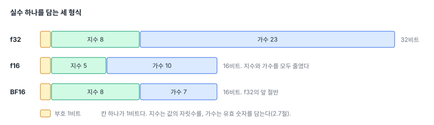
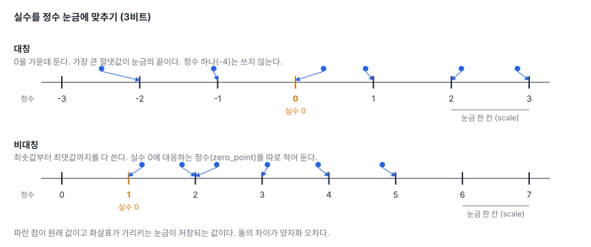
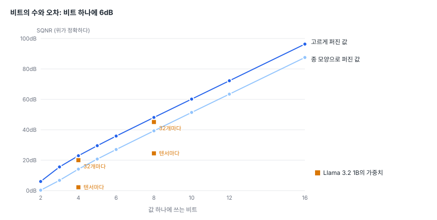
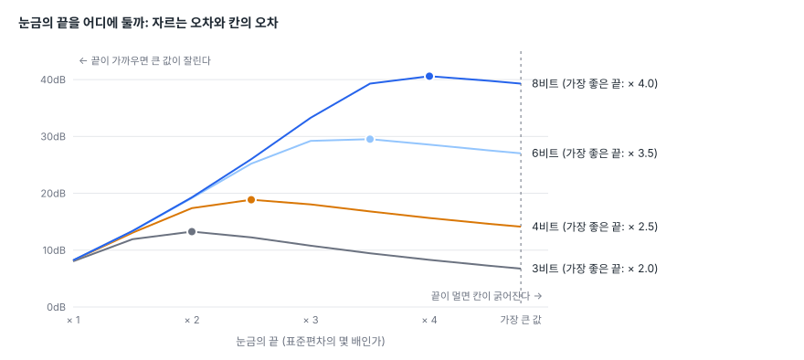
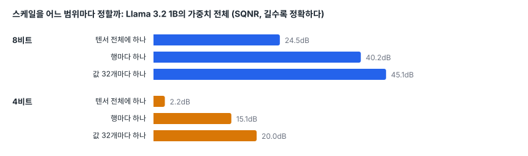
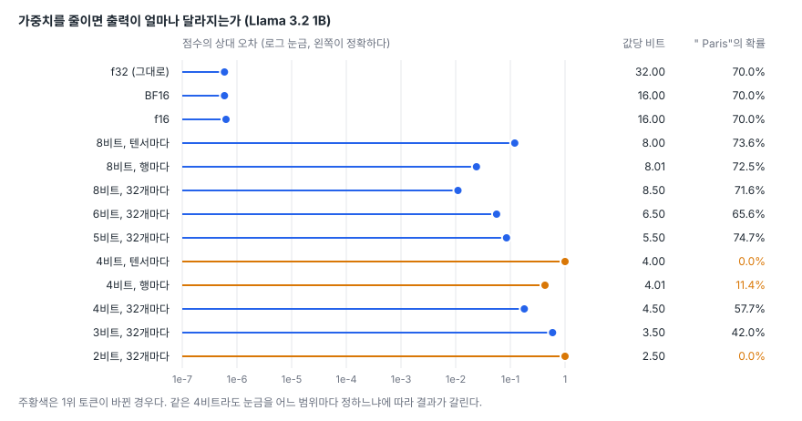

# 양자화 이론

[18장](ch18_multithreading.md)은 벽 앞에서 끝났습니다. 토큰 생성이 50.5토큰/초이고, [15장](ch15_bottleneck.md)이 계산한
상한이 55.6토큰/초입니다. 코어를 더 넣어도, 커널을 더 다듬어도 달라지지
않습니다. 토큰 하나를 만들 때마다 가중치 4.9GB를 메모리에서 읽어 와야
하고, 이 기계는 1초에 275GB까지만 읽을 수 있기 때문입니다.

남은 길은 하나입니다. **읽을 양을 줄입니다.** 가중치 하나를 32비트가
아니라 16비트, 8비트, 4비트로 적어 두면 읽을 양이 그만큼 줄어듭니다.
값을 더 적은 비트로 나타내는 일을 양자화(quantization)라고 합니다.

비트를 줄이면 값이 달라집니다. 이 장은 **얼마나 달라지는지**를 다룹니다.
엔진의 속도는 이 장에서 바뀌지 않습니다. 줄인 가중치로 빠르게 계산하는
커널은 [20장](ch20_weight_quantization.md)에서 만들고, 모델의 품질을 제대로 재는 일은 [21장](ch21_quantization_quality.md)에서 합니다.
여기서는 그 둘의 바탕이 되는 것, 곧 수를 줄여 적는 방법과 그때 생기는
오차의 크기를 손으로 만들고 재 봅니다.

결과를 미리 적어 둡니다.

- 16비트로 줄이는 데는 값이 들지 않습니다. 이 모델의 가중치는 처음부터
  16비트였습니다.
- 8비트로 줄여도 모델은 같은 답을 냅니다.
- 4비트는 **어떻게 줄이느냐**에 달렸습니다. 같은 4비트인데 한 방법은
  "Paris"라고 답하고, 다른 방법은 "Masks Masks Masks"를 끝없이 씁니다.

| 하는 일 | 절 |
|---|---|
| 몇 비트로 줄이면 얼마나 빨라질 수 있는지 계산한다 | 19.1 |
| 16비트 실수 두 가지를 만든다 | 19.2 |
| 진짜 가중치를 16비트로 바꿔 본다 | 19.3 |
| 실수를 정수 눈금에 맞춘다 | 19.4 |
| 오차의 크기를 예상하고 잰다 | 19.5 |
| 눈금의 끝을 어디에 둘지 정한다 | 19.6 |
| 눈금을 어느 범위마다 따로 정할지 정한다 | 19.7 |
| 줄인 가중치로 모델을 돌려 본다 | 19.8 |
| 줄인 가중치로 어떻게 계산하는지 내다본다 | 19.9 |

코드는 `crates/badak_core/src/quant.rs`에 있습니다.

## 19.1 얼마를 줄여야 하는가

15.5절에서 토큰 생성의 산술 강도를 계산했습니다. 곱셈 한 번에 가중치
하나, 4바이트를 읽습니다. 메모리가 1초에 줄 수 있는 바이트가 정해져
있으므로, 가중치 하나가 차지하는 바이트가 절반이 되면 1초에 할 수 있는
곱셈이 두 배가 됩니다.

| 가중치 하나 | 가중치 전체 | 메모리가 정하는 상한 |
|---|---|---|
| 32비트 (지금) | 4.94GB | 55.6토큰/초 |
| 16비트 | 2.47GB | 111토큰/초 |
| 8비트 | 1.24GB | 222토큰/초 |
| 4비트 | 0.62GB | 445토큰/초 |

상한은 15.6절의 55.6에 "32 ÷ 비트 수"를 곱한 값입니다. 이 표는 약속이
아니라 한 가지 전제 아래의 계산입니다. 메모리만이 속도를 막는다는
전제입니다. 읽을 양이 줄어들면 어느 지점에서 계산이 다시 막기
시작합니다. 그 지점이 어디인지는 19.9절에서 어림하고 [20장](ch20_weight_quantization.md)에서 잽니다.

속도만이 아닙니다. 10.3절에서 이 모델을 올리는 데 메모리 5GB가
들었습니다. 휴대전화에는 그만한 여유가 없습니다. 6부에서 기기에 모델을
올릴 때, 양자화는 빠르게 하는 기술이기 전에 **들어가게 하는
기술**입니다.

## 19.2 16비트 실수

가장 손쉬운 방법은 실수를 실수인 채로 줄이는 것입니다. 2.7절에서 `f32`의
32비트가 부호 1비트, 지수 8비트, 가수 23비트로 나뉜다고 했습니다. 지수가
자릿수를, 가수가 유효 숫자를 담습니다. 16비트에 맞추려면 어느 쪽인가를
줄여야 합니다. 줄이는 방법이 둘 있습니다.



**f16**은 IEEE 754 표준이 정한 16비트 실수입니다.[^ieee754] 표준의
이름은 binary16이고 흔히 반정밀도(half precision)라고 부릅니다. 지수를
5비트로, 가수를 10비트로 줄였습니다.

**BF16**은 9.3절에서 만났습니다. `f32`의 앞 16비트를 그대로 잘라 낸
것입니다. 지수 8비트를 지키고 가수를 7비트로 줄였습니다. 신경망의 학습에
쓰려고 만든 형식입니다.[^bf16]

둘은 같은 16비트를 다르게 나눠 썼습니다. f16은 유효 숫자를 지켰고
BF16은 범위를 지켰습니다.

### 변환을 만든다

Rust에는 아직 16비트 실수 형이 없습니다. `f16`이라는 형이 준비되고
있지만 이 책을 쓰는 시점의 안정판에서는 쓸 수 없습니다.[^rust-f16]
비트를 직접 다뤄 만듭니다. 16비트를 `u16`에 담아 두고, 계산할 때 `f32`로
바꿉니다.

16비트에서 32비트로 가는 쪽은 쉽습니다. 16비트 실수가 나타내는 값은
모두 `f32`로도 정확히 나타낼 수 있으므로 비트를 옮겨 적기만 하면 됩니다.

```rust
{{#include ../../../crates/badak_core/src/quant.rs:f16_to_f32}}
```

지수가 0인 경우만 따로 다룹니다. 지수를 더 내릴 수 없을 만큼 작은
수들이고, 이때는 가수가 곧 값입니다. 유효 숫자를 조금씩 잃어 가며 0에
가까운 수를 나타내는 구간입니다.

반대쪽이 어렵습니다. `f32`의 값 대부분은 16비트로 정확히 나타낼 수
없으므로 **가장 가까운 값을 골라야** 합니다.

```rust
{{#include ../../../crates/badak_core/src/quant.rs:f16_from_f32}}
```

가수 23비트 가운데 위의 10비트를 남기고 아래 13비트를 버립니다. 버리는
부분이 절반을 넘으면 올리고, 절반에 못 미치면 내립니다. 정확히 절반이면
남긴 부분의 마지막 비트가 0이 되는 쪽으로 갑니다. 17.2절에서 FMA가
"반올림을 한 번만 한다"고 할 때의 그 반올림 규칙입니다.

마지막 줄의 덧셈에 요령이 하나 있습니다. 올림 때문에 가수가 넘치면
지수가 1 올라야 합니다. 지수와 가수를 한 정수에 이어 붙여 두었으므로,
1을 더하면 가수의 넘침이 저절로 지수로 올라갑니다. 가장 큰 값에서
넘치면 비트가 무한대의 것이 됩니다. 그것이 올바른 답입니다.

BF16은 훨씬 짧습니다.

```rust
{{#include ../../../crates/badak_core/src/quant.rs:bf16}}
```

### 옳게 만들었는가

비트를 다루는 코드는 틀리기 쉽고, 틀려도 대부분의 값에서는 맞는 답을
냅니다. 세 가지로 확인합니다.

```rust
{{#include ../../../crates/badak_core/src/quant.rs:f16_tests}}
```

첫째, NumPy가 바꾼 결과와 견줍니다. 정확히 절반에 걸리는 값, 넘쳐서
무한대가 되는 값, 아주 작은 값을 골라 넣었습니다. 둘째, 16비트 실수는
65,536개뿐이므로 **전부** 해 봅니다. `f32`로 갔다가 돌아오면 같은 비트여야
합니다. 셋째, 이웃한 두 16비트 실수 사이의 4분의 1 지점, 절반 지점, 4분의
3 지점이 각각 옳은 쪽으로 가는지를 모든 이웃에 대해 봅니다.

### 두 형식을 견준다

```bash
cargo run --release -p badak_core --example ch19_formats
```

```text
{{#include output/ch19_formats.txt:1:5}}
```

**f16은 65,504보다 큰 수를 담지 못합니다.** `f32`와 BF16은 10의 38제곱
근처까지 갑니다. 반대로 정밀도는 f16이 낫습니다. 1과 2 사이에 f16은
1,024개의 값을 두고 BF16은 128개를 둡니다.

```text
{{#include output/ch19_formats.txt:7:18}}
```

BF16의 상대 오차는 값의 크기와 상관없이 천 분의 1 안팎입니다. f16은
대개 그보다 정확하지만 양쪽 끝에서 무너집니다. 0.00000001은
0이 되고 70,000은 무한대가 됩니다.

```text
{{#include output/ch19_formats.txt:20:29}}
```

이웃한 두 값 사이의 간격입니다. 실수는 값이 클수록 간격이 넓습니다.
**값이 두 배가 되면 간격도 두 배가 됩니다.** 이것이 부동소수점의
성질이고, 19.4절에서 볼 정수 눈금과 가장 다른 점입니다. f16은 2의
-14제곱 아래에서 간격이 더 줄지 않습니다. 지수가 바닥에 닿았기
때문입니다.

## 19.3 진짜 가중치를 16비트로

만든 변환을 Llama 3.2 1B의 가중치 12억 개에 써 봅니다. 16비트로 바꿨다가
되돌렸을 때 원래 값과 달라지는 것이 몇 개인지 셉니다.

```bash
cargo run --release -p badak_models --example ch19_weights
```

```text
{{#include output/ch19_weights_llama32.txt:15:25}}
```

**BF16으로 바꾸면 달라지는 값이 하나도 없습니다.** 놀랄 일은 아닙니다.
9.3절에서 본 대로 이 모델의 가중치 파일은 처음부터 BF16이었습니다. 우리가
읽을 때 아래 16비트에 0을 채워 `f32`로 펼쳤을 뿐입니다. 메모리에 있는
4.9GB의 절반은 0입니다. 토큰마다 메모리에서 읽어 오는 바이트의 절반이
아무것도 담고 있지 않습니다.

9.3절에서 진 빚이 이것입니다. BF16인 채로 계산할 수 있다면 **아무것도
잃지 않고** 읽는 양이 절반이 됩니다. [20장](ch20_weight_quantization.md)의 첫 일입니다.

**f16으로 바꾸면 29만 개가 달라집니다.** 12억 개 가운데 0.02%입니다.
BF16의 값은 유효 숫자가 8비트뿐이라 f16의 11비트에 넉넉히 들어갑니다.
들어가지 않는 것은 아주 작은 값들입니다. f16은 2의 -14제곱 아래에서
간격이 2의 -24제곱으로 고정되므로, 절댓값이 2의 -17제곱(약 0.0000076)보다
작은 값은 유효 숫자 8비트를 다 담지 못할 수 있습니다. SQNR 155dB는
오차가 사실상 없다는 뜻입니다(이 단위는 19.5절에서 설명합니다).

### 텐서에 16비트 자료형을 넣는다

"BF16인 채로"의 첫걸음을 여기서 뗍니다. 4.2절에서 텐서의 자료형을 셋
(`f32`, `i32`, `u8`)으로 시작하면서 16비트 실수는 이 장에서 넣겠다고
했습니다. 6.4절의 파서도 같은 약속을 했습니다.

Rust에 16비트 실수 형이 없으니 `u16` 하나를 감싼 형을 만듭니다.

```rust
{{#include ../../../crates/badak_core/src/quant.rs:half_types}}
```

이 형에는 덧셈도 곱셈도 없습니다. **담아 두는 형**입니다. 계산하려면
`to_f32`로 꺼내야 합니다. 텐서의 자료형에 둘을 더합니다.

```rust
{{#include ../../../crates/badak_core/src/tensor.rs:dtype}}
```

[4장](../part1/ch04_tensor.md)에서 텐서를 만들 때 저장소와 원소 형을 잇는 장치를 한 곳에 모아
두었습니다. 덕분에 고칠 곳이 이 목록과 그 장치뿐이고, 형상을 바꾸는
연산과 뷰는 손대지 않아도 16비트 텐서에서 그대로 돕니다. [5장](../part1/ch05_operators.md)의 연산자는
`f32`를 요구하므로 16비트 텐서를 넣으면 자료형 오류를 냅니다. 계산은
아직 못 합니다.

파일에서 꺼내는 길도 하나 더 냅니다.

```rust
{{#include ../../../crates/badak_formats/src/safetensors.rs:tensor_as_stored}}
```

6.4절에서 `f32` 텐서를 꺼낼 때 한 일과 같습니다. 파일을 비춘 메모리의 한
구간을 가리키는 텐서를 만듭니다. 복사하지 않습니다.

```rust
{{#include ../../../crates/badak_models/examples/ch19_stored.rs:read}}
```

```bash
cargo run --release -p badak_models --example ch19_stored
```

```text
{{#include output/ch19_stored_llama32.txt}}
```

**펼쳐 읽는 데 0.4초, 그대로 꺼내는 데는 잴 수 없을 만큼 짧은
시간입니다.** 10.3절에서 "값을 펼치느라 메모리에 비추기의 이점을 스스로
버렸다"고 적었습니다. 그 이점이 돌아왔습니다. 메모리는 4.94GB에서
2.47GB가 되고, 그 2.47GB도 우리가 잡은 메모리가 아니라 운영체제가 파일에서
필요할 때 가져오는 메모리입니다(6.5절). 12억 개의 값은 두 방법에서 모두
같습니다.

엔진은 아직 이 텐서로 계산하지 못합니다. `LlamaModel::load`는 여전히
펼쳐 읽습니다. 16비트 텐서를 받아 계산하는 커널이 생기는 [20장](ch20_weight_quantization.md)에서
바꿉니다.

16비트 실수 둘 가운데 무엇을 고르느냐는 값이 어디서 왔느냐에 달렸습니다.
BF16으로 학습한 모델은 BF16으로 두는 것이 당연합니다. `f32`로 학습한
모델을 16비트로 줄인다면 유효 숫자가 많은 f16이 대개 더 정확하고,
가중치처럼 크기가 고만고만한 값에서는 f16의 좁은 범위가 문제 되지
않습니다.

> 11.8절에서 KV 캐시가 `f32`라서 토큰 하나에 64KB를 쓴다고 적었고,
> llama.cpp는 16비트 실수로 둔다고 했습니다(11.9절). 캐시의 값은 가중치와
> 달리 계산해서 나온 `f32`이므로 16비트로 줄이면 값이 달라집니다. 줄이는
> 도구는 이 절에서 생겼습니다. 달라진 값이 모델의 답을 얼마나 바꾸는지는
> 잣대가 있어야 말할 수 있으므로, [21장](ch21_quantization_quality.md)에서 품질을 재는 방법을 만든 뒤에
> 합니다.

## 19.4 정수 눈금

16비트 아래로 내려가려면 다른 방법이 필요합니다. 8비트 실수를 만들 수는
있지만 지수와 가수에 줄 비트가 너무 적습니다. 대신 **정수**를 씁니다.

생각은 자와 같습니다. 눈금 한 칸의 크기를 정해 두고, 값마다 "몇 번째
눈금에 가장 가까운가"만 적습니다. 눈금 한 칸의 크기를 스케일(scale)이라고
합니다.

```text
정수 q = round(x ÷ scale)        되돌린 값 = scale × q
```

`scale`은 실수 하나이고 값 수천 개가 함께 씁니다. 값마다 드는 것은 정수
하나, 8비트나 4비트뿐입니다.



눈금을 놓는 방법이 둘 있습니다.

**대칭(symmetric).** 0을 눈금의 한가운데에 둡니다. 실수 0이 정수 0이
됩니다. 음수와 양수에 같은 수의 눈금을 줍니다.

**비대칭(asymmetric).** 값들의 최솟값부터 최댓값까지에 눈금을 고르게
폅니다. 실수 0이 어느 정수에 대응하는지를 따로 적어 둡니다. 이 정수를
영점(zero point)이라고 합니다.[^jacob]

```text
정수 q = round(x ÷ scale) + zero_point        되돌린 값 = scale × (q − zero_point)
```

두 방법을 한 구조체에 담습니다. 대칭은 영점이 0인 경우입니다.

```rust
{{#include ../../../crates/badak_core/src/quant.rs:quantizer}}
```

눈여겨볼 곳이 둘 있습니다.

**대칭 눈금은 정수 하나를 버립니다.** 8비트 정수는 -128부터 127까지
256가지인데 -127부터 127까지 255가지만 씁니다. -128을 쓰면 음수 쪽이
양수 쪽보다 한 칸 더 길어져 0이 가운데에 오지 않습니다. 8비트에서는
256분의 1을 버리는 것이라 아깝지 않습니다. 4비트에서는 16가지 가운데
하나, 2비트에서는 4가지 가운데 하나입니다. 비트가 적을수록 아까워집니다.
[20장](ch20_weight_quantization.md)에서 llama.cpp의 4비트 형식이 이 한 칸을 어떻게 살리는지 봅니다.

**비대칭 눈금은 0을 정확히 지킵니다.** 구간이 0을 포함하도록 넓히고,
영점을 정수로 반올림합니다. 실수 0이 눈금과 눈금 사이에 떨어지면 0이 0이
아닌 값으로 되돌아오는데, 신경망에는 정확히 0이어야 하는 값이
많습니다. 빈자리를 채운 0, ReLU가 잘라 낸 0이 그렇습니다.

```rust
{{#include ../../../crates/badak_core/src/quant.rs:quantizer_tests}}
```

어느 쪽을 쓸지는 값이 어떻게 퍼져 있느냐에 달렸습니다.

```text
{{#include output/ch19_uniform.txt:32:35}}
```

모두 0 이상인 값을 대칭 눈금에 맞추면 눈금의 절반(음수 쪽)을 쓰지
않습니다. 비대칭 눈금은 그 절반을 살려서 6dB를 더 얻습니다. 19.5절에서
보듯 6dB는 비트 하나의 값입니다.

**가중치에는 대칭을 씁니다.** 이유가 둘입니다. 가중치는 0을 중심으로
양쪽에 비슷하게 퍼져 있어서 비대칭으로 얻을 것이 없습니다. 그리고 영점이
0이면 계산이 단순해집니다(19.9절). 이 장의 나머지는 대칭 눈금만
다룹니다. 비대칭 눈금은 값이 한쪽으로 치우치는 곳, 곧 층과 층 사이를
흐르는 값(활성화)을 정수로 다룰 때 필요합니다. [29장](../part4/ch29_integer_inference.md)에서 비전 모델을
정수만으로 계산할 때 다시 꺼냅니다.

## 19.5 오차는 얼마나 되는가

눈금에 맞춘 값은 원래 값에서 **눈금 반 칸**까지 벗어날 수 있습니다. 값이
눈금 사이의 어디에 떨어질지는 알 수 없으니, 오차가 "반 칸 아래부터 반 칸
위까지 고르게 퍼져 있다"고 봅시다. 그러면 오차의 제곱의 평균이 간단한
식으로 나옵니다.

```text
오차의 제곱의 평균 = scale² ÷ 12
```

12는 "-0.5부터 0.5까지 고르게 퍼진 값의 제곱의 평균이 12분의 1"이라는
적분에서 나옵니다. 1948년의 논문에 나오는 오래된 결과입니다.[^bennett]

오차의 크기는 값의 크기에 견주어 봐야 뜻이 있습니다. 값의 제곱의 평균을
오차의 제곱의 평균으로 나눈 것을 신호 대 양자화 잡음비(SQNR)라고 하고,
로그를 취해 데시벨(dB)로 적습니다.

```rust
{{#include ../../../crates/badak_core/src/quant.rs:sqnr}}
```

데시벨은 비율을 더하기로 다루게 해 주는 단위입니다. 10dB는 오차의 제곱이
10분의 1, 20dB는 100분의 1입니다. 오차 자체(제곱이 아닌)로 말하면 20dB에
10분의 1입니다.

비트를 하나 늘리면 눈금의 수가 두 배가 되고 `scale`이 절반이 됩니다.
위의 식에서 오차의 제곱은 4분의 1이 됩니다. 4분의 1은 6.02dB입니다.
**비트 하나에 6dB.** 양자화에서 가장 쓸모 있는 어림셈입니다.[^gray]

재 봅니다. 값 100만 개를 두 가지로 만들었습니다. -1과 1 사이에 고르게
퍼진 값, 그리고 평균 0, 표준편차 1인 종 모양(정규분포)으로 퍼진
값입니다.

```rust
{{#include ../../../crates/badak_core/examples/ch19_uniform.rs:predicted}}
```

```bash
cargo run --release -p badak_core --example ch19_uniform
```

```text
{{#include output/ch19_uniform.txt:1:11}}
```

**예상이 소수점 둘째 자리까지 맞습니다.** 3비트부터 16비트까지 그렇습니다.
"오차가 고르게 퍼진다"는 가정은 눈금이 단 일곱 개일 때도 잘 맞습니다.
2비트에서 종 모양 분포만 어긋납니다. 눈금이 셋(-1, 0, 1)뿐이면 대부분의
값이 0으로 가 버려 가정이 깨집니다.

**비트 하나에 6dB가 보입니다.** 4비트에서 5비트로 6.6dB, 6비트에서
8비트로 12.3dB입니다. 정확히 6.02가 아닌 것은 대칭 눈금이 정수 하나를
버리기 때문입니다. 3비트는 눈금이 8개가 아니라 7개입니다.

**같은 비트인데 종 모양 분포가 8.8dB 낮습니다.** 비트로 치면 한 개
반입니다. 고르게 퍼진 값은 눈금을 고르게 씁니다. 종 모양으로 퍼진 값은
가운데에 몰려 있고 끝에는 드물게만 갑니다. 그런데 눈금의 끝은 가장 큰
값(표준편차의 4.77배)에 맞춰져 있습니다. 눈금 대부분이 값이 거의 없는
곳에 놓여 있습니다.



그림의 주황색 점은 19.7절에서 잴 진짜 가중치입니다. 미리 보면, 같은
비트인데 눈금을 어떻게 정하느냐에 따라 20dB 넘게 갈립니다. 비트로 치면
서너 개입니다. 다음 두 절이 그 이야기입니다.

## 19.6 눈금의 끝을 어디에 둘까

종 모양 분포에서 눈금의 끝을 가장 큰 값에 맞추는 것이 낭비라면, 끝을
안쪽으로 당기면 됩니다. 끝보다 큰 값은 끝값으로 잘립니다. 자르는 것을
클리핑(clipping)이라고 합니다.

오차가 두 가지가 됩니다.

- **칸의 오차.** 눈금 안의 값이 가장 가까운 눈금으로 가면서 생깁니다.
  끝을 당기면 칸이 촘촘해져 줄어듭니다.
- **자르는 오차.** 끝 밖의 값이 끝값으로 잘리면서 생깁니다. 끝을 당기면
  잘리는 값이 많아져 늘어납니다.

```text
{{#include output/ch19_uniform.txt:13:23}}
```



**가장 큰 값에 맞추는 것이 가장 좋은 경우는 없습니다.** 4비트에서는
표준편차의 2.5배에 끝을 둘 때 18.9dB로, 가장 큰 값에 맞출 때(14.1dB)보다
4.8dB 좋습니다. 비트 하나에 가까운 차이입니다.

**비트가 적을수록 끝을 더 당겨야 합니다.** 3비트는 2배, 4비트는 2.5배,
6비트는 3.5배, 8비트는 4배에서 가장 좋습니다. 칸이 굵을수록 칸의 오차가
커서, 큰 값 몇 개를 잘라 버리고 칸을 촘촘하게 하는 편이 이득입니다.

**8비트에서는 고민할 것이 적습니다.** 가장 좋은 값(40.6dB)과 가장 큰
값에 맞춘 값(39.3dB)의 차이가 1.3dB입니다.

이 표는 "오차의 제곱의 합을 가장 작게"라는 한 가지 잣대로 본
것입니다.[^nagel] 그 잣대가 모델의 품질과 같지는 않습니다. 잘려 나가는
큰 값이 모델에게 중요한 값일 수 있습니다. 그래도 방향은 분명합니다.
**적은 비트에서는 눈금의 크기를 고르는 일 자체가 풀어야 할 문제입니다.**
[20장](ch20_weight_quantization.md)에서 llama.cpp의 형식들이 눈금의 크기를 여러 번 바꿔 보며 고르는
것을 봅니다.

이 장의 나머지에서는 가장 단순한 선택, 곧 가장 큰 절댓값에 끝을 맞추는
방법만 씁니다. 다음 절에서 볼 문제가 이보다 훨씬 크기 때문입니다.

## 19.7 눈금을 어느 범위마다 정할까

진짜 가중치는 종 모양보다 사정이 나쁩니다. 텐서마다 가장 큰 절댓값이
표준편차의 몇 배인지 쟀습니다.

```text
{{#include output/ch19_weights_llama32.txt:3:13}}
```

**텐서 전체로 보면 가장 큰 값이 표준편차의 10배에서 32배입니다.** 종
모양으로 퍼진 값 100만 개에서는 4.77배였습니다. 가중치에는 유난히 큰
값이 섞여 있습니다. 이런 값을 이상치(outlier)라고 합니다.

눈금의 끝을 가장 큰 값에 맞추면 이상치 하나가 눈금 전체를 정합니다.
만든 값으로 확인합니다. 종 모양으로 퍼진 값 4,096개에 큰 값을 하나만
섞었습니다.

```text
{{#include output/ch19_uniform.txt:25:30}}
```

**표준편차의 30배짜리 값 하나가 섞이면 SQNR이 0.46dB가 됩니다.** 4비트의
눈금 열다섯 개가 -30부터 30까지에 펼쳐지고, 칸 하나가 4.3입니다. 나머지
4,095개의 값은 거의 모두 -2와 2 사이에 있으므로 0이 됩니다.
0dB는 "오차의 크기가 값의 크기와 같다"는 뜻입니다. 값을 다 지운
것입니다.

표의 오른쪽 두 열이 해법입니다. **눈금을 작은 범위마다 따로 정합니다.**
값을 32개씩 묶어 묶음마다 `scale`을 따로 두면, 이상치는 자기가 속한
묶음 하나만 망칩니다. 나머지 127개 묶음은 자기 값들에 맞는 촘촘한
눈금을 씁니다.

표의 첫 줄도 봅니다. 이상치가 없어도 32개마다 눈금을 정하면 5dB가
좋아집니다. 값 32개 가운데 가장 큰 것은 보통 표준편차의 두 배
남짓입니다. 4,096개 가운데 가장 큰 것(네 배쯤)보다 훨씬 작습니다.
19.6절에서 끝을 당겨 얻던 이득을, 자르는 오차 없이 얻습니다.

위의 표 "행 하나" 열이 이것을 진짜 가중치에서 보여 줍니다. 행 하나로
범위를 좁히면 가장 큰 값이 표준편차의 4배쯤으로, 종 모양 분포와 비슷해
집니다.

범위를 정하는 방법 셋을 진짜 가중치에 써 봅니다.

```rust
{{#include ../../../crates/badak_models/examples/ch19_weights.rs:noise}}
```

```text
{{#include output/ch19_weights_llama32.txt:27:37}}
```



**텐서 전체에 눈금 하나인 4비트는 2.2dB입니다.** 쓸 수 없습니다.

**행마다 정하면 15.1dB, 32개마다 정하면 20.0dB입니다.** 같은 4비트로
18dB를 얻었습니다. 비트 세 개의 값입니다. 8비트에서도 같은 무늬입니다.
24.5dB에서 45.1dB로, 20dB 넘게 오릅니다.

**종류마다 고릅니다.** 32개마다 정하면 어느 종류의 가중치든 4비트에서
20dB, 8비트에서 45dB 안팎입니다. 텐서 전체에 하나일 때는 종류마다 10dB
가까이 달랐습니다. 이상치가 얼마나 심한지에 결과가 매이지 않게
되었습니다.

### 눈금의 값

공짜는 아닙니다. `scale`도 저장해야 합니다. `scale`을 16비트 실수로
적는다면 값 하나에 드는 비트는 이렇습니다.

| 눈금의 범위 | 8비트 | 4비트 |
|---|---|---|
| 텐서 전체 | 8.00 | 4.00 |
| 행 하나 (2,048개) | 8.01 | 4.01 |
| 값 32개 | 8.50 | 4.50 |

32개마다 16비트를 더 쓰므로 값 하나에 0.5비트입니다. 4비트가 4.5비트가
됩니다. 12% 더 써서 5dB를 얻었습니다. 19.5절의 어림셈으로 5dB는 비트
0.8개쯤이니 남는 장사입니다. 묶음을 더 작게 하면 눈금은 더 잘 맞지만
`scale`의 몫이 커집니다. 16개마다이면 1비트, 8개마다이면 2비트가 더
듭니다.

이 숫자들은 [20장](ch20_weight_quantization.md)에서 다시 나옵니다. llama.cpp의 `Q8_0`과 `Q4_0` 형식이
값 32개마다 16비트 실수 `scale` 하나를 둡니다.[^llamacpp-blocks] 값
하나에 8.5비트와 4.5비트입니다.

채널마다(우리의 "행마다"에 해당합니다) 눈금을 따로 두는 방법은 비전
모델의 정수 양자화에서 널리 쓰입니다.[^krishnamoorthi] 거기서는 8비트가
보통이고 행마다로 충분합니다. 언어 모델을 4비트까지 줄이는 엔진들은 더
잘게 나눕니다.

## 19.8 모델은 얼마나 달라지는가

지금까지 잰 것은 가중치의 오차입니다. 알고 싶은 것은 **모델의 답**이
얼마나 달라지느냐입니다. 가중치의 오차가 20dB라는 것이 좋은지 나쁜지는
모델을 돌려 봐야 압니다.

양자화된 가중치로 계산하는 커널은 아직 없습니다. 없어도 볼 수 있습니다.
가중치를 정수로 바꿨다가 **곧바로 `f32`로 되돌려** 놓으면 됩니다.

```rust
{{#include ../../../crates/badak_core/src/quant.rs:fake}}
```

되돌린 값은 `f32`이지만 눈금 위의 값만 남아 있습니다. 이 가중치로 평소의
엔진을 돌리면 "양자화된 모델이 낼 답"을 얻습니다. 메모리도 속도도
그대로이고 값만 다릅니다. 양자화의 효과를 미리 보는 이 방법을 흉내
양자화(fake quantization)라고 부릅니다.

모델의 가중치를 바꿔 끼우는 함수를 하나 추가합니다.

```rust
{{#include ../../../crates/badak_models/src/llama/model.rs:matrices}}
```

행렬 모양의 가중치만 바꿉니다. 정규화의 가중치는 다 합쳐 6만 개 남짓이라
줄여서 얻을 것이 없습니다.

```rust
{{#include ../../../crates/badak_models/examples/ch19_effect.rs:scheme}}
```

방법마다 모델을 새로 읽고, 가중치를 바꾸고, [10장](../part2/ch10_forward_pass.md)부터 써 온 글("The
capital of France is")을 넣습니다.

```rust
{{#include ../../../crates/badak_models/examples/ch19_effect.rs:run}}
```

```bash
cargo run --release -p badak_models --example ch19_effect
```

```text
{{#include output/ch19_effect_llama32.txt:1:17}}
```

"상대 오차"는 13.3절과 같은 잣대입니다. 다음 토큰의 점수 128,256개가
`f64`로 계산한 기준에서 가장 많이 벗어난 정도를 가장 큰 점수로 나눈
값입니다.



**16비트 실수는 아무것도 바꾸지 않습니다.** BF16은 값이 하나도 달라지지
않았으니 당연하고, f16도 오차가 `6e-7`로 `f32`와 같은 수준입니다. 이어
쓴 토큰 40개가 모두 같습니다.

**8비트는 답을 지킵니다.** 32개마다 눈금을 정하면 점수의 오차가 1%이고
" Paris"의 확률이 69.95%에서 71.57%가 됩니다. 텐서 전체에 눈금 하나이면
오차가 12%로 열 배입니다.

**4비트는 방법에 따라 갈립니다.** 값 하나에 쓰는 비트는 4.00, 4.01,
4.50으로 거의 같습니다. 결과는 이렇습니다.

```text
{{#include output/ch19_effect_llama32.txt:20:20}}
{{#include output/ch19_effect_llama32.txt:28:30}}
```

텐서마다 눈금 하나이면 모델이 망가집니다. 행마다이면 문장은 되는데 답이
틀립니다("파리가 아니라 베르사유"). 32개마다이면 옳게 답합니다. 19.7절의
2.2dB, 15.1dB, 20.0dB가 모델의 입에서 이렇게 들립니다.

**3비트는 버티고 2비트는 무너집니다.** 3비트에서 " Paris"가 여전히
1위이지만 확률이 42%로 떨어지고 글이 같은 말을 되풀이합니다. 2비트는
글자가 깨집니다.

### 이 표를 읽을 때 조심할 것

**"같은 토큰"이 적다고 나쁜 것이 아닙니다.** 8비트(32개마다)는 40개
가운데 29개까지만 `f32`와 같습니다. 그 뒤의 글을 보면 이렇습니다.

```text
{{#include output/ch19_effect_llama32.txt:20:20}}
{{#include output/ch19_effect_llama32.txt:25:25}}
```

모네가 "파리에서 태어났다"고 쓰던 글이 "프랑스 시골의 풍경을 많이
그렸다"로 바뀌었습니다. 다른 글이지 못한 글이 아닙니다. 11.6절에서 본
대로 글 이어 쓰기는 작은 차이를 키웁니다. 두 후보의 점수가 비슷한
자리에서 순서가 한 번 바뀌면 그 뒤로는 다른 글이 됩니다.

**글 하나로는 품질을 말할 수 없습니다.** 표의 5비트는 6비트보다 " Paris"에
높은 확률을 줍니다(74.7% 대 65.6%). 5비트가 더 좋다는 뜻이 아닙니다.
오차가 우연히 이 토큰에 유리한 쪽으로 났을 뿐입니다. 점수의 오차는
6비트가 더 작습니다. 양자화가 모델을 얼마나 해치는지는 글 수천 개에
걸쳐 재야 하고, 그 잣대가 [21장](ch21_quantization_quality.md)에서 만들 퍼플렉서티입니다.

**이 장의 4비트는 가장 서툰 4비트입니다.** 눈금의 끝을 가장 큰 값에
맞췄고(19.6절의 표에서 가장 나쁜 줄), 정수 하나를 버렸습니다(19.4절).
그래도 답은 맞혔습니다. 실전의 형식은 둘 다 고칩니다.

## 19.9 줄인 가중치로 계산하기

줄인 가중치는 저장만 줄인 것이 아니라 **줄인 채로 계산해야** 뜻이
있습니다. 계산할 때 `f32`로 펼쳐 메모리에 두면 읽는 양이 그대로입니다.
계산 방법은 [20장](ch20_weight_quantization.md)의 일이지만, 이 장의 선택이 그 계산을 어떻게 바꾸는지는
여기서 봐 둡니다.

선형 층은 내적입니다. 가중치의 한 묶음이 `scale` 하나를 함께 쓴다면
그 묶음의 내적은 이렇게 됩니다.

```text
Σ w × x  ≈  Σ (scale × q) × x  =  scale × Σ q × x
```

`scale`이 합 밖으로 나옵니다. 안쪽은 정수 `q`와 입력 `x`의 곱을 더하는
일이고, 묶음마다 마지막에 `scale`을 한 번 곱합니다. **대칭 눈금이
계산을 단순하게 한다**고 한 것이 이것입니다. 영점이 있으면 `q` 자리에
`q − zero_point`가 들어가고, 풀어 쓰면 `Σ x`에 영점을 곱한 항이 하나 더
생깁니다.

입력 `x`를 어떻게 둘지에 따라 길이 셋으로 갈립니다.

- **가중치만 줄인다.** `x`는 `f32` 그대로 둡니다. 커널이 `q`를 읽어
  실수로 바꾼 뒤 곱합니다. 메모리에서 읽는 양은 줄고 계산은 실수로
  합니다. 입력에는 오차가 더해지지 않습니다.
- **입력도 그 자리에서 줄인다.** 곱하기 직전에 `x`를 가중치와 같은 방법
  (값 32개마다 눈금 하나, 8비트)으로 정수로 바꾸고, 정수끼리 곱합니다.
  눈금은 지금 들어온 값에서 바로 정하므로 미리 준비할 것이 없습니다.
  llama.cpp가 CPU에서 이렇게 합니다.[^llamacpp-vecdot] 정수 곱셈은 한
  번에 더 많이 할 수 있고, 대신 입력의 양자화 오차가 더해집니다.
- **입력의 눈금까지 미리 정해 둔다.** 층과 층 사이를 흐르는 값의 눈금을
  실행하기 전에 정해 두고, 처음부터 끝까지 정수만으로 계산합니다. 실수
  연산이 느리거나 없는 칩에서도 돕니다. 영점이 필요합니다.[^jacob]
  [29장](../part4/ch29_integer_inference.md)에서 비전 모델로 다룹니다.

[20장](ch20_weight_quantization.md)에서 앞의 두 길을 놓고 고릅니다.

### 속도의 예상

19.1절의 표에 계산의 한계를 겹쳐 봅니다. 17.5절에서 입력 벡터가 하나일
때 커널이 곱셈 하나에 0.17사이클을 썼습니다. 코어 하나가 1초에 235억
번, 열두 개가 2,820억 번입니다. 토큰 하나에 곱셈이 12.4억 번이므로
**계산이 정하는 상한은 228토큰/초쯤**입니다.

| 가중치 하나 | 메모리의 상한 | 계산의 상한 | 먼저 막는 것 |
|---|---|---|---|
| 32비트 (지금) | 55.6 | 228 | 메모리 |
| 16비트 | 111 | 228 | 메모리 |
| 8.5비트 | 209 | 228 | 거의 같다 |
| 4.5비트 | 395 | 228 | 계산 |

**8비트 근처에서 두 한계가 만납니다.** 그 아래로 줄여도 토큰 생성은 더
빨라지지 않을 것으로 예상합니다. 4비트의 값어치는 속도가 아니라 크기
(0.7GB)에 있게 됩니다.

이 표는 예상입니다. 틀릴 수 있는 곳이 여럿입니다. 계산의 상한은 `f32`
커널의 숫자이고, 정수를 실수로 바꾸는 일이 더해지면 내려갑니다. 4비트
값 둘이 한 바이트에 들어 있으면 꺼내는 데도 명령이 듭니다. 메모리의
상한은 [15장](ch15_bottleneck.md)에서 한 줄기로 읽을 때의 숫자에서 나왔고, 17.5절과
18.12절에서 그 전제가 두 번 흔들렸습니다. [20장](ch20_weight_quantization.md)에서 잽니다.

## 19.10 실전 엔진에서는

**llama.cpp의 `Q8_0`은 이 장의 "8비트, 32개마다"와 같습니다.** 값 32개의
가장 큰 절댓값을 127로 나눠 `scale`로 삼고, 16비트 실수로 적고, 값마다
`scale`로 나눠 반올림합니다.[^llamacpp-blocks] 19.7절의 선택 그대로입니다.

**`Q4_0`은 버리던 정수 하나를 살립니다.** 눈금을 -8부터 7까지 16개 다
씁니다. 절댓값이 가장 큰 값을 (부호를 살려) -8로 나눠 `scale`로
삼습니다.[^llamacpp-blocks] 그 값이 음수이면 `scale`이 양수가 되어 -8에
대응하고, 양수이면 `scale`이 음수가 되어 역시 -8에 대응합니다. 가장 큰
값이 어느 쪽이든 한 칸 더 긴 쪽에 놓이게 하는 요령입니다. [20장](ch20_weight_quantization.md)에서
자세히 봅니다.

**더 정교한 형식은 눈금을 찾습니다.** 13.5절에서 내려받은 `Q4_K_M` 같은
형식은 `scale`을 가장 큰 값에서 곧바로 정하지 않고, 후보를 여러 개
넣어 보고 오차가 가장 작은 것을 고릅니다. 19.6절에서 본 "끝을 당기면
좋아진다"를 묶음마다 하는 것입니다. 묶음의 `scale`들을 6비트로 다시
양자화해서 `scale`의 몫도 줄입니다.[^llamacpp-kquants] [20장](ch20_weight_quantization.md)의
뒷부분입니다.

**비전 모델과 휴대 기기 쪽은 8비트 정수가 표준입니다.** 가중치는
채널마다 대칭 눈금, 활성화는 층마다 비대칭 눈금을 쓰고, 계산을 정수만으로
합니다.[^jacob][^krishnamoorthi] 눈금을 정하려면 진짜 입력을 조금 흘려
보며 값의 범위를 재야 하는데, 이것을 보정(calibration)이라고
합니다.[^nagel] [29장](../part4/ch29_integer_inference.md)에서 다룹니다.

**학습을 다시 하는 길도 있습니다.** 이 장의 방법은 학습이 끝난 가중치를
그대로 줄입니다. 학습 후 양자화(post-training quantization)라고 합니다.
학습하는 동안 흉내 양자화를 끼워 넣어 모델이 오차에 익숙해지게 하는
방법도 있고, 양자화 인식 학습(quantization-aware training)이라고
합니다.[^jacob] 낮은 비트에서 품질이 더 좋지만 학습을 돌릴 수 있어야
합니다. 추론 엔진을 만드는 쪽에서는 대개 받은 가중치를 줄이는 것까지가
일입니다. 46장에서 추론 엔지니어의 눈으로 다시 봅니다.

## 정리

- 토큰 생성은 메모리에서 읽는 양에 막혀 있습니다. 가중치 하나의 비트를
  줄이면 상한이 그만큼 올라갑니다. 16비트에서 111, 8비트에서
  222토큰/초입니다.
- 16비트 실수가 둘 있습니다. f16은 지수 5비트, 가수 10비트로 정밀하지만
  65,504보다 큰 수를 담지 못합니다. BF16은 지수 8비트, 가수 7비트로
  `f32`와 범위가 같습니다.
- `f32`를 16비트로 바꿀 때는 가장 가까운 값을 고르고, 한가운데이면 마지막
  비트가 0인 쪽으로 갑니다. 16비트 실수 65,536개를 전부 넣어 확인했습니다.
- Llama 3.2 1B의 가중치는 BF16으로 바꿔도 하나도 달라지지 않습니다.
  처음부터 BF16이었습니다. 메모리의 4.9GB 가운데 절반은 0입니다.
- 텐서에 16비트 실수 자료형 둘을 넣었습니다. 파일의 가중치를 펼치지 않고
  그대로 가리킬 수 있습니다. 읽는 시간이 0.4초에서 0이 되고 메모리가
  절반이 됩니다. 이 자료형으로 계산하는 일은 [20장](ch20_weight_quantization.md)으로 넘깁니다.
- 정수 양자화는 눈금 한 칸의 크기(`scale`)를 정하고 값마다 눈금의 번호만
  적습니다. 0을 가운데 두면 대칭, 구간 전체를 쓰고 영점을 따로 적으면
  비대칭입니다. 가중치에는 대칭을 씁니다.
- 오차의 제곱의 평균은 `scale² ÷ 12`입니다. 측정이 소수점 둘째 자리까지
  맞습니다. 비트 하나에 6dB입니다.
- 눈금의 끝을 가장 큰 값보다 안쪽에 두면 큰 값은 잘리지만 칸이
  촘촘해집니다. 비트가 적을수록 더 당겨야 합니다.
- 가중치에는 표준편차의 10~30배짜리 값이 섞여 있습니다. 텐서 전체에 눈금
  하나이면 4비트의 SQNR이 2dB입니다. 값 32개마다 눈금을 정하면 20dB가
  됩니다. 그 값으로 값 하나에 0.5비트를 더 씁니다.
- 가중치를 바꿨다가 `f32`로 되돌려 놓으면 커널 없이도 양자화한 모델의
  답을 볼 수 있습니다.
- 8비트(32개마다)는 점수를 1% 바꾸고 답을 지킵니다. 4비트는 32개마다
  눈금을 정하면 옳게 답하고, 텐서마다 정하면 같은 낱말을 되풀이합니다.
- 줄인 가중치의 내적은 `scale × Σ q × x`입니다. 8비트 근처에서 메모리의
  한계와 계산의 한계가 만날 것으로 예상합니다.

## 연습 문제

1. `f16_from_f32`에서 "정확히 절반이면 마지막 비트가 0인 쪽"을 "정확히
   절반이면 올린다"로 바꾸면 어느 테스트가 실패합니까. 실패하는 입력을
   하나 손으로 만들어 보십시오.
2. `f16_to_f32(0x0001)`부터 `f16_to_f32(0x0400)`까지의 값은 이웃끼리
   간격이 모두 같습니다. 왜 그렇습니까. 그 구간에서 유효 숫자는 몇
   비트입니까.
3. 19.3절에서 f16으로 바꾸면 달라지는 가중치가 29만 개였습니다. 그
   값들의 절댓값이 정말 2의 -17제곱보다 작은지 `ch19_weights`를 고쳐
   확인해 보십시오(값 자체는 찍지 말고 개수만 세십시오). 더 큰 값인데도
   달라지는 것이 있습니까.
4. `Quantizer::symmetric`을 고쳐 8비트에서 -128도 쓰게 해 보십시오.
   `scale`을 어떻게 정해야 합니까. 0은 여전히 0으로 되돌아옵니까.
   4비트에서 SQNR이 얼마나 달라지는지 `ch19_uniform`으로 재 보십시오.
5. 19.5절의 식으로, 고르게 퍼진 값을 대칭 `b`비트 눈금에 맞출 때의
   SQNR을 `b`의 식으로 적어 보십시오. `b = 4`를 넣어 표의 22.92dB가
   나오는지 확인하십시오.
6. 19.6절의 표에서 4비트의 가장 좋은 끝은 표준편차의 2.5배였습니다.
   끝을 0.1 간격으로 바꿔 가며 더 정확한 값을 찾아보십시오. 값이 -1과
   1 사이에 고르게 퍼져 있다면 가장 좋은 끝은 어디입니까.
7. `ch19_effect`에 "4비트, 32개마다, 끝을 가장 큰 값의 0.8배에" 방법을
   추가해 보십시오. 점수의 오차가 줄어듭니까. 0.6배는 어떻습니까.
8. `ch19_effect`를 고쳐 임베딩 표만 4비트로 줄이고 나머지는 그대로 둬
   보십시오. 다음에는 MLP의 가중치만 줄여 보십시오. 어느 쪽이 출력을 더
   많이 바꿉니까. 값의 수는 어느 쪽이 많습니까.
9. 값 32개마다 `scale` 하나를 16비트 실수로 적는 대신 8비트로 적는다면
   값 하나에 몇 비트가 듭니까. `scale`을 8비트로 줄이려면 `scale`들을
   어떻게 양자화해야 하겠습니까. 19.7절의 방법을 `scale`에 다시 쓴다고
   생각해 보십시오.

## 참고 문헌

[^ieee754]: IEEE, "IEEE Standard for Floating-Point Arithmetic", IEEE Std
    754-2019. [doi:10.1109/IEEESTD.2019.8766229](https://doi.org/10.1109/IEEESTD.2019.8766229).
    16비트 형식 binary16과 32비트 형식 binary32, 그리고 가장 가까운
    값으로 가되 한가운데에서는 짝수 쪽으로 가는 기본 반올림을 정의합니다.

[^bf16]: Dhiraj Kalamkar 외, "A Study of BFLOAT16 for Deep Learning
    Training", 2019. [arXiv:1905.12322](https://arxiv.org/abs/1905.12322).
    BF16이 `f32`와 같은 범위를 나타내고 `f32`와의 변환이 단순하다는 점을
    이 형식의 장점으로 듭니다.

[^rust-f16]: Rust의 `f16` 형은 추적 이슈
    [rust-lang/rust#116909](https://github.com/rust-lang/rust/issues/116909)
    에서 진행 중입니다. 이 책의 기준 버전(1.100)에서 `f16`을 쓰면
    컴파일러가 "the type `f16` is unstable"이라는 오류와 함께 이 이슈를
    가리킵니다.

[^jacob]: Benoit Jacob 외, "Quantization and Training of Neural Networks
    for Efficient Integer-Arithmetic-Only Inference", 2017.
    [arXiv:1712.05877](https://arxiv.org/abs/1712.05877). 스케일과
    영점으로 실수를 정수에 대응시키는 방법, 정수만으로 하는 추론, 그리고
    학습할 때 양자화를 흉내 내는 방법을 함께 제안한 논문입니다.

[^bennett]: W. R. Bennett, "Spectra of Quantized Signals", *Bell System
    Technical Journal*, 27권 3호, 446–472쪽, 1948.
    [doi:10.1002/j.1538-7305.1948.tb01340.x](https://doi.org/10.1002/j.1538-7305.1948.tb01340.x).

[^gray]: Robert M. Gray, David L. Neuhoff, "Quantization", *IEEE
    Transactions on Information Theory*, 44권 6호, 2325–2383쪽, 1998.
    [doi:10.1109/18.720541](https://doi.org/10.1109/18.720541). 양자화
    이론 50년을 정리한 글입니다. 고른 눈금의 오차와 비트당 6dB를 포함해
    이 장의 19.5절과 19.6절이 기대는 결과들의 출처를 찾아볼 수 있습니다.

[^nagel]: Markus Nagel 외, "A White Paper on Neural Network
    Quantization", 2021. [arXiv:2106.08295](https://arxiv.org/abs/2106.08295).
    대칭과 비대칭, 채널별 눈금, 눈금의 범위를 정하는 방법(최솟값과 최댓값,
    오차의 제곱을 가장 작게 하기 등), 학습 후 양자화와 양자화 인식 학습을
    한 흐름으로 설명합니다. 이 장 다음에 읽기 좋습니다.

[^krishnamoorthi]: Raghuraman Krishnamoorthi, "Quantizing deep
    convolutional networks for efficient inference: A whitepaper", 2018.
    [arXiv:1806.08342](https://arxiv.org/abs/1806.08342). 가중치는 채널마다,
    활성화는 층마다 8비트로 양자화하면 여러 합성곱 신경망에서 정확도가
    실수 계산의 2% 안에 든다고 보고합니다.

[^llamacpp-blocks]: llama.cpp (커밋 `b4c0e00a4fcc`).
    `ggml/src/ggml-common.h`의 194번째 줄과 251번째 줄 부근에서 `QK4_0`과
    `QK8_0`을 32로 정의하고, 묶음의 구조체에 16비트 실수 `d`(delta)와
    값들을 둡니다. `ggml/src/ggml-quants.c`의 273번째 줄 부근
    `quantize_row_q8_0_ref`가 `d = amax / ((1 << 7) - 1)`로, 110번째 줄
    부근 `quantize_row_q4_0_ref`가 `d = max / -8`로 눈금의 크기를
    정합니다.
    <https://github.com/ggml-org/llama.cpp/blob/b4c0e00a4fcc/ggml/src/ggml-quants.c>

[^llamacpp-kquants]: llama.cpp (커밋 `b4c0e00a4fcc`).
    `ggml/src/ggml-common.h`의 323번째 줄부터의 `block_q4_K`는 "8 blocks
    of 32 elements each", "Effectively 4.5 bits per weight"라는 주석과
    함께 `scales`를 "quantized with 6 bits"라고 적고 있습니다.
    `ggml/src/ggml-quants.c`의 808번째 줄 부근 `make_qkx2_quants`가 후보
    눈금을 `nstep`번 바꿔 가며 오차가 가장 작은 것을 고릅니다.
    <https://github.com/ggml-org/llama.cpp/blob/b4c0e00a4fcc/ggml/src/ggml-common.h>

[^llamacpp-vecdot]: llama.cpp, `ggml/src/ggml-cpu/ggml-cpu.c` (커밋
    `b4c0e00a4fcc`). 243번째 줄과 275번째 줄 부근의 표에서 `Q4_0`과
    `Q8_0`의 `vec_dot_type`이 `GGML_TYPE_Q8_0`입니다. 행렬 곱은 입력을 그
    형식으로 바꾼 뒤(`from_float`) `ggml_vec_dot_q4_0_q8_0`,
    `ggml_vec_dot_q8_0_q8_0`으로 정수끼리 내적합니다.
    <https://github.com/ggml-org/llama.cpp/blob/b4c0e00a4fcc/ggml/src/ggml-cpu/ggml-cpu.c>
