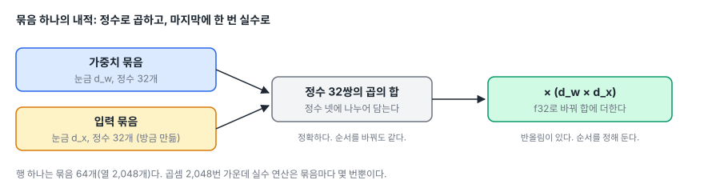
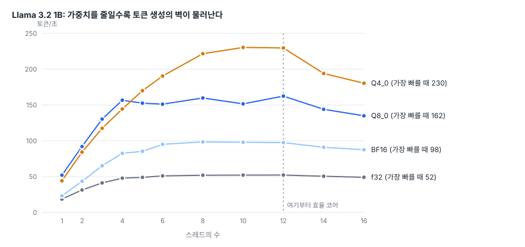
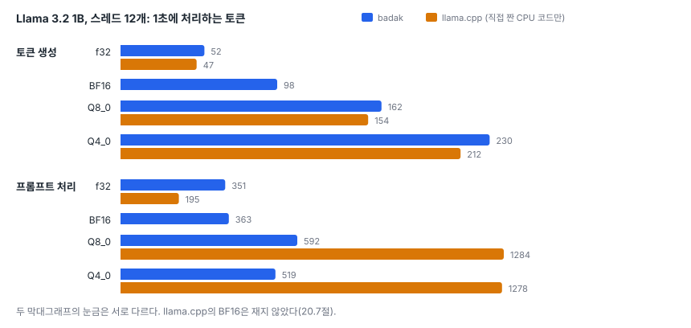

# LLM 가중치 양자화

[19장](ch19_quantization_theory.md)은 값을 줄여 적는 방법과 그때 생기는 오차를 다뤘고, 엔진은 건드리지
않았습니다. 이 장에서 엔진을 바꿉니다. 가중치를 16비트, 8비트, 4비트로
**줄인 채로 메모리에 두고, 줄인 채로 계산합니다.**

[18장](ch18_multithreading.md)이 끝났을 때 토큰 생성은 50.5토큰/초였고 메모리의 벽 앞에 서
있었습니다. 19.9절은 벽이 어디로 물러날지 어림했습니다. 16비트에서 111,
8.5비트에서 209토큰/초이고, 그 근처에서 계산이 다시 막기 시작해 4비트는
더 빨라지지 않을 것이라고 했습니다. 이 장에서 잽니다.

결과를 미리 적어 둡니다.

- BF16 가중치를 펼치지 않고 계산하면 토큰 생성이 52.5에서 96.2토큰/초가
  됩니다. 결과는 한 비트도 달라지지 않습니다.
- 8비트로 줄이면 160, 4비트로 줄이면 222토큰/초입니다. [18장](ch18_multithreading.md)의
  4.2배입니다.
- 우리가 양자화한 가중치는 llama.cpp가 만든 파일과 바이트 단위로
  같습니다.
- [19장](ch19_quantization_theory.md)의 예상은 절반만 맞았습니다. 틀린 절반이 더 쓸모 있습니다.
- 프롬프트 처리는 llama.cpp에 두 배 넘게 뒤집니다. [18장](ch18_multithreading.md)에서 앞섰던
  비교입니다.

| 하는 일 | 절 |
|---|---|
| BF16 가중치를 펼치지 않고 계산한다 | 20.1 |
| 값 32개를 묶는 형식 둘을 만든다 | 20.2 |
| 우리가 만든 묶음을 llama.cpp의 파일과 견준다 | 20.3 |
| 줄인 가중치와 어떻게 곱할지 정한다 | 20.4 |
| 정수 내적을 벡터 명령으로 짠다 | 20.5 |
| 점수가 얼마나 달라지는지 본다 | 20.6 |
| 속도를 재고 [19장](ch19_quantization_theory.md)의 예상과 견준다 | 20.7 |
| 더 정교한 형식을 읽어 본다 | 20.8 |
| 메모리와 읽는 시간을 잰다 | 20.9 |

코드는 `crates/badak_core/src/packed/`와 `crates/badak_core/src/simd/`에
있습니다.

## 20.1 BF16인 채로 계산한다

19.3절에서 두 가지를 확인했습니다. 이 모델의 가중치는 BF16으로 바꿔도
하나도 달라지지 않는다는 것, 그리고 파일의 BF16 값을 펼치지 않고 그대로
가리키는 텐서를 만들 수 있다는 것입니다. 남은 일은 그 텐서로 계산하는
것입니다.

[17장](ch17_simd.md)의 커널은 가중치를 `f32` 넷씩 레지스터에 읽어 들입니다. 가중치가
BF16이면 **읽는 순간에만 `f32`로 바꾸면** 됩니다. 9.3절에서 본 대로
BF16을 `f32`로 바꾸는 일은 아래 16비트에 0을 채우는 것이 전부입니다.

커널이 가중치를 읽는 한 곳을 가중치의 형에 맡깁니다.

```rust
{{#include ../../../crates/badak_core/src/simd/mod.rs:weight}}
```

`f32`는 [17장](ch17_simd.md)에서 하던 대로 읽습니다. `Bf16`은 16비트 넷을 읽어 32비트
넷으로 넓히고(`vmovl_u16`), 왼쪽으로 16비트 밀고(`vshlq_n_u32`), 그 비트를
`f32`로 읽습니다(`vreinterpretq_f32_u32`). 마지막 것은 명령이 아니라
"이 레지스터를 이제 실수로 보겠다"는 표시일 뿐이므로, 더해지는 명령은
둘입니다. x86 쪽도 같은 일을 AVX2 명령으로 합니다.

커널은 한 줄만 바뀝니다.

```rust
{{#include ../../../crates/badak_core/src/simd/neon.rs:dots}}
```

`vld1q_f32`로 읽던 자리가 `W::load_neon`이 되었습니다. [17장](ch17_simd.md)에서 고른 커널의
모양(입력 둘 × 가중치 넷), 가중치를 걷는 방법, [18장](ch18_multithreading.md)의 스레드 나누기는
그대로입니다. 기준 구현 `dots_portable`도 같은 식으로 `w.widen()`을
부릅니다.

### 같은 비트

펼친 값과 펼치지 않은 값이 같으므로, 계산의 순서가 같다면 결과도 비트
단위로 같아야 합니다.

```rust
{{#include ../../../crates/badak_core/src/simd/mod.rs:bf16_bits}}
```

이 테스트만이 아닙니다. [10장](../part2/ch10_forward_pass.md)의 대조, [11장](../part2/ch11_kv_cache.md)의 "캐시를 쓴 결과와 쓰지 않은
결과가 비트 단위로 같다"는 테스트가 모두 그대로 통과합니다. 엔진이 내는
점수 128,256개가 `f32`로 펼쳤을 때와 한 비트도 다르지 않습니다(20.6절).

### 연산자와 모델

[5장](../part1/ch05_operators.md)의 `linear`는 가중치로 `f32` 텐서만 받았습니다. 이제 가중치가 저장된
방식이 여럿이므로, 곱하는 일을 가중치 쪽에 맡깁니다.

```rust
{{#include ../../../crates/badak_core/src/ops.rs:linear_weight}}
```

```rust
{{#include ../../../crates/badak_core/src/packed/mod.rs:linear_weight}}
```

텐서는 자기 자료형을 보고 커널을 고릅니다. `Packed`와 `Matrix`는 다음
절부터 나옵니다. `linear`를 부르는 쪽, 곧 [9장](../part2/ch09_transformer.md)의 어텐션과 MLP는 한 글자도
바뀌지 않습니다.

모델을 읽을 때 행렬 가중치를 어떻게 둘지 고르게 합니다.

```rust
{{#include ../../../crates/badak_models/src/llama/mod.rs:weight_format}}
```

```rust
{{#include ../../../crates/badak_models/src/llama/mod.rs:matrix}}
```

기본값을 `Stored`로 바꿨습니다. 환경 변수 `BADAK_WEIGHTS`로 다른 방식을
고를 수 있어서, [14장](ch14_measurement.md)부터 써 온 측정 예제들을 고치지 않고 방식마다 돌릴 수
있습니다.

### 커널의 속도

가중치 `(8192, 2048)`을 스레드 하나로 곱하면서, 곱셈 하나에 드는
사이클과 명령을 쟀습니다.

```bash
cargo run --release -p badak_bench --example ch20_kernels
```

```text
{{#include output/ch20_kernels.txt:1:4}}
```

**벡터가 하나일 때 BF16이 더 빠릅니다.** 0.176사이클에서 0.132사이클로
줄었습니다. 명령은 0.64개에서 0.89개로 **늘었는데** 시간은 줄었습니다.
이 경우는 메모리에서 가중치가 오기를 기다리는 일이었고(17.5절), 읽을
양이 67MB에서 34MB로 줄었기 때문입니다.

**벡터가 64개일 때는 조금 느립니다.** 0.085에서 0.097사이클입니다. 이
경우는 가중치가 캐시에 머무는 동안 벡터들이 지나가므로 메모리를 기다리지
않습니다. 바꾸는 명령 둘의 값만 더해집니다.

[15장](ch15_bottleneck.md)의 두 한계가 한 표에 나란히 있습니다. 메모리에 막힌 일은 읽는 양을
줄이면 빨라지고, 계산에 막힌 일은 명령이 늘면 느려집니다.

모델 전체의 속도는 20.7절에서 다른 방식들과 함께 봅니다. 미리 말하면
토큰 생성이 96토큰/초가 됩니다. 아무것도 잃지 않고 얻은
속도입니다.

## 20.2 값 32개의 묶음

16비트 아래는 정수 양자화입니다. 19.7절에서 눈금을 값 32개마다 따로
정해야 한다는 것을 봤습니다. 그렇게 적은 묶음의 생김새를 정합니다.
llama.cpp가 쓰는 형식 둘을 그대로 따릅니다.[^llamacpp-blocks] 같은
바이트를 쓰면 20.3절에서 llama.cpp가 만든 파일과 곧바로 견줄 수 있습니다.


```rust
{{#include ../../../crates/badak_core/src/packed/mod.rs:format}}
```

### Q8_0

[19장](ch19_quantization_theory.md)의 "8비트, 32개마다"입니다. 묶음에서 가장 큰 절댓값을 127로 나눠
눈금의 크기로 삼고, 값마다 눈금의 크기로 나눠 반올림합니다.

```rust
{{#include ../../../crates/badak_core/src/packed/mod.rs:quantize_q8_0}}
```

[19장](ch19_quantization_theory.md)의 `Quantizer`와 다른 점이 셋 있습니다. 눈금의 크기를 16비트 실수로
줄여 적습니다. 나누는 대신 역수를 한 번 구해 곱합니다. 한가운데 값을
0에서 먼 쪽으로 반올림합니다. 어느 것도 더 낫거나 못한 선택이 아닙니다.
llama.cpp의 계산을 그대로 따른 것이고, 그래야 같은 바이트가 나옵니다.

눈금의 크기를 16비트로 줄이는 데는 생각할 거리가 하나 있습니다. 정수를
정할 때는 줄이기 전의 눈금으로 나누고, 되돌릴 때는 줄인 뒤의 눈금을
곱합니다. 둘이 조금 다릅니다. f16의 유효 숫자가 11비트이므로 차이는
2,000분의 1을 넘지 않고, 8비트 정수의 반 칸(254분의 1)에 견주면 작습니다.

### Q4_0

19.4절에서 대칭 눈금이 정수 하나를 버린다고 했습니다. 4비트는 16가지인데
-7부터 7까지 15가지만 썼습니다. `Q4_0`은 16가지를 다 씁니다.

```rust
{{#include ../../../crates/badak_core/src/packed/mod.rs:quantize_q4_0}}
```

4비트 정수는 -8부터 7까지입니다. 음수 쪽이 한 칸 깁니다. 묶음에서
절댓값이 가장 큰 값을 **긴 쪽의 끝, -8에** 놓습니다. 그 값이 음수이면
눈금의 크기는 양수이고 다른 형식과 다를 것이 없습니다. 그 값이 양수이면
눈금의 크기를 **음수로** 잡습니다. 그러면 양수인 값들이 음수 정수가
되고, 가장 큰 값이 -8이 됩니다. 눈금 전체를 뒤집어 놓은 것입니다.
되돌릴 때는 `눈금 × 정수`이므로 부호가 저절로 맞습니다.

이렇게 하면 가장 큰 값을 7이 아니라 8로 나누게 되어 눈금 한 칸이
8분의 7로 줄어듭니다. 대가도 있습니다. 가장 큰 값의 반대쪽 끝은 7까지만
갈 수 있으므로, 반대 부호로 가장 큰 값만큼 큰 값이 있으면 잘립니다.

저장할 때는 8을 더해 0부터 15까지로 옮기고, 둘씩 한 바이트에 넣습니다.
`i`번째 값과 `i + 16`번째 값이 한 바이트를 함께 씁니다. 이웃한 둘이
아니라 16칸 떨어진 둘인 데는 이유가 있고, 20.5절에서 드러납니다.

```rust
{{#include ../../../crates/badak_core/src/packed/mod.rs:dequantize}}
```

```rust
{{#include ../../../crates/badak_core/src/packed/mod.rs:block_tests}}
```

### 행렬

묶음들을 행렬로 모읍니다.

```rust
{{#include ../../../crates/badak_core/src/packed/mod.rs:packed}}
```

행 하나는 묶음 `열의 수 ÷ 32`개입니다. 열의 수가 32의 배수가 아니면
받지 않습니다. Llama 3.2 1B의 열은 2,048개와 8,192개, SmolLM2 135M은
576개와 1,536개로 모두 32의 배수입니다. 묶음마다 따로 계산하므로
양자화는 [18장](ch18_multithreading.md)의 풀에 나눠서 합니다.

모델의 가중치 자리에는 "어떤 방식으로든 저장된 행렬"이 들어갑니다.

```rust
{{#include ../../../crates/badak_core/src/packed/mod.rs:matrix}}
```

`lookup`은 임베딩 표에서 행을 뽑는 일입니다. 묶음으로 적은 표에서는 뽑은
행만 `f32`로 되돌립니다. 10.2절에서 이 모델은 임베딩 표와 출력 층이
같은 가중치를 쓴다고 했습니다. 표를 양자화하면 출력 층도 양자화된
가중치로 계산합니다. 값이 2.6억 개로 전체의 21%이니 줄이지 않을 수
없습니다.

## 20.3 llama.cpp의 파일과 같은가

[13장](../part2/ch13_first_showdown.md)에서 llama.cpp에 넣으려고 가중치를 GGUF 파일로 바꿔 두었습니다.
llama.cpp의 도구로 그 파일을 `Q8_0`과 `Q4_0`으로 양자화합니다.

```bash
sh scripts/quantize_gguf.sh
```

같은 `f32` 값을 우리 손으로 묶어, 파일의 바이트와 견줍니다. 파일에서
양자화된 텐서의 바이트를 꺼내는 길을 하나 냅니다.

```rust
{{#include ../../../crates/badak_formats/src/gguf.rs:bytes_from}}
```

걸리는 것이 하나 있습니다. 13.3절에서 본 대로 질의와 키의 가중치는
GGUF 파일에서 행의 순서가 다릅니다. 견주기 전에 같은 순서로 옮겨
적습니다.

```rust
{{#include ../../../crates/badak_models/examples/ch20_files.rs:names}}
```

```rust
{{#include ../../../crates/badak_models/examples/ch20_files.rs:compare}}
```

```bash
cargo run --release -p badak_models --example ch20_files
```

```text
{{#include output/ch20_files_llama32.txt:1:11}}
```

**`Q8_0` 파일의 행렬 113개, 13억 바이트가 모두 같습니다.** `Q4_0` 파일도
견준 112개가 모두 같습니다. 우리가 만든 양자화는 llama.cpp의 것과 같은
일을 합니다.

이 대조는 눈으로 코드를 읽어서는 얻기 어려운 확신을 줍니다. 반올림을
어느 쪽으로 하는지, 나누는지 역수를 곱하는지, 16비트로 줄이는 것이 언제
인지가 하나라도 다르면 13억 바이트 가운데 어딘가가 달라집니다.

두 가지를 덧붙입니다.

**`F32`로 남은 텐서 34개는 벡터입니다.** 정규화의 가중치 33개와 위치를
회전으로 나타낼 때 쓰는 값 하나입니다. llama.cpp도 1차원 텐서와 정규화의
가중치는 양자화하지 않습니다.[^llamacpp-which]

**`Q4_0` 파일에서 텐서 하나는 `Q4_0`이 아닙니다.** 임베딩 표가 `Q6_K`라는
6비트 형식으로 적혀 있습니다. llama.cpp는 임베딩 표가 출력 층을 겸하는
모델에서 그 표에 비트를 더 줍니다.[^llamacpp-which] 출력 층의 오차는
점수에 곧바로 나타나기 때문일 것입니다. 우리는 이 장에서 임베딩 표도
같은 형식으로 줄입니다. 20.6절에서 llama.cpp와 점수를 견줄 때 이 차이를
기억해야 합니다.

## 20.4 줄인 가중치와 곱하기

19.9절에서 길이 둘 남았습니다. 입력 `x`를 `f32`로 두고 가중치의 정수를
실수로 바꿔 곱하는 길, 그리고 입력도 그 자리에서 정수로 바꿔 정수끼리
곱하는 길입니다.

20.1절의 BF16은 앞의 길입니다. 읽으면서 `f32`로 바꿨고 명령 둘이
들었습니다. 8비트 정수를 `f32`로 바꾸는 데는 더 듭니다. 8비트를 16비트로,
다시 32비트로 넓히고, 실수로 바꿔야 합니다. 레지스터 하나에 든 8비트
16개가 `f32` 넷짜리 레지스터 넷이 됩니다. 4비트는 먼저 바이트에서
꺼내기까지 해야 합니다. 벡터가 64개일 때 BF16의 명령 둘이 14%를 느리게
한 것을 방금 봤습니다.

뒤의 길을 갑니다. llama.cpp가 CPU에서 가는 길이기도 합니다. 이유는
계산의 생김새에 있습니다.



**정수끼리의 곱셈은 한 번에 훨씬 많이 할 수 있습니다.** 레지스터 하나에
`f32`는 넷, 8비트 정수는 열여섯이 들어갑니다. 그리고 ARM과 x86에는
8비트 정수 여러 쌍을 곱해 더하는 일을 한 번에 하는 명령이 있습니다.

**정수의 덧셈은 순서를 바꿔도 결과가 같습니다.** [16장](ch16_matmul.md)부터 지켜 온 "같은
비트" 약속에서 가장 까다로웠던 것이 덧셈의 순서였습니다. 실수는 더하는
순서에 따라 마지막 자리가 달라져서, 합을 몇 개에 나누어 담고 어떤 순서로
모으는지를 정의에 적어야 했습니다(17.3절). 정수에는 그 문제가 없습니다.
넘치지만 않으면 어떻게 묶어 더해도 같은 값입니다. 8비트 정수 둘의 곱은
많아야 16,129이고 32쌍을 더해도 52만이므로 32비트 정수에서 넘칠 일이
없습니다.

### 입력을 정수로

곱하기 직전에 입력 벡터를 가중치와 같은 방법으로 묶습니다.

```rust
{{#include ../../../crates/badak_core/src/packed/mod.rs:activations}}
```

가중치의 `Q8_0`과 두 가지가 다릅니다. 저장할 것이 아니므로 눈금의 크기를
16비트로 줄이지 않습니다. 한가운데 값은 짝수 쪽으로 반올림합니다. ARM과
x86의 벡터 명령이 기본으로 하는 반올림이 그쪽이어서, 나중에 이 일을 벡터
명령으로 짜더라도 같은 정수가 나옵니다.

입력 벡터 하나는 2,048개의 값입니다. 가중치의 8,192행이 모두 이 정수들을
함께 쓰므로, 바꾸는 값은 곱셈에 견주어 8,192분의 1입니다.

입력을 8비트로 줄이면 오차가 더해집니다. 19.7절의 표로 어림할 수
있습니다. 값 32개마다 눈금을 정한 8비트의 SQNR이 45dB였습니다. 가중치가
`Q8_0`이면 두 오차가 비슷한 크기이고, `Q4_0`(20dB 남짓)이면 가중치의
오차가 300배쯤 커서 입력의 오차는 묻힙니다. 20.6절에서 잽니다.

### 계산의 정의

17.3절에서 한 것처럼, 빠른 구현을 짜기 전에 계산을 정의합니다.

```rust
{{#include ../../../crates/badak_core/src/packed/mod.rs:dot_q8_0}}
```

묶음마다 정수 32쌍의 곱을 정수로 더하고, 그 합을 한 번 `f32`로 바꿔 두
눈금의 크기의 곱을 곱합니다. 19.9절의 식 `scale × Σ q × x`에서 `x`도
정수가 된 꼴입니다.

정의에 적어야 하는 순서는 실수 연산 셋뿐입니다. 눈금끼리 곱하고, 정수
합에 곱하고, 행의 합에 더합니다. 묶음을 앞에서부터 차례로 더합니다.
FMA를 쓰지 않고 곱하기와 더하기를 따로 반올림한다고 정했습니다. FMA가
없는 프로세서에서도 같은 비트가 나오게 하려는 것이고, 묶음마다 한 번뿐인
연산이라 잃는 것이 없습니다.

```rust
{{#include ../../../crates/badak_core/src/packed/mod.rs:dot_q4_0}}
```

`Q4_0`은 바이트에서 값 둘을 꺼내는 것만 다릅니다.

행렬 전체의 곱은 이 내적을 행마다, 벡터마다 부르고, [18장](ch18_multithreading.md)에서 만든
방법으로 행을 스레드에 나눕니다.

```rust
{{#include ../../../crates/badak_core/src/packed/mod.rs:packed_linear}}
```

18.4절에서 행을 나누는 코드를 쓸 때 가중치가 `f32`라는 것을 전제로
했습니다. 그 부분을 떼어 "행의 구간을 받아 결과를 채우는 함수"만 받게
고쳤습니다.

```rust
{{#include ../../../crates/badak_core/src/simd/mod.rs:split_rows}}
```

## 20.5 정수 내적을 벡터 명령으로

기준 구현을 20.1절과 같은 방법으로 쟀습니다.

```text
{{#include output/ch20_kernels.txt:2:2}}
{{#include output/ch20_kernels.txt:5:5}}
{{#include output/ch20_kernels.txt:7:7}}
```

**`Q8_0`의 기준 구현은 벡터 명령을 직접 쓰지 않았는데 0.126사이클입니다.**
`f32` 커널(0.176)보다 빠릅니다. 17.4절의 기준 구현이 0.37사이클로
손으로 짠 것의 4분의 1 속도였던 것과 다릅니다. 정수의 덧셈은 순서를
바꿔도 되므로 **컴파일러가 스스로 벡터 명령을 씁니다.** 16.1절에서 실수의
합을 여러 변수에 나누어 담아 가며 컴파일러에게 부탁했던 일을, 정수에서는
부탁하지 않아도 해 줍니다.

**`Q4_0`의 기준 구현은 0.80사이클로 여섯 배 느립니다.** 바이트에서 4비트
둘을 꺼내는 일이 끼어들자 컴파일러가 벡터 명령으로 바꾸지 못했습니다.

두 형식 모두 손으로 짭니다. 쓸 명령은 ARM의 `SDOT`입니다. Rust에서는
`vdotq_s32`입니다.[^sdot] 8비트 정수 16쌍을 곱해 네 쌍씩 더한 32비트 합
넷을 냅니다. 명령 하나가 곱셈 16번입니다. [17장](ch17_simd.md)의 FMA는 명령 하나에
곱셈 넷이었습니다.

`Q4_0`의 바이트 배치가 여기서 뜻을 드러냅니다. 묶음의 16바이트를 레지스터
하나에 읽어, 아래 4비트만 남기면 앞 16개의 값이 한 레지스터에 놓이고,
오른쪽으로 4비트 밀면 뒤 16개의 값이 한 레지스터에 놓입니다. 명령
둘로 32개를 다 꺼냅니다. 이웃한 값 둘을 한 바이트에 넣었다면 꺼낸 뒤에
자리를 다시 맞춰야 했을 것입니다. 형식이 벡터 명령에 맞춰 설계된
것입니다.

### 세 번 짰다

처음 짠 커널은 기준 구현을 명령으로 옮겨 적은 것이었습니다. 묶음마다
`vdotq_s32` 두 번으로 정수 합 넷을 얻고, 그 넷을 하나로 더해 꺼내고,
눈금의 크기를 [19장](ch19_quantization_theory.md)의 `f16_to_f32`로 바꿔 곱했습니다. 재 보니
0.124사이클, 곱셈당 명령 1.19개였습니다. **컴파일러가 만든 것(0.126,
1.13개)과 같았습니다.**

명령 1.19개는 묶음 하나에 38개입니다. 곱셈 32번은 명령 둘이면 되는데
38개를 쓰고 있었습니다. 어디에 쓰이는지 보려고 눈금의 크기를 바꾸는
줄을 아무 계산으로나 바꿔 치워 봤습니다. 0.69개가 되었습니다. **16비트
실수 하나를 `f32`로 바꾸는 데 명령 16개를 쓰고 있었습니다.** 19.2절의
함수는 지수가 0인 경우와 무한대를 가리느라 갈림길이 있고, 묶음마다
불립니다. 나머지도 사정이 비슷했습니다. 정수 합을 벡터 레지스터에서
보통의 레지스터로 꺼냈다가, 실수로 바꾸려고 다시 실수 쪽 레지스터로
보내고 있었습니다.

두 번째로 짤 때는 **값을 벡터 레지스터 밖으로 꺼내지 않았습니다.**
16비트 실수를 `f32`로 바꾸는 명령(`vcvt_f32_f16`)이 따로 있습니다. 정수
넷을 실수 넷으로 바꾸는 명령(`vcvtq_f32_s32`)도 있습니다. 0.082사이클,
명령 0.60개가 되었습니다.

세 번째가 지금의 것입니다. 16.2절과 17.5절에서 배운 것을 다시 씁니다.
**내적 여러 개를 한꺼번에 계산합니다.**

```rust
{{#include ../../../crates/badak_core/src/packed/neon.rs:four}}
```

레지스터의 네 칸에 내적 **넷**의 합을 하나씩 담습니다. `vdotq_s32`가 낸
"내적 하나의 합 넷"을 `vpaddq_s32` 세 번으로 "내적 넷의 합 하나씩"으로
바꿉니다. 그 뒤의 실수 연산(바꾸기, 곱하기, 더하기)은 내적 넷에 대해 한
번씩만 합니다. 눈금의 크기 넷도 한 레지스터에 모아 한 번에 바꿉니다.

칸마다의 계산은 기준 구현과 같은 순서입니다. 정수 합은 어떻게 묶어
더하든 같고, 그 뒤의 실수 연산 셋은 칸마다 따로 일어나며 순서가 같습니다.
그래서 내적을 몇 개씩 묶든, 하나씩 계산하든 같은 비트가 나옵니다.

내적 넷을 고르는 방법이 둘입니다.

```rust
{{#include ../../../crates/badak_core/src/packed/neon.rs:piece}}
```

벡터가 하나이면 가중치 네 행과 곱합니다. 17.5절에서 찾은 대로 멀리
떨어진 네 줄기에서 한 행씩 가져옵니다. 벡터가 여럿이면 이웃한 두 행과
벡터 둘을 묶습니다.

```text
{{#include output/ch20_kernels.txt:2:2}}
{{#include output/ch20_kernels.txt:5:8}}
```

| `Q8_0`, 벡터 하나 | 곱셈당 사이클 | 곱셈당 명령 |
|---|---|---|
| 기준 구현 (컴파일러가 벡터 명령으로 바꿈) | 0.126 | 1.13 |
| 처음 짠 것: 정수와 눈금을 레지스터 밖으로 꺼냄 | 0.124 | 1.19 |
| 두 번째: 벡터 레지스터 안에서 끝냄 | 0.082 | 0.60 |
| 세 번째: 내적 넷을 한꺼번에 | 0.059 | 0.33 |

앞의 두 줄은 저장소에 남아 있지 않은 코드의 측정입니다. 과정을 적어 둔
것은 **벡터 명령을 쓴다고 빨라지는 것이 아니기** 때문입니다. 처음 짠
커널은 곱셈을 명령 둘로 끝내 놓고 그 주변에서 서른여섯 개를 썼습니다.
곱셈이 싸질수록 곱셈이 아닌 것이 드러납니다.

**`Q4_0`은 0.80에서 0.071사이클로 11배 빨라졌습니다.** `Q8_0`보다 조금
느린 것은 바이트에서 값을 꺼내는 명령 넷 때문입니다.

x86용도 짰습니다. AVX2에는 부호 있는 8비트끼리 곱하는 명령이 없어서
요령이 하나 필요합니다. 코드는 `packed/avx2.rs`에 있습니다. [17장](ch17_simd.md)과
마찬가지로 이 책의 기계에서는 실행할 수 없고, CI의 x86 기계에서 아래
테스트가 기준 구현과 같은 비트를 내는지 확인합니다. 정수 계산이라
[17장](ch17_simd.md)보다 마음이 놓입니다. 맞춰야 하는 것이 실수 연산 셋의 순서뿐입니다.

```rust
{{#include ../../../crates/badak_core/src/packed/mod.rs:same_bits}}
```

## 20.6 점수는 얼마나 달라지는가

19.8절과 같은 글, 같은 잣대로 봅니다. 이번에는 흉내가 아니라 줄인
가중치로 정말 계산한 결과입니다. 견줄 대상을 둘 더 넣었습니다. 가중치만
줄이고 입력은 `f32`로 둔 계산(19.8절의 방법), 그리고 20.3절의 파일을
llama.cpp에 넣은 결과입니다.

```rust
{{#include ../../../crates/badak_models/examples/ch20_accuracy.rs:ours}}
```

```bash
cargo run --release -p badak_models --example ch20_accuracy
```

```text
{{#include output/ch20_accuracy_llama32.txt:1:13}}
```

**BF16은 모든 비트가 같습니다.** 20.1절에서 말한 대로입니다.

**`Q8_0`은 점수를 1.6% 바꿉니다.** 가중치만 줄였을 때가 1.1%이니 입력을
8비트로 바꾼 몫이 그만큼 더해졌습니다. 20.4절에서 "두 오차가 비슷한
크기"라고 어림한 대로입니다. " Paris"의 확률은 69.95%에서 72.04%가
됩니다.

**`Q4_0`에서는 입력의 오차가 보이지 않습니다.** 가중치만 줄인 것이 15%,
입력도 줄인 것이 14%입니다. 가중치의 오차가 훨씬 커서 입력의 오차는
그 안에 묻힙니다.

**`Q4_0`은 [19장](ch19_quantization_theory.md)의 4비트보다 낫습니다.** 19.8절에서 4비트(32개마다)는
점수의 오차가 18%이고 " Paris"의 확률이 57.7%로 떨어졌습니다. `Q4_0`은
15%와 71.5%입니다. 버리던 정수 하나를 살린 값입니다.

**llama.cpp와 같은 자리에 있습니다.** `Q8_0`에서 우리가 `1.6e-2`,
llama.cpp가 `1.5e-2`입니다. 이어 쓴 글이 `f32`와 갈라지는 자리도 둘 다
13번째 토큰입니다.

같은 가중치로 계산했는데 점수가 얼마나 다른지도 봅니다.

```text
{{#include output/ch20_accuracy_llama32.txt:15:18}}
```

13.3절에서 `f32` 가중치로 견줬을 때는 두 엔진이 모두 기준에서 `2e-6`
안에 있었습니다. 여기서는 `Q8_0`에서 두 엔진이 서로 `1.2e-2` 다릅니다.
수천 배입니다. 가중치의
바이트가 같은데도 그렇습니다.

두 엔진이 입력을 정수로 바꾸는 방법이 조금 다릅니다. llama.cpp는 입력
쪽 눈금의 크기도 16비트로 줄이고, 우리는 줄이지 않습니다. 실수 합을
모으는 순서도 다릅니다. 그런 차이가 값 하나를 눈금의 이쪽이 아니라
저쪽으로 보내면 그 값은 반 칸이 아니라 한 칸 달라집니다. 블록 열여섯
개를 지나며 그런 일이 쌓입니다. 표의 왼쪽 열이 실마리입니다. 입력을
8비트로 바꾼 몫이 `9.7e-3`이고, 두 엔진의 차이가 그와 같은 크기입니다.
**두 엔진은 양자화가 만드는 오차의 크기 안에서 서로 다릅니다.** 이것은
해석이고, 층마다 따라가며 확인하지는 않았습니다.

여기서 [13장](../part2/ch13_first_showdown.md)의 검증 방법이 한계에 닿습니다. `f32`에서는 "두 엔진의 점수가
`1e-4` 안에서 같다"로 구현이 옳은지 확인했습니다. 양자화한 계산에서는
옳은 구현 둘이 1% 다릅니다. 그래서 이 장은 검증을 둘로 나눴습니다.
**가중치는 바이트가 같은지로**(20.3절), **계산은 기준 구현과 비트가
같은지로**(20.5절) 확인합니다. 점수는 "같은 자리에 있는가"까지만 봅니다.

`Q4_0`의 차이(`5e-2`)가 더 큰 데는 까닭이 하나 더 있습니다. 20.3절에서
본 대로 llama.cpp의 파일은 임베딩 표가 6비트이고 우리는 4비트입니다.

표의 마지막 줄 `Q4_K_M`은 20.8절에서 다룹니다.

## 20.7 속도

14.11절의 기준 측정을 방식마다 합니다.

```bash
BADAK_WEIGHTS=q8_0 cargo run --release -p badak_models --example ch14_baseline -- llama32_1b 15
```

| Llama 3.2 1B | 값당 비트 | 토큰 생성 (토큰/초) | 프롬프트 처리 (토큰/초) |
|---|---|---|---|
| `f32`로 펼침 ([18장](ch18_multithreading.md)) | 32 | 52.5 | 450 |
| BF16 그대로 | 16 | 96.2 | 395 |
| `Q8_0` | 8.5 | 160.1 | 613 |
| `Q4_0` | 4.5 | 221.5 | 566 |

기록은 `bench/baseline/badak_llama32_ch20_*.txt`에 있습니다.

**토큰 생성이 52.5에서 221.5토큰/초가 되었습니다.** 4.2배입니다. BF16으로
1.8배, `Q8_0`으로 3.0배입니다. [16장](ch16_matmul.md)부터 [18장](ch18_multithreading.md)까지 커널과 스레드로 얻은
것이 1.76에서 50.5였고, 그 뒤로는 계산을 아무리 다듬어도 움직이지 않던
숫자입니다. 15.7절이 양자화를 "토큰 생성을 빠르게 만드는 거의 유일한
기술"이라고 한 까닭이 여기 있습니다.

**프롬프트 처리는 방식에 따라 오르내립니다.** BF16은 12% 느려졌습니다.
20.1절에서 본 대로 메모리에 막히지 않은 일에서는 바꾸는 명령의 값만
더해집니다. 정수 커널은 `f32` 커널보다 빨라서 `Q8_0`이 1.4배입니다.

스레드의 수를 바꿔 가며 봅니다.

```bash
BADAK_WEIGHTS=q4_0 cargo run --release -p badak_models --example ch18_scaling
```



```text
{{#include output/ch20_scaling_q8_0.txt:12:23}}
```

```text
{{#include output/ch20_scaling_q4_0.txt:12:23}}
```

18.8절에서 `f32`의 토큰 생성은 스레드 넷에서 멈췄습니다. 줄일수록 멈추는
자리가 뒤로 갑니다. BF16은 여섯에서 여덟, `Q4_0`은 열에서 멈춥니다.
읽을 양이 줄어 메모리가 늦게 차고, 그때까지는 코어를 더 넣는 만큼
빨라집니다.

18.10절에서 토큰 생성에 쓸 스레드의 기본값을 여섯으로 정했습니다. `f32`
에서는 그 뒤로 얻을 것이 없었기 때문입니다. 이제는 있습니다. **기본값을
여덟으로 올렸습니다.** `Q4_0`은 열에서 가장 빠르지만 여덟과 4% 차이이고,
`f32`와 BF16은 여덟에서 이미 다 얻습니다. 위의 기준 측정은 이 기본값으로
잰 것입니다.

### 19장의 예상과 견준다

19.9절의 표에 측정을 붙입니다. 측정은 스레드 수를 바꿔 가며 잰 것
가운데 가장 빠른 값입니다.

| 가중치 하나 | 메모리의 상한 | 계산의 상한 | 예상 | 측정 |
|---|---|---|---|---|
| 32비트 | 55.6 | 228 | 55.6 | 52.2 |
| 16비트 (BF16) | 111 | 228 | 111 | 98.5 |
| 8.5비트 (`Q8_0`) | 209 | 228 | 209 근처 | 162.4 |
| 4.5비트 (`Q4_0`) | 395 | 228 | 228 | 230.4 |

**16비트까지는 예상대로입니다.** 상한의 89~94%에 있습니다.

**`Q8_0`은 예상(209)에 못 미칩니다.** 162에서 멈춥니다. 그때 메모리에서
읽는 양은 1초에 213GB로, 15.2절에서 잰 한계 275GB의 77%입니다. 기준
측정의 IPC가 2.64로, 계산에 바쁜 `Q4_0`(4.47)보다 낮습니다. 코어들이
기다리고 있다는 뜻입니다. llama.cpp도 같은 파일로 171에서 멈춥니다
(아래 표). 메모리의 한계 근처에서 멈춘 것으로 보이지만, 왜 275가 아니라
213에서인지는 확인하지 않았습니다. 15.2절은 큰 배열 하나를 읽는
측정이었고, 여기서는 스레드마다 행 넷을 번갈아 읽으면서 입력의 정수와
결과도 드나듭니다.

**`Q4_0`의 예상은 숫자만 맞고 까닭이 틀렸습니다.** 19.9절은 "8비트
근처에서 두 한계가 만나고 4비트는 더 빨라지지 않는다"고 했습니다.
4비트는 8비트보다 1.4배 빠릅니다. 예상에 쓴 "계산의 상한 228"은 `f32`
커널의 속도(곱셈당 0.17사이클)에서 나왔는데, 정수 커널은 곱셈당
0.06~0.07사이클로 두세 배 빠릅니다. 계산의 상한은 228이 아니라
600쯤이었습니다. `Q4_0`이 230에서 멈춘 것은 그 상한 때문이 아닙니다.
그때 읽는 양은 1초에 161GB로 메모리의 한계에도 한참 못 미칩니다.

그러면 무엇이 막고 있을까요. 토큰 하나에 4.3밀리초입니다. 선형 층을
113번 지나니 한 번에 38마이크로초입니다. 18.3절에서 일을 나눠 주는 데
2~4마이크로초가 들었고, 입력을 정수로 바꾸는 일과 어텐션, 활성화 함수는
나누지 않았거나 한 스레드가 합니다. 곱셈이 빨라질수록 18.9절에서 본
것처럼 **곱셈이 아닌 것들의 비중이 커집니다.** 프로파일에서 선형 층의
비중이 `f32`일 때 97%에서 `Q4_0`에서 90%로 내려왔습니다.

```text
{{#include output/ch20_profile_tg_q4_0.txt:18:23}}
```

[15장](ch15_bottleneck.md)에서 한계를 계산할 때는 토큰 생성이 "메모리에서 읽는 일"
하나였습니다. 읽는 양을 일곱 분의 일로 줄이자 그 하나가 더는 전부가
아니게 되었습니다. 예상이 틀린 자리가 다음에 볼 곳을 알려 줍니다.

### llama.cpp와 견준다

13.5절의 "직접 짠 CPU 코드만" 빌드로 같은 모델의 파일들을 쟀습니다.

```bash
sh scripts/bench_llama_cpp_quantized.sh
```

| llama.cpp, 토큰/초 | 스레드 | `f32` | `Q8_0` | `Q4_0` | `Q4_K_M` |
|---|---|---|---|---|---|
| 토큰 생성 | 1 | 13.8 | 53.0 | 46.4 | 42.0 |
| | 6 | 51.3 | 171.4 | 211.2 | 183.1 |
| | 12 | 47.4 | 154.1 | 211.6 | 208.4 |
| 프롬프트 처리 | 1 | 19.0 | 137.4 | 135.3 | 102.3 |
| | 6 | 110.8 | 778.4 | 759.3 | 576.8 |
| | 12 | 195.4 | 1,284 | 1,278 | 963.6 |

기록은 `bench/ch20/llama_cpp_llama32.txt`에 있습니다. BF16 파일은 재지
못했습니다. 이 빌드에서 스레드 하나의 첫 측정이 20분이 지나도 끝나지
않았습니다. llama.cpp에서 BF16은 빠른 길이 마련된 형식이 아닌
모양입니다.



| 스레드 12개, 토큰/초 | badak | llama.cpp | |
|---|---|---|---|
| 토큰 생성, `Q8_0` | 162.4 | 154.1 | 1.05배 |
| 토큰 생성, `Q4_0` | 229.7 | 211.6 | 1.09배 |
| 프롬프트 처리, `Q8_0` | 592.4 | 1,284 | 0.46배 |
| 프롬프트 처리, `Q4_0` | 519.0 | 1,278 | 0.41배 |

**토큰 생성은 같은 자리입니다.** 5~9% 앞서지만 llama.cpp는 스레드
여섯에서 더 빠른 경우도 있어(`Q8_0` 171), 가장 좋은 값끼리 견주면 거의
같습니다. 둘 다 같은 벽에 닿아 있습니다.

**프롬프트 처리는 llama.cpp가 두 배 넘게 빠릅니다.** 18.12절에서 `f32`로
1.76배 앞섰던 비교가 뒤집혔습니다. 스레드 하나에서 이미 그렇습니다.
우리가 70토큰/초, llama.cpp가 137토큰/초입니다. 137토큰/초는 곱셈
하나에 0.03사이클이고, 우리 커널의 0.05~0.06사이클의 절반입니다.

차이가 나는 곳을 하나는 찾았습니다. ARM에는 8비트 정수의 **작은 행렬
곱**을 한 번에 하는 명령이 있습니다. 두 행과 두 열, 내적 넷을 명령
하나로 계산합니다. llama.cpp는 프로세서에 이 명령이 있으면 가중치를 두
행씩 읽는 커널을 씁니다.[^llamacpp-i8mm] 우리가 `vdotq_s32` 여덟 번과
`vpaddq_s32` 세 번으로 하는 일입니다. 이 명령의 Rust 함수(`vmmlaq_s32`)는
이 책을 쓰는 시점의 안정판에서 쓸 수 없습니다.[^rust-i8mm] 그 밖에
무엇이 더 있는지는 살피지 않았습니다. [25장](ch25_rematch.md)에서 다시 겨룰 때 볼 일입니다.

## 20.8 더 정교한 4비트: K-양자화

[13장](../part2/ch13_first_showdown.md)에서 받아 둔 `Q4_K_M` 파일은 llama.cpp를 쓰는 사람들이 가장 흔히
쓰는 종류입니다. 여기 쓰인 형식들을 K-양자화라고 부릅니다.[^kquants]
이 장에서는 그 가운데 `Q4_K`를 **읽기만** 합니다. 이 형식으로 빠르게
계산하는 커널은 만들지 않습니다.

`Q4_K`는 `Q4_0`과 같이 값 하나에 4.5비트를 쓰는데, 그 비트를 다르게
나눠 씁니다.

| | `Q4_0` | `Q4_K` |
|---|---|---|
| 묶음 하나 | 값 32개, 18바이트 | 값 256개, 144바이트 |
| 눈금 | 값 32개마다 하나, 16비트 실수 | 값 32개마다 하나, **6비트 정수** |
| 최솟값 | 없음 (0이 가운데) | 값 32개마다 하나, 6비트 정수 |
| 눈금들의 눈금 | 없음 | 값 256개마다 16비트 실수 둘 |
| 값 | -8 ~ 7 | 0 ~ 15 |

[19장](ch19_quantization_theory.md)의 낱말로 읽으면 이렇습니다. **비대칭 눈금입니다**(19.4절). 값 32개의
작은 묶음마다 눈금의 크기와 최솟값을 따로 둡니다. 0을 가운데 두지 않아도
되므로 정수 16가지를 그 묶음의 값이 실제로 퍼진 구간에 다 씁니다.
**눈금을 다시 양자화합니다**([19장](ch19_quantization_theory.md)의 연습 문제 9). 작은 묶음 여덟 개의
눈금과 최솟값 열여섯 개를 6비트씩으로 줄이고, 그것들의 눈금 둘만
16비트로 적습니다. `Q4_0`이 눈금에 쓰던 값당 0.5비트로 눈금과 최솟값을
둘 다 담습니다.

```rust
{{#include ../../../crates/badak_core/src/packed/mod.rs:q4_k}}
```

되돌리는 식은 `눈금 × 정수 − 최솟값`입니다. 6비트 열여섯 개를 12바이트에
담느라 비트를 접어 넣은 부분이 조금 복잡하고, 나머지는 `Q4_0`과
비슷합니다.

파일을 만드는 쪽이 더 큰 차이입니다. `Q4_0`은 가장 큰 값에서 눈금을
곧바로 정했습니다. `Q4_K`는 작은 묶음마다 눈금과 최솟값의 후보를 여러
개 넣어 보고 오차가 가장 작은 것을 고릅니다.[^llamacpp-kquants]
19.6절에서 본 "눈금의 끝을 당기면 좋아진다"를 묶음마다 찾는 것입니다.
그 코드는 옮기지 않았습니다.

llama.cpp가 만든 `Q4_K`를 우리가 되돌려, 원래 값과의 오차를 잽니다.

```text
{{#include output/ch20_files_llama32.txt:13:22}}
```

**같은 4.5비트로 SQNR이 20.0dB에서 22.8dB까지 오릅니다.** 정수 하나를
살려서 1.1dB(`Q4_0`), 눈금을 찾고 비대칭으로 놓아서 다시 1.7dB(`Q4_K`)
입니다. 19.5절의 어림으로 2.8dB는 비트 반 개입니다. 비트를 늘리지 않고
얻었습니다.

**`Q4_K_M`은 한 가지 형식이 아닙니다.** 행렬 113개 가운데 96개가
`Q4_K`이고 17개가 6비트인 `Q6_K`입니다. 임베딩 표와, 블록 몇 개의 값
가중치(`attn_v`), MLP의 마지막 층(`ffn_down`)에 비트를 더 줬습니다.
이름 끝의 `M`이 그 섞는 방법을 가리킵니다. 어떤 가중치가 오차에 더
민감한지를 따져서 고른 것이고, [21장](ch21_quantization_quality.md)에서 우리도 그것을 재 봅니다.

20.6절의 표에서 `Q4_K_M`의 점수 오차는 11%로 `Q4_0`의 14%보다
작았습니다. " Paris"의 확률은 오히려 낮았습니다(62.9% 대 71.4%). 글
하나에서 본 확률 하나로는 어느 쪽이 낫다고 말할 수 없다는 것을 19.8절에서
이미 봤습니다.

20.7절의 표를 보면 llama.cpp에서 `Q4_K_M`의 프롬프트 처리가 `Q4_0`보다
25% 느립니다. 정확도를 얻은 대신 계산이 조금 더 복잡해졌습니다. 최솟값을
빼는 항이 하나 더 있고(19.9절), 6비트 눈금을 꺼내야 합니다.

## 20.9 메모리와 읽는 시간

속도 말고 얻은 것이 하나 더 있습니다.

```bash
cargo build --release -p badak_models --examples
sh scripts/measure_ch20_memory.sh
```

```text
{{#include output/ch20_memory_llama32.txt}}
```

"메모리 최대치"는 10.3절과 같이 운영체제가 알려 주는 값입니다. 이
프로세스만의 메모리, 곧 다른 곳에서 다시 가져올 수 없어서 운영체제가
지켜 줘야 하는 메모리를 셉니다.

**BF16 그대로는 0.01GB입니다.** 잘못 잰 것이 아닙니다. 가중치 2.47GB는
파일을 비춘 메모리에 있고(6.5절), 그것은 "이 프로세스만의 메모리"가
아닙니다. 파일에 그대로 있는 내용이므로 메모리가 모자라면 운영체제가
버렸다가 필요할 때 파일에서 다시 읽으면 됩니다. 물론 계산하는 동안에는
그 2.47GB가 실제 메모리에 올라와 있어야 빠릅니다. 올라와 있되 **언제든
내줄 수 있는** 메모리입니다. 10.3절에서 5.0GB였던 숫자가 이렇게
되었습니다. 9.3절과 10.3절의 빚을 여기서 갚습니다. 읽는 시간도 0.43초에서
0.01초가 되었습니다.

**`Q8_0`과 `Q4_0`은 가중치보다 훨씬 많이 씁니다.** 가중치는 1.31GB와
0.70GB인데 최대치가 2.46GB와 1.97GB입니다. 읽는 시간도 1.2초로 가장
깁니다. 읽을 때마다 양자화하기 때문입니다. 텐서 하나를 `f32`로 펼쳐
(임베딩 표는 1.05GB입니다) 묶음으로 적고, 펼친 것을 버립니다. 그 잠깐의
메모리가 최대치에 잡힙니다.

실전에서는 이렇게 하지 않습니다. 양자화는 한 번 해서 파일로 적어 두고,
그 파일을 BF16처럼 비춰 씁니다. 그러면 읽는 시간도, 프로세스의 메모리도
0에 가까워집니다. 이 책에서는 [22장](ch22_memory.md)에서 메모리를 다룰 때 묶음으로 적은
가중치를 파일에 두는 일을 함께 합니다. 20.3절에서 우리 묶음이 GGUF의
것과 바이트가 같음을 확인했으니, 읽을 파일의 형식은 이미 정해져
있습니다.

## 20.10 실전 엔진에서는

**양자화한 파일을 받아 쓰는 것이 보통입니다.** 사용자가 원본 가중치를
받아 직접 양자화하는 일은 드뭅니다. 모델을 올리는 쪽이 `Q4_K_M`,
`Q5_K_M`, `Q8_0` 같은 파일을 여러 개 만들어 두고, 쓰는 쪽이 자기 기계의
메모리에 맞는 것을 고릅니다. 추론 엔진의 일은 그 형식들을 읽고 빠르게
계산하는 것입니다.

**형식이 아주 많습니다.** llama.cpp의 형식 번호는 40개 남짓입니다.
이 장에서 본 것 말고도 2비트부터 6비트까지의 K-양자화, 눈금을 찾을 때
진짜 입력을 흘려 본 통계를 쓰는 형식들이 있습니다. 형식마다 기준 구현과
프로세서별 커널이 따로 있습니다. 우리가 형식 둘에 커널 셋(기준, ARM,
x86)을 짠 일을 수십 번 한 것입니다.

**커널이 형식보다 중요할 때가 있습니다.** 20.7절에서 `Q8_0`과 `Q4_0`의
프롬프트 처리 속도가 llama.cpp에서 거의 같았습니다(1,284와 1,278).
읽는 양이 절반인데 속도가 같습니다. 메모리에 막히지 않는 일에서는 정수
곱셈을 얼마나 빨리 하느냐만 남고, 두 형식 모두 같은 8비트 곱셈 명령으로
갑니다. 형식을 고를 때 "4비트가 8비트보다 두 배 빠르다"고 기대하면
안 됩니다. 토큰 생성에서는 1.2~1.4배였고 프롬프트 처리에서는 차이가
없었습니다.

**GPU에서는 사정이 다릅니다.** 이 장의 "입력도 그 자리에서 8비트로"는
CPU의 길입니다. 8비트 정수 곱셈 명령이 있기 때문에 이득입니다. GPU는
실수 곱셈이 워낙 빨라서, 줄인 가중치를 읽으면서 실수로 되돌려 곱하는
쪽이 보통입니다. [23장](ch23_gpu.md)에서 다룹니다.

**양자화는 가중치에서 끝나지 않습니다.** 11.9절에서 llama.cpp가 KV
캐시를 16비트로 둔다고 했습니다. 긴 글에서는 캐시가 가중치보다
커지므로(11.8절) 거기도 줄일 곳입니다. [21장](ch21_quantization_quality.md)에서 품질을 재는 잣대를
만든 뒤에 합니다.

## 정리

- BF16 가중치는 커널이 읽는 순간에만 `f32`로 바꿉니다. 명령 둘입니다.
  결과는 `f32`로 펼쳤을 때와 모든 비트가 같고, 토큰 생성이 52.5에서
  96.2토큰/초가 됩니다.
- 메모리에 막힌 일은 명령이 늘어도 읽는 양이 줄면 빨라지고, 계산에 막힌
  일은 명령이 늘면 느려집니다. BF16의 프롬프트 처리는 12% 느려졌습니다.
- `Q8_0`과 `Q4_0`은 값 32개마다 16비트 실수 눈금 하나를 둡니다. `Q4_0`은
  가장 큰 값을 -8에 놓아 정수 16가지를 다 씁니다.
- 우리가 만든 묶음은 llama.cpp가 만든 파일과 바이트가 같습니다. 행렬
  113개, 13억 바이트를 견줬습니다.
- 줄인 가중치와 곱할 때는 입력도 그 자리에서 8비트로 바꿔 정수끼리
  곱합니다. 정수의 덧셈은 순서를 바꿔도 같아서 "같은 비트"를 지키기가
  쉽고, 컴파일러가 스스로 벡터 명령을 씁니다.
- 벡터 명령을 썼는데 컴파일러와 같은 속도가 나왔습니다. 곱셈은 명령
  둘이었고 그 주변이 서른여섯이었습니다. 값을 벡터 레지스터 밖으로
  꺼내지 않고, 내적 넷을 한꺼번에 계산해 곱셈당 0.06사이클이 되었습니다.
- 양자화한 계산에서는 옳은 엔진 둘의 점수가 1% 다릅니다. 가중치는
  바이트로, 계산은 기준 구현과의 비트로 검증했습니다.
- 토큰 생성은 `Q8_0`에서 160, `Q4_0`에서 222토큰/초입니다. [18장](ch18_multithreading.md)의
  4.2배이고 llama.cpp와 같은 자리입니다.
- [19장](ch19_quantization_theory.md)의 예상은 16비트까지 맞았고, `Q4_0`에서는 숫자만 맞고 까닭이
  틀렸습니다. 정수 커널이 `f32` 커널보다 세 배 빨라서 계산의 상한이
  훨씬 위에 있었습니다. 지금 `Q4_0`을 막는 것은 곱셈이 아닌 일들입니다.
- 프롬프트 처리는 llama.cpp가 두 배 넘게 빠릅니다. 8비트 행렬 곱 명령을
  쓰는 커널이 그 차이의 일부입니다.
- `Q4_K`는 같은 4.5비트로 SQNR이 `Q4_0`보다 1.7dB 높습니다. 비대칭
  눈금을 쓰고, 눈금을 찾고, 눈금을 다시 양자화합니다.
- BF16을 그대로 쓰면 프로세스가 지켜야 하는 메모리가 5GB에서 0에
  가까워집니다. 읽을 때 양자화하는 지금의 `Q8_0`과 `Q4_0`은 읽는 시간과
  메모리를 낭비합니다. [22장](ch22_memory.md)에서 고칩니다.

## 연습 문제

1. `Weight`를 [19장](ch19_quantization_theory.md)의 `F16`에도 구현해 보십시오. `widen`만 있으면 기준
   구현은 돕니다. ARM에서 16비트 실수 넷을 `f32` 넷으로 바꾸는 명령은
   20.5절에 나왔습니다. BF16보다 명령이 많습니까, 적습니까.
2. 20.2절에서 `Q8_0`의 눈금을 16비트로 줄이는 오차가 "2,000분의 1을
   넘지 않는다"고 했습니다. f16의 유효 숫자에서 이 숫자를 구해 보십시오.
   눈금을 줄인 뒤의 값으로 정수를 정하도록 `quantize_block_q8_0`을
   고치면 SQNR이 달라집니까. 20.3절의 대조는 어떻게 됩니까.
3. `quantize_block_q4_0`에서 묶음의 값이 `[7.0, -8.0, ...]`일 때와
   `[8.0, -7.0, ...]`일 때 눈금의 크기와 정수가 어떻게 되는지 손으로
   구해 보십시오. `[8.0, -8.0, ...]`이면 어느 값이 잘립니까.
4. `dot_q8_0`의 정의에서 `products as f32 * (w_scale * x_scale)`을
   `(products as f32 * w_scale) * x_scale`로 바꾸면 어느 테스트가
   실패합니까. 값은 얼마나 달라집니까. 왜 정의에 괄호까지 적어야
   합니까.
5. 20.5절의 `four`를 내적 여덟 개(가중치 두 행 × 벡터 넷)를 계산하도록
   늘려 보십시오. 레지스터 둘에 합 넷씩을 담으면 됩니다. `ch20_kernels`
   로 재 보십시오. 빨라집니까.
6. `Activations::quantize`는 한 스레드가 값을 하나씩 바꿉니다. 프롬프트
   256토큰을 처리할 때 이 일이 전체의 몇 %인지 `profile::scope`를 넣어
   재 보십시오. 스레드에 나눌 만합니까. (24.8절에서 답합니다.)
7. `BADAK_WEIGHTS=q8_0`으로 `ch11_generate`를 실행하고 `f32`일 때와 글을
   견줘 보십시오. 20.6절의 표에서 "같은 토큰"이 13개였습니다. 14번째
   토큰에서 두 후보의 점수 차이가 얼마였는지 `ch10_next_token`을 고쳐
   확인해 보십시오.
8. `ch20_files`를 SmolLM2 135M으로 실행하면 `Q4_K_M` 파일의 텐서 대부분이
   `Q4_K`가 아니라 다른 형식으로 적혀 있습니다. 이 모델의 열의 수(576,
   1,536)와 `Q4_K` 묶음의 크기(256)로 까닭을 짐작해 보십시오.
9. 20.7절에서 `Q4_0`의 토큰 생성을 막는 것이 "곱셈이 아닌 일들"이라고
   했습니다. `BADAK_WEIGHTS=q4_0`으로 `ch14_profile`을 토큰 수 `1 32`로
   실행해, 선형 층 113번 가운데 가장 작은 것(`k_proj`)과 가장 큰 것
   (출력 층)이 각각 몇 마이크로초인지 구해 보십시오. 18.6절의 "나누지
   않는 문턱"은 정수 커널에서도 같은 값이 맞습니까.

## 참고 문헌

[^llamacpp-blocks]: llama.cpp (커밋 `b4c0e00a4fcc`).
    `ggml/src/ggml-common.h`의 194번째 줄과 251번째 줄 부근이 `block_q4_0`
    과 `block_q8_0`의 생김새이고, `ggml/src/ggml-quants.c`의 110번째 줄
    부근 `quantize_row_q4_0_ref`, 273번째 줄 부근 `quantize_row_q8_0_ref`,
    462번째 줄 부근 `dequantize_row_q4_0`이 이 장의 20.2절이 따른
    계산입니다. `_ref`가 붙은 함수는 "reference implementation for
    deterministic creation of model files"라는 주석이 달려 있습니다.
    <https://github.com/ggml-org/llama.cpp/blob/b4c0e00a4fcc/ggml/src/ggml-quants.c>

[^llamacpp-which]: llama.cpp, `src/llama-quant.cpp` (커밋 `b4c0e00a4fcc`).
    307번째 줄 부근에서 2차원 미만의 텐서를, 315번째 줄 부근에서 이름에
    `_norm.weight`가 든 텐서를 양자화에서 뺍니다. 572번째 줄 부근에서
    출력 층의 텐서와, 임베딩 표가 출력 층을 겸하는 모델의 임베딩 표를
    따로 다룹니다. 이 모델의 `Q4_0` 파일에서 `token_embd.weight`가
    `Q6_K`로 적힌 것은 파일을 열어 확인했습니다.
    <https://github.com/ggml-org/llama.cpp/blob/b4c0e00a4fcc/src/llama-quant.cpp>

[^sdot]: Arm, "Intrinsics".
    <https://developer.arm.com/architectures/instruction-sets/intrinsics/>.
    `vdotq_s32`(명령 `SDOT`)를 찾아볼 수 있습니다. Rust에서는
    `core::arch::aarch64::vdotq_s32`이고 `dotprod` 기능이 있어야 합니다.

[^llamacpp-i8mm]: llama.cpp, `ggml/src/ggml-cpu/ggml-cpu.c` (커밋
    `b4c0e00a4fcc`). 243번째 줄과 275번째 줄 부근의 표에서 `Q4_0`과
    `Q8_0`의 `nrows`가 `__ARM_FEATURE_MATMUL_INT8`이 정의되어 있으면 2,
    아니면 1입니다. 입력을 8비트로 바꾸는 함수는
    `ggml/src/ggml-cpu/arch/arm/quants.c`의 41번째 줄 부근
    `quantize_row_q8_0`이고, 1153번째 줄 부근 `ggml_vec_dot_q8_0_q8_0`이
    그 정수끼리 내적합니다.
    <https://github.com/ggml-org/llama.cpp/blob/b4c0e00a4fcc/ggml/src/ggml-cpu/ggml-cpu.c>

[^rust-i8mm]: Rust의 `vmmlaq_s32`는 추적 이슈
    [rust-lang/rust#117223](https://github.com/rust-lang/rust/issues/117223)
    에서 진행 중입니다. 이 책의 기준 버전(1.100)에서 쓰면 컴파일러가
    "use of unstable library feature `stdarch_neon_i8mm`"이라는 오류와
    함께 이 이슈를 가리킵니다.

[^kquants]: ikawrakow, "k-quants", llama.cpp 풀 리퀘스트 1684번, 2023년
    6월 병합. <https://github.com/ggml-org/llama.cpp/pull/1684>. 2비트부터
    6비트까지의 형식과 그것들을 섞는 방법을 처음 넣은 변경입니다.
    설명에 모델의 크기와 퍼플렉서티의 관계를 잰 그림이 있습니다.

[^llamacpp-kquants]: llama.cpp (커밋 `b4c0e00a4fcc`).
    `ggml/src/ggml-common.h`의 323번째 줄부터가 `block_q4_K`이고,
    `ggml/src/ggml-quants.c`의 889번째 줄 부근 `get_scale_min_k4`가 6비트
    눈금과 최솟값을 꺼내며, 1539번째 줄 부근 `dequantize_row_q4_K`가
    20.8절이 옮긴 계산입니다. 808번째 줄 부근 `make_qkx2_quants`가 후보
    눈금을 바꿔 가며 오차가 가장 작은 것을 고릅니다.
    <https://github.com/ggml-org/llama.cpp/blob/b4c0e00a4fcc/ggml/src/ggml-quants.c>
