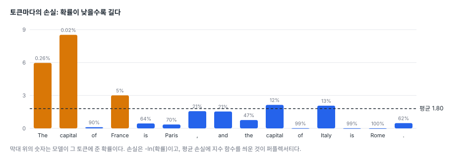
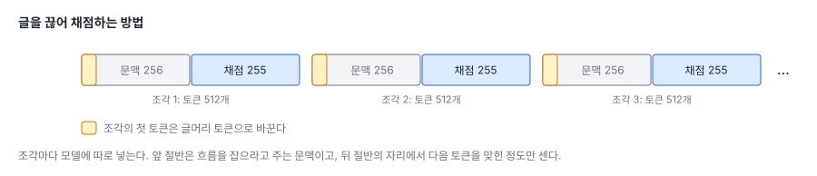
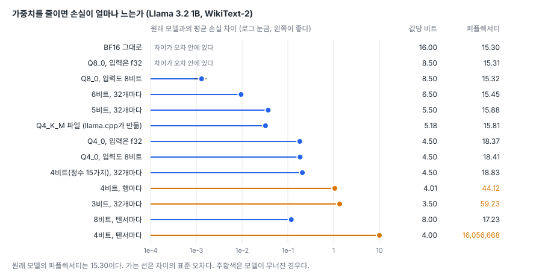
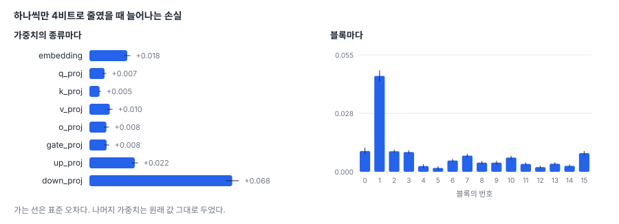

# 양자화 품질 측정

[19장](ch19_quantization_theory.md)과
[20장](ch20_weight_quantization.md)에서 가중치를 줄였습니다. 줄인 모델이
여전히 쓸 만한지는 글 하나로 봤습니다. "The capital of France is"를 넣고
" Paris"에 준 확률이 몇 %인지, 이어 쓴 글이 원래와 몇 토큰까지 같은지를
셌습니다.

그 방법의 한계를 두 번 봤습니다. 19.8절에서는 5비트가 6비트보다 "
Paris"에 높은 확률을 줬고, 20.6절에서는 옳은 엔진 둘이 같은 가중치로 1%
다른 점수를 냈습니다. 글 하나의 숫자는 우연에 좌우되고, 점수를 대조하는
검증은 양자화한 계산에서는 쓰기 어렵습니다.

이 장에서 품질을 재는 지표를 만듭니다. **진짜 글 수만 토큰에서 모델이
다음 토큰을 얼마나 잘 맞히는지**를 숫자 하나로 내며, 이 숫자를
**퍼플렉서티**<sup>perplexity</sup>라고 부릅니다. 그 숫자를 **얼마나
믿을 수 있는지**도 함께 냅니다. 측정에 오차가 있다는 것은
[14장](ch14_measurement.md)에서 시간을 잴 때 배웠고, 품질을 잴 때도
같습니다.

결과를 미리 적어 둡니다.

- 우리가 잰 퍼플렉서티는 llama.cpp가 잰 것과 소수점 넷째 자리까지
  같습니다. 대조하는 과정에서 우리 쪽 버그를 하나 찾았습니다.
- `Q8_0`은 원래 모델과 구별하기 어렵고 `Q4_0`은 분명히 나빠집니다.
  llama.cpp의 `Q4_K_M`은 비트를 15% 더 쓰고 손실 증가가 `Q4_0`의 6분의
  1에 그칩니다.
- 가중치마다 민감한 정도가 다릅니다. MLP의 마지막 층 하나가 4비트
  양자화로 생기는 손실 증가 가운데 가장 큰 부분을 차지합니다.
- KV 캐시를 16비트로 줄여도 품질은 달라지지 않습니다.

| 하는 일 | 절 |
|---|---|
| 손실과 퍼플렉서티를 정의한다 | 21.1 |
| 긴 글을 끊어 채점하는 방법을 정한다 | 21.2 |
| llama.cpp와 같은 숫자가 나오는지 확인한다 | 21.3 |
| 숫자를 얼마나 믿을 수 있는지 계산한다 | 21.4 |
| 저장 방식마다 잰다 | 21.5 |
| 어느 가중치가 민감한지 잰다 | 21.6 |
| KV 캐시를 16비트로 줄인다 | 21.7 |

코드는 `crates/badak_models/src/llama/perplexity.rs`에 있습니다.

## 21.1 퍼플렉서티는 평균 손실에 지수 함수를 씌운 값이다

언어 모델은 앞의 토큰을 보고 다음 토큰의 확률분포를 냅니다(9.1절). 진짜
글을 넣으면 "다음에 실제로 온 토큰"이 무엇인지 우리는 압니다. 모델이 그
토큰에 준 확률이 높을수록 잘 맞힌 것입니다.

글 하나로 해 봅니다.

```rust
{{#include ../../../crates/badak_models/examples/ch21_tokens.rs:score}}
```

```bash
cargo run --release -p badak_models --example ch21_tokens
```

```text
{{#include output/ch21_tokens.txt}}
```



자리마다 읽어 봅니다. "The capital" 다음의 " of"는 90%로 맞혔습니다.
"The capital of" 다음에 " France"가 올 확률은 5%로 봤습니다. 나라 이름이
올 자리이지만 어느 나라일지는 알 수 없기 때문입니다. 문장의 뒷부분은
쉽습니다. "the capital of Italy is" 다음의 " Rome"은 99.6%입니다. 앞에서
같은 모양의 문장을 한 번 봤기 때문입니다.

확률 열다섯 개를 숫자 하나로 모아야 하는데, 그냥 평균을 내면 안 됩니다.
글 전체의 확률은 토큰마다의 확률을 **곱한** 것이기 때문입니다. 곱은
다루기 불편하니 로그를 취해 합으로 바꿉니다.

- **손실**<sup>loss</sup>은 토큰 하나의 `-ln(확률)`입니다. 확률이 1이면
  0이고 확률이 낮을수록 커집니다. 0.02%로 본 " capital"의 손실이 8.5,
  99.6%로 본 " Rome"의 손실이 0.004입니다.
- **평균 손실**은 손실을 토큰 수로 나눈 것입니다. 이 글에서 1.80입니다.
- **퍼플렉서티**는 평균 손실에 지수 함수를 씌운 것입니다.[^jelinek]
  `e^1.80 = 6.06`입니다.

퍼플렉서티의 뜻은 출력의 마지막 줄에서 알 수 있습니다. 확률의 기하
평균이 16.5%이고 그 역수가 6.06입니다. **모델이 토큰마다 평균 여섯 개의
후보를 놓고 고르는 만큼 헷갈렸다**는 뜻입니다. 단어 사전이 128,256개이니
아무것도 모르는 모델의 퍼플렉서티는 128,256이고, 완벽하게 맞히면
1입니다.

손실을 계산하는 함수입니다.

```rust
{{#include ../../../crates/badak_models/src/llama/perplexity.rs:loss}}
```

2.6절의 소프트맥스로 확률을 구한 뒤 로그를 취해도 되지만, 그러면 아주
작은 확률이 0이 되어 로그가 무한대가 될 수 있으므로 식을 풀어 한 번에
계산합니다. 12.6절에서 `f32`로 12만 개를 더하면 자릿수가 모자란다는 것을
배웠으므로 합은 `f64`로 모읍니다.

이 장의 나머지에서는 퍼플렉서티보다 **평균 손실**을 주로 봅니다. 둘은
같은 정보이지만 손실은 더하고 뺄 수 있어서 다루기 쉽습니다. "양자화가
손실을 0.18 늘렸다"는 "퍼플렉서티에 `e^0.18 = 1.2`를 곱했다"와 같은
말입니다.

## 21.2 긴 글은 512토큰씩 끊어 뒤 절반만 채점한다

토큰 열다섯 개로는 아무것도 말할 수 없으므로 긴 글이 필요합니다. 언어
모델을 견줄 때 흔히 쓰는 글 가운데 WikiText-2가 있습니다. 위키백과의
글을 모은 것이고, 시험용으로 떼어 둔 부분이 129만
바이트입니다.[^wikitext] llama.cpp가 양자화로 품질이 얼마나 떨어지는지
잴 때 이 글을 씁니다.[^llamacpp-ppl]

```bash
sh scripts/download_wikitext2.sh
```

[8장](../part2/ch08_tokenizer.md)의 토크나이저로 바꾸면 289,077토큰입니다.

이 글을 한 번에 모델에 넣을 수는 없어서 끊어야 합니다. 끊는 방법에 따라
숫자가 달라지므로 방법을 정해 적어 둬야 합니다. 숫자를 견줄 수 있도록
llama.cpp의 방법을 그대로 따릅니다.[^llamacpp-ppl]



- 글을 512토큰씩 끊어 조각마다 따로 모델에 넣습니다.
- 조각의 첫 토큰을 글머리 토큰으로 바꿉니다. 모델이 늘 글머리 토큰으로
  시작하는 글만 봐 왔기 때문입니다(10.4절).
- **뒤 절반의 자리만** 채점합니다. 조각의 앞부분에서는 모델이 볼 문맥이
  거의 없어서, 글이 무엇에 관한 것인지도 모르는 채로 맞혀야 합니다. 그런
  자리의 손실은 모델의 실력이 아니라 끊은 위치 때문에 생깁니다.[^hf-ppl]
  앞의 256토큰은 문맥으로만 쓰고, 뒤의 255자리에서 다음 토큰을 맞힌 것만
  셉니다.

```rust
{{#include ../../../crates/badak_models/src/llama/perplexity.rs:protocol}}
```

조각 하나를 블록에 통과시키고([11장](../part2/ch11_kv_cache.md)의 캐시를
쓰는 길로 한 번에), 채점할 255줄만 출력 층에 넣습니다. 출력 층은 단어
사전의 12만 행과 곱하므로, 필요 없는 줄을 빼는 것만으로 조각 하나의
시간이 꽤 줄어듭니다. 그러려고 순전파에서 "블록을 다 지난 결과"를 꺼내는
함수를 따로 만들었습니다.

```rust
{{#include ../../../crates/badak_models/src/llama/model.rs:hidden_cached}}
```

조각 하나에 1.5초쯤 걸리고, 글 전체는 564조각이라 15분이 걸립니다. 여러
방법을 견줄 때마다 15분씩 쓸 수는 없어서, 이 장의 표는 대부분 **앞의
64조각**(채점하는 토큰 16,320개)으로 잽니다. 그렇게 줄여도 되는지는
21.4절에서 따집니다.

## 21.3 우리 퍼플렉서티는 llama.cpp와 소수점 넷째 자리까지 같다

[13장](../part2/ch13_first_showdown.md)부터 해 온 대로, 믿기 전에
대조합니다. llama.cpp에는 퍼플렉서티를 재는 도구가 있습니다.

```bash
sh scripts/build_llama_cpp.sh llama-perplexity
sh scripts/perplexity_llama_cpp.sh llama32_1b 64
```

```text
{{#include ../../../bench/ch21/llama_cpp_llama32_64.txt:1:2}}
```

같은 64조각을 우리 엔진으로 잽니다.

```bash
cargo run --release -p badak_models --example ch21_perplexity -- llama32_1b 64 formats
```

```text
{{#include output/ch21_formats_llama32.txt:4:6}}
```

**15.302 ± 0.341과 15.3021 ± 0.34088입니다.** 값도, 오차의 어림도
같습니다. 16,320개 토큰의 손실을 평균한 값이 소수점 넷째 자리까지
맞으려면 토큰화, 조각을 끊는 위치, 채점하는 자리, 모델의 계산, 손실의
계산이 모두 같아야 합니다.

처음부터 맞지는 않았습니다. 처음 잰 값은 8조각에서 14.386이었고
llama.cpp는 14.277이어서 0.8% 차이가 났습니다. 양자화의 영향을 재려는
지표가 0.8% 틀려 있으면 쓸 수 없습니다.

어디서 갈리는지 좁혀 갔습니다. 토큰을 견주니 289,077개가 모두
같았습니다. 조각 수를 줄여 보니 **첫 조각은 소수점 넷째 자리까지 맞고
둘째 조각부터 틀렸습니다.** 둘 가운데 누가 옳은지 가리려고 PyTorch로 두
조각을 계산했더니 PyTorch는 llama.cpp와 같았습니다. 또 둘째 조각만 따로
떼어 우리 엔진에 넣으면 옳은 값이 나왔습니다.

원인은 한 줄이었습니다. 조각의 첫 토큰을 글머리 토큰으로 바꾸는 코드가
토크나이저에게 "글머리 토큰이 무엇이냐"고 물었는데, 그 값은 설정
파일에서 따로 넣어 줘야 채워지는 것이었고 넣어 준 적이 없었습니다.
"없음"이 돌아왔고, 바꾸지 않고 넘어갔습니다. 첫 조각은 글의 맨 앞이라
원래 글머리 토큰으로 시작하므로 드러나지 않았습니다.

이 버그는 오류를 내지 않고, 퍼플렉서티도 그럴듯한 숫자가 나옵니다.
방법마다 같은 식으로 틀리므로 방법끼리 견준 순서도 대체로 맞았을
것입니다. **대조할 상대가 없었다면 찾지 못했을 버그입니다.**
[7장](../part1/ch07_mnist.md)에서 PyTorch와,
[13장](../part2/ch13_first_showdown.md)에서 llama.cpp와 대조한 것과 같은
이유로, 지표를 만들 때도 먼저 남이 만든 지표와 대조해야 합니다.

글 전체로도 한 번 대조합니다. 564조각, 채점하는 토큰 143,820개입니다.

```bash
cargo run --release -p badak_models --example ch21_perplexity -- llama32_1b 100000 base
sh scripts/perplexity_llama_cpp.sh llama32_1b
```

```text
{{#include output/ch21_full_llama32.txt:4:5}}
```

```text
{{#include ../../../bench/ch21/llama_cpp_llama32_full.txt:1:2}}
```

14.001 ± 0.104와 14.0009 ± 0.10411입니다. 15분이 걸렸습니다.

64조각에서는 15.30이었고 전체에서는 14.00입니다. 같은 모델, 같은
방법인데 글의 어느 부분을 쟀느냐에 따라 9%가 다릅니다. 다음 절에서 이
차이를 다룹니다.

## 21.4 차이는 같은 토큰으로 짝지어 견준다

위의 출력에 `± 0.341`이 붙어 있습니다. 이것부터 설명해야 다음 절의 표를
읽을 수 있습니다.

16,320개의 손실은 고르지 않습니다. 21.1절에서 본 대로 어떤 토큰은
0.004이고 어떤 토큰은 8.5입니다. 다른 글에서 16,320개를 골랐다면 평균이
조금 달랐을 것입니다. 우리가 알고 싶은 것은 "이 64조각에서의 평균"이
아니라 "이런 글에서 이 모델의 평균"이므로, 표본을 바꾸면 평균이 얼마나
흔들릴지를 알아야 합니다.

14.4절에서 측정값의 흩어짐을 표준편차로 봤습니다. 평균의 흔들림은 그보다
작습니다. 값을 많이 모을수록 평균은 덜 흔들리고, 그 크기는 표준편차를
개수의 제곱근으로 나눈 것입니다. 이것을 **표준
오차**<sup>standard error</sup>라고 합니다.

```rust
{{#include ../../../crates/badak_models/src/llama/perplexity.rs:losses}}
```

원래 모델의 평균 손실은 2.7280이고 표준 오차는 0.022입니다(퍼플렉서티로
옮기면 `15.302 × 0.022 = 0.341`). **이 모델의 퍼플렉서티는
15.3이라기보다 "15.0에서 15.6 사이쯤"입니다.**

여기서 문제가 생깁니다. `Q8_0`이 품질에 주는 영향은 아주 작을 것입니다.
그런데 지표가 2%씩 흔들립니다. 2%씩 흔들리는 숫자 둘을 견줘 0.1%의
차이를 볼 수는 없어 보입니다.

그러나 **같은 토큰으로 견주면** 볼 수 있습니다.

원래 모델과 양자화한 모델은 같은 토큰에서 함께 어려워하고 함께
쉬워합니다. " capital"은 둘 다 못 맞히고 " Rome"은 둘 다 맞힙니다.
평균이 2%씩 흔들리는 것은 "어려운 토큰이 표본에 얼마나 섞였느냐"
때문인데, 그 흔들림은 두 모델에 **똑같이** 들어갑니다. 토큰마다 두
모델의 손실의 차이를 먼저 구하면 그 부분이 상쇄됩니다. 남는 것은
양자화가 그 토큰의 손실을 얼마나 바꿨느냐뿐이고, 그 값은 훨씬 덜
흩어집니다.

위 코드의 `difference_from`이 그 계산입니다. 토큰마다의 차이를 구하고,
그 차이의 평균과 표준 오차를 냅니다. 이렇게 같은 대상에서 잰 값을 짝지어
견주는 것을 **짝지은 비교**<sup>paired comparison</sup>라고 합니다.

얼마나 다른지는 다음 절의 표에 나옵니다. 평균 손실의 표준 오차가
0.022인데, `Q8_0`과 원래 모델의 **차이**의 표준 오차는 0.0004로 쉰 배
작습니다. 그래서 15분짜리 측정을 64조각으로 줄여도 됩니다. 절대값은 2%쯤
흔들리지만 우리가 보려는 것은 차이입니다.

토큰마다의 손실을 버리지 않고 모아 두는 것도 이 때문입니다. llama.cpp의
도구는 합과 제곱의 합만 모읍니다. 방법 둘을 짝지어 견주려면 둘을 같은
토큰에서 잰 값이 토큰마다 남아 있어야 합니다.

> 표준 오차는 "값들이 서로 상관없이 뽑혔다"고 볼 때의 어림입니다. 글의
> 토큰들은 그렇지 않습니다. 어려운 문단의 토큰들은 함께 어렵습니다.
> 그래서 진짜 흔들림은 이 숫자보다 큽니다. 21.3절에서 64조각의 값
> (15.30 ± 0.34)과 글 전체의 값(14.00)이 표준 오차의 네 배 가까이
> 떨어져 있었습니다. 앞쪽 글들이 뒤쪽보다 어려웠던 것입니다. 짝지은
> 차이는 이 문제에서 훨씬 자유롭지만 완전히 벗어나지는 못합니다. 이
> 장에서는 표준 오차의 두 배가 넘는 차이만 "차이가 있다"고 읽겠습니다.

## 21.5 Q8_0은 구별되지 않고 Q4_0은 손실을 0.185 늘린다

```text
{{#include output/ch21_formats_llama32.txt:4:18}}
```

"기준과의 손실 차이"가 짝지은 비교입니다. 첫 줄이 기준이고, 줄마다 같은
16,320개 토큰에서 손실이 평균 얼마나 늘었는지와 그 표준 오차를
적었습니다.



**BF16은 차이가 정확히 0입니다.** 20.1절에서 모든 비트가 같음을
확인했으니 당연합니다.

**`Q8_0`의 가중치만으로는 차이가 보이지 않습니다.**
`+0.0003 ± 0.0003`으로 오차 안입니다. 값 32개마다 스케일을 정한 8비트는 이
지표로는 원래 모델과 구별되지 않습니다.

**입력도 8비트로 바꾸면 `+0.0013 ± 0.0004`입니다.** 작지만 오차의 세
배이니 실제로 있는 차이입니다. 20.6절에서 입력의 양자화가 점수의 오차를
1.1%에서 1.6%로 키운 것을 봤습니다. 품질로 옮기면 손실 0.001,
퍼플렉서티로 0.1%입니다. 20.4절에서 정수끼리 곱하는 방법을 고른 대가가
이것이고, 얻은 속도에 견주면 작습니다.

**`Q4_0`은 `+0.185`입니다.** 퍼플렉서티가 15.3에서 18.4로 20% 오르니
분명히 나빠진 것입니다. 입력을 8비트로 바꾼 영향은 가중치의 오차에 가려
여기서 보이지 않습니다(0.1827과 0.1850).

**[19장](ch19_quantization_theory.md)의 4비트는 `Q4_0`보다 조금
나쁩니다.** `+0.207`입니다. 정수 하나를 버린 대가(19.4절)가 손실
0.02입니다. 20.8절에서 SQNR로 1.1dB였던 차이입니다.

**`Q4_K_M`은 `+0.032`입니다.** `Q4_0`의 6분의 1입니다. 값 하나에
5.18비트로 `Q4_0`보다 15% 더 쓰고 얻은 결과입니다. 어디에 비트를 더
쓰는지는 다음 절에서 봅니다. 같은 표의 "5비트, 32개마다"(5.5비트)가
`+0.037`이니, `Q4_K_M`은 **더 적은 비트로 더 낫습니다.** 스케일을
찾고(19.6절), 비대칭으로 놓고(20.8절), 민감한 가중치에 비트를 더 준
결과입니다.

**3비트부터는 쓸 수 없습니다.** 3비트(32개마다)에서 퍼플렉서티가 59,
4비트를 행마다 정하면 44입니다. 19.8절에서 글이 같은 말을 되풀이하거나
틀린 답을 내던 방법입니다.

**텐서마다 스케일 하나인 4비트의 퍼플렉서티는 1,600만입니다.** 단어 사전의
크기(128,256)보다 큽니다. 아무 토큰이나 고르게 찍는 것보다 못하다는
뜻이고, 틀린 답에 높은 확률을 주고 있습니다. 19.8절에서 "Masks Masks
Masks"를 쓰던 방법입니다.

**8비트도 텐서마다 정하면 `Q4_K_M`보다 나쁩니다.** `+0.119`입니다.
비트를 1.5배 쓰고 손실은 네 배 가까이 늡니다. 19.7절의 결론, 곧 스케일을
어느 범위마다 정하느냐가 비트의 수만큼 중요하다는 것이 품질에서도 그대로
확인됩니다.

### 가중치의 SQNR은 품질의 어림일 뿐이다

[19장](ch19_quantization_theory.md)에서 가중치의 오차를 SQNR로 쟀습니다.
그 숫자가 품질을 얼마나 잘 말해 주는지 나란히 놓아 봅니다.

| 방법 | 가중치의 SQNR | 손실 증가 |
|---|---|---|
| `Q8_0` | 45.2dB | +0.0003 |
| 8비트, 텐서마다 | 24.5dB | +0.119 |
| `Q4_K` (대부분) | 22.8dB | +0.032 (`Q4_K_M`) |
| `Q4_0` | 21.1dB | +0.183 |
| 4비트(정수 15가지), 32개마다 | 20.0dB | +0.207 |
| 4비트, 행마다 | 15.1dB | +1.06 |
| 4비트, 텐서마다 | 2.2dB | +13.9 |

대체로 SQNR이 높을수록 손실이 덜 늡니다. 그런데 어긋나는 줄이 있습니다.
**"8비트, 텐서마다"는 SQNR이 `Q4_K`보다 높은데 손실은 네 배 가까이
늡니다.** SQNR은 모든 값의 오차를 똑같이 세지만, 모델에게는 모든 값이
똑같이 중요하지 않습니다. 텐서 전체에 스케일 하나를 쓰면 작은 값이 모조리
0이 되는데(19.7절), 가중치의 대부분이 그런 작은 값입니다. `Q4_K_M`이
`Q4_K`만으로 된 것이 아니라는 점도 있습니다.

**가중치의 오차는 품질의 어림일 뿐입니다.**
[19장](ch19_quantization_theory.md)에서 SQNR로 방법을 골랐고 방향은
맞았습니다. 그러나 마지막 판단은 모델을 돌려서 잰 숫자로 해야 합니다.

### llama.cpp가 잰 값과 견준다

21.3절의 도구로 llama.cpp의 파일을 같은 64조각에서 쟀습니다.

```text
{{#include ../../../bench/ch21/llama_cpp_llama32_64.txt}}
```

| 64조각의 퍼플렉서티 | badak | llama.cpp |
|---|---|---|
| 원래 모델 | 15.302 | 15.302 |
| `Q8_0` | 15.323 | 15.319 |
| `Q4_0` | 18.413 | 17.955 |
| `Q4_K_M` | 15.807 (입력은 `f32`) | 15.846 |

`Q8_0`은 0.03% 다릅니다. 20.6절에서 같은 가중치로 점수가 1% 달랐던 두
엔진입니다. 점수 하나하나는 양자화의 오차 안에서 서로 다르지만 **수만
토큰에 걸친 품질은 같습니다.** 20.6절에서 "같은 수준"이라고만 말할 수
있었던 것을 이제 숫자로 말할 수 있습니다.

`Q4_0`은 llama.cpp가 낫습니다. 20.3절에서 본 대로 llama.cpp의 `Q4_0`
파일은 임베딩 표가 6비트이고 우리는 4비트입니다. 임베딩 표가 품질에
얼마나 영향을 주는지는 다음 절에 나옵니다.

`Q4_K_M`은 우리 쪽이 조금 낫습니다. 우리는 그 파일의 가중치를 `f32`로
되돌려 `f32` 입력과 곱했고(이 형식의 커널이 없습니다), llama.cpp는
입력도 8비트로 바꿉니다.

## 21.6 MLP의 마지막 층과 블록 1이 가장 민감하다

20.8절에서 `Q4_K_M`이 가중치 113개 가운데 17개에 6비트를 준다는 것을
봤습니다. 임베딩 표, 값을 만드는 가중치, MLP의 마지막 층이었습니다. 왜
그것인지 재 봅니다.

**하나만 줄이고 나머지는 그대로 두는** 단순한 방법을 씁니다.
[19장](ch19_quantization_theory.md)에서 만든 `replace_matrices`로 고른
가중치만 `Q4_0`으로 바꿉니다.

```bash
cargo run --release -p badak_models --example ch21_perplexity -- llama32_1b 64 kinds
```

```text
{{#include output/ch21_kinds_llama32.txt:4:14}}
```

종류 하나는 블록 열여섯 개에 걸친 같은 이름의 가중치 전부입니다.

**MLP의 마지막 층(`down_proj`)이 가장 큽니다.** `+0.068`로, 나머지 일곱
종류를 다 합친 것(0.078)에 가깝습니다.

값의 수가 종류마다 다르니, 값 1억 개를 줄일 때의 손실로도 봅니다.

| 종류 | 값 (백만) | 손실 증가 | 값 1억 개당 |
|---|---|---|---|
| `v_proj` | 16.8 | +0.0097 | 0.058 |
| `k_proj` | 16.8 | +0.0048 | 0.029 |
| `down_proj` | 268.4 | +0.0680 | 0.025 |
| `o_proj` | 67.1 | +0.0081 | 0.012 |
| `q_proj` | 67.1 | +0.0072 | 0.011 |
| `up_proj` | 268.4 | +0.0216 | 0.008 |
| `embedding` | 262.7 | +0.0180 | 0.007 |
| `gate_proj` | 268.4 | +0.0082 | 0.003 |

**값 하나하나로 보면 `v_proj`가 가장 민감합니다.** `gate_proj`의 스무 배
가까이입니다. 값을 만드는 가중치는 작아서(전체의 1.4%) 비트를 더 줘도
파일이 거의 커지지 않습니다. 가장 적은 비트로 품질을 올릴 수 있는
곳입니다.

llama.cpp의 `Q4_K_M`이 6비트를 주는 셋(임베딩 표, `attn_v`, `ffn_down`)
가운데 둘이 이 표의 위쪽에 있습니다. `v_proj`는 값 하나당 가장 민감하고,
`down_proj`는 전체 손실 증가가 가장 큽니다. 임베딩 표는 값 하나당으로는
아래쪽이지만 전체로는 세 번째(`+0.018`)입니다. 우리 측정이 그 선택을
뒷받침합니다. 다만 그 선택이 이런 측정에서 나온 것인지는 확인하지
않았습니다.

`gate_proj`와 `up_proj`는 크기가 같고 같은 입력을 받는데(9.9절) 민감도가
2.6배 다릅니다. `gate_proj`의 출력은 SiLU를 지나며 범위가 줄어들고
`up_proj`의 출력은 그대로 곱해집니다. 그 차이 때문일 것으로 짐작하지만
확인하지는 않았습니다.

**종류별 손실을 다 더하면 0.146이고, 모두 줄였을 때는 0.185입니다.**
따로 잰 손실 증가의 합보다 한꺼번에 줄였을 때의 증가가 큽니다. 오차가
서로를 키우기 때문입니다. 하나씩 재서 더하는 것으로는 전체를 어림만 할
수 있습니다.

### 블록마다 재면 블록 1이 두드러진다

같은 일을 블록마다 합니다. 블록 하나의 선형 층 일곱 개를 줄이고 나머지
블록과 임베딩 표는 그대로 둡니다.

```bash
cargo run --release -p badak_models --example ch21_perplexity -- llama32_1b 64 blocks
```

```text
{{#include output/ch21_blocks_llama32.txt:4:21}}
```



**블록 1이 유난히 민감합니다.** `+0.045`로, 다른 블록의 네 배에서
스물다섯 배입니다. 블록 하나가 열여섯 개 전체 손실 증가의 3분의 1을
차지합니다.

**앞쪽 블록과 마지막 블록이 가운데보다 민감합니다.** 블록 0부터 3까지와
블록 15가 0.009 안팎이고, 가운데 블록은 0.002에서 0.007입니다. 앞쪽의
오차는 뒤의 블록을 모두 지나며 커질 기회가 많고, 마지막 블록의 오차는
곧바로 점수가 됩니다. 그럴듯한 설명이지만 확인한 것은 아닙니다. 블록 1이
왜 그렇게 두드러지는지도 알아보지 않았습니다. 10.7절에서 첫 토큰의 값이
앞쪽 블록에서 유난히 커지는 것을 봤는데, 그것과 관련이 있을 수 있습니다.

블록 열여섯 개의 손실을 더하면 0.128이고, 임베딩 표의 0.018을 더하면
0.146입니다. 종류별로 더한 값과 같습니다. 어느 쪽으로 쪼개 더해도 모두
줄였을 때의 0.185에는 못 미칩니다.

이 측정에서 실용적인 규칙 하나가 나옵니다. **값 하나에 쓸 비트를 모든
가중치에 똑같이 나눌 까닭이 없습니다.** 블록 1과 `down_proj`, `v_proj`에
비트를 더 주고 나머지에서 아끼면 같은 크기로 더 나은 모델이 됩니다.
llama.cpp의 `Q4_K_M`도 블록마다 다르게 줍니다. 20.8절에서 `attn_v`와
`ffn_down`에 6비트를 준 블록이 0, 1, 4, …였습니다.

### K-양자화 파일을 읽는 코드를 더한다

`Q4_K_M`의 줄을 재려면 그 파일의 가중치를 우리 모델에 넣어야 했습니다.
20.8절에서 `Q4_K`를 되돌리는 함수는 만들었고, 이 파일에는 6비트인
`Q6_K`도 섞여 있어서 하나를 더 만들었습니다.

```rust
{{#include ../../../crates/badak_core/src/packed/mod.rs:q6_k}}
```

값 하나가 6비트 정수이고, 값 16개마다 8비트 스케일 하나, 그 스케일의
스케일이 16비트 실수 하나입니다. `Q4_K`와 달리 0을 가운데 두는 대칭
눈금입니다.

```rust
{{#include ../../../crates/badak_models/examples/ch21_perplexity.rs:gguf}}
```

13.3절에서 본 대로 질의와 키의 가중치는 파일에서 행의 순서가 다르므로
원래 순서로 되돌려 놓습니다. 이 한 가지를 빠뜨리면 오류 없이
퍼플렉서티가 수천이 됩니다.

## 21.7 KV 캐시를 16비트로 줄여도 품질은 그대로다

11.8절에서 미뤄 둔 일입니다. KV 캐시는 토큰 하나에 64KB를 쓰고, 이
모델이 받을 수 있는 가장 긴 글(131,072토큰)에서는 8.6GB가 됩니다.
[20장](ch20_weight_quantization.md)에서 가중치를 0.7GB까지 줄였으니 이제
긴 글에서는 캐시가 가중치의 열 배가 넘습니다. llama.cpp는 캐시를 16비트
실수로 둡니다(11.9절).

[19장](ch19_quantization_theory.md)에서 16비트 실수를 만들 때 이 일을
뒤로 미뤘습니다. 가중치는 BF16으로 바꿔도 값이 그대로였지만, 캐시의 값은
계산해서 나온 `f32`라서 16비트로 줄이면 달라집니다. 달라진 값이 품질을
얼마나 해치는지 말하려면 지표가 있어야 했고, 이제 있습니다.

```rust
{{#include ../../../crates/badak_models/src/llama/cache.rs:precision}}
```

캐시에 넣을 때 19.2절의 f16으로 줄이고, 어텐션이 읽을 때 `f32`로
펼칩니다. (이 장을 쓸 때는 읽을 때마다 캐시 전체를 펼친 사본을
만들었습니다. 24.5절에서 커널이 읽는 순간에 넓히도록 고쳤습니다.) 형식은
BF16이 아니라 f16을 골랐습니다. 캐시의 값은 정규화를 지난 벡터에서 나온
것이라 크기가 비슷비슷하고, 그런 값에는 유효 숫자가 많은 f16이
낫습니다(19.3절).

```bash
cargo run --release -p badak_models --example ch21_perplexity -- llama32_1b 64 kv
```

```text
{{#include output/ch21_kv_llama32.txt:4:8}}
```

**차이가 보이지 않습니다.** 원래 가중치에서 `-0.0000 ± 0.0000`,
`Q4_0`에서 0.1850과 0.1846입니다. 소수점 넷째 자리까지 같거나, 차이가 그
자리에서 오르내립니다. f16의 상대 오차는 만 분의 몇입니다(19.2절).
8비트로 줄인 입력의 오차(백 분의 일쯤)가 손실을 0.001 바꿨으니, 그보다
백 배 작은 오차가 보이지 않는 것은 자연스럽습니다.

메모리는 절반이 됩니다.

| 글의 길이 | 캐시 `f32` | 캐시 f16 |
|---|---|---|
| 토큰 하나 | 64KB | 32KB |
| 4,096토큰 | 268MB | 134MB |
| 131,072토큰 | 8.6GB | 4.3GB |

속도도 잽니다.

```text
{{#include ../../../bench/ch21/kv_speed_llama32.txt}}
```

14.11절의 기준 측정을 캐시의 정밀도만 바꿔 돌린
것입니다(`BADAK_KV=f16`). 줄마다 첫 숫자가 프롬프트 처리와 토큰 생성의
토큰/초입니다.

**토큰 생성이 3~4% 느려집니다.** 원래 가중치에서 93.0이 90.0으로,
`Q4_0`에서 208이 200으로 내려갑니다. 토큰을 하나 만들 때마다 블록마다
캐시 전체를 `f32`로 펼치기 때문입니다. 이 측정은 토큰 32개짜리라 캐시가
작습니다. 글이 길어지면 펼치는 양이 글의 길이만큼 늘어납니다. 메모리를
줄이는 대신 시간을 더 쓰는 것이고, 지금의 구현은 시간을 필요 이상으로
씁니다. 펼치지 않고 16비트인 채로 내적하는 커널이 있으면 그 시간이
줄어듭니다. 20.1절에서 BF16 가중치에 한 일을 캐시에도 하는 것입니다.

기본값은 `f32`로 둡니다. [11장](../part2/ch11_kv_cache.md)의 "캐시를 쓴
결과와 쓰지 않은 결과가 비트 단위로 같다"는 테스트가 `f32` 캐시에 기대고
있고, 이 책에서 다루는 글의 길이에서는 캐시가 작습니다. 환경 변수
`BADAK_KV=f16`으로 바꿀 수 있습니다. [24장](ch24_attention.md)에서
어텐션을 다시 짤 때 이 문제를 다시 다룹니다.

## 21.8 실전 엔진에서는

**퍼플렉서티는 모델끼리 견주는 숫자가 아닙니다.** 토크나이저가 다르면
토큰의 수가 달라지고 토큰 하나를 맞히는 일의 어려움이 달라집니다.
llama.cpp의 문서도 이 점과, 미세 조정한 모델은 사람이 보기에 더 나은데도
퍼플렉서티가 오르곤 한다는 점을 먼저 적고 있습니다.[^llamacpp-ppl]
퍼플렉서티는 이 장에서 한 것처럼 **같은 모델을 다르게 저장한 것끼리**
견줄 때 믿을 만합니다.

**정답 토큰만 보지 않는 지표도 있습니다.** 퍼플렉서티는 자리마다 정답
토큰 하나에 준 확률만 보고, 나머지 12만 개에 확률을 어떻게 나눴는지는
보지 않습니다. 양자화한 모델이 원래 모델과 **같은 분포를 내는지**를 직접
재는 방법이 있습니다. 두 분포가 얼마나 다른지를 재는 쿨백-라이블러
발산<sup>Kullback–Leibler divergence</sup>입니다. llama.cpp의 도구는
원래 모델의 점수를 파일에 적어 두었다가 양자화한 모델의 점수와 견줘 이
값을 냅니다.[^llamacpp-ppl] [12장](../part2/ch12_sampling.md)에서 봤듯
글을 쓸 때는 1위 토큰만이 아니라 분포 전체에서 뽑으므로, 분포를 견주는
쪽이 실제 쓰임에 더 가깝습니다. 대신 자리마다 12만 개의 점수를 적어 둬야
해서 파일이 수십 GB가 됩니다.

**퍼플렉서티가 같다고 모든 것이 같지는 않습니다.** 퍼플렉서티는
위키백과의 글을 이어 맞히는 능력을 잰 것입니다. 긴 추론, 코드, 다른
언어, 도구를 부르는 형식을 지키는 일에서 양자화가 품질을 얼마나
떨어뜨리는지는 이 숫자에 나오지 않습니다. 실전에서는 퍼플렉서티로 거른
뒤, 모델을 쓸 일에 맞는 시험을 따로 돌립니다.

**민감도를 재서 비트를 나누는 방법은 더 정교하게 할 수 있습니다.** 이
장에서는 가중치의 종류마다, 블록마다 쟀습니다. 더 잘게, 값 하나하나가
출력에 얼마나 중요한지를 진짜 입력을 넣어 보며 재고, 스케일을 찾을 때
중요한 값의 오차에 더 큰 벌점을 주는 방법이 있습니다. llama.cpp에서는 그
통계를 중요도 행렬<sup>importance matrix</sup>이라고 부르고, 따로
계산하는 도구가 있습니다.[^llamacpp-imatrix]

**KV 캐시의 정밀도는 긴 글에서 중요해집니다.** 이 장에서는 512토큰짜리
조각으로 쟀습니다. 수만 토큰의 글에서는 캐시가 메모리의 대부분이고,
16비트보다 더 줄이려는 시도도 있습니다. 그때는 이 장의 측정을 그
길이에서 다시 해야 합니다.

## 정리

- 손실은 모델이 정답 토큰에 준 확률의 `-ln`이고, 퍼플렉서티는 평균
  손실에 지수 함수를 씌운 것입니다. "평균 몇 개의 후보를 놓고 헷갈렸는가"
  로 읽습니다.
- 긴 글은 512토큰씩 끊고, 조각마다 글머리 토큰으로 시작하게 하고, 뒤
  절반의 자리만 채점합니다. 끊는 방법이 숫자를 바꾸므로 방법을 적어 둬야
  합니다.
- 우리 숫자는 llama.cpp와 소수점 넷째 자리까지 같습니다. 맞춰 보다가
  조각마다 글머리 토큰을 넣지 않는 버그를 찾았습니다. 오류도 내지 않고
  그럴듯한 숫자를 내던 버그입니다.
- 16,320개 토큰으로 잰 퍼플렉서티는 2%쯤 흔들립니다. 방법 둘을 **같은
  토큰에서** 짝지어 견주면 차이는 쉰 배 정밀하게 잴 수 있습니다.
- `Q8_0`은 가중치만으로는 원래 모델과 구별되지 않고, 입력까지 8비트로
  바꾸면 손실이 0.001 늡니다. `Q4_0`은 0.185, `Q4_K_M`은 0.032 늡니다.
- 스케일을 텐서마다 하나만 두면 8비트도 `Q4_K_M`보다 나쁘고, 4비트는
  아무렇게나 찍는 것보다 못합니다.
- 가중치의 SQNR은 품질의 어림이지 품질이 아닙니다. SQNR이 더 높은
  방법이 손실을 더 키우는 경우가 있습니다.
- MLP의 마지막 층이 4비트 양자화의 손해에서 가장 큰 몫이고, 값
  하나하나로는 값을 만드는 가중치가 가장 민감합니다. llama.cpp의
  `Q4_K_M`이 비트를 더 주는 곳과 겹칩니다.
- 하나씩 줄여 잰 손해를 더한 것보다 모두 줄인 손해가 큽니다.
- KV 캐시를 f16으로 줄여도 손실은 달라지지 않고 메모리는 절반이 됩니다.

## 연습 문제

1. `ch21_tokens`에 다른 글을 넣어 보십시오. 사실과 다른 문장("The capital
   of France is Rome.")에서는 어느 토큰의 손실이 커집니까. 같은 문장을
   두 번 이어 붙이면 둘째 문장의 손실은 어떻게 됩니까.
2. `token_loss`를 2.6절의 `softmax`로 확률을 구해 `-ln`을 취하도록 바꿔
   보십시오. 점수가 `[1000.0, 0.0]`이고 정답이 1번일 때 두 구현의 답을
   견줘 보십시오.
3. `Protocol`의 `context`를 256과 1,024로 바꿔 원래 모델의 퍼플렉서티를
   재 보십시오. 어느 쪽이 낮습니까. 왜 그렇습니까. 방법이 다른 숫자를
   서로 견주면 안 되는 이유를 이 결과로 설명해 보십시오.
4. 21.2절에서 뒤 절반만 채점한다고 했습니다. `evaluate`를 고쳐 앞
   절반의 자리(1번부터 255번까지)만 채점해 보십시오. 손실이 얼마나
   다릅니까. 자리를 32개씩 묶어 평균 손실을 그려 보면 어떤 모양입니까.
5. 21.4절의 표준 오차는 토큰들이 서로 상관없다고 봅니다. 손실을
   조각마다 평균해 64개의 값을 만들고, 그 64개로 표준 오차를 구해
   보십시오. 0.022보다 큽니까. 어느 쪽이 더 믿을 만합니까.
6. `ch21_perplexity`의 `formats` 묶음에 "임베딩 표만 `Q8_0`, 나머지는
   `Q4_0`"을 추가해 보십시오. llama.cpp의 `Q4_0` 파일(임베딩 표가 6비트)이
   낸 17.955에 얼마나 가까워집니까.
7. 21.6절의 표를 보고 값 하나에 평균 5비트를 쓰는 섞는 방법을 직접
   정해 보십시오(어느 종류를 `Q8_0`으로, 어느 종류를 `Q4_0`으로).
   `Setup`에 추가해 재고, `Q4_K_M`(5.18비트, +0.032)과 견줘 보십시오.
8. KV 캐시를 f16이 아니라 BF16으로 담도록 `Store`에 갈래를 하나 더해
   보십시오. 손실의 차이가 보입니까. 19.2절의 표에서 두 형식의 상대
   오차를 다시 보고 결과를 설명해 보십시오.
9. 퍼플렉서티 대신 "1위 토큰이 원래 모델과 같은 자리의 비율"을 재도록
   `evaluate`를 고쳐 보십시오. `Q8_0`과 `Q4_0`에서 몇 %입니까. 이 숫자와
   손실의 차이 가운데 어느 쪽이 [12장](../part2/ch12_sampling.md)의 샘플링을 쓰는 사용자에게 더
   뜻이 있겠습니까.

## 참고 문헌

[^jelinek]: F. Jelinek, R. L. Mercer, L. R. Bahl, J. K. Baker,
    "Perplexity—a measure of the difficulty of speech recognition tasks",
    *The Journal of the Acoustical Society of America*, 62권 S1호, S63쪽,
    1977. [doi:10.1121/1.2016299](https://doi.org/10.1121/1.2016299).
    퍼플렉서티라는 이름이 나온 발표의 초록입니다.

[^wikitext]: Stephen Merity, Caiming Xiong, James Bradbury, Richard Socher,
    "Pointer Sentinel Mixture Models", 2016.
    [arXiv:1609.07843](https://arxiv.org/abs/1609.07843). 더 긴 문맥과 더
    현실적인 어휘로 언어 모델을 평가하려고 WikiText 말뭉치를 함께
    내놓았습니다. 글은 위키백과에서 왔습니다. 이 책은 llama.cpp의
    `scripts/get-wikitext-2.sh`가 받는 것과 같은 파일을 받습니다.

[^llamacpp-ppl]: llama.cpp, `tools/perplexity/README.md`와
    `tools/perplexity/perplexity.cpp` (커밋 `b4c0e00a4fcc`). 문서는
    양자화의 품질 손실을 잴 때 WikiText-2의 시험 부분을 쓰는 것이
    관례라고 적고, 퍼플렉서티를 모델끼리 견줄 수 없다는 점과 KL 발산을
    재는 방법을 설명합니다. 코드의 442번째 줄부터가 이 장이 따른
    방법입니다. 540번째 줄 부근에서 `first = n_ctx/2`로 뒤 절반만
    채점하고, 567번째 줄 부근에서 조각의 첫 토큰을 글머리 토큰으로
    바꿉니다.
    <https://github.com/ggml-org/llama.cpp/blob/b4c0e00a4fcc/tools/perplexity/perplexity.cpp>

[^hf-ppl]: Hugging Face, "Perplexity of fixed-length models".
    <https://huggingface.co/docs/transformers/perplexity>. 글을 겹치지
    않게 끊으면 대부분의 자리에서 문맥이 모자라 퍼플렉서티가 더 나쁘게
    나온다는 점과, 문맥을 주며 채점하는 방법을 설명합니다. llama.cpp의
    코드가 주석에서 이 글을 가리킵니다.

[^llamacpp-imatrix]: llama.cpp, `tools/imatrix/README.md` (커밋
    `b4c0e00a4fcc`). 주어진 글로 모델의 중요도 행렬을 계산하고, 그것을
    양자화할 때 써서 품질을 높일 수 있다고 설명합니다.
    <https://github.com/ggml-org/llama.cpp/blob/b4c0e00a4fcc/tools/imatrix/README.md>
