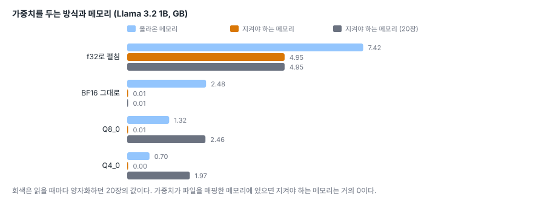
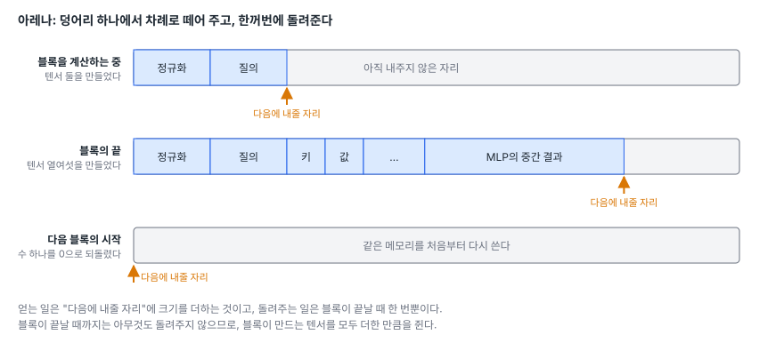
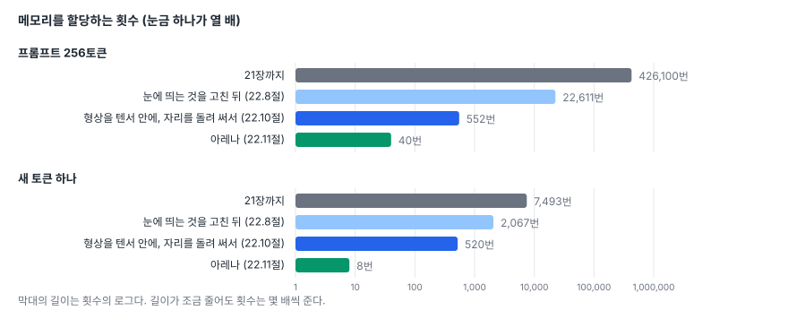

# 메모리

지금까지 3부는 시간을 다뤘습니다. 이 장은 메모리를 다룹니다. 엔진이
메모리를 얼마나 쓰는지, 언제 얻고 언제 돌려주는지를 재고 고칩니다.

미뤄 둔 일이 여럿 있습니다. 20.9절에서 `Q8_0`과 `Q4_0`은 읽을 때마다
양자화하느라 1.2초와 2GB를 썼습니다. [5장](../part1/ch05_operators.md)의 연산자는 부를 때마다 새
텐서를 만듭니다. 11.8절의 KV 캐시는 자라는 대로 자리를 다시 잡습니다.
어느 것이 정말 문제이고 어느 것은 놔둬도 되는지, 지금까지 해 온 대로
재서 가립니다.

결과를 미리 적어 둡니다.

- 양자화한 가중치를 한 번 파일로 적어 두고 비춰 쓰게 했습니다. 읽는
  시간이 1.2초에서 0.01초로, 프로세스가 지켜야 하는 메모리가 2.5GB에서
  0.01GB로 줄었습니다.
- 프롬프트 256토큰을 처리하는 동안 메모리를 42만 번 할당하고 있었습니다.
  40번으로 줄였습니다. 새 토큰 하나는 7,493번에서 8번이 되었습니다.
- 그 가운데 한 무더기는 [18장](ch18_multithreading.md)에서 "안전한 방법"이라며 쓴 잠금에서
  왔습니다. 잠금 하나가 메모리를 한 번씩 할당하고 있었습니다.
- 나머지는 엔진 전체에 퍼져 있었습니다. 텐서의 형상을 텐서 안에 담고,
  잠깐 쓰는 자리를 돌려 쓰고, 블록마다 아레나를 열어 없앴습니다.
- 토큰 생성이 형식에 따라 2.5~9% 빨라졌습니다. 프롬프트 처리는 1%
  안팎으로, 달라졌다고 말하기 어렵습니다. 아레나는 메모리를 20MB쯤 더
  씁니다.
- 속도를 재다가 함정에 빠졌습니다. 번갈아 재는데도 고친 엔진이 5% 느리게
  나왔고, 까닭은 고치기 전의 엔진이 실행마다 1.2초씩 쉬고 시작한다는
  것이었습니다.

| 하는 일 | 절 |
|---|---|
| 메모리를 세는 두 숫자를 구별한다 | 22.1 |
| 양자화한 가중치를 파일에 두고 비춰 쓴다 | 22.2 |
| 할당을 세는 도구를 만든다 | 22.3 |
| 할당 한 번의 값을 잰다 | 22.4 |
| 가장 많이 할당하는 곳을 고친다 | 22.5 |
| 연산자마다 세어 숨은 할당을 찾는다 | 22.6 |
| KV 캐시의 자리를 미리 잡는다 | 22.7 |
| 여기까지 다시 잰다 | 22.8 |
| 형상을 텐서 안에 담는다 | 22.9 |
| 잠깐 쓰는 자리를 돌려 쓴다 | 22.10 |
| 아레나를 만든다 | 22.11 |
| 다시 잰다 | 22.12 |
| 남긴 것과 그 까닭을 적는다 | 22.13 |

## 22.1 메모리를 세는 두 숫자

"이 프로그램이 메모리를 얼마나 쓰는가"에는 답이 여럿 있습니다. 10.3절과
20.9절에서 macOS의 `/usr/bin/time -l`이 알려 주는 숫자를 썼는데, 이
도구는 숫자를 둘 줍니다.[^time] 가중치를 `f32`로 펼쳐 읽는 엔진([19장](ch19_quantization_theory.md)까지의
방식)에서 둘은 이렇습니다.

```bash
cargo build --release -p badak_models --examples
sh scripts/measure_ch22_memory.sh
```

```text
{{#include output/ch22_memory_llama32.txt:1:1}}
```

7.42GB와 4.95GB입니다. 2.5GB나 다릅니다.


**올라온 메모리**(maximum resident set size)는 이 프로세스의 쪽 가운데
실제 메모리에 올라와 있던 것을 다 셉니다. 6.5절에서 파일을 메모리에
비추면 읽은 부분만 운영체제가 메모리에 올려 준다고 했습니다. 그렇게
올라온 쪽도 여기 들어갑니다.

**지켜야 하는 메모리**(peak memory footprint)는 그 가운데 **이 프로세스가
없으면 사라지는 것**만 셉니다. 힙에 계산해 적은 값은 다른 어디에도
없으므로, 메모리가 모자라도 운영체제가 그냥 버릴 수 없습니다. 파일을
비춘 쪽은 다릅니다. 같은 내용이 파일에 있으니 버렸다가 필요할 때 다시
읽으면 됩니다.

위의 줄을 다시 읽습니다. 가중치 파일(BF16, 2.47GB)을 비춰서 읽고, 그것을
`f32`로 펼쳐 힙에 4.94GB를 적었습니다. 올라온 메모리는 둘을 합친
7.42GB이고, 지켜야 하는 메모리는 힙의 4.95GB입니다.

어느 숫자가 "진짜"인지는 묻는 까닭에 달렸습니다.

- 이 프로그램이 **다른 프로그램을 얼마나 밀어내는가**를 알고 싶다면
  지켜야 하는 메모리를 봅니다. 운영체제는 메모리가 모자라면 파일을 비춘
  쪽부터 내주고, 지켜야 하는 메모리는 디스크의 임시 자리로 옮겨 적거나
  (느려집니다) 프로그램을 끝내야만 되찾습니다. 휴대전화에서 앱이 강제로
  꺼지는 것이 이 숫자 때문입니다.
- 이 프로그램이 **빠르게 돌려면 메모리가 얼마나 있어야 하는가**를 알고
  싶다면 올라온 메모리를 봅니다. 가중치가 파일을 비춘 쪽에 있더라도
  토큰마다 전부 읽으므로, 그만큼은 실제 메모리에 올라와 있어야 합니다.
  내준 쪽을 다시 읽어 오느라 디스크를 기다리기 시작하면 토큰 하나에
  몇 초가 걸립니다.

이 장에서는 두 숫자를 늘 함께 적습니다.

## 22.2 양자화한 가중치를 파일에 둔다

네 가지 방식을 모두 봅니다. 이것은 [20장](ch20_weight_quantization.md)이 끝났을 때의 값입니다.

```text
{{#include output/ch20_memory_llama32.txt}}
```

BF16은 20.1절에서 파일을 비춘 메모리를 그대로 쓰게 했고, 지켜야 하는
메모리가 0.01GB입니다. `Q8_0`과 `Q4_0`은 그러지 못합니다. 가중치는
1.31GB와 0.70GB인데 최대치가 2.46GB와 1.97GB이고, 읽는 데 1.2초가
걸립니다. 프로그램을 시작할 때마다 텐서를 하나씩 `f32`로 펼쳐 양자화하고
펼친 것을 버립니다.

양자화는 한 번만 하면 됩니다. 결과를 파일로 적어 두고, 다음부터는 그
파일을 비춥니다.

### 파일의 형식

새 형식을 만들지 않습니다. [6장](../part1/ch06_model_files.md)의 safetensors에 그대로 담습니다. 묶음으로
적은 행렬은 결국 바이트의 나열이므로 `U8` 텐서로 적으면 됩니다. 형상을
`(행의 수, 행 하나의 바이트 수)`로 두면 읽는 쪽이 행렬의 크기를 되찾을
수 있습니다. 텐서의 이름은 원래 파일과 같게 둡니다.

```rust
{{#include ../../../crates/badak_models/src/llama/mod.rs:pack}}
```

```bash
cargo run --release -p badak_models --example ch22_pack
```

```text
{{#include output/ch22_pack.txt}}
```

> 20.3절에서 우리 묶음이 llama.cpp의 GGUF 파일과 바이트가 같다는 것을
> 확인했으니, GGUF 파일을 곧바로 비춰 쓰는 길도 있습니다. 그러지 않은
> 까닭이 둘입니다. GGUF에서는 질의와 키의 가중치가 행의 순서가 달라서
> (13.3절) 그 텐서들은 비추지 못하고 옮겨 적어야 합니다. 그리고
> llama.cpp가 만든 `Q4_0` 파일은 임베딩 표가 우리 커널이 없는 6비트
> 형식입니다(20.3절).

### 빌려 쓰는 행렬

[20장](ch20_weight_quantization.md)의 `Packed`는 묶음의 바이트를 `Vec<u8>`로 쥐고 있었습니다. 스스로
쥔 메모리입니다. 파일을 비춘 메모리를 가리키게 하려면 "쥐고 있거나 빌려
쓰는 바이트"가 필요합니다. 6.4절에서 텐서의 저장소를 그렇게
만들었습니다. 그것을 그대로 씁니다. **묶음의 바이트를 `u8` 텐서에
담습니다.**

```rust
{{#include ../../../crates/badak_core/src/packed/mod.rs:from_tensor}}
```

텐서가 파일을 빌린 것이면 행렬도 파일을 빌린 것이 됩니다. 커널은
`bytes()`로 바이트의 슬라이스를 받을 뿐이라 달라질 것이 없습니다.

모델을 읽는 쪽은 그런 파일이 있으면 거기서 꺼냅니다.

```rust
{{#include ../../../crates/badak_models/src/llama/mod.rs:matrix}}
```

### 결과

```text
{{#include output/ch22_memory_llama32.txt}}
```



**`Q8_0`을 읽는 시간이 1.22초에서 0.01초가 되었습니다.** 지켜야 하는
메모리는 2.46GB에서 0.01GB입니다. `Q4_0`도 같습니다. 올라온 메모리는
가중치의 크기 그대로, 1.32GB와 0.70GB입니다.

결과가 같은지 확인합니다. 20.6절의 예제를 다시 돌려 그때 저장해 둔
출력과 견줬습니다. 한 글자도 다르지 않습니다. 같은 바이트를 다른 곳에서
읽을 뿐이니 당연하지만, 당연한 것도 한 번은 확인합니다.

`f32`로 펼치는 방식은 이제 쓸 까닭이 없습니다. 다른 세 방식은 가중치가
모두 파일을 비춘 메모리에 있고, **프로세스가 지켜야 하는 메모리가
10MB쯤입니다.** 5GB였던 숫자입니다(10.3절).

## 22.3 할당을 센다

가중치를 빼면 무엇이 남는지 봅니다. 순전파는 연산자를 부를 때마다
결과를 담을 텐서를 새로 만듭니다([5장](../part1/ch05_operators.md)). 그때마다 힙에서 메모리를 얻고,
텐서가 사라질 때 돌려줍니다. 메모리를 얻는 일을 할당(allocation)이라고
합니다.

얼마나 자주 하는지 셉니다. Rust에서 힙을 쓰는 모든 것(`Vec`, `Box`,
`String`)은 **전역 할당자**(global allocator)를 거칩니다. 그 자리에
우리가 만든 것을 끼워 넣을 수 있습니다.[^global-alloc]

```rust
{{#include ../../../crates/badak_bench/src/alloc.rs:counting}}
```

일은 운영체제의 할당자(`System`)에 그대로 맡기고, 지나가는 요청의
횟수와 크기만 적습니다. 지금 쥐고 있는 양과 그 최댓값도 적어 둡니다.
세는 데 원자적 변수만 쓰는 것은, 세는 일 자체가 메모리를 할당하면
끝없이 자기를 부르게 되기 때문입니다.

```rust
{{#include ../../../crates/badak_bench/src/alloc.rs:snapshot}}
```

쓰려는 프로그램에서 한 줄로 등록합니다.

```rust
{{#include ../../../crates/badak_models/examples/ch22_allocations.rs:register}}
```

14.11절의 기준 측정과 같은 두 가지 일을 시키고 셉니다.

```rust
{{#include ../../../crates/badak_models/examples/ch22_allocations.rs:measure}}
```

[21장](ch21_quantization_quality.md)까지의 엔진입니다.

```text
{{#include output/ch22_allocations_before.txt:1:5}}
```

**프롬프트 256토큰을 처리하는 동안 426,100번 할당합니다.** 합쳐서
1.5GB를 얻었다가 돌려줍니다. 한순간에 쥐고 있던 최대치는 57MB입니다.
대부분은 얻자마자 돌려주는 것입니다.

**새 토큰 하나에 7,493번입니다.** 7MB를 얻었다가 돌려줍니다.

크기별로 보면 프롬프트의 42만 번 가운데 41만 6천 번이 1KB 미만입니다.
작은 것을 아주 많이 얻고 있습니다.

## 22.4 할당 한 번의 값

고치기 전에 값부터 잽니다. [15장](ch15_bottleneck.md)에서 배운 순서입니다. 할당 한 번이
공짜에 가깝다면 42만 번이어도 놔두면 됩니다.

같은 크기의 벡터를 채우는 일을 두 가지로 합니다. 매번 새로 얻어서
채우고 돌려주는 것과, 한 번 얻은 것에 계속 다시 채우는 것입니다.

```rust
{{#include ../../../crates/badak_bench/examples/ch22_malloc_cost.rs:work}}
```

```bash
cargo run --release -p badak_bench --example ch22_malloc_cost
```

```text
{{#include output/ch22_malloc_cost.txt}}
```

마지막 열이 할당의 값입니다.

**작은 것은 한 번에 20나노초쯤입니다.** 64바이트를 얻고 돌려주는 데
21나노초가 듭니다. 채우는 일(3나노초)의 일곱 배입니다. 작은 벡터에서는
할당이 일 자체보다 비쌉니다.

**큰 것은 크기에 따라 늘어납니다.** 8MB에 44마이크로초, 64MB에
254마이크로초입니다. 채우는 일의 15~22%입니다. `vec![0.0; n]`은 0으로
채워진 메모리를 달라고 하고, 운영체제는 새 쪽을 줄 때마다 0으로 채워서
줍니다. 큰 메모리에서는 그 일이 크기만큼 듭니다.

앞 절의 숫자에 곱해 봅니다.

| | 작은 할당 | 한 번에 | 합 | 그 일의 시간 |
|---|---|---|---|---|
| 프롬프트 256토큰 | 41만 6천 번 | 20~40나노초 | 8~17밀리초 | 650밀리초 |
| 새 토큰 하나 | 5,551번 | 20~40나노초 | 0.1~0.2밀리초 | 4.4~10밀리초 |

프롬프트 처리에서는 1~3%, 토큰 생성에서는 1~5%입니다. 크지는 않지만
없는 것도 아닙니다. 그리고 이 어림은 **스레드 하나가 혼자** 할당할 때의
값입니다. [18장](ch18_multithreading.md)부터 어텐션은 열여섯 스레드가 동시에 계산하고, 그
스레드들이 모두 할당자를 부릅니다. 할당자는 스레드들이 함께 쓰는
것이어서 서로 기다릴 수 있습니다. 실제 값은 고쳐서 재 봐야 압니다.

## 22.5 가장 많이 할당하는 곳

42만 번이 어디서 오는지는 숫자가 알려 줍니다. 256토큰, 헤드 32개,
블록 16개를 곱하면 131,072입니다. 426,100은 그 세 배 남짓입니다.

[11장](../part2/ch11_kv_cache.md)의 어텐션은 토큰마다, 헤드마다 벡터를 셋 만듭니다. 점수를 담는
벡터, 소프트맥스 안에서 지수 함수의 결과를 담는 벡터, 소프트맥스의
결과를 담는 벡터입니다. 길이가 많아야 256인, 1KB가 안 되는 벡터들입니다.

고치는 방법은 단순합니다. **자리를 한 번 마련해 돌려 씁니다.**

```rust
threads
    .pool()
    .run_chunks(&mut output, heads * dim, count, &|token, output| {
        let position = past + token;
        // 점수와 비중을 담을 자리를 토큰마다 한 번만 마련해 헤드들이 돌려 쓴다.
        let mut attention = vec![0.0_f32; position + 1];
        for (head, mixed) in output.chunks_mut(dim).enumerate() {
            // ... 점수를 `attention`에 적고, 그 자리에서 소프트맥스를 하고,
            //     값들을 비중대로 섞는다 ...
        }
    });
```

토큰 하나를 맡은 스레드가 벡터 하나를 만들어, 헤드 32개가 차례로
씁니다. 점수를 거기 적고, 소프트맥스도 그 자리에서 합니다. (지금의
코드는 22.10절에서 한 번 더 고친 것이어서 이 모양과 조금 다릅니다.)

```rust
{{#include ../../../crates/badak_core/src/prob.rs:softmax_in_place}}
```

2.6절의 `softmax`와 같은 연산을 같은 순서로 하므로 결과의 비트가
같습니다. 테스트가 그것을 확인하고, [11장](../part2/ch11_kv_cache.md)의 "캐시를 쓴 결과와 쓰지 않은
결과가 비트 단위로 같다"는 테스트도 그대로 통과합니다.

토큰 하나에 벡터 96개를 만들던 것이 하나가 됩니다.

## 22.6 연산자마다 세어 본다

토큰 생성 쪽은 사정이 다릅니다. 새 토큰 하나에 7,493번인데, 어텐션의
몫은 헤드 32개 × 블록 16개 × 벡터 셋으로 1,536번뿐입니다. 나머지
6천 번은 다른 데서 옵니다.

연산자를 하나씩 불러 보며 셉니다.

```bash
cargo run --release -p badak_models --example ch22_per_operator
```

이 장을 고치기 전에 돌렸을 때 눈에 띄는 줄이 하나 있었습니다.

```text
선형 층 (linear)                            42         5288
```

**선형 층을 한 번 부르는 데 42번 할당합니다.** 더하기는 5번,
활성화 함수는 4번입니다. 블록 하나가 선형 층을 일곱 번 지나니 294번,
블록 열여섯 개에 4,704번입니다. 찾던 6천 번의 대부분입니다.

스레드를 하나만 쓰게 하고(`BADAK_THREADS=1`) 다시 세니 9번이었습니다.
33번은 일을 스레드에 나누는 데서 옵니다.

18.4절의 `run_chunks`가 그 자리입니다. 결과를 담을 슬라이스를 조각내어
스레드들에 나눠 주는 함수이고, 스레드마다 다른 조각에 쓴다는 것을
컴파일러에게 보이려고 조각마다 잠금을 씌웠습니다.

```rust
{{#include ../../../crates/badak_core/src/threads.rs:run_chunks}}
```

그때 이렇게 적었습니다. "조각마다 한 번씩만 잠그니 기다리는 스레드는
없고, 드는 값은 조각당 수십 나노초입니다. `unsafe`를 쓰면 그 값도 없앨
수 있지만, 조각이 수십 개뿐인 일에서 얻을 것이 없습니다." 재지 않고 쓴
문장입니다.

조각은 스레드 8개에 4조각씩 32개이고, 잠금을 담은 `Vec`가 하나입니다.
합쳐서 33번입니다. **잠금 하나가 할당 한 번입니다.** Rust의 `Mutex`는
운영체제의 잠금을 감싼 것인데, macOS에서는 그 운영체제의 잠금을 처음
잠글 때 힙에 따로 만듭니다.[^mutex] 운영체제의 잠금은 만든 뒤에 메모리의
다른 자리로 옮기면 안 되는데, Rust의 값은 옮겨질 수 있어서 그렇게
합니다. 리눅스에서는 잠금이 정수 하나로 되어 있어 할당이 없습니다.
같은 코드가 운영체제에 따라 다른 값을 치릅니다.

잠금을 없앱니다. 스레드마다 다른 조각을 건드린다는 보장을 컴파일러 대신
우리가 합니다.

```rust
{{#include ../../../crates/badak_core/src/threads.rs:run_chunks_unlocked}}
```

이 책의 엔진에서 스레드와 관련된 세 번째 `unsafe`입니다. 근거는 18.2절의
`run`이 번호마다 함수를 정확히 한 번 부른다는 것입니다. 그 사실은
[18장](ch18_multithreading.md)의 테스트가 확인하고 있습니다. 번호가 다르면 구간이 겹치지 않으므로
같은 원소를 두 스레드가 건드리는 일이 없습니다.

두 구현이 같은 일을 하는지 테스트로 견주고, 잠금을 쓰는 쪽은 견줄
대상으로 남겨 두었습니다.

고친 뒤입니다. (이 절까지 고친 엔진으로 실행한 결과입니다. 지금의 코드로
실행하면 22.12절의 표가 나옵니다.)

```text
{{#include output/ch22_per_operator.txt}}
```

선형 층이 42번에서 9번이 되었습니다.

[18장](ch18_multithreading.md)의 문장에서 틀린 것은 "수십 나노초"가 아닙니다. 22.4절에서 작은 할당
한 번이 20나노초쯤이었으니 조각당 수십 나노초는 맞습니다. 틀린 것은
**"얻을 것이 없다"**입니다. 토큰 하나에 선형 층을 113번 지나고 그때마다
33번이면 3,700번입니다. 작은 값도 충분히 여러 번 치르면 보입니다.
20.5절에서 곱셈 주변의 명령 서른여섯 개를 찾았을 때와 같은 일입니다.

## 22.7 KV 캐시의 자리

22.3절의 표에서 숫자 하나가 이상합니다. 새 토큰 하나를 처리하는 동안
쥐고 있던 힙의 최대치가 17MB입니다. 토큰 하나에 얻는 양이 다 합쳐
7MB인데 최대치가 그보다 큽니다.

11.8절에서 KV 캐시를 `Vec`에 덧붙여 가며 키운다고 했습니다. `Vec`는
자리가 모자라면 **두 배 크기의 자리를 새로 얻어, 지금까지의 값을 옮겨
적고, 옛 자리를 돌려줍니다.** 옮기는 동안에는 옛것과 새것을 함께 쥐고
있습니다. 256토큰이 든 캐시에 토큰 하나를 더 넣는 순간, 블록 16개의
키와 값 32개가 모두 자리를 옮깁니다. 그때의 최대치가 17MB입니다.

글이 얼마나 길어질지 아는 쪽이 자리를 미리 잡아 두면 됩니다.[^reserve]

```rust
{{#include ../../../crates/badak_models/src/llama/cache.rs:reserve}}
```

[11장](../part2/ch11_kv_cache.md)의 `generate`는 프롬프트의 길이와 새로 쓸 토큰의 수를 압니다. 시작할
때 한 번 부르게 했습니다.

```text
{{#include output/ch22_allocations_after.txt:5:6}}
```

**최대치가 17.31MB에서 0.53MB가 되었습니다.** 토큰 하나를 처리하는 동안
쥐는 메모리가 캐시의 크기와 상관없어졌습니다.

옮겨 적는 일은 캐시가 두 배가 될 때만 일어나므로 평균으로는 값이
작습니다. 문제는 평균이 아니라 **그 순간**입니다. 긴 글에서 캐시가
4GB일 때 토큰 하나를 더 넣으면 8GB를 새로 얻어 4GB를 옮겨 적습니다.
그 토큰 하나가 몇백 밀리초 늦게 나오고, 그 순간 메모리를 12GB 쥡니다.
14.1절에서 토큰과 토큰 사이의 시간을 백분위수로 봐야 한다고 한 것이
이런 일 때문입니다.

## 22.8 여기까지 다시 잰다

```text
{{#include output/ch22_allocations_after.txt:1:6}}
```

| | [21장](ch21_quantization_quality.md)까지 | 여기까지 |
|---|---|---|
| 프롬프트 256토큰의 할당 | 426,100번 | 22,611번 |
| 새 토큰 하나의 할당 | 7,493번 | 2,067번 |
| 새 토큰 하나를 처리하는 동안의 힙 최대치 | 17.31MB | 0.53MB |

속도를 봅니다. 18.12절에서 코어를 모두 쓰는 측정은 처음 몇 초가 빠르고
그 뒤로 느려진다는 것을 봤습니다. 고치기 전과 뒤를 따로 재면 그 흔들림이
차이보다 큽니다. 실제로 처음에 따로 쟀을 때는 고친 뒤의 프롬프트 처리가
10% **느리게** 나왔습니다. 그래서 고치기 전의 엔진([21장](ch21_quantization_quality.md)의 커밋)과 고친
뒤의 엔진을 **번갈아** 세 번씩 돌렸습니다.

```text
{{#include output/ch22_speed.txt}}
```

**토큰 생성이 빨라졌습니다.** BF16에서 94.3이 96.6으로(2.5%), `Q4_0`에서
216이 229로(6%) 올랐습니다. 세 번 모두 같은 쪽이고 차이가 흔들림보다
큽니다. `Q4_0`에서 더 크게 오른 것은 토큰 하나의 시간이 짧아서 같은
만큼의 할당이 더 큰 몫이었기 때문입니다. 20.7절에서 `Q4_0`의 토큰 생성을
막는 것이 "곱셈이 아닌 일들"이라고 했습니다. 그 가운데 하나를
찾았습니다.

**프롬프트 처리는 달라지지 않았습니다.** 할당을 40만 번 줄였는데도
그렇습니다. 22.4절에서 어림한 8~17밀리초는 650밀리초의 1~3%이고, 이
측정의 흔들림이 그만큼입니다. 스레드들이 할당자를 두고 다투느라 훨씬
비쌀 수 있다고 걱정했지만 그렇지 않았습니다. 고친 것이 헛일은 아닙니다.
할당이 줄어든 것은 사실이고 코드도 복잡해지지 않았습니다. 다만 "할당을
줄이면 빨라진다"가 늘 참은 아니라는 것을 숫자로 봤습니다.

여기까지가 "눈에 띄는 것을 찾아 고친" 일입니다. 새 토큰 하나에 아직
2,067번 할당합니다. 남은 것은 한두 군데에 몰려 있지 않고 엔진 전체에
고르게 퍼져 있습니다. 이 장의 나머지는 그것을 다룹니다.

## 22.9 텐서 하나에 네 번

22.6절의 표를 다시 봅니다.

```text
{{#include output/ch22_per_operator.txt:1:4}}
```

**텐서 하나를 만드는 데 4번 할당합니다.** 값을 담을 자리, 형상을 담을
`Vec`, 스트라이드를 담을 `Vec`, 그리고 저장소를 여러 텐서가 함께
가리키게 해 주는 `Arc`(4.1절)입니다. 모양만 바꾸는 `reshape`는 값을
옮기지 않는데도(4.4절) 2번입니다. 새 형상과 새 스트라이드를 담을 `Vec`
때문입니다.

연산자마다 텐서를 한두 개 만들고, 블록 하나에 연산이 스무 개 남짓이니
블록 열여섯 개에 2천 번입니다. 한 군데를 고쳐서 없앨 수 있는 것이
아닙니다. **텐서의 생김새**를 고쳐야 합니다.

넷 가운데 둘부터 봅니다. 형상과 스트라이드는 수 서너 개짜리 목록입니다.
`(토큰 수, 2048)`이라는 수 두 개를 적어 두려고 힙에서 자리를 얻고, 그
자리의 주소를 텐서에 적어 둡니다. 주소 하나가 8바이트이니, 주소를 적을
자리에 수를 바로 적어도 크기가 비슷합니다.

```rust
{{#include ../../../crates/badak_core/src/dims.rs:dims}}
```

`Dims`는 두 갈래입니다. 수가 넷 이하이면 자기 안의 배열에 담고, 그보다
많으면 `Vec`를 씁니다. 넷으로 정한 것은 이 책에 나오는 텐서가 많아야
4차원이기 때문입니다. 언어 모델에서는 `(토큰, 헤드, 길이)`의 3차원이
가장 크고, [27장](../part4/ch27_convolution.md)에서 다룰 사진은 `(장, 색, 세로, 가로)`의 4차원입니다.
다섯 번째 수가 들어오면 그때 힙으로 옮깁니다. 느려질 뿐 틀리지는
않습니다.

`Deref`를 구현했으므로 `&Dims`는 `&[usize]`가 필요한 곳에 그대로
들어갑니다. `shape.iter()`, `shape[axis]`, `shape.len()`이 모두
슬라이스의 것입니다. 그래서 [4장](../part1/ch04_tensor.md)의 코드는 거의 그대로입니다. 바꾼 곳은
이렇습니다.

| 곳 | 전 | 후 |
|---|---|---|
| `Tensor`의 `shape`, `strides` | `Vec<usize>` | `Dims` |
| 텐서를 만들 때 | `shape.to_vec()` | `shape.into()` |
| `contiguous_strides` | `vec![1; n]` | `Dims::filled(1, n)` |
| `permute`의 검사 | 본 축을 적어 두는 `Vec<bool>` | 앞에 나온 번호들과 견준다 |
| `transpose`가 만드는 축의 순서 | `Vec<usize>` | `Dims` |
| 반복자의 축별 위치 | `Vec<usize>` | `Dims` |

[4장](../part1/ch04_tensor.md)의 테스트는 하나도 고치지 않았고 모두 통과합니다. 텐서 하나의
크기는 120바이트가 되었습니다. 복제할 때 그만큼을 복사하지만 힙은
건드리지 않습니다.

텐서 하나에 4번이 2번이 되고, `reshape`와 `transpose` 같은 뷰는 0번이
됩니다.

## 22.10 잠깐 쓰는 자리를 돌려 쓴다

텐서가 아닌 벡터들도 있습니다. 22.6절의 표에서 정규화는 9번, 회전은
7번이었습니다. 텐서 둘을 만드는 8번이나 텐서 하나의 4번보다 많습니다.
연산자 안에서 **계산하는 동안에만 쓰고 버리는** 벡터들입니다. 찾아보니
다섯 군데였습니다.

| 곳 | 무엇을 담나 | 얼마나 자주 |
|---|---|---|
| 정규화 (9.5절) | 벡터의 원소를 제곱한 값 | 벡터마다 |
| 회전 (9.7절) | 위치마다의 사인과 코사인 | 토큰마다 |
| 어텐션 (22.5절) | 점수와 비중 | 토큰마다 |
| 정수 내적 (20.4절) | 입력을 8비트 정수로 바꾼 것 | 선형 층마다 둘 |
| 행을 나누는 곳 (18.4절) | 조각마다의 결과를 모아 둔 것 | 선형 층마다 |

마지막 것이 가장 큽니다. 입력 벡터가 여럿일 때 `split_rows`는 결과
전체와 같은 크기의 자리를 하나 더 얻어 조각들의 결과를 모아 두었다가
제자리로 옮깁니다(18.4절). 프롬프트 256토큰이 MLP의 선형 층을 지날 때
그 자리가 8.4MB입니다. 22.3절에서 프롬프트 하나에 합쳐서 1.3GB를 얻었다가
돌려준다고 했는데, 그 가운데 큰 몫이 여기서 옵니다. 22.4절에서 큰 할당은
크기만큼 값이 든다는 것을 봤습니다.

방법은 세 가지를 썼습니다.

**있는 자리를 쓴다.** 정규화는 제곱들을 더해 평균을 내고 나면 제곱들이
더는 필요 없습니다. 결과가 들어갈 자리에 제곱을 잠깐 적어 두었다가 그
자리를 결과로 덮어씁니다.

```rust
{{#include ../../../crates/badak_core/src/ops.rs:rms_norm}}
```

더하는 값도 순서도 그대로여서 결과의 비트가 같습니다.

**스레드마다 하나를 두고 돌려 쓴다.** 나머지는 그럴 자리가 없습니다.
22.5절에서는 토큰마다 벡터를 하나 만들어 헤드들이 돌려 썼습니다. 한
걸음 더 나아가, 스레드마다 벡터를 하나 두고 그 스레드가 하는 모든 일이
돌려 쓰게 합니다.

```rust
{{#include ../../../crates/badak_core/src/arena.rs:scratch}}
```

`thread_local!`은 스레드마다 따로 있는 변수를 만듭니다.[^thread-local]
스레드 풀의 스레드 열여섯 개가 각자 벡터를 하나씩 갖고, 서로의 것을
건드릴 길이 없으므로 잠금이 필요 없습니다. `Cell`의 `take`는 안의
벡터를 꺼내고 그 자리에 빈 벡터를 둡니다. 일을 마치면 다시 넣습니다.
벡터는 한번 자라면 줄어들지 않으므로, 두 번째부터는 힙을 건드리지
않습니다.

한 가지를 조심해야 합니다. **받은 자리에는 지난번에 쓴 값이 남아
있습니다.** 0으로 채워서 주면 안전하지만, 8MB를 0으로 채우는 일은
22.4절에서 본 대로 공짜가 아닙니다. 쓰는 세 곳 모두 받은 자리를 읽기
전에 전부 채우므로 채우지 않고 줍니다. 대신 함수의 설명에 그 약속을
적었습니다.

같은 까닭으로 벡터의 길이를 줄이지 않습니다. 빌려줄 때마다 요청한 길이에
맞추면(`resize`) 줄일 때는 값이 들지 않지만, 다시 늘릴 때 늘어난 부분을
0으로 채웁니다. 선형 층마다 요청하는 길이가 0.5MB에서 8.4MB까지
다르므로, 블록마다 몇 MB씩을 쓸데없이 0으로 채우게 됩니다. 가장 길었던
길이를 그대로 두고 앞부분만 빌려줍니다. 처음에는 길이를 맞추게 짰다가
고쳤습니다. 할당을 없애려다 다른 값을 들일 뻔한 자리입니다.

회전과 어텐션, 행을 나누는 곳이 이것을 씁니다. 어텐션은 이렇게
바뀌었습니다. (아래 코드는 24.4절에서 한 번 더 고친 모습입니다.
`with_scratch`로 자리를 빌리는 것은 그때도 지금도 같습니다.)

```rust
{{#include ../../../crates/badak_models/src/llama/cache.rs:by_tokens}}
```

**값이 가진 자리에 다시 채운다.** 입력을 정수로 바꾼 것은 `f32`가 아니라
8비트 정수여서 위의 함수를 쓸 수 없습니다. 같은 방법을 그 타입에
맞춰 한 번 더 씁니다. 만드는 함수 옆에, 이미 가진 자리에 다시 채우는
함수를 뒀습니다.

```rust
{{#include ../../../crates/badak_core/src/packed/mod.rs:activations}}
```

`Packed::linear_with`가 스레드마다 하나를 두고 `fill`로 채워 씁니다.

여기까지 고친 엔진입니다. 다음 절의 아레나를 끄고(`BADAK_ARENA=off`)
쟀습니다.

```text
{{#include output/ch22_allocations_no_arena.txt:1:6}}
```

**프롬프트가 22,611번에서 552번으로, 새 토큰 하나가 2,067번에서 520번으로
줄었습니다.** 프롬프트 하나에 얻었다가 돌려주는 양은 1.3GB에서 0.9GB가
되었습니다.

## 22.11 아레나

남은 520번은 셈이 맞습니다. 블록 하나가 텐서를 16개 만들고, 텐서 하나에
2번(값을 담을 자리와 `Arc`)이고, 블록이 16개입니다. 곱하면 512이고,
나머지 8번은 블록 밖에서 옵니다.

이 텐서들에는 공통점이 있습니다. **블록 하나를 계산하는 동안 만들어지고,
블록이 끝나면 결과 하나만 남기고 모두 사라집니다.** 수명이 같은 것들을
하나씩 얻고 하나씩 돌려줄 까닭이 없습니다.



큰 메모리 한 덩어리를 얻어 둡니다. 텐서가 자리를 달라고 하면 덩어리의
앞에서부터 차례로 떼어 줍니다. "어디까지 내줬는지"를 가리키는 수 하나에
크기를 더하는 것이 얻는 일의 전부입니다. 돌려주는 일은 없습니다. 블록이
끝나면 그 수를 0으로 되돌립니다. 그것으로 모든 텐서의 자리를 한꺼번에
돌려준 셈이 됩니다. 이 방법을 아레나(arena) 할당이라고 합니다. 수명이
같은 것들을 한 구역(region)에 모은다고 해서 구역 할당이라고도
부릅니다.[^hanson]

### 덩어리

```rust
{{#include ../../../crates/badak_core/src/arena.rs:block}}
```

덩어리는 `f32`의 나열과 "어디까지 내줬는지"(`used`)입니다. `take`가 다음
구간을 내주고, `fresh`가 그 구간을 0으로 채워 쓸 수 있게 빌려주고,
`slice`가 구간을 읽게 해 줍니다.

여기에 `unsafe`가 여럿 있습니다. 텐서 여러 개가 덩어리 하나의 서로 다른
구간을 가리키고, 그 가운데 하나에 값을 쓰는 동안 다른 것들은 읽히고
있습니다. Rust의 빌림 규칙은 "덩어리 전체를 한 번에 한 곳만 쓸 수 있다"
까지만 표현하므로, 구간이 겹치지 않는다는 것을 우리가 보장해야 합니다.
근거는 세 가지입니다.

1. `take`는 같은 자리를 두 번 내주지 않습니다. `used`가 늘어나기만
   합니다.
2. 구간에 값을 쓰는 것은 그 구간을 가리키는 텐서가 생기기 **전**뿐입니다.
   텐서가 된 뒤로는 읽기만 합니다([4장](../part1/ch04_tensor.md)에서 텐서를 고칠 수 없는 값으로
   만든 덕입니다).
3. `used`를 0으로 되돌리는 것은 구간을 가리키는 텐서가 하나도 남지
   않았을 때뿐입니다. 다음 소절에서 봅니다.

### 구간을 열고 닫는다

아레나는 스레드마다 하나입니다. 앞 절과 같은 까닭으로, 스레드끼리 다툴
일이 없게 하려는 것입니다.

```rust
{{#include ../../../crates/badak_core/src/arena.rs:state}}
```

```rust
{{#include ../../../crates/badak_core/src/arena.rs:scope}}
```

`scope(일)`은 "이 일을 하는 동안 만드는 텐서는 아레나에서 자리를
얻는다"는 뜻입니다. 들어갈 때 덩어리를 처음으로 되돌리고, 나올 때는
이번에 얼마나 썼는지만 적어 둡니다. 나오는 일을 `Drop`에 맡긴 것은
18.2절의 `Wait`와 같은 까닭입니다. 일이 패닉으로 끝나도 깊이가
되돌아갑니다.

자리를 내주는 쪽은 짧습니다. 구간이 열려 있지 않거나 덩어리에 자리가
모자라면 `None`을 돌려주고, 그러면 부른 쪽이 힙을 씁니다.

```rust
{{#include ../../../crates/badak_core/src/arena.rs:take}}
```

**되돌려도 되는지는 `Arc::get_mut`에 묻습니다.** 덩어리는 `Arc`에 들어
있고, 구간을 가리키는 텐서마다 그 `Arc`의 복제본을 쥡니다. `Arc::get_mut`은
복제본이 하나도 없을 때만 안의 값을 고칠 수 있게 내줍니다.[^arc-get-mut]
지난번에 만든 텐서를 누군가 아직 쥐고 있으면 `None`이 돌아오고, 그때는
덩어리를 되돌리지 않고 **새 덩어리를 얻습니다.** 옛 덩어리는 그것을
가리키는 마지막 텐서가 사라질 때 함께 사라집니다.

이것이 위의 세 번째 근거입니다. 그리고 이 설계에서 가장 중요한
성질이기도 합니다. **아레나를 잘못 써도 틀린 값이 나오지 않습니다.**
구간 밖으로 텐서를 들고 나가는 실수를 하면 덩어리를 돌려 쓰지 못해
느려질 뿐입니다. C로 짠 아레나에서는 같은 실수가 "이미 다른 값이 덮어쓴
메모리를 읽는" 버그가 됩니다.

> 복제본의 수를 알려 주는 `Arc::strong_count`도 있습니다. 처음에는
> 그것이 1인지 보고 되돌리게 짰습니다. 표준 라이브러리의 설명에는 이
> 함수를 "올바르게 쓰려면 주의가 필요하다"고 적혀 있고,[^arc-get-mut]
> 소스를 읽어 보면 두 함수가 수를 읽는 방법이 다릅니다. 다른 스레드가
> 마지막 복제본을 막 놓은 순간에, 그 스레드가 하던 읽기가 끝났다는
> 보장까지 받으려면 `get_mut`이 읽는 방법이어야 합니다. 18.2절에서
> 원자적 변수의 순서 보장을 다룬 것과 같은 이야기입니다. 직접 따지지
> 않고 그 보장을 해 주는 쪽을 쓰도록 고쳤습니다.

덩어리의 크기는 지난번에 쓴 양으로 정합니다. 처음에는 256KB로 시작하고,
모자라면 못 들어간 요청은 힙으로 보내고(틀리지 않습니다) 다음번에 쓴
양보다 조금 넉넉한 덩어리를 새로 얻습니다. 거꾸로 덩어리가 쓴 양의 네
배를 넘으면 작은 것으로 바꿉니다. 프롬프트를 한꺼번에 처리하느라 키운
덩어리를, 토큰을 하나씩 처리하는 동안 내내 쥐고 있지 않으려는 것입니다.

### 텐서가 아레나를 가리킨다

텐서의 저장소는 `Arc<Storage>`였습니다. 갈래를 하나 더합니다.

```rust
{{#include ../../../crates/badak_core/src/tensor.rs:handle}}
```

아레나를 가리키는 텐서는 `Arc<Storage>`를 새로 만들지 않습니다. 덩어리의
`Arc`를 복제해(수를 하나 올릴 뿐입니다) 구간과 함께 쥡니다. 텐서
하나에 남은 두 번의 할당이 모두 사라집니다.

텐서를 만드는 길도 하나 더합니다.

```rust
{{#include ../../../crates/badak_core/src/tensor.rs:build}}
```

지금까지 연산자는 `Vec`를 만들어 값을 채운 뒤 `Tensor::from_vec`에
넘겼습니다. 그러면 자리를 어디서 얻을지를 연산자가 정하게 됩니다.
`build`는 순서를 뒤집습니다. **텐서가 자리를 먼저 얻고, 연산자는 받은
자리를 채우기만 합니다.** 구간이 열려 있으면 아레나에서, 아니면 힙에서
얻습니다. 연산자는 어느 쪽인지 모릅니다.

`build`는 자리를 0으로 채워서 넘깁니다. 어텐션처럼 결과에 값을 더해
가는 연산은 0에서 시작해야 합니다. 받은 자리를 전부 덮어쓰는 연산에는
헛일입니다. 아레나의 덩어리는 돌려 쓰는 메모리여서 채우지 않으면 지난
블록의 값이 남아 있을 뿐이고, 채우지 않아도 정의되지 않은 동작은
아닙니다. 그래서 채우지 않게 고친 엔진을 만들어(어텐션만 스스로 0으로
채우게 하고) 번갈아 재 봤습니다. `Q4_0`의 프롬프트 처리가 581 대
580토큰/초, BF16이 381 대 379토큰/초로 흔들림 안이었습니다. 얻는 것이
없으니, 받은 자리가 늘 0이라는 단순한 약속을 지키는 쪽으로 뒀습니다.

[5장](../part1/ch05_operators.md)의 선형 층에서 바뀐 것은 이만큼입니다.

```rust
// 전
let mut data = vec![0.0; count * out_features];
weight.apply(x_data.as_slice::<f32>()?, count, &mut data)?;
// ... 편향을 더한다 ...
Tensor::from_vec(data, &shape)

// 후
Tensor::build(&shape, |data| {
    weight.apply(x_data.as_slice::<f32>()?, count, data)?;
    // ... 편향을 더한다 ...
    Ok(())
})
```

`map`, `zip`, `matmul`, `linear`, `embedding`, `rms_norm`, `rope::apply`와
어텐션의 결과를 이렇게 고쳤습니다. 계산하는 코드는 건드리지 않았습니다.

값을 읽는 쪽은 한 군데입니다.

```rust
{{#include ../../../crates/badak_core/src/tensor.rs:storage_slice}}
```

### 어디서 열고 닫나

구간을 어디에 둘지가 남았습니다. 토큰 하나를 처리하는 순전파 전체를 한
구간으로 하면 가장 단순합니다. 그런데 프롬프트 256토큰을 한꺼번에 넣을
때가 문제입니다. 블록 하나가 만드는 텐서 16개를 더하면 54MB입니다.
아레나는 구간이 끝날 때까지 아무것도 돌려주지 않으므로, 블록 16개를 한
구간에 넣으면 864MB를 쥡니다.

**블록마다 엽니다.** 블록의 결과만 밖으로 꺼내면 다음 블록이 같은 54MB를
다시 씁니다.

```rust
{{#include ../../../crates/badak_models/src/llama/model.rs:hidden_cached}}
```

결과를 꺼내는 방법이 `assign`입니다.

```rust
{{#include ../../../crates/badak_core/src/tensor.rs:assign}}
```

`x`는 힙에 있는 텐서이고 블록마다 형상이 같습니다. 블록의 결과를 `x`가
쥔 자리에 덮어씁니다. 여기서도 `Arc::get_mut`이 "이 저장소를 보는 텐서가
나뿐인가"를 확인해 줍니다. 다른 텐서가 같은 저장소를 보고 있으면 덮어쓰지
않고 새 텐서를 만듭니다. 텐서를 고칠 수 없는 값으로 다뤄 온 약속이
깨지지 않습니다.

블록 하나에 `(토큰 수, 2048)`짜리 텐서 하나를 옮겨 적는 값이 듭니다.
프롬프트 256토큰에서 2MB, 블록 하나가 계산하는 양에 견주면 보이지 않는
크기입니다.

### 확인

테스트가 확인하는 것은 이렇습니다.

- 구간 안에서 만든 텐서가 아레나에 있고 값이 섞이지 않는다.
- 구간을 열 번 되풀이해도 덩어리를 새로 얻지 않는다.
- 구간 밖으로 들고 나간 텐서는 다음 구간이 지나도 값이 그대로다. 그때는
  새 덩어리를 얻는다.
- 덩어리에 못 들어가는 요청은 힙으로 가고, 다음 구간에서는 덩어리가 커져
  있다.
- 쓰는 양이 크게 줄면 덩어리가 작은 것으로 바뀐다.
- 구간이 겹쳐도, 구간 안에서 패닉이 나도 상태가 어긋나지 않는다.

그리고 [11장](../part2/ch11_kv_cache.md)의 "캐시를 쓴 결과와 쓰지 않은 결과가 비트 단위로 같다",
[17장](ch17_simd.md)과 [20장](ch20_weight_quantization.md)의 "빠른 구현과 기준 구현이 비트 단위로 같다"는 테스트가
모두 그대로 통과합니다. 자리를 얻는 곳만 바꿨고 계산은 바꾸지 않았으니
당연하지만, 22.2절에서 말한 대로 당연한 것도 확인합니다.

이 절의 `unsafe`는 한 가지를 더 거쳤습니다. Rust에는 프로그램을 기계어로
옮기지 않고 한 걸음씩 흉내 내어 실행하면서, 메모리의 칸마다 누가 빌려
갔는지를 장부에 적어 두고 빌림 규칙을 어기는 순간을 잡아 주는 도구가
있습니다. Miri입니다.[^miri] 답이 우연히 맞게 나오더라도 과정에서 규칙을
어겼으면 그 줄을 짚어 줍니다. 여러 스레드가 같은 메모리를 다투는 것도
잡습니다.

```bash
rustup +nightly component add miri
cargo +nightly miri test -p badak_core -- arena tensor:: dims:: threads::
```

아레나의 테스트 7개, 텐서와 `Dims`의 테스트 25개, 그리고 [18장](ch18_multithreading.md)과
22.6절의 스레드 풀 테스트 7개가 모두 통과했습니다. 이 책의 엔진에서
`unsafe`가 가장 미묘한 세 곳입니다.

Miri가 통과시켰다고 코드가 옳다는 뜻은 아닙니다. Miri는 테스트가 실제로
지나간 길만 봅니다. 그리고 훨씬 느립니다. 값 백만 개를 채우는 테스트가
30분이 지나도 끝나지 않아서, Miri로 검사할 때만 덩어리의 처음 크기를
작게 잡도록 했습니다(`cfg!(miri)`). 운영체제의 함수를 직접 부르는
코드(6.5절의 `mmap`)와 [17장](ch17_simd.md)의 벡터 명령은 Miri가 일부만 흉내 내므로
검사하지 않았습니다.

## 22.12 다시 잰다

```bash
cargo run --release -p badak_models --example ch22_allocations
cargo run --release -p badak_models --example ch22_per_operator
```

```text
{{#include output/ch22_allocations_arena.txt:1:9}}
```



| | [21장](ch21_quantization_quality.md)까지 | 22.8절 | 22.10절 | 아레나 |
|---|---|---|---|---|
| 프롬프트 256토큰의 할당 | 426,100번 | 22,611번 | 552번 | 40번 |
| 새 토큰 하나의 할당 | 7,493번 | 2,067번 | 520번 | 8번 |
| 프롬프트 하나에 얻었다 돌려주는 양 | 1,542MB | 1,341MB | 883MB | 19MB |

**새 토큰 하나에 8번입니다.** 블록 안에서는 한 번도 할당하지 않습니다.
연산자마다 보면 이렇습니다.

```text
{{#include output/ch22_per_operator_arena.txt}}
```

남은 8번은 블록 밖에 있습니다. 토큰 번호를 담는 텐서, 임베딩의 결과,
마지막 정규화, 그리고 단어 사전 크기만큼의 점수(513KB)가 각각
2번입니다. 프롬프트의 40번 가운데 32번은 KV 캐시가 자라는 것이고,
22.7절의 `reserve`를 부르면 사라집니다.

### 속도

네 엔진을 번갈아 돌립니다. [21장](ch21_quantization_quality.md)의 엔진, 22.8절까지 고친 엔진, 아레나를
끈 지금의 엔진(22.10절까지 고친 것과 같습니다), 아레나를 켠 지금의
엔진입니다.

처음 잰 결과는 뜻밖이었습니다. 22.8절에서 한 대로 번갈아 여섯 번씩
돌렸더니 이렇게 나왔습니다.

| 프롬프트 처리 (토큰/초, 중앙값) | [21장](ch21_quantization_quality.md) | 아레나 없이 | 아레나 |
|---|---|---|---|
| BF16 그대로 | 355 | 354 | 356 |
| `Q8_0` | 570 | 541 | 543 |
| `Q4_0` | 517 | 494 | 495 |

**양자화한 형식의 프롬프트 처리가 4~5% 느려졌습니다.** 여섯 번 모두 같은
쪽이었습니다. 할당을 2만 번 줄였는데 느려졌다면 무언가 잘못 고친
것입니다. 하나씩 가렸습니다.

| 확인한 것 | 결과 |
|---|---|
| 하드웨어 카운터(14.9절) | 토큰당 명령 수와 IPC는 같다. 초당 사이클만 6~7% 적다 |
| 22.8절까지만 고친 엔진 | 똑같이 느리다. 아레나나 22.9~22.10절의 일이 아니다 |
| 돌려 쓰는 자리를 하나씩 되돌린 엔진 | 그대로다 |
| 양자화한 파일을 치우고 [20장](ch20_weight_quantization.md)처럼 읽을 때 양자화 | 차이가 사라지고 [21장](ch21_quantization_quality.md)보다 14% **빠르다** |
| 파일을 비춘 메모리를 읽자마자 힙에 통째로 복사 | 그대로다. 파일을 비춘 메모리 탓이 아니다 |
| 스레드가 일이 없을 때 바로 잠들게(18.3절) | 차이가 사라진다 |

같은 일을 같은 명령 수로 하는데 프로세서가 내주는 사이클이 적습니다.
코드가 아니라 **기계의 상태**가 다르다는 뜻입니다. 그리고 넷째 줄과
다섯째 줄이 갈립니다. 둘 다 가중치가 힙에 있는데 하나는 빠르고 하나는
그대로입니다. 둘의 차이는 **읽는 시간**입니다. 읽을 때 양자화하면
스레드 하나가 1.2초 동안 일하고, 그동안 나머지 열다섯 코어는 쉽니다.

18.12절에서 코어를 모두 쓰는 측정은 처음 몇 초가 빠르고 그 뒤로
느려진다고 했습니다. 쉬지 않고 이어서 돌리면 기계가 달궈진 채로 다음
실행을 시작합니다. [21장](ch21_quantization_quality.md)의 엔진은 `Q8_0`과 `Q4_0`을 읽는 데 1.2초가
걸리므로 **실행마다 1.2초씩 쉬고 나서** 재기 시작합니다. 22.2절에서 읽는
시간을 0.01초로 줄인 엔진은 쉬지 못합니다. BF16은 두 엔진 모두
0.01초여서 차이가 없었습니다. 표의 모든 줄이 이것으로 설명됩니다.
(프로세서가 왜 사이클을 덜 내주는지, 온도 때문인지 전력 관리 때문인지는
확인하지 않았습니다. 쉬면 돌아온다는 것까지가 잰 것입니다.)

확인은 쉽습니다. 실행마다 앞에서 쉬게 합니다. 재는 스크립트를 하나
만들었습니다.

```bash
sh scripts/compare_engines.sh q8_0 6 "21장=..." "아레나=target/release/examples/ch14_baseline"
```

쉬지 않을 때(`REST=0`)입니다.

```text
{{#include output/ch22_speed_no_rest.txt}}
```

3초씩 쉴 때입니다. 네 엔진을 세 가지 형식으로 네 번씩 돌렸습니다.

```text
{{#include output/ch22_speed_final.txt}}
```

**느려진 것이 아니었습니다.** 쉬게 하니 `Q8_0`의 프롬프트 처리가
[21장](ch21_quantization_quality.md)의 엔진에서 14%, 지금의 엔진에서 20% 높게 나오고, 차례마다의
값이 (표의 맨 첫 실행 하나를 빼면) 1% 안팎에서 모입니다. 쉬지 않고 잴
때는 같은 엔진의 값이 598에서 557까지 흘러내렸습니다.

22.8절에서 "속도를 견줄 때는 번갈아 돌려야 한다"고 했습니다. 그것으로는
모자랐습니다. 번갈아 돌리면 **시간이 지나면서 기계가 달라지는 것**은
두 엔진이 고르게 나눠 갖습니다. 하지만 **한쪽 엔진에만 늘 붙어 있는
차이**는 나눠 갖지 못합니다. 여기서는 재려는 구간 바깥의 일(읽는
시간)이 재려는 구간의 조건을 바꿨습니다. 22.8절의 표도 같은 함정 안에
있었습니다. 그 표의 `Q4_0`에서 "고치기 전"의 엔진은 실행마다 1.2초씩
쉬었습니다.

쉬는 시간이 늘 3초면 되는 것도 아닙니다. 쉬지 않는 측정을 한참 돌린
바로 뒤에는 3초씩 쉬어도 값이 485에서 658까지 흔들렸습니다. 달궈진
기계가 식는 데는 그보다 오래 걸립니다. 이 뒤로 이 책의 비교는 식은
기계에서 시작해, 실행마다 쉬면서, 번갈아 잽니다.

이제 표를 읽습니다.

| 중앙값 (토큰/초) | [21장](ch21_quantization_quality.md) | 22.8절 | 22.10절 | 아레나 | [21장](ch21_quantization_quality.md) 대비 |
|---|---|---|---|---|---|
| BF16 프롬프트 처리 | 409.7 | 412.6 | 408.1 | 411.7 | +0.5% |
| BF16 토큰 생성 | 92.4 | 93.8 | 95.1 | 94.7 | +2.5% |
| `Q8_0` 프롬프트 처리 | 648.5 | 647.6 | 648.9 | 654.5 | +0.9% |
| `Q8_0` 토큰 생성 | 157.7 | 163.4 | 165.9 | 166.1 | +5.3% |
| `Q4_0` 프롬프트 처리 | 588.1 | 589.9 | 594.0 | 597.7 | +1.6% |
| `Q4_0` 토큰 생성 | 215.0 | 219.0 | 229.0 | 230.3 | +7.1% |

**토큰 생성이 2.5~7% 빨라졌습니다.** 토큰 하나의 시간이 짧은 형식일수록
크게 올랐습니다. 22.8절에서 본 대로 같은 만큼의 할당이 더 큰 몫이기
때문입니다. 22.4절의 어림과 맞춰 봅니다. `Q4_0`에서 토큰 하나가
4.65밀리초에서 4.34밀리초로, 0.31밀리초 줄었습니다. 할당은 7,485번
줄었으니 한 번에 41나노초입니다. 22.4절에서 잰 "작은 할당 한 번에
20~40나노초"와 같은 자릿수입니다. 다투는 스레드가 있어서 훨씬 비쌀지
모른다던 걱정은 이번에도 맞지 않았습니다.

토큰 생성의 값은 프롬프트 처리보다 많이 흔들립니다. 표에서 `Q4_0`의
22.8절 엔진은 네 번이 213, 218, 229, 220으로 갈렸습니다. 그래서 `Q4_0`만
세 엔진으로 여덟 번을 더 돌렸습니다.

```text
{{#include output/ch22_speed_q4_more.txt:28:31}}
```

이번에는 [21장](ch21_quantization_quality.md) 대비 22.8절이 +7.1%, 아레나가 +8.7%입니다. 위의 표에서는
+1.9%와 +7.1%였습니다. 차례 수가 넷일 때의 중앙값은 그만큼 믿기
어렵습니다. 두 측정을 함께 읽으면, `Q4_0`의 토큰 생성은 22.8절까지의
일로 6~7%, 그 뒤의 일로 1~2%가 더 올랐다고 말할 수 있습니다. 소수점
아래까지 말할 수는 없습니다. (이 측정에서는 3초씩 쉬었는데도 프롬프트
처리가 차례에 따라 527에서 600까지 흘렀습니다. 기계의 상태를 다 다스리지
못하고 있다는 뜻입니다. 번갈아 돌린 덕에 세 엔진이 그 흔들림을 고르게
나눠 가졌을 뿐입니다.)

**프롬프트 처리는 1% 안팎입니다.** 차례마다의 흔들림과 비슷한
크기여서, 올랐다고 말하기 어렵습니다. 22.4절의 어림(1~3%)과 어긋나지
않습니다.

**아레나만의 몫은 작습니다.** 22.10절의 엔진과 아레나를 켠 엔진의 차이는
어느 줄에서도 1%를 넘지 않습니다. 토큰 하나에 512번의 할당을 없앤
것이고, 41나노초를 곱하면 0.02밀리초, 토큰 하나의 0.5%입니다. 잰 값과
어림이 같은 말을 합니다.

### 메모리

아레나는 공짜가 아닙니다. 프롬프트 256토큰을 처리하고 토큰 32개를 만드는
기준 측정(14.11절)을 `/usr/bin/time -l`로 감싸서 쟀습니다.

```bash
BADAK_ARENA=off /usr/bin/time -l target/release/examples/ch14_baseline llama32_1b 3
BADAK_ARENA=on  /usr/bin/time -l target/release/examples/ch14_baseline llama32_1b 3
```

| 지켜야 하는 메모리 (MB, 다섯 번의 중앙값) | 아레나 없이 | 아레나 | 차이 |
|---|---|---|---|
| BF16 그대로 | 125.3 | 148.0 | +22.7 |
| `Q8_0` | 137.2 | 156.3 | +19.1 |
| `Q4_0` | 133.0 | 158.2 | +25.2 |

**20MB 남짓을 더 씁니다.** 잴 때마다 10MB쯤 흔들리지만 방향은 늘
같았습니다. 까닭은 아레나의 정의에 있습니다. 힙에서는 텐서가 쓸모를
다하는 순간 자리를 돌려주고, 바로 다음 텐서가 그 자리를 받습니다.
아레나는 블록이 끝날 때까지 아무것도 돌려주지 않습니다. 블록 하나가
만드는 텐서를 **모두 더한** 54MB를 쥡니다. 힙을 쓸 때는 한 순간에 살아
있는 텐서만큼만 쥐었습니다.

토큰을 하나씩 처리할 때는 덩어리가 0.26MB이므로 차이가 없습니다. 위의
숫자는 프롬프트를 처리하는 동안의 최대치입니다.

할당의 횟수를 줄이는 것과 쥐는 메모리를 줄이는 것은 다른 일이고, 여기서는
서로 반대쪽으로 움직였습니다.

기준 측정을 새로 남깁니다(`bench/baseline/badak_llama32_ch22_*.txt`).

| Llama 3.2 1B | 토큰 생성 (토큰/초) | 프롬프트 처리 (토큰/초) | 읽는 시간 | 지켜야 하는 메모리 |
|---|---|---|---|---|
| BF16 그대로 | 96.4 | 424 | 0.01초 | 0.15GB |
| `Q8_0` | 167.0 | 663 | 0.01초 | 0.16GB |
| `Q4_0` | 235.2 | 597 | 0.01초 | 0.16GB |

지켜야 하는 메모리가 22.2절의 0.01GB보다 큽니다. 22.2절은 토큰 넷을
처리하는 프로그램으로 쟀고, 이 표는 프롬프트 256토큰을 처리하는 기준
측정으로 잰 것입니다. 가중치가 아닌 것(KV 캐시, 중간 결과, 스레드의
스택)이 그만큼입니다.

## 22.13 남긴 것

**자리를 계획하는 일.** 앞 절의 20MB는 줄일 수 있습니다. 어떤 텐서가
언제 만들어지고 언제 마지막으로 쓰이는지를 계산을 시작하기 전에 알면,
수명이 겹치지 않는 텐서들이 덩어리의 같은 자리를 쓰도록 미리 짜 둘 수
있습니다. 그러면 얻고 돌려주는 일이 없다는 아레나의 좋은 점과, 한 순간에
필요한 만큼만 쥔다는 힙의 좋은 점을 함께 얻습니다. 지금의 엔진에서는 할
수 없습니다. 연산이 "텐서를 받아 새 텐서를 돌려주는 함수"여서, 함수를
부르기 전에는 다음에 무엇이 만들어질지 알 길이 없습니다. 4부에서 계산을
**그래프**로 나타내면([26장](../part4/ch26_graph_interpreter.md)) 텐서의 수명을 그래프에서 읽을 수 있습니다.
거기서 계획기를 만들고, 이 블록에 적용하면 54MB가 얼마가 되는지
계산합니다(26.13절). 10.1절에서 순전파가 중간 결과를 모두 쥐고 있다고 한
것도 같은 문제입니다. 수명을 알면 쥐고 있을 까닭이 없는 값이 드러납니다.

**`f32`가 아닌 것.** 아레나는 `f32`만 담습니다. 순전파가 만드는 텐서가
모두 `f32`여서 그것으로 충분했습니다. 토큰 번호를 담는 `i32` 텐서와
정수로 바꾼 입력은 따로 다뤘습니다. 자료형마다 정렬이 다른 값을 한
덩어리에 섞어 담으려면 구간을 내줄 때 정렬을 맞추는 일이 더해집니다.

**블록 밖의 8번.** 토큰 하나에 남은 8번은 순전파의 결과를 부른 쪽에
돌려주느라 힙에 만드는 것들입니다. 부르는 쪽이 자리를 넘겨주게 하면
없앨 수 있지만 `forward_cached`의 모양이 바뀝니다. 8번에 20~40나노초를
곱하면 0.3마이크로초입니다. 놔둡니다.

미뤄 둔 다른 빚들도 정리합니다.

- **7.6절의 "한 장씩 넣을 때 장당 41마이크로초".** 지금은
  4.7마이크로초입니다(18.12절의 측정). 그때 PyTorch가
  6.5마이크로초였으니 이미 앞서 있습니다. [16장](ch16_matmul.md)과 [17장](ch17_simd.md)의 커널이 한 일이고,
  할당과는 상관이 없었습니다.
- **11.8절의 "최대 길이를 확인하지 않는다".** 캐시의 자리를 미리 잡는
  함수는 만들었지만, 모델이 받을 수 있는 길이를 넘는지는 여전히 확인하지
  않습니다. 5부에서 여러 요청을 받는 서버를 만들 때 한도를 정하면서
  합니다.

## 22.14 실전 엔진에서는

**가중치를 읽는 방법을 고르게 합니다.** llama.cpp에는 모델을 읽는 방식을
정하는 옵션이 있습니다. 기본은 이 장에서 한 것처럼 파일을 메모리에
비추는 것이고, 운영체제가 가중치를 메모리에서 내보내지 못하게 붙잡아
두는 방식도 고를 수 있습니다.[^llamacpp-load] 22.1절에서 파일을 비춘
쪽은 "언제든 내줄 수 있다"고 했는데, 그것이 좋기만 한 것은 아닙니다.
다른 프로그램이 메모리를 많이 쓰는 순간 가중치가 밀려나면, 다음 토큰은
디스크에서 가중치를 다시 읽느라 한참 걸립니다. 응답 시간이 고르게
나와야 하는 서버에서는 붙잡아 두는 쪽을 씁니다.

**처음 한 번은 느립니다.** 이 장의 "읽는 시간 0.01초"는 파일이 이미
운영체제의 메모리에 올라와 있을 때의 값입니다. 컴퓨터를 켠 뒤 처음
읽을 때는 가중치를 디스크에서 가져와야 하고, 그 시간은 첫 토큰이 나올
때까지의 시간에 얹힙니다. 이 책에서는 그 시간을 재지 않았습니다.
6.8절에서 적은 대로, 운영체제가 쥔 파일의 내용을 비우려면 관리자 권한이
필요합니다.

**텐서의 자리는 미리 계획합니다.** llama.cpp가 쓰는 ggml에는 할당자가
둘 있습니다. 하나는 버퍼 하나에서 텐서의 자리를 차례로 떼어 주는
것이고, 다른 하나는 계산 그래프를 보고 자리를 계획하는 것입니다. 뒤의
것에는 "가장 큰 경우의 그래프로 미리 자리를 잡아 두어 다시 잡는 일을
피하라"는 안내가 붙어 있습니다.[^ggml-alloc] 앞의 것이 22.11절의
아레나이고, 뒤의 것이 22.13절에서 미뤄 둔 일입니다.

**형상은 텐서 안에 둡니다.** ggml의 텐서는 축마다의 길이와 스트라이드를
길이가 4인 배열 둘에 담습니다.[^ggml-dims] 22.9절에서 한 것과 같고,
넷이라는 수도 같습니다. 다만 ggml은 다섯 번째 축을 아예 받지 않습니다.

**할당자를 바꾸기도 합니다.** 이 장에서 전역 할당자 자리에 세는 장치를
끼웠습니다. 같은 자리에 더 빠른 할당자를 끼울 수도 있습니다. 스레드마다
따로 쥔 메모리에서 떼어 줘서 스레드끼리 다투지 않게 한 것들이 있습니다.
서버처럼 여러 스레드가 작은 할당을 끝없이 하는 프로그램에서 효과가
큽니다. 우리 엔진에서는 22.8절의 측정이 다툼이 크지 않다고 말해 줍니다.

## 정리

- 프로세스의 메모리를 세는 숫자가 둘입니다. 올라온 메모리는 실제
  메모리에 올라온 쪽 전부이고, 지켜야 하는 메모리는 그 가운데 다른 곳에
  사본이 없는 것만입니다. 파일을 비춘 쪽은 뒤의 것에 들어가지 않습니다.
- 양자화한 가중치를 safetensors 파일에 `U8` 텐서로 적어 두고 비춰
  씁니다. 읽는 시간이 1.2초에서 0.01초로, 지켜야 하는 메모리가 2.5GB에서
  0.01GB로 줄었습니다. 계산 결과는 한 글자도 달라지지 않았습니다.
- 전역 할당자 자리에 세는 장치를 끼워 넣어 할당을 셌습니다. 프롬프트
  256토큰에 426,100번, 새 토큰 하나에 7,493번이었습니다.
- 작은 할당 한 번은 20나노초쯤이고, 큰 할당은 크기만큼 듭니다.
- 어텐션이 헤드마다 만들던 벡터 셋을 토큰마다 하나로 돌려 쓰게 했습니다.
  프롬프트의 할당이 2만 번이 되었습니다.
- 선형 층 하나가 42번 할당하고 있었고, 33번은 [18장](ch18_multithreading.md)의 "조각마다 잠금"에서
  왔습니다. macOS에서는 잠금 하나가 할당 한 번입니다. 잠금 없이 조각을
  나누도록 고쳤습니다.
- KV 캐시의 자리를 미리 잡으면 캐시가 자랄 때 값을 옮겨 적는 일이
  없습니다. 토큰 하나를 처리하는 동안의 힙 최대치가 17MB에서 0.5MB가
  되었습니다.
- 텐서 하나를 만드는 데 4번 할당하고 있었습니다. 형상과 스트라이드를
  텐서 안에 담아(`Dims`) 2번으로 줄였습니다.
- 계산하는 동안에만 쓰는 벡터들은 스레드마다 하나를 두고 돌려 씁니다.
  돌려 쓰는 자리의 길이를 줄였다 늘리면 늘어난 부분을 0으로 채우는 값을
  매번 치릅니다. 할당의 횟수에는 보이지 않고 속도를 재야 보입니다.
- 블록마다 아레나를 열어, 블록이 만드는 텐서들이 덩어리 하나에서 자리를
  차례로 얻게 했습니다. 덩어리를 처음부터 다시 써도 되는지는
  `Arc::get_mut`이 확인하므로, 잘못 써도 느려질 뿐 틀린 값이 나오지
  않습니다.
- 프롬프트 256토큰의 할당이 426,100번에서 40번으로, 새 토큰 하나가
  7,493번에서 8번으로 줄었습니다.
- 토큰 생성이 BF16에서 2.5%, `Q8_0`에서 5%, `Q4_0`에서 7~9%
  빨라졌습니다. 줄어든 시간을 줄어든 할당의 수로 나누면 한 번에
  40~50나노초로, 따로 잰 값과 같은 자릿수입니다. 프롬프트 처리는 1%
  안팎입니다. 아레나만의 몫은 1%가 안 됩니다.
- 아레나는 블록이 끝날 때까지 아무것도 돌려주지 않으므로 프롬프트를
  처리하는 동안 메모리를 20MB쯤 더 씁니다. 할당의 횟수와 쥐는 메모리는
  다른 것입니다.
- 속도를 견줄 때는 고치기 전과 뒤를 번갈아 돌리고, 실행마다 앞에서
  쉬게 합니다. 번갈아 돌리기만 하면 한쪽 엔진에만 붙어 있는 차이(여기서는
  읽는 시간)가 측정을 기울입니다. 명령 수와 IPC가 같은데 초당 사이클만
  다르면 코드가 아니라 기계의 상태를 의심합니다.
- 텐서의 수명을 미리 읽어 자리를 계획하는 일은 계산을 그래프로 나타내는
  [26장](../part4/ch26_graph_interpreter.md)으로 남겼습니다.

## 연습 문제

1. `scripts/measure_ch22_memory.sh`가 쓰는 `ch20_load`는 토큰 넷을
   처리하고 끝납니다. 가중치를 전혀 읽지 않고 끝나도록 고치면(모델만
   읽고 순전파를 하지 않으면) 올라온 메모리가 어떻게 됩니까. BF16과
   `f32`에서 각각 답하고 까닭을 설명해 보십시오.
2. `Counting`의 `record`가 `println!`으로 크기를 찍도록 고치면 무슨 일이
   일어납니까. 왜 그렇습니까. 실행하기 전에 답해 보십시오.
3. `ch22_malloc_cost`에서 `vec![0.0_f32; len]`을 `Vec::with_capacity(len)`
   으로 바꾸고 값을 `push`로 채우게 고쳐 보십시오. 64MB에서 "매번 새로"의
   시간이 달라집니까. 0으로 채워 달라고 하지 않으면 운영체제가 하는 일이
   줄어듭니까.
4. `arena::with_scratch`가 받은 자리를 0으로 채워서 주도록 고치고,
   프롬프트 처리의 속도를 고치기 전과 번갈아 재 보십시오. 22.10절에서
   이 함수를 쓰는 세 곳 가운데 0으로 채워진 자리가 정말 필요한 곳이
   있습니까.
5. `run_chunks`의 `unsafe` 블록에서 `count`를 `size`로 바꾸면(마지막
   조각의 길이를 줄이지 않으면) 어떤 테스트가 실패합니까. 실패하지 않고
   조용히 틀린 값을 낼 수 있는 경우가 있습니까.
6. 리눅스에서 `ch22_per_operator`를 실행해 보십시오. 이 장을 고치기 전의
   코드([21장](ch21_quantization_quality.md)의 커밋)에서 선형 층의 할당이 몇 번입니까. 22.6절의 설명과
   맞습니까.
7. `KvCache::reserve`를 부르지 않고 토큰 1,024개를 하나씩 넣으면서, 토큰
   하나를 처리하는 시간을 모두 적어 보십시오. 가장 느린 토큰은 몇 번째
   입니까. 가운데 값의 몇 배입니까. `reserve`를 부르면 어떻게 됩니까.
8. `dims.rs`의 `INLINE`을 2로 바꾸면 새 토큰 하나의 할당이 몇 번
   늘어납니까. 먼저 어림하고 `ch22_allocations`로 확인해 보십시오. 어느
   텐서들 때문입니까.
9. `hidden_cached`에서 구간을 블록마다가 아니라 블록 16개 전체에 한 번만
   열도록 고쳐 보십시오. 프롬프트 256토큰을 처리할 때 아레나의 덩어리가
   얼마나 커지는지 먼저 계산하고, `ch22_allocations`가 찍는 값과 견줘
   보십시오. 속도는 달라집니까.
10. `hidden_cached`의 `x.assign(&output)`을 `x = output`으로 바꾸면 틀린
    값이 나옵니까. `arena::statistics()`의 `blocks`가 어떻게 달라집니까.
    22.11절의 어느 문장이 이 결과를 설명합니까.
11. `Block::fresh`에서 구간의 시작을 하나 앞당겨(`range.start - 1`) 이웃한
    텐서와 한 칸이 겹치게 해 보십시오. 보통의 테스트(`cargo test`)는 이
    실수를 잡습니까. Miri는 이것을 규칙 위반으로 봅니까. 둘의 답이 다른
    까닭을, 텐서가 덩어리의 메모리를 "쥐고" 있는 방식(22.11절의
    `storage_slice`)에서 찾아보십시오.
12. 아레나는 구간이 끝날 때까지 자리를 돌려주지 않습니다. 블록 하나가
    만드는 텐서 16개를 만들어지는 순서대로 적고, 각각이 마지막으로 쓰이는
    때를 적어 보십시오. 한 순간에 살아 있는 텐서의 크기를 더한 값이 가장
    클 때는 언제이고 얼마입니까. 54MB와 견줘 보십시오.

## 참고 문헌

[^time]: macOS의 `time(1)` 설명서(`man time`). `-l` 옵션이 프로세스의
    자원 사용 기록(rusage)을 함께 찍습니다. 거기에 "maximum resident set
    size"와 "peak memory footprint"가 있습니다. 두 숫자의 뜻은 이 장에서
    가중치를 두는 방식을 바꿔 가며 잰 결과로 확인했습니다.

[^global-alloc]: Rust 표준 라이브러리, `std::alloc::GlobalAlloc`.
    <https://doc.rust-lang.org/std/alloc/trait.GlobalAlloc.html>.
    `#[global_allocator]`로 표준 라이브러리의 기본 할당자로 등록할 수 있는
    할당자의 트레이트입니다.

[^mutex]: Rust 표준 라이브러리의 소스, `library/std/src/sys/sync/mutex/`
    (1.100). `mod.rs`가 운영체제마다 구현을 고릅니다. 리눅스는 `futex`
    구현을, 그 밖의 유닉스 계열(macOS 포함)은 `pthread` 구현을 씁니다.
    `pthread.rs`의 `Mutex`는 `OnceBox`에 운영체제의 잠금을 담고, 처음 쓸
    때 `Box::pin`으로 힙에 만듭니다.
    <https://github.com/rust-lang/rust/tree/main/library/std/src/sys/sync/mutex>

[^reserve]: Rust 표준 라이브러리, `Vec::reserve`.
    <https://doc.rust-lang.org/std/vec/struct.Vec.html#method.reserve>.
    원소를 적어도 그만큼 더 넣을 수 있는 자리를 잡아 둡니다.

[^llamacpp-load]: llama.cpp, `common/arg.cpp` (커밋 `b4c0e00a4fcc`).
    2661번째 줄 부근의 `--load-mode` 옵션이 `mmap`, `mlock`, `mmap+mlock`
    등을 고르게 하고, `mlock`을 "force system to keep model in RAM rather
    than swapping or compressing"이라고 설명합니다.
    <https://github.com/ggml-org/llama.cpp/blob/b4c0e00a4fcc/common/arg.cpp>

[^ggml-alloc]: llama.cpp, `ggml/include/ggml-alloc.h` (커밋
    `b4c0e00a4fcc`). 13번째 줄부터의 `ggml_tallocr`가 버퍼와 그 안의
    위치(`offset`)를 쥔 "Tensor allocator"이고, 그 아래의 "Graph
    allocator"에 "create a worst-case graph and reserve the buffers to
    avoid reallocations"라는 안내가 있습니다.
    <https://github.com/ggml-org/llama.cpp/blob/b4c0e00a4fcc/ggml/include/ggml-alloc.h>

[^thread-local]: Rust 표준 라이브러리, `std::thread_local!`.
    <https://doc.rust-lang.org/std/macro.thread_local.html>. 스레드마다
    따로 있는 변수를 선언합니다. `Cell`이나 `RefCell`을 담은 변수에는
    `take`, `set`, `with_borrow_mut` 같은 메서드가 있습니다(1.73부터).

[^hanson]: D. R. Hanson, "Fast Allocation and Deallocation of Memory Based
    on Object Lifetimes," *Software: Practice and Experience*, vol. 20,
    no. 1, pp. 5–12, 1990. <https://doi.org/10.1002/spe.4380200104>.
    수명이 같은 것들을 한 아레나에 모아 한꺼번에 돌려주는 방법을 다룬
    논문입니다. 서지 정보는 Crossref에서 확인했고, 본문은 읽지
    못했습니다.

[^arc-get-mut]: Rust 표준 라이브러리, `std::sync::Arc`.
    <https://doc.rust-lang.org/std/sync/struct.Arc.html>. `get_mut`은
    같은 값을 가리키는 다른 `Arc`나 `Weak`가 없을 때만 고칠 수 있는
    참조를 돌려줍니다. `strong_count`의 설명에는 "using it correctly
    requires extra care"라는 주의가 붙어 있습니다. 두 함수가 수를 읽는
    방법은 표준 라이브러리의 소스 `library/alloc/src/sync.rs`(1.100)에서
    확인했습니다. `strong_count`는 느슨한 순서로, `get_mut`이 쓰는
    `is_unique`는 다른 스레드의 감소와 순서를 맞추는 방법으로 읽습니다.

[^ggml-dims]: llama.cpp, `ggml/include/ggml.h` (커밋 `b4c0e00a4fcc`).
    49번째 줄에 `#define GGML_MAX_DIMS 4`가 있고, 518번째 줄부터 텐서의
    `ne[GGML_MAX_DIMS]`(원소의 수)와 `nb[GGML_MAX_DIMS]`(바이트로 센
    스트라이드)가 있습니다.
    <https://github.com/ggml-org/llama.cpp/blob/b4c0e00a4fcc/ggml/include/ggml.h>

[^miri]: Miri. <https://github.com/rust-lang/miri>. Rust 프로젝트가 관리하는
    해석기로, nightly 툴체인의 구성 요소로 설치합니다. 이 장에서는
    2026년 11월 13일의 nightly(`rustc 1.102.0-nightly`)에 든 판으로
    돌렸습니다.
