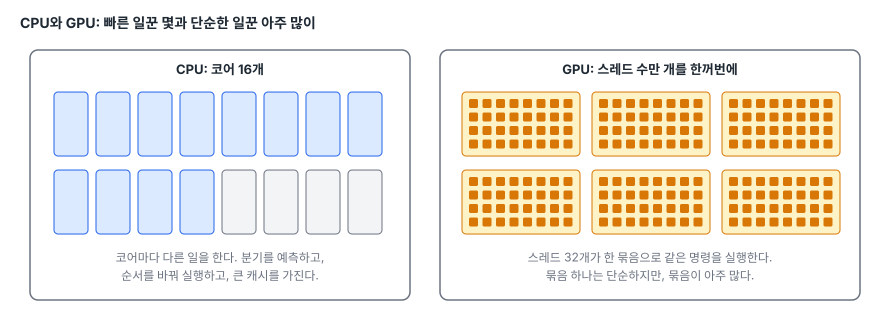
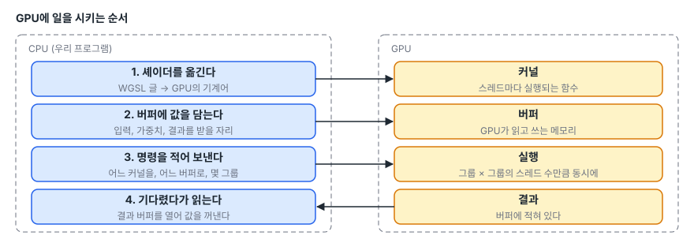
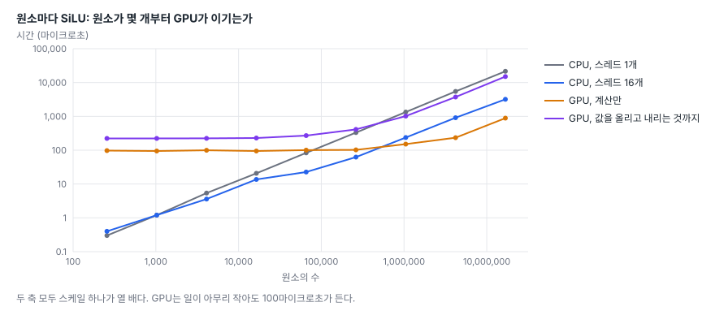
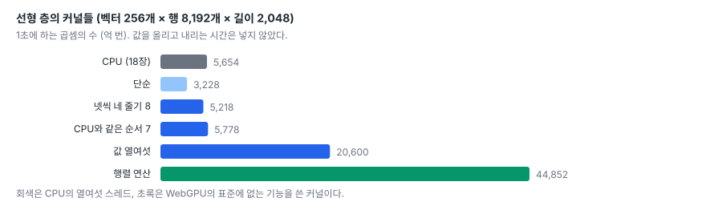
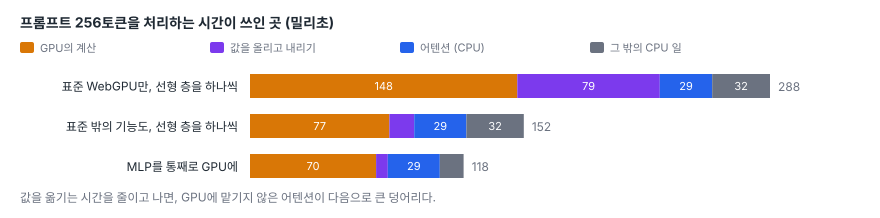
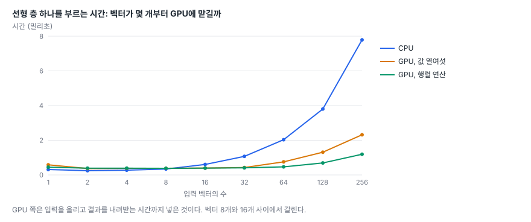

# GPU 연산

지금까지 3부의 계산은 모두 CPU가 했습니다. 이 책의 기계에는 코어가
40개인 GPU가 하나 더 들어 있고, 그것은 지금까지 한 번도 일하지
않았습니다. 13.5절에서 llama.cpp는 GPU를 켜는 것만으로 프롬프트 처리가
6.5배 빨라졌습니다. 이 장에서 그 격차를 줄입니다.

결과를 미리 적어 둡니다.

- 프롬프트 256토큰의 처리가 412토큰/초에서 2,116토큰/초가 되었습니다.
  5.1배입니다.
- 토큰을 하나씩 만드는 일은 GPU에 맡기면 **서너 배 느려집니다.** 그 일은
  CPU에 남겼습니다.
- 처음 짠 GPU 커널은 CPU보다 느렸습니다. 같은 계산을 네 번 고쳐 짜서
  14배 빠르게 만들었습니다.
- GPU가 계산하는 시간만큼을 값을 올리고 내려받는 데 쓰고 있었습니다.
  이 기계는 CPU와 GPU가 메모리를 함께 쓰는데도 그랬습니다.
- CPU와 같은 비트를 내는 것은 포기했습니다. 까닭을 확인했습니다.

| 하는 일 | 절 |
|---|---|
| GPU가 CPU와 무엇이 다른지 본다 | 23.1 |
| GPU에 닿는 길을 정한다 | 23.2 |
| 첫 셰이더를 실행한다 | 23.3 |
| 일을 맡기는 값을 잰다 | 23.4 |
| 선형 층의 커널을 세 번 고쳐 짠다 | 23.5 |
| 하드웨어의 행렬 연산을 쓴다 | 23.6 |
| 같은 비트가 나오는지 본다 | 23.7 |
| 값을 옮기는 값을 잰다 | 23.8 |
| 모델의 선형 층을 GPU에 맡긴다 | 23.9 |
| 값을 GPU에 머물게 한다 | 23.10 |
| CPU와 일을 나눈다 | 23.11 |

이 장의 코드는 새 크레이트 `crates/badak_gpu/`에 있습니다.

## 23.1 GPU는 무엇이 다른가



CPU의 코어 하나는 복잡한 기계입니다. 다음에 실행할 명령을 예측하고,
순서를 바꿔 실행하고, 큰 캐시를 혼자 씁니다. 어떤 프로그램이든 빨리
돌리려고 그렇게 만들었습니다. [17장](ch17_simd.md)에서 그 코어 하나가 1초에 곱셈을
490억 번 했습니다.

GPU는 반대쪽 끝에 있습니다. **같은 일을 아주 많이 하는 것만** 잘하도록
만든 기계입니다. 화면의 점 수백만 개에 같은 계산을 하는 것이 처음의
쓰임이었고, 행렬의 값 수백만 개에 같은 계산을 하는 일도 모양이 같습니다.

GPU에서 실행하는 함수 하나를 **커널**이라고 하고, 그 함수를 실행하는
흐름 하나를 **스레드**라고 합니다. CPU의 스레드와 이름은 같지만 훨씬
가볍습니다. 일 하나에 스레드를 수백만 개 띄웁니다. GPU는 스레드를 몇십
개씩 묶어, 묶음 안의 스레드들이 **같은 명령을 같은 순간에** 실행하게
합니다. 17.1절의 벡터 명령이 값 넷에 같은 연산을 한 것과 같은 생각이고,
묶음이 훨씬 큽니다. 한 묶음 안에서 어떤 스레드는 `if`의 이쪽으로, 다른
스레드는 저쪽으로 가면 묶음 전체가 두 길을 다 걸어야 합니다. 그래서
GPU의 커널은 갈라지는 길이 적을수록 좋습니다.

프로그램은 스레드를 **작업 그룹**(workgroup)으로 묶어서 띄웁니다. "스레드
64개짜리 그룹을 가로 1,024개, 세로 32개" 하는 식입니다. 스레드마다 자기가
전체에서 몇 번째인지를 받고, 그 번호로 자기가 맡을 값을 찾습니다.

이 책의 기계가 가진 GPU는 이렇습니다.

```bash
system_profiler SPDisplaysDataType
```

```text
      Chipset Model: Apple M4 Max
      Total Number of Cores: 40
      Metal Support: Metal 4
```

### 통합 메모리

데스크톱의 그래픽 카드는 자기 메모리를 따로 가지고 있습니다. CPU가 가진
값을 GPU가 쓰려면 그 메모리로 보내야 하고, 결과를 받으려면 다시 가져와야
합니다. 둘 사이의 길은 메모리 안에서 값을 옮기는 것보다 훨씬 좁습니다.

Apple Silicon에서는 CPU와 GPU가 **같은 메모리**를 씁니다. 통합
메모리(unified memory)라고 부릅니다. 원리대로라면 값을 보내고 받을 일이
없습니다. 같은 주소를 둘이 함께 보면 됩니다. 실제로 그렇게 되는지는
23.8절에서 잽니다. 미리 말해 두면, 그렇게 되게 하려면 손이 갑니다.

## 23.2 GPU에 닿는 길

GPU에 일을 시키려면 운영체제와 드라이버를 거쳐야 합니다. 그 길은
운영체제마다 다릅니다. macOS는 Metal, Linux는 Vulkan, Windows는
Direct3D이고, 브라우저 안에서는 WebGPU입니다. 커널을 적는 언어도
제각각입니다.

이 책의 엔진은 Rust의 표준 라이브러리만 씁니다. 텐서도, 스레드 풀도,
파일 형식의 해석기도 직접 짰습니다. **GPU에 닿는 길만은 예외로 합니다.**
`wgpu`라는 크레이트를 씁니다.[^wgpu] WebGPU라는 하나의 약속을 Rust로
구현한 것으로, 위의 네 가지 길을 모두 감쌉니다. 같은 코드가 Mac, Linux,
Windows에서 돌고, 6부에서는 브라우저에서도 돕니다. 커널은 WebGPU의 셰이더
언어인 WGSL로 한 번만 적습니다.

예외를 둔 까닭은 이렇습니다. GPU로 가는 길을 직접 짜는 일은 운영체제의
함수 수십 개를 정해진 순서로 부르는 일이고, 운영체제마다 다시 해야
합니다. 추론이 무엇인지와는 상관이 없습니다. 6.5절에서 파일을 메모리에
비출 때 운영체제의 함수 `mmap`을 부른 것과 같은 경계인데, 그 경계가 훨씬
넓을 뿐입니다. 경계의 이쪽, 곧 **GPU에서 무엇을 어떻게 계산할지**는
모두 직접 짭니다.

값을 치릅니다. `wgpu`는 우리 프로그램과 GPU 사이에 한 겹을 더 둡니다.
그 겹이 무엇을 해 주고 무엇을 가리는지가 이 장에 여러 번 나옵니다.

### 장치를 연다

```rust
{{#include ../../../crates/badak_gpu/src/native.rs:gpu}}
```

두 단계입니다. **어댑터**는 이 기계에 있는 GPU 하나를 가리키고,
**장치**는 그 GPU와 맺은 연결입니다. 장치와 함께 받는 **줄**(queue)로
명령을 보냅니다.

장치를 열 때 쓰고 싶은 한도를 말해야 합니다. WebGPU의 기본 한도는
버퍼 하나를 256MiB로, 셰이더에 묶는 버퍼 하나를 128MiB로
묶습니다.[^webgpu-limits] 어떤 기계에서든 돌게 하려는 값입니다. MLP의
가중치 행렬 하나가 `f32`로 67MB이고 임베딩 표는 1GB이므로, 이 GPU가
허락하는 만큼으로 올립니다.

`request_adapter`와 `request_device`는 `async` 함수입니다. 브라우저에서는
GPU를 여는 일이 정말로 나중에 끝나기 때문입니다. 브라우저 밖에서는
부르는 즉시 끝납니다. 그래서 실행기를 가져다 쓰지 않고, 준비됐는지
물어보기를 되풀이하는 열 줄짜리를 짰습니다.

```rust
{{#include ../../../crates/badak_gpu/src/executor.rs:block_on}}
```

## 23.3 첫 셰이더

원소마다 SiLU를 적용하는 일로 시작합니다. 5.2절의 `ops::silu`와 같은
계산입니다.

```wgsl
{{#include ../../../crates/badak_gpu/src/shaders/silu.wgsl}}
```

읽는 법은 이렇습니다.

- **버퍼**(`var<storage, ...>`)는 GPU가 읽고 쓰는 메모리입니다. `x`는
  읽기만 하고 `y`에는 씁니다. `@binding(0)`, `@binding(1)`은 프로그램이
  버퍼를 건넬 때의 자리 번호입니다.
- **`@compute @workgroup_size(256)`**: 이 함수가 커널이고, 작업 그룹
  하나가 스레드 256개라는 뜻입니다.
- **`global_invocation_id`**: 이 스레드가 전체에서 몇 번째인지입니다.
  스레드는 이 번호로 자기가 맡을 원소를 찾습니다. 반복문이 없습니다.
  "모든 `i`에 대해"는 GPU가 스레드를 원소의 수만큼 띄우는 것으로
  이루어집니다.
- **`if (i >= arrayLength(&x))`**: 원소가 1,000개이면 그룹은 4개,
  스레드는 1,024개입니다. 남는 24개는 할 일이 없습니다.
- **`ROW`**: 한 축에 놓을 수 있는 그룹은 65,535개까지입니다.[^webgpu-limits]
  원소가 그보다 많으면 그룹을 여러 줄에 놓습니다.

이 셰이더를 실행하려면 네 가지 일을 합니다.



**셰이더를 옮깁니다.** WGSL은 글입니다. GPU가 실행할 수 있는 기계어로
옮겨야 합니다. `wgpu`가 그것을 이 운영체제의 셰이더 언어로 바꾸고,
드라이버가 다시 GPU의 명령으로 바꿉니다.

```rust
{{#include ../../../crates/badak_gpu/src/native.rs:kernel}}
```

**버퍼를 만듭니다.**

```rust
{{#include ../../../crates/badak_gpu/src/native.rs:buffers}}
```

**명령을 적어 보냅니다.** "이 커널을, 이 버퍼들로, 그룹 몇 개" 를
적어 줄에 넣습니다. 넣는 함수는 기다리지 않고 돌아옵니다. GPU는 자기
속도로 일합니다.

```rust
{{#include ../../../crates/badak_gpu/src/native.rs:run}}
```

**결과를 읽습니다.**

```rust
{{#include ../../../crates/badak_gpu/src/native.rs:read}}
```

합치면 이렇습니다.

```rust
{{#include ../../../crates/badak_gpu/examples/ch23_first.rs:first}}
```

```bash
cargo run --release -p badak_gpu --example ch23_first
```

```text
{{#include output/ch23_first.txt:1:14}}
```

GPU가 계산했습니다. 여덟 값 가운데 셋은 CPU의 결과와 마지막 비트가
다릅니다. GPU의 `exp`가 2.4절의 것과 다른 방법으로 계산하기 때문입니다.
23.7절에서 다시 봅니다.

## 23.4 일을 맡기는 값

18.1절에서 스레드에 일을 나눠 주는 값을 먼저 쟀습니다. GPU에도 같은 것을
잽니다. 원소 256개, 그룹 하나짜리 일입니다.

```text
{{#include output/ch23_first.txt:16:20}}
```

**GPU가 계산에 쓴 시간은 4마이크로초인데 우리는 153마이크로초를
기다렸습니다.** CPU의 스레드 하나는 같은 일을 0.3마이크로초에 합니다.
500배입니다.

명령을 만들어 줄에 넣는 데는 9마이크로초가 듭니다. 나머지 140마이크로초는
명령이 드라이버를 지나 GPU에 닿고, GPU가 그것을 꺼내 실행하고, 끝났다는
소식이 돌아와 우리 스레드를 깨우는 시간입니다. 18.3절에서 잠든 스레드를
깨우는 데 수십 마이크로초가 든다는 것을 봤습니다. 여기서는 그런 일이
프로세스와 드라이버와 GPU 사이에서 여러 번 일어납니다.

원소의 수를 늘려 봅니다.

```text
{{#include output/ch23_first.txt:22:32}}
```



세 가지가 보입니다.

**GPU에는 바닥이 있습니다.** 원소가 256개이든 26만 개이든
100마이크로초입니다. 일이 그보다 작으면 무엇을 해도 CPU가 이깁니다.

**원소가 100만 개쯤부터 GPU가 열여섯 스레드를 이깁니다.** 1,600만
개에서는 3.6배입니다. SiLU는 원소 하나에 하는 일이 적어서 차이가 크지
않습니다.

**값을 올리고 내려받으면 이기지 못합니다.** 보라색 선은 입력을 버퍼에
담고 결과를 읽어 오는 시간까지 넣은 것입니다. 1,600만 개에서
15밀리초로, CPU의 스레드 하나(21밀리초)와 비슷하고 열여섯
스레드(3.2밀리초)보다 훨씬 느립니다. **계산은 0.9밀리초인데 값을 옮기는
데 14밀리초가 듭니다.**

GPU에 일을 맡길 때의 규칙 둘이 여기서 나옵니다. 작은 일은 맡기지
않습니다. 그리고 값을 옮기지 않습니다.

## 23.5 선형 층을 GPU에서

[14장](ch14_measurement.md)부터 봐 온 대로 시간의 대부분은 선형 층에 있습니다. `y = x Wᵀ`,
입력 벡터마다 가중치의 행마다 내적 하나입니다.

### 가장 단순하게

스레드 하나가 결과의 값 하나를 맡습니다.

```wgsl
{{#include ../../../crates/badak_gpu/src/shaders/linear_simple.wgsl}}
```

2.3절의 내적 그대로입니다. 그룹을 2차원으로 놓았습니다. 가로가 가중치의
행이고 세로가 입력 벡터입니다. 형상은 **유니폼**(uniform)이라는 작은
버퍼로 넘깁니다.

[18장](ch18_multithreading.md)까지의 CPU 커널과 견줍니다. MLP의 첫 층에 토큰 256개를 넣는
형상입니다. 곱셈이 43억 번입니다.

```bash
cargo run --release -p badak_gpu --example ch23_linear
```

```text
{{#include output/ch23_linear.txt:2:2}}
{{#include output/ch23_linear.txt:22:24}}
```

**GPU가 CPU보다 느립니다.** 1초에 3,228억 번 대 5,654억 번입니다.
GPU에 올리기만 하면 빨라지는 것이 아닙니다.

### 넷씩 묶어 네 줄기로

[17장](ch17_simd.md)에서 CPU의 커널에 한 일을 그대로 해 봅니다. 값을 넷씩 묶어
읽고(`vec4<f32>`), 합을 네 줄기로 나눠 쌓습니다.

```wgsl
{{#include ../../../crates/badak_gpu/src/shaders/linear_wide.wgsl:12:}}
```

```text
{{#include output/ch23_linear.txt:25:25}}
```

1.6배가 되어 CPU와 비슷해졌습니다. [17장](ch17_simd.md)에서 CPU가 같은 일로 얻은
것에 견주면 작습니다. GPU에서 `vec4`는 한 번에 넷을 계산하는 명령이 아니라 넷을
묶어 적는 표기에 가깝습니다. 스레드를 묶어 같은 명령을 실행하는 것이
이미 GPU의 벡터 계산입니다.

### 읽는 양을 줄인다

두 커널 모두 값 하나를 내려고 입력 벡터 하나와 가중치의 행 하나를 통째로
읽습니다. 곱셈 한 번에 읽기 두 번입니다. 16.4절에서 본 문제이고,
푸는 방법도 같습니다. **스레드 하나가 값을 여럿 맡습니다.** 입력 벡터
넷과 가중치의 행 넷을 한 번씩 읽으면 내적 열여섯 개를 계산할 수
있습니다. 곱셈 한 번에 읽기가 반의 반입니다.

```wgsl
{{#include ../../../crates/badak_gpu/src/shaders/linear_block.wgsl:10:}}
```

```text
{{#include output/ch23_linear.txt:27:27}}
```

**3.9배가 되었습니다.** 1초에 2조 번, CPU의 3.6배입니다.

이 셰이더가 길게 풀어 적은 모양인 데는 까닭이 있습니다. 처음에는 합
열여섯 개를 배열에 두고 반복문 둘로 돌게 짰습니다. 그 판은 1초에
6,240억 번이었습니다. 풀어 적은 것의 3분의 1입니다. `wgpu`는 셰이더가
버퍼나 배열의 범위 밖을 건드리지 못하게 검사하는 코드를 끼워 넣고,
끝나지 않는 반복문이 생기지 않게 반복문마다 장치를 답니다. 브라우저에서
남이 준 셰이더를 실행해도 안전하게 하려는 것입니다. 그 검사가 가장
안쪽의 반복문에 들어가면 계산보다 검사가 커집니다. 검사를 끄는 방법도
있지만(`unsafe`입니다) 쓰지 않았습니다. 배열과 안쪽 반복문을 없애니
검사를 켠 채로도 같은 속도가 나왔습니다.

묶음의 크기도 재서 골랐습니다. 벡터 여덟에 행 여덟(값 64개)을 맡기면
읽기는 더 줄지만 1초에 1조 5,750억 번으로 느려집니다. 스레드 하나가
쥐고 있어야 하는 값이 너무 많아지는 것으로 보입니다(확인하지는
않았습니다).

## 23.6 하드웨어의 행렬 연산

llama.cpp는 이 GPU에서 프롬프트를 1초에 5,532토큰 처리했습니다(13.5절).
토큰 하나에 곱셈이 9억 7천만 번이니 1초에 5조 4천억 번입니다. 앞 절의
커널은 2조 번입니다. 아직 2.6배 차이가 납니다.

llama.cpp의 커널을 읽어 보면 까닭이 있습니다.[^ggml-mul-mm] Apple의
GPU에는 **스레드 한 묶음이 힘을 합쳐 8 × 8 행렬의 곱을 한 번에 하는**
명령이 있고, 그것을 씁니다. 스레드 하나가 내적을 하나씩 하는 대신,
묶음이 행렬 하나를 나눠 쥐고 `C += A × B`를 한 번의 연산으로 합니다.
곱셈 512번입니다.

이 기능은 WebGPU의 표준에 없습니다. `wgpu`가 실험 기능으로 내놓고
있습니다.[^wgpu-coop] Apple의 GPU와 일부 Vulkan 장치에서만 됩니다.

```wgsl
{{#include ../../../crates/badak_gpu/src/shaders/linear_cooperative.wgsl:8:26}}
    // ... c00부터 c33까지 열여섯 개 ...
    for (var k = 0u; k < shape.cols; k += 8u) {
        // a<i>: 벡터 8개의 값 8개씩. 행이 벡터이고 열이 k다.
        let a0 = coopLoadT<coop_mat8x8<f32, A>>(&x[(vector + 0u) * shape.cols + k], shape.cols);
        // ... a1, a2, a3 ...
        // b<j>: 가중치의 행 8개의 값 8개씩. 열이 가중치의 행이고 행이 k다.
        let b0 = coopLoad<coop_mat8x8<f32, B>>(&w[(row + 0u) * shape.cols + k], shape.cols);
        // ... b1, b2, b3 ...
        // c += a × b. 곱셈 512번을 한 번의 연산으로 한다.
        c00 = coopMultiplyAdd(a0, b0, c00);
        // ... 열여섯 줄 ...
    }
    coopStoreT(c00, &y[(vector + 0u) * shape.rows + row + 0u], shape.rows);
    // ... 열여섯 줄 ...
}
```

작업 그룹 하나가 스레드 32개이고, 그룹 하나가 결과의 값 1,024개(벡터
32 × 행 32)를 맡습니다. `a`를 넷, `b`를 넷 읽어 열여섯 번 곱합니다.
앞 절과 같은 생각입니다. 읽은 것을 여러 번 씁니다.

```text
{{#include output/ch23_linear.txt:28:28}}
```

**1초에 4조 5천억 번입니다.** CPU의 7.9배, 앞 절 커널의 2.2배입니다.
(표의 시간에는 23.4절의 바닥이 들어 있습니다. GPU의 시계로 잰 0.77밀리초로
나누면 5조 6천억 번이고, llama.cpp의 5조 4천억 번과 같은 자리입니다.)

여기서도 묶음의 크기를 재서 골랐습니다. `a` 하나에 `b` 하나(그룹이 값
64개)이면 1조 번으로 앞 절의 커널보다 느리고, 넷에 넷이 가장 빠르고,
여덟에 여덟이면 2조 번 안팎으로 다시 떨어집니다.



| 커널 | 1초에 하는 곱셈 (억) | CPU 대비 |
|---|---|---|
| CPU, 열여섯 스레드 ([18장](ch18_multithreading.md)) | 5,654 | 1배 |
| 단순 | 3,228 | 0.57배 |
| 넷씩 네 줄기 | 5,218 | 0.92배 |
| 값 열여섯 | 20,600 | 3.6배 |
| 행렬 연산 (표준 밖) | 44,852 | 7.9배 |

처음 짠 커널과 마지막 커널이 14배 차이입니다. 같은 GPU, 같은 계산입니다.
[16장](ch16_matmul.md)과 [17장](ch17_simd.md)에서 CPU에 한 일을 GPU에서 다시 했습니다. 읽는 양을 줄이고,
기계가 가진 가장 좋은 명령을 씁니다.

벡터가 적을 때는 사정이 다릅니다.

```text
{{#include output/ch23_linear.txt:3:7}}
```

토큰 하나를 넣을 때는 어느 커널도 CPU를 이기지 못합니다. 23.11절에서
다룹니다.

15.6절에서 미뤄 둔 물음이 하나 있습니다. llama.cpp의 GPU가 토큰을 만들
때 1초에 447GB를 읽는데, CPU의 열두 코어는 275GB가 한계였습니다. 위의
표에서 GPU의 시계로 가장 빠른 줄은 0.22밀리초입니다. 가중치 67MB를 한
번 훑는 일이니 1초에 300GB입니다. 스레드 하나가 값 하나를 맡는 단순한
커널로도 CPU의 열두 코어보다 많이 읽습니다. 같은 메모리를 GPU 쪽에서는
더 넓은 길로 읽는다는 15.6절의 관찰과 같은 쪽입니다. 다만 이 값은 잴
때마다 0.19에서 0.47밀리초 사이를 오갔습니다. 방향만 확인한 것으로
적어 둡니다.

## 23.7 같은 비트는 포기한다

17.3절부터 이 책의 CPU 커널은 한 가지 약속을 지켜 왔습니다. 어떤 구현으로
계산하든 결과의 **비트가 같습니다.** 16.7절에서 GPU에 대해서는 이 약속을
미뤄 두었습니다.

위의 표에 마지막 두 열이 있습니다. CPU의 결과와 가장 크게 어긋난 값의
상대 오차, 그리고 비트까지 같은 값의 비율입니다.

```text
{{#include output/ch23_linear.txt:2:2}}
{{#include output/ch23_linear.txt:22:28}}
```

차이는 10만 분의 일 안쪽이고, 비트까지 같은 값은 3~9%뿐입니다. 더하는
순서가 다르니 당연합니다.

그러면 순서를 맞추면 어떨까요. 표의 "CPU와 같은 순서"가 그 실험입니다.
17.3절의 정의 그대로, 합 여덟 개에 `fma`로 곱해 더하고 같은 순서로
모으는 셰이더입니다.

```wgsl
{{#include ../../../crates/badak_gpu/src/shaders/linear_exact.wgsl:26:}}
```

**비트가 같은 값이 42%입니다.** 다른 커널보다는 많지만 절반도 안
됩니다. 순서를 맞췄는데도 같은 비트가 나오지 않습니다.

까닭을 찾아 내려갔습니다. `wgpu`는 우리 셰이더를 Metal의 셰이더 언어로
바꿔 Metal의 컴파일러에 넘깁니다. 그 컴파일러에는 "빠른 수학" 옵션이
있고, Apple의 설명에 따르면 켜져 있는 것이 기본이며 켜면 컴파일러가
IEEE 754를 어길 수 있는 최적화를 합니다.[^fast-math] `wgpu`의 소스를
보면 그 옵션을 건드리지 않습니다.[^wgpu-compile] 곧 **우리가 적은 순서를
컴파일러가 바꿔도 되는 상태**로 옮겨집니다. `wgpu` 30에는 이것을 끄는
방법이 없습니다.

WGSL의 명세가 `fma`와 덧셈의 정밀도를 어떻게 정하는지도 확인하려
했습니다. 명세에 "부동소수점의 정확도"와 "다시 묶기와 합치기"라는 절이
있다는 것까지는 차례에서 확인했지만 본문을 읽지 못했습니다. 그래서
"표준이 무엇을 허락하는가"는 이 책에서 말하지 않습니다. 이 기계에서 잰
것만 말합니다.

대신 확인한 것이 하나 있습니다. **같은 계산을 GPU에서 두 번 하면 모든
비트가 같았습니다**(23.9절의 출력). 실행할 때마다 달라지는 것은 아닙니다.
CPU와 다를 뿐입니다.

GPU에 대한 약속을 이렇게 정합니다.

- GPU의 결과는 CPU의 결과와 **허용 오차 안에서** 같아야 합니다. 테스트가
  모든 커널을 CPU의 `ops::linear`와 견줍니다.
- 모델 전체로는 점수가 얼마나 달라지는지, 이어 쓴 토큰이 같은지를
  잽니다(23.9절). 20.6절에서 양자화에 쓴 방법입니다.
- 비트까지 같아야 하는 일(정답 파일과의 대조, 버그를 찾을 때의
  비교)은 CPU에서 합니다.

## 23.8 값을 옮기는 값

23.4절에서 값을 올리고 내려받는 시간이 계산보다 컸습니다. 이 기계는
CPU와 GPU가 메모리를 함께 쓰는데도 그랬습니다. 따로 잽니다.

```bash
cargo run --release -p badak_gpu --example ch23_memory
```

```text
{{#include output/ch23_memory.txt}}
```

첫 열이 기준입니다. 같은 양을 CPU의 메모리 안에서 옮겨 적는 시간입니다.
64MB에 0.9밀리초, 1초에 70GB입니다.

**표준의 길은 그 일곱 배가 걸립니다.** 64MB를 적는 데 6.9밀리초, 읽는
데 6.2밀리초입니다. WebGPU의 규칙이 그렇게 만듭니다. 셰이더가 쓰는
버퍼(`STORAGE`)는 CPU가 열 수 없습니다. CPU가 열 수 있는 버퍼는 읽기용과
쓰기용이 따로 있고, 다른 쓰임과 섞을 수 없습니다.[^webgpu-usage] 그래서
결과를 읽으려면 GPU에게 "계산에 쓴 버퍼를 읽기용 버퍼로 옮겨 적어 달라"고
한 뒤 그것을 열어야 합니다. 값을 적을 때도 임시 버퍼를 거칩니다.
GPU의 메모리가 따로 있는 기계를 기준으로 만든 규칙입니다. 그런 기계에서는
어차피 옮겨야 하니까요.

**곧바로 여는 길은 CPU 안에서 옮기는 것과 같습니다.** 0.9밀리초입니다.
`wgpu`에는 계산에 쓰는 버퍼를 CPU가 열 수 있게 하는 기능이 있습니다.
브라우저 밖에서만 됩니다. 이 기능을 켜면 `wgpu`는 버퍼를 "CPU와 GPU가
같은 메모리를 보는" 방식으로 만들고, 여는 일은 그 메모리의 주소를
돌려주는 것이 됩니다.[^wgpu-buffer] 통합 메모리가 약속한 것이 이것입니다.
그래도 옮겨 적기는 한 번 합니다. 순전파가 텐서의 값을 자기 메모리에 쥐고
있기 때문입니다.

### 함정 둘

마지막 열은 제가 처음 짠 방식입니다. 버퍼를 읽기와 쓰기를 모두 열 수
있게 만들었습니다. 편하니까요. **읽기가 23배 느려졌습니다.** 64MB에
21.6밀리초입니다. 표준의 길보다도 세 배 느립니다.

`wgpu`의 소스에 까닭이 있습니다. 쓰기를 열 수 있는 버퍼는 Metal에
"쓰기 전용으로 빠른 메모리"로 만들어 달라고 합니다.[^wgpu-buffer] Apple의
설명서는 그런 메모리를 이렇게 적어 두었습니다. CPU가 쓰기만 하고 읽지
않을 자원을 위한 것이고, 읽기는 "perform very poorly"라고요.[^write-combined]
CPU의 캐시를 거치지 않게 만든 메모리입니다. 쓸 때는 캐시를 어지럽히지
않아 좋지만, 읽을 때는 캐시의 도움을 받지 못합니다.

입력을 담는 버퍼는 쓰기만, 결과를 받는 버퍼는 읽기만 열 수 있게
나눴습니다.

```rust
{{#include ../../../crates/badak_gpu/src/native.rs:write}}
```

두 번째 함정은 메모리에 있었습니다. 가중치를 GPU에 올리고 프로세스의
메모리를 쟀더니 지켜야 하는 메모리가 8.06GB였습니다. 올린 것은
3.89GB입니다. 버퍼를 만들면서 값을 담으면 `wgpu`는 값을 임시 버퍼에
받아 두었다가 **다음 명령을 보낼 때** 제자리로 옮깁니다. 행렬 112개를
잇달아 올리는 동안 명령을 한 번도 보내지 않았으니 임시 버퍼 112개가
그대로 쌓여 있었습니다. 올릴 때마다 빈 명령을 보내 그때그때 옮기게
했습니다.

```bash
cargo build --release -p badak_models --examples
sh scripts/measure_ch23_memory.sh
```

```text
{{#include output/ch23_memory_llama32.txt}}
```

22.1절의 두 숫자가 여기서 또 갈립니다. GPU에 올린 3.89GB는 **지켜야
하는 메모리에는 들어가고 올라온 메모리에는 거의 들어가지 않습니다.**
GPU의 버퍼는 우리 프로세스의 주소 공간에 올라와 있지 않지만, 이
프로세스가 없으면 사라지는 메모리이기는 합니다.

그리고 가중치가 두 벌이 되었습니다. 파일을 비춘 BF16 2.47GB와 GPU에
올린 `f32` 3.89GB입니다. 22.2절에서 0.01GB로 줄여 놓은 숫자가 4.2GB가
되었습니다. 23.12절에서 다시 이야기합니다.

## 23.9 모델의 선형 층을 GPU에 맡긴다

커널이 있으니 모델에 끼웁니다. 순전파의 코드는 고치지 않습니다.
20.4절에서 선형 층의 곱셈을 가중치 쪽에 맡겨 두었습니다(`LinearWeight`).
`f32` 텐서, BF16 텐서, 묶음으로 양자화한 행렬이 각자 자기 커널을
불렀습니다. **GPU에 올린 행렬**이 하나 더 생길 뿐입니다.

엔진의 행렬에 갈래를 하나 더합니다. 엔진의 핵심(`badak_core`)은 GPU를
모릅니다. "곱셈을 다른 곳에 맡긴 행렬"이라는 것만 압니다.

```rust
{{#include ../../../crates/badak_core/src/packed/mod.rs:delegated}}
```

GPU 쪽에는 창구를 하나 둡니다. 커널과, 입력과 결과를 담는 버퍼를 쥐고
있습니다. 22.10절에서 한 대로 버퍼는 돌려 씁니다.

```rust
{{#include ../../../crates/badak_gpu/src/offload.rs:offload}}
```

```rust
{{#include ../../../crates/badak_gpu/src/offload.rs:matrix}}
```

곱셈은 세 단계입니다. 입력을 버퍼에 적고, 계산을 명령하고 기다리고,
결과를 읽습니다.

```rust
{{#include ../../../crates/badak_gpu/src/offload.rs:apply}}
```

행렬 연산 커널은 벡터를 32개씩 묶어 계산합니다. 벡터가 45개이면 64개로
보고 모자라는 19개는 0으로 채웁니다. 헛계산이지만 커널을 형상마다 따로
짜는 것보다 단순합니다.

모델을 읽어 블록의 선형 층들을 바꿔 끼웁니다. 19.8절에서 양자화한
가중치를 끼울 때 쓴 함수입니다.

```rust
{{#include ../../../crates/badak_models/examples/ch23_llama.rs:offload}}
```

임베딩 표는 CPU에 둡니다. 표에서 행을 뽑는 일은 계산이 아니고, 마지막에
점수를 내는 일은 토큰 하나에 한 번뿐입니다.

```bash
cargo run --release -p badak_models --example ch23_llama
```

```text
{{#include output/ch23_llama.txt:1:10}}
```

**이어 쓴 토큰 40개가 모두 같습니다.** 점수는 정답(13.3절의 `f64`
계산)에서 100만 분의 2만큼 벗어납니다. CPU가 100만 분의 0.6이니
조금 더 벗어나지만, 20.6절에서 `Q8_0`이 1,000분의 1 벗어났던 것에 견주면
아무것도 아닙니다. 1위 토큰의 확률은 소수점 둘째 자리까지 같습니다.
점수의 비트가 CPU와 같은 값은 1%뿐입니다. 앞 절에서 정한 약속대로입니다.

## 23.10 값을 GPU에 머물게 한다

속도입니다. 프롬프트 256토큰을 한꺼번에 처리하고, 이어서 토큰 32개를
하나씩 처리합니다.

```text
{{#include output/ch23_llama.txt:12:17}}
```

위의 세 줄부터 봅니다. 표준 WebGPU만 쓰면 프롬프트 처리가 926토큰/초,
CPU의 2.2배입니다. 표준 밖의 기능 둘(행렬 연산, 버퍼를 곧바로 열기)을
쓰면 1,716토큰/초, 4.2배입니다.

커널은 CPU의 7.9배인데 모델은 4.2배입니다. 14.7절의 프로파일러로 시간이
어디에 쓰였는지 봅니다.

```text
{{#include output/ch23_llama.txt:21:33}}
```

표준의 길에서는 **값을 올리고 내려받는 데 79밀리초**를 씁니다. 전체의
27%입니다. 버퍼를 곧바로 여는 길로 바꾸면 이렇게 됩니다.

```text
{{#include output/ch23_llama.txt:35:47}}
```

14밀리초로 줄었습니다. 이제 눈에 들어오는 것은 **CPU에 남은 일들**입니다.
어텐션이 29밀리초, 활성화 함수가 13밀리초, 더하기와 곱하기가
6밀리초입니다. 선형 층이 빨라지자 나머지가 드러났습니다. 18.9절에서
스레드를 넣었을 때와 같은 일이고, 암달의 법칙(18.8절)입니다.

그 가운데 활성화 함수와 곱하기는 이상한 자리에 있습니다. MLP는 이런
계산입니다(9.9절).

```text
down( silu(gate(x)) × up(x) )
```

`gate`와 `up`은 GPU에서 계산합니다. 결과는 각각 8MB입니다. 그것을 CPU로
내려받아 `silu`와 곱셈을 하고, 다시 GPU로 올려 `down`에 넣습니다.
**GPU에서 나온 값이 GPU로 돌아가려고 CPU를 다녀옵니다.**

가운데 계산도 GPU에서 하면 다녀올 일이 없습니다. 셰이더 하나를 더
짭니다.

```wgsl
{{#include ../../../crates/badak_gpu/src/shaders/silu_mul.wgsl}}
```

그리고 네 단계(`gate`, `up`, 가운데, `down`)를 **명령 묶음 하나**에 적어
한 번에 보냅니다. 가운데 결과는 GPU의 버퍼에만 있고 CPU로 오지 않습니다.
기다리는 것도 네 번이 아니라 한 번입니다.

```rust
{{#include ../../../crates/badak_gpu/src/offload.rs:mlp_apply}}
```

모델에는 "MLP 전체를 대신 계산하는 것"을 끼울 자리를 하나 냈습니다.

```rust
{{#include ../../../crates/badak_core/src/ops.rs:operator}}
```

```text
{{#include output/ch23_llama.txt:49:61}}
```



**프롬프트 처리가 2,116토큰/초가 되었습니다.** CPU의 5.1배입니다. 값을
옮기는 시간은 6.5밀리초이고, CPU의 활성화 함수는 표에서 사라졌습니다.

남은 119밀리초 가운데 70이 GPU의 계산이고 29가 어텐션입니다. 어텐션은
CPU가 합니다. 전체의 4분의 1입니다. 다음 장이 어텐션을 다룹니다.

## 23.11 CPU와 일을 나눈다

토큰 생성 쪽을 보지 않았습니다. 앞의 표를 다시 봅니다.

```text
{{#include output/ch23_llama.txt:12:17}}
```

**GPU에 맡기면 토큰 생성이 71토큰/초에서 22토큰/초로 떨어집니다.**
토큰 하나를 만들 때 선형 층을 113번 지나고, 그때마다 23.4절의 바닥을
치릅니다. 벡터가 하나일 때는 GPU의 커널이 CPU보다 빠르지도 않습니다
(23.6절). 얻는 것 없이 값만 치릅니다.

어디서 갈리는지 잽니다. MLP의 첫 층 하나에 벡터를 1개부터 256개까지
넣습니다. GPU 쪽은 값을 올리고 내려받는 시간까지 넣은 것입니다.

```bash
cargo run --release -p badak_gpu --example ch23_split
```

```text
{{#include output/ch23_split.txt}}
```



벡터가 8개일 때까지는 CPU가 빠르고, 16개부터 GPU가 빠릅니다. GPU 쪽의
시간은 벡터가 32개가 될 때까지 0.4밀리초에서 움직이지 않습니다. 그만큼이
바닥입니다.

규칙을 정합니다. **벡터가 32개보다 적은 일은 CPU가 합니다.** 16이 아니라
32로 한 것은 행렬 연산 커널이 32개씩 묶어 계산하기 때문입니다. `Offload`의
`min_count`가 그 문턱입니다.

```text
{{#include output/ch23_llama.txt:18:19}}
```

프롬프트 처리는 1,907토큰/초, 토큰 생성은 CPU 그대로입니다. 프롬프트
쪽이 조금 떨어진 것은 문턱 때문이 아닙니다. 두 줄은 같은 길로 프롬프트를
처리합니다. 측정이 그만큼 흔들립니다.

| Llama 3.2 1B | 프롬프트 처리 (토큰/초) | 토큰 생성 (토큰/초) |
|---|---|---|
| CPU ([22장](ch22_memory.md)) | 412 | 71 |
| GPU, 표준 WebGPU만 | 926 | 15 |
| GPU, 표준 밖의 기능도 | 1,716 | 19 |
| GPU, MLP를 통째로 | 2,116 | 22 |
| 벡터 32개부터만 GPU | 1,907 | 77 |
| llama.cpp, GPU (13.5절, `f32`) | 5,532 | 90 |

토큰 생성의 71은 14.11절의 기준 측정(96)보다 낮습니다. 다른 일을 재기
때문입니다. 기준 측정은 빈 문맥에서 토큰을 만들고, 이 표는 256토큰 뒤에
이어서 만듭니다. 문맥이 길수록 어텐션이 볼 것이 많습니다(9.6절). 이것도
다음 장의 일입니다.

"GPU가 있으면 빠르다"는 절반만 맞습니다. **일이 클 때만 빠릅니다.**
프롬프트를 처리하는 일은 크고, 토큰을 하나씩 만드는 일은 작습니다.
[14장](ch14_measurement.md)에서 두 지표를 따로 재기로 한 것이 여기서 값을 합니다.

## 23.12 남긴 것

**llama.cpp와의 거리.** 프롬프트 처리가 2,116 대 5,532입니다. 2.6배
남았습니다. 커널은 같은 자리까지 왔으니(23.6절) 차이는 그 밖에 있습니다.
우리는 어텐션, 정규화, 더하기를 CPU에서 하고, 그러느라 블록마다 값을
올리고 내려받으며, 그때마다 GPU를 기다립니다. llama.cpp는 계산 전체를
GPU에 올려 두고 끝에서 한 번 기다립니다. 그렇게 하려면 "다음에 무슨
계산이 올지"를 미리 알아야 합니다. 22.13절에서 메모리의 자리를 계획하는
일을 그래프([26장](../part4/ch26_graph_interpreter.md))로 미룬 것과 같은 까닭으로, 계산 전체를 GPU에 올리는
일도 그래프가 있어야 할 수 있습니다. [26장](../part4/ch26_graph_interpreter.md)에서 그래프와 실행 계획을
만듭니다. GPU에 통째로 올리는 일은 그 위에서 하는 다음 일로
남습니다(26.14절). 이 장의 `Operator`는 그 일을 MLP 하나에 손으로 한
것입니다. [25장](ch25_rematch.md)에서 조건을 맞춰 다시 겨룹니다.

**가중치가 두 벌.** GPU에는 `f32`로 펼친 3.89GB가 올라가 있고, 파일을
비춘 BF16 2.47GB도 그대로 있습니다. 줄이는 길이 둘 있습니다. 하나는
GPU에서도 BF16을 그대로 읽고 곱하는 순간에 펼치는 것입니다(20.1절에서
CPU에 한 일). 행렬 연산 커널은 버퍼에서 `f32`를 곧바로 읽어 가므로,
펼친 값을 그룹이 함께 쓰는 메모리에 잠깐 적어 두는 단계가 필요합니다.
llama.cpp의 커널이 그렇게 합니다.[^ggml-mul-mm] 다른 하나는 파일을 비춘
메모리를 GPU의 버퍼로 그대로 쓰는 것입니다. Metal에는 그런 함수가 있고
llama.cpp가 씁니다.[^ggml-nocopy] WebGPU에는 없습니다. `wgpu`를 쓰기로
하면서 내준 것입니다.

**양자화한 가중치.** `Q8_0`과 `Q4_0`은 GPU에 올리지 않았습니다. 20.10절에
적은 대로 GPU에서는 줄인 가중치를 읽으면서 실수로 되돌려 곱하는 것이
보통이고, 위의 BF16과 같은 일입니다.

**다른 GPU.** 이 장의 숫자는 모두 Apple M4 Max의 것입니다. `wgpu`를 쓴
덕에 코드는 다른 운영체제에서도 돌겠지만, 돌려 보지 않았습니다. 묶음의
크기, 문턱, 행렬 연산을 쓸 수 있는지는 GPU마다 다를 것입니다. 자동
테스트는 GPU가 없으면 건너뛰게 했습니다. 브라우저에서는 표준 밖의 기능
둘을 쓸 수 없으므로 표의 둘째 줄(926토큰/초)이 출발점이 됩니다. [49장](../part6/ch49_browser_gpu.md)에서
잽니다.

**GPU의 속을 재는 일.** "스레드 하나가 쥐는 값이 많아져서"(23.5절) 같은
설명을 확인하지 못했습니다. CPU에는 14.9절의 카운터가 있었지만, GPU가
명령을 몇 개 실행했고 캐시를 얼마나 놓쳤는지를 `wgpu`로는 읽을 수
없습니다. 이 장에서 잰 것은 시간뿐입니다.

## 23.13 실전 엔진에서는

**계산 전체를 GPU에 둡니다.** llama.cpp의 Metal 백엔드는 선형 층만이
아니라 정규화, 어텐션, 활성화 함수의 커널을 모두 가지고 있습니다
(`ggml/src/ggml-metal/kernels/`에 연산마다 파일이 있습니다). 값은
끝까지 GPU의 버퍼에 있고, CPU로 오는 것은 마지막의 점수뿐입니다.

**통합 메모리를 그대로 씁니다.** llama.cpp는 장치가 통합 메모리인지
묻고, 그렇다면 자기가 이미 쥔 메모리를 옮겨 적지 않고 GPU의 버퍼로
등록합니다.[^ggml-nocopy] 23.8절에서 우리가 한 번은 옮겨 적은 것조차
하지 않습니다.

**행렬의 곱은 하드웨어의 것을 씁니다.** 23.6절에서 본 대로입니다.
llama.cpp의 최신 커널은 한 걸음 더 나아가, 묶음마다의 행렬이 아니라
텐서 전체의 곱을 운영체제가 주는 연산으로 부릅니다.[^ggml-mul-mm] 어떤
크기로 묶을지를 Apple이 정합니다.

**셰이더는 미리 옮겨 둡니다.** 23.3절에서 셰이더를 옮기는 데
0.3밀리초가 걸렸습니다. 운영체제가 지난번에 옮긴 것을 기억하고 있어서
그렇습니다. 처음 실행할 때는 5밀리초였습니다. 커널이 수십 개인 엔진에서는
이것이 첫 토큰이 나올 때까지의 시간에 얹힙니다.

**NVIDIA의 GPU에서는 이야기가 더 있습니다.** 메모리가 따로 있어서 값을
옮기는 일이 실제로 좁은 길을 지납니다. 대신 GPU가 훨씬 크고, 16비트
실수 행렬의 곱을 위한 전용 회로가 있습니다. 이 책의 기계에 없어 재지
못합니다. [42장](../part5/ch42_datacenter.md)에서 설계를 읽는 것으로 다룹니다.

## 정리

- GPU는 같은 일을 아주 많이 하는 데 맞춘 기계입니다. 커널 하나를 스레드
  수백만 개가 실행하고, 스레드는 자기 번호로 맡을 값을 찾습니다.
- GPU에 닿는 길에만 외부 크레이트 `wgpu`를 씁니다. 커널은 WGSL로 한 번
  적고, 무엇을 어떻게 계산할지는 모두 직접 짭니다.
- GPU에 일을 맡기는 데는 바닥이 있습니다. 이 기계에서 100~150마이크로초
  입니다. 그보다 작은 일은 CPU가 빠릅니다.
- 선형 층의 커널을 네 번 짰습니다. 단순한 것은 CPU보다 느렸고, 스레드
  하나가 값 열여섯을 맡게 하니 3.6배, 하드웨어의 행렬 연산을 쓰니
  7.9배가 되었습니다.
- 안전을 위한 검사가 가장 안쪽의 반복문에 들어가면 속도가 3분의 1이
  됩니다. 배열과 안쪽 반복문을 풀어 적어 피했습니다.
- GPU의 결과는 CPU와 비트가 같지 않습니다. 순서를 맞춰도 그렇습니다.
  셰이더 컴파일러가 순서를 바꿀 수 있는 상태로 옮겨지기 때문입니다.
  같은 계산을 GPU에서 두 번 하면 비트가 같습니다.
- 통합 메모리인 기계에서도 WebGPU의 표준은 값을 옮겨 적게 합니다.
  계산에 쓰는 버퍼를 곧바로 여는(표준 밖의) 길이 일곱 배 빠릅니다.
- 읽을 버퍼를 쓰기도 열 수 있게 만들면 읽기가 23배 느려집니다. 쓰기
  전용으로 빠른 메모리에 놓이기 때문입니다.
- 선형 층만 GPU에 맡기면 값이 GPU와 CPU 사이를 오갑니다. MLP를 통째로
  GPU에서 계산해 가운데 결과가 CPU로 오지 않게 하니 프롬프트 처리가
  1,716에서 2,116토큰/초가 되었습니다.
- 토큰을 하나씩 만드는 일은 GPU에 맡기면 서너 배 느려집니다. 입력 벡터가
  32개보다 적은 일은 CPU가 합니다.
- 프롬프트 처리는 CPU의 5.1배가 되었고, llama.cpp의 GPU와는 2.6배가
  남았습니다. 남은 것은 어텐션과, 계산 전체를 GPU에 올리는 일입니다.

## 연습 문제

1. `silu.wgsl`의 `@workgroup_size(256)`을 32와 1024로 바꿔 23.4절의
   측정을 다시 해 보십시오. 원소가 1,600만 개일 때 시간이 달라집니까.
   `groups_for`와 `ROW`도 함께 고쳐야 합니다. 왜 그렇습니까.
2. 23.4절의 "일을 맡기는 값"에서 `gpu.wait()`를 부르지 않고 명령을 100번
   보낸 뒤 한 번만 기다리면, 명령 하나에 드는 시간이 얼마가 됩니까.
   153마이크로초 가운데 "기다리는 일"의 몫이 얼마입니까.
3. `linear_block.wgsl`을 벡터 둘 × 행 둘(값 넷)로 고쳐 짜 보십시오.
   23.5절의 설명대로라면 1초에 하는 곱셈이 "단순"과 "값 열여섯" 사이
   어디쯤이어야 합니까. 재서 견줘 보십시오.
4. `Variant::Cooperative`의 테스트에서 `count`를 32의 배수가 아닌 수로
   주면 `supports`가 거짓을 돌려줍니다. `Offload`는 그런 입력을 어떻게
   처리합니까. 벡터가 33개일 때 헛되이 하는 곱셈은 전체의 몇
   퍼센트입니까.
5. `Gpu::standard()`로 연 장치에서 `ch23_split`을 돌리도록 고쳐
   보십시오. CPU와 GPU가 갈리는 벡터의 수가 달라집니까. 23.8절의 어느
   숫자가 그 차이를 설명합니까.
6. 23.10절에서 MLP를 통째로 GPU에 맡겼습니다. 같은 방법으로 어텐션의
   선형 층 넷(`q_proj`, `k_proj`, `v_proj`, `o_proj`) 가운데 앞의 셋을
   명령 묶음 하나로 보내면, 기다리는 횟수가 블록마다 몇 번에서 몇 번으로
   줍니까. 23.4절의 바닥으로 어림하면 프롬프트 처리가 몇 밀리초
   빨라집니까.
7. `ch23_load`를 고쳐 가중치를 올린 뒤 `model`을 놓고(`drop`) 다시 읽어
   올리기를 세 번 되풀이하게 해 보십시오. 지켜야 하는 메모리의 최대치가
   늘어납니까. GPU의 버퍼는 언제 돌려줍니까.
8. 23.7절의 "CPU와 같은 순서" 커널에서 `fma(a, b, c)`를 `a * b + c`로
   바꾸면 비트가 같은 값의 비율이 어떻게 됩니까. 그 결과에서 이 GPU의
   `fma`에 대해 무엇을 말할 수 있고 무엇을 말할 수 없습니까.

## 참고 문헌

[^wgpu]: wgpu, 버전 30.0.2. <https://crates.io/crates/wgpu>,
    <https://github.com/gfx-rs/wgpu>. WebGPU를 Rust로 구현한 것입니다.
    이 장에서 인용하는 `wgpu`의 소스는 모두 이 버전의 것이고,
    crates.io에서 받은 꾸러미를 직접 열어 확인했습니다.

[^webgpu-limits]: W3C, "WebGPU," Candidate Recommendation Draft, 2026년
    11월 16일. <https://www.w3.org/TR/webgpu/>. 3.6.2절 "Limits"의 표에
    `maxBufferSize` 268,435,456, `maxStorageBufferBindingSize`
    134,217,728, `maxComputeWorkgroupsPerDimension` 65,535,
    `maxComputeInvocationsPerWorkgroup` 256이 있습니다. `wgpu`의
    기본값(`wgpu-types`의 `src/limits.rs`)도 같습니다.

[^webgpu-usage]: W3C, "WebGPU," 5.1.2절 "Buffer Usages"와 5.1.3절 "Buffer
    Creation". `MAP_READ`는 `COPY_DST`하고만, `MAP_WRITE`는 `COPY_SRC`
    하고만 함께 쓸 수 있습니다. 이 조항은 요약으로 확인했고 문장을 그대로
    대조하지는 못했습니다.

[^ggml-mul-mm]: llama.cpp, `ggml/src/ggml-metal/kernels/mul_mm.metal`
    (커밋 `b4c0e00a4fcc`). 파일의 뒤쪽 커널이 `simdgroup_float8x8`
    행렬을 여덟 개 두고 8 × 8 곱을 쌓습니다. 앞쪽 커널(`GGML_METAL_HAS_TENSOR`
    일 때)은 가중치의 한 구간을 펼쳐 그룹이 함께 쓰는 메모리에 적은 뒤
    (`PHASE 1`), 텐서의 곱을 하는 연산 `matmul2d`를 부릅니다(`PHASE 2`).
    <https://github.com/ggml-org/llama.cpp/blob/b4c0e00a4fcc/ggml/src/ggml-metal/kernels/mul_mm.metal>

[^wgpu-coop]: wgpu-types 30.0.2, `src/features.rs`의
    `EXPERIMENTAL_COOPERATIVE_MATRIX`. 설명에 "also known as tensor cores on
    NVIDIA GPUs or simdgroup matrix operations on Apple GPUs"라고 적혀
    있고, 지금은 8 × 8 `f32` 행렬만 된다고 합니다. WGSL에서의 문법
    (`coop_mat8x8`, `coopLoad`, `coopMultiplyAdd`, `coopStore`)은 naga
    30.0.2의 `src/front/wgsl/`에서 확인했습니다.

[^fast-math]: Apple, Metal 프레임워크의 헤더 `MTLLibrary.h`(macOS 27의
    SDK). `MTLCompileOptions`의 `fastMathEnabled`에 "enables the compiler
    to perform optimizations for floating-point arithmetic that may violate
    the IEEE 754 standard"라는 설명과 함께 기본값이 `YES`라고 적혀
    있습니다. macOS 15부터는 `mathMode`가 그 자리를 잇습니다.

[^wgpu-compile]: wgpu-hal 30.0.2, `src/metal/device.rs` 272~278번째 줄.
    `MTLCompileOptions`를 새로 만들어 언어의 판과 `preserveInvariance`만
    정하고 컴파일러에 넘깁니다. 빠른 수학에 관한 옵션은 건드리지
    않습니다.

[^wgpu-buffer]: wgpu-hal 30.0.2, `src/metal/device.rs`. 469~476번째 줄에서
    CPU가 열 수 있는 버퍼를 `StorageModeShared`로, 그렇지 않은 버퍼를
    `StorageModePrivate`으로 만들고, 쓰기를 열 수 있는 버퍼에는
    `CPUCacheModeWriteCombined`를 더합니다. 504~514번째 줄의
    `map_buffer`는 Metal 버퍼의 `contents`(그 메모리의 주소)를 그대로
    돌려줍니다.

[^write-combined]: Apple, Metal 프레임워크의 헤더 `MTLResource.h`(macOS
    27의 SDK). `MTLCPUCacheModeWriteCombined`의 설명입니다. 같은 헤더에
    `MTLResourceStorageModeShared`가 CPU와 장치가 같은 메모리를 쓰는
    방식이라고 적혀 있습니다.

[^ggml-nocopy]: llama.cpp, `ggml/src/ggml-metal/ggml-metal-device.m`
    (커밋 `b4c0e00a4fcc`). 1139번째 줄에서 장치의 `hasUnifiedMemory`를
    읽고 1271번째 줄에서 그 값으로 `use_shared_buffers`를 정합니다.
    2206번째 줄부터, 그 값이 참이면 이미 가진 메모리를
    `newBufferWithBytesNoCopy`로 Metal의 버퍼로 등록합니다.
    <https://github.com/ggml-org/llama.cpp/blob/b4c0e00a4fcc/ggml/src/ggml-metal/ggml-metal-device.m>
