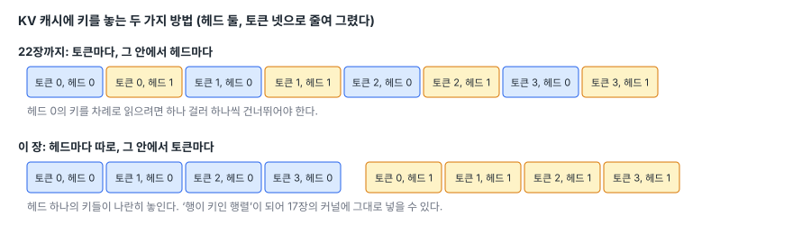
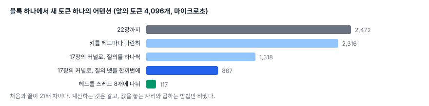
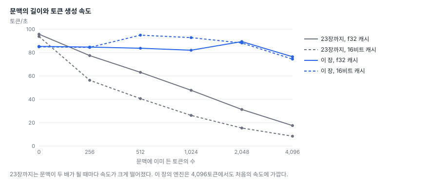

# 어텐션 최적화와 커널 융합

9.6절에서 어텐션을 처음 짤 때, 토큰 하나가 앞의 모든 토큰을 보므로 글이
길어지면 일이 글 길이의 제곱으로 늘어난다고 적어 두었습니다. 그 뒤로
열다섯 장 동안 어텐션은 거의 그대로였습니다. 선형 층이 워낙 커서
드러나지 않았습니다.

이 장에서 그 일을 합니다. 그리고 18.9절부터 "나누지 않은 일", "곱셈이
아닌 일들"이라는 이름으로 미뤄 온 작은 연산을 함께 정리합니다.

결과를 미리 적어 둡니다.

- 문맥에 4,096토큰이 들어 있을 때 토큰 생성이 17.5토큰/초에서
  76.4토큰/초가 되었습니다. 어텐션이 24배 빨라졌습니다.
- 계산은 바꾸지 않았습니다. 키를 놓는 위치를 바꿔 [17장](ch17_simd.md)의
  커널을 그대로 쓸 수 있게 했습니다.
- 16비트 KV 캐시가 `f32` 캐시와 같은 속도가 되었습니다. 21.7절에서는
  메모리를 절반으로 줄이는 대신 더 느렸습니다.
- 양자화한 모델의 프롬프트 처리가 13~18% 빨라졌습니다. 어텐션이 아니라
  입력을 정수로 바꾸는 일을 스레드 하나가 하고 있었습니다.

| 하는 일 | 절 |
|---|---|
| 문맥이 길어질 때 무슨 일이 생기는지 잰다 | 24.1 |
| 어텐션이 선형 층과 같은 모양임을 본다 | 24.2 |
| 키를 헤드마다 나란히 놓는다 | 24.3 |
| 한 단계씩 고치며 잰다 | 24.4 |
| 16비트 캐시를 펼치지 않고 읽는다 | 24.5 |
| 만들지 않는 행렬을 짚어 본다 | 24.6 |
| 연산을 합친다 | 24.7 |
| 나누지 않은 일들을 나눈다 | 24.8 |
| 다시 잰다 | 24.9 |
| 어텐션의 변형들을 훑어본다 | 24.10 |

## 24.1 문맥이 길어지면 토큰 생성이 느려진다

14.11절의 기준 측정은 빈 문맥에서 토큰 32개를 만듭니다. 실제로 쓸 때는
문맥이 비어 있지 않습니다. 긴 문서를 넣고 묻거나 대화가 길게 이어집니다.
그래서 문맥을 미리 채워 두고 토큰을 하나씩 넣으며 잽니다.

```bash
cargo run --release -p badak_models --example ch24_context
```

[23장](ch23_gpu.md)까지의 엔진으로 잰 결과입니다.

```text
{{#include output/ch24_context_before.txt}}
```

**문맥이 4,096토큰이면 토큰 생성이 96토큰/초에서 17.5토큰/초로
떨어집니다.** 토큰 하나의 57밀리초 가운데 46밀리초, 81%가 어텐션입니다.
어텐션의 시간은 문맥이 두 배가 될 때마다 두 배가 됩니다. 9.6절에서 말한
대로 새 토큰 하나가 앞의 토큰 전부를 보기 때문입니다.

기준 측정은 이것을 보여 주지 않았습니다. 빈 문맥에서는 어텐션이 2%이기
때문입니다. [14장](ch14_measurement.md)에서 기준을 고정하면서 "재는 일이
실제로 하는 일과 닮았는가"를 물었어야 합니다. 22.12절의 잘못과는 종류가
다릅니다. 숫자는 맞는데 엉뚱한 것을 재고 있었습니다.

## 24.2 어텐션은 선형 층이다

지금의 코드부터 봅니다. 새 토큰 하나, 헤드 하나가 하는 일입니다.

```rust
{{#include ../../../crates/badak_models/examples/ch24_attention.rs:before}}
```

세 단계입니다. 질의를 앞의 키 하나하나와 내적해 점수를 내고,
소프트맥스로 비중을 만들고, 값을 비중대로 섞습니다.

첫 단계를 다시 읽어 봅니다. 벡터 하나(질의)를 벡터 여러 개(키)와 각각
내적합니다. **선형 층과 같은 계산입니다.** 선형 층은 입력 벡터를
가중치의 행 하나하나와 내적했습니다(5.3절). 키를 행으로 쌓은 행렬이
있다면 점수는 "질의에 그 행렬을 곱한 것"입니다.

[16장](ch16_matmul.md)과 [17장](ch17_simd.md)에서 그 계산을 빠르게
만드는 데 두 장을 썼습니다. 값을 여덟씩 묶어 한 번에 곱하고, 입력 벡터
여럿을 한꺼번에 처리하고, 가중치의 행 여럿을 함께 읽습니다. 그런데
어텐션은 그 커널을 쓰지 않고 2.3절의 `dot`을 부르고 있습니다. 값을
하나씩 곱해 차례로 더하는 함수입니다. 15.4절에서 그 "덧셈의 줄 서기"가
얼마나 느린지 쟀습니다.

커널을 쓰지 못한 까닭이 있습니다.

## 24.3 키를 헤드마다 나란히 놓는다

커널을 쓰려면 가중치의 행이 **메모리에 나란히** 놓여 있어야 합니다.
11.4절의 KV 캐시는 그렇지 않습니다. 토큰이 들어올 때마다 그 토큰의 키를
헤드 여덟 개 것까지 한꺼번에 덧붙입니다.



헤드 0의 키만 차례로 읽으려면 일곱 개씩 건너뛰어야 합니다. 4.5절의 말로
하면 "연속이 아닌" 레이아웃입니다. 헤드마다 따로 담으면 한 헤드의 키가
나란히 놓입니다.

```rust
{{#include ../../../crates/badak_models/src/llama/cache.rs:cache}}
```

토큰이 들어오면 여덟 군데에 나눠 덧붙입니다. 일이 하나 늘지만 토큰마다
한 번이고, 읽는 것은 그 뒤로 토큰마다 되풀이합니다. 자주 하는 일에
맞춥니다.

이제 점수를 내는 일이 커널 한 번입니다.

```rust
{{#include ../../../crates/badak_models/src/llama/cache.rs:store_kernels}}
```

`scores`의 `simd::linear_with`가 17.5절의 그 함수입니다. 인자의 이름만
바꿔 읽으면 됩니다. 입력 벡터가 질의이고, 가중치의 행이 키이고, 결과가
점수입니다.

질의가 `count`개인 것은 9.8절 때문입니다. 이 모델은 질의 헤드 넷이 키·값
헤드 하나를 함께 씁니다. 같은 키와 내적할 질의가 넷이니 **한꺼번에
넣습니다.** 커널은 키를 한 번 읽어 네 질의와 곱합니다. 16.4절에서 입력
벡터를 묶어 넣은 것과 같습니다.

`mix`도 같은 방식입니다. 값 하나를 한 번 읽어 네 헤드의 결과에 더합니다.

## 24.4 한 단계씩 고치며 잰다

고친 것이 여럿이니 하나씩 떼어 잽니다. 블록 하나에서 새 토큰 하나의
어텐션만 꺼낸 프로그램입니다.

```bash
cargo run --release -p badak_models --example ch24_attention
```

```text
{{#include output/ch24_attention.txt:1:7}}
```



**레이아웃만 바꾸면 6%입니다.** 2,472에서 2,316마이크로초입니다. 건너뛰며
읽는 것이 나란히 읽는 것보다 조금 느릴 뿐입니다. 레이아웃은 그 자체로
빨라지려고 바꾼 것이 아니라 다음 단계를 할 수 있게 하려고 바꿨습니다.

**커널을 쓰면 1.8배입니다.** 1,318마이크로초입니다.
[17장](ch17_simd.md)에서 선형 층이 얻은 것보다 작습니다. 점수만 빨라지고
나머지 두 단계는 그대로이기 때문입니다.

**질의 넷을 한꺼번에 넣으면 다시 1.5배입니다.** 867마이크로초입니다.

**헤드를 스레드에 나누면 7.4배입니다.** 117마이크로초입니다. 지금까지 새
토큰이 하나일 때 어텐션은 스레드 하나로 돌았습니다. 18.9절에서 토큰을
스레드에 나눴는데, 토큰이 하나이면 나눌 것이 없었습니다. 일의 단위를
(토큰, 키·값 헤드)로 바꾸면 토큰이 하나여도 여덟 조각이 나옵니다.

```rust
{{#include ../../../crates/badak_models/src/llama/cache.rs:by_tokens}}
```

문맥이 짧을 때는 나누지 않습니다. 256토큰에서는 나눠서 11마이크로초,
나누지 않아 52마이크로초로 여전히 이득이지만, 수십 토큰에서는 18.6절에서
본 대로 나누는 비용이 더 큽니다.

처음과 끝이 21배입니다. 남은 117마이크로초를 어디에 쓰는지도 봅니다.

```text
{{#include output/ch24_attention.txt:9:12}}
```

이제 가장 큰 것은 값을 섞는 일입니다. 점수는 31마이크로초, 1초에 곱셈
340억 번으로 17.5절의 커널이 내던 속도입니다. 섞는 일은 같은 수의
곱셈에 54마이크로초가 듭니다. 이것도 행렬의 곱으로 볼 수 있지만(비중의
행렬에 값의 행렬을 곱합니다), 커널에 넣으려면 값을 지금과 직각으로 놓아야
합니다. 연습 문제로 남깁니다.

### 비트는 달라진다

점수를 내는 내적이 2.3절의 것에서 17.3절의 것으로 바뀌었습니다. 더하는
순서가 다르므로 **점수의 마지막 비트가 달라집니다.** 17.3절에서 선형 층의
계산을 다시 정의했을 때와 같은 일입니다.

[9장](../part2/ch09_transformer.md)의 캐시 없는 `attention`도 같은
정의를 쓰도록 한 줄을 고쳤습니다. 그래서 11.6절의 "캐시를 쓴 결과와 쓰지
않은 결과가 비트 단위로 같다"는 테스트는 그대로 통과합니다. 정답과의
차이는 20.6절의 방법으로 다시 쟀습니다.

| | 정답과의 상대 오차 | 1위 토큰의 확률 | 이어 쓴 토큰 40개 |
|---|---|---|---|
| [23장](ch23_gpu.md)까지 | `5.9e-7` | 69.95% | |
| 이 장 | `6.9e-7` | 69.95% | 모두 같음 |

## 24.5 16비트 캐시를 펼치지 않는다

21.7절에서 KV 캐시를 16비트로 담으면 메모리가 절반이 되고 품질은
그대로라는 것을 확인했습니다. 대가는 속도였습니다. 그때의 코드는 어텐션을
계산할 때마다 **캐시 전체를 `f32`로 펼친 사본**을 만들었습니다.

```text
{{#include output/ch24_context_f16_before.txt:2:8}}
```

빈 문맥에서는 차이가 없어 보였지만, 4,096토큰에서는 8.4토큰/초로 `f32`
캐시의 절반입니다. 토큰 하나를 만들 때마다 블록 16개가 각자 16비트 값
수백만 개를 하나씩 펼칩니다.

20.1절에서 BF16 가중치에 한 일을 그대로 합니다. **펼치지 않고, 커널이
읽는 순간에 넓힙니다.** 커널이 읽을 수 있는 원소의 종류에 16비트 실수를
더합니다.

```rust
{{#include ../../../crates/badak_core/src/simd/mod.rs:weight_f16}}
```

ARM에는 16비트 실수 넷을 `f32` 넷으로 넓히는 명령이 있습니다. 20.5절에서
스케일을 읽을 때 쓴 명령입니다. 16비트 실수는 어느 것이든 `f32`로
정확히 옮겨지므로, 먼저 펼쳐 놓고 계산한 것과 결과의 비트가 같습니다.
테스트가 그것을 확인합니다.

값을 섞는 쪽은 한 줄씩 넓혀 씁니다. 처음에는 값을 하나씩 넓혔고,
그랬더니 16비트 캐시의 어텐션이 `f32` 캐시보다 세 배 넘게
느렸습니다(4,096토큰에서 6.8밀리초 대 2.0밀리초). 같은 명령으로 넷씩
넓히는 함수를 따로 만들었습니다.

```rust
{{#include ../../../crates/badak_core/src/simd/mod.rs:widen}}
```

```text
{{#include output/ch24_context_f16_after.txt:2:8}}
```

**74.4토큰/초입니다.** `f32` 캐시(76.4)와 흔들림 안에서 같습니다.
21.7절의 "메모리 절반, 품질 같음"에 "속도 같음"이 더해졌습니다.
4,096토큰의 캐시가 268MB에서 134MB가 됩니다.

## 24.6 점수의 행렬은 만들지 않는다

어텐션을 식으로 적으면 이렇게 됩니다.

```text
결과 = softmax(Q Kᵀ) V
```

`Q Kᵀ`는 (질의의 수) × (키의 수)의 행렬입니다. 식을 그대로 옮기면 이
행렬을 통째로 만들고, 소프트맥스를 하고, `V`를 곱합니다.
[9장](../part2/ch09_transformer.md)의 `attention`이 그렇게 합니다.
9.6절의 그림을 그리려고, 헤드마다 (토큰 수) × (토큰 수)의 비중을 모두
모아 돌려줍니다.

이 행렬이 얼마나 큰지 셉니다. 문맥에 4,096토큰이 있고 새 토큰 256개를
한꺼번에 넣으면, 헤드 32개에 256 × 4,352의 `f32`입니다. 블록 하나에
143MB입니다. 22.11절의 아레나가 블록 하나에 쥐는 54MB보다 큽니다.

우리 코드는 이 행렬을 만들지 않습니다. 일의 단위 하나, 곧 (토큰, 키·값
헤드) 하나가 쓰는 것은 4 × (앞의 토큰 수)의 점수뿐이고, 22.10절의 돌려
쓰는 공간에 담습니다. 4,096토큰에서 64KB입니다. 점수를 내고, 그 공간에서
비중으로 바꾸고, 값을 섞고, 다음 단위가 그 공간을 다시 씁니다. 행렬의 한
줄을 만들고 쓰고 버리기를 되풀이합니다.

속도에도 좋습니다. 64KB는 코어의 캐시에 들어가므로(15.2절), 점수를 적고
읽을 때 메모리까지 가지 않습니다.

여기서 더 나아갈 수도 있습니다. 점수 한 줄조차 다 만들지 않는
방법입니다. 키를 수십 개씩 끊어 읽으면서, 지금까지 본 점수의 최댓값과
합을 들고 다니고, 끊은 조각마다 값을 섞어 넣습니다. 소프트맥스는
최댓값과 합을 알아야 계산할 수 있는데, 둘 다 조각을 지날 때마다 고쳐 갈
수 있습니다.[^online-softmax] GPU에서 긴 글을 학습할 때 메모리를
아끼려고 널리 쓰는 방법입니다.[^flash] 우리 엔진에서는 점수 한 줄이 이미
캐시에 들어가므로 얻을 것이 적다고 보고 하지 않았습니다. 재 보지는
않았습니다.

## 24.7 연산을 합친다

어텐션 다음으로 작은 연산을 봅니다. MLP는 이렇게 적혀 있었습니다(9.9절).

```rust
let gate = ops::silu(&ops::linear(x, &weights.gate_proj, None)?)?;
let up = ops::linear(x, &weights.up_proj, None)?;
ops::linear(&ops::mul(&gate, &up)?, &weights.down_proj, None)
```

`silu`가 텐서를 하나 만들고 `mul`이 또 하나를 만듭니다. 프롬프트
256토큰에서 각각 8MB입니다. 8MB를 쓰고, 그것을 다시 읽어 곱하고, 8MB를
또 씁니다.

두 연산은 모두 원소마다 하는 계산입니다. **한 번 지나가면서 둘 다 하면
됩니다.**

```rust
{{#include ../../../crates/badak_models/src/llama/mod.rs:mlp}}
```

`silu(gate) × up`을 원소마다 한 번에 계산합니다. 텐서 하나와, 8MB를 쓰고
읽는 일 한 번이 사라집니다. 이렇게 이웃한 연산을 하나의 반복문으로
합치는 것을 **융합**<sup>fusion</sup>이라고 합니다. 3.7절에서
`Mlp::forward`에 융합이 없다고 적어 두고 미룬 일입니다.

연산과 순서는 같습니다. `silu`의 결과를 `f32`로 반올림한 뒤에 곱하는
것까지 같습니다. 그래서 **결과의 비트가 같습니다.**

[23장](ch23_gpu.md)에서 GPU의 MLP에 같은 일을 했습니다(`silu_mul.wgsl`).
거기서는 값이 CPU를 다녀오지 않게 하려고 합쳤고, 여기서는 메모리를 한 번
덜 지나가려고 합칩니다. 까닭은 다르지만 연산의 경계를 없앤다는 점은
같습니다.

손으로 합칠 수 있는 것은 여기까지입니다. 어떤 연산이 이웃해 있는지를
우리가 코드를 읽어서 알았습니다. 연산이 수백 가지이고 모델마다 이웃이
다르면 손으로는 할 수 없습니다. 4부에서 계산을 그래프로
나타내면([26장](../part4/ch26_graph_interpreter.md)) 이웃한 연산을
프로그램이 찾을 수 있고, [30장](../part4/ch30_graph_optimization.md)에서
그것을 자동으로 합칩니다.

## 24.8 나누지 않은 일을 나눈다

18.9절에서 스레드를 넣을 때 선형 층, 어텐션, `map`만 나눴습니다.
"나머지는 작아서"가 이유였습니다. 그 뒤로 선형 층이 계속 빨라졌으니
나머지를 다시 봐야 합니다. `Q8_0`으로 프롬프트 256토큰을 처리할 때의
프로파일입니다(14.7절).

```bash
BADAK_WEIGHTS=q8_0 cargo run --release -p badak_models --example ch14_profile -- llama32_1b 256 0
```

```text
{{#include output/ch24_profile_q8_0_before.txt:17:25}}
```

선형 층 86%, 어텐션 7%, 나머지가 7%입니다. 그런데 선형 층의 0.326초 안에
숨은 일이 있습니다. 20.4절에서 정수 내적을 하려고 **입력을 8비트 정수로
바꾸는 일**입니다. [20장](ch20_weight_quantization.md)의 연습 문제 6번이
이것을 재 보라고 했습니다. 구간을 넣어 재니 0.046초, 전체의 10%였고,
스레드 하나가 하고 있었습니다. 가중치의 행을 열여섯 스레드가 나눠 곱하는
동안, 그 앞에서 스레드 하나가 입력 52만 개를 혼자 바꿉니다. 암달의
법칙(18.8절) 그대로입니다. 20.7절에서 `Q4_0`의 프롬프트 처리가 기대보다
느렸던 까닭 가운데 하나입니다.

넷을 나눴습니다.

| 일 | 나누는 단위 | 고친 곳 |
|---|---|---|
| 입력을 정수로 바꾸기 | 값 32개의 묶음 | `Activations::fill` |
| 원소끼리의 계산(`zip`) | 원소 | `ops::zip` |
| 정규화 | 벡터 | `ops::rms_norm` |
| 회전 | 토큰 | `rope::apply` |

모두 18.4절의 `run_chunks` 하나로 됩니다. 결과를 담을 공간을 조각내어
스레드마다 한 조각씩 채웁니다.

```rust
{{#include ../../../crates/badak_core/src/ops.rs:zip_threaded}}
```

입력을 정수로 바꾸는 일은 두 번 지나갑니다. 묶음마다 스케일을
정하고, 그 스케일로 값을 바꿉니다. 결과가 두 군데(스케일과 정수)에
적히는데 `run_chunks`는 한 군데만 조각내 주기 때문입니다.

```rust
{{#include ../../../crates/badak_core/src/packed/mod.rs:activations}}
```

어느 것도 계산의 순서를 바꾸지 않으므로 결과의 비트는 그대로입니다.
[18장](ch18_multithreading.md)의 "스레드의 수와 상관없이 같은 비트"가
여기서도 지켜집니다.

```text
{{#include output/ch24_profile_q8_0.txt:19:27}}
```

입력을 바꾸는 일이 0.046초에서 0.007초가 되었습니다. `map`은 융합되어
사라졌고, 정규화는 0.006초에서 0.002초가 되었습니다. 전체는 0.381초에서
0.324초가 되었습니다.

## 24.9 다시 잰다

문맥의 길이부터 봅니다.

```text
{{#include output/ch24_context_after.txt}}
```



| 문맥 4,096토큰에서 | [23장](ch23_gpu.md)까지 | 이 장 |
|---|---|---|
| 토큰 생성, `f32` 캐시 | 17.5토큰/초 | 76.4토큰/초 |
| 토큰 생성, 16비트 캐시 | 8.4토큰/초 | 74.4토큰/초 |
| 토큰 하나의 어텐션 | 46.2밀리초 | 1.9밀리초 |
| 4,096토큰을 채우는 시간 | 15.8초 | 11.7초 |

**어텐션이 24배 빨라졌고, 4,096토큰에서의 토큰 생성이 4.4배가
되었습니다.** 16비트 캐시에서는 8.9배입니다.

일이 문맥의 길이만큼 느는 것은 그대로입니다. 표에서 어텐션의 시간은
여전히 문맥이 두 배가 될 때마다 두 배입니다. 기울기는 그대로 두고 높이만
낮췄습니다. 4,096토큰에서 15%이니, 3만 토큰쯤 가면 다시 절반을 넘을
것입니다. 기울기를 바꾸는 방법은 24.10절에서 봅니다.

프롬프트를 채우는 쪽도 봅니다. 뒤의 2,048토큰을 넣는 데 9.6초에서
6.6초가 되었습니다. 1초에 212토큰에서 309토큰입니다. 빈 문맥에서는
457토큰이니, 긴 문맥에서는 프롬프트 처리도 어텐션에 시간을 꽤 씁니다.

표의 "토큰 하나"가 문맥에 따라 고르지 않은 것이 눈에 띕니다. 빈 문맥에서
11.7밀리초인데 2,048토큰에서 11.2밀리초입니다. 같은 프로그램을 여러 번
돌리면 빈 문맥의 값이 10.3과 11.8밀리초 사이를 오갑니다. 한 번의 실행
안에서는 값이 어느 한쪽에 머뭅니다. [23장](ch23_gpu.md)까지의 엔진도
똑같이 오가므로 이 장에서 고친 것과는 상관이 없습니다. 원인은 찾지
못했습니다.

기준 측정입니다. 22.12절의 방법대로 [23장](ch23_gpu.md)의 엔진과 번갈아,
쉬면서 쟀습니다.

```bash
sh scripts/compare_engines.sh q8_0 4 "23장=..." "24장=target/release/examples/ch14_baseline"
```

```text
{{#include output/ch24_speed.txt}}
```

| 중앙값 (토큰/초) | [23장](ch23_gpu.md) | 이 장 | |
|---|---|---|---|
| BF16 프롬프트 처리 | 395 | 419 | +6% |
| BF16 토큰 생성 | 96.0 | 97.3 | +1% |
| `Q8_0` 프롬프트 처리 | 649 | 763 | +18% |
| `Q8_0` 토큰 생성 | 166.9 | 171.8 | +3% |
| `Q4_0` 프롬프트 처리 | 594 | 674 | +13% |
| `Q4_0` 토큰 생성 | 223.4 | 231.5 | +4% |

**양자화한 모델의 프롬프트 처리가 13~18% 올랐습니다.** 어텐션 때문이
아니고, 24.8절의 "입력을 정수로 바꾸는 일"이 대부분입니다. BF16에는 그
일이 없어서 6%입니다.

기준 측정의 토큰 생성은 거의 그대로입니다. 빈 문맥에서 재기 때문입니다.
이 장에서 가장 크게 바뀐 것을 기준 측정이 보지 못합니다. 그래서 문맥을
채운 측정을 하나 더 남깁니다. `ch24_context`의 4,096토큰 줄입니다.

| Llama 3.2 1B | 토큰 생성 (빈 문맥) | 토큰 생성 (4,096토큰 뒤) | 프롬프트 처리 |
|---|---|---|---|
| BF16 그대로 | 97토큰/초 | 76토큰/초 | 419토큰/초 |
| `Q8_0` | 172토큰/초 | | 763토큰/초 |
| `Q4_0` | 232토큰/초 | | 674토큰/초 |

## 24.10 어텐션의 변형을 훑어본다

이 장에서 한 일은 모두 **같은 계산을 빨리 하는 것**이었습니다. 계산
자체를 바꾸는 방법도 있습니다. 다만 그것은 엔진이 정하지 않습니다.
모델이 그렇게 학습되어 있어야 합니다. 엔진을 만드는 사람은 어떤 변형이
있는지, 그것이 엔진에 무엇을 요구하는지를 알면 됩니다.


**키와 값을 함께 쓴다.** 9.8절에서 본 것입니다. 질의 헤드 여럿이 키·값
헤드 하나를 함께 씁니다. 헤드가 모두 하나를 함께 쓰는 방법이 먼저
나왔고,[^mqa] 몇 개씩 묶어 함께 쓰는 방법이 뒤에 나왔습니다.[^gqa] KV
캐시가 그만큼 작아집니다. Llama 3.2 1B는 넷씩 묶어 캐시가 4분의 1입니다.
이 장에서 "질의 넷을 한꺼번에"가 가능했던 것도 이 덕입니다.

**가까운 것만 본다.** 새 토큰이 앞의 토큰 전부가 아니라 가장 가까운 몇천
개만 봅니다. 일이 문맥의 길이가 아니라 창의 크기에서 멈춥니다.
24.9절에서 바꾸지 못한 기울기를 바꾸는 방법입니다. KV 캐시도 창의
크기만큼만 있으면 됩니다. 창 밖의 정보는 층을 거치며 한 층씩
전해집니다.[^mistral]

**가까운 것과 몇몇 먼 것을 본다.** 긴 문서를 다루는 모델은 가까운 창에
더해, 정해 둔 몇몇 위치를 모든 토큰이 보게 합니다.[^longformer]

**점수의 행렬을 만들지 않는다.** 24.6절에서 본 것입니다. 계산의 결과는
같고 계산하는 순서만 다르므로, 이것만은 모델이 아니라 엔진이
고릅니다.[^flash]

엔진에 요구하는 것을 모으면 이렇습니다.

| 변형 | 엔진이 할 일 |
|---|---|
| 키와 값을 함께 쓰기 | 헤드의 수와 키·값 헤드의 수를 따로 다룬다 (9.8절에서 했다) |
| 창 | 캐시에서 오래된 것을 버린다. 키를 읽는 범위를 정한다 |
| 가까운 것과 먼 것 | 볼 자리의 목록을 받아 그것만 읽는다 |
| 행렬을 만들지 않기 | 점수, 비중, 섞기를 한 커널로 합친다 |

우리 엔진은 첫째만 합니다. 이 책의 모델이 그것만 쓰기 때문입니다.
`Store::scores`가 "앞의 `positions`개"를 인자로 받는 것은 둘째를 준비한
것이기도 합니다. 시작하는 위치를 하나 더 받으면 창이 됩니다.

## 24.11 남긴 일을 적어 둔다

**값을 섞는 일.** 24.4절에서 본 대로 지금 어텐션에서 가장 큰
부분입니다. 커널에 넣으려면 값을 지금과 직각으로 놓아야 하고, 그러면
토큰을 덧붙이는 일이 번거로워집니다. 재 보지 않았습니다.

**소프트맥스.** 4,096토큰에서 블록 하나가 `exp`를 13만 번 부릅니다.
어텐션의 5분의 1입니다. 여러 값의 `exp`를 한꺼번에 계산하는 근사식이
있지만, 쓰려면 2.4절부터 지켜 온 `exp`의 정의를 바꿔야 합니다.

**GPU의 어텐션.** [23장](ch23_gpu.md)에서 선형 층을 GPU에 맡기면 프롬프트 256토큰의
4분의 1이 CPU의 어텐션이었습니다. 이 장은 빈 문맥에서 256토큰을 넣는 그
일을 절반으로 줄였을 뿐입니다(24.8절의 프로파일에서 0.028초가
0.013초). 어텐션을 GPU로 옮기는 일은 계산 전체를 GPU에 올리는 일(23.12절,
26.14절)과 함께 남겨 둡니다.

**아주 긴 문맥.** 4,096토큰까지 쟀습니다. 이 모델은 131,072토큰까지 받게
학습되었습니다(11.8절). 거기서는 16비트 캐시가 4.3GB이고, 어텐션이 다시
시간의 대부분이 될 것입니다. 문맥의 한도는 [39장](../part5/ch39_inference_server.md)에서 서버를 만들며
정합니다. 거기서는 한도를 넘는 요청을 거절하고, 앞을 버리고 이어 가는
일은 만들지 않았습니다.

**기준 측정.** 빈 문맥에서 재는 14.11절의 기준은 그대로 두었습니다.
[13장](../part2/ch13_first_showdown.md)의 llama.cpp 숫자와 견줄 수 있어야 하기 때문입니다. [25장](ch25_rematch.md)의 재대결에서
문맥을 채운 조건을 함께 잽니다.

## 24.12 실전 엔진에서는

**llama.cpp는 어텐션을 하나의 연산으로 둡니다.** 점수, 가림, 소프트맥스,
값 섞기를 따로따로 하지 않고 하나로 묶은 연산이 있고, 옵션으로 켜고
끕니다.[^llamacpp-fa] 질의 헤드의 수가 키·값 헤드의 수의 배수여야 한다는
조건이 그 연산의 설명에 적혀 있습니다. 9.8절의 구조를 그 안에서 처리하기
때문입니다. GPU 쪽에는 가중치의 형식마다 그 연산의 커널이 따로
있습니다(`fa_f32.metal`, `fa_f16.metal`, `fa_q8_0.metal` 등). KV 캐시를
16비트나 8비트로 담고 커널이 읽으면서 펼칩니다. 24.5절에서 우리가 한
일입니다.

**문맥이 넘치면 앞을 버립니다.** llama.cpp에는 문맥이 한도에 닿았을 때
앞부분을 버리고 이어 가는 옵션이 있습니다.[^llamacpp-fa] 캐시에서 오래된
토큰을 지우는 일이므로, 캐시가 헤드마다 토큰의 순서로 놓여 있으면
앞에서부터 잘라 내면 됩니다.

**융합은 그래프에서 합니다.** 24.7절에서 손으로 한 일을 실전 엔진은
그래프를 훑어서 합니다. 4부에서 다룹니다.

## 정리

- 기준 측정은 빈 문맥에서 토큰을 만듭니다. 문맥에 4,096토큰이 있으면
  토큰 생성이 96에서 17.5토큰/초로 떨어지고 그 81%가 어텐션이었습니다.
  기준 측정이 실제로 하는 일과 닮았는지를 물었어야 했습니다.
- 어텐션의 점수는 질의를 키 하나하나와 내적하는 일이고, 그것은 키가
  가중치의 행인 선형 층입니다.
- KV 캐시에 키를 헤드마다 나란히 놓으면 [17장](ch17_simd.md)의 커널을 그대로 쓸 수
  있습니다. 레이아웃만 바꿔서는 6%이지만, 그것이 커널(1.8배), 질의 넷을
  한꺼번에(1.5배), 헤드를 스레드에(7.4배)를 가능하게 합니다. 합쳐서
  21배입니다.
- 점수의 내적을 바꿨으므로 결과의 마지막 비트가 달라집니다. 정답과의
  거리는 `5.9e-7`에서 `6.9e-7`이고 이어 쓴 토큰은 같습니다.
- 16비트 KV 캐시는 펼친 사본을 만들지 않고 커널이 읽는 순간에 넓힙니다.
  `f32` 캐시와 속도가 같아졌습니다.
- 우리 어텐션은 점수의 행렬을 통째로 만들지 않습니다. 한 줄을 만들고
  쓰고 버립니다. 4,096토큰에서 64KB입니다.
- 이웃한 원소별 연산을 한 번에 지나가도록 합치는 것이 융합입니다.
  MLP의 `silu`와 곱셈을 합쳤습니다. 결과의 비트는 같습니다.
- 입력을 정수로 바꾸는 일이 스레드 하나에 묶여 양자화한 모델의 프롬프트
  처리 10%를 쓰고 있었습니다. 스레드에 나누어 프롬프트 처리가 13~18%
  올랐습니다.
- 일이 문맥의 길이만큼 느는 것은 그대로입니다. 그것을 바꾸는 것은 모델의
  구조(창, 정해 둔 자리만 보기)이고 엔진이 정하지 못합니다.

## 연습 문제

1. `ch24_context`를 8,192토큰까지 돌려 보십시오(둘째 인자). 어텐션의
   몫이 얼마가 됩니까. 24.9절에서 어림한 "3만 토큰쯤에서 절반"이 맞을지
   두 점을 이어 따져 보십시오.
2. 24.4절에서 일의 단위를 (토큰, 키·값 헤드)로 잡았습니다. (토큰, 질의
   헤드)로 잡으면 스레드에 나눌 조각이 네 배가 되는 대신 무엇을
   잃습니까. `ch24_attention`의 표에서 어느 두 줄을 보면 답할 수
   있습니까.
3. `attention_cached`에서 스레드에 나눌지를 정하는 임계값은 18.6절의 값을
   그대로 빌린 것입니다. `ch24_attention`을 고쳐 앞의 토큰이 16, 32, 64,
   128개일 때 나눈 것과 나누지 않은 것을 견줘 보십시오. 임계값이 맞는
   자리에 있습니까.
4. `Store::mix`를 커널로 바꾼다고 합시다. 값을 `(head_dim, 토큰 수)`로
   놓으면 섞기는 "비중이 입력 벡터이고 값의 줄이 가중치의 행인 선형
   층"이 됩니다. 토큰 하나를 덧붙일 때 메모리의 몇 군데에 적어야
   합니까. 자리를 미리 잡아 두지 않으면(22.7절) 어떤 일이 생깁니까.
5. 24.6절의 조각내어 읽는 소프트맥스를 종이 위에서 해 보십시오. 점수가
   `[1, 3]`인 조각을 지난 뒤와, 이어서 `[5, 2]`인 조각을 지난 뒤에,
   들고 다니는 최댓값과 합은 각각 얼마입니까. 앞 조각에서 이미 섞어 둔
   값에는 무엇을 곱해야 합니까.
6. `ops::zip`에 넘기는 함수에 `Sync`가 붙었습니다. 붙이지 않으면 어디서
   컴파일 오류가 납니까. 18.2절의 어느 설명과 이어집니까.
7. `Activations::fill`은 입력을 두 번 지나갑니다. 한 번만 지나가도록
   고치려면 `run_chunks`가 무엇을 해 줘야 합니까. 22.6절의 `Unshared`를
   써서 직접 해 볼 수 있습니다. 빨라집니까.
8. 문맥이 가득 찼을 때 앞의 절반을 버리는 함수 `KvCache::drop_front`를
   짜 보십시오. 키는 위치만큼 돌린 뒤에 저장되어 있습니다(11.4절).
   앞을 버린 뒤에 새 토큰의 위치는 무엇이어야 합니까. 9.7절의 회전이
   "위치의 차이"만 본다는 성질이 여기서 왜 중요합니까.

## 참고 문헌

[^online-softmax]: M. Milakov, N. Gimelshein, "Online normalizer calculation
    for softmax," 2018. [arXiv:1805.02867](https://arxiv.org/abs/1805.02867).
    소프트맥스를 메모리를 덜 읽으며 계산하는 방법을 다룹니다. 초록을
    확인했습니다.

[^flash]: T. Dao, D. Y. Fu, S. Ermon, A. Rudra, C. Ré, "FlashAttention:
    Fast and Memory-Efficient Exact Attention with IO-Awareness," 2022.
    [arXiv:2205.14135](https://arxiv.org/abs/2205.14135). 어텐션의 시간과
    메모리가 글 길이의 제곱으로 느는 문제를, 결과를 바꾸지 않고("exact")
    메모리를 읽고 쓰는 양을 줄여 푸는 방법입니다. 초록을 확인했습니다.

[^mqa]: N. Shazeer, "Fast Transformer Decoding: One Write-Head is All You
    Need," 2019. [arXiv:1911.02150](https://arxiv.org/abs/1911.02150).
    초록을 확인했습니다.

[^gqa]: J. Ainslie, J. Lee-Thorp, M. de Jong, Y. Zemlyanskiy, F. Lebrón,
    S. Sanghai, "GQA: Training Generalized Multi-Query Transformer Models
    from Multi-Head Checkpoints," 2023.
    [arXiv:2305.13245](https://arxiv.org/abs/2305.13245). 초록에 키·값
    헤드를 하나만 쓰는 방법이 품질을 떨어뜨릴 수 있어 그 사이의 방법을
    제안한다고 적혀 있습니다.

[^mistral]: A. Q. Jiang 외, "Mistral 7B," 2023.
    [arXiv:2310.06825](https://arxiv.org/abs/2310.06825). 초록에 키·값을
    묶어 쓰는 어텐션과 창을 쓰는 어텐션을 함께 썼다고 적혀 있습니다.
    창 밖의 정보가 층을 거치며 전해진다는 설명은 본문의 것인데, 본문은
    확인하지 못했습니다.

[^longformer]: I. Beltagy, M. E. Peters, A. Cohan, "Longformer: The
    Long-Document Transformer," 2020.
    [arXiv:2004.05150](https://arxiv.org/abs/2004.05150). 초록에 일이 글
    길이에 비례하게 느는 어텐션을 제안한다고 적혀 있습니다.

[^llamacpp-fa]: llama.cpp (커밋 `b4c0e00a4fcc`). `ggml/include/ggml.h`
    2234번째 줄부터 `ggml_flash_attn_ext`의 설명이 있고, 거기에
    `n_head % n_head_kv == 0`이라는 조건이 적혀 있습니다.
    `common/arg.cpp` 1734번째 줄의 `--flash-attn`이 이 연산을 켜고 끄고,
    1720번째 줄의 `--context-shift`가 문맥이 넘칠 때의 동작을 정합니다.
    커널들은 `ggml/src/ggml-metal/kernels/`에 있습니다.
    <https://github.com/ggml-org/llama.cpp/tree/b4c0e00a4fcc>
