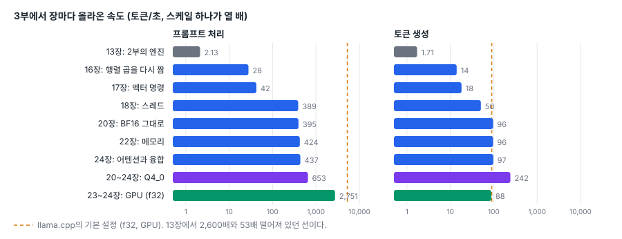
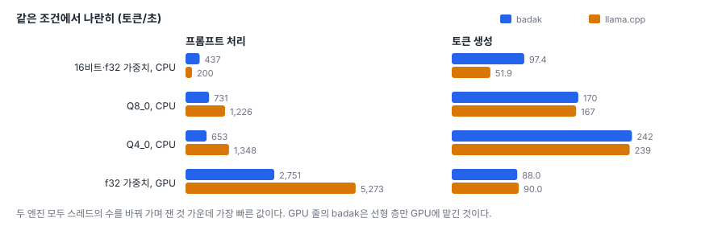
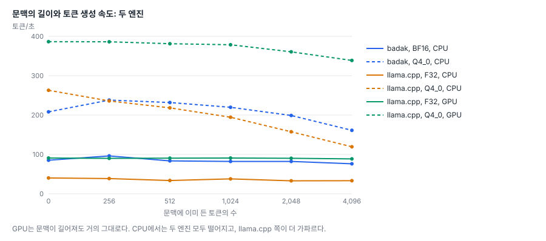

# 재대결: llama.cpp

[13장](../part2/ch13_first_showdown.md)에서 `badak`은 llama.cpp보다 프롬프트 처리가 2,600배, 토큰 생성이
53배 느렸습니다. 그 격차를 조각으로 나눠 표를 만들었고, 3부는 그 표를
위에서부터 한 줄씩 지워 가는 과정이었습니다. 열두 장이 지났습니다. 다시
잽니다.

결과를 미리 적어 둡니다.

- 같은 정밀도, llama.cpp의 기본 설정(GPU)과 견주어 프롬프트 처리가
  **1.9배** 느립니다. 2,600배였습니다. 토큰 생성은 **우리가 조금
  빠릅니다.** 53배 느렸습니다.
- CPU에서 같은 조건으로 견주면 토큰 생성은 어느 형식에서든 같거나 우리가
  빠르고, 프롬프트 처리는 16비트 가중치에서 우리가 2.2배 빠르고 양자화한
  가중치에서 1.7~2.1배 느립니다.
- 시작해서 글 한 줄을 쓰고 끝나는 데 0.3초입니다. 20초였습니다.
  llama.cpp는 0.5~1.2초입니다.
- 남은 격차는 세 군데에 있고, 각각 까닭을 말할 수 있습니다.

| 하는 일 | 절 |
|---|---|
| 재는 규칙을 다시 정한다 | 25.1 |
| 여전히 같은 답을 내는지 본다 | 25.2 |
| 3부의 사다리를 한눈에 본다 | 25.3 |
| CPU에서 같은 조건으로 견준다 | 25.4 |
| 문맥을 채우고 견준다 | 25.5 |
| Accelerate, GPU와 견준다 | 25.6 |
| 시작 시간과 메모리를 견준다 | 25.7 |
| [13장](../part2/ch13_first_showdown.md)의 표를 다시 채운다 | 25.8 |
| 남은 격차의 까닭을 찾는다 | 25.9 |

## 25.1 재는 규칙

13.4절의 규칙은 그대로입니다. 같은 기계, 같은 모델, 같은 일(프롬프트
256토큰, 토큰 32개), 전원을 연결한 상태입니다. llama.cpp도 [13장](../part2/ch13_first_showdown.md)과 같은
커밋입니다. 상대는 그대로이고 우리만 바뀌었습니다.

규칙을 둘 더합니다. 3부에서 데어 가며 배운 것들입니다.

**쉬면서 잽니다.** 22.12절에서 쉬지 않고 이어 재면 기계가 달궈져 값이
15~20% 낮게 나온다는 것을 봤습니다. [13장](../part2/ch13_first_showdown.md)과 [20장](ch20_weight_quantization.md)의 llama.cpp 숫자는 그것을
모르고 잰 것입니다. 설정을 바꿀 때마다 5초, 측정과 측정 사이에 3초를
쉬게 하고 전부 다시 쟀습니다.

```bash
sh scripts/bench_llama_cpp_rematch.sh
```

**스레드의 수는 각자 가장 좋은 것으로.** [13장](../part2/ch13_first_showdown.md)에서는 두 엔진 모두 12개로
맞췄습니다. 그 뒤로 알게 된 것이 있습니다. 가장 좋은 스레드의 수는 일에
따라 다릅니다(18.10절). 우리 엔진은 토큰 생성에 8개, 프롬프트 처리에
16개를 씁니다. llama.cpp도 8, 12, 16개로 재서 일마다 가장 빠른 값을
씁니다. 12개로 맞춘 값도 함께 적습니다.

다시 잰 llama.cpp의 값이 그때와 얼마나 다른지부터 봅니다.

| llama.cpp, 스레드 12개 | 그때 | 다시 잰 값 |
|---|---|---|
| F32, 직접 짠 CPU 코드만, 프롬프트 처리 | 197.3 ± 4.9 | 199.7 ± 3.6 |
| F32, 직접 짠 CPU 코드만, 토큰 생성 | 48.35 ± 1.26 | 44.70 ± 1.11 |
| F32, GPU, 프롬프트 처리 | 5,532 ± 32 | 5,273 ± 321 |
| F32, GPU, 토큰 생성 | 90.35 ± 0.17 | 89.87 ± 0.20 |
| Q8_0, 프롬프트 처리 ([20장](ch20_weight_quantization.md)) | 1,284 ± 10 | 1,226 ± 184 |
| Q8_0, 토큰 생성 ([20장](ch20_weight_quantization.md)) | 154.1 ± 2.9 | 137.3 ± 11.3 |

크게 다르지 않습니다. 걱정한 쪽(쉬지 않아 낮게 쟀을 가능성)으로는
움직이지 않았습니다. 다만 llama.cpp의 값은 우리보다 많이 흔들립니다.
프롬프트 처리 1,226 ± 184는 다섯 번 가운데 한두 번이 크게 달랐다는
뜻입니다. 아래의 비교에서 10% 안쪽의 차이는 차이로 읽지 않습니다.

## 25.2 여전히 같은 답을 내는가

빨라졌는데 틀려졌다면 소용이 없습니다. 13.3절의 대조를 그대로 다시
돌립니다.

```bash
cargo run --release -p badak_models --example ch13_compare
```

| 엔진과 설정 | 정답과의 상대 오차 | 1위 토큰 | 이어 쓴 토큰 40개 |
|---|---|---|---|
| badak, [13장](../part2/ch13_first_showdown.md) | `1.9e-6` | `" Paris"` | 같음 |
| badak, [23장](ch23_gpu.md)까지 | `5.9e-7` | `" Paris"` | 같음 |
| badak, 지금 | `6.9e-7` | `" Paris"` | 같음 |
| PyTorch (`f32`) | `2.0e-6` | `" Paris"` | |
| llama.cpp, F32 파일, 16비트 없이 | `4.5e-7` | `" Paris"` | 같음 |
| llama.cpp, F32 파일, 기본 설정 | `1.6e-4` | `" Paris"` | 같음 |

**빨라지는 동안 점수는 정답에 더 가까워졌습니다.** 100만 분의 1.9에서
0.7입니다. 계산의 순서를 두 번 다시 정했습니다(17.3절의 선형 층,
24.4절의 어텐션). 값을 하나씩 차례로 더하던 것을 여덟 갈래로 나눠 더하게
되면서, 빨라지고 오차도 줄었습니다(5.6절에서 본 쌍별 합산과 같은
까닭입니다). 지금은 PyTorch보다 정답에 가깝고, llama.cpp의 기본
설정보다 200배 가깝습니다.

3부에서 엔진을 고칠 때마다 [9장](../part2/ch09_transformer.md)부터 쌓아 온 테스트가 이것을 지켰습니다.
"어느 구현으로 계산하든 같은 비트"라는 약속(17.3절)이 스레드(18.11절),
BF16(20.1절), 아레나(22.11절), 융합(24.7절)을 지나는 동안 한 번도 깨지지
않았습니다. 비트가 달라지는 것을 허락한 곳은 넷뿐이고, 모두 재고 나서
허락했습니다. 양자화(20.6절, [21장](ch21_quantization_quality.md)), 16비트 캐시(21.7절), GPU(23.7절),
그리고 위의 두 번의 재정의입니다.

## 25.3 3부의 사다리

장마다 남겨 둔 기준 측정(`bench/baseline/`)을 한 줄로 세웁니다.



| 장 | 한 일 | 프롬프트 처리 | 토큰 생성 |
|---|---|---|---|
| [13장](../part2/ch13_first_showdown.md) | 2부의 엔진 | 2.13 | 1.71 |
| [16장](ch16_matmul.md) | 행렬 곱을 다시 짬 | 27.8 (13배) | 14.0 (8.2배) |
| [17장](ch17_simd.md) | 벡터 명령 | 42.4 (1.5배) | 18.1 (1.3배) |
| [18장](ch18_multithreading.md) | 스레드 | 389 (9.2배) | 50.5 (2.8배) |
| [20장](ch20_weight_quantization.md) | BF16 그대로 계산 | 395 | 96.2 (1.9배) |
| [22장](ch22_memory.md) | 메모리 | 424 | 96.4 |
| [24장](ch24_attention.md) | 어텐션과 융합 | 437 | 97.4 |
| 합쳐서 | | **205배** | **57배** |
| [20장](ch20_weight_quantization.md)~24장 | `Q4_0`으로 | 653 | 242 (2.5배 더) |
| [23장](ch23_gpu.md)~24장 | GPU로 | 2,751 (6.3배 더) | 88 |

괄호 안은 바로 앞 줄에 견준 것입니다.

**프롬프트 처리는 두 장이 거의 다 했습니다.** [16장](ch16_matmul.md)의 13배와 [18장](ch18_multithreading.md)의
9.2배입니다. 토큰을 묶어 계산하게 한 것과 코어를 모두 쓰게 한
것입니다. 계산 능력을 늘리는 수단들입니다.

**토큰 생성은 네 장이 나눠 했습니다.** [16장](ch16_matmul.md)의 8.2배, [18장](ch18_multithreading.md)의 2.8배,
[20장](ch20_weight_quantization.md)의 1.9배, 그리고 4비트로 줄인 2.5배입니다. 뒤의 둘은 계산을 빠르게
한 것이 아니라 읽을 것을 줄인 것입니다. 15.6절에서 계산한 대로 토큰
생성은 메모리에 묶여 있었고, 가중치를 줄이는 것만이 그 벽을 옮겼습니다.

**[22장](ch22_memory.md)과 [24장](ch24_attention.md)은 이 표에서 거의 보이지 않습니다.** 둘이 한 일은 다른
숫자에 있습니다. [22장](ch22_memory.md)은 읽는 시간을 1.2초에서 0.01초로, 지켜야 하는
메모리를 5GB에서 0.1GB로 줄였습니다(25.7절). [24장](ch24_attention.md)은 문맥이 길 때의
토큰 생성을 4.4배 올렸습니다(25.5절). 기준 측정은 빈 문맥에서 256토큰과
32토큰을 재므로 둘 다 보지 못합니다. **숫자 하나로 엔진을 말할 수
없습니다.**

## 25.4 CPU에서 같은 조건으로

가장 공정한 비교부터 합니다. 둘 다 CPU만, 둘 다 스스로 짠 코드만
씁니다(llama.cpp는 13.1절의 `--plain` 빌드).

```text
{{#include ../../../bench/ch25/badak_llama32.txt:3:6}}
{{#include ../../../bench/ch25/badak_llama32.txt:13:16}}
{{#include ../../../bench/ch25/badak_llama32.txt:23:26}}
```

```text
{{#include ../../../bench/ch25/llama_cpp_llama32.txt:5:13}}
```

| 가장 빠른 설정끼리 (토큰/초) | badak | llama.cpp | badak / llama.cpp |
|---|---|---|---|
| 16비트·`f32` 가중치, 프롬프트 처리 | 437 | 200 | 2.2배 |
| 16비트·`f32` 가중치, 토큰 생성 | 97.4 | 51.9 | 1.9배 |
| `Q8_0`, 프롬프트 처리 | 731 | 1,226 | 0.60배 |
| `Q8_0`, 토큰 생성 | 170 | 167 | 1.0배 |
| `Q4_0`, 프롬프트 처리 | 653 | 1,348 | 0.48배 |
| `Q4_0`, 토큰 생성 | 242 | 239 | 1.0배 |



**토큰 생성은 어느 형식에서든 같거나 우리가 빠릅니다.** `Q8_0`과
`Q4_0`에서 두 엔진이 3% 안에서 같은 것은 우연이 아닙니다. 둘 다 같은
벽 앞에 있습니다. 15.6절의 벽, 곧 이 기계가 메모리에서 읽어 올 수 있는
양입니다. 엔진을 어떻게 짜든 이 기계에서 이 파일로는 여기까지입니다.
`f32` 쪽에서 우리가 1.9배 빠른 것은 엔진이 좋아서가 아니라 **파일이
작아서**입니다. 우리는 BF16을 그대로 계산하고(20.1절), llama.cpp의 이
빌드는 `f32`로 펼친 파일을 읽습니다. 읽을 것이 절반입니다.

**프롬프트 처리는 갈립니다.** 16비트 가중치에서는 우리가 2.2배 빠르고,
양자화한 가중치에서는 llama.cpp가 1.7~2.1배 빠릅니다. 같은 엔진이 한쪽에서
이기고 다른 쪽에서 집니다. 25.9절에서 까닭을 찾습니다.

스레드를 12개로 맞춘 값도 적어 둡니다. 순위는 바뀌지 않습니다.

| 스레드 12개 (토큰/초) | badak | llama.cpp |
|---|---|---|
| 16비트·`f32`, 프롬프트 처리 / 토큰 생성 | 379 / 97.5 | 200 / 44.7 |
| `Q8_0` | 679 / 173 | 1,226 / 137 |
| `Q4_0` | 593 / 241 | 1,348 / 184 |

llama.cpp는 스레드가 12개일 때 토큰 생성이 8개일 때보다 느립니다
(`Q4_0`에서 184 대 239). 18.10절에서 우리가 본 것과 같은 현상입니다.
메모리에 묶인 일은 스레드를 늘려도 빨라지지 않고, 어느 선을 넘으면 서로
방해합니다. 16개로 늘리면 94까지 떨어집니다.

## 25.5 문맥을 채우면

24.1절에서 기준 측정이 빈 문맥에서 재느라 어텐션의 값을 보지 못한다는
것을 알았습니다. llama.cpp에도 같은 측정을 합니다. llama.cpp의 함수를
직접 부르는 작은 도구를 만들어 `ch24_context`와 같은 일을 시켰습니다.

```bash
sh scripts/build_ch25_tools.sh
```

```text
{{#include ../../../bench/ch25/llama_cpp_context.txt:12:19}}
```

```text
{{#include ../../../bench/ch25/badak_context.txt:25:33}}
```



| 문맥 4,096토큰 뒤의 토큰 생성 (토큰/초) | badak | llama.cpp |
|---|---|---|
| 16비트·`f32` 가중치, CPU | 76 | 33 |
| `Q4_0`, CPU | 161 | 119 |
| `f32`, GPU | | 89 |
| `Q4_0`, GPU | | 339 |

**CPU에서는 긴 문맥에서 우리가 빠릅니다.** `Q4_0`에서 빈 문맥일 때는
llama.cpp가 263, 우리가 208~242로 비슷하거나 llama.cpp가 앞서지만,
4,096토큰에서는 161 대 119입니다. llama.cpp의 CPU 쪽은 문맥이 길어지면
우리보다 가파르게 떨어집니다. [24장](ch24_attention.md)을 쓰기 전의 우리는 17.5였으니, 그
장이 없었다면 이 줄에서 일곱 배 뒤져 있었을 것입니다.

**GPU는 다른 세상입니다.** llama.cpp의 GPU는 문맥이 4,096토큰이 되어도
90에서 89, 387에서 339입니다. 어텐션까지 GPU에 있고, KV 캐시도 GPU의
메모리에 있습니다. 우리 GPU 길은 어텐션을 CPU에 남겨 두었습니다(23.12절).

4,096토큰을 채우는 시간도 봅니다. 긴 문서를 넣고 첫 토큰이 나올 때까지
기다리는 시간입니다.

| 4,096토큰을 채우는 시간 | badak | llama.cpp |
|---|---|---|
| 16비트·`f32` 가중치, CPU | 12.4초 | 22.9초 |
| `Q4_0`, CPU | 8.8초 | 4.7초 |
| `f32`, GPU | | 0.87초 |

GPU의 0.87초 앞에서는 CPU의 어느 숫자도 초라합니다. 긴 문서를 다루는
일에서 GPU가 왜 기본인지를 이 줄이 말해 줍니다.

## 25.6 Accelerate와 GPU

이제 llama.cpp가 가진 것을 다 쓰게 합니다.

```text
{{#include ../../../bench/ch25/llama_cpp_llama32.txt:37:53}}
```

우리 쪽의 GPU도 다시 쟀습니다. [23장](ch23_gpu.md)을 쓴 뒤에 [24장](ch24_attention.md)이 CPU에 남은 일들을
빠르게 했으므로 숫자가 달라졌습니다.

```text
{{#include ../../../bench/ch25/badak_gpu.txt:12:18}}
```

| `f32` 가중치 (토큰/초) | 프롬프트 처리 | 토큰 생성 |
|---|---|---|
| badak, CPU | 437 | 97 |
| badak, 선형 층을 GPU에 ([23장](ch23_gpu.md)에서 잰 값) | 2,116 | |
| badak, 선형 층을 GPU에 (지금) | 2,751 | 88 (CPU가 함) |
| llama.cpp, Accelerate (CPU) | 838 | 44 |
| llama.cpp, GPU | 5,273 | 90 |

**[24장](ch24_attention.md)이 GPU 쪽을 30% 올렸습니다.** GPU의 코드는 한 줄도 고치지
않았습니다. 23.10절에서 GPU에 선형 층을 맡기고 나면 CPU에 남은 어텐션이
4분의 1이라고 했는데, 그 4분의 1을 줄인 것입니다. 한쪽을 빠르게 하면
다른 쪽이 드러나고, 그것을 줄이면 다시 처음 것이 드러납니다. 3부 내내
되풀이된 일입니다.

**Accelerate(CPU)보다 우리 GPU가 3.3배 빠르고, 우리 CPU는 Accelerate의
절반입니다.** 7.6절에서 Accelerate를 "일반 CPU 명령으로는 따라갈 수
없는 영역"이라고 했습니다. Apple이 자기 프로세서에 맞춰 만든 행렬
라이브러리이고 소스가 공개되어 있지 않습니다. 무엇으로 그 속도를 내는지는
이 책에서 확인하지 않았습니다. [17장](ch17_simd.md)의 커널(NEON)로 닿지 못한 2배가
여기 남아 있다는 것까지가 잰 것입니다.

**llama.cpp의 GPU와는 1.9배입니다.** 2,751 대 5,273입니다. [13장](../part2/ch13_first_showdown.md)에서
2,600배였던 줄입니다.

**토큰 생성은 `f32`에서 우리가 조금 앞섭니다.** 우리 CPU가 97, llama.cpp의
GPU가 90입니다. 25.4절과 같은 까닭입니다. 우리가 읽는 파일이 절반입니다.
4비트로 가면 사정이 바뀝니다. llama.cpp의 GPU는 `Q4_0`에서 371이고 우리
CPU는 242입니다. GPU 쪽에서는 같은 메모리를 더 넓은 길로 읽습니다(15.6절,
23.6절). 우리는 양자화한 가중치를 GPU에 올리지 않았습니다.

## 25.7 시작 시간과 메모리

13.6절의 측정입니다. 짧은 글 뒤에 토큰 16개를 쓰고 끝나는 실행 하나를
처음부터 끝까지 잽니다.

```bash
sh scripts/measure_ch25_memory.sh
```

```text
{{#include ../../../bench/ch25/memory.txt}}
```

| | [13장](../part2/ch13_first_showdown.md) | 지금 |
|---|---|---|
| badak, 시작부터 끝까지 | 19.73초 | 0.37초 |
| badak, 지켜야 하는 메모리 | 5.02GB | 0.07GB |
| llama.cpp (F32, CPU, 문맥 4,096) | 1.00초, 0.39GB | 0.93초, 0.39GB |

**20초가 0.4초가 되었습니다.** 사용자가 체감하는 숫자입니다. 그 가운데
읽는 시간은 0.01초입니다(22.2절).

**llama.cpp보다 빨리 끝납니다.** 어느 형식에서든 그렇습니다. `Q4_0`에서
0.26초 대 0.47초입니다. 속도 때문이 아닙니다. 토큰 16개를 만드는 시간은
두 엔진이 비슷합니다. 시작이 가볍기 때문입니다. 우리는 파일을 비추고
곧바로 계산을 시작합니다.

**지켜야 하는 메모리가 0.07GB입니다.** llama.cpp는 0.39GB이고, CPU에서
양자화한 파일을 쓸 때는 1.15GB와 1.70GB입니다. 13.6절에서 "양자화된
가중치를 CPU에 맞는 배치로 다시 꾸려 복사해 두기 때문으로 보인다"고
적었던 그 숫자입니다. 우리는 22.2절에서 양자화한 가중치도 파일을 비춘
채로 쓰게 했습니다. 다만 llama.cpp의 0.39GB에는 4,096토큰짜리 KV 캐시를
미리 잡아 둔 것이 들어 있고, 우리는 쓰는 만큼만 잡습니다. 문맥을 다
채우면 우리도 0.13~0.27GB를 더 씁니다(24.5절).

## 25.8 격차의 지도, 다시

13.7절의 표를 다시 채웁니다.

| 격차의 조각 | [13장](../part2/ch13_first_showdown.md)에서 본 크기 | 한 일 | 지금 |
|---|---|---|---|
| 재는 방법이 거칠다 | 초시계 수준 | [14장](ch14_measurement.md), 22.12절 | 번갈아, 쉬면서, 카운터와 함께 잰다 |
| 병목이 계산인지 메모리인지 모른다 | 정황만 | [15장](ch15_bottleneck.md) | 상한을 계산하고 그 93%에 닿았다 |
| 행렬 곱이 단순한 반복문이다 | 8~9배 | [16장](ch16_matmul.md), [17장](ch17_simd.md) | `f32`에서 llama.cpp의 커널보다 빠르다 |
| 토큰을 묶어 계산하지 못한다 | 프롬프트 처리 4배 이상 | [16장](ch16_matmul.md) | 묶는다 |
| 스레드를 하나만 쓴다 | 10배, 3.6배 | [18장](ch18_multithreading.md) | 직접 만든 풀로 9.2배, 2.8배 |
| 가중치를 `f32`로만 다룬다 | 생성 4.6배 | 19~21장 | BF16, `Q8_0`, `Q4_0`. 토큰 생성은 llama.cpp와 같다 |
| 메모리를 두 배, 버릴 수 없게 쓴다 | 5.0GB 대 0.4GB | [22장](ch22_memory.md) | 0.07GB 대 0.39GB |
| GPU를 쓰지 않는다 | 6.5배, 1.8배 | [23장](ch23_gpu.md) | 6.3배. llama.cpp의 GPU와 1.9배 |
| 어텐션을 묶어 계산하지 않는다 | 보이지 않음 | [24장](ch24_attention.md) | 긴 문맥에서 4.4배. CPU에서는 llama.cpp보다 빠르다 |

[13장](../part2/ch13_first_showdown.md)의 "한 줄로 말하면"도 다시 적습니다.

| llama.cpp와 견주어 | [13장](../part2/ch13_first_showdown.md) | 지금 |
|---|---|---|
| 같은 정밀도, 기본 설정(GPU). 프롬프트 처리 | 2,600배 느림 | 1.9배 느림 |
| 같은 정밀도, 기본 설정(GPU). 토큰 생성 | 53배 느림 | 1.08배 빠름 |
| 사람들이 쓰는 설정(4비트, GPU). 프롬프트 처리 | 2,700배 느림 | 8.6배 느림 (우리는 `Q4_0`, CPU) |
| 사람들이 쓰는 설정(4비트, GPU). 토큰 생성 | 209배 느림 | 1.45배 느림 (우리는 `Q4_0`, CPU) |

막막하던 숫자가 서너 개의 곱이 되었고, 그 곱의 대부분을 지웠습니다.

## 25.9 남은 격차의 까닭

남은 것은 세 군데입니다.

### 양자화한 가중치의 프롬프트 처리 (CPU에서 1.7~2.1배)

25.4절에서 가장 이상한 줄입니다. 같은 엔진이 16비트 가중치에서는 2.2배
이기고 `Q8_0`에서는 1.7배 집니다.

우리 쪽부터 봅니다. 프롬프트 처리가 BF16에서 437, `Q8_0`에서 731입니다.
8비트 정수 내적이 `f32` 내적보다 1.7배 빠른 만큼만 빨라졌습니다(20.5절).

llama.cpp는 `f32`에서 200, `Q8_0`에서 1,226입니다. **6배입니다.**
형식만 바꿨는데 여섯 배가 되었다면 두 길의 코드가 같은 솜씨로 짜여 있지
않다는 뜻입니다. 소스를 보면 그렇습니다. llama.cpp의 이 빌드에는 행렬과
행렬을 곱하는 전용 코드가 들어 있고,[^tinyblas] 그 안에 양자화한
가중치를 위한 갈래가 따로 있습니다. 가중치의 행 셋과 입력 벡터 셋을 한
번에 읽어 내적 아홉 개를 함께 계산합니다. 16.4절과 23.5절에서 본 그
생각입니다. 읽은 것을 여러 번 씁니다.

우리 커널은 내적을 넷씩 계산합니다(20.5절의 `four`). [20장](ch20_weight_quantization.md)의 연습 문제
5번이 "내적 여덟 개를 계산하도록 늘려 보라"였습니다. 답을 이 표가 알려
줍니다. 늘리면 빨라집니다. 반대로 `f32` 쪽에서는 우리가 [16장](ch16_matmul.md)과 [17장](ch17_simd.md)에
걸쳐 공을 들였고 llama.cpp의 이 빌드는 그러지 않았습니다(Accelerate가
있으니 그럴 까닭이 없습니다).

두 엔진의 차이가 아니라 **두 커널의 차이**입니다. 그리고 커널의 차이는
"한 번에 내적 몇 개"라는 한 가지로 거의 설명됩니다. 고치지 않고 남깁니다.
이 장은 재는 장입니다.

### GPU (1.9배)

23.12절에 적은 그대로입니다. 커널은 같은 자리에 있습니다(23.6절). 차이는
우리가 선형 층만 GPU에 맡기고 나머지를 CPU에서 한다는 데서 옵니다.
블록마다 값을 올리고 내려받고 기다립니다. 25.5절의 그림이 그 값을
보여 줍니다. llama.cpp의 GPU는 문맥이 길어져도 그대로이고, 4,096토큰을
0.87초에 채웁니다. 계산 전체가 GPU에 있기 때문입니다.

### Accelerate (2배)

우리 CPU 커널이 Apple의 행렬 라이브러리에 지는 몫입니다. 까닭은 확인하지
못했습니다(25.6절).

양자화한 커널을 고치는 일은 지금도 할 수 있습니다. GPU에 계산 전체를
올리는 일과 이웃한 연산을 자동으로 합치는 일(24.7절)은 "다음에 무슨 계산이 올지"를 엔진이
미리 알아야 합니다. 지금의 엔진은 모릅니다. 함수가 불릴 때 계산할
뿐입니다. 4부가 거기서 시작합니다.

## 25.10 3부를 마치며

3부의 열두 장이 한 일을 한 줄씩 적습니다.

| 장 | 배운 것 |
|---|---|
| [14장](ch14_measurement.md) | 재는 법. 중앙값, 준비 운동, 카운터, 프로파일러 |
| [15장](ch15_bottleneck.md) | 계산과 메모리, 두 한계. 고치기 전에 상한을 계산한다 |
| [16장](ch16_matmul.md) | 읽은 것을 여러 번 쓴다. 토큰을 묶는다 |
| [17장](ch17_simd.md) | 벡터 명령. 계산을 정의하고 구현들이 같은 비트를 내게 한다 |
| [18장](ch18_multithreading.md) | 스레드 풀. 나누는 값, 일의 종류마다 다른 스레드의 수 |
| [19장](ch19_quantization_theory.md) | 수를 적는 방법들. 묶음마다 눈금을 정한다 |
| [20장](ch20_weight_quantization.md) | 줄인 채로 계산한다. 토큰 생성은 읽는 양이 정한다 |
| [21장](ch21_quantization_quality.md) | 품질을 숫자로. 짝지은 비교 |
| [22장](ch22_memory.md) | 두 가지 메모리. 비춰 쓰기, 할당을 없애기. 쉬면서 재기 |
| [23장](ch23_gpu.md) | GPU. 작은 일은 맡기지 않고, 값을 옮기지 않는다 |
| [24장](ch24_attention.md) | 어텐션도 행렬의 곱이다. 기준 측정이 못 보는 것 |
| 이 장 | 숫자 하나로 엔진을 말할 수 없다 |

되풀이된 것이 셋 있습니다.

**재고 나서 고쳤습니다.** 고치기 전에 어림하고, 고친 뒤에 재서 어림과
맞춰 봤습니다. 맞지 않을 때가 가장 많이 배운 때였습니다. 18.4절에서
"조각이 수십 개뿐이라 얻을 것이 없다"고 쓴 잠금이 22.6절에서 할당
3,700번으로 돌아왔고, 22.12절에서 5% 느려졌다고 믿은 것은 측정이 기운
것이었습니다.

**한쪽을 고치면 다른 쪽이 드러났습니다.** 선형 층이 빨라지자 어텐션이,
계산이 빨라지자 메모리가, GPU가 계산을 가져가자 값을 옮기는 시간이
보였습니다. 엔진을 빠르게 하는 일은 한 번에 끝나지 않고, 그때그때 가장
큰 것을 찾는 일의 되풀이입니다.

**옳은 채로 빨라졌습니다.** 13.7절의 마지막 문단을 그대로 다시 적을 수
있습니다. 이 장의 어느 표에도 "계산이 틀렸다"는 줄은 없습니다.

4부에서는 엔진의 모양을 바꿉니다. 지금까지 `badak`은 Llama 하나를 위한
코드였습니다. 블록이 무엇인지, 어텐션 다음에 무엇이 오는지가 Rust
코드에 적혀 있습니다. 다른 모델을 돌리려면 그 모델의 코드를 다시 써야
합니다. [26장](../part4/ch26_graph_interpreter.md)에서 계산을 **그래프**로 나타냅니다. 모델이 코드가 아니라
데이터가 되고, 엔진은 그 데이터를 읽어 실행합니다. 이 장에서 남긴 GPU의
격차를 풀려면 그 그래프가 있어야 합니다.

## 정리

- llama.cpp를 쉬면서 다시 쟀습니다. 값은 [13장](../part2/ch13_first_showdown.md)과 [20장](ch20_weight_quantization.md)에서 잰 것과 크게
  다르지 않았고, 우리보다 많이 흔들렸습니다.
- 점수는 정답과 100만 분의 0.7 안에서 같고, 이어 쓴 글이 같습니다.
  3부 내내 옳은 채로 빨라졌습니다.
- 3부에서 프롬프트 처리가 205배, 토큰 생성이 57배 빨라졌습니다. 4비트와
  GPU까지 넣으면 각각 1,290배와 142배입니다.
- CPU에서 같은 조건으로 견주면 토큰 생성은 llama.cpp와 같거나 빠릅니다.
  둘 다 메모리의 벽 앞에 있습니다.
- 프롬프트 처리는 16비트 가중치에서 2.2배 빠르고, 양자화한 가중치에서
  1.7~2.1배 느립니다. 한 번에 내적을 몇 개 계산하느냐의 차이입니다.
- 문맥 4,096토큰 뒤의 토큰 생성은 CPU에서 우리가 빠릅니다(`Q4_0`에서 161
  대 119). GPU의 llama.cpp는 문맥의 길이와 거의 상관이 없습니다.
- llama.cpp의 기본 설정(GPU)과 견주어 프롬프트 처리가 1.9배 느리고 토큰
  생성이 조금 빠릅니다. [13장](../part2/ch13_first_showdown.md)에서는 2,600배와 53배였습니다.
- 시작해서 끝나는 데 0.3초, 지켜야 하는 메모리 0.07GB입니다. 둘 다
  llama.cpp보다 작습니다.
- 남은 격차는 양자화한 커널, GPU에 계산 전체를 올리는 일, Apple의 행렬
  라이브러리와의 2배입니다. 첫째는 지금도 고칠 수 있고, 둘째는 4부의
  그래프가 필요하고, 셋째는 까닭을 확인하지 못했습니다.

## 연습 문제

1. 25.4절의 표에서 llama.cpp는 `f32`에서 `Q8_0`으로 가면 프롬프트 처리가
   6배가 되고, 우리는 1.7배가 됩니다. 두 엔진의 `Q8_0` 프롬프트 처리가
   각각 1초에 곱셈을 몇 번 하는지 계산해 보십시오(토큰 하나에 9억 7천만
   번). 스레드 하나로 나누면 얼마입니까. 20.5절에서 잰 우리 커널의 값과
   맞습니까.
2. [20장](ch20_weight_quantization.md)의 연습 문제 5번을 풀어 `Q8_0`의 프롬프트 처리를 다시 재
   보십시오. 25.9절의 설명이 맞다면 얼마나 올라야 합니까. 실제로는
   얼마나 오릅니까.
3. `scripts/bench_llama_cpp_rematch.sh`에서 `--delay 3`과 `sleep`을 빼고
   돌려 보십시오. 어느 줄이 가장 많이 달라집니까. 22.12절의 설명으로
   그 줄을 미리 맞힐 수 있습니까.
4. 25.5절의 llama.cpp 도구는 KV 캐시를 기본값(16비트)으로 둡니다.
   `ctx_params.type_k`와 `type_v`를 `GGML_TYPE_F32`로 바꿔 다시 재
   보십시오. CPU에서 4,096토큰 뒤의 속도가 달라집니까. 우리 엔진의
   24.5절과 견줘 보십시오.
5. 25.7절에서 llama.cpp의 지켜야 하는 메모리는 문맥의 길이를 4,096으로
   줬을 때의 값입니다. `-c 32768`로 주면 얼마가 됩니까. 우리 엔진이 같은
   길이의 문맥을 다 채웠을 때 KV 캐시가 얼마인지 계산해 견줘 보십시오.
6. 25.3절의 표에서 장마다의 배수를 모두 곱해 보십시오. 프롬프트 처리가
   205배가 됩니까. 13.7절은 격차를 `8.9 × 10.4 × 4.3 × 6.5`로 적었습니다.
   우리가 지운 조각과 지우지 못한 조각을 그 식에서 가려 보십시오.
7. 이 장의 비교는 모두 Llama 3.2 1B 하나로 했습니다. `scripts/`의
   스크립트들은 모델의 이름을 인자로 받습니다. SmolLM2 135M으로 25.4절의
   표를 다시 만들어 보십시오. 어느 줄의 순위가 바뀝니까. 모델이 작아지면
   15.6절의 두 한계 가운데 어느 쪽이 먼저 닿습니까.

## 참고 문헌

[^tinyblas]: llama.cpp, `ggml/src/ggml-cpu/llamafile/sgemm.cpp` (커밋
    `b4c0e00a4fcc`). 1481번째 줄의 `tinyBLAS_Q0_ARM`이 양자화한 가중치의
    행렬 곱이고, 그 안의 `mnpack`이 행과 열을 셋씩까지 묶어 계산할 크기를
    고릅니다. 4328번째 줄과 4376번째 줄에서 `Q8_0`과 `Q4_0` 가중치가 이
    코드로 갑니다. 이 코드가 빌드에 들어 있는지는 13.1절의 `--plain`
    빌드의 `CMakeCache.txt`에서 `GGML_LLAMAFILE:BOOL=ON`으로 확인했습니다.
    <https://github.com/ggml-org/llama.cpp/blob/b4c0e00a4fcc/ggml/src/ggml-cpu/llamafile/sgemm.cpp>
