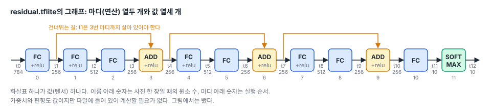
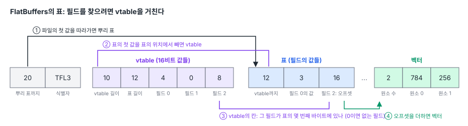
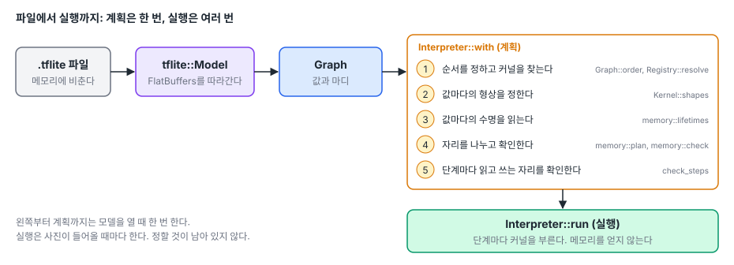
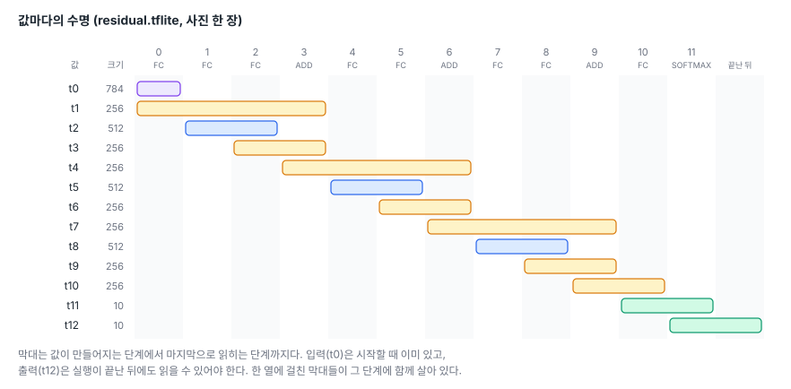
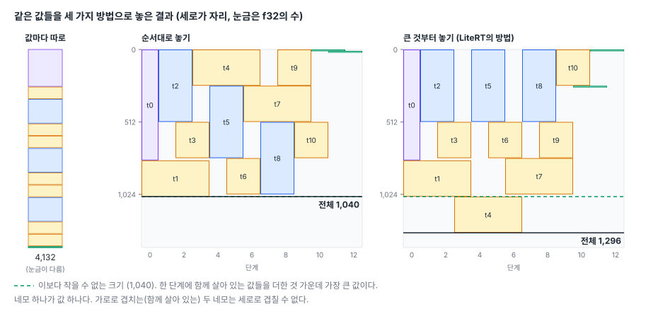

# 그래프 해석기

3부가 끝날 때까지 `badak`은 모델 하나를 위한 프로그램이었습니다. 선형 층
다음에 ReLU가 오고 그다음에 또 선형 층이 온다는 사실이 Rust 코드에 적혀
있었습니다. 다른 모델을 돌리려면 코드를 다시 써야 했습니다.

이 장에서 그것을 뒤집습니다. 계산의 순서를 **데이터**로 받습니다. 모델
파일에 "어떤 연산이 어떤 텐서를 받아 어떤 텐서를 내는가"가 적혀 있고,
엔진은 그것을 읽어 실행합니다. [1장](../part1/ch01_landscape.md)에서 본 둘째 계열, 그래프를 해석하는
엔진입니다. 4부에서 다룰 모델들은 모두 이 해석기 위에서 돕니다.

결과를 미리 적어 둡니다.

- LiteRT의 모델 파일(`.tflite`) 둘을 읽어 실행합니다. 시험 사진 만 장에서
  LiteRT와 같은 숫자를 고르고, 확률은 천만 분의 3 안에서 같습니다.
- 파일을 열어 실행할 준비를 마치는 데 18마이크로초(작은 모델)와
  36마이크로초(큰 모델)가 걸립니다. 가중치는 한 바이트도 복사하지
  않습니다.
- 실행하기 전에 텐서마다의 자리를 계획합니다. 잔차 연결이 있는 모델에서
  중간 결과의 메모리가 3분의 1에서 4분의 1로 줄어듭니다. 같은 계획기를
  Llama의 블록에 적용하면 54MB가 27MB가 됩니다. 22.13절에서 미뤄 둔
  일입니다.
- 실행하는 동안 메모리를 한 번도 얻지 않습니다. 해석기가 연산 하나를
  부르는 데 드는 수고는 6~9나노초입니다.
- 사진 한 장의 추론은 LiteRT가 우리보다 2.2~3.1배 빠릅니다. 무엇이
  다른지 찾았습니다. LiteRT는 이 기계의 다른 명령 집합(SME2)을 쓰는 커널을
  부릅니다.

| 하는 일 | 절 |
|---|---|
| 계산을 그래프로 본다 | 26.1 |
| 모델 파일을 만든다 | 26.2 |
| FlatBuffers를 읽는다 | 26.3 |
| `.tflite`의 구조를 읽는다 | 26.4 |
| 그래프로 옮긴다 | 26.5 |
| 연산자 레지스트리를 만든다 | 26.6 |
| 실행 계획을 세운다 | 26.7 |
| 텐서의 수명을 읽는다 | 26.8 |
| 메모리를 계획한다 | 26.9 |
| 계획대로 실행한다 | 26.10 |
| 같은 답인지 본다 | 26.11 |
| 시간을 잰다 | 26.12 |
| Llama의 블록에 적용한다 | 26.13 |

## 26.1 코드에서 데이터로

[7장](../part1/ch07_mnist.md)의 손글씨 숫자 분류 모델은 순전파가 세 줄이었습니다.

```rust
let fc1 = ops::linear(x, &self.fc1_weight, Some(&self.fc1_bias))?;
let relu = ops::relu(&fc1)?;
let logits = ops::linear(&relu, &self.fc2_weight, Some(&self.fc2_bias))?;
```

이 세 줄에는 두 가지가 섞여 있습니다. 하나는 **무엇을 계산하는가**입니다.
선형 층, ReLU, 선형 층. 다른 하나는 **어떻게 실행하는가**입니다. 위에서
아래로 차례로, 연산마다 새 텐서를 만들어 가며. 코드로 적으면 둘을 떼어
놓을 수 없습니다.

그래프는 앞의 것만 적은 것입니다. **값**(value)과 **마디**(node)로
이루어집니다. 값은 텐서가 놓일 자리이고, 마디는 값 몇 개를 받아 값 몇
개를 내는 연산입니다. 위의 세 줄은 값 여덟 개(`x`, 가중치와 치우침 넷,
`fc1`, `relu`, `logits`)와 마디 세 개입니다. 어느 마디가 어느 값을
읽는지를 화살표로 그리면 그림이 됩니다.



이 장에서 실행할 둘째 모델입니다. 마디 열두 개가 한 줄로 늘어서 있지만
한 줄짜리 사슬은 아닙니다. `ADD`는 바로 앞 마디의 결과와, 세 마디 앞의
결과를 함께 받습니다. [9장](../part2/ch09_transformer.md)의 잔차 연결과 같은 모양입니다.

"어떻게 실행하는가"를 엔진이 정하게 되면 엔진은 실행하기 전에 그래프
전체를 볼 수 있습니다. 코드로 적은 모델에서는 할 수 없던 일들이
가능해집니다.

- 값이 언제 만들어지고 언제 마지막으로 읽히는지 미리 압니다. 그래서
  메모리를 미리 나눠 둘 수 있습니다(26.8~26.9절).
- 모델이 쓰는 연산 가운데 엔진이 모르는 것이 있으면 실행하기 전에
  압니다(26.6절).
- 이웃한 마디를 합치거나 순서를 바꾸는 최적화를 할 수 있습니다. 30장에서
  합니다.

그 대가는 한 겹의 간접 호출입니다. 코드에서는 컴파일러가 `ops::linear`를
곧바로 불렀지만, 해석기는 마디마다 "이 마디의 연산이 무엇인가"를 표에서
찾아 불러야 합니다. 그 값이 얼마인지는 26.12절에서 잽니다.

## 26.2 모델 파일 만들기

읽을 파일이 있어야 합니다. `.tflite`는 LiteRT의 모델 파일입니다. LiteRT는
2024년까지 TensorFlow Lite라고 불렸고, 파일의 확장자에 옛 이름이 남아
있습니다(1.5절). 폰과 임베디드 기기를 겨냥한 엔진이고, 4부의 비전
모델들을 이 형식으로 받습니다. 이 장에서는 작은 모델 둘을 직접 만듭니다.

| | `mlp.tflite` | `residual.tflite` |
|---|---|---|
| 구조 | 784 → 128 → 10 | 784 → 256, 잔차 블록 셋(256 → 512 → 256), 256 → 10 |
| 파라미터 | 101,770 | 992,266 |
| 가중치 | [7장](../part1/ch07_mnist.md)의 것 그대로 | 여기서 학습 |
| 시험 정확도 | 97.64% | 97.73% |

모델은 PyTorch로 적고, Google의 변환 도구(`litert-torch`)로 `.tflite`
파일로 바꿉니다.[^litert-torch]

```python
class Mlp(nn.Module):
    def forward(self, pixels):
        x = (pixels - MEAN) / STD
        return torch.softmax(self.fc2(torch.relu(self.fc1(x))), dim=-1)

litert_torch.convert(model, (test_images[:1],)).export("mlp.tflite")
```

[7장](../part1/ch07_mnist.md)과 다른 점이 둘 있습니다. **정규화가 모델 안에 있습니다.** [7장](../part1/ch07_mnist.md)에서는
평균을 빼고 표준편차로 나누는 일을 Rust 코드가 했고, 그 두 숫자를
safetensors 파일의 메타데이터에 적어 두었습니다. 여기서는 그 계산이
`forward`의 첫 줄입니다. 그리고 **소프트맥스까지 모델 안에 있습니다.**
모델은 0과 1 사이의 픽셀 값을 받아 확률을 냅니다.

전체 스크립트는 `reference/ch26_make_tflite.py`입니다. 두 모델을 만들고,
LiteRT로 시험 사진 만 장을 분류해 그 결과를 정답으로 남깁니다. 만들어 둔
파일을 받으려면 다음을 실행합니다.

```bash
sh scripts/download_mnist.sh
sh scripts/download_ch26.sh
```

## 26.3 FlatBuffers: 풀지 않고 읽는 형식

`.tflite` 파일은 FlatBuffers로 적혀 있습니다.[^flatbuffers] [6장](../part1/ch06_model_files.md)에서 본 두
형식과 견주면 이 형식이 무엇을 하려는지 보입니다.

| 형식 | 머리(header) | 읽는 방법 |
|---|---|---|
| safetensors | JSON 글 | 글을 해석해 자료구조를 만든다 |
| GGUF | 길이가 앞에 붙은 값들의 나열 | 앞에서부터 차례로 읽어 자료구조를 만든다 |
| FlatBuffers | 오프셋으로 엮인 표들 | 만들지 않는다. 필요한 값이 있는 곳으로 바로 간다 |

앞의 둘은 파일을 **해석해서** 메모리 안의 자료구조로 옮깁니다.
FlatBuffers는 파일의 바이트가 곧 자료구조입니다. 값이 있는 곳을 가리키는
것은 모두 **오프셋**(위치의 차이)이고, 읽는 쪽은 그것을 따라가기만
합니다. 형식의 설명서는 이것을 "형식은 오프셋과 인접 관계만으로
정의된다"고 적습니다.[^fb-internals]

구성 요소는 셋입니다.

**표(table).** 이름 붙은 필드들의 묶음입니다. 필드의 값이 표 안에
차례로 놓이는데, 어느 필드가 표의 몇 번째 바이트에 있는지는 표에 적혀
있지 않습니다. 따로 있는 **vtable**에 적혀 있습니다. 표의 첫 4바이트가
vtable까지의 거리입니다.

**벡터(vector).** 원소의 수(4바이트)가 앞에 있고 원소들이 이어집니다.
문자열은 바이트의 벡터입니다.

**오프셋.** 표 안의 필드가 숫자이면 값이 그 자리에 있고, 다른 표나
벡터이면 그 자리에는 4바이트 오프셋이 있습니다. 오프셋은 **자기가 적힌
자리에서 잰 거리**이고 부호가 없습니다. 언제나 뒤쪽을 가리킵니다.



vtable을 한 번 거치는 까닭은 **없는 필드** 때문입니다. vtable의 칸이
0이면 그 필드는 파일에 없고, 읽는 쪽은 기본값을 씁니다. 필드를 쓰지 않는
표는 그만큼 짧아집니다. 그리고 스키마에 필드가 나중에 추가되어도 옛
파일을 읽을 수 있습니다. 옛 파일의 vtable은 새 필드의 칸까지 오지 않고,
읽는 쪽은 "vtable 밖의 칸은 없는 필드"로 칩니다.[^fb-internals] 형식에 판
번호가 따로 없어도 되는 까닭입니다.

### 읽는 코드

이 모듈이 하는 일의 바닥에는 함수 둘이 있습니다. 정해진 위치에서 숫자
하나를 읽는 것과, 오프셋을 따라가는 것입니다.

```rust
{{#include ../../../crates/badak_formats/src/flatbuffers.rs:read}}
```

둘 다 읽기 전에 범위를 확인합니다. 6.2절의 원칙 그대로입니다. 모델
파일은 믿을 수 없는 입력이고, 이 형식은 온통 "저기로 가라"는 숫자로
이루어져 있습니다. 확인 없이 따라가면 깨진 파일 하나가 프로그램을
멈춥니다. C나 C++로 짠 읽기 코드라면 멈추는 대신 남의 메모리를 읽습니다.

표는 그 위에 얹습니다.

```rust
{{#include ../../../crates/badak_formats/src/flatbuffers.rs:table}}
```

`field`가 그림의 ③입니다. `slot`번째 필드의 칸이 vtable 안에 있는지 보고,
있으면 그 칸의 값을 표의 위치에 더합니다. 칸이 vtable 밖이거나 0이면
`None`입니다. 그 위의 `scalar`, `table`, `vector`, `string`은 필드가 어떤
종류인지에 따라 그 자리의 값을 읽거나 오프셋을 따라갑니다.

여기에 없는 것이 하나 있습니다. **필드의 이름과 자료형입니다.** 파일에는
"3번 필드"가 문자열인지 숫자인지 적혀 있지 않습니다. 그것은
**스키마**(schema)가 정하고, 쓰는 쪽과 읽는 쪽이 같은 스키마를 알고
있어야 합니다. 보통은 스키마에서 읽기 코드를 자동으로 만들어 냅니다.
우리는 그 코드를 손으로 씁니다. 다음 절의 일입니다.

### 깨진 파일

읽기 코드를 시험하려면 쓰는 코드가 있어야 합니다. 시험 안에 작은
FlatBuffers 쓰기 함수를 두고, 그것으로 만든 파일을 두 가지로 망가뜨려
읽혔습니다.

- 파일을 0바이트부터 한 바이트씩 늘려 가며 자른 것 전부
- 모든 위치의 바이트를 `00`, `01`, `7f`, `80`, `ff`로 바꾼 것 전부

어느 것도 프로그램을 멈추지 않습니다. 읽히거나(끝의 채움 바이트만
잘렸을 때), 오류가 됩니다.

```bash
cargo test -p badak_formats flatbuffers
```

## 26.4 `.tflite`의 구조

스키마는 LiteRT 저장소의 `schema.fbs`입니다.[^schema] 1,800줄쯤 되고,
대부분은 연산마다의 설정입니다. 뼈대는 표 여섯 개입니다.

| 표 | 담는 것 | 이 책이 읽는 필드 (괄호는 필드 번호) |
|---|---|---|
| `Model` | 파일 전체 | `version`(0), `operator_codes`(1), `subgraphs`(2), `description`(3), `buffers`(4) |
| `OperatorCode` | 모델이 쓰는 연산의 종류 하나 | `deprecated_builtin_code`(0), `custom_code`(1), `version`(2), `builtin_code`(3) |
| `SubGraph` | 그래프 하나 | `tensors`(0), `inputs`(1), `outputs`(2), `operators`(3), `name`(4) |
| `Tensor` | 값 하나의 설명 | `shape`(0), `type`(1), `buffer`(2), `name`(3) |
| `Operator` | 마디 하나 | `opcode_index`(0), `inputs`(1), `outputs`(2), `builtin_options_type`(3), `builtin_options`(4) |
| `Buffer` | 바이트 덩어리 하나 | `data`(0) |

필드 번호는 스키마에 필드가 적힌 순서입니다. 26.3절에서 말한 "쓰는 쪽과
읽는 쪽이 함께 아는 것"이 이 표입니다.

읽는 코드는 표를 따라 내려가며 Rust의 구조체를 채웁니다.

```rust
{{#include ../../../crates/badak_formats/src/tflite.rs:parse}}
```

세 군데를 짚어 둡니다.

**연산의 번호가 두 필드에 있습니다.** 스키마의 처음에는 연산의 번호가
1바이트였습니다. 연산이 127가지를 넘게 되자 4바이트 필드를 새로
만들었고, 옛 프로그램이 새 파일을 읽을 수 있도록 두 필드를 모두
적습니다. 127번 아래의 연산은 두 필드에 같은 값을, 그 위의 연산은 옛
필드에 127을 적습니다.[^schema-opcode] 읽는 쪽은 큰 쪽을 씁니다.

```rust
{{#include ../../../crates/badak_formats/src/tflite.rs:operator_code}}
```

vtable이 "없는 필드"로 판을 넘나든다면, 이것은 "있던 필드의 크기를
바꿔야 할 때" 어떻게 하는지를 보여 줍니다. 바꾸지 않습니다. 새 필드를
더하고 옛 필드를 남깁니다.

**연산의 설정은 유니언입니다.** 선형 층의 설정(이어 붙일 활성화 함수)과
소프트맥스의 설정(`beta`)은 필드가 다릅니다. `Operator`에는 "어떤 종류의
설정 표인가"를 적은 1바이트(3번 필드)와 그 표의 오프셋(4번 필드)이 쌍으로
있습니다. FlatBuffers가 여러 종류 가운데 하나를 담는 방법입니다.[^fb-internals]

**가중치는 읽지 않습니다.** `Tensor`는 값이 아니라 값의 설명입니다.
값은 `buffers`에 있고, 텐서는 버퍼의 번호만 압니다. 0번 버퍼는 비어
있기로 약속되어 있어서, 버퍼가 0번인 텐서는 "파일에 값이 없는 텐서",
곧 실행하면서 계산되는 텐서입니다.[^schema-tensor] 파서는 버퍼마다 값이
파일의 어디서 어디까지인지만 적어 둡니다. 텐서가 필요해지면 그 구간을
6.4절의 방법으로 빌립니다.

```rust
{{#include ../../../crates/badak_formats/src/tflite.rs:constant}}
```

`Tensor::from_bytes`는 구간의 시작 주소가 자료형의 정렬에 맞으면 복사하지
않고, 맞지 않으면 복사합니다(6.4절). 스키마는 버퍼의 값을 16바이트
경계에 맞추라고 적어 두었습니다(`force_align: 16`).[^schema-buffer] 그래서
복사는 일어나지 않습니다. 확인해 봅니다.

```bash
cargo run --release -p badak_graph --example ch26_inspect -- mlp
```

```text
{{#include output/ch26_inspect_mlp.txt}}
```

파일 408,708바이트 가운데 99.6%가 가중치이고, 그래프의 설명은
1,628바이트입니다. 가중치는 모두 "파일의 값을 그대로"입니다.

출력에서 눈여겨볼 것이 더 있습니다. **PyTorch에서 다섯 가지였던 연산이
세 마디가 되었습니다.** 빼기와 나누기(정규화), 선형 층, ReLU, 선형 층,
소프트맥스를 적었는데, 파일에는 `FULLY_CONNECTED` 둘과 `SOFTMAX` 하나뿐입니다.
변환기가 두 가지를 했습니다.

- ReLU를 선형 층의 설정에 넣었습니다(`activation: Relu`). 선형 층이 결과를
  적으면서 곧바로 0보다 작은 값을 자릅니다. 24.7절에서 손으로 한
  융합입니다.
- 정규화를 첫 층의 가중치에 접어 넣었습니다. `W·(x − m)/s + b`는
  `(W/s)·x + (b − (m/s)·ΣW)`와 같으므로(`ΣW`는 가중치의 행마다 원소를 더한
  것), 가중치와 치우침을 미리 고쳐 두면 빼기와 나누기를 실행할 필요가
  없습니다. 26.11절에서 파일의 가중치가 정말 그 값인지 확인합니다.

둘 다 30장의 주제(그래프 최적화)입니다. 여기서는 변환기가 해 준 것을
받아 쓰기만 합니다.

## 26.5 그래프로 옮기기

파서가 만든 `tflite::Model`은 파일의 구조를 그대로 옮긴 것입니다. 해석기는
이것을 직접 쓰지 않고, 자기의 그래프로 한 번 더 옮깁니다.

```rust
{{#include ../../../crates/badak_graph/src/graph.rs:types}}
```

새 크레이트 `badak_graph`의 중심입니다. `.tflite`에 대한 것이 하나도
없습니다. 해석기가 파일 형식을 모르게 해 두면 다른 형식(30장의 ONNX)을
읽을 때 파서와 옮기는 함수만 새로 쓰면 됩니다. 그래프를 고쳐 쓰는
최적화도 이 자료구조 위에서 합니다.

옮기는 함수는 짧습니다.

```rust
{{#include ../../../crates/badak_graph/src/graph.rs:from_tflite}}
```

텐서는 값이 되고, 가중치가 있는 텐서는 값을 함께 가집니다. 연산은 마디가
됩니다. 이 책이 아는 연산이면 `Op`의 해당 갈래가 되고, 모르는 연산이면
`Op::Custom`에 이름만 담깁니다. **모르는 연산이 있어도 여기서 오류를
내지 않습니다.** 그 연산을 실행할 수 있는지는 다음 절의 레지스트리가
정합니다.

`f32`가 아닌 텐서는 아직 받지 않습니다. 정수로 양자화한 모델은 29장에서
다룹니다.

## 26.6 연산자 레지스트리

마디를 실행하는 것은 **커널**입니다. 커널이 해야 하는 일은 둘입니다.

```rust
{{#include ../../../crates/badak_graph/src/kernels.rs:kernel}}
```

**`shapes`는 실행하기 전에 한 번 불립니다.** 입력의 형상만 받아 출력의
형상을 정합니다. 형상이 맞지 않으면 여기서 오류를 냅니다. [5장](../part1/ch05_operators.md)의
연산자들은 이 일을 계산하는 함수 안에서 했습니다. 떼어 낸 까닭은 다음
절에서 드러납니다. 형상을 알아야 메모리를 계획할 수 있고, 계획은 실행
전에 끝나야 합니다.

**`run`은 추론할 때마다 불립니다.** [5장](../part1/ch05_operators.md)의 연산자와 모양이 다릅니다.
텐서를 받아 **새 텐서를 돌려주지 않습니다.** 결과를 적을 자리를 함께
받습니다. 자리를 정하는 것은 해석기의 일이고 커널은 거기에 적기만
합니다. 22.11절의 `Tensor::build`가 "자리를 먼저 얻고 그 자리에 적게"
했던 것을 한 걸음 더 민 것입니다.

선형 층의 커널입니다.

```rust
{{#include ../../../crates/badak_graph/src/kernels.rs:fully_connected}}
```

계산은 17~18장의 `simd::linear`를 그대로 부릅니다. 3부에서 만든 커널이
해석기 아래에 그대로 들어갑니다. 그 뒤에 치우침을 더하고 활성화 함수를
적용합니다.

커널은 받은 자리의 **모든 원소를 덮어써야 합니다.** 22.11절의 아레나는
자리를 0으로 채워서 넘겼지만, 해석기는 채우지 않습니다. 그 자리에는
앞서 다른 값이 쓰던 내용이 남아 있습니다. 커널이 "처음에 0이겠지" 하고
더하기부터 하면 틀린 답이 나옵니다. 시험에서는 실행 전에 자리 전체를
`NaN`으로 채워 이 잘못을 잡습니다.

이제 마디와 커널을 잇습니다.

```rust
{{#include ../../../crates/badak_graph/src/registry.rs:registry}}
```

**레지스트리**(registry)는 연산의 이름에서 "커널을 만드는 함수"를 찾는
표입니다. 해석기는 어떤 연산이 있는지 모릅니다. 마디마다 이 표에서 이름을
찾을 뿐입니다.

`match` 하나로 충분해 보이는 일을 표로 만든 데는 까닭이 있습니다.

- **모르는 연산을 실행 전에 압니다.** 표에 없는 이름이면 해석기를 만들
  때 오류가 납니다. 무엇이 없고 무엇이 있는지를 함께 알려 줍니다.
- **엔진을 고치지 않고 연산을 더합니다.** `register`를 한 번 부르면
  됩니다. 표준에 없는 연산(`.tflite`의 사용자 정의 연산)을 쓰는 모델을
  그렇게 돌립니다.
- **같은 연산의 커널을 바꿔 끼웁니다.** 이미 있는 이름으로 등록하면
  바뀝니다. 느리지만 단순한 커널과 견줄 때, 나중에 정수 커널이나 GPU
  커널을 끼울 때 씁니다.

LiteRT도 같은 구조입니다. 연산 하나를 함수 네 개(`init`, `free`,
`prepare`, `invoke`)의 묶음으로 나타내고,[^litert-registration] 연산의
번호에서 그 묶음을 찾는 표를 둡니다.[^litert-resolver] `prepare`가 우리의
`shapes`이고 `invoke`가 `run`입니다. 그 표도 프로그램이 실행 중에
채웁니다(`AddBuiltin`, `AddCustom`). 모델이 쓰는 연산만 등록한 표를 만들
수 있다는 뜻입니다.

## 26.7 실행 계획

해석기는 만들 때 모든 것을 정합니다. 다섯 단계입니다.



```rust
{{#include ../../../crates/badak_graph/src/interpreter.rs:build}}
```

### 순서

마디는 자기 입력을 만드는 마디들이 모두 끝난 뒤에 실행할 수 있습니다.
그 조건을 지키는 순서를 찾는 일이 **위상 정렬**(topological sort)입니다.

```rust
{{#include ../../../crates/badak_graph/src/graph.rs:order}}
```

마디마다 "아직 끝나지 않은 앞 마디의 수"를 세어 두고, 그 수가 0인 마디를
하나 골라 실행 목록에 넣고, 그 마디를 기다리던 마디들의 수를 하나씩
줄입니다. 이것을 되풀이합니다.[^kahn] 고를 수 있는 마디가 여럿이면 번호가
가장 작은 것을 고릅니다. 모든 마디가 목록에 들어가기 전에 고를 마디가
없어지면 마디들이 서로를 기다리며 돌고 있는 것이고, 그런 그래프는 실행할
수 없습니다.

`.tflite`는 연산을 실행할 순서대로 적어 두기로 되어 있어서[^schema-order]
이 함수는 파일의 순서를 그대로 돌려줍니다. 그래도 계산하는 까닭이 둘
있습니다. 파일을 믿지 않기 때문이고, 30장에서 그래프를 고쳐 쓰면 마디의
순서가 뒤섞이기 때문입니다. 그래프가 올바른지도 여기서 봅니다. 아무도
만들지 않는 값을 읽는 마디, 두 마디가 만드는 값, 가중치에 쓰려는 마디가
걸러집니다.

### 형상

순서대로 마디를 돌며 `Kernel::shapes`를 부릅니다. 입력의 형상에서
출발해 모든 값의 형상이 정해집니다. 파일에도 값마다 형상이 적혀 있으므로
둘을 견줍니다. 다르면 파일이나 커널 가운데 하나가 틀린 것이고, 실행하기
전에 알게 됩니다.

입력의 형상을 바꿀 수도 있습니다. 파일의 입력은 사진 한 장 `(1, 784)`
이지만 `(64, 784)`를 주고 해석기를 만들면 모든 값의 형상이 그에 맞게
다시 정해집니다. 그래프와 가중치는 그대로이고 계획만 달라집니다.

```bash
cargo run --release -p badak_graph --example ch26_plan -- residual 1
```

```text
{{#include output/ch26_plan_residual.txt:1:15}}
```

## 26.8 텐서의 수명

22.13절에서 남긴 일입니다. 그때 엔진은 아레나를 썼습니다. 블록이 만드는
텐서를 덩어리 하나에 차례로 놓고, 블록이 끝나면 한꺼번에 비웠습니다. 얻고
돌려주는 수고는 없어졌지만, 블록이 만드는 텐서를 **모두 더한** 만큼을
쥐고 있어야 했습니다. 어떤 텐서가 언제 쓸모를 다하는지 미리 알 길이
없었기 때문입니다.

이제 압니다. 실행 순서가 정해졌으므로 값마다 두 숫자를 읽을 수 있습니다.

- **처음**: 그 값을 만드는 단계
- **끝**: 그 값을 마지막으로 읽는 단계

```rust
{{#include ../../../crates/badak_graph/src/memory.rs:lifetimes}}
```

그래프를 한 번 훑으면 됩니다. 마디가 값을 내면 그 값의 처음과 끝을 그
단계로 두고, 마디가 값을 읽으면 그 값의 끝을 그 단계로 늦춥니다. 경계에
있는 값 둘은 따로 다룹니다. 그래프의 입력은 시작할 때 이미 있어야 하고,
그래프의 출력은 실행이 끝난 뒤에도 읽을 수 있어야 합니다.



대부분의 값은 두 단계만 삽니다. 만들어지고, 바로 다음 마디가 읽으면
끝입니다. 길게 사는 것은 `t1`, `t4`, `t7`입니다. 잔차 연결을 건너뛰는
값들이어서 `ADD`가 읽을 때까지 기다립니다. 그림을 세로로 자르면 그
단계에 함께 살아 있는 값들이 보입니다. 가장 붐비는 곳은 0번 단계입니다.
입력(784)과 첫 층의 결과(256)가 함께 있어야 해서 1,040원소입니다. 2, 5,
8번 단계가 값 셋(256 + 512 + 256 = 1,024)으로 그 뒤를 잇습니다.

## 26.9 메모리 계획

수명이 겹치지 않는 두 값은 같은 자리를 써도 됩니다. 메모리 계획은 큰
자리 하나를 잡아 두고, 값마다 그 안의 **어디서부터** 쓸지를 정하는
일입니다. 목표는 자리 전체를 작게 하는 것입니다.

그림으로 보면 네모를 쌓는 문제입니다. 값 하나가 네모 하나이고, 가로는
수명, 세로는 크기입니다. 가로 위치는 정해져 있고 세로 위치만 고를 수
있습니다. 네모끼리 겹치지 않게 놓으면서 전체의 높이를 가장 낮게 해야
합니다. 가장 좋은 답을 찾는 것은 어려운 문제로 알려져 있어서[^pisarchyk]
실전에서는 그럴듯한 규칙으로 하나씩 놓습니다.

세 가지 방법을 만들어 견줍니다.

```rust
{{#include ../../../crates/badak_graph/src/memory.rs:plan}}
```

**값마다 따로**(`Separate`)는 함께 쓰지 않는 것입니다. [22장](../part3/ch22_memory.md)의 아레나가
한 일이고, 견줄 기준입니다.

나머지 둘은 `place`를 함께 씁니다. 값을 하나씩 놓는데, 놓으려는 값과
**함께 살아 있는** 값들만이 걸림돌입니다. 그 걸림돌들 사이의 틈 가운데
이 값이 들어갈 수 있는 **가장 작은 틈**에 넣고, 들어갈 틈이 없으면
걸림돌들의 맨 뒤에 붙입니다. 두 방법은 값을 놓는 **순서**만 다릅니다.

- **순서대로 놓기**(`InOrder`): 만들어지는 순서대로.
- **큰 것부터 놓기**(`BySize`): 큰 값부터. 크기가 같으면 먼저 만들어지는
  것부터.

뒤의 것이 LiteRT가 쓰는 방법입니다. LiteRT의 계획기는 텐서를 "큰 것부터
작은 것 순서로, 크기가 같으면 먼저 쓰이는 것부터" 늘어놓고,[^litert-order]
하나씩 가장 작은 틈에 넣습니다.[^litert-gap] 같은 방법이 논문에는 "크기
순서의 탐욕법"(Greedy by Size)이라는 이름으로 실려 있습니다.[^pisarchyk]
큰 것을 먼저 놓는 까닭은 직관적입니다. 큰 네모는 들어갈 틈이 드물므로
자리가 넉넉할 때 먼저 놓고, 작은 네모로 남은 틈을 메웁니다.

어떤 방법도 넘을 수 없는 선이 있습니다.

```rust
{{#include ../../../crates/badak_graph/src/memory.rs:bound}}
```

한 단계에 함께 살아 있는 값들은 모두 메모리에 있어야 합니다. 그 합이
가장 큰 단계의 값보다 작은 계획은 있을 수 없습니다.[^pisarchyk] 계획이
이 값과 같으면 더 줄일 것이 없다는 뜻입니다.

층이 한 줄로 이어진 모델에서는 이 값이 "이웃한 두 값의 크기를 더한 것
가운데 가장 큰 값"입니다. 층이 몇 개이든 자리 두 개를 번갈아 쓰면
됩니다. [3장](../part1/ch03_neural_networks.md)의 연습 문제 6번이 물은 것의 답입니다.

### 결과

```text
{{#include output/ch26_plan_residual.txt:17:}}
```

| 자리 전체 (바이트) | 값마다 따로 | 순서대로 | 큰 것부터 | 하한 |
|---|---|---|---|---|
| `mlp`, 한 장 | 3,728 | 3,648 | 3,648 | 3,648 |
| `residual`, 한 장 | 16,528 | 4,160 | 5,184 | 4,160 |
| `residual`, 64장 | 1,057,792 | 266,240 | 331,776 | 266,240 |

**잔차 모델에서 3분의 1에서 4분의 1이 됩니다.** 값 열세 개를 더하면
4,132원소인데, 한 순간에 필요한 것은 1,040원소입니다. 마디가 많아질수록
이 차이는 커집니다. 따로 두는 쪽은 마디의 수에 비례해 늘고, 계획한 쪽은
가장 붐비는 한 단계가 정합니다.

작은 모델에서는 얻는 것이 거의 없습니다. 값이 넷뿐이고, 가장 큰 둘(입력
784와 첫 층의 결과 128)이 함께 살아 있어야 합니다.

**LiteRT의 방법이 여기서는 집니다.** 큰 것부터 놓으면 1,296원소이고
순서대로 놓으면 하한인 1,040원소입니다. 그림을 보면 까닭이 보입니다.



큰 것부터 놓으면 입력(`t0`, 784)과 크기 512인 셋(`t2`, `t5`, `t8`)이 먼저
맨 위를 차지합니다. 그다음은 크기 256인 값들이고, 그 가운데 먼저
만들어지는 `t1`이 `t0`의 아래(784번째)에 놓입니다. `t1`은 `t0`과 함께
살아 있으므로 다른 길이 없습니다. 문제는 `t4`입니다. `t4`는 3번 단계에서
태어나 `t1`, `t3`과 함께 살아 있어야 하는데, 그 순간 `t1`이 784~1,040을,
`t3`이 512~768을 쥐고 있습니다. 위쪽의 0~512는 `t4`가 사는 동안(3~6번
단계)에 `t5`가 써야 합니다. 남은 자리는 `t1`의 아래뿐입니다.

순서대로 놓으면 `t4`가 놓일 때 `t5`가 아직 놓이지 않았으므로 `t4`가 맨
위를 얻고, 나중에 오는 `t5`가 그 아래의 틈으로 들어갑니다.

그렇다고 순서대로 놓는 쪽이 늘 낫다는 뜻은 아닙니다. 26.13절의 Llama
블록에서는 반대의 결과가 나옵니다. 시험 코드에는 두 방법이 서로 지는
작은 예를 하나씩 적어 두었습니다(`memory::tests`). 둘 다 탐욕법이고,
어느 쪽도 가장 좋은 답을 보장하지 않습니다. 해석기의 기본값은 LiteRT와
같은 "큰 것부터"로 두었습니다. 26.13절의 결과와, 논문이 여러 신경망에서
이 방법이 대체로 하한에 닿는다고 보고한 것[^pisarchyk]을 따랐습니다.

## 26.10 계획대로 실행하기

실행은 짧습니다. 단계마다 입력과 출력의 자리를 찾아 커널에 넘깁니다.

```rust
{{#include ../../../crates/badak_graph/src/interpreter.rs:run}}
```

`unsafe`가 있습니다. 까닭은 Rust의 빌림 규칙입니다. 해석기의 자리는
`Vec<f32>` 하나이고, 한 단계는 그 안의 한 구간을 읽으면서 다른 구간에
씁니다. Rust는 벡터 하나에서 읽는 참조와 쓰는 참조를 동시에 내주지
않습니다. 두 구간이 겹치지 않는다는 것을 컴파일러가 알 수 없기
때문입니다. 겹치지 않는다는 사실은 **계획**에 들어 있고, 계획은 실행할
때에야 생기는 값입니다.

그래서 여기서는 원시 포인터로 구간을 직접 만들고, 겹치지 않는다는 것을
우리가 보증합니다. 22.11절의 아레나와 같은 종류의 약속입니다. 보증이
틀리면 정의되지 않은 동작입니다. 한 값이 다른 값을 조용히 덮어씁니다.

약속을 말로만 두지 않고 **확인합니다.** 두 번 합니다.

```rust
{{#include ../../../crates/badak_graph/src/memory.rs:check}}
```

`memory::check`는 계획 전체를 봅니다. 함께 살아 있는 두 값의 자리가
겹치면 오류입니다. 계획기가 어떤 방법을 쓰든, 나중에 더 영리한 방법으로
바꾸든 이 확인을 지나야 해석기가 만들어집니다.

```rust
{{#include ../../../crates/badak_graph/src/interpreter.rs:check_steps}}
```

`check_steps`는 `unsafe`가 기대는 사실을 그대로 확인합니다. 단계마다,
쓰는 구간이 자리 안에 있는지, 그 단계가 읽는 구간이나 쓰는 다른 구간과
겹치지 않는지 봅니다. 수명의 정의에서 따라 나오는 사실이지만, 따라
나온다는 논증에 기대는 것보다 직접 확인하는 것이 낫습니다. 둘 다 해석기를
만들 때 한 번 하고, 실행할 때는 하지 않습니다.

22.11절에서 쓴 Miri로 이 크레이트의 시험을 돌렸습니다.

```bash
cargo +nightly miri test -p badak_graph --lib
```

크레이트 안의 시험 22개가 모두 지나갑니다(파일을 메모리에 비추는 통합
시험은 Miri가 볼 수 없어 뺐습니다). 계획기의 세 방법으로 잔차 그래프를
실행하는 시험, 입력의 형상을 바꾸는 시험이 들어 있습니다. 처음 돌렸을
때는 다섯 개가 실패했는데, 메모리의 잘못이 아니었습니다. 두 가지 길로
계산한 소프트맥스가 비트까지 같은지 견주는 시험이었고, Miri에서는 `exp`의
마지막 자리가 호출마다 달라질 수 있어서 어긋났습니다. 비교를 허용 오차로
바꿨습니다.

**실행하는 동안 메모리를 얻지 않습니다.** 텐서의 자리는 미리 잡혀
있습니다. 남는 것은 커널에 넘길 입력과 출력의 목록인데, 입력이나 출력이
넷 이하인 마디(지금의 모든 마디)는 그 목록을 스택의 배열에 담습니다.
22.3절의 할당 세기를 붙여 확인한 값은 26.12절에 있습니다.

입력과 출력은 해석기의 자리를 직접 읽고 씁니다.

```rust
{{#include ../../../crates/badak_graph/src/interpreter.rs:io}}
```

쓰는 쪽에서 조심할 것이 하나 있습니다. **입력의 자리도 다른 값과 함께
씁니다.** 위의 그림에서 `t0`의 자리에는 실행이 끝날 때쯤 다른 값들이
들어 있습니다. 같은 사진으로 한 번 더 실행하려면 입력을 다시 적어야
합니다.

## 26.11 같은 답인가

LiteRT가 같은 파일로 계산한 결과와 견줍니다. 시험 사진 만 장을
분류합니다.

```bash
cargo run --release -p badak_graph --example ch26_verify
```

```text
{{#include output/ch26_verify.txt}}
```

| | `mlp` | `residual` |
|---|---|---|
| 확률의 가장 큰 차이 (앞의 사진 열여섯 장) | 2.4 × 10⁻⁷ | 3.0 × 10⁻⁷ |
| LiteRT와 같은 숫자를 고른 사진 | 10,000 / 10,000 | 10,000 / 10,000 |
| 정답을 맞힌 사진 | 9,764 | 9,773 |

확률은 `f32`가 구분할 수 있는 가장 작은 차이의 두세 배 안에서 같고, 고른
숫자는 만 장 모두 같습니다. 덧셈의 순서가 다른 두 구현이 낼 수 있는
차이입니다(5.6절).

사진을 한 장씩 넣은 결과와 만 장을 한 번에 넣은 결과는 비트까지
같습니다. 17.3절에서 내적의 덧셈 순서를 고정해 둔 덕분입니다. 한 장을
넣으면 커널이 벡터 하나짜리 길로, 만 장을 넣으면 여러 스레드가 벡터를
묶어 계산하는 길로 가지만 답은 같습니다.

**[7장](../part1/ch07_mnist.md)의 엔진과도 만 장 모두 같은 숫자를 고릅니다.** 같은 가중치에서
출발했지만 두 엔진이 하는 계산은 다릅니다. [7장](../part1/ch07_mnist.md)은 픽셀에서 평균을 빼고
표준편차로 나눈 뒤 원래의 가중치를 곱하고, 그래프는 픽셀에 고쳐 둔
가중치를 곱합니다. 출력의 마지막 두 줄이 그 확인입니다. 파일의 첫 층
가중치는 원래 가중치를 표준편차로 나눈 것과 1.2 × 10⁻⁷ 안에서, 치우침은
26.4절의 식과 5.7 × 10⁻⁶ 안에서 같습니다.

7.7절에서 남긴 물음이 있었습니다. 코드로 모델을 옮기면 전처리 같은 세부
사항이 어긋나기 쉽고, 그래프를 파일에 담는 엔진에서도 "전처리는 여전히
파일 밖에 있어서 같은 문제가 남는다"고 적었습니다. 확인한 결과는 **절반만
맞습니다.**

- 정규화는 그래프 안에 넣을 수 있고, 넣으면 사라집니다. 평균과
  표준편차를 따로 전할 필요가 없고, 틀릴 수도 없습니다. 변환기가
  가중치에 접어 넣어 실행 비용도 없습니다.
- 그러나 "입력이 0과 1 사이의 값"이라는 약속은 여전히 파일 밖에
  있습니다. 파일에 적힌 것은 형상 `(1, 784)`와 자료형뿐입니다. 0~255의
  픽셀을 그대로 넣어도 엔진은 아무 말 없이 계산하고, 답은 틀립니다.
  28 × 28 그림을 어떤 순서로 펴는지, 바탕이 검은지 흰지도 마찬가지입니다.

경계가 옮겨 갔을 뿐 없어지지는 않았습니다. 27장에서 사진을 다루면 이
경계가 넓어집니다. 크기를 바꾸는 방법, 색의 순서, 채널의 배치가 모두
파일 밖의 약속입니다.

## 26.12 얼마나 빠른가

```bash
cargo run --release -p badak_graph --example ch26_bench
```

```text
{{#include output/ch26_bench.txt:11:}}
```

### 준비

| (마이크로초) | `mlp` | `residual` |
|---|---|---|
| 파일을 열고 해석 | 15.4 | 28.5 |
| 그래프로 옮기기 | 1.0 | 2.8 |
| 계획 세우기 | 1.7 | 4.8 |
| 합 | 18.1 | 36.1 |

4MB짜리 파일을 열어 실행할 준비를 마치는 데 36마이크로초입니다.
대부분이 파일을 메모리에 비추는 시스템 호출입니다. 가중치를 읽지 않으니
파일이 커져도 이 시간은 마디와 텐서의 수에만 달려 있습니다. 가중치만 든
safetensors를 읽는 [7장](../part1/ch07_mnist.md)의 엔진(14.4마이크로초)과 같은 자릿수입니다.

### 한 장

| 사진 한 장 | 시간 (µs) | 1,000장 동안의 할당 |
|---|---|---|
| [7장](../part1/ch07_mnist.md)의 엔진 (소프트맥스를 붙임) | 4.89 | 15,000번 |
| 그래프 해석기, `mlp` | 4.33 | 0번 |
| 그래프 해석기, `residual` | 44.03 | 0번 |

**같은 모델에서 해석기가 코드보다 조금 빠릅니다.** 간접 호출의 값을
치르고도 그렇습니다. [7장](../part1/ch07_mnist.md)의 엔진은 연산마다 텐서를 새로 만들고(한 장에
할당 15번), ReLU를 따로 한 번 더 훑습니다. 해석기는 자리가 미리 정해져
있고 ReLU가 선형 층에 붙어 있습니다.

단계마다의 시간을 보면 일의 거의 전부가 선형 층입니다. `mlp`의 첫 층이
95%입니다. 해석기 자신이 쓰는 시간을 보려고, 일이 거의 없는 마디(원소
여덟 개의 ReLU)를 1,024개 이은 그래프를 돌렸습니다. **마디 하나에
6~9나노초**입니다(세 번 재서 6.1, 7.0, 8.6). 입력과 출력의 자리를 찾고,
함수 포인터로 커널을 부르고, 커널이 여덟 원소를 계산하는 것까지 든
값입니다. 마디가 열두 개인 잔차 모델에서 0.1마이크로초, 전체의
0.2%입니다. 마디가 수백 개인 모델에서도 마디 하나가 마이크로초 단위의
일을 하는 한 문제가 되지 않습니다.

`ADD`에서 배운 것이 하나 있습니다. 처음에는 더하기와 곱하기를 한 커널로
만들면서 "원소 둘을 받아 하나를 내는 함수 포인터"를 커널이 들고 있게
했습니다. 256원소를 더하는 데 0.22마이크로초가 걸렸습니다. 원소마다 함수
포인터를 거쳐 부르면 컴파일러가 반복문을 벡터 명령으로 바꾸지 못합니다
(17.2절). 어떤 계산인지를 반복문 **밖에서** 한 번 고르게 바꾸자
0.05마이크로초가 되었습니다. 해석기가 마디마다 한 번 함수 포인터를 거치는
것은 괜찮지만, 그 안쪽의 반복문에 같은 것이 들어가면 안 됩니다.

### 만 장

만 장을 한 번에 넣으면 장당 0.33마이크로초(`mlp`)와 2.83마이크로초
(`residual`)입니다. 한 장씩 넣을 때의 13분의 1과 16분의 1입니다. [18장](../part3/ch18_multithreading.md)의
스레드가 일하고, 커널이 벡터를 묶어 계산합니다.

### LiteRT

같은 파일을 LiteRT로 실행한 시간과 견줍니다. LiteRT는 Python에서
불렀습니다(`ai-edge-litert` 2.3.0). 두 엔진을 번갈아, 쉬면서 세 번
쟀습니다(22.12절).

```bash
PYTHON=<requirements_ch26.txt를 설치한 Python> sh scripts/bench_ch26.sh
```

```text
{{#include output/ch26_litert.txt}}
```

| 사진 한 장 (µs) | `badak` | LiteRT | 배수 |
|---|---|---|---|
| `mlp` | 4.33 | 1.96 | 2.2 |
| `residual` | 44.03 | 14.15 | 3.1 |

LiteRT의 값은 Python에서 `invoke()`를 한 번 부르는 시간입니다. 아무 일도
하지 않는 Python 호출이 0.02마이크로초이고, Python에서 LiteRT의 함수로
건너가는 데 드는 시간은 따로 재지 못했습니다. 그만큼 LiteRT에 불리한
값입니다. `residual`의 값은 차례에 따라 14와 20 사이를 오갔습니다. 표는
그 가운데 낮은 쪽입니다.

**LiteRT가 2.2~3.1배 빠릅니다.** 같은 기계, 같은 파일, 스레드
하나입니다. 3부에서 그렇게 다듬은 커널이 어디서 지는지 찾아봤습니다.

먼저 우리 커널을 따로 쟀습니다.

```bash
cargo run --release -p badak_graph --example ch26_single_vector
```

```text
{{#include output/ch26_single_vector.txt}}
```

**벡터가 하나일 때 우리 커널은 제 속도의 절반을 냅니다.** 같은 가중치에
벡터 여덟 개를 한 번에 넣으면 1초에 곱셈을 430~510억 번 하는데, 하나를
넣으면 220~260억 번입니다. 사진을 한 장씩 넣는 것은 벡터를 하나씩 넣는
것입니다. 17.5절의 표에 이미 있던 차이입니다. 그때 곱셈 하나에 벡터
하나일 때 0.17사이클, 여럿일 때 0.082사이클이 들었습니다. 그때는 큰
행렬로 쟀고, 여기서는 가중치가 0.4MB인 작은 행렬에서 같은 배수가
나옵니다. 메모리가 아니라 커널의 구조에서 오는 차이라는 뜻입니다. 벡터가
둘이면 읽어 온 가중치 한 묶음을 두 번 곱하는 데 쓰고, 하나이면 한 번만
씁니다. 곱셈 하나에 드는 읽기가 두 배입니다(해석). 벡터 하나에 가중치
여덟 행을 함께 읽도록 커널을 바꿔 보았지만 값이 달라지지 않았습니다. 그
코드는 남기지 않았습니다.

LiteRT의 값을 같은 단위로 바꾸면, `mlp`의 곱셈 10만 번을 1.96마이크로초에
하므로 1초에 500억 번이 넘습니다. **벡터 하나로 우리의 여덟 개짜리
속도를 냅니다.**

LiteRT가 어떤 커널을 쓰는지 봤습니다. 14.8절의 `sample`을 LiteRT를
돌리는 Python 프로세스에 붙였습니다.

```text
{{#include ../../../bench/ch26/litert_sample.txt}}
```

두 가지가 보입니다.

**LiteRT는 이 그래프를 스스로 실행하지 않습니다.** `Subgraph::Invoke`
바로 아래에 `tflite::xnnpack::SubgraphInvoke`가 있습니다. LiteRT는
그래프를 XNNPACK이라는 다른 라이브러리에 통째로 넘겼습니다. 이런 넘겨주기를
LiteRT에서는 **델리게이트**(delegate)라고 부릅니다. 31장에서 XNNPACK을
해부합니다.

**커널의 이름이 `…1x32__neonsme2`입니다.** XNNPACK의 소스에서 이 함수는
Arm이 만든 라이브러리 KleidiAI의 커널
`kai_matmul_clamp_f32_f32_f32p4vsx1bf32_1x32vs_sme2_mla`를 부르는 얇은
껍데기입니다.[^xnnpack-sme2] SME2는 Arm 프로세서가 갖출 수 있는 명령
집합 가운데 하나의 이름입니다. 흔히 "행렬 확장"(Scalable Matrix
Extension)이라고 풀어 씁니다.[^sme-name] 이 기계가 그것을 지원하는지는 운영체제에
물어볼 수 있습니다.

```bash
sysctl hw.optional.arm.FEAT_SME2
```

```text
hw.optional.arm.FEAT_SME2: 1
```

우리 커널은 [17장](../part3/ch17_simd.md)의 NEON 명령을 씁니다. LiteRT는 같은 프로세서에 있는
**다른 명령 집합**을 씁니다. 반복문을 어떻게 짰느냐보다 먼저, 쓰는 명령이
다릅니다. XNNPACK에 NEON만 쓰게 하면 얼마가 나오는지는 재지 않았으므로
격차의 얼마가 명령 집합의 몫인지는 아직 모릅니다. 이 명령들이 무엇을
하는지, 왜 빠른지도 이 장에서 확인하지 않았습니다. Rust의 표준 라이브러리에는 SME 명령을 쓰는
함수가 없어서[^rust-sme] 지금의 원칙(표준 라이브러리만) 안에서는 따라갈
길도 마땅치 않습니다. 31장에서 다시 다룹니다.

25.9절에서 까닭을 찾지 못한 격차가 하나 있었습니다. Apple의 행렬
라이브러리(Accelerate)가 우리 NEON 커널보다 두 배 빨랐습니다. 같은
까닭일 수 있습니다. 확인하지는 않았습니다.

## 26.13 Llama의 블록에 적용하기

22.13절은 이렇게 끝났습니다. 아레나는 블록 하나가 만드는 텐서를 모두
더한 54MB를 쥐고, 수명을 미리 알면 줄일 수 있지만 "지금의 엔진에서는 할
수 없다"고. 이제 계획기가 있습니다. 블록에 적용해 봅니다.

Llama를 그래프 해석기로 실행하지는 않습니다. `block_cached`([11장](../part2/ch11_kv_cache.md), [24장](../part3/ch24_attention.md))가
만드는 텐서들과 그것들이 서로를 읽는 관계를 그래프로 옮겨 적고, 수명을
읽어 자리를 계획합니다. 계획기는 연산이 무엇인지 모르고 크기와 수명만
보므로 그것으로 충분합니다.

```bash
cargo run --release -p badak_graph --example ch26_llama_block
```

```text
{{#include output/ch26_llama_block.txt}}
```

옮겨 적은 것이 맞는지부터 봅니다. [22장](../part3/ch22_memory.md) 때의 블록(`silu`와 곱셈을 따로
하던 때)으로 적으면 텐서가 16개이고 모두 더해 54.00MB입니다. 22.11절에서
"텐서 16개를 더하면 54MB"라고 잰 값과 같습니다. 24.7절에서 두 연산을
합친 뒤로는 15개, 45.61MB입니다.

| 프롬프트 256토큰, 블록 하나 (MB) | [22장](../part3/ch22_memory.md)의 블록 | [24장](../part3/ch24_attention.md)의 블록 |
|---|---|---|
| 값마다 따로 (아레나) | 54.00 | 45.61 |
| 순서대로 놓기 | 29.36 | 29.36 |
| 큰 것부터 놓기 | 27.26 | 27.26 |
| 하한 | 27.26 | 27.26 |

**45.61MB가 27.26MB가 됩니다.** 하한과 같으므로 수명만으로는 더 줄일
수 없습니다. 하한을 정하는 단계는 MLP의 한가운데입니다. `gate`, `up`,
`hidden`(각 8.39MB)과 잔차 연결을 건너뛰려고 기다리는 `h`(2.10MB)가 함께
살아 있습니다.

22.12절의 측정과 맞춰 봅니다. 그때 아레나를 켜면 프로세스의 메모리가
"20MB 남짓" 늘었습니다. 아레나를 끄면 텐서는 쓸모를 다하는 순간 힙으로
돌아가므로 한 순간에 살아 있는 만큼만 쥡니다. 그것이 이 표의 하한입니다.
[22장](../part3/ch22_memory.md)의 블록에서 54.00 − 27.26 = 26.7MB입니다. 측정은 19~25MB였습니다.
같은 자릿수이고, 방향이 맞습니다.

**여기서는 큰 것부터 놓는 쪽이 이깁니다.** 26.9절과 반대입니다. 큰 텐서
셋이 뒤쪽에 몰려 있어서, 순서대로 놓으면 앞에서 놓은 작은 텐서들이 큰
텐서가 들어갈 틈을 쪼갭니다.

토큰을 하나씩 만들 때는 0.18MB가 0.11MB가 됩니다. 22.12절에서 본 대로
이때의 메모리는 문제가 아닙니다.

### 한 것과 하지 않은 것

22.13절의 숙제 가운데 여기서 한 것은 **계획기를 만들고, 그것이 Llama의
블록에서 얼마를 줄이는지 계산한 것**입니다. Llama 엔진이 이 계획대로
실행하도록 고치지는 않았습니다. 그렇게 하려면 Llama의 블록을 그래프
해석기의 마디로 옮겨야 하고, 그러자면 해석기에 지금 없는 것들이
필요합니다. 16비트와 양자화한 가중치를 받는 선형 층, 실행할 때마다
길어지는 KV 캐시를 쥔 마디, 실행마다 달라지는 입력의 길이. 4부에서
해석기가 자라는 동안 하나씩 생깁니다.

이 책의 Llama 엔진은 첫째 계열(코드로 적은 엔진)로 남습니다. 그 계열의
대표인 llama.cpp도 안에서는 그래프를 만들어 자리를 계획한다는 것을
22.14절에서 봤습니다. 두 계열의 경계는 [1장](../part1/ch01_landscape.md)의 표가 그린 것만큼 또렷하지
않습니다.

## 26.14 남긴 것

**제자리 계산.** `ADD`는 두 입력 가운데 하나가 이 단계에서 수명이
끝난다면 결과를 그 자리에 적어도 됩니다. 그러면 그 값은 자리를 새로 얻지
않습니다. 지금의 계획기는 한 단계의 입력과 출력을 언제나 다른 자리에
둡니다. LiteRT의 계획기에는 이 일을 하는 단계가 있습니다.[^litert-inplace]
30장에서 그래프를 고쳐 쓸 때 함께 다룹니다.

**`f32`가 아닌 값.** 해석기의 자리는 `Vec<f32>` 하나입니다. 정수 텐서가
섞이면 자료형마다 정렬이 다른 값을 한 덩어리에 놓아야 합니다. 22.13절에서
아레나에 대해 남긴 것과 같은 숙제이고, 29장에서 `int8` 모델을 돌릴 때
풉니다. LiteRT는 모든 텐서를 64바이트 경계에 맞춥니다.[^litert-alignment]

**브로드캐스팅.** `ADD`와 `MUL`은 형상이 같은 입력만 받습니다. 5.5절의
브로드캐스팅을 커널에 넣는 일은 그것이 필요한 모델이 나올 때 합니다.

**실행하면서 정해지는 형상.** 지금은 모든 값의 형상을 실행 전에 압니다.
입력의 길이가 실행마다 달라지는 모델(글, 소리)에서는 계획을 다시 세워야
합니다. 계획을 세우는 데 2~5마이크로초이니 매번 다시 세워도 되지만,
22.14절에서 본 ggml의 안내("가장 큰 경우로 미리 잡아 두라")가 더 나은
답일 수 있습니다. 33장의 음성 모델에서 마주칩니다.

**부분 그래프와 흐름 제어.** `.tflite` 파일에는 그래프가 여럿 들어갈 수
있고, "조건에 따라 이 그래프나 저 그래프를 실행하라"는 연산이 있습니다.
지금은 첫 그래프만 읽습니다.

**그래프 전체를 GPU에.** 23.12절에서 "다음에 무슨 계산이 올지 미리
알아야" 계산 전체를 GPU에 올려 두고 한 번에 보낼 수 있다고 했습니다.
이제 압니다. 실행 계획이 그 목록입니다. 그 일 자체는 이 장에서 하지
않았습니다. 앞 절에서 LiteRT가 그래프를 통째로 XNNPACK에 넘기는 것을
봤습니다. GPU에 넘기는 것도 같은 모양의 일입니다.

**SME2.** 벡터 하나짜리 선형 층에서 LiteRT의 절반에 못 미칩니다. 31장으로
넘깁니다.

## 26.15 실전 엔진에서는

**LiteRT의 해석기도 같은 순서로 일합니다.** 연산의 번호에서 함수 묶음을
찾고,[^litert-resolver] 실행 계획(`execution_plan_`)이라는 마디 번호의
목록을 만들고, 실행할 때 그 목록을 돌며 마디마다 `invoke`를
부릅니다.[^litert-invoke] 메모리 계획은 텐서마다 처음 쓰이는 마디와
마지막으로 쓰이는 마디를 적어 두고 큰 것부터 틈에 넣습니다. 26.9절에서
본 대로입니다.

**그러나 실제로 계산하는 것은 해석기가 아닐 때가 많습니다.** 26.12절의
호출 경로에서 LiteRT는 그래프 전체를 XNNPACK에 넘겼습니다. 넘겨받은 쪽은
자기의 실행기(`xnn_invoke_runtime`)로 그것을 실행합니다. LiteRT의 해석기는
그 한 덩어리를 부를 뿐입니다. 이 장에서 만든 해석기는
LiteRT에서 "넘겨받을 쪽이 없을 때 쓰는 기본 경로"에 해당합니다.

**llama.cpp의 ggml도 그래프를 만듭니다.** 22.14절에서 본 대로 계산 그래프를
보고 자리를 계획하는 할당자가 있습니다. 모델을 코드로 적는 엔진과 파일의
그래프를 해석하는 엔진의 차이는 "그래프가 있느냐"가 아니라 **그래프가
어디서 오느냐**입니다. 앞의 것은 엔진의 코드가 실행할 때마다 그래프를
짓고, 뒤의 것은 파일에서 읽습니다.

**메모리 계획에는 더 나은 방법들이 있습니다.** 이 장에서 따른 논문은
탐욕법 몇 가지를 견주고, 가장 좋은 것이 당시의 방법보다 메모리를 11%까지
더 줄인다고 보고합니다.[^pisarchyk] 우리가 만든 것은 그 가운데 가장
단순한 것 하나입니다.

## 정리

- 그래프는 "무엇을 계산하는가"만 적은 것입니다. 값과 마디로 이루어지고,
  "어떻게 실행하는가"는 엔진이 실행 전에 정합니다.
- `.tflite`는 FlatBuffers로 적혀 있습니다. 파일을 자료구조로 옮기지 않고
  오프셋을 따라가며 읽습니다. 없는 필드는 vtable이 알려 주고, 그 덕에
  스키마가 자라도 옛 파일을 읽습니다.
- 가중치는 복사하지 않습니다. 4MB짜리 모델을 열어 실행할 준비를 마치는
  데 36마이크로초입니다.
- 커널은 형상을 정하는 일(`shapes`)과 계산하는 일(`run`)로 나뉩니다.
  레지스트리가 연산의 이름에서 커널을 찾습니다. 모르는 연산은 실행 전에
  드러납니다.
- 해석기는 만들 때 순서, 형상, 수명, 자리를 모두 정합니다. 실행할 때는
  정할 것이 없고, 메모리를 얻지 않습니다.
- 수명이 겹치지 않는 값은 같은 자리를 씁니다. 잔차 모델에서 중간 결과의
  메모리가 3분의 1에서 4분의 1이 되고, Llama의 블록에서 45.6MB가 27.3MB가
  됩니다.
- 큰 것부터 놓는 방법과 순서대로 놓는 방법은 모델에 따라 승패가
  갈립니다. 둘 다 가장 좋은 답을 보장하지 않습니다.
- 한 메모리의 여러 곳을 동시에 읽고 쓰려면 `unsafe`가 필요합니다. 그
  `unsafe`가 기대는 사실을 해석기를 만들 때 직접 확인하고, Miri로
  시험했습니다.
- LiteRT와 만 장 모두 같은 답을 냅니다. 정규화는 그래프 안에 넣을 수
  있지만, 입력이 어떤 값이어야 하는지는 여전히 파일 밖의 약속입니다.
- 해석기가 마디 하나를 부르는 수고는 6~9나노초입니다. 같은 모델에서
  코드로 적은 [7장](../part1/ch07_mnist.md)의 엔진보다 조금 빠릅니다.
- 사진 한 장에서 LiteRT가 2.2~3.1배 빠릅니다. LiteRT는 그래프를 XNNPACK에
  넘기고, XNNPACK은 이 기계의 SME2 명령을 쓰는 커널을 부릅니다.

## 연습 문제

1. `ch26_inspect`의 출력에서 `mlp.tflite`의 텐서 3번(첫 층의 가중치)이
   파일의 몇 번째 바이트에서 시작하는지 알아내도록 예제를 고쳐 보십시오.
   그 위치는 16의 배수입니까. 16의 배수가 아니도록 파일의 앞에 바이트
   하나를 끼워 넣으면(오프셋은 모두 상대 위치이므로 뿌리의 오프셋만
   고치면 됩니다) `is_borrowed()`가 어떻게 달라집니까.
2. `Graph::order`는 실행할 수 있는 마디 가운데 번호가 가장 작은 것을
   고릅니다. 가장 큰 것을 고르도록 바꾸고 26.1절의 잔차 그래프에서 순서가
   달라지는지 보십시오. 달라지지 않는 까닭은 무엇입니까. 순서에 따라
   메모리의 하한이 달라지는 그래프를 하나 만들어 보십시오.
3. `memory::tests`의 `largest_first_is_not_always_best`에 적힌 네 값을
   26.9절의 그림처럼 손으로 그려 보십시오. 큰 것부터 놓으면 왜 70이
   됩니까. 두 방법을 모두 해 보고 작은 쪽을 고르는 `Strategy::Best`를
   더해 보십시오. 계획을 세우는 시간은 얼마나 늘어납니까.
4. 26.14절의 제자리 계산을 `ADD`에 넣어 보십시오. `memory::lifetimes`가
   "이 값은 저 값의 자리를 물려받는다"는 것을 알릴 방법이 필요하고,
   `check_steps`가 그 경우를 허락해야 합니다. 잔차 모델의 자리는 얼마가
   됩니까. 26.13절의 Llama 블록에서는 얼마입니까.
5. `Binary` 커널이 `fn(f32, f32) -> f32`를 들고 있다가 원소마다 부르도록
   되돌려 보십시오. `ch26_bench`의 `ADD` 줄이 얼마가 됩니까. 17.2절의
   설명으로 그 배수를 설명할 수 있습니까.
6. 레지스트리에 `FULLY_CONNECTED`를 5.3절의 `ops::linear`를 쓰는 커널로
   바꿔 등록해 보십시오(텐서를 만들어 계산한 뒤 결과를 자리에 복사하면
   됩니다). 한 장의 추론이 얼마나 느려집니까. 할당은 몇 번 생깁니까.
7. `ch26_plan residual 64`의 출력에서 자리 전체를 장당으로 나누면 한 장일
   때와 같습니다. 그런데 26.12절에서 장당 시간은 16분의 1이 됩니다.
   18.8절과 26.12절의 `ch26_single_vector`로 그 16배를 스레드의 몫과
   커널의 몫으로 나눠 보십시오.
8. `scripts/bench_ch26.sh`를 돌려 LiteRT의 `residual` 값이 14와 20
   마이크로초 사이를 오가는지 보십시오. `reference/ch26_time_litert.py`의
   `ROUNDS`를 늘리면 어느 쪽으로 모입니까.

## 참고 문헌

[^litert-torch]: `litert-torch` 0.10.0, `ai-edge-litert` 2.3.0, PyTorch
    2.14.1. `reference/requirements_ch26.txt`에 판을 고정해 두었습니다.
    변환기가 한 일(ReLU를 선형 층에 붙이기, 정규화를 가중치에 접기)은
    문서가 아니라 만들어진 파일을 읽어 확인했습니다(26.4절, 26.11절).

[^flatbuffers]: FlatBuffers, <https://github.com/google/flatbuffers>
    (커밋 `5eb190f00005`). `.tflite`가 FlatBuffers 파일이라는 것은
    스키마가 FlatBuffers의 스키마 언어로 적혀 있다는 것([^schema])과,
    이 장의 파서가 그 형식의 규칙만으로 파일을 읽어 LiteRT와 같은 답을
    낸다는 것으로 확인했습니다.

[^fb-internals]: FlatBuffers, `docs/source/internals.md` (커밋
    `5eb190f00005`). "Format components"(오프셋과 인접 관계로만
    정의한다), "Offsets"(부호 없는 32비트, 한 방향만 가리킨다),
    "Tables"(vtable까지의 부호 있는 거리를 표의 위치에서 뺀다. vtable의
    첫 값은 vtable의 길이, 둘째는 표의 길이. 칸이 범위 밖이거나 0이면
    없는 필드이고 기본값을 돌려준다), "Unions"(종류를 적은 값과 오프셋의
    쌍), "Strings and Vectors"(32비트 원소 수가 앞에 온다).
    <https://github.com/google/flatbuffers/blob/5eb190f00005/docs/source/internals.md>

[^schema]: LiteRT, `tflite/converter/schema/schema.fbs` (커밋
    `5d9e2a42e02b`). 33번째 줄 `file_identifier "TFL3"`, 293번째 줄
    `table Tensor`, 1578번째 줄 `table OperatorCode`, 1615번째 줄
    `table Operator`, 1665번째 줄 `table SubGraph`, 1690번째 줄
    `table Buffer`, 1753번째 줄 `table Model`. 연산의 번호
    (`BuiltinOperator`, 346번째 줄), 설정의 종류(`BuiltinOptions`,
    569번째 줄), 활성화 함수(`ActivationFunctionType`, 895번째 줄)의 값도
    여기서 옮겼습니다.
    <https://github.com/google-ai-edge/LiteRT/blob/5d9e2a42e02b/tflite/converter/schema/schema.fbs>

[^schema-opcode]: 같은 파일, 1578~1593번째 줄의 주석. 옛 필드
    `deprecated_builtin_code`는 값이
    `PLACEHOLDER_FOR_GREATER_OP_CODES`(127, 480번째 줄)보다 작을 때 쓰이고,
    새 필드 `builtin_code`는 그보다 클 때 쓰인다고 적혀 있습니다. 두 필드
    가운데 큰 쪽을 쓰는 것은 이 주석에서 따라 나오는 읽는 방법입니다.

[^schema-tensor]: 같은 파일, 299~301번째 줄. `buffer`가 0이면 값이 없는
    텐서(중간 결과)이고, 0번은 언제나 있는 빈 버퍼라고 적혀 있습니다.

[^schema-buffer]: 같은 파일, 1691번째 줄 `data:[ubyte] (force_align: 16);`.

[^schema-order]: 같은 파일, 1678번째 줄의 주석 "All operators, in
    execution order."

[^litert-registration]: LiteRT, `tflite/core/c/common.h` (커밋
    `5d9e2a42e02b`), 1245번째 줄의 `TfLiteRegistration`. `init`(1271번째
    줄), `free`(1275), `prepare`(1283), `invoke`(1289).
    <https://github.com/google-ai-edge/LiteRT/blob/5d9e2a42e02b/tflite/core/c/common.h>

[^litert-resolver]: LiteRT, `tflite/mutable_op_resolver.h` (같은 커밋).
    `FindOp`(65번째 줄)가 연산의 번호와 판에서 `TfLiteRegistration`을
    찾고, `AddBuiltin`(71번째 줄)과 `AddCustom`(86번째 줄)이 표에
    더합니다.
    <https://github.com/google-ai-edge/LiteRT/blob/5d9e2a42e02b/tflite/mutable_op_resolver.h>

[^litert-invoke]: LiteRT, `tflite/core/subgraph.cc` (같은 커밋).
    `Subgraph::InvokeImpl`(1722번째 줄)이 `execution_plan_`을 돌며
    (1747번째 줄) 마디마다 `OpInvoke`를 부릅니다(1830번째 줄).
    <https://github.com/google-ai-edge/LiteRT/blob/5d9e2a42e02b/tflite/core/subgraph.cc>

[^litert-order]: LiteRT, `tflite/arena_planner.h` (같은 커밋), 90~95번째
    줄의 주석과 `arena_planner.cc` 442~467번째 줄의
    `CreateTensorAllocationVector`. 모델의 처음부터 끝까지 살아 있는
    텐서를 맨 앞에 두고, 나머지는 크기가 큰 것부터, 크기가 같으면 먼저
    할당되는 것부터 늘어놓습니다. 우리 계획기는 앞의 규칙(끝까지 사는
    텐서를 먼저)을 따로 두지 않았습니다.
    <https://github.com/google-ai-edge/LiteRT/blob/5d9e2a42e02b/tflite/arena_planner.cc>

[^litert-gap]: LiteRT, `tflite/simple_memory_arena.cc` (같은 커밋),
    370~430번째 줄의 `SimpleMemoryArena::Allocate`. 쓰이는 구간이 겹치는
    할당들을 자리 순서로 훑으며, 들어갈 수 있는 틈 가운데 가장 작은 것을
    고르고, 없으면 맨 뒤에 둡니다. 우리의 `place`는 이 함수를 옮긴
    것입니다.
    <https://github.com/google-ai-edge/LiteRT/blob/5d9e2a42e02b/tflite/simple_memory_arena.cc>

[^litert-inplace]: LiteRT, `tflite/arena_planner.h` (같은 커밋), 79번째
    줄의 `InputTensorCanBeShared`와 84번째 줄의 `IdentifyInPlaceTensors`. 이 함수들이
    어떤 조건에서 자리를 함께 쓰게 하는지는 자세히 읽지 않았습니다.

[^litert-alignment]: 같은 파일, 33번째 줄
    `constexpr const int kDefaultArenaAlignment = 64;`.

[^pisarchyk]: Y. Pisarchyk, J. Lee, "Efficient Memory Management for Deep
    Neural Net Inference", MLSys 2020 Workshop on Resource-Constrained
    Machine Learning, 2020. arXiv:2001.03288. 5절이 큰 자리 하나 안의
    위치를 정하는 문제(Offset Calculation)이고, 5.1절이 하한(연산마다
    함께 있어야 하는 텐서의 합 가운데 가장 큰 값), 5.2절이 크기 순서의
    탐욕법입니다. 5.1절은 하한에 늘 닿을 수는 없지만 대부분의 경우에
    닿는다고 적습니다. 문제가 NP-완전이라는 것은 2절이 Sethi(1975)를 들어
    적은 것이고, 그 문헌은 확인하지 않았습니다. "11%까지"는 초록의
    표현입니다. <https://arxiv.org/abs/2001.03288>

[^kahn]: 이 방법은 흔히 Kahn의 알고리즘이라고 부릅니다. A. B. Kahn,
    "Topological sorting of large networks", *Communications of the ACM*
    5(11), 558~562쪽, 1962. doi:10.1145/368996.369025. 서지 정보만
    확인했고 본문은 읽지 못했습니다.

[^sme-name]: "Scalable Matrix Extension"이라는 풀이와 그 내용은 Arm의
    문서를 열어 확인하지 않았습니다. 이 장에서 확인한 것은 커널의 이름과
    `sysctl`의 값뿐입니다.

[^rust-sme]: Rust 1.100의 표준 라이브러리 소스
    (`library/stdarch/crates/core_arch/src/aarch64/`). NEON, SVE, SVE2의
    모듈은 있고 SME의 것은 없습니다. 프로세서가 SME를 지원하는지 묻는
    기능(`std_detect`의 `"sme"`, `"sme2"`)도 불안정 표시가 붙어 있습니다.
    `asm!`으로 명령을 직접 적는 길이 있는지는 확인하지 않았습니다.

[^xnnpack-sme2]: XNNPACK, `src/pf32-gemm/pf32-gemm-1x32-minmax-neonsme2.c`
    (커밋 `9cbfeacb0b67`). `xnn_pf32_gemm_minmax_ukernel_1x32__neonsme2`가
    KleidiAI의 `kai_matmul_clamp_f32_f32_f32p4vsx1bf32_1x32vs_sme2_mla`를
    부릅니다. 이 장에서 쓴 `ai-edge-litert` 2.3.0에 든 XNNPACK이 이
    커밋과 같은 판인지는 확인하지 않았습니다. 함수의 이름이 같다는 것만
    `bench/ch26/litert_sample.txt`로 확인했습니다.
    <https://github.com/google/XNNPACK/blob/9cbfeacb0b67/src/pf32-gemm/pf32-gemm-1x32-minmax-neonsme2.c>
