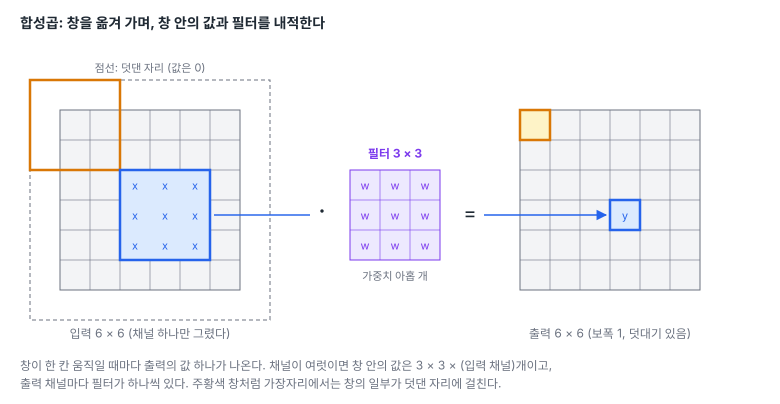
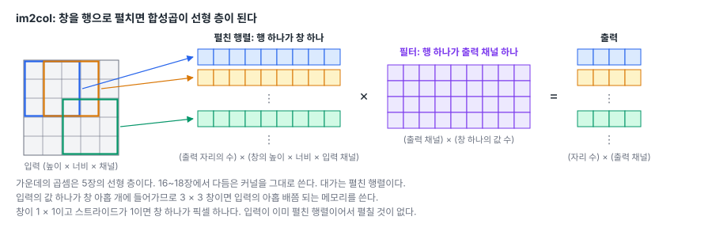
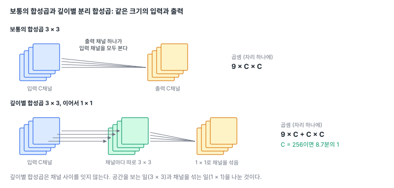
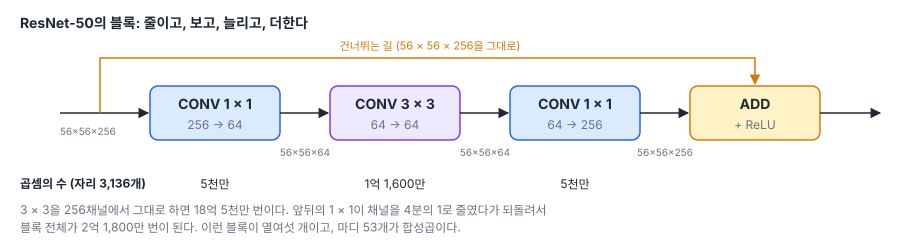
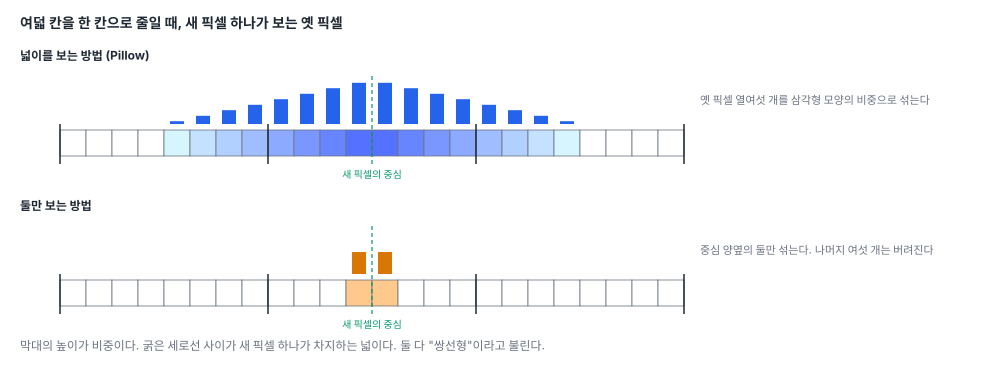

# 합성곱과 비전 분류

[26장](ch26_graph_interpreter.md)의 해석기는 선형 층 몇 개짜리 모델을 돌렸습니다. 이 장에서는 그 위에
사진을 보는 모델을 올립니다. 마디가 78개이고 곱셈을 41억 번 하는
ResNet-50입니다. 사진 파일을 열어 "골든 리트리버"라는 답을 내기까지의
길을 처음부터 끝까지 만듭니다.

새로 필요한 것은 둘입니다. 하나는 **합성곱**(convolution)입니다. 사진을
다루는 모델의 계산은 거의 전부가 이것입니다. 다른 하나는 **전처리**입니다.
사진 파일을 모델이 받는 텐서로 바꾸는 일이고, 모델 밖에 있어서 가장 쉽게
틀리는 곳입니다.

결과를 미리 적어 둡니다.

- ResNet-50과 MobileNetV2를 `.tflite` 파일로 읽어 실행합니다. 점수가
  LiteRT, PyTorch와 10만 분의 2 안에서 같습니다.
- 합성곱을 세 가지로 계산합니다. 정의를 그대로 옮기면 사진 한 장에
  1.67초, 창을 행렬로 펼쳐 3부의 커널에 넘기면 0.019초입니다. 87배입니다.
- 중간 결과를 값마다 따로 두면 75.7MB이고, [26장](ch26_graph_interpreter.md)의 계획기를 지나면
  9.6MB입니다.
- 사진을 줄이는 방법을 Pillow와 바이트까지 같게 만들었습니다. 흔히 쓰는
  다른 "쌍선형" 방법으로 바꾸면 같은 사진에서 골든 리트리버일 확률이
  80%에서 28%로 떨어집니다.
- 사진 한 장을 처리하는 시간의 대부분은 모델이 아닙니다. 파일을 푸는 데
  57밀리초, 줄이는 데 20밀리초, 모델에 18밀리초입니다.
- 모델만 보면 LiteRT가 2배 빠릅니다(8.4밀리초, 스레드 하나). 우리는
  스레드 12개로 16.7밀리초입니다. [28장](ch28_conv_kernels.md)에서 이 격차를 다룹니다.

| 하는 일 | 절 |
|---|---|
| 사진을 텐서로 본다 | 27.1 |
| 합성곱을 정의한다 | 27.2 |
| 정의 그대로 계산한다 | 27.3 |
| 창을 펼쳐 계산한다 | 27.4 |
| `1 × 1` 합성곱을 따로 다룬다 | 27.5 |
| 채널마다 따로 합성곱한다 | 27.6 |
| 나머지 연산을 채운다 | 27.7 |
| ResNet-50을 돌린다 | 27.8 |
| 사진 파일을 입력으로 바꾼다 | 27.9 |
| 전처리가 다르면 어떻게 되는지 본다 | 27.10 |
| 메모리를 잰다 | 27.11 |
| 시간을 잰다 | 27.12 |

## 27.1 사진은 어떤 텐서인가

사진은 숫자가 세 방향으로 늘어선 것입니다. 세로로 몇 줄, 가로로 몇 칸,
그리고 칸마다 색이 셋(빨강, 초록, 파랑)입니다. 이 장의 모델들은 `224 ×
224` 크기의 사진을 받습니다. 숫자 150,528개입니다.

[7장](../part1/ch07_mnist.md)과 [26장](ch26_graph_interpreter.md)의 모델은 `28 × 28` 사진을 784개의 숫자로 **펴서** 선형 층에
넣었습니다. 같은 방법을 여기에 쓰면 첫 층의 가중치가 출력 하나마다
150,528개입니다. 그보다 큰 문제는 펴는 순간 "어느 픽셀이 어느 픽셀의
이웃인가"가 사라진다는 것입니다. 고양이의 귀는 사진의 어디에 있든 귀인데,
편 벡터에서는 위치가 다르면 전혀 다른 입력입니다.

합성곱은 이 두 가지를 함께 풉니다. 작은 창 하나를 사진 전체에 대고
옮겨 가며 **같은 가중치**로 계산합니다. 가중치는 창의 크기만큼만 있고,
어디에서 본 무늬든 같은 값으로 응답합니다.

### 채널을 어디에 둘 것인가

축이 넷인 텐서를 메모리에 늘어놓는 순서가 둘 있습니다.

| 이름 | 축의 순서 | 메모리에서 이웃한 값 | 쓰는 곳 |
|---|---|---|---|
| NCHW | 장 수, 채널, 높이, 너비 | 같은 채널의 옆 픽셀 | PyTorch |
| NHWC | 장 수, 높이, 너비, 채널 | 같은 픽셀의 다른 채널 | LiteRT (`.tflite`) |

`.tflite`의 연산들은 NHWC를 씁니다.[^schema-nhwc] 그런데 이 장의 모델은
PyTorch에서 왔고, 입력의 형상이 `(1, 3, 224, 224)`입니다. 변환기는 이
틈을 그래프의 맨 앞에 마디 하나를 넣어 메웠습니다.

```text
{{#include output/ch27_inspect_resnet50.txt:213:216}}
```

0번 마디(`TRANSPOSE`)가 `(1, 3, 224, 224)`를 `(1, 224, 224, 3)`으로
바꿉니다. 값은 그대로이고 놓인 순서만 달라집니다. 그 뒤로 그래프 안의
텐서는 모두 NHWC입니다. 어느 쪽이 빠른지는 커널을 어떻게 짜느냐에 달려
있고, [28장](ch28_conv_kernels.md)에서 다룹니다. 이 장에서는 NHWC가 주는 편리함 하나를 씁니다.
**한 픽셀의 채널들이 메모리에 나란히 있습니다.**

## 27.2 합성곱의 정의



입력이 `(높이, 너비, 입력 채널)`이고 필터가 `(출력 채널, 창의 높이, 창의
너비, 입력 채널)`일 때, 출력의 한 값은 이렇게 정해집니다.

```text
y[행, 열, o] = b[o] + Σ  x[행·보폭 + i, 열·보폭 + j, c] × w[o, i, j, c]
                     i, j, c
```

`i`와 `j`가 창 안의 칸을, `c`가 입력 채널을 돕니다. 창 안의 값 전부와
필터 하나의 내적입니다. 필터는 출력 채널마다 하나씩 있습니다.

정할 것이 셋 더 있습니다.

- **보폭**(stride). 창을 한 번에 몇 칸씩 옮기는가. 2이면 출력의 높이와
  너비가 절반이 됩니다. 사진을 줄여 가는 방법입니다.
- **덧대기**(padding). 창이 가장자리에 걸칠 때 어떻게 하는가.
- **간격**(dilation). 창의 칸들을 띄엄띄엄 놓는가. 이 장의 모델은 쓰지
  않지만 커널은 받습니다.

덧대기는 `.tflite`에서 둘 가운데 하나입니다.[^litert-padding]

| | 출력의 길이 | 덧대는 길이 |
|---|---|---|
| `VALID` | `(입력 − 창이 덮는 길이) / 보폭 + 1` | 0 |
| `SAME` | `입력 / 보폭` (올림) | 그 출력이 나오는 데 모자란 만큼. 홀수이면 뒤쪽에 하나 더 |

"창이 덮는 길이"는 간격이 1이면 창의 칸 수이고, 일반적으로는 `(칸 수 −
1) × 간격 + 1`입니다. 한 축에서의 계산을 따로 떼어 둡니다.

```rust
{{#include ../../../crates/badak_graph/src/conv.rs:axis}}
```

`source`가 이 장의 모든 커널이 쓰는 함수입니다. "출력의 몇 번째 자리에서
창의 몇 번째 칸이 입력의 어디를 읽는가." 덧댄 자리이면 `None`입니다.
덧댄 값은 0이므로 합성곱에서는 건너뛰면 됩니다.

파일을 보면 덧대기를 두 가지로 하고 있습니다. `3 × 3`에 보폭 1인
합성곱은 `SAME`으로 적혀 있습니다. 보폭이 2인 합성곱은 앞에 `PAD` 마디가
따로 있고 합성곱 자신은 `VALID`입니다. PyTorch의 덧대기는 앞뒤에 같은
길이를 붙이는데 `SAME`은 홀수일 때 뒤쪽에 하나를 더 붙이므로, 둘이
어긋나는 경우에 변환기가 덧대기를 마디로 꺼낸 것입니다(해석).

## 27.3 정의 그대로

먼저 정의를 그대로 옮깁니다.

```rust
{{#include ../../../crates/badak_graph/src/conv.rs:direct}}
```

반복문이 일곱 겹입니다. 사진, 출력의 행과 열, 출력 채널, 창의 행과 열,
입력 채널. 2.5절에서 행렬 곱을 세 겹의 반복문으로 처음 짰을 때와 같은
자리에 서 있습니다.

ResNet-50 전체를 이 커널로 돌리면 사진 한 장에 **1.67초**입니다. 곱셈이
41억 번이므로 1초에 25억 번입니다.

이 커널은 빠르게 만들 대상이 아닙니다. 정답을 주는 기준입니다. 뒤의 두
방법은 이것과 같은 값을 내는지로 시험합니다.

## 27.4 창을 펼친다

3부에서 선형 층의 커널을 다듬는 데 다섯 장을 썼습니다. 합성곱을 그 커널로
계산할 수 있으면 그 일을 다시 하지 않아도 됩니다.

정의를 다시 봅니다. 출력의 한 값은 "창 안의 값 전부"와 "필터 하나"의
내적입니다. 선형 층의 출력 하나는 "입력 벡터"와 "가중치의 한 행"의
내적이었습니다. **창 하나를 벡터 하나로 보면 둘은 같은 계산입니다.**



출력의 자리마다 창 안의 값을 한 줄로 늘어놓아 행렬을 만듭니다. 이 일을
im2col이라고 부릅니다.

```rust
{{#include ../../../crates/badak_graph/src/conv.rs:unfold}}
```

창 안의 값을 (창의 행, 창의 열, 채널)의 순서로 놓습니다. 필터
`(출력 채널, 높이, 너비, 입력 채널)`에서 출력 채널 하나를 떼어 낸 것이
정확히 이 순서입니다. NHWC여서 한 픽셀의 채널들을 통째로 복사합니다.
필터는 건드릴 필요가 없습니다. 파일을 비춘 메모리를 그대로 "가중치
행렬"로 씁니다.

```rust
{{#include ../../../crates/badak_graph/src/conv.rs:im2col}}
```

`simd::linear`가 17~18장의 커널입니다. 벡터 명령을 쓰고, 스레드에 나누고,
몇 개의 내적을 함께 계산합니다. 합성곱은 그 모든 것을 한 줄로 물려받습니다.

같은 모델이 **0.019초**가 됩니다. 87배입니다.

### 대가

펼친 행렬은 공짜가 아닙니다. 입력의 값 하나가 창 여러 개에 들어갑니다.
`3 × 3` 창에 보폭이 1이면 아홉 번 복사됩니다. ResNet-50에서 가장 큰 것은
맨 처음의 `7 × 7` 합성곱입니다. 출력의 자리가 `112 × 112`개이고 창 하나가
`7 × 7 × 3 = 147`개의 값이므로 184만 개, **7.4MB**입니다. 그 합성곱의
입력(0.63MB)의 열두 배입니다.

이 행렬은 텐서가 아닙니다. 커널 안에서 만들어 쓰고 버립니다. 그래서 [26장](ch26_graph_interpreter.md)의
메모리 계획에 들어 있지 않습니다. 22.10절의 "스레드가 돌려 쓰는 자리"를
빌립니다. 가장 큰 것에 맞춰 한 번 잡히면 그 뒤로는 다시 얻지 않습니다.
계획한 자리가 9.6MB인데 계획 밖의 자리가 7.4MB라는 것은 적어 둘 만한
사실입니다. 27.11절에서 다시 봅니다.

펼치는 데 드는 시간도 있습니다. 복사는 계산이 아니지만 메모리를 한 번
읽고 한 번 씁니다. 27.12절에서 잽니다.

## 27.5 `1 × 1` 합성곱은 선형 층이다

창이 `1 × 1`이면 창 하나가 픽셀 하나입니다. 창 안의 값은 그 픽셀의
채널들이고, NHWC에서는 그것이 이미 메모리에 나란히 있습니다. **입력
텐서가 그대로 펼친 행렬입니다.**

```rust
{{#include ../../../crates/badak_graph/src/conv.rs:pointwise}}
```

`(높이, 너비, 채널)`인 입력을 "길이가 채널 수인 벡터 `높이 × 너비`개"로
읽을 뿐입니다. 복사가 없습니다. 보폭이 1이고 덧대지 않을 때만 이렇게 할
수 있습니다. 보폭이 2이면 픽셀을 하나 걸러 골라내야 하므로 펼치는 길로
갑니다.

`1 × 1` 합성곱은 공간을 보지 않습니다. 픽셀마다 채널들을 섞어 새 채널들을
만듭니다. 사소해 보이지만 ResNet-50의 합성곱 53개 가운데 **36개**가
이것입니다. 까닭은 27.8절에 있습니다.

커널은 창의 모양을 보고 길을 고릅니다.

```rust
{{#include ../../../crates/badak_graph/src/conv.rs:method}}
```

26.6절의 레지스트리가 여기서 쓸모를 보입니다. 기본으로 등록된 것은
`Method::Auto`이고, 세 방법을 견줄 때는 같은 이름에 다른 커널을 등록해
같은 그래프를 다시 실행합니다.

| ResNet-50, 사진 한 장 | 시간 | |
|---|---|---|
| 정의 그대로 | 1,669 ms | 1 |
| 언제나 펼치기 | 19.2 ms | 87배 |
| `1 × 1`은 그대로 | 18.3 ms | 91배 |

`1 × 1`을 펼치지 않아서 얻는 것은 5%입니다. 복사가 계산보다 훨씬 싸기
때문입니다. 줄어드는 것은 시간보다 메모리입니다.

## 27.6 깊이별 분리 합성곱

합성곱의 곱셈 수는 `출력 자리 × 창의 칸 × 입력 채널 × 출력 채널`입니다.
채널이 두 배가 되면 네 배가 됩니다. 폰에서 돌릴 모델을 만들던 사람들은
이 곱을 쪼갰습니다.[^mobilenets]



**깊이별 합성곱**(depthwise convolution)은 출력 채널 하나가 입력 채널
하나만 봅니다. 채널마다 자기 창을 가지고 따로 합성곱합니다. 그것만으로는
채널 사이의 정보가 섞이지 않으므로 뒤에 `1 × 1` 합성곱을 붙입니다. 공간을
보는 일과 채널을 섞는 일을 나눈 것입니다. 둘을 합쳐 깊이별 분리
합성곱(depthwise separable convolution)이라고 부릅니다.

```rust
{{#include ../../../crates/badak_graph/src/conv.rs:depthwise}}
```

펼치지 않고 정의대로 계산합니다. 창의 칸마다, 그 칸이 가리키는 픽셀의
채널들에 그 칸의 가중치들을 곱해 더합니다. 가장 안쪽 반복문이 **채널을
따라** 돕니다. NHWC에서 한 픽셀의 채널들과 한 칸의 가중치들이 모두
나란히 있으므로 컴파일러가 이 반복문을 벡터 명령으로 바꿉니다(17.2절).
여기서도 배치가 일을 덜어 줍니다.

필터의 형상이 보통의 합성곱과 다릅니다. `(1, 높이, 너비, 출력 채널)`
입니다. 입력 채널 하나가 출력 채널 여럿을 내게 할 수도 있고(배수), 이
장의 모델은 배수가 1입니다.

깊이별 합성곱이 보통의 합성곱과 같은 계산이라는 것은 시험으로
확인합니다. "다른 채널로 가는 가중치가 모두 0인" 보통의 합성곱을 만들어
27.3절의 커널로 계산한 값과 견줍니다.

이 연산을 쓰는 모델로 MobileNetV2를 함께 돌립니다.[^mobilenetv2] 곱셈이
3억 번으로 ResNet-50의 14분의 1입니다.

## 27.7 나머지 연산들

합성곱 말고 네 가지가 더 필요합니다.

| 연산 | 하는 일 | ResNet-50에서 |
|---|---|---|
| `MAX_POOL_2D` | 창 안의 최댓값. 채널마다 따로 | 맨 앞에서 사진을 절반으로 줄인다 |
| `PAD`, `PADV2` | 가장자리에 값을 덧댄다 | 보폭 2인 합성곱과 풀링의 앞 |
| `MEAN` | 축을 따라 평균 | 마지막 `7 × 7 × 2048`을 `2048`로 |
| `TRANSPOSE` | 축의 순서를 바꾼다 | 입력을 NHWC로 |

```rust
{{#include ../../../crates/badak_graph/src/spatial.rs:pool}}
```

풀링은 합성곱과 같은 `Axis`를 씁니다. 창이 움직이는 방법이 같기
때문입니다. 다른 점은 덧댄 자리의 뜻입니다. 합성곱에서 덧댄 값은 0이지만,
최댓값을 고를 때 0을 넣으면 음수뿐인 창의 답이 틀립니다. 덧댄 자리는
**없는 값**으로 칩니다. 변환기도 같은 사정을 압니다. 풀링 앞의 `PADV2`는
0이 아니라 음의 무한대를 덧댑니다.

`MEAN`이 높이와 너비를 줄이는 것을 전역 평균 풀링(global average
pooling)이라고 부릅니다. 채널마다 사진 전체의 평균 하나를 냅니다. 사진의
어디에 무엇이 있었는지를 버리고 "무엇이 있었는가"만 남깁니다. 그 2,048개의
값이 마지막 선형 층으로 들어가 1,000가지 이름의 점수가 됩니다.

### 설정이 텐서로 온다

`PAD`가 덧댈 길이, `MEAN`이 줄일 축, `TRANSPOSE`가 축의 순서를 어디서
받는지가 [26장](ch26_graph_interpreter.md)의 연산들과 다릅니다. 설정 표가 아니라 **입력 텐서**로
받습니다. 정수 텐서이고 값은 파일에 들어 있습니다.

해석기의 커널은 `f32` 값만 주고받습니다. 그래서 그래프로 옮길 때 이
텐서들을 읽어 연산의 설정으로 바꿉니다.

```rust
{{#include ../../../crates/badak_graph/src/graph.rs:parameters}}
```

값이 파일에 정해져 있을 때만 받습니다. 덧댈 길이가 실행 중에 계산되는
그래프라면 출력의 형상을 실행 전에 알 수 없고, 26.7절의 계획을 세울 수
없습니다. 그런 그래프는 지금은 거절합니다.

### 사라진 연산

PyTorch의 ResNet-50에는 합성곱마다 뒤에 배치 정규화(batch normalization)가
있습니다. 파일에는 없습니다. 값의 이름에 흔적만 남아 있습니다
(`…BatchNorm2d_bn3`). 변환기가 26.4절의 정규화처럼 합성곱의 가중치와
치우침에 접어 넣었습니다. ReLU도 마디가 아니라 합성곱과 덧셈의 설정입니다.
[30장](ch30_graph_optimization.md)에서 이 일을 직접 합니다.

## 27.8 ResNet-50

ResNet-50은 2015년에 나온 모델입니다.[^resnet] [9장](../part2/ch09_transformer.md)에서 본 잔차 연결을
내놓은 논문의 모델이고, 엔진의 속도를 견줄 때 자주 쓰입니다.



블록 하나가 합성곱 셋입니다. `1 × 1`로 채널을 4분의 1로 줄이고, `3 × 3`
으로 이웃을 보고, `1 × 1`로 채널을 되돌린 뒤, 블록의 입력을 더합니다.
비싼 `3 × 3`을 좁은 곳에서 하려는 것입니다. `3 × 3`을 256채널에서 그대로
하면 블록 하나의 곱셈이 여덟 배가 넘습니다. 합성곱의 3분의 2가 `1 × 1`인
까닭이 이것입니다.

블록 열여섯 개가 네 무리로 묶여 있고, 무리가 바뀔 때마다 사진의 한 변이
절반이 되고 채널이 두 배가 됩니다.

| | 텐서 (높이 × 너비 × 채널) | 블록 |
|---|---|---|
| 입력 | 224 × 224 × 3 | |
| `7 × 7` 합성곱, 풀링 | 56 × 56 × 64 | |
| 첫째 무리 | 56 × 56 × 256 | 3 |
| 둘째 무리 | 28 × 28 × 512 | 4 |
| 셋째 무리 | 14 × 14 × 1,024 | 6 |
| 넷째 무리 | 7 × 7 × 2,048 | 3 |
| 평균, 선형 층 | 1,000 | |

뒤로 갈수록 사진은 작아지고 채널은 많아집니다. 값의 수는 무리마다
절반이 됩니다.

### 모델 파일

가중치는 `timm` 라이브러리의 저장소에서 받습니다.[^timm-resnet]
torchvision이 처음 공개한 가중치를 옮겨 둔 것이고, ImageNet의 검증 사진
5만 장에서 첫째 답의 정확도가 76.13%라고 적혀 있습니다.[^torchvision-meta]
이 책에서는 그 정확도를 재지 않았습니다. ImageNet의 사진은 내려받아 다시
나눠 줄 수 없어서, 독자가 따라 할 수 있는 측정이 되지 못합니다. 대신
"같은 입력에 PyTorch와 같은 점수를 내는가"를 봅니다. 그것이 맞으면
정확도도 같습니다.

```bash
sh scripts/download_ch27.sh
```

시험 사진 다섯 장과 모델 둘, 정답 파일을 받습니다. 모델은 위의 가중치를
`.tflite`로 바꿔 이 책의 저장소에 올려 둔 것입니다.[^hub-imagenet] 가중치의
값은 바꾸지 않았고, 원본의 라이선스(ResNet-50은 BSD-3-Clause, MobileNetV2는
Apache-2.0)를 함께 두었습니다. ResNet-50의 파일은 102MB입니다. 가중치
2,556만 개가 `f32`로 들어 있습니다.

직접 만들려면 Python이 필요합니다. 스크립트가 원본 가중치를 받아
변환하고, PyTorch와 LiteRT의 점수를 정답으로 남깁니다.

```bash
pip install -r reference/requirements_ch27.txt
python reference/ch27_make_tflite.py
```

### 검증

정답 파일에 든 입력(Python이 전처리한 사진)을 그대로 넣어, 모델의 계산만
견줍니다.

```bash
cargo run --release -p badak_graph --example ch27_verify
```

```text
{{#include output/ch27_verify.txt}}
```

점수는 10에서 20 사이의 값이고, 차이는 10만 분의 2 이하입니다. 마디
53개를 지나며 쌓인 덧셈 순서의 차이입니다(5.6절). 고른 이름은 모두
같습니다.

고양이 사진은 두 모델 모두 틀립니다. 그 사진의 줄무늬 고양이를
ResNet-50은 샴고양이로, MobileNetV2는 왈라비로 봅니다. PyTorch와 LiteRT도
같은 답을 냅니다. **엔진이 옳다는 것과 모델이 옳다는 것은 다른
이야기입니다.** 이 책이 확인하는 것은 앞의 것입니다.

## 27.9 사진 파일에서 입력까지

모델의 입력은 `(1, 3, 224, 224)`인 `f32` 텐서입니다. 손에 있는 것은
`4032 × 3024`짜리 JPEG 파일입니다. 그 사이에 네 단계가 있습니다.

| 단계 | 하는 일 | 결과 |
|---|---|---|
| 풀기 | JPEG을 픽셀로 | `높이 × 너비 × 3`, 값은 0~255 |
| 줄이기 | 짧은 변을 256으로 | `256 × 341 × 3` |
| 자르기 | 가운데 `224 × 224` | `224 × 224 × 3` |
| 숫자로 | 0~1로 바꾸고, 평균을 빼고, 표준편차로 나누고, 채널을 앞으로 | `3 × 224 × 224`, `f32` |

이 숫자들(256, 224, 평균과 표준편차, 줄이는 방법)은 모델을 학습한
사람이 정한 것입니다. 모델 파일에는 적혀 있지 않습니다. 26.11절에서
"입력이 어떤 값이어야 하는지는 파일 밖의 약속"이라고 했는데, 사진
모델에서는 그 약속이 이만큼 깁니다. 이 모델의 약속은 `timm`의 설정에서
읽었습니다.[^timm-config]

새 크레이트 `badak_image`에 둡니다.

```rust
{{#include ../../../crates/badak_image/src/lib.rs:preprocess}}
```

### 풀기: 처음 쓰는 외부 크레이트

JPEG 파일을 푸는 일은 직접 만들지 않습니다. 이산 코사인 변환, 허프만
부호, 색 공간 변환으로 이루어진, 그것만으로 책 한 권이 되는 주제이고
추론과는 상관이 없습니다. 제안서가 처음부터 예외로 정해 둔 세 가지
(GPU 접근, 브라우저 연결, 이미지 파일 디코딩) 가운데 하나입니다.
`jpeg-decoder` 크레이트를 씁니다.[^jpeg-decoder] [23장](../part3/ch23_gpu.md)의 `wgpu`에 이어 이
책의 둘째 외부 크레이트입니다.

```rust
{{#include ../../../crates/badak_image/src/lib.rs:decode}}
```

경계는 이 함수 하나입니다. 바이트가 들어가 픽셀이 나옵니다. 그 뒤는 모두
우리 코드입니다. 엔진(`badak_core`, `badak_graph`)은 이 크레이트를
모릅니다.

### 줄이기: 같은 이름의 두 방법

`4032 × 3024`를 `341 × 256`으로 줄이면 옛 픽셀 열두 개가 새 픽셀 하나의
폭이 됩니다. 새 픽셀의 값을 어떻게 정할까요. 이 모델의 설정에는
"쌍선형"(bilinear)이라고 적혀 있습니다. 문제는 그 이름으로 불리는 방법이
둘이라는 것입니다.



**둘만 보는 방법.** 새 픽셀의 중심이 옛 사진의 어디에 떨어지는지를 보고,
그 양옆의 옛 픽셀 둘을 거리에 따라 섞습니다(가로와 세로를 합치면 넷).
교과서의 쌍선형 보간이고, 사진을 **늘릴** 때는 이것으로 충분합니다. 줄일
때는 새 픽셀 하나가 차지하는 넓이 안의 나머지 픽셀을 보지 않습니다.
열두 개 가운데 둘만 쓰고 열 개를 버립니다.

```rust
{{#include ../../../crates/badak_image/src/lib.rs:two_taps}}
```

**넓이를 보는 방법.** 줄이는 비율만큼 보는 범위를 넓힙니다. 새 픽셀의
중심에서 가장 큰 비중을 주고, 멀어질수록 줄여, 새 픽셀 폭만큼 떨어지면
0이 되게 합니다. 삼각형 모양입니다. 열두 배로 줄이면 한 축에서 옛 픽셀
스물네 개쯤을 섞습니다. Pillow가 `BILINEAR`라는 이름으로 하는 일이
이것입니다.[^pillow-resample]

```rust
{{#include ../../../crates/badak_image/src/lib.rs:coefficients}}
```

Pillow의 소스를 옮긴 것입니다. 비중을 실수로 계산한 뒤 **22비트 고정
소수점 정수**로 바꿉니다. 그 뒤의 계산은 모두 정수입니다. 정수로 계산하면
어느 기계에서나, 어느 컴파일러에서나 같은 바이트가 나옵니다.

```rust
{{#include ../../../crates/badak_image/src/lib.rs:resize}}
```

한 축씩 두 번에 나눠 줄입니다. 한 번 줄일 때마다 결과를 8비트로
되돌립니다.

처음 옮긴 코드는 가로를 먼저, 세로를 나중에 했습니다. 시험 사진 다섯
장에서는 Pillow와 맞았습니다. 식으로 만든 사진 세 장으로 바이트를 견주자
한 장이 어긋났습니다. `300 × 1000`을 `256 × 853`으로 줄이는
경우였습니다. Pillow의 소스를 다시 읽으니 규칙이 하나 더 있었습니다.
**세로로 줄어드는 픽셀 수가 가로의 두 배보다 많으면 세로를 먼저
합니다.**[^pillow-order] 뒤의 패스가 다룰 줄을 줄이려는 속도 최적화인데,
중간에 8비트로 반올림하므로 순서가 바뀌면 결과의 바이트가 바뀝니다.
그 규칙까지 옮기자 세 장 모두 바이트까지 같아졌습니다.

```bash
cargo test -p badak_image --test pillow
```

이런 일은 문서에 적혀 있지 않습니다. "Pillow의 쌍선형"이 무엇인지는
Pillow의 소스가 정합니다. 학습에 쓴 도구와 같은 입력을 만들려면 그
도구의 코드를 읽어야 합니다.

## 27.10 전처리가 다르면

단계마다 Pillow와 견줍니다. 그리고 줄이는 방법을 바꿔 모델의 답이
어떻게 달라지는지 봅니다.

```bash
cargo run --release -p badak_image --example ch27_classify
```

```text
{{#include output/ch27_classify.txt:3:21}}
```

사진 다섯 장의 결과를 모으면 이렇습니다.

| 사진 | 풀기: 가장 큰 차이 | 줄이기: 다른 값 | 점수의 차이 (넓이) | 점수의 차이 (둘만) | 첫째 답의 확률 (넓이 → 둘만) |
|---|---|---|---|---|---|
| 잔 | 0 | 0.1% | 0.013 | 2.96 | 96.9% → 97.4% |
| 골든 리트리버 | 1 | 3.1% | 0.038 | 4.17 | 80.2% → 27.9% |
| 기타 | 2 | 4.7% | 0.031 | 2.69 | 94.3% → 80.8% |
| 펠리컨 | 1 | 0.1% | 0.011 | 3.76 | 92.8% → 88.0% |
| 고양이 | 1 | 0.1% | 0.011 | 2.83 | 21.1% → 15.8% |

"차이"는 모두 Pillow로 전처리하고 LiteRT로 계산한 결과에 견준 것입니다.

**푸는 단계가 완전히 같지는 않습니다.** 우리가 쓰는 디코더와 Pillow가
쓰는 디코더는 다른 프로그램이고, 같은 JPEG에서 픽셀 값이 1이나 2씩 다른
곳이 있습니다. JPEG을 푸는 계산에는 구현마다 다르게 할 수 있는 여지가
있습니다. 그 차이가 줄인 사진으로 넘어와 값의 0.1~4.7%가 1씩 다릅니다.
줄이는 코드 자체는 앞 절에서 본 대로 바이트까지 같으므로, 이 차이는
모두 디코더에서 온 것입니다.

**그 차이는 답을 바꾸지 않습니다.** 점수가 0.01~0.04 달라지고, 확률은
소수 첫째 자리에서 같습니다.

**줄이는 방법이 다르면 사정이 달라집니다.** 둘만 보는 방법으로 바꾸면
점수가 3~4씩 달라집니다. 골든 리트리버 사진에서 그 답의 확률이 80%에서
28%로 떨어집니다. 첫째 답은 다섯 장 모두 그대로였습니다. 다섯 장으로는
"정확도가 얼마나 떨어진다"고 말할 수 없습니다. 말할 수 있는 것은 모델이
보는 입력이 **다른 사진이 되었다**는 것입니다. 사진을 열두 배로 줄이면서
픽셀의 대부분을 버리면 가는 선과 털의 결이 거칠게 깨집니다. 사람 눈에는
같은 개이지만 모델이 학습할 때 본 것은 그렇게 깨진 사진이 아닙니다.

이것이 7.7절에서 말한 "전처리 같은 세부 사항이 어긋나기 쉽다"의 실제
모습입니다. 오류 메시지는 없습니다. 답도 대개 맞습니다. 정확도가 몇 %
낮아질 뿐이고, 정답과 견줘 보기 전에는 알 수 없습니다. 그리고 "쌍선형"
이라는 설정 한 줄만 보고 구현하면 둘 가운데 어느 쪽을 만들지는 반반입니다.

### 사진의 출처

시험 사진 다섯 장은 위키미디어 공용에서 골랐습니다. 올린 사람이 권리를
포기한(CC0) 사진들입니다.[^commons] 저장소에 넣지 않고 원래 위치에서
받으며, 스크립트가 파일마다 해시를 확인합니다.

## 27.11 메모리

```bash
cargo run --release -p badak_graph --example ch27_bench -- resnet50
```

```text
{{#include output/ch27_bench_resnet50.txt:16:21}}
```

| 중간 결과의 자리 (MB) | ResNet-50 | MobileNetV2 |
|---|---|---|
| 값마다 따로 | 75.68 | 37.61 |
| 순서대로 놓기 | 12.04 | 12.22 |
| 큰 것부터 놓기 | 9.63 | 9.81 |
| 하한 | 9.63 | 9.81 |
| 펼친 행렬 (계획 밖) | 7.38 | 1.35 |

**8분의 1이 됩니다.** 26.9절에서 "마디가 많아질수록 차이가 커진다"고 한
것이 여기서 보입니다. 값 79개를 모두 더하면 75.7MB인데 한 순간에 필요한
것은 9.6MB입니다. 가장 붐비는 곳은 첫째 무리의 덧셈입니다. `56 × 56 ×
256`짜리 텐서(3.2MB) 셋이 함께 살아 있습니다. 덧셈의 두 입력과 출력입니다.
26.14절에서 남긴 제자리 계산을 하면 둘로 줄어듭니다.

**여기서는 큰 것부터 놓는 방법이 이깁니다.** 하한과 같습니다. 순서대로
놓으면 25% 더 씁니다. 26.9절의 작은 모델에서는 반대였습니다. LiteRT가 이
방법을 기본으로 삼은 까닭을 짐작할 수 있습니다. 실제 모델들이 이런
모양입니다.

**MobileNetV2가 ResNet-50보다 메모리를 더 씁니다.** 가중치는 7분의 1이고
곱셈은 14분의 1인데 중간 결과의 자리는 조금 더 큽니다. 이 모델은 블록
안에서 채널을 여섯 배로 **늘렸다가** 줄입니다. 사진이 아직 큰 앞쪽에서
`112 × 112 × 96`짜리 텐서(4.8MB)가 생깁니다. 모델의 크기와 실행할 때의
메모리는 다른 숫자입니다. 폰에서는 뒤의 것이 문제가 되는 일이 많습니다.

**계획 밖의 7.4MB.** 펼친 행렬은 계획기가 모릅니다. ResNet-50에서 계획한
자리의 4분의 3만큼을 따로 쥐고 있습니다. 한 번에 합성곱 하나만 실행하므로
가장 큰 것 하나만큼만 있으면 되고, 그 점에서는 계획한 것과 같은 효과입니다.
그래도 "이 모델을 돌리는 데 메모리가 얼마나 드는가"에 답하려면 두 숫자를
더해야 합니다. LiteRT는 펼친 행렬을 임시 텐서로 등록해 계획기가 알게
합니다.[^litert-im2col]

## 27.12 시간

### 스레드

```text
{{#include output/ch27_bench_resnet50.txt:22:28}}
```

| 사진 한 장 (ms) | 1 | 2 | 4 | 8 | 12 | 16 |
|---|---|---|---|---|---|---|
| ResNet-50 | 96.3 | 60.4 | 31.5 | 19.0 | 16.9 | 18.1 |
| MobileNetV2 | 11.2 | 8.5 | 6.5 | 5.7 | 5.6 | 6.4 |

스레드 하나로 ResNet-50이 96밀리초입니다. 곱셈 41억 번을 그 시간에
하므로 1초에 430억 번입니다. 26.12절에서 잰 커널의 속도(벡터가 여럿일 때
430~510억)와 맞습니다. **스레드 하나에서는 커널이 낼 수 있는 속도를 거의
다 냅니다.** 펼치는 수고와 나머지 연산이 그 위에 조금 얹혀 있습니다.

스레드를 늘리면 덜 좋습니다. 12개에서 5.7배입니다. 18.8절에서 LLM의
프롬프트 처리가 열두 스레드로 5.8배였던 것과 같은 값입니다. 여기에는
까닭이 더 있습니다. 펼치는 일, 풀링, 덧대기, 덧셈은 스레드 하나로
합니다. 그리고 합성곱 하나하나가 작습니다. 뒤쪽의 `7 × 7`짜리 사진에서는
벡터가 49개뿐이어서 나눌 일이 많지 않습니다. 각각의 몫이 얼마인지는
나눠 재지 않았습니다.

스레드 16개가 12개보다 느립니다. 18.10절에서 남긴 숙제 그대로입니다.
효율 코어 넷이 끼면 일을 고르게 나눈 조각 가운데 느린 것이 생깁니다.
기본값은 여전히 16개입니다. 아래의 표들은 그 기본값으로 잰 것입니다.

### 어디에 쓰이는가

```text
{{#include output/ch27_bench_resnet50.txt:29:38}}
```

합성곱이 90%입니다. 눈에 띄는 것은 셋입니다.

**`7 × 7` 합성곱 하나가 15%입니다.** 곱셈으로는 전체의 3%인데(1억 1,800만
번) 시간은 그 다섯 배를 씁니다. 창 하나가 147개의 값이고 출력 채널이
64개입니다. 가중치 행렬이 작고 펼친 행렬이 큽니다(7.4MB). 펼치는 일과,
그 큰 행렬을 커널이 여러 번 훑는 일이 시간을 씁니다.

**`ADD`가 6%입니다.** 계산은 덧셈 하나인데 텐서가 큽니다(가장 큰 것이
80만 개). 스레드 하나로 하고, 더한 뒤에 ReLU를 따로 한 번 더 훑습니다.

**`PAD`가 2%입니다.** 계산이 없는 복사입니다. 합성곱이 덧댄 자리를 스스로
건너뛸 수 있는데도, 그래프에 마디로 적혀 있어서 텐서를 통째로 한 번 더
만듭니다.

뒤의 둘은 [30장](ch30_graph_optimization.md)의 일(이웃한 마디를 합치기)이고, 앞의 하나는 [28장](ch28_conv_kernels.md)의
일입니다.

### 전처리까지 넣으면

```text
{{#include output/ch27_classify.txt:53:58}}
```

| `4032 × 3024` 사진 한 장 (ms) | `badak` | Pillow |
|---|---|---|
| 파일 풀기 | 56.7 | 27.8 |
| 줄이기 | 20.1 | 13.0 |
| 자르고 숫자로 바꾸기 | 0.5 | |
| 모델 (ResNet-50) | 18.3 | |

**모델은 전체의 5분의 1입니다.** 사진 한 장을 분류하는 95밀리초 가운데
77밀리초가 모델에 닿기 전에 쓰입니다. 폰으로 찍은 1,200만 화소의 사진을
`224 × 224`로 만드는 일이 41억 번의 곱셈보다 오래 걸립니다.

추론 엔진을 견주는 숫자는 거의 언제나 모델의 시간만 잽니다. 이 장의
표들도 그렇습니다. 그러나 제품에서 사용자가 기다리는 것은 전체입니다.
모델을 두 배 빠르게 만들어도 이 사진에서는 전체가 10% 빨라질 뿐입니다.
무엇을 빠르게 할지는 재 본 뒤에 정해야 한다는 [14장](../part3/ch14_measurement.md)의 원칙이 여기서도
그대로입니다.

Pillow는 푸는 일을 두 배, 줄이는 일을 1.5배 빠르게 합니다. 줄이는 방법이
계산을 얼마나 더 하는지도 보입니다. 둘만 보는 방법은 0.3밀리초였습니다.
넓이를 보는 방법의 60분의 1입니다. 옛 픽셀 1,200만 개를 모두 읽느냐,
새 픽셀 9만 개에 필요한 것만 읽느냐의 차이입니다. 빠른 쪽이 틀린
쪽입니다.

### LiteRT, PyTorch와 견주면

```bash
PYTHON=<requirements_ch27.txt를 설치한 Python> sh scripts/bench_ch27.sh
```

```text
{{#include output/ch27_python.txt:4:}}
```

| 사진 한 장 (ms), 모델만 | `badak` 스레드 1 | `badak` 스레드 12 | LiteRT 스레드 1 | LiteRT 가장 빠를 때 | PyTorch 스레드 1 |
|---|---|---|---|---|---|
| ResNet-50 | 96.3 | 16.9 | 8.4 | 5.5 (8개) | 16.6 |
| MobileNetV2 | 11.2 | 5.6 | 2.0 | 1.3 (4개) | 10.5 |

**LiteRT는 스레드 하나로 8.4밀리초입니다.** 곱셈 41억 번을 그 시간에
하면 1초에 4,900억 번입니다. 우리 커널이 스레드 하나로 내는 속도의 열한
배입니다. 26.12절에서 본 SME2 커널입니다. 그때는 벡터 하나짜리 일이어서
2~3배였는데, 벡터가 수천 개인 합성곱에서는 격차가 훨씬 큽니다. 우리가
스레드 열두 개를 다 써도 LiteRT의 스레드 하나에 미치지 못합니다.

LiteRT는 스레드를 늘려도 1.5배밖에 빨라지지 않습니다. 이 기계에서 행렬
확장을 쓰는 계산이 코어의 수만큼 나뉘지 않는다는 뜻으로 읽힙니다(해석.
확인하지 않았습니다).

PyTorch는 ResNet-50에서 우리의 스레드 12개와 비슷하고(16.6 대 16.9),
MobileNetV2에서는 우리가 두 배 빠릅니다. PyTorch에 스레드를 12개 주면
MobileNetV2가 네 배 **느려집니다**. 작은 일을 스레드에 나누는 수고가
일보다 큰 것으로 보입니다(해석).

정리하면 이렇습니다. 합성곱을 3부의 커널에 넘기는 것만으로 "쓸 수 있는"
속도가 됩니다. 스레드 하나에서는 커널이 가진 속도를 다 씁니다. 그 위로는
두 가지가 남았습니다. 합성곱에 맞는 커널과 스레드 나누기([28장](ch28_conv_kernels.md)), 그리고
다른 명령 집합([31장](ch31_mobile_engines.md)).

## 27.13 남긴 것

**합성곱 커널.** 이 장은 합성곱을 선형 층으로 바꿔 계산했습니다. 펼친
행렬을 만드는 수고, 그 행렬이 캐시보다 크다는 것, 스레드에 나누는 방법이
모두 선형 층에 맞춰진 채입니다. [28장](ch28_conv_kernels.md)에서 합성곱에 맞게 일을 나누고,
합성곱을 빠르게 한다고 알려진 방법들을 재 봅니다.

**깊이별 합성곱과 나머지 연산의 스레드.** 스레드 하나로 합니다.
MobileNetV2에서 깊이별 합성곱이 시간의 34%입니다.

**펼친 행렬의 자리.** 계획 밖에 있습니다(27.11절).

**여러 장을 한 번에.** 커널은 사진 여러 장을 받게 짰지만 이 장에서는
한 장으로만 쟀습니다. 26.7절의 방법으로 입력의 형상을 바꾸면 됩니다.

**묶음 합성곱.** 채널을 몇 묶음으로 나눠 묶음끼리만 잇는 합성곱은 받지
않습니다. 깊이별 합성곱은 묶음의 수가 채널의 수와 같은 특별한 경우입니다.

**정확도.** ImageNet의 검증 사진으로 정확도를 재지 않았습니다(27.8절).

**다른 파일 형식.** JPEG만 풉니다. 흑백 사진은 세 채널에 같은 값을 넣고,
그 밖의 색 형식은 거절합니다. 사진의 방향을 적은 정보(EXIF)는 읽지
않습니다. 폰으로 세워 찍은 사진은 옆으로 누운 채 모델에 들어갑니다.
Pillow도 따로 시키지 않으면 읽지 않으므로 이 장의 비교에서는 문제가
없지만, 제품에서는 문제입니다.

## 27.14 실전 엔진에서는

**LiteRT의 기본 커널도 창을 펼칩니다.** 합성곱의 커널이 여러 종류이고,
그 가운데 "펼친 행렬이 필요한가"를 정하는 조건이 이 장과 같습니다. 창이
`1 × 1`이고 보폭이 1이면 펼치지 않고, 그 밖에는 펼칩니다. 펼친 행렬은
임시 텐서로 등록합니다. 폰에서는 그 크기가 1GB를 넘으면 펼치지 않는
느린 길로 돌아갑니다.[^litert-im2col]

**덧대기의 규칙은 엔진마다 정해져 있습니다.** 이 장의 `Axis::new`는
LiteRT의 계산을 옮긴 것입니다.[^litert-padding] PyTorch는 앞뒤에 같은
길이를 덧대므로 둘이 어긋나는 경우가 있고, 변환기가 그것을 `PAD` 마디로
풀었습니다.

**실제로 계산한 것은 XNNPACK입니다.** 26.12절에서 본 대로 LiteRT는 그래프를
XNNPACK에 넘깁니다. XNNPACK이 합성곱을 어떻게 계산하는지는 [31장](ch31_mobile_engines.md)에서
봅니다.

**전처리는 엔진 밖에 있습니다.** LiteRT도, PyTorch도 사진을 줄이는 방법을
모델 파일에 담지 않습니다. `timm`은 모델마다의 설정을 따로 적어
둡니다.[^timm-config] 그 설정을 읽고 같은 일을 하는 것은 모델을 쓰는
쪽의 몫입니다.

## 정리

- 사진은 `(높이, 너비, 채널)`의 텐서입니다. `.tflite`는 채널을 맨 뒤에
  두고(NHWC), 그러면 한 픽셀의 채널들이 메모리에 나란히 놓입니다.
- 합성곱은 창을 옮겨 가며 창 안의 값과 필터를 내적합니다. 보폭, 덧대기,
  간격이 출력의 크기를 정합니다.
- 창을 행렬의 행으로 펼치면(im2col) 합성곱이 선형 층이 됩니다. 3부의
  커널을 그대로 쓰고, 정의 그대로 계산하는 것보다 87배 빠릅니다. 대가는
  입력의 몇 배가 되는 펼친 행렬입니다.
- `1 × 1` 합성곱은 펼칠 것이 없습니다. NHWC의 입력이 이미 펼친
  행렬입니다. ResNet-50의 합성곱 53개 가운데 36개가 이것입니다.
- 깊이별 합성곱은 채널마다 따로 계산합니다. 뒤에 `1 × 1`을 붙여 공간을
  보는 일과 채널을 섞는 일을 나눕니다.
- 덧댈 길이나 축의 번호 같은 설정이 텐서로 올 때는 그래프로 옮기면서
  읽어 둡니다. 실행 전에 형상을 알아야 계획을 세울 수 있습니다.
- ResNet-50과 MobileNetV2의 점수가 LiteRT, PyTorch와 10만 분의 2 안에서
  같습니다.
- 중간 결과의 자리는 75.7MB가 9.6MB가 됩니다. 실제 모델에서는 큰 것부터
  놓는 방법이 하한에 닿습니다. 펼친 행렬 7.4MB는 계획 밖에 있습니다.
- 전처리는 모델을 학습한 도구와 같아야 합니다. "쌍선형"이라는 이름의
  방법이 둘이고, 다른 쪽을 쓰면 점수가 3~4씩 달라집니다. Pillow의
  방법을 소스에서 옮겨 바이트까지 같게 만들었습니다.
- 사진 파일을 푸는 일만 외부 크레이트에 맡겼습니다.
- 큰 사진에서는 전처리가 모델보다 네 배 오래 걸립니다.
- 모델만 보면 스레드 하나에서 커널의 속도를 다 내지만, LiteRT가 스레드
  하나로 우리의 열두 개보다 두 배 빠릅니다.

## 연습 문제

1. `Axis::new`에 길이 224, 창 7, 보폭 2를 `SAME`으로 주면 출력의 길이와
   앞에 덧대는 길이가 얼마입니까. PyTorch의 `Conv2d(padding=3)`은 앞뒤에
   3씩 덧댑니다. 두 방법에서 창이 읽는 입력의 자리가 어떻게 다릅니까.
   변환기가 이 합성곱 앞에 `PAD`를 따로 둔 까닭을 설명해 보십시오.
2. ResNet-50의 합성곱 53개 각각의 곱셈 수를 세어 창의 크기별로 더해
   보십시오(`Interpreter::steps`가 형상을 줍니다). 27.12절의 시간 비율과
   견주면 곱셈 하나에 시간이 가장 많이 드는 것은 어느 쪽입니까.
3. `unfold`는 창의 칸마다 한 픽셀의 채널들을 복사합니다. 보폭이 1이고
   간격이 1이면 창의 한 행(칸 여럿)이 입력에서 이어져 있습니다. 그 경우에
   한 행을 통째로 복사하도록 고쳐 보십시오. `7 × 7` 합성곱의 시간이
   달라집니까.
4. `im2col`은 사진 한 장의 창을 모두 펼친 뒤 커널을 한 번 부릅니다.
   출력의 행 몇 개씩 나눠, 조각마다 펼치고 커널을 부르도록 바꿔
   보십시오. 펼친 행렬의 크기는 얼마가 됩니까. 시간은 어떻게 됩니까.
   조각을 스레드에 나누면(18.4절) 어떻게 됩니까. [28장](ch28_conv_kernels.md)에서 이 길을 갑니다.
5. `DepthwiseConv2d`에서 가장 안쪽 반복문이 채널이 아니라 창의 칸을 돌게
   순서를 바꿔 보십시오(출력의 자리마다, 채널마다, 창의 칸마다).
   MobileNetV2의 시간이 어떻게 됩니까. NCHW였다면 어느 순서가 자연스러웠을지
   생각해 보십시오.
6. `Preprocess::IMAGENET`의 `resize`를 224로 바꾸면(자르지 않고 바로 줄이기)
   다섯 장의 점수가 어떻게 달라집니까. 평균과 표준편차를 `[0.5, 0.5, 0.5]`
   로 바꾸면 어떻습니까. 줄이는 방법을 바꾼 것(27.10절)과 견주어 어느
   실수가 가장 큽니까.
7. `resize_area`에서 세로를 먼저 하는 조건을 지우고 `cargo test -p
   badak_image --test pillow`를 돌려 보십시오. 어긋나는 값은 몇 개이고
   차이는 얼마입니까. 그 차이가 모델의 점수를 얼마나 바꿀지 27.10절의
   표로 어림해 보십시오.
8. 27.12절에서 `4032 × 3024` 사진을 푸는 데 57밀리초가 걸립니다. JPEG은
   푸는 과정에서 사진을 2분의 1, 4분의 1, 8분의 1 크기로 바로 풀 수
   있습니다(`jpeg-decoder`의 `Decoder::scale`). 8분의 1로 풀어도 짧은 변이
   256보다 큽니다. 그렇게 하면 시간이 얼마가 됩니까. 점수는 얼마나
   달라집니까. 이 절약을 쓸지 말지를 무엇으로 정해야 합니까.

## 참고 문헌

[^schema-nhwc]: LiteRT, `tflite/converter/schema/schema.fbs` (커밋
    `5d9e2a42e02b`), 294~296번째 줄. 텐서의 형상에 대해 "builtin ops use:
    [batch size, height, width, number of channels] (That's Tensorflow's
    NHWC)"라고 적혀 있습니다.
    <https://github.com/google-ai-edge/LiteRT/blob/5d9e2a42e02b/tflite/converter/schema/schema.fbs>

[^litert-padding]: LiteRT, `tflite/kernels/padding.h` (커밋
    `5d9e2a42e02b`). 출력의 길이는 135~141번째 줄(`SAME`은
    `(입력 + 보폭 − 1) / 보폭`, `VALID`는 `(입력 + 보폭 − 창이 덮는 길이) /
    보폭`), 덧대는 길이는 73~79번째 줄(모자란 길이의 절반을 앞에 두고,
    나머지 `% 2`를 따로 적어 둔다)입니다. `Axis::new`는 이 계산을 옮긴
    것입니다.
    <https://github.com/google-ai-edge/LiteRT/blob/5d9e2a42e02b/tflite/kernels/padding.h>

[^litert-im2col]: LiteRT, `tflite/kernels/conv.cc` (같은 커밋). 펼친
    행렬이 필요한 조건은 185~192번째 줄(간격이 1이 아니거나, 보폭이 1이
    아니거나, 창이 `1 × 1`이 아닐 때), 폰에서의 크기 제한
    (`kMaxIm2colBufferSizeMobile`, 1GB)은 74번째 줄과 264~273번째 줄, 임시
    텐서로 등록하는 곳은 276~281번째 줄입니다. 이 파일은 LiteRT 자신의
    커널이고, 26.12절에서 본 대로 XNNPACK에 넘긴 그래프는 이 코드를
    지나지 않습니다.
    <https://github.com/google-ai-edge/LiteRT/blob/5d9e2a42e02b/tflite/kernels/conv.cc>

[^resnet]: K. He, X. Zhang, S. Ren, J. Sun, "Deep Residual Learning for
    Image Recognition", 2015. arXiv:1512.03385. 서지 정보와 초록만
    확인했습니다. 블록의 구조와 무리마다의 크기는 논문이 아니라 변환한
    파일을 읽어 적었습니다(`ch26_inspect vision_tflite/resnet50`).
    <https://arxiv.org/abs/1512.03385>

[^mobilenets]: A. G. Howard 외, "MobileNets: Efficient Convolutional Neural
    Networks for Mobile Vision Applications", 2017. arXiv:1704.04861.
    서지 정보만 확인했고 본문은 읽지 못했습니다. 곱셈 수의 비교는 이
    장에서 직접 계산한 것입니다. <https://arxiv.org/abs/1704.04861>

[^mobilenetv2]: M. Sandler, A. Howard, M. Zhu, A. Zhmoginov, L.-C. Chen,
    "MobileNetV2: Inverted Residuals and Linear Bottlenecks", 2018.
    arXiv:1801.04381. 서지 정보만 확인했습니다. 이 장이 쓴 가중치는
    `timm/mobilenetv2_100.ra_in1k`(판 `5afa12513b04`, Apache-2.0)이고,
    모델 카드에 파라미터 350만 개, 곱셈 3억 번이라고 적혀 있습니다. 이
    모델의 설정은 줄이는 방법이 "bicubic"입니다. 이 장은 두 모델에 같은
    전처리(쌍선형)를 썼으므로, MobileNetV2의 결과는 그 모델이 낼 수 있는
    가장 좋은 답이 아닐 수 있습니다. 엔진끼리의 비교에는 영향이 없습니다.
    <https://huggingface.co/timm/mobilenetv2_100.ra_in1k>

[^timm-resnet]: `timm/resnet50.tv_in1k` (판 `78f3ecfdb38e`, BSD-3-Clause).
    모델 카드에 "original torchvision model weight", 파라미터 2,560만 개,
    곱셈 41억 번이라고 적혀 있습니다.
    <https://huggingface.co/timm/resnet50.tv_in1k>

[^hub-imagenet]: <https://huggingface.co/building-an-inference-engine-from-scratch/imagenet-tflite>
    (판 `fd225d824adb`). 변환하면서 달라진 것(배치 정규화를 접기, ReLU를
    합치기, 맨 앞의 `TRANSPOSE`)과 원본의 출처, 라이선스 전문이 거기
    있습니다.

[^torchvision-meta]: torchvision 0.29.2의
    `ResNet50_Weights.IMAGENET1K_V1.meta`. `acc@1` 76.13, `acc@5` 92.862,
    파라미터 25,557,032개. 이 값들은 torchvision이 적어 둔 것이고 이
    책에서 다시 재지 않았습니다. `timm`의 저장소에 든 가중치가 이것과
    같은 것인지는 모델 카드의 설명으로만 확인했습니다.

[^timm-config]: `timm` 1.0.31에서 `timm.create_model("resnet50.tv_in1k")`
    의 `pretrained_cfg`: 입력 `(3, 224, 224)`, `interpolation` "bilinear",
    `crop_pct` 0.875, 평균 `(0.485, 0.456, 0.406)`, 표준편차
    `(0.229, 0.224, 0.225)`. 224를 0.875로 나누면 256입니다.

[^jpeg-decoder]: `jpeg-decoder` 0.3.2, <https://github.com/image-rs/jpeg-decoder>
    (MIT 또는 Apache-2.0). 스레드를 쓰는 기능은 껐습니다.

[^pillow-resample]: Pillow 13.0.0, `src/libImaging/Resample.c`. 삼각형
    모양의 비중은 22~30번째 줄(`bilinear_filter`), 줄이는 비율만큼 범위를
    넓히는 것은 242~248번째 줄, 새 픽셀마다의 범위와 비중은 276~300번째
    줄(`precompute_coeffs`), 22비트 정수로 바꾸는 것은 137번째 줄과
    314~327번째 줄(`normalize_coeffs_8bpc`)입니다.
    <https://github.com/python-pillow/Pillow/blob/13.0.0/src/libImaging/Resample.c>

[^pillow-order]: 같은 파일, 863~867번째 줄. 주석에 "If height is being
    scaled down more than twice the amount the width is, run the vertical
    pass first, to make the horizontal pass faster"라고 적혀 있습니다.

[^commons]: 위키미디어 공용, <https://commons.wikimedia.org>. 사진마다의
    파일 이름은 `scripts/download_ch27.sh`에 있습니다. 라이선스는 공용의
    API가 돌려주는 값(`LicenseShortName`이 "CC0")으로 확인했습니다.
