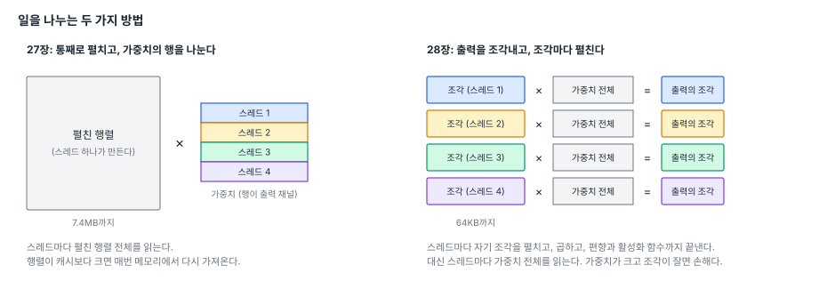
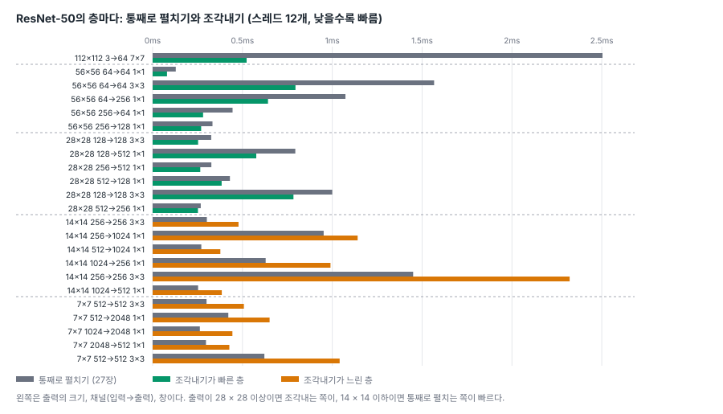
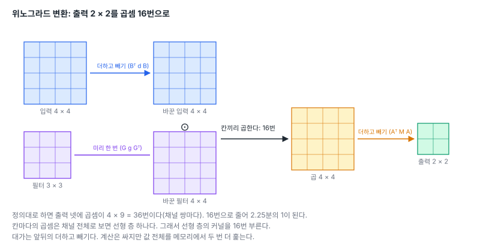
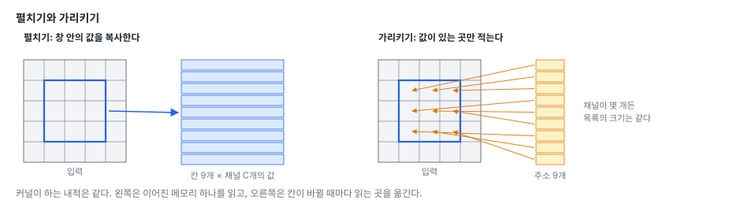
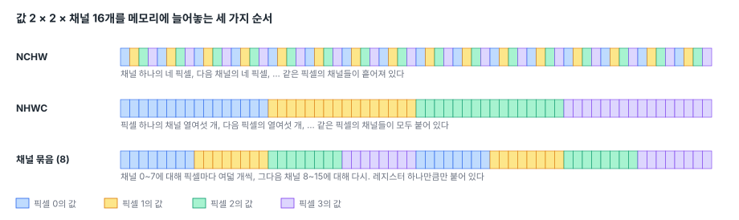

# 합성곱 커널 최적화

[27장](ch27_convolution.md)은 합성곱을 선형 층으로 바꿔 계산했습니다. 창을 행렬로 펼치고 3부의
커널을 불렀습니다. 그것만으로 스레드 하나에서는 커널이 가진 속도를 거의
다 냈습니다. 문제는 그다음이었습니다. 스레드 열두 개로 5.7배, LiteRT의
절반.

이 장은 그 숫자를 올리는 장이고, 합성곱을 빠르게 한다고 알려진 방법들을
하나씩 **재 보는** 장입니다. 다섯 가지를 구현했고, 엔진의 기본값이 된
것은 그 가운데 하나입니다. 나머지 넷은 왜 기본값이 되지 못했는지를
숫자로 적습니다. 그것도 결과입니다.

결과를 미리 적어 둡니다.

- 출력을 조각내어 조각마다 펼치고, 층의 모양에 따라 방법을 고르게
  했습니다. ResNet-50이 스레드 12개에서 16.9밀리초에서 11.1밀리초가
  되었습니다. MobileNetV2는 5.6밀리초에서 2.4밀리초입니다.
- 어느 방법이 빠른지는 **층의 모양**이 정합니다. 사진이 크고 필터가 작은
  앞쪽 층에서는 조각내는 쪽이 최대 다섯 배 빠르고, 사진이 작고 필터가 큰
  뒤쪽 층에서는 [27장](ch27_convolution.md)의 방법이 1.5배 빠릅니다.
- 위노그라드 변환은 스레드 하나에서 채널이 많은 층을 1.3~1.9배 빠르게
  합니다. 스레드 12개에서는 기본값보다 느립니다.
- 펼치지 않는 간접 합성곱은 펼친 행렬을 없애지만, 우리 구현에서는
  1.5배 느립니다.
- 16비트 부동소수점으로 계산하는 커널은 같은 일을 1.9배까지 빠르게
  합니다. 층 하나의 오차가 1,000분의 1~2입니다.
- LiteRT와의 거리는 2.0배에서 1.4배가 되었습니다(스레드 하나의 LiteRT와
  스레드 12개의 우리).

| 하는 일 | 절 |
|---|---|
| 어디가 느린지 층마다 본다 | 28.1 |
| 출력을 조각내어 펼친다 | 28.2 |
| 층의 모양을 보고 방법을 고른다 | 28.3 |
| 나머지 연산을 스레드에 나눈다 | 28.4 |
| 위노그라드 변환을 재 본다 | 28.5 |
| 펼치지 않는 합성곱을 재 본다 | 28.6 |
| 채널의 배치가 반복문을 어떻게 정하는지 본다 | 28.7 |
| 16비트로 계산해 본다 | 28.8 |
| 다시 잰다 | 28.9 |

## 28.1 어디가 느린가

27.12절의 표는 연산의 종류로 묶은 것이었습니다. 합성곱이 53개이고
모양이 제각각이므로 하나씩 봐야 합니다. 층마다 곱셈의 수와 시간을 적고
**1초에 하는 곱셈의 수**로 나눕니다. [14장](../part3/ch14_measurement.md)에서 배운 대로, 시간이 아니라
일의 단위당 시간을 봐야 어디가 비효율적인지 보입니다.

```bash
cargo run --release -p badak_graph --example ch28_layers -- resnet50 1 whole
```

```text
{{#include output/ch28_layers_1_whole.txt}}
```

스레드 하나에서는 고를 것이 없습니다. 거의 모든 층이 1초에 440억에서
520억 번을 합니다. 26.12절에서 잰 커널의 한계(430~510억)입니다. 처지는
것은 맨 앞의 `7 × 7` 합성곱(234억)과 채널이 64개인 `1 × 1`(340억
안팎)뿐입니다.

스레드를 12개로 늘리면 그림이 달라집니다.

```bash
cargo run --release -p badak_graph --example ch28_layers -- resnet50 12 whole
```

```text
{{#include output/ch28_layers_12_whole.txt}}
```

스레드가 12개이면 한계는 5,000억에서 6,000억 번쯤입니다. 뒤쪽 층들은
3,500억에서 4,200억으로 그 3분의 2쯤을 냅니다. 앞쪽 층들이 문제입니다.

- **`7 × 7` 합성곱은 스레드를 늘려도 그대로입니다.** 234억이 471억이 될
  뿐입니다. 스레드 하나일 때 5.0밀리초 가운데 절반이 창을 펼치는
  시간이었는데, 그 일은 스레드 하나가 합니다. 곱셈이 열두 배 빨라져도
  펼치는 시간이 남습니다. 18.9절에서 본 것과 같은 일입니다. 나누지 않은
  일이 전체를 정합니다.
- **`56 × 56`짜리 층들이 2,000억 안팎입니다.** 펼친 행렬이 7.2MB이고,
  입력 그대로 쓰는 `1 × 1`도 입력이 0.8~3.2MB입니다. [27장](ch27_convolution.md)의 방법은
  가중치의 행을 스레드에 나누므로 스레드마다 이 행렬 **전체**를 읽습니다.
  그것도 가중치 네 행마다 한 번씩 다시 읽습니다.

두 문제의 뿌리가 같습니다. 일을 나누는 방향이 사진이 큰 층에 맞지
않습니다.

## 28.2 출력을 조각낸다



18.4절에서 선형 층을 나누는 방법을 둘 견줬습니다. 가중치의 행을 나누는
것과 입력 벡터를 나누는 것. LLM에서는 가중치가 크고 벡터가 적어서 앞의
것이 이겼습니다. 합성곱의 앞쪽 층은 사정이 반대입니다. 벡터(출력의
자리)가 3,136개이고 가중치는 147KB입니다.

출력의 자리를 조각으로 나누고, **조각이 일의 단위**가 되게 합니다.

```rust
{{#include ../../../crates/badak_graph/src/conv.rs:tiled}}
```

스레드 하나가 조각 하나를 맡아 네 가지를 이어서 합니다. 자기 자리에
창을 펼치고, 커널을 스레드 하나짜리로 부르고, 치우침을 더하고, 활성화
함수를 적용합니다. 얻는 것이 셋입니다.

- **펼치는 일이 나뉩니다.** 스레드마다 자기 조각만 펼칩니다.
- **펼친 행렬이 작습니다.** 조각 하나가 64KB를 넘지 않게 자릅니다.
  스레드마다 하나씩 가지므로 다 합쳐도 1MB가 안 됩니다. 27.11절에서
  계획 밖에 있던 7.4MB가 사라집니다.
- **방금 쓴 값을 바로 다시 읽습니다.** 조각의 출력에 치우침과 활성화
  함수를 적용할 때 그 값은 아직 캐시에 있습니다. [27장](ch27_convolution.md)에서는 출력 전체를
  다 쓴 뒤에 처음부터 다시 훑었습니다.

조각의 크기는 여러 값으로 재 보았고(16KB에서 1MB까지) 차이가 5% 안이어서
64KB로 두었습니다. `BADAK_CONV_TILE`로 바꿔 볼 수 있습니다.

```bash
cargo run --release -p badak_graph --example ch28_layers -- resnet50 12 tiled
```

```text
{{#include output/ch28_layers_12_tiled.txt}}
```

`7 × 7` 합성곱이 2.5밀리초에서 0.5밀리초가 됩니다. 다섯 배입니다.
`56 × 56`짜리 층들은 1.4~2.1배 빨라집니다. 그런데 **뒤쪽 층들이
느려졌습니다.**

## 28.3 층의 모양이 방법을 정한다



경계가 또렷합니다. 출력이 `28 × 28` 이상이면 조각내는 쪽이, `14 × 14`
이하이면 [27장](ch27_convolution.md)의 방법이 빠릅니다. 예외가 없습니다.

뒤쪽 층에서는 출력의 자리가 196개나 49개뿐이고 가중치가 큽니다
(`512 × 4,608`이면 9.4MB). 자리 196개를 스레드 12개에 조각 넷씩 나누면
조각 하나에 벡터가 네 개입니다. 두 가지가 나빠집니다. 17.5절에서 본 대로
커널은 벡터를 여덟 개 이상 받아야 제 속도를 내고, 스레드마다 9.4MB의
가중치를 통째로 읽게 됩니다. 앞쪽 층에서 "펼친 행렬 전체를 읽는다"던
문제가 가중치 쪽으로 옮겨 간 것입니다.

규칙은 한 줄입니다.

```rust
{{#include ../../../crates/badak_graph/src/conv.rs:choose}}
```

조각 하나에 벡터가 여덟 개 이상 돌아가면 조각내고, 아니면 [27장](ch27_convolution.md)의 방법을
씁니다. 스레드의 수에 따라 경계가 움직입니다. 스레드가 하나이면 거의
언제나 조각내고, 12개이면 자리가 384개 이상일 때 조각냅니다.

같은 연산인데 모양에 따라 계산하는 방법이 다릅니다. 실전 엔진의 합성곱
코드가 긴 까닭이 이것입니다. 빠른 방법 하나가 있는 것이 아니라 모양마다
빠른 방법이 따로 있고, 엔진은 그 표를 들고 있습니다.

## 28.4 나머지 연산

합성곱이 빨라지면 나머지의 몫이 커집니다. 둘을 고칩니다.

**깊이별 합성곱.** 출력의 한 줄을 일의 단위로 삼아 스레드에 나눕니다.
줄마다 따로 계산할 수 있고, 펼친 행렬이 없으니 나눌 것도 출력뿐입니다.
MobileNetV2에서 깊이별 합성곱 17개의 시간이 2.2밀리초에서 0.5밀리초가
됩니다.

**덧셈.** [26장](ch26_graph_interpreter.md)의 `ADD`는 스레드 하나로 더한 뒤 ReLU를 따로 한 번 더
훑었습니다. 4,096원소씩 조각내어 스레드에 나누고, 조각마다 더하기와
ReLU를 이어서 합니다. ResNet-50의 `ADD` 16개가 1.0밀리초에서
0.8밀리초가 됩니다. 덜 줄어든 것은 이 일이 계산이 아니라 메모리를 읽고
쓰는 일이기 때문입니다. 80만 원소짜리 텐서 셋을 지나가는 속도가
정합니다.

`PAD`와 풀링은 그대로 두었습니다. 합쳐 0.6밀리초이고, [30장](ch30_graph_optimization.md)에서 `PAD`를
합성곱에 합치면 절반이 사라집니다.

## 28.5 위노그라드 변환

곱셈의 수 자체를 줄이는 방법이 있습니다.[^winograd]



`3 × 3` 합성곱에서 출력 `2 × 2`개를 한 묶음으로 봅니다. 묶음 하나가
읽는 입력은 `4 × 4`입니다. 정의대로 하면 출력 넷에 곱셈이 `4 × 9 =
36`번입니다. 입력 16개와 필터 9개를 **미리 더하고 빼서** 각각 16개의
값으로 바꿔 두면, 그 16쌍을 칸끼리 곱한 뒤 다시 더하고 빼서 같은 출력
넷을 얻을 수 있습니다. 곱셈이 16번입니다. 2.25분의 1입니다.

필터를 바꾸는 일은 가중치만 있으면 되므로 한 번만 합니다.

```rust
{{#include ../../../crates/badak_graph/src/winograd.rs:filter}}
```

커널은 처음 실행될 때 바꾼 필터를 만들어 쥐고 있습니다. 메모리를 더
씁니다. `3 × 3`짜리 필터가 `4 × 4`가 되므로 1.8배입니다.

입력은 실행할 때마다 바꿉니다. 채널마다 같은 계산이어서 채널 전체를
한꺼번에 더하고 뺍니다.

```rust
{{#include ../../../crates/badak_graph/src/winograd.rs:input}}
```

16번의 곱셈은 채널 전체로 보면 선형 층입니다. 곱셈의 자리 하나마다
"(묶음의 수) × (입력 채널)"인 행렬과 "(출력 채널) × (입력 채널)"인
가중치의 곱입니다. 3부의 커널을 16번 부릅니다.

```rust
{{#include ../../../crates/badak_graph/src/winograd.rs:band}}
```

정의 그대로의 합성곱과 같은 값을 내는지 시험으로 확인했습니다. 차이는
`f32`의 반올림 수준입니다(만 분의 1 이하로 견줍니다). 더하고 빼는 단계가
늘어난 만큼 오차도 조금 늘어납니다.

### 얼마나 빨라지는가

스레드 하나에서, `3 × 3`이고 보폭이 1인 층들입니다.

| 층 (출력, 채널) | 기본 (ms) | 위노그라드 (ms) | 배수 |
|---|---|---|---|
| `56 × 56`, 64 | 7.50 | 8.04 | 0.93 |
| `28 × 28`, 128 | 7.14 | 5.63 | 1.27 |
| `14 × 14`, 256 | 12.66 | 7.55 | 1.68 |
| `7 × 7`, 512 | 5.93 | 3.20 | 1.86 |

채널이 많을수록 이론값(2.25)에 가까워지고, 채널이 64개인 층에서는
오히려 느립니다. 까닭은 변환의 값입니다. 더하고 빼는 일은 채널의 수에
비례하고, 곱셈은 채널의 수의 제곱에 비례합니다. 채널이 적으면 변환이
아낀 곱셈보다 비쌉니다. 모델 전체로는 스레드 하나에서 96밀리초가
88밀리초가 됩니다.

스레드 12개에서는 사정이 다릅니다.

| ResNet-50, 스레드 12개 | 한 장 (ms) |
|---|---|
| 기본 (28.3절) | 11.7 |
| 쓸 수 있는 곳에 위노그라드 | 13.3 |

**느립니다.** 변환을 스레드에 나눴는데도 그렇습니다. 변환은 계산이 거의
없는 일입니다. 값을 읽어 더하고 다른 곳에 씁니다. 스레드 하나일 때는
곱셈이 시간을 정했으므로 곱셈을 줄이면 빨라졌습니다. 스레드가 열둘이면
곱셈은 열두 곳에서 하지만 메모리는 함께 씁니다. [15장](../part3/ch15_bottleneck.md)에서 본 두 한계
가운데 메모리 쪽에 먼저 닿습니다(해석).

그래서 기본값으로 쓰지 않았습니다. 26.6절의 레지스트리에
`winograd::conv_2d_winograd`를 등록하면 쓸 수 있습니다. 코어가 적은
기기에서는 답이 달라질 수 있습니다. 기기 위에서 재야 알 수 있는데, 이
판에서는 재지 못했습니다.

## 28.6 펼치지 않는 합성곱

펼친 행렬은 입력의 복사본입니다. 값은 같고 놓인 곳만 다릅니다. 복사하지
않고 **어디에 있는지만 적어 두면** 어떨까요.[^indirect]



창의 칸마다 "이 칸이 읽을 픽셀이 입력의 어디에 있는가"를 적은 목록을
만듭니다. 덧댄 자리는 0으로 채운 픽셀 하나를 함께 가리킵니다. 커널은
목록을 따라가며 내적합니다. 목록의 크기는 창의 칸 수이고 채널의 수와
상관이 없습니다. 채널이 512개여도 `3 × 3` 창이면 주소 아홉 개입니다.

```rust
{{#include ../../../crates/badak_graph/src/conv.rs:indirect_dots}}
```

17.4절의 커널과 같은 모양입니다. 입력 둘과 필터 넷의 내적 여덟 개를
한꺼번에 누산합니다. 다른 점은 입력이 이어진 메모리 하나가 아니라 칸마다
바뀌는 슬라이스라는 것입니다.

```rust
{{#include ../../../crates/badak_graph/src/conv.rs:indirect}}
```

Rust에서는 주소 대신 슬라이스를 담습니다. 범위 검사가 따라오지만,
가리키는 곳이 입력 안이라는 것을 컴파일러가 보증합니다.

```bash
cargo run --release -p badak_graph --example ch28_layers -- resnet50 1 indirect
```

| ResNet-50 (ms) | 스레드 1개 | 스레드 12개 |
|---|---|---|
| [27장](ch27_convolution.md)의 방법 | 95.6 | 16.1 |
| 조각마다 펼치기 | 96.1 | 14.6 |
| 펼치지 않기 | 140.0 | 19.2 |

**1.5배 느립니다.** 층마다 보면 `3 × 3` 합성곱에서 1초에 290억에서
370억 번을 합니다. 펼치는 쪽은 390억에서 490억입니다. `7 × 7` 합성곱은
80억입니다.

까닭이 둘 있습니다. 하나는 커널입니다. 이 커널은 [17장](../part3/ch17_simd.md)처럼 벡터 명령을
직접 쓰지 않고 컴파일러가 바꿔 주는 반복문으로 짰습니다. 다른 하나는
맨 앞의 층입니다. 채널이 3개뿐이어서 칸 하나에서 읽는 값이 셋입니다.
여덟 개씩 묶어 계산할 것이 없습니다. 펼치는 쪽은 칸 49개의 값 147개를
이어 붙여 놓고 여덟 개씩 읽습니다.

펼치는 수고가 실제로 얼마였는지는 28.2절의 표에서 이미 보입니다.
조각마다 펼치는 `3 × 3` 합성곱과 펼칠 것이 없는 `1 × 1` 합성곱이 같은
속도를 냅니다. 조각이 캐시에 들어갈 만큼 작아지면 **펼치는 값은 거의
보이지 않습니다.** 펼치지 않아서 얻을 수 있는 시간이 처음부터 많지
않았습니다. 얻는 것은 메모리인데, 그것도 조각내기가 7.4MB를 1MB 아래로
줄인 뒤입니다.

이 방법을 내놓은 논문은 펼치는 수고가 큰 경우에 이 방법이 낫다고
적습니다.[^indirect] 우리 엔진에서 그 수고를 줄인 것은 조각내기였습니다.
둘은 같은 문제의 다른 답입니다.

## 28.7 채널을 어디에 둘 것인가

27.1절에서 채널을 두는 순서가 둘이라고 했습니다. 셋째가 있습니다.



**채널 묶음 배치**는 채널을 여덟 개나 열여섯 개씩 묶어, 묶음 안에서만
픽셀의 채널들이 나란히 놓이게 합니다. NCHW를 쓰는 엔진들이 합성곱을
빠르게 하려고 쓰는 배치입니다.[^nchwc] 묶음의 크기는 벡터 레지스터
하나에 들어가는 값의 수입니다.

배치가 무엇을 바꾸는지 보려고, 같은 `1 × 1` 합성곱을 세 배치에서
**평범한 반복문**으로 짰습니다. [17장](../part3/ch17_simd.md)의 커널을 쓰지 않고 컴파일러에게
맡깁니다.

```rust
{{#include ../../../crates/badak_graph/examples/ch28_layout.rs:nhwc}}
```

```rust
{{#include ../../../crates/badak_graph/examples/ch28_layout.rs:nchw}}
```

```rust
{{#include ../../../crates/badak_graph/examples/ch28_layout.rs:blocked}}
```

```bash
cargo run --release -p badak_graph --example ch28_layout
```

```text
{{#include output/ch28_layout.txt}}
```

**같은 계산이 배치에 따라 일곱 배까지 다릅니다.** 컴파일러가 무엇을
벡터 명령으로 바꿀 수 있느냐의 차이입니다.

- NHWC의 가장 안쪽 반복문은 **내적**입니다. 값들을 하나의 합에
  더해 갑니다. 17.2절에서 본 대로 컴파일러는 부동소수점 덧셈의 순서를
  바꾸지 못하므로 이 반복문을 벡터로 바꾸지 않습니다.
- NCHW의 가장 안쪽 반복문은 **값 하나를 곱해 여러 곳에 더하는**
  것입니다. 더해지는 곳이 서로 달라서 순서를 바꿀 필요가 없습니다.
  벡터로 바뀝니다. 대신 가중치 하나마다 한 장 전체를 지나갑니다.
- 채널 묶음은 그 둘을 합칩니다. 픽셀 하나의 값을 출력 채널 여덟 개에
  한꺼번에 더합니다. 여덟 개가 나란히 있어서 벡터로 바뀌고, 픽셀을 한
  번만 지나갑니다.

이 표는 "NHWC가 느리다"는 뜻이 아닙니다. [17장](../part3/ch17_simd.md)의 커널은 NHWC에서
430~510억 번을 냅니다. 덧셈의 순서를 우리가 직접 정해(17.3절) 내적을
벡터로 계산하기 때문입니다. 표가 말하는 것은 **배치가 어떤 반복문을
자연스럽게 만드느냐**입니다. NCHW에서 출발한 엔진은 채널 묶음으로 가야
했고, NHWC에서 출발한 엔진은 내적 커널을 손으로 짜야 했습니다. 우리는
뒤의 길을 3부에서 이미 걸었습니다.

엔진이 배치를 바꾸면 그래프의 처음과 끝에서 값을 옮겨 놓아야 합니다.
27.1절의 `TRANSPOSE`가 그런 마디입니다. 사진 한 장을 옮기는 데
0.1밀리초가 듭니다.

## 28.8 16비트로 계산한다

[19장](../part3/ch19_quantization_theory.md)에서 16비트 부동소수점을 **저장** 형식으로 다뤘습니다. 가중치를
16비트로 두고, 계산할 때 `f32`로 넓혔습니다. 계산까지 16비트로 하면
레지스터 하나에 값이 여덟 개 들어갑니다. `f32`의 두 배입니다.

ARM에는 16비트 부동소수점을 직접 계산하는 명령이 있고, 프로세서의 선택
기능입니다. 이 기계에 있는지 운영체제에 묻습니다.

```bash
sysctl hw.optional.arm.FEAT_FP16
```

```text
hw.optional.arm.FEAT_FP16: 1
```

Rust에서는 1.94부터 이 명령들을 쓸 수 있습니다.[^rust-fp16] 커널은 17.4절의
것과 같은 모양이고, 값의 폭만 다릅니다.

```rust
{{#include ../../../crates/badak_core/src/simd/half.rs:dots}}
```

세 가지를 잽니다.

```bash
cargo run --release -p badak_graph --example ch28_half
```

```text
{{#include output/ch28_half.txt}}
```

**가중치를 16비트로 줄여도 답은 그대로입니다.** 파일이 102MB에서
51MB가 되고, 점수는 0.01 안에서 같고, 확률은 소수 첫째 자리까지
같습니다. [20장](../part3/ch20_weight_quantization.md)의 LLM에서 본 것과 같습니다.

**가중치만 16비트이면 느려집니다.** 8~17%입니다. 읽을 때마다 `f32`로
넓히는 명령이 하나 더 듭니다. LLM에서는 이 수고를 메모리가 갚았습니다.
가중치가 2.5GB여서 읽는 양을 절반으로 줄이는 것이 더 컸습니다(20.7절).
여기서는 가중치가 캐시에 들어가므로 갚을 것이 없습니다. 같은 기법이
모델의 크기에 따라 득도 되고 실도 됩니다.

**계산까지 16비트이면 최대 1.9배 빠릅니다.** 열이 긴 층에서 1초에
960억 번까지 냅니다. 열이 128개인 층에서는 1.2배에 그칩니다. 내적 하나가
짧으면 누산한 값을 꺼내 정리하는 일의 몫이 커집니다.

**대가는 정밀도입니다.** 층 하나의 출력이 `f32`로 계산한 것과
1,000분의 1에서 2 다릅니다. 가중치를 줄였을 때의 오차(만 분의 5)보다
큽니다. 누산도 16비트로 하기 때문입니다. 값을 2,304개 더하는 동안 합이
커지면 작은 항이 반올림으로 사라집니다(5.6절). 합성곱 53개를 지나면 이
오차가 어떻게 쌓이는지는 이 장에서 재지 않았습니다. 그러려면 그래프의
모든 값이 16비트여야 하고, 해석기의 자리가 `f32` 하나라는 26.14절의
숙제를 먼저 풀어야 합니다. [29장](ch29_integer_inference.md)에서 정수 텐서를 들이면서 그 길이
열립니다.

## 28.9 다시 잰다

```bash
PYTHON=<requirements_ch27.txt를 설치한 Python> sh scripts/bench_ch28.sh
```

```text
{{#include output/ch28_layers_12_auto.txt}}
```

| 사진 한 장 (ms), 모델만 | [27장](ch27_convolution.md) | 28장 | LiteRT 스레드 1 | LiteRT 가장 빠를 때 | PyTorch 스레드 1 |
|---|---|---|---|---|---|
| ResNet-50, 스레드 1 | 96.3 | 96.6 | 7.8 | 5.4 (8개) | 15.7 |
| ResNet-50, 스레드 12 | 16.9 | 11.1 | | | |
| MobileNetV2, 스레드 1 | 11.2 | 10.9 | 1.9 | 1.3 (4개) | 10.1 |
| MobileNetV2, 스레드 12 | 5.6 | 2.4 | | | |

스레드 12개에서 ResNet-50이 1.5배, MobileNetV2가 2.3배 빨라졌습니다.
스레드 하나에서는 그대로입니다. 이 장에서 고친 것은 일을 **나누는
방법**이고, 커널은 건드리지 않았습니다. 스레드 12개가 하나의 8.7배가
되었습니다([27장](ch27_convolution.md): 5.7배).

LiteRT는 스레드 하나로 7.8밀리초입니다. 우리의 스레드 12개가 그것의
1.4배입니다([27장](ch27_convolution.md): 2.0배). PyTorch의 스레드 하나(15.7밀리초)는 넘었습니다.
26.12절과 27.12절에서 본 대로 LiteRT는 다른 명령 집합(SME2)을 쓰고,
스레드 하나로 우리 커널의 열한 배를 냅니다. 일을 나누는 방법으로 좁힐
수 있는 거리는 여기까지입니다. 남은 것은 커널이고, [31장](ch31_mobile_engines.md)에서 다룹니다.

방법마다의 결과를 한 표에 모읍니다.

| ResNet-50 (ms) | 스레드 1개 | 스레드 12개 | 기본값인가 |
|---|---|---|---|
| [27장](ch27_convolution.md)의 방법 (통째로 펼치기) | 95.6 | 16.1 | 사진이 작은 층에서 |
| 조각마다 펼치기 | 96.1 | 14.6 | 사진이 큰 층에서 |
| 모양을 보고 고르기 | 96.2 | 11.7 | 예 |
| 위노그라드 | 88.1 | 13.3 | 아니오 (스레드 하나에서만 이득) |
| 펼치지 않기 | 140.0 | 19.2 | 아니오 |

(층마다의 표를 만드는 도구로 잰 값이어서 위의 표와 0.5밀리초쯤
다릅니다. 시계를 마디마다 읽는 수고가 들어 있습니다.)

## 28.10 남긴 것

**위노그라드와 16비트 연산을 기본값에 넣는 일.** 둘 다 조건에 따라
이깁니다. 위노그라드는 스레드가 적을 때, 16비트는 오차를 받아들일 수
있을 때. 어느 기기에서 무엇을 고를지는 기기 위에서 재야 하고(이 판에서는
재지 못했습니다), 16비트는 해석기가 `f32`가 아닌 값을 다루게 된 뒤의
일입니다.

**커널.** 스레드 하나의 속도는 3부에서 정한 그대로입니다. SME2를 쓰는
커널, 벡터 하나짜리 일의 속도(26.12절)가 [31장](ch31_mobile_engines.md)으로 넘어가 있습니다.

**`7 × 7` 합성곱.** 조각내어 다섯 배 빨라졌지만 여전히 다른 층의
절반입니다(2,370억). 채널이 3개인 입력을 펼치는 일은 값 셋씩 147번
복사하는 일입니다. 연습 문제 2번입니다.

**`PAD`.** 0.4밀리초가 그대로 있습니다. MobileNetV2에서는 전체의
16%입니다. [30장](ch30_graph_optimization.md)에서 합성곱에 합칩니다.

**스레드 16개.** 12개보다 여전히 느립니다(12.8 대 11.1밀리초).
18.10절의 숙제가 그대로입니다.

**펼치지 않는 커널을 벡터 명령으로 짜는 일.** 28.6절의 결과는 방법이
아니라 구현의 한계일 수 있습니다. [17장](../part3/ch17_simd.md)처럼 손으로 짜면 얼마가 나오는지는
재지 않았습니다.

## 28.11 실전 엔진에서는

**합성곱의 방법을 고르는 표는 엔진마다 있습니다.** LiteRT의 합성곱은
커널의 종류를 여럿 두고, 창의 크기와 보폭과 간격을 보고 펼칠지 말지를
정합니다(27.14절).

**위노그라드 변환을 내놓은 논문은 GPU에서 쟀습니다.** `3 × 3` 합성곱이
대부분인 모델에서, 변환의 크기를 바꿔 가며 속도와 정확도를
견줍니다.[^winograd] 이 장의 결과(스레드가 많으면 이득이 사라진다)는
CPU에서 우리 구현으로 잰 것입니다.

**펼치지 않는 합성곱은 XNNPACK을 만든 사람의 논문에서 나왔습니다.**
[^indirect] 26.12절에서 LiteRT가 그래프를 넘긴 그 라이브러리입니다.
XNNPACK이 지금 어떤 방법을 쓰는지는 [31장](ch31_mobile_engines.md)에서 봅니다.

**채널 묶음 배치는 NCHW를 쓰는 엔진들의 답입니다.** 이 배치를 쓰면
그래프의 모든 합성곱이 같은 배치를 주고받게 하는 일이 그래프 최적화의
한 부분이 됩니다.[^nchwc]

## 정리

- 층마다 "1초에 하는 곱셈의 수"를 재면 어디가 비효율적인지 보입니다.
  스레드 하나에서는 거의 모든 층이 커널의 한계에 있었고, 문제는 스레드를
  늘렸을 때 드러났습니다.
- 사진이 큰 층에서는 출력을 조각내어, 조각마다 펼치고 곱하고 활성화
  함수까지 끝냅니다. 펼치는 일이 스레드에 나뉘고, 펼친 행렬이 캐시에
  들어갑니다.
- 사진이 작고 필터가 큰 층에서는 [27장](ch27_convolution.md)의 방법(가중치의 행을 나누기)이
  낫습니다. 조각 하나에 벡터가 여덟 개 이상 돌아가는지로 고릅니다.
- 같은 연산이라도 모양에 따라 빠른 방법이 다릅니다. 엔진은 그 선택을
  들고 있습니다.
- 위노그라드 변환은 곱셈을 2.25분의 1로 줄이고 더하고 빼기를 늘립니다.
  스레드 하나에서 채널이 많은 층을 1.9배까지 빠르게 하지만, 스레드
  12개에서는 느립니다.
- 펼치지 않는 합성곱은 펼친 행렬을 없앱니다. 우리 구현에서는 1.5배
  느립니다. 조각내기가 펼치는 값을 이미 거의 없앴습니다.
- 채널의 배치는 어떤 반복문이 자연스러운지를 정합니다. 평범한
  반복문으로는 배치에 따라 일곱 배가 다릅니다.
- 16비트 가중치는 파일을 절반으로 줄이고 답을 바꾸지 않습니다. 16비트
  계산은 1.9배까지 빠르고 층 하나에 1,000분의 1~2의 오차를 냅니다.
- ResNet-50이 스레드 12개에서 16.9밀리초에서 11.1밀리초가 되었습니다.
  LiteRT(스레드 하나)의 1.4배입니다.

## 연습 문제

1. `BADAK_CONV_TILE`을 4096에서 4194304까지 바꿔 가며 `ch28_layers
   resnet50 12 tiled`를 돌려 보십시오. `56 × 56` 층들이 가장 빠른 값은
   얼마입니까. 스레드를 1개로 하면 달라집니까. 이 기계의 캐시 크기와
   견줘 설명해 보십시오.
2. `unfold_range`는 창의 칸마다 한 픽셀의 채널들을 복사합니다. 창의 한
   행(칸 일곱 개)이 입력에서 이어져 있으면 한 번에 복사하도록 고쳐
   보십시오. `7 × 7` 합성곱이 1초에 몇 억 번이 됩니까.
3. `worth_tiling`의 8을 4와 16으로 바꿔 보십시오. 그림의 경계에 있는
   `28 × 28`, 128 → 512 층은 어느 쪽으로 넘어갑니까. 스레드를 4개로
   하면 경계가 어디로 옵니까.
4. `ch28_layers resnet50 4 winograd`와 `auto`를 견줘 보십시오. 스레드가
   몇 개일 때부터 위노그라드가 집니까. 28.5절의 설명이 맞다면 층마다
   지는 순서가 어떻게 되어야 합니까.
5. 위노그라드의 `band`에서 입력을 바꾸는 단계만 따로 시간을 재어
   보십시오. `56 × 56`, 64채널에서 전체의 몇 %입니까. `7 × 7`,
   512채널에서는 어떻습니까.
6. `indirect_dots`를 17.4절의 커널처럼 NEON 명령으로 직접 짜 보십시오.
   `3 × 3` 합성곱이 1초에 몇 억 번이 됩니까. 28.6절의 결론이 달라집니까.
7. `ch28_layout`의 NHWC 반복문에서 합을 여덟 개로 나누어 누산하도록
   (17.3절의 정의대로) 고쳐 보십시오. 속도가 얼마가 됩니까. 채널 묶음
   배치와 견주면 어떻습니까.
8. `simd::half::linear`는 누산을 16비트로 합니다. 값 여덟 개를 곱한
   뒤 `f32`로 넓혀 누산하도록 바꿔 보십시오. 속도와 오차가 각각 어떻게
   됩니까. 어느 쪽이 "16비트 연산"이라고 부를 만합니까.

## 참고 문헌

[^winograd]: A. Lavin, S. Gray, "Fast Algorithms for Convolutional Neural
    Networks", 2015. arXiv:1509.09308. 4.1절이 `F(2 × 2, 3 × 3)`이고,
    곱셈이 36번에서 16번이 되어 2.25배 줄어든다고 적습니다. 변환
    행렬(`Bᵀ`, `G`, `Aᵀ`)은 같은 절의 식에서 옮겼고, 구현이 정의 그대로의
    합성곱과 같은 값을 내는 것으로 확인했습니다. 논문의 측정은 GPU에서 한
    것입니다(5절). <https://arxiv.org/abs/1509.09308>

[^indirect]: M. Dukhan, "The Indirect Convolution Algorithm", 2019.
    arXiv:1907.02129. 초록만 확인했습니다. 초록은 이 방법이 펼치는 변환의
    수고 없이 행렬 곱 커널의 효율을 얻으며, 입력 픽셀의 행을 가리키는
    포인터의 버퍼(indirection buffer)를 쓴다고 적습니다. 저자가 XNNPACK을
    만든 사람이라는 것은 XNNPACK 저장소의 기록으로 알려진 사실이고 이
    장에서 따로 확인하지 않았습니다. <https://arxiv.org/abs/1907.02129>

[^nchwc]: Y. Liu 외, "Optimizing CNN Model Inference on CPUs", 2018.
    arXiv:1809.02697. 서지 정보와 초록의 앞부분만 확인했습니다. 채널
    묶음 배치(NCHW[x]c)에 대한 설명은 이 논문의 본문이 아니라 28.7절의
    실험에서 직접 확인한 것만 적었습니다.
    <https://arxiv.org/abs/1809.02697>

[^rust-fp16]: Rust 1.100의 표준 라이브러리 소스,
    `library/stdarch/crates/core_arch/src/arm_shared/neon/generated.rs`.
    `vfmaq_f16`에 `#[target_feature(enable = "neon,fp16")]`과
    `stable(feature = "stdarch_neon_fp16", since = "1.94.0")`이 붙어
    있습니다. 16비트 부동소수점 타입(`f16`) 자체는 아직 안정판에서 쓸 수
    없어서, 커널은 16비트 정수 레지스터를 읽어 부동소수점 레지스터로
    다시 해석합니다(`vreinterpretq_f16_u16`).
