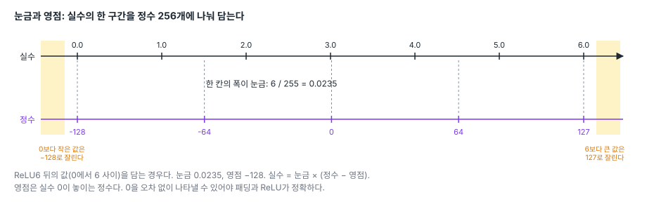
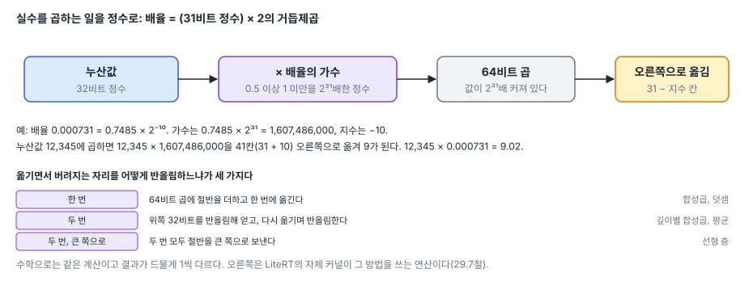

# 정수 양자화 추론

19~21장에서 LLM의 **가중치**를 8비트와 4비트로 줄였습니다. 저장은 정수로
하고, 계산할 때는 실수로 되돌렸습니다. 중간 결과는 끝까지 `f32`였습니다.

이 장에서는 한 걸음 더 갑니다. 가중치도, 중간 결과도, 계산도 정수입니다.
모델의 입력에서 출력까지 부동소수점 연산이 한 번도 나오지 않습니다. 폰과
작은 기기에서 돌리는 모델들이 쓰는 방식입니다.

이 장에서 가장 오래 걸린 일은 계산이 아니라 **반올림**이었습니다. 정수
연산은 실수와 달리 "거의 같다"가 없습니다. 같거나 다릅니다. LiteRT와 같은
비트를 내려고 층마다 견주다가, LiteRT 안에서 연산마다 반올림하는 방법이
세 가지로 다르다는 것을 찾았습니다.

결과를 미리 적어 둡니다.

- 8비트 정수 MobileNetV2를 실행합니다. 사진 다섯 장의 출력 5,000개와,
  한 장에 대한 중간 결과 70개 층 전부가 LiteRT의 자체 커널과 **비트까지
  같습니다**.
- 모델 파일이 14.1MB에서 4.1MB가 되고, 중간 결과의 자리가 9.8MB에서
  2.5MB가 됩니다.
- LiteRT에는 길이 둘 있고(자체 커널, XNNPACK) 두 길의 출력이 서로
  다릅니다. 값 1,000개 가운데 460~740개가 다르고, 차이는 최대 9입니다.
- 답은 다섯 장 모두 실수 모델과 같습니다. 그러나 가장 높은 점수가 정수의
  범위에 잘려, 확신 95%가 41%가 되고 동점이 생깁니다. 보정 도구가 범위를
  정하는 방법 때문입니다.
- 속도는 집니다. 스레드 하나로 우리 22.4밀리초, LiteRT의 자체 커널
  4.0밀리초, XNNPACK 1.7밀리초입니다. 우리 엔진에서는 정수 모델이 실수
  모델보다 두 배 느립니다. 까닭을 적습니다.

| 하는 일 | 절 |
|---|---|
| 왜 정수로 계산하는지 본다 | 29.1 |
| 실수를 정수에 담는다 | 29.2 |
| 모델을 정수로 바꾼다 | 29.3 |
| 채널마다 눈금을 따로 둔다 | 29.4 |
| 정수만으로 합성곱한다 | 29.5 |
| 실수 배율을 정수로 곱한다 | 29.6 |
| LiteRT와 같은 비트를 낸다 | 29.7 |
| 해석기와 나머지 연산을 채운다 | 29.8 |
| 답이 얼마나 달라지는지 본다 | 29.9 |
| LiteRT와 겨룬다 | 29.10 |

## 29.1 왜 정수인가

가중치를 8비트로 줄이는 것만으로 파일은 4분의 1이 됩니다. [20장](../part3/ch20_weight_quantization.md)에서 한
일입니다. 중간 결과까지 정수로 하면 얻는 것이 셋 더 있습니다.

- **메모리.** 중간 결과가 `f32`의 4분의 1입니다. 27.11절에서 MobileNetV2가
  ResNet-50보다 실행 메모리를 더 쓴다고 했습니다. 폰에서는 그 숫자가
  모델의 크기보다 중요할 때가 많습니다.
- **속도.** 8비트 값은 벡터 레지스터 하나에 열여섯 개 들어갑니다. `f32`는
  넷입니다. 28.8절에서 16비트로 두 배를 본 것과 같은 이치입니다.
- **부동소수점이 없는 기계.** 마이크로컨트롤러와 일부 가속기는 정수
  연산만 빠르거나, 정수 연산만 있습니다.

대가는 정밀도이고, 그리고 **복잡함**입니다. 실수 계산에서는 값의 크기를
숫자가 스스로 기억합니다. 정수 계산에서는 "이 정수 1이 실수로 얼마인가"를
우리가 값마다 따로 들고 다녀야 하고, 연산마다 그것을 맞춰 줘야 합니다.
이 장의 대부분이 그 이야기입니다.

## 29.2 눈금과 영점

실수의 한 구간을 정수 256개에 고르게 나눠 담습니다.



```text
실수 = 눈금 × (정수 − 영점)
```

**눈금**(scale)은 정수 한 칸이 실수로 얼마인지입니다. **영점**(zero
point)은 실수 0이 놓이는 정수입니다. 19.4절에서 본 것과 같은 식인데,
그때는 가중치만 다뤄서 영점을 0으로 둘 수 있었습니다(가중치는 0을 가운데
두고 양쪽으로 퍼져 있습니다). 중간 결과는 그렇지 않습니다. ReLU6을 지난
값은 0에서 6 사이에만 있습니다. 영점을 −128로 두면 정수 256개를 모두 그
구간에 쓸 수 있습니다.

영점이 **정수**라는 것이 중요합니다. 실수 0을 오차 없이 나타낼 수 있다는
뜻입니다. 덧댄 자리의 값이 0이고, ReLU가 자르는 곳이 0입니다. 그 값이
조금이라도 어긋나면 사진의 가장자리마다 오차가 생깁니다.[^jacob]

파일에는 텐서마다 이 두 숫자가 적혀 있습니다. [26장](ch26_graph_interpreter.md)의 파서에 읽는 코드를
더합니다.

```rust
{{#include ../../../crates/badak_formats/src/tflite.rs:quantization}}
```

눈금과 영점이 벡터인 까닭은 29.4절에 있습니다.

## 29.3 모델을 정수로 바꾸기

[27장](ch27_convolution.md)의 `mobilenetv2.tflite`를 LiteRT의 양자화 도구로 바꿉니다.[^quantizer]

가중치의 눈금은 가중치만 보면 정할 수 있습니다. 가장 큰 절댓값이 127에
오도록 하면 됩니다. 중간 결과는 다릅니다. 어떤 층의 출력이 어느 범위에
있는지는 **사진을 넣어 봐야** 압니다. 모델에 사진 몇 장을 넣어 층마다
값의 범위를 재는 일을 **보정**(calibration)이라고 합니다.

```python
work = quantizer.Quantizer("mobilenetv2.tflite")
work.load_quantization_recipe(recipe.static_wi8_ai8())
result = work.quantize(work.calibrate({"serving_default": samples}))
```

보정에는 [27장](ch27_convolution.md)의 시험 사진 다섯 장에서 잘라 낸 조각 45개를 썼습니다.
사진마다 가운데 조각 하나([27장](ch27_convolution.md)의 입력과 같은 것)와 무작위 위치의 조각
여덟 개입니다. 실전에서는 학습 데이터에서 수백 장을 고릅니다. 다섯 장은
너무 적고, 그 값은 29.9절에서 치릅니다.

```bash
sh scripts/download_ch27.sh
sh scripts/download_ch29.sh
```

만들어 둔 모델과 정답을 받습니다. 직접 만들려면 `reference/
ch29_quantize.py`를 실행합니다.

파일을 처음 열었을 때 [26장](ch26_graph_interpreter.md)의 파서가 거절했습니다. "값을 FlatBuffers 밖에
둔 파일"이라는 오류였습니다. `.tflite`에는 가중치를 FlatBuffers 구조
밖에, 파일의 뒤쪽에 따로 두는 방법이 있습니다. 버퍼에는 값 대신 파일의
처음부터 잰 위치와 길이가 적힙니다. 스키마의 주석은 이것을 2GB를 넘는
모델을 위한 것이라고 설명하는데,[^schema-buffer] 이 도구는 4MB짜리
파일에도 씁니다. 파서가 그 경우를 읽도록 고쳤습니다. 주석이 말하는 쓰임과
도구가 실제로 하는 일이 다를 수 있습니다.

## 29.4 채널마다 다른 눈금

합성곱의 가중치에는 눈금이 하나가 아닙니다. **출력 채널마다 하나씩**
있습니다.

까닭은 27.7절에서 본 배치 정규화입니다. 변환기가 배치 정규화를 합성곱의
가중치에 접어 넣으면서 필터마다 다른 값을 곱했습니다. 어떤 필터는 값이
0.01 근처에 있고 어떤 필터는 2 근처에 있습니다. 눈금을 하나로 하면 큰
필터에 맞춰지고, 작은 필터는 정수 한두 개에 뭉개집니다. 20.2절에서
GGUF가 값 32개마다 눈금을 따로 둔 것과 같은 까닭입니다. 여기서는 묶음의
단위가 필터입니다.

| 텐서 | 눈금의 수 | 영점 |
|---|---|---|
| 중간 결과 | 1 | 값의 범위에 따라 |
| 합성곱의 가중치 | 출력 채널마다 1 | 0 |
| 치우침 (32비트 정수) | 출력 채널마다 1 | 0 |

치우침은 8비트가 아니라 32비트 정수이고, 눈금이 따로 정해져 있지
않습니다. **입력의 눈금 × 가중치의 눈금**입니다. 다음 절에서 그 까닭이
나옵니다.

## 29.5 정수만으로 합성곱하기

합성곱의 출력 하나는 `Σ x × w + b`입니다. 세 실수를 각자의 눈금과 영점으로
바꿔 씁니다. 입력의 눈금과 영점을 `Sx`, `Zx`, 가중치의 눈금을 `Sw`(영점은
0), 출력의 것을 `Sy`, `Zy`라고 하면

```text
Sy × (qy − Zy) = Σ Sx × (qx − Zx) × Sw × qw  +  b
```

치우침의 눈금이 `Sx × Sw`이면 `b = Sx × Sw × qb`이므로 오른쪽 전체에서
`Sx × Sw`가 묶여 나옵니다.

```text
qy = Zy + (Sx × Sw / Sy) × ( Σ (qx − Zx) × qw + qb )
```

괄호 안은 **정수만의 계산**입니다. 8비트끼리 곱해 32비트에 더합니다.
실수는 맨 앞의 배율 `Sx × Sw / Sy` 하나에만 남습니다. 치우침의 눈금을
그렇게 정한 까닭이 이것입니다. 누산값과 같은 눈금이어야 그냥 더할 수
있습니다.

괄호 안을 한 번 더 풉니다. `Σ (qx − Zx) × qw = Σ qx × qw − Zx × Σ qw`
이고, 뒤의 항은 가중치만으로 정해집니다. 실행 전에 계산해 치우침에
넣어 두면 안쪽 반복문은 8비트 둘의 내적이 됩니다.

```rust
{{#include ../../../crates/badak_graph/src/quantized.rs:convolve}}
```

27.4절처럼 창을 펼치고 필터마다 내적합니다. 다른 점이 둘 있습니다.
**덧댄 자리에 0이 아니라 영점을 적습니다.** 실수 0이 그 정수이기
때문입니다. 그리고 누산값을 출력으로 옮기는 단계가 따로 있습니다.

```rust
{{#include ../../../crates/badak_graph/src/quantized.rs:requantize}}
```

치우침을 더하고, 배율을 곱하고, 출력의 영점을 더하고, 범위로 자릅니다.
이어 붙인 활성화 함수는 이 "자르기"에 들어 있습니다. ReLU6이라면 실수
0과 6에 해당하는 정수가 범위의 양 끝입니다. 따로 계산할 것이 없습니다.

남은 것은 배율을 곱하는 일입니다.

## 29.6 실수 배율을 정수로 곱하기

배율 `Sx × Sw / Sy`는 0.0007 같은 실수입니다. 이것을 정수 연산만으로
곱해야 합니다.



실수를 "0.5 이상 1 미만의 수 × 2의 거듭제곱"으로 씁니다. 앞의 수에
2³¹을 곱해 정수로 만들어 두면, 곱셈은 정수끼리 곱한 뒤 오른쪽으로 자리를
옮기는 일이 됩니다. 19.2절에서 본 부동소수점의 가수와 지수를 손으로
다루는 것과 같습니다.

```rust
{{#include ../../../crates/badak_graph/src/quantized.rs:multiplier}}
```

배율은 채널마다 다르므로 해석기를 만들 때 채널마다 한 번씩 계산해
둡니다.

```rust
{{#include ../../../crates/badak_graph/src/quantized.rs:prepared}}
```

위의 코드에는 곱하는 함수가 둘 있습니다(그 아래에 하나가 더 있습니다).
다음 절이 그 까닭입니다.

## 29.7 같은 비트를 내기까지

[26장](ch26_graph_interpreter.md)과 [27장](ch27_convolution.md)에서는 "LiteRT와 10만 분의 2 안에서 같다"로 충분했습니다.
실수 계산에서 덧셈의 순서가 다르면 마지막 자리가 달라지는 것은
당연합니다. 정수는 다릅니다. 덧셈의 순서를 바꿔도 값이 같습니다. 다를
수 있는 곳은 **반올림**뿐이고, 같은 규칙을 따르면 같은 비트가 나와야
합니다.

LiteRT에는 길이 둘 있습니다. 26.12절에서 본 XNNPACK에 넘기는 길과,
넘기지 않고 LiteRT 자신의 커널로 계산하는 길입니다. 두 길의 출력을
정답으로 받아 두었습니다.

처음 견준 결과는 이랬습니다.

| 사진 | 자체 커널과 | XNNPACK과 |
|---|---|---|
| 잔 | 632개가 다름, 최대 5 | 587개, 최대 3 |
| 골든 리트리버 | 567개, 최대 4 | 610개, 최대 3 |

출력 1,000개 가운데 절반 넘게 다릅니다. 차이는 작지만 "같은 정수
계산"이라고 할 수 없습니다. 어디서 갈라지는지 보려고 LiteRT가 계산한
**중간 텐서를 모두** 받았습니다.

```bash
cargo run --release -p badak_graph --example ch29_layers
```

처음 실행한 결과입니다(지금의 코드로는 재현되지 않습니다. 과정을
적습니다).

```text
   0 TRANSPOSE          값   150528개 가운데 다른 것       0개, 가장 큰 차이 0
   1 PAD                값   153228개 가운데 다른 것       0개, 가장 큰 차이 0
   2 CONV_2D            값   401408개 가운데 다른 것    1943개, 가장 큰 차이 1
   3 DEPTHWISE_CONV_2D  값   401408개 가운데 다른 것    3373개, 가장 큰 차이 8
   5 CONV_2D            값  1204224개 가운데 다른 것   77642개, 가장 큰 차이 50
```

첫 합성곱에서 40만 개 가운데 1,943개가 1씩 다릅니다. 0.5%입니다. 그
차이가 층을 지나며 번져 다섯째 층에서는 50까지 벌어집니다.

0.5%가 1씩 다르다는 것은 반올림이 다르다는 표시입니다. LiteRT의 소스에는
배율을 곱하는 함수가 **두 벌** 있습니다.[^litert-multiply]

- **한 번 반올림.** 64비트로 곱하고, 절반을 더하고, 한 번에 자리를
  옮깁니다.
- **두 번 반올림.** 곱의 위쪽 32비트를 반올림해 얻고, 그것을 다시 2의
  거듭제곱으로 나누며 반올림합니다.[^gemmlowp] 32비트 레지스터만으로 할 수
  있어서 벡터 명령으로 짜기 좋습니다. 반올림을 두 번 하므로 드물게 1이
  다릅니다.

어느 쪽을 쓸지는 빌드할 때 정해지고, 받은 패키지가 어느 쪽으로 빌드됐는지
알 길이 없었습니다. 둘 다 만들어 층마다 대 봤습니다.

| 단계 | 두 번 반올림 | 한 번 반올림 |
|---|---|---|
| 합성곱 | 1,943개가 다름 | **같은 비트** |
| 깊이별 합성곱 | **같은 비트** | 2,497개가 다름 |

**연산마다 다릅니다.** 합성곱은 한 번, 깊이별 합성곱은 두 번입니다. 같은
프로그램 안에서 그렇습니다. 합성곱과 깊이별 합성곱은 서로 다른 사람이,
다른 시기에, 다른 방법(하나는 행렬 곱 라이브러리, 하나는 손으로 짠 벡터
명령)으로 최적화했고, 각자가 쓴 반올림이 그대로 남아 있는 것으로
보입니다(해석).

이렇게 맞추자 70개 가운데 68개 층이 같아졌습니다. 남은 둘은 맨 끝의
평균과 선형 층입니다.

**평균.** 1,280개 가운데 45개가 다릅니다. 소스를 따라가 보니 정수 평균의
구현이 둘이고, 빠른 쪽은 "줄인 축을 길이 1로 남길 때"만 쓰입니다. 우리
모델은 그렇지 않아서 기준 구현으로 갑니다.[^litert-mean] 기준 구현은
"원소 수로 나누기"를 배율에 미리 넣습니다. 배율의 정수를 왼쪽으로 옮겨
놓고 원소 수로 **정수 나눗셈**을 합니다. 그 계산을 그대로 옮기고 두 번
반올림을 쓰자 같아졌습니다.

**선형 층.** 1,000개 가운데 하나가 다릅니다. 한 번 반올림으로도, 두 번
반올림으로도 하나씩 남습니다. 셋째 방법이 있었습니다. 두 번 반올림하되
"딱 절반이면 언제나 큰 쪽으로" 보내는 것입니다. ARM의 벡터 명령 둘이 하는
그대로이고, 둘째 방법과는 **음수가 딱 절반일 때만** 다릅니다. 1,000개
가운데 그 경우가 하나 있었습니다.

```rust
{{#include ../../../crates/badak_graph/src/quantized.rs:rounding}}
```

```bash
cargo run --release -p badak_graph --example ch29_verify
```

```text
{{#include output/ch29_verify.txt}}
```

```text
{{#include output/ch29_layers.txt:1:6}}
   ⋮
{{#include output/ch29_layers.txt:69:71}}
```

**사진 다섯 장의 출력이 모두 같은 비트이고, 한 장에 대해서는 70개 층의
중간 결과 925만 개 값이 모두 같습니다.**

이 표에서 가져갈 것이 둘 있습니다.

**"LiteRT의 답"은 하나가 아닙니다.** 오른쪽 열을 보십시오. LiteRT의 두
길(자체 커널과 XNNPACK)의 출력이 값 1,000개 가운데 460~740개에서 다르고,
차이가 9까지 납니다. XNNPACK은 또 다른 반올림을 씁니다. 같은 파일, 같은
입력, 같은 라이브러리인데 어느 길로 갔느냐에 따라 정수 출력이 다릅니다.
"정수 연산이니 어디서나 같은 결과"라는 기대는 맞지 않습니다. 엔진이
같아야 하고, 엔진 안에서도 길이 같아야 합니다.

**반올림 규칙은 문서에 없습니다.** 어느 연산이 어느 반올림을 쓰는지는
소스의 조건부 컴파일과 커널마다의 구현에 흩어져 있고, 우리는 그것을
읽어서가 아니라 **층마다 대 봐서** 찾았습니다. 선형 층의 규칙은 값
하나가 알려 줬습니다. 다섯 장의 출력 5,000개에서 확인했지만, 다른
모델에서도 그대로일지는 보증할 수 없습니다. `Weighted::rounding`의
주석에 그렇게 적어 두었습니다.

## 29.8 해석기와 나머지 연산

정수 그래프를 실행하는 해석기는 [26장](ch26_graph_interpreter.md)의 것과 뼈대가 같습니다.

```rust
{{#include ../../../crates/badak_graph/src/quantized.rs:build}}
```

실행 순서(26.7절), 형상, 수명(26.8절), 자리의 계획과 확인(26.9~26.10절)은
함수를 그대로 부릅니다. **계획기는 값이 실수인지 정수인지 모릅니다.**
크기와 수명만 봅니다. 형상도 자료형과 상관이 없어서 26~27장의 커널에게
묻습니다. 새로 쓴 것은 자리의 원소(`Vec<i8>`)와 커널, 그리고 마디마다
배율을 미리 계산하는 단계입니다.

26.14절과 28.8절에서 "해석기의 자리가 `f32` 하나"라는 숙제를 이 장으로
넘겼습니다. 여기서 한 것은 **정수만 다루는 해석기를 하나 더 만든
것**입니다. 한 그래프 안에 실수와 정수가 섞인 경우(입력만 실수로 받아
정수로 바꾸는 마디가 있는 모델)는 아직 받지 않습니다. 이 장의 모델은
입력부터 출력까지 정수입니다. 실수를 정수로 바꾸는 일은 부르는 쪽이
합니다.

나머지 연산입니다.

| 연산 | 정수로 하는 방법 |
|---|---|
| 깊이별 합성곱 | 합성곱과 같되, 덧댄 칸을 건너뛰고 칸마다 `(qx − Zx) × qw`를 누산한다 |
| 선형 층 | `1 × 1` 사진 한 장에 대한 `1 × 1` 합성곱이다 |
| 덧셈 | 두 입력의 눈금이 다르다. 둘을 같은 눈금으로 옮겨 더하고, 출력의 눈금으로 옮긴다. 배율을 세 번 곱한다 |
| 평균 | 정수를 더하고, 눈금의 비와 "원소 수로 나누기"를 한 배율로 곱한다 |
| 덧대기 | 0이 아니라 영점을 덧댄다 |
| 축 바꾸기 | 값을 옮길 뿐이다. 실수일 때와 같다 |

덧셈이 가장 번거롭습니다. 실수에서는 명령 하나였습니다. 정수에서는 두
입력의 정수 1이 서로 다른 실수이므로 그대로 더할 수 없습니다. 자리를
잃지 않으려고 먼저 2²⁰을 곱해 두고, 입력마다 배율을 곱해 같은 눈금으로
맞추고, 더한 뒤 다시 출력의 눈금으로 옮깁니다.[^litert-add] [9장](../part2/ch09_transformer.md)에서 본
잔차 연결이 정수 모델에서는 이만큼의 일이 됩니다.

## 29.9 답은 얼마나 달라지는가

같은 사진을 실수 모델과 정수 모델에 넣습니다.

```bash
cargo run --release -p badak_graph --example ch29_bench
```

```text
{{#include output/ch29_bench.txt:11:21}}
```

| | f32 | int8 |
|---|---|---|
| 모델 파일 | 14.07MB | 4.10MB |
| 중간 결과의 자리 | 9.81MB | 2.45MB |

크기는 기대한 대로입니다. 파일이 3.4분의 1(가중치는 4분의 1이지만
치우침이 32비트이고 그래프의 설명이 있습니다), 중간 결과가 정확히
4분의 1입니다.

**고른 답은 다섯 장 모두 같습니다.** 그런데 확률이 이상합니다. 잔이
95.3%에서 41.3%가 되고, 기타가 89.4%에서 41.9%가 됩니다. 29.7절의
표에서 기타 사진에는 "동점 2개"라고 적혀 있었습니다.

출력의 눈금을 보면 까닭이 보입니다. 눈금이 0.0485이고 영점이
−46입니다. 정수의 가장 큰 값 127이 실수로 `0.0485 × (127 + 46) =
8.4`입니다. **8.4보다 큰 점수는 나타낼 수 없습니다.** 실수 모델에서 잔의
점수는 그보다 높았고, 정수 모델에서는 127에 잘렸습니다. 기타 사진에서는
첫째와 둘째 답이 모두 127에 잘려 동점이 되었습니다. 어쿠스틱 기타가
이긴 것은 번호가 앞이기 때문입니다.

범위가 왜 그렇게 좁게 잡혔을까요. 보정에 그 사진의 가운데 조각이 들어
있었으므로, 도구가 "본 값 가운데 가장 큰 값"을 범위로 삼았다면 잘릴 수
없습니다. 도구의 소스를 보니 범위를 그렇게 정하지 않습니다. 보정 입력을
하나씩 넣으면서 최솟값과 최댓값의 **이동 평균**을 냅니다.[^quantizer-qsv]
튀는 값 하나에 범위 전체가 끌려가지 않게 하려는 것이고, 값들이 범위 안에
촘촘히 놓이는 대신 드문 큰 값은 잘립니다. 보정 입력이 45개뿐이고 그
가운데 40개가 사진의 구석을 자른 조각이어서(점수가 낮습니다), 평균이
낮게 잡혔습니다.

두 가지를 배웁니다.

- **보정 데이터가 모델의 일부입니다.** 가중치와 그래프가 같아도 보정에
  쓴 사진이 다르면 다른 모델이 나옵니다. 실제로 쓸 입력과 닮은 사진을
  충분히 넣어야 합니다.
- **정수 모델의 확률을 그대로 믿으면 안 됩니다.** 순위는 지켜져도
  점수의 꼭대기가 잘릴 수 있습니다. 점수의 차이나 확률에 기대는
  처리(문턱값으로 거르기)는 정수 모델에서 다시 맞춰야 합니다.

이 모델의 정확도가 실수 모델보다 얼마나 낮은지는 사진 다섯 장으로 말할
수 없습니다. 27.8절과 같은 까닭으로 ImageNet에서 재지 않았습니다.

## 29.10 LiteRT 대결

```text
{{#include output/ch29_bench.txt:23:}}
```

```bash
python reference/ch29_time.py
```

```text
{{#include output/ch29_litert.txt}}
```

| MobileNetV2, 사진 한 장 (ms) | f32, 스레드 1 | int8, 스레드 1 | int8, 여러 스레드 |
|---|---|---|---|
| `badak` | 11.0 | 22.4 | 3.4 (12개) |
| LiteRT 자체 커널 | 7.9 | 4.0 | 2.2 (4개) |
| LiteRT + XNNPACK | 1.9 | 1.7 | 1.4 (4개) |

세 가지가 보입니다.

**우리 엔진에서는 정수가 실수보다 두 배 느립니다.** 정수로 바꾸면
빨라진다는 기대와 반대입니다. LiteRT의 자체 커널은 기대대로입니다.
정수가 실수의 절반입니다. 차이는 커널입니다. 우리의 `f32` 커널은 3부에서
다섯 장에 걸쳐 다듬은 것이고, 정수 커널은 이 장에서 처음 쓴 것입니다.

**어디서 시간을 쓰는지는 "값 하나에 드는 시간"이 말해 줍니다.** 합성곱이
출력 값 하나에 3.5나노초입니다. 이 모델의 합성곱은 출력 하나에 곱셈이
평균 70번쯤입니다(곱셈 3억 번, 출력 438만 개). 곱셈보다 **출력마다 한
번씩 하는 일**이 더 비쌉니다. 내적 함수를 부르는 수고, 그리고 29.6절의
배율 곱하기입니다. 64비트 곱셈, 자리 옮기기, 범위로 자르기를 출력마다
하나씩 합니다. 내적을 NEON 명령으로 직접 짜 보았지만(`dot_neon`) 시간이
달라지지 않았습니다. 병목이 거기가 아니라는 확인입니다.

MobileNetV2는 [28장](ch28_conv_kernels.md)의 눈으로 보면 "좁은" 모델입니다. 채널이 적고 `1 × 1`
합성곱이 대부분이어서 내적 하나가 짧습니다. 그런 모델에서는 내적의
속도보다 내적과 내적 사이의 일이 시간을 정합니다. 빠른 정수 커널은 출력
여러 개의 누산값을 모아 배율 곱하기까지 벡터 명령으로 한꺼번에 합니다.
29.7절에서 "두 번 반올림"이 32비트 레지스터에 맞게 생긴 까닭이
이것입니다.

**XNNPACK에서는 정수와 실수가 비슷합니다.** 1.7 대 1.9밀리초입니다.
26.12절에서 본 SME2 커널이 `f32`를 워낙 빠르게 해서, 정수로 바꿔 얻는
것이 거의 없습니다. 이 기계에서는 그렇습니다. 그런 명령이 없는 기기에서는
다를 것입니다. 기기 위에서 재야 알 수 있는데, 이 판에서는 재지
못했습니다.

정리하면, 이 장은 정수 추론을 **옳게** 하는 데까지 왔습니다. LiteRT의
자체 커널과 비트가 같고, 다섯 배 느립니다.

## 29.11 남긴 것

**정수 커널의 속도.** 출력 여러 개를 묶어 누산하고 벡터 명령으로 배율을
곱하는 커널을 만들지 않았습니다. [28장](ch28_conv_kernels.md)의 조각내기도 정수 쪽에는 넣지
않았습니다. [31장](ch31_mobile_engines.md)에서 다시 봅니다(XNNPACK의 정수 커널을 읽지는 못했고,
내적과 배율 곱하기를 고쳐 두 배를 얻었습니다).

**실수와 정수가 섞인 그래프.** 입력을 실수로 받아 그래프 안에서 정수로
바꾸는 모델(`QUANTIZE`, `DEQUANTIZE` 마디)을 받지 않습니다. 해석기 둘을
하나로 합치는 일이 남았습니다.

**정확도.** 보정 데이터가 사진 다섯 장입니다(29.9절). 제대로 보정한
모델의 정확도는 재지 않았습니다.

**반올림 규칙의 근거.** 연산마다의 반올림은 한 모델, 한 패키지에서 찾은
것입니다. 다른 연산(풀링, 곱셈, 이어 붙이기)과 다른 빌드에서는 다시
확인해야 합니다.

**다른 정수 형식.** 16비트 중간 결과, 부호 없는 8비트(옛 형식),
가중치만 정수이고 중간 결과는 실수인 모델을 다루지 않았습니다.

## 29.12 실전 엔진에서는

**정수만으로 추론하는 방법은 2017년의 논문에서 정리되었습니다.**[^jacob]
눈금과 영점으로 실수를 나타내고, 배율을 정수의 곱셈과 자리 옮기기로
바꾸고, 학습할 때부터 그 반올림을 흉내 내는 방법까지 담고 있습니다.
`.tflite`의 정수 모델이 그 방식을 따릅니다.

**LiteRT는 채널마다의 배율을 실행 전에 계산해 둡니다.** 입력의 눈금과
필터의 눈금을 곱해 출력의 눈금으로 나누는 계산을 배정밀도로
합니다.[^litert-perchannel] 29.6절의 `prepare`가 같은 일을 합니다. 그
계산의 순서(무엇을 먼저 `f64`로 바꾸는가)까지 같아야 비트가 맞습니다.

**같은 엔진 안에 반올림이 여럿입니다.** 29.7절에서 본 대로입니다.
기준 구현, 행렬 곱 라이브러리를 쓰는 구현, 벡터 명령으로 짠 구현이 각자의
반올림을 가지고 있고, XNNPACK은 또 다릅니다.

**보정에는 여러 방법이 있습니다.** 우리가 쓴 도구는 최솟값과 최댓값의
이동 평균을 씁니다.[^quantizer-qsv] 값의 분포를 보고 범위를 정하는
방법들도 있습니다. 19.6절에서 본 "범위를 좁히면 반올림 오차가 줄고
자르는 오차가 는다"는 맞바꿈을 어디서 멈출지의 문제입니다.

## 정리

- 정수 추론에서는 가중치도, 중간 결과도, 계산도 정수입니다. 값마다
  눈금과 영점을 들고 다닙니다. 실수 = 눈금 × (정수 − 영점).
- 영점은 실수 0을 오차 없이 나타내려고 둡니다. 덧대는 값이 영점이고,
  ReLU는 범위로 자르는 일에 들어갑니다.
- 중간 결과의 범위는 사진을 넣어 봐야 압니다. 그 일이 보정이고, 보정
  데이터가 모델의 일부가 됩니다.
- 합성곱의 가중치는 출력 채널마다 눈금이 다릅니다. 치우침은 32비트이고
  눈금이 "입력 × 가중치"여서 누산값에 그냥 더할 수 있습니다.
- 실수는 배율 하나에만 남고, 그것도 "31비트 정수 × 2의 거듭제곱"으로
  바꿔 정수로 곱합니다.
- 정수 계산이 다를 수 있는 곳은 반올림뿐입니다. LiteRT의 자체 커널은
  합성곱, 깊이별 합성곱, 선형 층에 서로 다른 반올림을 씁니다. 층마다
  견줘서 찾았고, 70개 층 전부와 출력 5,000개가 같은 비트입니다.
- LiteRT의 두 길(자체 커널, XNNPACK)은 서로 다른 정수를 냅니다.
- 계획기는 값의 자료형을 모릅니다. 정수 해석기는 [26장](ch26_graph_interpreter.md)의 순서, 수명,
  계획을 그대로 씁니다.
- 파일이 3.4분의 1, 중간 결과가 4분의 1이 됩니다. 답은 다섯 장 모두
  같지만, 보정이 범위를 좁게 잡아 가장 높은 점수가 잘립니다.
- 우리 정수 커널은 LiteRT의 자체 커널보다 다섯 배 느립니다. 출력마다
  한 번씩 하는 배율 곱하기가 시간을 정합니다.

## 연습 문제

1. 눈금 0.0235, 영점 −128인 텐서에서 실수 0, 1.0, 6.0, 7.5, −0.3은 각각
   어떤 정수가 됩니까. 그 정수를 다시 실수로 바꾸면 얼마입니까. 오차가
   가장 큰 것은 어느 것이고 왜 그렇습니까.
2. `quantize_multiplier(0.000731)`의 결과로 `multiply(12345, …)`,
   `multiply_twice_rounded`, `multiply_half_up`을 계산해 보십시오.
   −1,000,000에서 1,000,000까지의 모든 정수에 대해 세 함수가 서로 다른
   값을 내는 것은 몇 개입니까. 어느 둘이 가장 자주 다릅니까.
3. `Weighted::rounding`에서 합성곱의 반올림을 `Twice`로 바꾸고
   `ch29_layers`를 돌려 보십시오. 첫 합성곱에서 다른 값이 몇 %입니까.
   마지막 출력에서는 얼마입니까. 차이가 층을 지나며 어떻게 자랍니까.
4. `convolve`는 덧댄 자리에 영점을 적습니다. 0을 적도록 바꾸면 첫
   합성곱의 출력이 어디에서 달라집니까. 가장자리의 값만 달라지는지
   확인해 보십시오.
5. `reference/ch29_quantize.py`의 `CROPS`를 0으로(가운데 조각만) 바꿔
   모델을 다시 만들어 보십시오. 출력의 눈금이 얼마가 됩니까. 29.9절의
   잘림이 사라집니까. 다른 사진에서는 어떻게 될지 생각해 보십시오.
6. `Requantize::apply`가 출력 넷을 한꺼번에 받아 처리하도록 바꿔
   보십시오(누산값 넷, 배율 넷). 컴파일러가 벡터 명령으로 바꿉니까.
   `ch29_bench`의 "값 하나에" 열이 얼마가 됩니까.
7. 덧셈에서 두 입력의 눈금이 같고 출력의 눈금도 같으면 세 번의 배율
   곱하기가 필요 없습니다. 그 경우를 따로 처리하면 `ADD`의 시간이
   얼마나 줄어듭니까. 이 모델에서 그런 덧셈이 몇 개입니까.
8. [28장](ch28_conv_kernels.md)의 조각내기(`worth_tiling`)를 정수 합성곱에 넣어 보십시오. 정수
   내적 여럿을 한 번에 계산하는 커널(17.4절의 정수판)이 먼저 필요합니다.
   어디까지 빨라집니까.

## 참고 문헌

[^jacob]: B. Jacob 외, "Quantization and Training of Neural Networks for
    Efficient Integer-Arithmetic-Only Inference", 2017. arXiv:1712.05877.
    서지 정보만 확인했고 본문은 읽지 못했습니다. 이 장의 식은 논문이 아니라
    LiteRT의 소스와 층마다의 대조에서 확인한 것입니다.
    <https://arxiv.org/abs/1712.05877>

[^quantizer]: `ai-edge-quantizer` 0.10.1. `recipe.static_wi8_ai8()`
    (`recipe.py` 176번째 줄)이 가중치와 중간 결과를 모두 8비트 정수로
    하는 설정입니다. 판은 `reference/requirements_ch29.txt`에 고정했습니다.

[^quantizer-qsv]: `ai-edge-quantizer` 0.10.1, `calibrator.py` 268번째 줄
    (`self._qsv_update_func = qsv_utils.moving_average_update`)과
    `utils/qsv_utils.py`의 `_update_moving_average`. 이동 평균의 비중이
    얼마인지와, 29.9절의 좁은 범위가 정확히 이 계산에서 나온 값인지는
    숫자로 따라가 확인하지 않았습니다.

[^schema-buffer]: LiteRT, `tflite/converter/schema/schema.fbs` (커밋
    `5d9e2a42e02b`), 1690~1698번째 줄. `Buffer`의 `offset`과 `size`에 "In
    a model that is larger than 2GB, then buffers instead uses the
    following attributes"라는 주석이 붙어 있습니다. 양자화 설정
    (`QuantizationParameters`)은 158번째 줄부터입니다.
    <https://github.com/google-ai-edge/LiteRT/blob/5d9e2a42e02b/tflite/converter/schema/schema.fbs>

[^litert-multiply]: LiteRT, `tflite/kernels/internal/common.cc` (같은
    커밋). 한 번 반올림은 34~47번째 줄, 두 번 반올림은 81~90번째 줄이고
    `TFLITE_SINGLE_ROUNDING`으로 갈립니다(32번째 줄). 실수 배율을 정수와
    지수로 바꾸는 `QuantizeMultiplier`는 `quantization_util.cc`
    53번째 줄입니다. 셋째 방법(두 번 모두 큰 쪽으로)은 `common.h`
    414~431번째 줄의 NEON 판(`vqrdmulhq_s32`, `vrshlq_s32`)이 하는
    계산입니다.
    <https://github.com/google-ai-edge/LiteRT/blob/5d9e2a42e02b/tflite/kernels/internal/common.cc>

[^gemmlowp]: gemmlowp, `fixedpoint/fixedpoint.h` (커밋 `16e8662c3491`).
    `SaturatingRoundingDoublingHighMul`(340~350번째 줄)과
    `RoundingDivideByPOT`(368~379번째 줄). `multiply_twice_rounded`는 이
    둘을 옮긴 것입니다.
    <https://github.com/google/gemmlowp/blob/16e8662c3491/fixedpoint/fixedpoint.h>

[^litert-mean]: LiteRT, `tflite/kernels/reduce.cc` (커밋 `5d9e2a42e02b`)
    755~775번째 줄이 빠른 구현을 고르는 조건(`keep_dims`이고 4차원일 때)
    이고, 그 밖에는 `reference/reduce.h`의 `QuantizedMeanOrSum`으로
    갑니다. 원소 수로 나누는 일을 배율에 넣는 계산은 그 파일의
    403~417번째 줄입니다.
    <https://github.com/google-ai-edge/LiteRT/blob/5d9e2a42e02b/tflite/kernels/internal/reference/reduce.h>

[^litert-add]: LiteRT, `tflite/kernels/add.cc` (같은 커밋), 175~198번째
    줄(왼쪽으로 20칸, 두 입력의 배율은 `눈금 / (2 × 큰 눈금)`, 출력의
    배율은 `2 × 큰 눈금 / (2²⁰ × 출력의 눈금)`)과
    `reference/integer_ops/add.h` 107~123번째 줄.
    <https://github.com/google-ai-edge/LiteRT/blob/5d9e2a42e02b/tflite/kernels/add.cc>

[^litert-perchannel]: LiteRT, `tflite/kernels/kernel_util.cc` (같은 커밋),
    250~263번째 줄. 입력의 눈금, 필터의 눈금, 출력의 눈금을 각각 `double`
    로 바꾼 뒤 곱하고 나눕니다.
    <https://github.com/google-ai-edge/LiteRT/blob/5d9e2a42e02b/tflite/kernels/kernel_util.cc>
