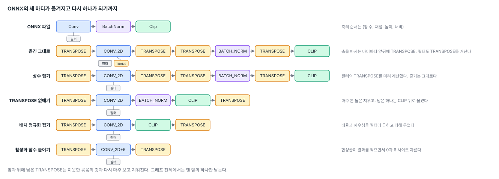
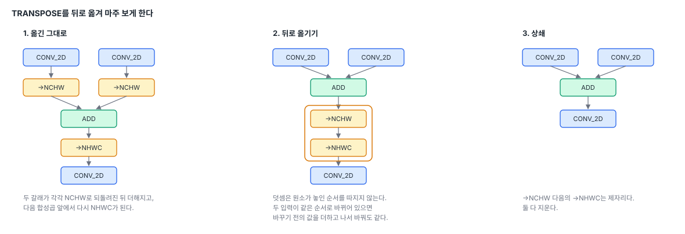
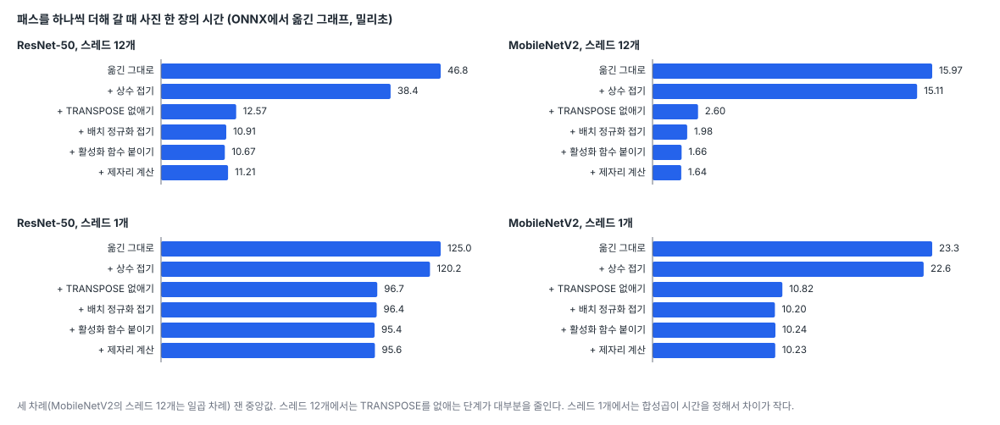

# 그래프 최적화

[26장](ch26_graph_interpreter.md)부터
[29장](ch29_integer_inference.md)까지 우리는 **변환기가 다듬어 준
그래프**를 실행했습니다. `.tflite` 파일에는 배치 정규화가
없었고(27.7절), ReLU는 노드가 아니라 합성곱의 설정이었고(26.4절), 입력의
정규화는 첫 층의 가중치에 들어가 있었습니다. 그때마다 "30장에서 직접
합니다"라고 적었습니다.

이 장에서 그 일을 합니다. 아무도 다듬지 않은 그래프를 받아, 실행하기
전에 **같은 답을 내는 더 싼 그래프로 고쳐 씁니다**. 그 일을 **그래프
최적화**<sup>graph optimization</sup>라고 합니다.

다듬지 않은 그래프를 얻으려면 다른 형식이 필요합니다. PyTorch가 내보내는
ONNX입니다. 그래서 이 장의 앞 절반에서는 ONNX 파일을 읽고, 뒤 절반에서는
그래프를 고쳐 씁니다.

결과를 미리 적어 둡니다.

- ONNX 파일을 읽습니다. Protocol Buffers를 푸는 코드가 240줄, ONNX의
  메시지를 읽는 코드가 460줄입니다.
- PyTorch에서 최적화를 끄고 내보낸 ResNet-50은 옮기면 노드가 448개이고,
  패스 여덟 개를 거치면 73개가 됩니다. MobileNetV2는 414개에서
  65개입니다. 변환기가 만든 `.tflite`의 그래프와 노드의 수가 같아집니다.
- 고쳐 쓴 그래프의 답은 고치기 전과 100만분의 6 안에서 같고, ONNX
  Runtime의 답과 10만분의 3 안에서 같습니다.
- 시간은 스레드 12개에서 ResNet-50이 46.8밀리초에서 10.67밀리초,
  MobileNetV2가 15.97밀리초에서 1.66밀리초가 됩니다. 그 대부분은 배치
  정규화가 아니라 **축의 순서를 바꾸는 노드**를 없앤 데서 옵니다. 그
  노드는 우리가 옮기면서 넣은 것입니다.
- 변환기가 준 `.tflite`에도 남은 일이 있었습니다. `PAD`를 합성곱에
  합치면 MobileNetV2의 중간 결과의 메모리가 9.8MB에서 6.0MB가 되고
  시간이 2.11밀리초에서 1.64밀리초가 됩니다.
- 결과를 입력이 있던 곳에 적는 제자리 계산은 ResNet-50의 메모리를
  9.6MB에서 7.2MB로 줄입니다. 시간은 달라지지 않습니다.

| 하는 일 | 절 |
|---|---|
| 다듬지 않은 그래프를 구한다 | 30.1 |
| Protocol Buffers를 읽는다 | 30.2 |
| ONNX 파일을 읽는다 | 30.3 |
| 우리 그래프로 옮긴다 | 30.4 |
| 고쳐 쓰는 틀을 만든다 | 30.5 |
| 상수를 접는다 | 30.6 |
| 축을 바꾸는 노드를 없앤다 | 30.7 |
| 배치 정규화를 접는다 | 30.8 |
| 활성화 함수를 붙인다 | 30.9 |
| `PAD`를 합친다 | 30.10 |
| 제자리에서 계산한다 | 30.11 |
| 시간을 잰다 | 30.12 |

## 30.1 다듬지 않은 그래프를 구한다

[27장](ch27_convolution.md)의 ResNet-50을 PyTorch에서 보면 합성곱마다
뒤에 배치 정규화가 있고 그 뒤에 ReLU가 있습니다. `.tflite`로 바꾸면 그
셋이 노드 하나가 됩니다. 변환기(`litert-torch`)가 한 일입니다.

같은 모델을 ONNX로 내보낼 때도 PyTorch는 보통 같은 일을 하는데, 끌 수
있습니다.

```python
{{#include ../../../reference/ch30_make_onnx.py:66:80}}
```

`training=PRESERVE`는 배치 정규화를 합성곱에 접어 넣지 않게 하고,
`do_constant_folding=False`는 상수끼리의 계산을 미리 해 두지 않게
합니다.[^torch-export] 모델은 `eval()` 상태이므로 배치 정규화는 학습이
남긴 평균과 분산을 씁니다. 추론할 때의 계산 그대로이고, 노드만 합쳐지지
않은 것입니다.

두 선택지는 PyTorch의 예전 내보내기(`dynamo=False`)에만 있습니다. 새
내보내기에서는 쓰지 않는 것으로 표시되어 있습니다. 이 장은 최적화하지
않은 그래프가 필요해서 예전 것을 썼습니다.

가중치는 [27장](ch27_convolution.md)과 같습니다. 그래서 답도 같아야 합니다. 정답은 ONNX
Runtime으로 만들었습니다. ONNX Runtime도 그래프를 고치지 않게 하고
실행했습니다.

```text
{{#include output/ch30_make_onnx.txt}}
```

`.tflite`의 ResNet-50은 노드가 78개였습니다. 여기는 179개입니다. 배치
정규화 53개와 ReLU 49개가 따로 있습니다. `Identity` 4개는 값이 똑같은
가중치를 내보내기가 하나로 묶으면서 생긴 것으로 보입니다. 가중치를
모두 초기값으로 두고 내보내면 그 수가 200개로 늘어납니다.

## 30.2 Protocol Buffers를 읽는다

ONNX 파일은 Protocol Buffers(protobuf) 메시지 하나입니다. 26.3절의
FlatBuffers와 같은 회사에서 나온 형식이고, 설계가 반대입니다.

| | FlatBuffers (`.tflite`) | Protocol Buffers (`.onnx`) |
|---|---|---|
| 필드를 찾는 법 | 표(vtable)에서 위치를 읽는다 | 앞에서부터 차례로 읽는다 |
| 읽기 전에 할 일 | 없다. 파일을 그대로 쓴다 | 한 번 훑어 풀어야 한다 |
| 숫자의 크기 | 고정 | 작은 수는 짧게 |
| 정렬 | 맞춰져 있다 | 없다 |

FlatBuffers는 풀지 않고 읽는 형식이었고, Protocol Buffers는 푸는
형식입니다. 메시지는 필드를 이어 붙인 것이고, 원하는 필드가 어디
있는지는 앞의 필드를 지나가 봐야 압니다.

필드 하나는 **꼬리표**<sup>tag</sup>와 값입니다. 꼬리표는 필드의 번호와
값을 적은 방법을 한 숫자에 담습니다: `(번호 << 3) | 방법`. 방법은 넷이
쓰입니다.[^protobuf]

```rust
{{#include ../../../crates/badak_formats/src/protobuf.rs:field}}
```

꼬리표와 정수는 **길이가 변하는 정수**<sup>varint</sup>로 적습니다.

```rust
{{#include ../../../crates/badak_formats/src/protobuf.rs:varint}}
```

`mobilenetv2.onnx`의 첫 스물네 바이트를 손으로 읽어 봅니다.

```text
08 08                      꼬리표 0x08 = (1 << 3) | 0 → 필드 1, 정수.  값 8
12 07 70 79 74 6f 72 63 68 꼬리표 0x12 = (2 << 3) | 2 → 필드 2, 바이트 7개. "pytorch"
1a 06 32 2e 31 34 2e 31    꼬리표 0x1a = (3 << 3) | 2 → 필드 3, 바이트 6개. "2.14.1"
3a ef ed e3 06             꼬리표 0x3a = (7 << 3) | 2 → 필드 7, 바이트 14,218,991개
```

마지막 줄의 길이 `ef ed e3 06`이 varint입니다. 바이트마다 아래 7비트를
떼어 낮은 자리부터 붙이면
`0x6f + (0x6d << 7) + (0x63 << 14) + (6 << 21)` = 14,218,991입니다.
파일의 나머지 거의 전부가 필드 7 하나입니다.

필드 1이 무엇이고 필드 7이 무엇인지는 **바이트에 없습니다**. 읽는 쪽이
`.proto` 파일을 보고 알아야 합니다. ONNX의 `onnx.proto`에 `ModelProto`의
1번은 `ir_version`, 2번은 `producer_name`, 3번은 `producer_version`,
7번은 `graph`라고 적혀 있습니다.[^onnx-proto] 형식의 버전이 8이고,
PyTorch 2.14.1이 만들었고, 나머지는 그래프입니다.

필드 하나를 읽는 코드는 이것이 전부입니다.

```rust
{{#include ../../../crates/badak_formats/src/protobuf.rs:next}}
```

안에 든 메시지도 "길이가 앞에 붙은 바이트"여서 문자열과 구별되지
않습니다. 그 바이트를 다시 메시지로 읽을지는 부르는 쪽이 정합니다.

숫자 여러 개는 두 가지로 적힐 수 있습니다. 값마다 꼬리표를 붙이거나,
꼬리표 하나 뒤에 값을 이어 붙입니다. 읽는 쪽은 둘 다 받아야 합니다.

```rust
{{#include ../../../crates/badak_formats/src/protobuf.rs:packed}}
```

26.3절에서처럼 파일을 믿지 않습니다. 길이는 남은 바이트 수와 견주고,
varint는 열 바이트에서 끊고, 모르는 방법은 거절합니다. 테스트 가운데
하나는 올바른 파일을 모든 길이에서 잘라 넣어 보고, 어디서 잘라도 오류가
될 뿐 프로그램이 죽지 않는지를 봅니다.

## 30.3 ONNX 파일을 읽는다

ONNX의 그래프를 `.tflite`의 그래프와 견주면 이렇습니다.

| | `.tflite` | ONNX |
|---|---|---|
| 값을 가리키는 법 | 번호 | 이름(문자열) |
| 연산의 종류 | 번호 (`CONV_2D`는 3) | 이름 (`"Conv"`) |
| 연산의 설정 | 연산마다 정해진 표 | 이름이 붙은 속성들의 목록 |
| 중간 값의 형상 | 적혀 있다 | 없어도 된다 |
| 사진의 축 | 장 수, 높이, 너비, 채널 | 장 수, 채널, 높이, 너비 |
| 연산의 뜻이 바뀌면 | 연산마다 버전 번호 | 파일 전체에 버전 번호 하나(opset) |

읽은 것을 담는 타입입니다.

```rust
{{#include ../../../crates/badak_formats/src/onnx.rs:types}}
```

노드 하나를 읽는 코드는 필드의 번호를 뜻에 대응시키는 것이 전부입니다.

```rust
{{#include ../../../crates/badak_formats/src/onnx.rs:node}}
```

속성에는 값이 들어갈 필드가 종류마다 따로 있고(정수는 3번, 실수는 2번,
정수 여럿은 8번), 어느 필드를 봐야 하는지는 20번 필드에 적혀 있습니다.

가중치는 `TensorProto`입니다.

```rust
{{#include ../../../crates/badak_formats/src/onnx.rs:tensor}}
```

값이 `raw_data`에 리틀 엔디언 바이트로 들어 있으면
[6장](../part1/ch06_model_files.md)의 safetensors처럼 파일을 매핑한
메모리를 그대로 빌려 쓸 수 있습니다. 문제가 하나 있습니다.
**정렬**입니다. Protocol Buffers는 바이트가 4의 배수인 주소에서
시작하도록 맞춰 주지 않습니다. 앞의 이름 한 글자에 따라 어긋납니다.
6.4절에서 만든 `Tensor::from_bytes`는 주소가 맞으면 빌리고 맞지 않으면
복사합니다. 실제로 얼마나 맞는지 봅니다.

```text
{{#include output/ch30_inspect.txt}}
```

가중치 텐서 262개 가운데 파일을 빌려 쓰는 것이 47개입니다. 넷에 하나꼴로
맞을 것을 기대했고, 그보다 조금 적습니다. 나머지는 복사합니다. 풀지 않고
쓰는 형식(26.3절)과 푸는 형식의 차이가 여기서 드러납니다.

처음 여섯 노드가 30.1절에서 말한 구조입니다. 합성곱, 배치 정규화, 그리고
`Clip`입니다. 0과 6은 `Constant` 노드 둘이 내놓습니다. MobileNetV2의
활성화 함수는 ReLU6이고, ONNX에는 그런 연산이 없어서 "0과 6 사이로
자르기"로 적혀 있습니다.

값을 다른 파일에 둔 텐서(2GB를 넘는 모델이 그렇게 합니다), 성긴 텐서,
노드 안에 든 그래프(조건문과 반복문)는 읽지 않습니다. 만나면 거절합니다.

## 30.4 우리 그래프로 옮긴다

읽은 것을 26.5절의 `Graph`로 옮깁니다. 해석기는 파일 형식을
모르므로(26.5절) 옮기기만 하면 실행할 수 있습니다.

옮기는 일은 일부러 **기계적으로** 합니다. 노드 하나를 보고 그 노드만
옮기고, 이웃을 보지 않습니다. 이웃을 보는 일은 뒤의 패스가 합니다.
그렇게 나누어야 옮기는 코드가 형식마다 따로 있어도 최적화는 하나만
있으면 됩니다.

### 축의 순서를 노드마다 바꾼다

가장 큰 문제는 축의 순서입니다. ONNX의 사진은
`(장 수, 채널, 높이, 너비)`이고 우리 커널은
`(장 수, 높이, 너비, 채널)`만 압니다(27.1절). 약자로 NCHW와 NHWC입니다.

기계적으로 옮기려면 이렇게 합니다. 축의 순서를 따지는 노드마다 **앞에서
NHWC로 바꾸고, 계산하고, 뒤에서 NCHW로 되돌립니다**.

```rust
{{#include ../../../crates/badak_graph/src/onnx.rs:wrapped}}
```

합성곱 하나가 노드 셋이 됩니다. 필터도 축이 다릅니다. ONNX는 `(출력
채널, 입력 채널, 높이, 너비)`이고 우리는 `(출력 채널, 높이, 너비, 입력
채널)`입니다. 필터의 값을 옮기면서 바로 바꿔 놓을 수도 있지만 그러지
않고, 필터를 읽는 `TRANSPOSE` 노드를 하나 더 둡니다.

```rust
{{#include ../../../crates/badak_graph/src/onnx.rs:conv}}
```

깊이별 합성곱(27.6절)은 ONNX에 따로 없습니다. 채널을 묶음으로 나누는
합성곱(`group`)에서 묶음의 수가 채널의 수와 같은 경우입니다.

원소마다 하는 연산(`Relu`, `Clip`, `Add`)은 축의 순서를 따지지 않으므로
그대로 옮깁니다. `Gemm`은 선형 층이 되고, 사진 전체의 평균
(`GlobalAveragePool`)은 27.7절의 `MEAN`이 됩니다.

### 패딩하는 길이를 숫자로 받는다

`.tflite`는 패딩하는 방법을 규칙의 이름(`SAME`, `VALID`)으로 적었습니다.
ONNX는 숫자로 적습니다: `pads = [위, 왼쪽, 아래, 오른쪽]`.[^onnx-conv]
PyTorch가 숫자로 정하기 때문입니다. 27.2절에서 변환기가 스트라이드 2인 합성곱
앞에 `PAD` 노드를 따로 둔 까닭을 짐작만 했는데, 여기서 확인됩니다.
스트라이드가 2인 첫 합성곱의 `pads`가 `[1, 1, 1, 1]`입니다(30.3절의 출력).
PyTorch의 "위아래 하나씩"은 `SAME`("아래에만 하나")과 달라서 규칙의
이름으로는 적을 수 없었습니다.

우리 그래프가 숫자를 받게 합니다.

```rust
{{#include ../../../crates/badak_graph/src/graph.rs:padding}}
```

27.2절의 `Axis::new`에 경우가 하나 늘어납니다. 패딩한 입력에 `Valid`를 한
것과 같습니다. 커널은 고칠 것이 없습니다. 패딩한 위치를 읽으면 0으로 보는
것은 그대로이고, 어디가 패딩한 위치인지를 정하는 숫자만 달라집니다.

### 커널 넷을 더하고 형상을 구한다

커널이 넷 늘었습니다. 배치 정규화, `Clip`, 행렬로 펴기(`Flatten`),
그대로 내놓기(`Identity`)입니다. 배치 정규화가 가장 깁니다.

```rust
{{#include ../../../crates/badak_graph/src/kernels.rs:batch_norm}}
```

채널마다 곱할 수 하나와 더할 수 하나입니다. 그 둘을 실행할 때마다 다시
구합니다. 배율과 평균과 분산이 상수라는 것을 커널은 모르기 때문입니다.
그것을 아는 것은 그래프이고, 30.8절에서 그 사실을 씁니다.

ONNX 파일에는 중간 값의 형상이 없습니다. 26.7절에서 해석기가 하던
계산(커널의 `shapes`를 순서대로 부르기)을 그래프의 함수로 꺼냈습니다.

```rust
{{#include ../../../crates/badak_graph/src/graph.rs:infer_shapes}}
```

### 옮긴 그대로 실행하면 네 배 느리다

옮긴 그래프는 그대로 실행됩니다.

```text
{{#include output/ch30_verify.txt}}
```

"옮긴 그대로"의 열이 ONNX Runtime과의 가장 큰 차이입니다. 10만분의 3
안입니다. [27장](ch27_convolution.md)에서 `.tflite`가 LiteRT와 낸 차이와
같은 크기입니다.

그런데 노드가 179개에서 448개로 늘었습니다. 그 가운데 269개가
`TRANSPOSE`입니다. 시간은 스레드 12개에서 46.8밀리초입니다.
[28장](ch28_conv_kernels.md)에서 같은 모델을 11.1밀리초에 돌렸으니 네 배
느려졌습니다.

이제 이것을 고쳐 씁니다.

## 30.5 고쳐 쓰는 틀을 만든다

그래프를 고쳐 쓰는 규칙 하나를 **패스**<sup>pass</sup>라고 합니다.
패스는 그래프에서 정해진 패턴을 찾아 다른 것으로 바꿉니다. "합성곱 뒤에
배치 정규화가 있으면 하나로"가 패스 하나입니다.

패턴을 찾으려면 이웃을 알아야 합니다. 26.5절의 그래프는 노드가 값의
번호를 가지고 있을 뿐이어서, "이 값을 누가 만드는가", "이 값을 누가
읽는가"를 물으려면 표를 만들어야 합니다.

```rust
{{#include ../../../crates/badak_graph/src/optimize.rs:uses}}
```

`only`가 패스마다 나오는 조건입니다. **값을 없애려면 그 값을 읽는 것이
하나뿐이어야 합니다.** 합성곱의 결과를 배치 정규화만 읽는다면 둘을 합쳐
그 값을 없애도 됩니다. 다른 노드도 읽고 있다면 그 노드는 정규화하기 전의
값을 원하는 것이므로 없앨 수 없습니다. 그래프의 출력이어도
마찬가지입니다.

패스는 노드를 직접 지우지 않고 읽는 쪽의 연결만 바꿉니다. 그러면 예전
노드는 결과를 아무도 읽지 않게 되고, 그런 노드를 한꺼번에 치웁니다.

```rust
{{#include ../../../crates/badak_graph/src/optimize.rs:prune}}
```

값도 치웁니다. 접어 넣고 남은 예전 필터와 배치 정규화의 값이 여기서
사라집니다. 치우지 않으면 가중치가 메모리에 두 벌 남습니다.

패스는 다른 패스가 할 일을 만듭니다. 축을 바꾸는 노드 둘이 지워져야
합성곱과 배치 정규화가 이웃이 되고, 필터가 상수가 되어야 배치 정규화를
접을 수 있고, 배치 정규화가 사라져야 합성곱과 ReLU가 이웃이 됩니다. 어떤
순서로 불러야 하는지를 따지는 대신, **아무것도 바뀌지 않을 때까지 모두
되풀이합니다**.

```rust
{{#include ../../../crates/badak_graph/src/optimize.rs:passes}}
```

끝나면 형상을 다시 구합니다. 그 과정에서 26.7절의 `order`가 그래프가
올바른지를 다시 봅니다. 고쳐 쓰다가 그래프를 망가뜨렸다면 여기서
드러납니다.



## 30.6 상수를 접는다

입력이 모두 상수인 노드는 실행할 때마다 같은 값을 내므로 한 번만
계산하면 됩니다. 실행 전에 계산해 결과를 상수로 두는 것이 **상수
접기**<sup>constant folding</sup>입니다.

```rust
{{#include ../../../crates/badak_graph/src/optimize.rs:fold_constants}}
```

눈여겨볼 것은 계산을 **해석기가 쓰는 바로 그 커널**로 한다는 점입니다.
레지스트리에서 커널을 찾아 부릅니다. 접기만을 위한 계산 코드가 따로
없으므로, 미리 계산한 값이 실행 중에 계산했을 값과 다를 수 없습니다.
커널이 있는 연산은 모두 접을 수 있게 되기도 합니다.

우리 그래프에서 접히는 것은 필터의 `TRANSPOSE`입니다. ResNet-50에서
53개, 그리고 `Identity` 4개가 접힙니다. 노드를 훑는 순서가 실행
순서라서, 앞의 것이 상수가 되면 그것을 읽는 뒤의 노드도 같은 차례에
접힙니다.

30.4절에서 필터를 옮기면서 바로 바꿔 놓지 않은 까닭이 여기 있습니다.
옮기는 코드는 "축을 바꾸는 노드를 거친다"고만 적고, 그것을 미리 계산해도
된다는 판단은 이 패스가 합니다. 옮기는 코드가 형식마다 늘어나도 그
판단은 한 곳에 있습니다.

## 30.7 축을 바꾸는 노드를 없앤다

4.8절에서 "그래프 전체를 미리 아는 엔진은 불필요한 전치를 실행 전에 찾아
없앨 수 있다"고 적었습니다. 여기서 그 일을 합니다.

합성곱 뒤에는 NCHW로 되돌리는 `TRANSPOSE`가 있고, 바로 뒤 배치 정규화
앞에는 NHWC로 바꾸는 `TRANSPOSE`가 있습니다. 둘을 이어서 하면 원래
순서로 돌아옵니다.

```rust
{{#include ../../../crates/badak_graph/src/optimize.rs:cancel_transposes}}
```

두 순서를 합친 것이 "0, 1, 2, 3"이면 처음 값을 바로 읽게 하고, 아니면
`TRANSPOSE` 하나로 합칩니다.

이것만으로는 다 지워지지 않습니다. 배치 정규화와 다음 합성곱 사이에
`Clip`이 끼어 있습니다. `Clip`은 NCHW인 값을 그대로 받아 그대로
내놓으므로, 앞의 `TRANSPOSE`와 뒤의 `TRANSPOSE`가 이웃이 아닙니다.

`Clip`은 원소마다 하는 연산이어서 원소가 어디에 놓였는지를 따지지
않습니다. "축을 바꾸고 자르기"와 "자르고 축을 바꾸기"는 같은 값입니다.
그러니 `TRANSPOSE`를 `Clip`의 **뒤로 옮길 수 있습니다**. 옮기면 다음
합성곱 앞의 `TRANSPOSE`와 이웃이 되고, 지워집니다.

```rust
{{#include ../../../crates/badak_graph/src/optimize.rs:sink_transposes}}
```

덧셈은 조건이 하나 더 있습니다. 두 입력이 **같은 순서로** 바뀌어 있어야
합니다. 한쪽만 바뀌어 있으면 원소의 짝이 달라지므로 옮길 수 없습니다.
ResNet의 건너뛰는 덧셈은 두 입력이 모두 합성곱(과 배치 정규화)에서 오고
둘 다 NCHW로 되돌려져 있어서 조건이 맞습니다.



`TRANSPOSE`는 한 번에 노드 하나씩 출력 쪽으로 갑니다. 그래서 이 패스는
언젠가 멈춥니다. 더 갈 곳이 없으면 그곳에 남습니다.

그래프의 끝에 형상만 바꾸는 노드가 남습니다. 평균을 낸 결과
`(1, 1, 1, 2048)`을 NCHW `(1, 2048, 1, 1)`로 되돌리고, 그것을 행렬
`(1, 2048)`로 폅니다. 길이가 1인 축을 옮기는 `TRANSPOSE`는 원소를 하나도
옮기지 않고 형상만 바꿉니다. 그런 것을 찾아 지우고, "축을 남기는 평균 +
행렬로 펴기"를 "축을 남기지 않는 평균" 하나로 바꾸는 패스를
더했습니다(`simplify_reshapes`). 이 패스는 값의 **형상**을 봐야 판단할
수 있습니다. 30.4절에서 형상을 미리 구해 둔 까닭입니다.

결과입니다. ResNet-50의 `TRANSPOSE` 269개가 하나가 됩니다. 남는 하나는
맨 앞에서 입력을 NHWC로 바꾸는 것입니다. 입력은 NCHW로 들어오고 첫
합성곱은 NHWC를 원하므로 이것은 지울 수 없습니다. 변환기가 만든
`.tflite`에도 같은 곳에 하나가 있었습니다(27.1절).

## 30.8 배치 정규화를 접는다

**배치 정규화**<sup>batch normalization</sup>는 학습을 쉽게 하려고 넣는
층입니다. 채널마다 값의 평균을 0, 분산을 1로 맞춘 다음, 학습한 배율을
곱하고 편향을 더합니다. 학습할 때는 평균과 분산을 그때그때의 입력에서
구하고, 추론할 때는 학습이 남긴 값을 씁니다. 그래서 추론할 때의 배치
정규화는 채널마다 숫자 둘로 줄어듭니다.

```text
y = (x − 평균) / √(분산 + ε) × 배율 + 편향
  = a × x + b        a = 배율 / √(분산 + ε),   b = 편향 − 평균 × a
```

배치 정규화를 제안한 논문이 이 점을 적어 두었습니다. 추론할 때는 평균과
분산이 고정되어 있으므로 정규화는 활성값마다 적용하는 선형 변환일
뿐이라고 했습니다.[^batch-norm]

바로 앞이 합성곱이면 더 줄일 수 있습니다. 합성곱의 출력 채널 하나는
`Σ w × x + c`입니다(`c`는 합성곱의 편향). 거기에 `a`를 곱하고 `b`를
더하면

```text
a × (Σ w × x + c) + b  =  Σ (a × w) × x  +  (a × c + b)
```

곱셈을 합 안으로 넣었을 뿐입니다. 오른쪽은 **필터가 `a × w`이고 편향이
`a × c + b`인 합성곱**입니다. 필터와 편향을 미리 그렇게 고쳐 두면 배치
정규화 노드는 필요 없습니다. 3.4절에서 "활성화 함수 없이 이어진 선형
연산은 미리 곱해 하나로 합칠 수 있다"고 한 것이 이 계산이고, 26.4절에서
변환기가 입력의 정규화를 첫 층에 접어 넣은 것도 같은 계산입니다.

```rust
{{#include ../../../crates/badak_graph/src/optimize.rs:fold_batch_norms}}
```

조건이 넷입니다. 코드의 `continue`가 하나씩입니다.

- 합성곱의 결과를 배치 정규화**만** 읽어야 합니다(`only`).
- 합성곱에 활성화 함수가 붙어 있지 않아야 합니다. 사이에 직선이 아닌
  것이 끼면 곱셈을 합 안으로 넣을 수 없습니다.
- 필터와 편향이 상수여야 합니다. 그래서 상수 접기가 먼저 되어 있어야
  합니다.
- 배치 정규화의 네 값이 상수여야 합니다.

필터에서 출력 채널이 놓인 축이 합성곱과 깊이별 합성곱에서 다르다는
것만 조심하면 됩니다(27.6절).

ResNet-50의 배치 정규화 53개, MobileNetV2의 52개가 모두 접힙니다.

**답이 비트까지 같지는 않습니다.** 접기 전에는 `(Σ w × x) × a + b`를
계산했고 접은 뒤에는 `Σ (a × w) × x + b'`를 계산합니다. 실수로는 같지만
`f32`로는 반올림이 다른 곳에서 일어납니다. 30.4절의 표에서 "최적화한
것"의 열이 "옮긴 그대로"와 조금 다른 까닭이고, 두 그래프의 점수를 직접
견주면 가장 큰 차이가 ResNet-50에서 100만분의 4.8, MobileNetV2에서
100만분의 5.5입니다(점수는 10 안팎의 값입니다).

## 30.9 활성화 함수를 붙인다

24.7절에서 활성화 함수와 곱셈을 손으로 합쳤고, "이웃한 연산을 프로그램이
찾을 수 있게 되면 자동으로 합친다"고 했습니다.
[28장](ch28_conv_kernels.md)의 합성곱 커널은 결과를 적으면서 곧바로,
방금 적은 값이 캐시에 있는 동안 활성화 함수를 적용합니다. 그 커널을 쓰게
하려면 그래프에서 "합성곱 뒤의 ReLU"를 찾아 합성곱의 설정으로 옮기면
됩니다.

```rust
{{#include ../../../crates/badak_graph/src/optimize.rs:fuse_activations}}
```

붙일 수 있는 활성화 함수는 커널이 아는 것입니다. `Clip`은 끝값이 0과
6이면 ReLU6이고, −1과 1이면 26.5절의 `ReluN1To1`입니다. 다른 끝값은
붙이지 않고 `Clip` 노드로 남깁니다.

조건은 앞과 같습니다. 앞 연산의 결과를 활성화 함수만 읽어야 합니다.
ResNet의 덧셈 뒤에 있는 ReLU도 붙습니다. 덧셈 커널도 활성화 함수를 이어서
하기 때문입니다(28.4절).

여기까지가 ONNX에서 온 그래프에 하는 일의 전부입니다. ResNet-50의
결과입니다.

```text
{{#include output/ch30_optimize.txt:1:30}}
```

노드 448개가 73개가 되고, 값 712개가 182개가 됩니다. 상수의 원소 수가
조금 준 것은 배치 정규화의 값(채널마다 넷)이 사라지고 편향(채널마다
하나)이 생겼기 때문입니다. `IDENTITY 지우기`가 0인 것은 이 모델의
`Identity`가 모두 상수를 읽고 있어서 상수 접기가 먼저 처리했기
때문입니다.

이 패스의 효과는 시간보다 **메모리**에서 큽니다. MobileNetV2의 중간
결과의 메모리가 9.6MB에서 6.0MB가 됩니다. 가장 큰 텐서(`112 × 112 × 96`,
4.8MB)를 `Clip`이 읽어 같은 크기의 텐서를 또 만들고 있었습니다. 노드가
사라지면 그 텐서도 사라집니다.

## 30.10 `PAD`를 합친다

여기까지가 변환기가 해 주던 일입니다. 변환기가 **하지 않은** 일이 하나
있었습니다. 27.7절의 `PAD`입니다. MobileNetV2의 `.tflite`에는 스트라이드 2인
합성곱 앞에 `PAD` 노드가 다섯 개 있고, 28.10절에서 그것이 시간의
16%였습니다.

`PAD`는 텐서를 가장자리에 0을 두른 더 큰 텐서로 **복사**합니다. 합성곱은
패딩한 위치를 0으로 읽을 줄 압니다. 30.4절에서 합성곱이 덧댈 길이를 숫자로
받게 했으므로, `PAD`가 하려던 일을 합성곱에 알려 주기만 하면 됩니다.

```rust
{{#include ../../../crates/badak_graph/src/optimize.rs:fuse_pads}}
```

풀링에는 합치지 않습니다. 최댓값 풀링은 패딩한 위치를 아예 보지
않습니다(27.7절). 0을 패딩한 텐서에서 최댓값을 구하는 것과 다릅니다. 창
안의 값이 모두 음수이면 앞의 것은 음수를, 뒤의 것은 0을 냅니다.
ResNet-50의 `PAD` 다섯 가운데 풀링 앞의 하나가 그래서 남습니다.

```text
{{#include output/ch30_optimize.txt:62:92}}
```

답은 한 비트도 달라지지 않습니다. 0을 곱해 더하던 것을 건너뛸 뿐입니다.
MobileNetV2의 메모리가 9.8MB에서 6.0MB가 되는 것은 30.9절과 같은
까닭입니다. 가장 큰 텐서를 패딩해 복사하던 노드가 사라졌습니다.

ONNX에서 온 그래프에는 이 패스가 할 일이 없습니다. 처음부터 덧댈 길이가
합성곱에 적혀 있기 때문입니다. 형식이 무엇을 표현할 수 있는가에 따라
그래프의 구조가 달라졌습니다.

LiteRT에도 같은 일을 하는 코드가 있습니다. 변환기가 아니라 XNNPACK에
있고, 실행 직전에 합칩니다.[^xnnpack-pad]

## 30.11 제자리에서 계산한다

26.14절에서 남긴 일입니다. `ADD`의 두 입력 가운데 하나가 이 단계에서
수명이 끝난다면 결과를 그 입력이 있던 곳에 적어도 됩니다. 그러면 결과는
공간을 새로 얻지 않습니다.

이것은 그래프를 고쳐 쓰는 일이 아닙니다. 노드는 그대로이고 **계획**이
달라집니다. 26.9절의 메모리 계획 앞에 단계를 하나 넣습니다.

```rust
{{#include ../../../crates/badak_graph/src/interpreter.rs:share}}
```

조건 넷을 주석에 적었습니다. 셋째와 넷째는 놓치기 쉽습니다. `x + x`의
한쪽을 덮어쓰면 다른 쪽도 바뀝니다.

물려받은 값은 공간을 따로 얻지 않고, 물려준 값의 수명이 길어집니다.
그래서 26.9절의 계획기는 고칠 것이 없습니다. 수명의 목록이 짧아질
뿐입니다.

커널도 달라져야 합니다. 26.6절의 `Kernel`에 함수가 둘 늘었습니다.

```rust
{{#include ../../../crates/badak_graph/src/kernels.rs:kernel}}
```

덧셈의 제자리 버전입니다.

```rust
{{#include ../../../crates/badak_graph/src/kernels.rs:binary_in_place}}
```

`run`과 따로 있어야 하는 까닭은 Rust의 규칙입니다. 26.10절의 해석기는 한
단계의 입력을 읽는 참조(`&[f32]`)로, 출력을 쓰는 참조(`&mut [f32]`)로
커널에 넘깁니다. 같은 메모리를 가리키는 읽는 참조와 쓰는 참조를 함께
만드는 것은 `unsafe` 안에서도 해서는 안 됩니다. 컴파일러는 둘이 겹치지
않는다고 가정하고 코드를 만듭니다. 그래서 제자리 단계에서는 덮어쓸
입력의 읽는 참조를 만들지 않고, 커널은 그 입력을 출력의 구간에서
읽습니다. 26.10절의 `check_steps`도 "쓰는 구간은 읽는 구간과 겹치지
않는다"에서 "제자리 단계의 쓰는 구간은 고른 입력 하나와 **정확히 같고**,
나머지와는 겹치지 않는다"로 바뀌었습니다.
[22장](../part3/ch22_memory.md)의 Miri로 이 경로를 확인했습니다.

행렬로 펴기(`FLATTEN`)는 제자리에서 할 일이 **없습니다**. 값은
그대로이고 형상만 다르기 때문입니다.

결과입니다.

```text
{{#include output/ch30_optimize.txt:1:1}}
{{#include output/ch30_optimize.txt:30:30}}
{{#include output/ch30_optimize.txt:32:32}}
{{#include output/ch30_optimize.txt:60:60}}
```

"앞"은 옮긴 그대로의 그래프, "뒤"는 최적화한 그래프입니다.

ResNet-50은 9.63MB에서 7.23MB로 4분의 1이 줄어듭니다. 덧셈 16개를 모두
제자리에서 합니다. 가장 큰 덧셈(`56 × 56 × 256`, 3.2MB)이 입력 둘과 출력
하나를 함께 쥐던 것이 입력 둘로 줄었습니다.

MobileNetV2는 그대로입니다. 이 모델에서 메모리가 가장 많이 드는 순간은
덧셈이 아니라 앞쪽의 합성곱입니다(27.11절). 덧셈 열 개를 제자리에서
하지만 메모리의 최대치와는 상관이 없습니다.

시간은 두 모델 모두 달라지지 않았습니다(30.12절). `Interpreter::new`는
앞 장의 숫자가 그대로 나오도록 두었고, 제자리 계산은
`Interpreter::in_place`로 켭니다.

## 30.12 시간을 잰다

패스를 하나씩 더해 가며 사진 한 장의 시간을 쟀습니다. 단계 하나를 한
번의 실행으로 재고, 실행마다 3초를 쉬고, 세 차례 되풀이해 중앙값을
적습니다(22.12절).

ONNX에서 옮긴 그래프입니다. 시간은 밀리초이고, R은 ResNet-50, M은 MobileNetV2입니다.

| 단계 | 노드 (R / M) | 자리 MB (R / M) | ResNet-50 스레드 1 | 스레드 12 | MobileNetV2 스레드 1 | 스레드 12 |
|---|---|---|---:|---:|---:|---:|
| 옮긴 그대로 | 448 / 414 | 11.05 / 9.64 | 125.0 | 46.8 | 23.3 | 15.97 |
| + 상수 접기 | 391 / 362 | 9.63 / 9.63 | 120.2 | 38.4 | 22.6 | 15.11 |
| + TRANSPOSE 없애기 | 175 / 152 | 9.63 / 9.63 | 96.7 | 12.57 | 10.82 | 2.60 |
| + 배치 정규화 접기 | 122 / 100 | 9.63 / 9.63 | 96.4 | 10.91 | 10.20 | 1.98 |
| + 활성화 함수 붙이기 | 73 / 65 | 9.63 / 6.02 | 95.4 | 10.67 | 10.24 | 1.66 |
| + 제자리 계산 | 73 / 65 | 7.23 / 6.02 | 95.6 | 11.21 | 10.23 | 1.64 |

변환기가 만든 `.tflite`의 그래프입니다.

| 단계 | 노드 (R / M) | 자리 MB (R / M) | ResNet-50 스레드 1 | 스레드 12 | MobileNetV2 스레드 1 | 스레드 12 |
|---|---|---|---:|---:|---:|---:|
| 변환기가 준 그대로 | 78 / 70 | 9.63 / 9.81 | 96.2 | 10.80 | 10.83 | 2.11 |
| + PAD 합치기 | 74 / 65 | 9.63 / 6.02 | 96.1 | 10.51 | 10.53 | 1.64 |
| + 제자리 계산 | 74 / 65 | 7.23 / 6.02 | 96.2 | 10.46 | 10.39 | 1.62 |

MobileNetV2의 스레드 12개 열은 2밀리초 안팎이어서 차례마다 흔들림이
컸습니다. 그 열만 일곱 차례의 중앙값입니다. 원시 결과는 `bench/ch30/`에
있습니다.



네 가지를 알 수 있습니다.

**가장 큰 효과는 `TRANSPOSE`를 없앤 데서 옵니다.** 스레드 12개에서
ResNet-50이 38.4밀리초에서 12.57밀리초가 됩니다. 269개 가운데 필터의
것을 뺀 216개가 사진 크기의 텐서를 통째로 복사하고 있었고, 우리
`TRANSPOSE` 커널은 스레드에 나누지 않습니다. 스레드 하나에서는 비중이
작습니다(120.2 → 96.7밀리초). 합성곱이 느려서 드러나지 않던 것이,
합성곱을 스레드 열둘에 나누자 드러났습니다. 18.9절의 암달의 법칙입니다.

그리고 이 노드는 **우리가 넣은 것**입니다. ONNX 파일에는 `TRANSPOSE`가
하나도 없습니다. 우리 커널이 NHWC만 알아서 옮기면서 생겼습니다. 그러니
이 단계의 이득은 최적화의 성과이기 전에, 기계적으로 옮기느라 치른 비용을
되찾은 것입니다.

**상수 접기도 효과가 보입니다.** ResNet-50에서 46.8 → 38.4밀리초입니다.
필터 2,500만 개의 축을 추론할 때마다 바꾸고 있었습니다. 누구도 일부러
그렇게 짜지는 않겠지만, 기계적으로 옮긴 그래프에는 이런 것이 들어
있습니다.

**배치 정규화 접기는 13~24%입니다.** 스레드 12개에서 ResNet-50이 12.57 →
10.91밀리초, MobileNetV2가 2.60 → 1.98밀리초입니다. 배치 정규화는 원소
하나에 곱셈 하나와 덧셈 하나이고, 합성곱에 견주면 계산은 거의 없습니다.
시간이 드는 것은 텐서를 한 번 더 읽고 쓰는 일입니다. 스레드 하나에서는
0~6%입니다.

**활성화 함수 붙이기는 MobileNetV2에서만 효과가 보입니다**(1.98 →
1.66밀리초). 16%입니다. ResNet-50은 2%이고, 차례마다의 흔들림 안입니다.
MobileNetV2는 합성곱 하나가 하는 일이 적어서 텐서를 한 번 더 훑는 비용이
상대적으로 큽니다.

**제자리 계산은 시간을 바꾸지 않습니다.** 덧셈이 읽고 쓰는 메모리가
3분의 2가 되지만 덧셈은 전체의 몇 %입니다. 표에서 ResNet-50의 스레드
12개가 10.67에서 11.21밀리초로 늘어 보이는 것은 흔들림입니다. 그 줄의 세
차례가 10.2, 11.2, 11.6밀리초였고, `.tflite` 쪽의 같은 단계는 10.51에서
10.46밀리초입니다.

변환기가 준 `.tflite`에서는 `PAD` 합치기가 MobileNetV2를 스레드 12개에서
2.11밀리초에서 1.64밀리초로 줄입니다. 28.10절에서 본 16%와 견줄
크기입니다. ResNet-50은 3%입니다(10.80 → 10.51밀리초). `PAD`가 붙은
텐서가 전체에 견주어 작습니다.

ONNX에서 출발해 최적화한 그래프와, 변환기가 만든 `.tflite`를 최적화한
그래프는 시간이 같습니다. 노드의 수도 같습니다(MobileNetV2는 둘 다
65개). 다른 방법으로 같은 그래프를 얻었습니다.

### ONNX Runtime은 레이아웃을 바꿔 빨라진다

ONNX Runtime은 그래프 최적화를 단계로 나누어 켜고 끌 수 있습니다.
단계마다 고친 그래프를 파일로 받아 노드를 세고 시간을 쟀습니다.

```text
{{#include output/ch30_onnxruntime.txt}}
```

"기본"에서 배치 정규화와 `Identity`가 사라집니다. "확장"에서 활성화
함수가 합성곱에 붙습니다(`FusedConv`). 여기까지가 우리가 한 일과
같습니다. "모두"는 한 가지를 더 합니다. 합성곱의 **메모리 레이아웃을
바꿉니다**. 문서는 이 단계를 28.7절에서 재 본 "채널을 묶는 레이아웃"로
바꾸는 것이라고 설명합니다.[^ort-levels] 우리 기계에서 받은 그래프는
조금 다릅니다. `NhwcFusedConv`라는 노드가 17개 생기고 `Transpose`가 34개
생겼습니다. 이름으로 보면 합성곱 가운데 일부를 NHWC로 계산하게 하고 그
앞뒤에 축을 바꾸는 노드를 넣은 것입니다(해석). 우리가 옮기면서 모든
노드에 한 일을, 이득이 되는 노드에만 골라서 했습니다. 그 단계에서
ResNet-50의 `Add` 노드 16개도 사라졌습니다. 합성곱에 합쳐진 것으로
보입니다. 어느 것도 소스에서 확인하지는 않았습니다.

두 가지가 눈에 띕니다.

- ONNX Runtime은 **최적화를 꺼도 느려지지 않습니다**. 스레드 하나에서
  ResNet-50이 끈 것 17.83밀리초, "확장" 17.63밀리초입니다. 우리
  엔진은 옮긴 그대로가 125.0밀리초, 최적화한 것이 95.4밀리초였습니다.
  차이는 `TRANSPOSE`입니다. ONNX Runtime의 커널은 NCHW를 그대로 받으므로
  바꿀 축이 없습니다.
- ONNX Runtime이 크게 빨라지는 곳은 레이아웃을 바꾸는 마지막 단계입니다
  (ResNet-50, 스레드 하나, 17.63 → 12.37밀리초). 배치 정규화와
  활성화 함수를 합치는 것으로는 거의 달라지지 않습니다.

두 엔진에서 같은 결론이 나옵니다. **노드를 합치는 최적화는 메모리를 한
번 덜 오가는 만큼만 이득**이고, 큰 이득은 메모리 레이아웃과 커널에서 옵니다.
[28장](ch28_conv_kernels.md)에서 본 것과 같습니다.

스레드 하나에서 ONNX Runtime의 ResNet-50은 12.37밀리초이고 우리는
95.4밀리초로, 여덟 배 차이입니다. ONNX Runtime이 정말 코어 하나만 썼는지
따로 봤습니다. 실행에 걸린 시간과 프로세스가 쓴 CPU 시간이
같았습니다(17.9밀리초와 17.9밀리초, 12.0밀리초와 12.0밀리초). 28.9절에서
LiteRT와 벌어져 있던 것과 같은 크기의 격차이고, 그때 본 것처럼 다른 명령
집합을 쓰는 커널일 것으로 짐작합니다. 확인하지 않았습니다.
[31장](ch31_mobile_engines.md)에서 그 엔진의 커널을 읽습니다.

### 최적화는 미리 해 둘 수 있다

최적화에도 시간이 듭니다.

```text
{{#include output/ch30_optimize.txt:1:2}}
{{#include output/ch30_optimize.txt:32:33}}
```

ResNet-50은 파일을 읽고 옮기고 최적화하는 데 64밀리초가 듭니다. 그
가운데 46밀리초가 최적화이고, 대부분은 필터 2,500만 개의 축을 바꾸고
배율을 곱하는 일입니다. 추론 한 번(10.67밀리초)의 여섯 배입니다.
서버에서는 한 번 치르면 그만인 비용이지만, 앱을 켤 때마다 치러야 한다면
다릅니다.

그래서 엔진은 최적화를 **미리 해서 파일로 저장**할 수 있게 합니다. ONNX
Runtime은 이것을 오프라인 방식이라고 부릅니다.[^ort-levels] `.tflite`는
처음부터 그 방식입니다. 변환기가 다듬은 그래프가 파일에 들어 있고,
그래서 26.12절에서 파일을 여는 데 수십 마이크로초면 됐습니다.

우리 엔진에는 그래프를 **쓰는** 코드가 없습니다. 읽을 때마다
최적화합니다.

## 30.13 남긴 일을 적어 둔다

**최적화한 그래프의 저장.** 위에서 말한 대로입니다.

**그 밖의 패스.** 같은 계산을 두 번 하는 노드를 하나로 줄이기, 선형
층이나 합성곱 뒤의 "상수 곱하기"와 "상수 더하기"를 가중치에 넣기(배치
정규화 접기의 일반형), 합성곱 뒤의 덧셈을 합성곱에 합치기, `SAME`으로
패딩하는 합성곱에 `PAD` 합치기를 하지 않았습니다. 이 책의 두 모델에는 그런
패턴이 없거나, 있어도 커널이 받지 못합니다.

**NCHW 커널.** 옮기면서 축을 바꾸는 대신 NCHW를 그대로 계산하는 커널을
둘 수도 있습니다. ONNX Runtime이 그렇게 합니다. 28.7절에서 레이아웃마다
커널이 따로 있어야 한다는 것을 봤습니다. 우리는 커널을 한 벌만 두고
그래프를 고치는 방법을 골랐습니다.

**실행할 때 정해지는 형상.** 패스 가운데 둘이 형상을 봅니다. 입력의
형상을 바꾸면(26.7절) 그 판단이 틀릴 수 있습니다. 이 장의 모델에서는
장 수만 바뀌고, 두 패스의 판단은 장 수와 무관합니다. 일반적으로
그렇다는 보장은 없습니다.

**정수 그래프.** [29장](ch29_integer_inference.md)의 정수 그래프는 건드리지 않습니다. `PAD` 합치기는
패딩하는 값이 0이 아니라 영점이어야 하고, 배치 정규화 접기는 스케일을 다시
정해야 합니다.

**ONNX의 나머지.** 표준 연산 200여 가지 가운데 열네 가지를 옮깁니다. 값을
다른 파일에 둔 모델, 조건문과 반복문, 표준이 아닌 연산은 읽지 않습니다.

**LLM.** 26.13절에서 Llama의 블록을 그래프로 그려 봤습니다. 거기에 이
패스들을 돌리는 일은 하지 않았습니다. 그 엔진은 코드로 적은 채로
남습니다.

## 30.14 실전 엔진에서는

**최적화는 대개 변환기와 엔진 양쪽에 있습니다.** PyTorch의 ONNX
내보내기는 기본값으로 상수를 접고 배치 정규화를 접습니다.[^torch-export]
그 파일을 받은 ONNX Runtime이 다시 단계별로 최적화합니다. LiteRT는
변환기가 대부분을 하고, XNNPACK에 실행 직전에 `PAD`를 합치는 코드가
있습니다.[^xnnpack-pad] 한쪽에서 놓친 것을 다른 쪽이 잡습니다. 이 장에서 변환기가 남긴 `PAD`를
우리가 합친 것이 그 예입니다.

**기기를 아는 최적화와 모르는 최적화가 나뉩니다.** ONNX Runtime의
"기본" 단계는 어느 기기에서 실행하든 맞는 고쳐 쓰기(상수 접기, 배치
정규화 접기)이고, 그 뒤의 단계들은 노드를 어느 장치가 실행할지 정한
다음에, CPU(와 일부 GPU 실행기)가 맡은 노드에만 적용됩니다.[^ort-levels] 합성곱에 활성화
함수를 붙이는 것은 그것을 받는 커널이 있어야 뜻이 있기 때문입니다.
30.9절에서 "커널이 아는 활성화 함수만 붙인다"고 한 것과 같은
이야기입니다. 그래서 문서는 미리 최적화해 저장한 파일을 **같은 설정,
같은 기기**에서 써야 한다고 적습니다.

**제자리 계산은 LiteRT의 계획기에도 있습니다.** 26.14절에서 본 대로
입력과 출력이 자리를 함께 쓸 수 있는 텐서를 찾는 단계가
있습니다.[^litert-inplace]

**ONNX의 그래프는 실행할 수 있는 순서로 적혀 있어야 합니다.** 명세가
그렇게 정합니다.[^onnx-ir] 우리는 26.7절에서처럼 그래도 순서를 다시
계산합니다. 고쳐 쓴 뒤에는 순서가 뒤섞여 있기 때문에 이번에는 꼭 필요한
계산입니다.

## 정리

- 그래프 최적화는 실행 전에 그래프를 같은 답을 내는 더 싼 그래프로 고쳐
  쓰는 일입니다. 규칙 하나가 패스이고, 패스들을 아무것도 바뀌지 않을
  때까지 되풀이합니다.
- 값을 없애는 패스의 조건은 언제나 같습니다. 그 값을 읽는 것이 하나뿐일
  것.
- Protocol Buffers는 앞에서부터 푸는 형식입니다. 필드마다 "번호와
  방법"을 담은 꼬리표가 붙고, 번호의 뜻은 `.proto` 파일에 있습니다.
- ONNX는 값을 이름으로, 연산을 이름과 속성으로 적습니다. 가중치의
  바이트는 정렬되어 있지 않아 대부분 복사해야 합니다.
- 옮기는 일은 기계적으로 하고, 다듬는 일은 패스에 맡깁니다. 축의 순서가
  다른 노드마다 `TRANSPOSE`를 두르고, 필터의 축도 노드로 바꿉니다.
- 상수 접기는 입력이 모두 상수인 노드를 해석기의 커널로 미리
  실행합니다.
- `TRANSPOSE`는 원소마다 하는 연산의 뒤로 옮길 수 있고, 마주 본 둘은
  지워집니다. 269개가 하나가 됩니다.
- 추론할 때의 배치 정규화는 채널마다 `a × x + b`입니다. 앞이 합성곱이면
  필터에 `a`를 곱하고 편향을 고쳐 노드를 없앱니다. 답은 반올림만큼
  달라집니다.
- 활성화 함수와 `PAD`는 그것을 받을 줄 아는 커널이 있을 때 앞뒤의
  연산에 합칩니다. 노드가 사라지면 그 노드가 만들던 텐서도 사라집니다.
- 제자리 계산은 그래프가 아니라 계획을 바꿉니다. Rust에서는 읽는 창과
  쓰는 창이 겹칠 수 없어 커널에 따로 길을 둡니다.
- 시간의 대부분은 우리가 옮기면서 넣은 `TRANSPOSE`를 없앤 데서
  왔습니다. 노드를 합치는 패스들은 메모리를 한 번 덜 오가는 만큼,
  스레드 12개에서 단계마다 2~24%를 줍니다. ONNX Runtime에서도 그런
  패스들의 몫은 작았습니다.

## 연습 문제

1. `mobilenetv2.onnx`의 25번째 바이트부터(`0a a8 01 0a 05 69 6e 70 75
   74 …`) 손으로 읽어 보십시오. 필드 7 안의 첫 필드는 몇 번이고 길이가
   얼마입니까. 그 안의 첫 필드는 무엇입니까. `onnx.proto`의 `GraphProto`와
   `NodeProto`를 보고 뜻을 붙여 보십시오.
2. `PASSES`의 순서를 거꾸로 뒤집고 `ch30_optimize`를 돌려 보십시오.
   결과의 노드 수가 달라집니까. 패스마다 고친 횟수는 어떻습니까.
   `optimize::run`이 패스들을 몇 바퀴 도는지 세도록 고쳐, 순서에 따라
   바퀴 수가 어떻게 달라지는지 보십시오.
3. `fold_batch_norms`에서 `uses.only(x, index)` 조건을 빼면 어떤 그래프에서
   답이 틀려집니까. 그런 그래프를 하나 지어 시험으로 확인해 보십시오.
4. 배치 정규화 앞이 합성곱이 아닐 때는 접을 곳이 없습니다. 그때는 배치
   정규화를 "상수 `a`를 곱하고 상수 `b`를 더하는" 노드로 바꿔 둘 수
   있습니다. `MUL`과 `ADD`가 브로드캐스팅을 받도록 고치고 그 패스를 써
   보십시오. `a`와 `b`를 실행 전에 계산해 두는 것만으로 배치 정규화
   커널보다 빨라집니까.
5. 합성곱 뒤에 "상수 더하기"가 있으면 그 상수를 합성곱의 편향에 넣을
   수 있습니다. ONNX Runtime이 `Conv Add Fusion`이라고 부르는 것입니다.
   패스로 써 보십시오. 조건은 무엇입니까.
6. `sink_transposes`는 `MAX_POOL_2D`를 지나가지 못합니다. 풀링은 축의
   순서를 따지기 때문입니다. 그런데 30.7절의 결과에서 ResNet-50의 풀링
   앞뒤에는 `TRANSPOSE`가 남지 않았습니다. 왜 그런지 옮기는 코드를 보고
   설명해 보십시오.
7. `share`는 입력을 번호 순서로 보고 처음 맞는 것을 고릅니다. 두 입력이
   모두 조건에 맞을 때 어느 쪽을 고르느냐에 따라 자리의 크기가 달라질
   수 있습니까. 달라지는 그래프를 지어 보거나, 달라지지 않는 까닭을
   설명해 보십시오.
8. 합성곱은 제자리에서 할 수 없습니다. 출력 하나가 입력 여러 개를 읽기
   때문입니다. `1 × 1` 합성곱(27.5절)은 어떻습니까. 입력 채널과 출력
   채널의 수가 같다면 제자리에서 할 수 있습니까. 커널이 무엇을 달리해야
   합니까.

## 참고 문헌

[^torch-export]: PyTorch 2.14.1 (커밋 `5c4886908584`),
    `torch/onnx/_internal/torchscript_exporter/utils.py`의 `export`
    설명(316~321번째 줄의 `training`, 385~387번째 줄의
    `do_constant_folding`). 기본값은 `TrainingMode.EVAL`과 `True`입니다
    (231, 236번째 줄). 새 내보내기에서 두 선택지를 쓰지 않는다는 것은
    `torch/onnx/__init__.py` 263~276번째 줄에 있습니다. `EVAL`일 때 배치
    정규화를 합성곱에 접는 코드가 어디인지는 찾아 읽지 않았습니다.
    끄면 배치 정규화 노드가 남는다는 것은 이 장에서 만든 파일로
    확인했습니다.
    <https://github.com/pytorch/pytorch/blob/5c4886908584/torch/onnx/_internal/torchscript_exporter/utils.py>

[^protobuf]: Protocol Buffers 문서, "Encoding". 꼬리표의 식
    `(field_number << 3) | wire_type`, 값을 적는 방법의 표(0 `VARINT`,
    1 `I64`, 2 `LEN`, 5 `I32`. 3과 4는 쓰지 않는 묶음), varint의 정의,
    묶어 적기(packed)가 여기에 있습니다. 시험에 쓴 예(`08 96 01`이 150,
    `12 07 74 65 73 74 69 6e 67`이 `"testing"`)도 이 문서의 것입니다.
    <https://protobuf.dev/programming-guides/encoding/>

[^onnx-proto]: ONNX 1.23.2 (커밋 `e1ac8e74b620`), `onnx/onnx.proto`.
    `ModelProto`(450번째 줄부터), `GraphProto`(565번째 줄), `NodeProto`
    (224번째 줄), `AttributeProto`(138번째 줄), `TensorProto`(608번째
    줄). 이 장의 파서가 읽는 필드의 번호는 모두 이 파일에서 옮겼습니다.
    <https://github.com/onnx/onnx/blob/e1ac8e74b620/onnx/onnx.proto>

[^onnx-ir]: ONNX 1.23.2, `docs/IR.md`, 315번째 줄: "The list of nodes
    defining the top-level computation graph MUST be ordered
    topologically".
    <https://github.com/onnx/onnx/blob/e1ac8e74b620/docs/IR.md>

[^onnx-conv]: ONNX 1.23.2, `docs/Operators.md`의 `Conv`. `pads`의 순서
    (`[x1_begin, x2_begin...x1_end, x2_end,...]`)와 `auto_pad`의 기본값
    `NOTSET`이 여기에 있습니다. 배치 정규화의 식은 같은 문서의
    `BatchNormalization`에 있습니다.
    <https://github.com/onnx/onnx/blob/e1ac8e74b620/docs/Operators.md#Conv>

[^batch-norm]: S. Ioffe, C. Szegedy, "Batch Normalization: Accelerating
    Deep Network Training by Reducing Internal Covariate Shift", 2015.
    arXiv:1502.03167. 3.1절: "Since the means and variances are fixed
    during inference, the normalization is simply a linear transform
    applied to each activation."
    <https://arxiv.org/abs/1502.03167>

[^xnnpack-pad]: XNNPACK (커밋 `cb7016a482d6`), `src/subgraph.c`
    1665번째 줄부터. 주석이 "Try to fuse Constant Pad node downstream
    into [Depthwise] Convolution 2D Node"입니다. 조건을 끝까지 읽지는
    않았습니다. LiteRT가 이 모델에서 실제로 그 길을 탔는지도 확인하지
    않았습니다.
    <https://github.com/google/XNNPACK/blob/cb7016a482d6/src/subgraph.c>

[^ort-levels]: ONNX Runtime 문서, "Graph Optimizations in ONNX
    Runtime". 단계의 구분(basic, extended, layout), 단계마다의 패스 목록
    (`Constant Folding`, `Conv BatchNorm Fusion`, `Conv Activation
    Fusion`, `NCHWc Optimizer`), 온라인과 오프라인 방식, 오프라인으로
    저장한 모델을 같은 설정과 기기에서 써야 한다는 주의가 여기에
    있습니다. ONNX Runtime의 소스는 읽지 못했습니다. 이 장의 표에 있는
    노드의 수와 시간은 1.32.0 버전을 직접 실행해 얻은 것입니다.
    <https://onnxruntime.ai/docs/performance/model-optimizations/graph-optimizations.html>

[^litert-inplace]: LiteRT, `tflite/arena_planner.h` (커밋
    `5d9e2a42e02b`), 79번째 줄의 `InputTensorCanBeShared`와 84번째 줄의
    `IdentifyInPlaceTensors`. 26장에서 확인한 것이고, 조건을 자세히
    읽지는 않았습니다.
    <https://github.com/google-ai-edge/LiteRT/blob/5d9e2a42e02b/tflite/arena_planner.h>
