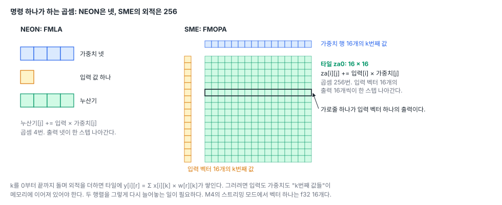
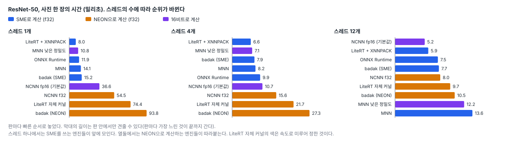

# 모바일 추론 엔진 해부와 대결

[26장](ch26_graph_interpreter.md)부터 다섯 장에 걸쳐 그래프를 읽고,
합성곱을 다듬고, 정수로 계산하고, 그래프를 고쳐 썼습니다. 그때마다
LiteRT와 견주었고, 그때마다 같은 문장을 남겼습니다. "LiteRT는 다른 명령
집합을 씁니다. 31장에서 다룹니다."

이 장에서 두 가지를 합니다.

첫째, 견줄 상대를 늘립니다. 폰에서 모델을 돌릴 때 쓰는 엔진은 LiteRT만이
아닙니다. Tencent의 NCNN, Alibaba의 MNN, 그리고
[30장](ch30_graph_optimization.md)에서 본 ONNX Runtime을 같은 모델, 같은
입력, 같은 스레드 수로 잽니다. 순위는 하나로 정해지지 않습니다. 스레드의
수에 따라, 층의 모양에 따라, 계산의 정밀도에 따라 바뀝니다. 왜
바뀌는지를 엔진의 소스와 기계어에서 찾습니다.

둘째, 미뤄 둔 일을 합니다. 다른 엔진이 스레드 하나에서 우리보다 열 배
빠른 까닭은 SME라는 명령 집합이었습니다. 그 명령으로 커널을 직접 짭니다.

결과를 미리 적어 둡니다.

- 스레드 하나에서 ResNet-50은 LiteRT 7.96밀리초, ONNX Runtime
  11.93밀리초, MNN 14.11밀리초, NCNN 54.5밀리초, 우리 93.8밀리초입니다.
  앞의 셋은 SME로 계산하고 뒤의 둘은 NEON으로 계산합니다. 기계어를
  읽어서 확인했습니다.
- 스레드를 늘리면 그 차이가 줄어듭니다. 스레드 열둘에서 LiteRT
  5.86밀리초, NCNN 7.97밀리초입니다. 일곱 배가 1.4배가 됩니다. SME로
  계산하는 엔진은 스레드를 늘려도 그만큼 빨라지지 않습니다.
  MobileNetV2에서는 스레드 하나에서 가장 빠르던 LiteRT가 열둘에서는
  끝에서 둘째입니다.
- NCNN은 기본 설정으로 16비트 실수로 계산합니다. 그래서 1.5배 빠르고,
  점수가 0.1에서 1.1까지 달라집니다. 어느 엔진이 빠른지를 말하려면
  무엇을 계산했는지를 먼저 맞춰야 합니다.
- SME의 외적 명령으로 선형 층의 커널을 Rust의 인라인 어셈블리로
  짰습니다. 같은 일을 NEON 커널의 7~16배 속도로 합니다.
- 그 커널을 합성곱에 연결하면 ResNet-50이 스레드 하나에서 93.8밀리초에서
  15.15밀리초가 됩니다. 커널이 빨라지자 창을 펼치는 복사가 병목이
  되었고, 그것을 없애서 3밀리초를 더 줄였습니다.
- 정수 커널을 다시 짰습니다. MobileNetV2 int8이 22.4밀리초에서
  11.51밀리초가 됩니다. LiteRT와 비트가 같은 것은 그대로입니다.

| 하는 일 | 절 |
|---|---|
| 상대를 정하고 같은 답을 내게 한다 | 31.1 |
| 처음 잰다 | 31.2 |
| 네 엔진의 설계를 견준다 | 31.3 |
| 누가 어떤 명령을 쓰는지 기계어로 본다 | 31.4 |
| SME의 외적 명령을 이해한다 | 31.5 |
| Rust로 SME 커널을 짠다 | 31.6 |
| 합성곱에 연결한다 | 31.7 |
| 층마다 견준다 | 31.8 |
| 스레드를 늘린다 | 31.9 |
| 16비트라는 지름길을 본다 | 31.10 |
| 정수 커널을 다시 짠다 | 31.11 |
| 순위표를 다시 쓴다 | 31.12 |

## 31.1 상대를 정하고 같은 답을 내게 한다

| 엔진 | 만든 곳 | 버전 | 모델 파일 |
|---|---|---|---|
| LiteRT (+ XNNPACK) | Google | 2.3.0 | `.tflite` ([27장](ch27_convolution.md)) |
| ONNX Runtime | Microsoft | 1.32.0 | `.onnx` ([30장](ch30_graph_optimization.md)) |
| NCNN | Tencent | 1.0.20261020 | `.ncnn.param`, `.ncnn.bin` |
| MNN | Alibaba | 3.6.2 | `.mnn` |
| `badak` | 이 책 | | `.tflite` ([30장](ch30_graph_optimization.md)의 패스를 거친 것) |

네 엔진 모두 Python에서 부릅니다. 설치한 그대로의 바이너리이고, 우리가
빌드 설정을 고른 것이 없습니다.

NCNN과 MNN은 자기 형식의 파일을 읽습니다. [30장](ch30_graph_optimization.md)의 ONNX 파일을 각자의
변환기로 바꿉니다.

```bash
python reference/ch31_convert.py
```

두 변환기 모두 [30장](ch30_graph_optimization.md)에서 우리가 한 일을
스스로 합니다. 배치 정규화를 접고 활성화 함수를 붙입니다. NCNN의 결과는
사람이 읽을 수 있는 텍스트입니다.

```text
{{#include output/ch31_ncnn_param.txt}}
```

한 줄이 층 하나입니다. 층의 종류, 이름, 입력과 출력의 수, 그 이름들,
그리고 `번호=값`으로 적은 설정입니다. `Convolution`의 `0=32`가 출력 채널,
`1=3`이 창의 크기, `9=3`이 붙어 있는 활성화 함수(자르기)이고 `-23310`
뒤가 그 끝값 0과 6입니다.[^ncnn-param] [30장](ch30_graph_optimization.md)에서 `Conv`, `BatchNormalization`, `Clip`
세 노드였던 것이 층 하나가 되어 있습니다.

같은 가중치이므로 답도 같아야 합니다.

```text
{{#include output/ch31_convert.txt}}
```

두 열이 눈에 띕니다. NCNN의 "fp16"과 MNN의 "낮음"은 16비트 실수로
계산하는 설정이고, 점수가 0.03에서 1.1까지 다릅니다(점수는 10 안팎의
값입니다). 다섯 장 모두 고른 답은 같았습니다. 그런데 **NCNN은 이것이
기본값입니다.** 설정을 건드리지 않고 NCNN을 재면 16비트 계산을 재게
됩니다. 가중치도 그렇습니다. NCNN의 변환기는 기본값으로 가중치를
16비트로 저장합니다. 위의 스크립트는 그것을 끄고(`fp16=0`) 바꿨습니다.

그래서 NCNN은 두 번 잽니다. 다른 엔진과 같은 조건인 `f32`로 한 번,
기본값인 16비트로 한 번입니다. 31.10절에서 따로 다룹니다.

이 장의 측정은 모두 기준 기계(M4 Max, 성능 코어 12개, 효율 코어 4개)에서
했습니다. **폰이 아닙니다.** 폰에서의 순위는 다를 수 있고, 이 장에서
보게 되듯이 순위를 가르는 것이 프로세서가 가진 명령이므로 **다를
것**으로 봐야 합니다. 폰에서의 측정은 이 판에 싣지 못했습니다. 6부는
엔진을 시뮬레이터와 에뮬레이터에 올려 빌드와 정확성까지만 확인합니다.

## 31.2 처음 잰다

엔진마다, 스레드 수마다 따로 재고 그 앞에서 3초를 쉽니다(22.12절).
벽시계 시간과 함께 **프로세스가 쓴 CPU 시간**도 적습니다. 둘의 비가
"실제로 일한 코어의 수"입니다.

```bash
python reference/ch31_time.py
```

```text
{{#include output/ch31_engines.txt}}
```

세 차례의 중앙값으로 표를 만들고, [30장](ch30_graph_optimization.md)까지의 우리 엔진(`optimize`를 거친
그래프, NEON 커널)을 더합니다.

| 사진 한 장 (ms) | ResNet-50, 스레드 1 | 4 | 12 | 코어 (12일 때) | MobileNetV2, 스레드 1 | 4 | 12 |
|---|---:|---:|---:|---:|---:|---:|---:|
| LiteRT + XNNPACK | 7.96 | 6.58 | 5.86 | 7.4 | 1.97 | 1.35 | 2.08 |
| ONNX Runtime | 11.93 | 9.88 | 7.55 | 12.1 | 4.35 | 2.16 | 1.71 |
| MNN | 14.11 | 8.23 | 13.64 | 2.8 | 2.93 | 1.81 | 2.67 |
| NCNN f32 | 54.5 | 15.56 | 7.97 | 12.7 | 5.95 | 2.14 | 1.71 |
| LiteRT 자체 커널 | 74.4 | 21.7 | 9.73 | 11.8 | 7.62 | 2.67 | 1.64 |
| NCNN fp16 (기본값) | 36.6 | 10.69 | 5.23 | 12.6 | 3.60 | 1.44 | 1.12 |
| MNN 낮은 정밀도 | 10.81 | 7.07 | 12.18 | 2.5 | 2.32 | 1.59 | 2.17 |
| `badak` (NEON) | 93.8 | 27.3 | 10.52 | | 10.24 | 3.17 | 1.61 |

세 가지를 알 수 있습니다.

**스레드 하나에서 엔진이 두 무리로 나뉩니다.** ResNet-50에서 LiteRT,
ONNX Runtime, MNN이 8~14밀리초에 모여 있고, NCNN이 54.5밀리초, LiteRT의
자체 커널이 74.4밀리초, 우리가 93.8밀리초입니다. 두 무리가 네 배 넘게
벌어져 있습니다. 반복문을 조금 잘 짰다고 생기는 차이가 아닙니다.

**스레드를 늘리면 무리가 섞입니다.** 스레드 열둘에서 NCNN은 7.97밀리초로
일곱 배 가까이 빨라지고, LiteRT는 7.96에서 5.86밀리초로 1.4배
빨라집니다. 일곱 배이던 둘의 차이가 1.4배가 됩니다. MNN은 14.11에서
13.64밀리초로, **거의 그대로**입니다. 스레드 넷일 때(8.23밀리초)보다
오히려 느립니다. "코어" 열에서 까닭의 절반을 알 수 있습니다. 스레드
열둘을 달라고 했을 때 NCNN과 ONNX Runtime은 코어 열둘을 쓰고, LiteRT는
일곱여덟 개, MNN은 세 개를 씁니다.

**MobileNetV2에서는 순위가 뒤집힙니다.** LiteRT는 스레드 넷에서
1.35밀리초로 가장 빠르다가 열둘에서 2.08밀리초로 느려집니다. 스레드
하나일 때보다 느립니다. 그때는 NEON으로 계산하는 엔진(NCNN, LiteRT의
자체 커널, 우리)이 1.6~1.7밀리초로 더 빠릅니다.

어느 엔진이 가장 빠른가에 답이 하나가 아닙니다. `f32`끼리 견주면
ResNet-50은 어느 스레드 수에서나 LiteRT이고, MobileNetV2는 스레드 넷까지
LiteRT, 열둘에서는 NEON으로 계산하는 엔진입니다. 16비트 계산을 허락하면
스레드 열둘에서는 두 모델 모두 NCNN입니다. 이 장의 나머지에서 이 표가 왜
이렇게 나왔는지를 찾습니다.

## 31.3 네 엔진의 설계를 견준다

같은 일을 하는 네 엔진이 얼마나 다르게 만들어졌는지부터 봅니다. 소스에서
확인한 것만 적었습니다.

| | LiteRT + XNNPACK | ONNX Runtime | NCNN | MNN |
|---|---|---|---|---|
| 사진의 축 | NHWC | NCHW (일부를 NHWC로, 30.12절) | NCHW, 채널을 4개씩 묶음 | NCHW, 채널을 4개씩 묶음 |
| 그래프 최적화 | 변환기가 미리 | 읽을 때, 단계별로([30장](ch30_graph_optimization.md)) | 변환기가 미리 | 변환기가 미리 |
| 합성곱의 방법 | 간접 합성곱 하나 | 읽지 못함 | 위노그라드, 펼쳐서 행렬 곱, 손으로 짠 직접 계산 가운데 고름 | 위노그라드, 슈트라센, 조각내어 행렬 곱 가운데 고름 |
| 고르는 기준 | 창의 모양 | 읽지 못함 | 채널 수, 가중치가 2차 캐시에 들어가는가 | 방법마다 드는 비용을 어림해 견줌 |
| 스레드를 나누는 도구 | 읽지 않음 | 읽지 못함 | OpenMP | Apple에서는 운영체제의 큐(GCD) |
| 기본 정밀도 | `f32` | `f32` | 16비트 | `f32` |
| 스레드 수의 기본값 | 읽지 않음 | 읽지 못함 | 성능 코어 수 | 4 |

### LiteRT는 XNNPACK에 계산을 맡긴다

26.12절에서 본 대로 LiteRT는 그래프를 XNNPACK에 통째로 넘깁니다. 실제로
계산하는 것은 XNNPACK입니다.

XNNPACK의 합성곱은 경로가 셋입니다. 창이 `1 × 1`이고 패딩과 스트라이드가
없는 깊이별 합성곱, 그 밖의 깊이별 합성곱, 그리고 **나머지
전부**입니다.[^xnnpack-conv] 나머지 전부를 28.6절에서 만들어 본 **간접
합성곱**<sup>indirect convolution</sup>으로 계산합니다. 창을 펼치지
않고, 창의 칸마다 입력의 어디를 읽을지를 적은 주소의 표를 커널에 넘기는
방법입니다. [28장](ch28_conv_kernels.md)에서 우리 구현은 그 방법이 1.5배
느렸습니다. XNNPACK에서는 그것이 유일한 방법입니다. 까닭은 31.7절에
나옵니다.

방법이 하나인 대신 **커널이 많습니다.** 같은 일을 하는 커널이 명령
집합마다, 한 번에 처리하는 줄의 수마다 따로 있고, 시작할 때 프로세서를
보고 하나를 고릅니다. 이 기계에서 고르는 것이 SME2용 커널입니다. 설정
코드에 "프로세서에 SME2가 있으면"이라는 분기가 있고, 그 안에서 한 번에
`32 × 32`를 계산하는 커널과 그 간접 합성곱 버전을
등록합니다.[^xnnpack-gemm] 커널의 본체는 XNNPACK의 것이 아니고, Arm이
만든 KleidiAI라는 라이브러리를 부릅니다(26.12절).

### NCNN은 채널을 묶고 방법을 고른다

NCNN은 텐서의 원소가 **묶음**일 수 있습니다. 채널이 넷의 배수이면 채널
넷을 원소 하나로 묶어 둡니다(`elempack = 4`). 28.7절에서 재 본 "채널을
묶는 배치"입니다. 16비트로 계산할 때는 여덟씩 묶습니다.[^ncnn-conv]

그 대가는 코드의 양입니다. 묶음이 1인 입력에서 4인 출력으로 가는 합성곱,
4에서 4로 가는 합성곱이 따로 있어야 하고, 창의 크기와 스트라이드마다 손으로 짠
커널이 따로 있습니다. ARM용 층의 소스 파일이 265개이고 그 가운데 합성곱에
관한 것이 69개입니다.[^ncnn-tree]

합성곱 하나를 어떻게 계산할지는 층을 만들 때 고릅니다.[^ncnn-conv]

- 창이 `3 × 3`이고 스트라이드가 1이고 채널이 8 이상이면 **위노그라드**. 채널이
  128 이하이면 한 번에 `6 × 6`을 계산하는 변환을, 그보다 많으면
  `4 × 4`짜리를 씁니다. 28.5절에서 우리가 짠 것은 `2 × 2`짜리였습니다.
- 가중치가 2차 캐시보다 크거나 채널이 16을 넘으면 **펼쳐서 행렬 곱**.
- 그 밖에는 창의 크기와 스트라이드에 맞춰 손으로 짠 커널.

2차 캐시의 크기를 운영체제에 물어서 알고리즘을 고른다는 점이 눈에
띕니다. 같은 모델을 기기마다 다른 방법으로 계산합니다.

스레드 수의 기본값도 기기를 봅니다. 성능 코어의 수입니다.[^ncnn-option]
이 기계에서 12입니다. 스레드에 일을 나누는 데는 OpenMP를 씁니다.

### MNN은 비용을 어림해 구현을 고른다

MNN은 층의 구현을 고를 때 보는 것이 가장 많습니다. 합성곱을 만드는
함수가 입력과 출력의 텐서와 스레드의 수까지 받습니다.[^mnn-factory] 창이
`1 × 1`이면 슈트라센(Strassen) 알고리즘을 쓰는 구현을 고릅니다. 큰 행렬
곱을 더 작은 곱 일곱 개로 나누는 방법입니다. 그 밖에는 위노그라드를 쓸
수 있는지 보고, 쓸 수 있으면 **위노그라드로 할 때의 비용과 조각내어 행렬
곱을 할 때의 비용을 어림해 견줍니다.** 입력과 출력의 크기와 스레드의
수가 그 어림에 들어갑니다. 비용이 적은 쪽이 그 층의 구현이 됩니다.

이 기계에서 MNN도 SME2를 씁니다. 소스에 SME2용 어셈블리 파일이 따로
있고,[^mnn-sme] 라이브러리를 부르면 "sme2: 1"이라고 출력합니다.
KleidiAI를 쓰는 경로도 소스에 있습니다. 설치한 바이너리가 어느 쪽으로
빌드되었는지는 확인하지 않았습니다.

스레드 수의 기본값은 4입니다. Apple의 운영체제에서는 자기 풀을 쓰지 않고
운영체제가 관리하는 큐에 일을 넘깁니다.[^mnn-threads] 31.2절의 "코어"
열에서 MNN이 스레드 열둘을 달라고 해도 세 개만 쓴 것이 이것과 관련이
있어 보입니다. 거기까지 따라가 확인하지는 않았습니다.

### ONNX Runtime은 소스를 읽지 못했다

30.12절에서 그래프 최적화의 단계를 봤습니다. 계산은 MLAS라는 자체
라이브러리가 합니다. 소스를 이 환경에서 열 수 없어서 설계를 읽지
못했습니다. 다음 절에서 기계어로 본 것만 적습니다.

## 31.4 빠른 엔진은 SME를 쓴다

소스를 읽는 것보다 확실한 방법이 있습니다. 실행 중인 프로세스에 "지금
어디를 실행하고 있느냐"를 여러 번 묻고(26.12절의 `sample`), 가장 자주
나온 주소의 기계어를 봅니다.

ONNX Runtime이 ResNet-50을 계산할 때 가장 오래 머무는 곳입니다.

```text
{{#include output/ch31_disassembly_ort.txt}}
```

(주소와 명령만 남기고 줄을 추렸습니다.)

함수의 이름이 `kai_kernel_matmul_clamp_f32_…`입니다. KleidiAI의
커널입니다. LiteRT가 부르는 것과 같은 라이브러리를 ONNX Runtime도 부르고
있습니다. 명령은 `fmopa`입니다. 다음 절에서 설명할 SME의 외적
명령입니다.

NCNN의 같은 곳입니다.

```text
{{#include output/ch31_disassembly_ncnn.txt}}
```

`fmla.4s`. [17장](../part3/ch17_simd.md)에서 쓴 NEON의 곱하고
더하기입니다. 레지스터 하나에 `f32` 넷입니다. 16비트로 계산하게 하면
같은 곳이 `fmla.8h`가 됩니다. 레지스터 하나에 16비트 실수 여덟입니다.
28.8절에서 본 그대로입니다.

NCNN의 바이너리 전체에 `fmopa`는 하나도 없습니다. 소스에는 "SVE와 SME를
확인할 것"이라는 메모만 있습니다.[^ncnn-sme]

| 엔진 | 합성곱의 명령 | 확인한 방법 |
|---|---|---|
| LiteRT + XNNPACK | SME2 (KleidiAI) | 26.12절의 표본, 소스 |
| ONNX Runtime | SME (KleidiAI) | 표본과 기계어 |
| MNN | SME2 | 표본의 함수 이름(`…_SME2`), 소스 |
| NCNN | NEON | 표본과 기계어 |
| LiteRT 자체 커널 | NEON (해석) | 확인하지 않음. 속도로 미루어 본 것 |
| `badak` | NEON | [17장](../part3/ch17_simd.md) |

31.2절의 두 무리가 이 표의 두 무리입니다. 스레드 하나에서 빠른 셋은 모두
SME를 쓰고, 느린 셋은 NEON을 씁니다.

## 31.5 SME는 명령 하나로 곱셈을 256번 한다

SME(Scalable Matrix Extension)는 Arm 프로세서가 갖출 수 있는 명령
집합입니다. 이 기계가 갖췄는지는 운영체제에 묻습니다(26.12절).

세 가지를 알면 됩니다.

**스트리밍 모드.** SME의 명령은 프로세서를 "스트리밍 모드"라는 상태로
바꿔야 쓸 수 있습니다. 그 상태에서는 벡터 레지스터가 길어집니다. 이
기계에서는 512비트, `f32` 열여섯 개입니다. NEON은 128비트, 넷이었습니다.
그 대신 그 상태에서는 NEON 명령을 쓸 수 없고, 상태를 드나들 때 벡터
레지스터의 내용이 모두 지워집니다.

**`ZA`.** 행렬 형태의 레지스터가 하나 생깁니다. 한 변이 벡터의 길이와
같은 정사각형입니다. `f32`로 쓰면 `16 × 16`짜리 타일 넷으로 나누어 쓸 수
있습니다(`za0`~`za3`).

**`FMOPA`.** 벡터 둘의 **외적**을 타일에 더합니다. 외적은 한 벡터의 모든
원소와 다른 벡터의 모든 원소를 짝지어 곱한 표입니다.
`za[i][j] += a[i] × b[j]`. 열여섯 개짜리 둘이면 곱셈 256번이고, 명령
하나입니다.



선형 층은 `y[i][r] = Σₖ x[i][k] × w[r][k]`입니다(`i`는 입력 벡터, `r`은
가중치의 행). [17장](../part3/ch17_simd.md)의 커널은 `(i, r)` 하나를
고정하고 `k`를 따라 내적을 구했습니다. 순서를 바꿉니다. `k` 하나를
고정하면, 모든 `(i, r)`에 대해 `x[i][k] × w[r][k]`를 더하는 일입니다.
그것이 "입력 벡터의 `k`번째 값을 모은 벡터"와 "가중치 행의 `k`번째 값을
모은 벡터"의 외적입니다. `k`를 처음부터 끝까지 돌며 외적을 더하면 타일에
답이 쌓입니다.

문제가 하나 있습니다. "입력 벡터 열여섯 개의 `k`번째 값"은 메모리에
이어져 있지 않습니다. 입력은 벡터 하나가 이어져 있는 순서로 놓여
있습니다. 가중치도 마찬가지입니다. 그래서 두 행렬을 **다시 늘어놓아야**
합니다(packing). 가중치는 한 번만 하면 되지만 입력은 계산할 때마다 해야
합니다. 이 일이 31.7절에서 다시 나옵니다.

## 31.6 Rust로 SME 커널을 짠다

26.12절에서 "Rust의 표준 라이브러리에는 SME 명령을 쓰는 함수가 없어서
지금의 원칙 안에서는 따라갈 길이 마땅치 않다"고 적었습니다. 방법이 하나
있습니다. **인라인 어셈블리**(`asm!`)입니다. 표준 라이브러리의 기능이고,
기계어 명령을 이름으로 직접 적습니다.

어셈블러는 기본으로는 SME 명령을 받지 않습니다. 조각의 첫 줄에서
받으라고 알립니다. 그리고 망가뜨리는 레지스터를 빠짐없이 적어야 합니다.

```rust
{{#include ../../../crates/badak_core/src/simd/sme.rs:clobbers}}
```

마지막 부분이 중요합니다. 스트리밍 모드를 드나들면 벡터 레지스터가 모두
지워집니다. 컴파일러가 그 레지스터 가운데 하나에 값을 두고 있었다면 그
값이 사라집니다. 서른두 개를 모두 "이 조각이 망가뜨린다"고 적어 두면
컴파일러가 필요한 값을 미리 다른 곳에 옮겨 둡니다. 하나라도 빠뜨리면
가끔 틀린 답이 나오는 프로그램이 됩니다. 테스트 가운데 하나가 이것을
봅니다. 커널을 부르기 전에 계산해 둔 실수가 부른 뒤에도 그대로인지
확인합니다.

SME가 있는지는 운영체제에 묻습니다. macOS의 `sysctlbyname`을 선언해서
부릅니다. 표준 라이브러리가 이미 그 함수가 든 시스템 라이브러리에
연결되어 있으므로 크레이트를 더할 필요가 없습니다. 다른 운영체제에서는
확인하는 방법을 시험해 보지 못해서 "없다"고 답하게 했습니다.

가중치를 다시 늘어놓는 것입니다.

```rust
{{#include ../../../crates/badak_core/src/simd/sme.rs:packed}}
```

입력을 늘어놓는 일은 실행할 때마다 하므로 빨라야 합니다. 벡터 넷, 값
넷씩 `4 × 4` 행렬을 뒤집습니다(전치). NEON으로 합니다. 스트리밍 모드에
들어가기 **전**이어야 합니다.

```rust
{{#include ../../../crates/badak_core/src/simd/sme.rs:pack_inputs}}
```

커널입니다.

```rust
{{#include ../../../crates/badak_core/src/simd/sme.rs:block}}
```

안쪽 반복문(`4:`)이 전부입니다. 벡터 다섯을 읽고 외적 넷을 더합니다. 한
번 돌 때 곱셈이 1,024번입니다. 끝나면 타일의 가로줄을 `y`에 적습니다.
가로줄 하나가 입력 벡터 하나의 출력이기 때문입니다. 출력의 수가 16의
배수가 아니면 술어(predicate) 레지스터로 남은 만큼만 적습니다.

처음에는 입력 묶음 하나마다 어셈블리 조각을 한 번씩 불렀습니다. 부를
때마다 스트리밍 모드에 들어가고 나왔는데, 그 시간이 작지 않았습니다.
`k`가 16번뿐인 작은 층에서는 계산보다 길었습니다. 묶음을 도는 반복문까지
어셈블리 안으로 넣어 한 번만 드나들게 하자 1.3~1.9배 빨라졌습니다.

```bash
cargo run --release -p badak_core --example ch31_sme
```

```text
{{#include output/ch31_sme.txt:1:16}}
```

[17장](../part3/ch17_simd.md)부터 다듬어 온 NEON 커널이 1초에 곱셈 500억
번쯤이었습니다. SME 커널은 3,000억에서 7,000억 번으로 7~16배입니다.
채널이 많은 `1 × 1` 합성곱의 형상(`196 × 1024 × 256`)에서 가장 빠릅니다.

느린 곳이 둘 있습니다.

- 행이 24개인 경우(2.9배). 타일 넷 가운데 둘이 비어서 돕니다. 묶음을
  넷씩만 처리하는 커널 하나만 짰기 때문입니다.
- 벡터가 하나인 경우(1.7배). 타일의 가로줄 열여섯 가운데 하나만 씁니다.
  26.12절의 "벡터 하나짜리 선형 층"이 이것입니다. LiteRT는 그 경우에 다른
  커널(외적이 아니라 긴 벡터의 곱하고 더하기)을 씁니다(26.12절). 우리는
  그것을 짜지 않았습니다.

**결과가 NEON 커널과 비트까지 같지는 않습니다.** 더하는 순서가 다릅니다.
17.3절부터 "어느 구현을 쓰든 같은 비트"를 지켜 왔는데 이 커널은 그
약속을 지키지 못합니다. 그래서 기본값으로 넣지 않고, 고르면 쓰게
했습니다.

## 31.7 합성곱에 연결한다

28.2절의 합성곱은 출력을 조각내어, 조각마다 창을 행렬로 펼치고, 선형
층의 커널을 불렀습니다. 그 커널을 SME의 것으로 바꿉니다. 필터는 처음
실행할 때 한 번 다시 늘어놓아 가지고 있습니다.
```rust
{{#include ../../../crates/badak_graph/src/outer.rs:kernel}}
```

레지스트리에 이 커널을 등록하면(26.6절) 해석기는 고칠 것이 없습니다.

```rust
registry.register("CONV_2D", badak_graph::outer::conv_2d_outer);
```

스레드 하나에서 ResNet-50이 94밀리초에서 **18.5밀리초**가 되었습니다.
다섯 배입니다. 그런데 커널은 열 배 빨라졌습니다. 나머지 절반이 어디로
갔는지 연산별로 나눠 보면, `3 × 3` 합성곱이 8.8밀리초입니다. 그 층의
곱셈은 18억 번이고, 커널의 속도(1초에 5,000억 번)로는 3.6밀리초면
됩니다.

남은 것은 **창을 펼치는 복사**였습니다. `3 × 3` 합성곱은 입력의 값
하나를 아홉 번 복사해 펼친 행렬을 만듭니다. ResNet-50의 `3 × 3` 층이
펼치는 값을 모두 더하면 1,240만 개, 50MB입니다. 그것을 한 번 쓰고,
커널이 읽을 순서로 늘어놓느라 한 번 더 읽고 씁니다. NEON 커널이
90밀리초를 쓸 때는 보이지 않던 5밀리초가, 커널이 4밀리초가 되자 가장 큰
부분이 되었습니다. 18.9절에서 본 대로 한 곳이 빨라지면 다른 곳이 병목이
됩니다.

펼친 행렬을 없앱니다. 사진에서 곧바로 커널이 읽을 순서로 늘어놓습니다.

```rust
{{#include ../../../crates/badak_graph/src/outer.rs:pack_windows}}
```

눈여겨볼 것은 가운데의 분기입니다. 커널은 출력 위치 열여섯 개의 "`k`번째
값"을 읽습니다. 창의 칸 하나를 놓고 보면, 한 줄에 나란히 있는 위치
열여섯 개가 읽는 입력 픽셀도 나란히 있습니다. 그 픽셀 열여섯 개를
`(자리, 채널)`에서 `(채널, 자리)`로 뒤집으면 그 칸의 일이 끝납니다.
31.6절의 `pack_inputs`를 그대로 부릅니다. 줄이 바뀌는 곳, 스트라이드가 2인 층,
패딩한 위치가 끼는 곳에서는 값을 하나씩 옮깁니다.

**15.1밀리초**가 되었습니다. `3 × 3` 합성곱이 8.8에서 6.8밀리초로,
`7 × 7` 합성곱이 3.0에서 1.6밀리초로 줄었습니다.

28.6절로 돌아갑니다. 간접 합성곱은 "펼친 행렬을 만들지 않는다"는
방법이었고, 우리 NEON 구현에서는 1.5배 느렸습니다. 그때는 펼치는 복사가
전체의 몇 %였기 때문입니다. 커널이 열 배 빨라지면 사정이 뒤집힙니다.
XNNPACK이 합성곱의 방법을 간접 합성곱 하나로 둔 까닭(31.3절)을 이제 알
수 있습니다. 빠른 커널을 가진 엔진은 펼치지 않아야 합니다.

## 31.8 층마다 견준다

모델 전체의 시간은 여러 종류의 층이 섞인 값입니다. 층을 하나씩 떼어
잽니다. ResNet-50과 MobileNetV2에서 모양을 아홉 가지 골라, 층 하나짜리
모델을 엔진마다의 형식으로 만들어 잽니다.

```bash
python reference/ch31_layers.py
cargo run --release -p badak_graph --example ch31_layers
```

스레드 1개, 층 하나의 시간(마이크로초)입니다. 세 차례의 중앙값이고, 줄마다 가장 빠른 것을 굵게 적었습니다.

| 층 | XNNPACK | ONNX Runtime | NCNN | NCNN 16비트 | MNN | `badak` NEON | `badak` SME |
|---|---:|---:|---:|---:|---:|---:|---:|
| conv 7×7 스트라이드 2, 3→64 @224 | 994 | 971 | 2751 | 1665 | **951** | 4532 | 1567 |
| conv 3×3, 64→64 @56 | 499 | **488** | 883 | 684 | 800 | 2482 | 565 |
| conv 1×1, 64→256 @56 | 465 | 347 | 1221 | 974 | 393 | 1399 | **189** |
| conv 3×3, 256→256 @14 | **328** | **328** | 1062 | 901 | 501 | 2489 | 349 |
| conv 1×1, 1024→256 @14 | 199 | 187 | 1143 | 900 | 399 | 1027 | **125** |
| conv 3×3, 512→512 @7 | 349 | 287 | 1413 | 1416 | 654 | 2720 | **268** |
| conv 1×1, 16→96 @112 | 512 | 354 | 844 | 655 | 584 | 786 | **202** |
| depthwise 3×3, 144 @56 | 546 | 347 | 423 | 360 | 481 | **335** | - |
| depthwise 3×3, 960 @7 | 132 | 169 | 100 | 103 | 104 | **32** | - |

스레드 12개, 층 하나의 시간(마이크로초)입니다. 세 차례의 중앙값이고, 줄마다 가장 빠른 것을 굵게 적었습니다.

| 층 | XNNPACK | ONNX Runtime | NCNN | NCNN 16비트 | MNN | `badak` NEON | `badak` SME |
|---|---:|---:|---:|---:|---:|---:|---:|
| conv 7×7 스트라이드 2, 3→64 @224 | 426 | 568 | 688 | 486 | 495 | 662 | **192** |
| conv 3×3, 64→64 @56 | 299 | 358 | 225 | 201 | 656 | 267 | **98** |
| conv 1×1, 64→256 @56 | 251 | 183 | 356 | 252 | 371 | 138 | **64** |
| conv 3×3, 256→256 @14 | 298 | 219 | 224 | 165 | 804 | 276 | **100** |
| conv 1×1, 1024→256 @14 | 274 | 122 | 272 | 154 | 377 | 208 | **98** |
| conv 3×3, 512→512 @7 | 405 | 256 | 213 | 256 | 928 | 458 | **137** |
| conv 1×1, 16→96 @112 | 230 | 272 | 339 | 303 | 386 | 124 | **57** |
| depthwise 3×3, 144 @56 | 267 | 85 | 174 | 147 | 321 | **66** | - |
| depthwise 3×3, 960 @7 | 85 | 63 | 36 | 46 | 87 | **23** | - |

다른 엔진의 값에는 Python에서 부르는 시간과 입력을 복사하는 시간이 들어
있습니다. 수십 마이크로초입니다. 100마이크로초 아래의 값은 그만큼
감안해서 봐야 합니다.

**스레드 열둘의 표에서 우리 값이 유독 작은 것은 그대로 믿으면 안
됩니다.** 층 하나가 100마이크로초이면 스레드 열둘을 깨우고 다시 재우는
시간이 계산과 맞먹습니다. 우리 측정은 같은 층을 쉬지 않고 되풀이하므로
스레드가 깨어 있는 채로 다음 일을 받습니다(18.3절). 다른 엔진이 Python을
거쳐 돌아오는 사이에 스레드를 어떻게 두는지는 확인하지 않았습니다. 모델
전체에서는 이런 차이가 나지 않았습니다(스레드 열둘에서 우리 7.7밀리초,
LiteRT 5.9밀리초). 스레드 열둘의 표는 엔진마다 층 사이의 크기를 견주는
데만 써야 합니다.

**층마다 가장 빠른 엔진이 다릅니다.**

- **넓은 `1 × 1` 합성곱에서는 SME가 빠릅니다.** `1024 → 256`에서
  LiteRT와 ONNX Runtime이 NCNN의 여섯 배입니다. 창이 `1 × 1`이면 입력이
  이미 펼친 행렬이어서 커널의 속도가 그대로 드러납니다.
- **`3 × 3` 합성곱에서는 차이가 줄어듭니다.** `64 → 64`에서 NCNN이
  LiteRT의 1.8배 시간입니다. 명령 하나에 곱셈 4번과 256번의 차이인데 두
  배가 안 납니다. NCNN이 위노그라드 변환으로 곱셈의 수 자체를 줄였기
  때문입니다(31.3절). MNN도 여기서 위노그라드를 고릅니다. 31.4절의
  표본에 변환 함수의 이름이 보였습니다.
- **깊이별 합성곱은 모두 NEON입니다.** 채널마다 따로 하는 계산이라 행렬
  곱이 아니고, 외적 명령을 쓸 곳이 없습니다. 여기서는 SME를 쓰는 엔진이
  더 빠르지 않습니다. `144 @56`에서 NCNN과 우리가 LiteRT보다 빠릅니다.
- **첫 층(`7 × 7`, 채널 3)은 어느 엔진에서나 느립니다.** 채널이 셋이라
  벡터를 채울 것이 없습니다.

MobileNetV2가 ResNet-50보다 엔진 사이의 차이가 작은 까닭이 여기
있습니다. MobileNetV2의 시간은 절반이 깊이별 합성곱이고, 거기서는 모두가
같은 명령을 씁니다.

우리 SME 커널은 층 하나로 보면 다른 엔진과 비슷한 속도입니다. 그런데
모델 전체에서는 LiteRT의 두 배입니다(15.1 대 8.0밀리초). 층 하나짜리
측정에 없는 것이 모델에는 있습니다. 스트라이드가 2인 합성곱(값을 하나씩 옮기는
경로로 갑니다), 덧셈, 풀링, 그리고 층과 층 사이에서 캐시의 내용이 바뀌는
일입니다. 거기까지는 따라가지 않았습니다.

## 31.9 스레드를 늘리면 SME의 이점이 줄어든다

31.2절에서 SME를 쓰는 엔진이 스레드를 늘려도 그만큼 빨라지지 않는 것을
봤습니다. 우리 커널로 직접 확인합니다. 스레드마다 같은 일을 따로 하게
하고, 모두 합쳐 1초에 곱셈을 몇 번 했는지를 잽니다.

```text
{{#include output/ch31_sme.txt:17:}}
```

NEON 커널은 스레드 열둘에서 10.6배를 일합니다. SME 커널은 2.8배입니다.
그래도 SME 커널이 네 배 가까이 많이 계산합니다. 스레드 하나에서 열네
배이던 차이가 그만큼 줄었습니다.

까닭을 확인하지는 못했습니다. 두 가지를 적어 둡니다. 스레드마다 하는
일에는 SME가 아닌 부분(입력을 늘어놓는 NEON 코드)이 있고 그 부분은
스레드만큼 빨라집니다. 그러니 SME 명령만의 속도는 표의 숫자보다 덜
늘었을 것입니다. 그리고 31.2절에서 LiteRT가 스레드 열둘에 코어 일곱여덟
개의 시간만 쓴 것, MNN이 세 개만 쓴 것도 같은 방향을 가리킵니다. SME를
실행하는 장치가 코어마다 하나씩 있지 않고 여럿이 나눠 쓰는 것으로
보입니다(해석). Apple은 이 프로세서의 그 부분을 문서로 밝히지
않았습니다.

결과는 분명합니다. 이 기계에서 **SME의 이점은 스레드를 늘릴수록
줄어듭니다.**

| ResNet-50 (ms) | 스레드 1 | 4 | 12 | 1 → 12 |
|---|---:|---:|---:|---:|
| `badak`, NEON 커널 | 93.8 | 27.3 | 10.52 | 8.9배 |
| `badak`, SME 커널 | 15.15 | 7.87 | 7.73 | 2.0배 |
| NCNN `f32` (NEON) | 54.5 | 15.56 | 7.97 | 6.8배 |
| LiteRT + XNNPACK (SME2) | 7.96 | 6.58 | 5.86 | 1.4배 |
| ONNX Runtime (SME) | 11.93 | 9.88 | 7.55 | 1.6배 |
| MNN (SME2) | 14.11 | 8.23 | 13.64 | 1.0배 |

우리 엔진에서 SME 커널은 스레드 하나에서 NEON 커널의 6.2배이고, 열둘에서
1.4배입니다. 스레드 넷과 열둘의 시간이 거의 같습니다. NCNN은 NEON만으로
스레드 열둘에서 우리 SME 커널과 같은 수준이 됩니다. LiteRT는 스레드
열둘에 코어 일곱 개의 시간을 쓰고 1.4배를 얻습니다. 전력으로 보면 스레드
하나나 넷에서 멈추는 편이 낫습니다.

엔진이 스레드를 몇 개 쓸지를 스스로 정하는 방법도 다릅니다(31.3절의 표).
NCNN은 성능 코어의 수를 셉니다. 우리 엔진은 운영체제가 알려 주는
수(16)를 그대로 쓰고, 그러면 효율 코어 넷이 끼어 MobileNetV2가
느려집니다([30장](ch30_graph_optimization.md)에서 스레드 16개로
2.5밀리초, 12개로 1.7밀리초). 18.5절에서 조각을 잘게 나눠 그 영향을
줄였지만 합성곱에서는 없어지지 않았습니다. 기본값을 고치지는 않았습니다.
이 책의 측정은 스레드 수를 늘 직접 정합니다.

측정하다가 한 번, 스레드 열둘의 `1 × 1` 합성곱이 60마이크로초가 아니라
10밀리초로 나온 일이 있었습니다. 다시 재서는 나오지 않았고, 까닭을 찾지
못했습니다. 스트리밍 모드의 상태(`ZA`)를 스레드마다 처음 쓸 때
운영체제가 메모리를 마련하는 일과 관련이 있을 수 있습니다(추측).

## 31.10 16비트 계산은 빠르지만 오차가 쌓인다

NCNN의 기본값은 16비트 계산입니다.[^ncnn-option] 31.2절의 표에서 그 줄이
`f32`보다 1.5배 빠릅니다. 스레드 열둘의 ResNet-50에서는 모든 엔진보다
빠릅니다.

28.8절에서 같은 것을 재 봤습니다. 레지스터 하나에 값이 두 배 들어가므로
같은 명령 수로 두 배를 계산합니다. 우리 커널에서 1.2~1.9배였고 층 하나의
오차가 1,000분의 1~2였습니다.

모델 전체에서는 오차가 쌓입니다.

| | NCNN `f32` | NCNN 16비트 | MNN 보통 | MNN 낮은 정밀도 |
|---|---|---|---|---|
| ResNet-50, 점수의 가장 큰 차이 | 0.00003 | 0.11 | 0.0005 | 0.03 |
| MobileNetV2 | 0.00001 | 1.1 | 0.00002 | 0.04 |

MobileNetV2에서 점수 하나가 1.1 달라졌습니다. 다섯 장 모두 고른 답은
같았지만, 29.9절에서 정수 모델의 점수가 3 넘게 달라지고도 답이 같았던
것을 생각하면 "답이 같다"는 약한 확인입니다. 사진 다섯 장으로 정확도를
말할 수는 없습니다.

같은 16비트인데 NCNN의 오차가 MNN보다 큰 까닭은 확인하지 않았습니다.

여기서 배울 것은 속도표를 읽는 법입니다. **"NCNN이 가장 빠르다"와
"NCNN은 다른 엔진과 비슷하다"가 둘 다 이 장의 숫자에서 나옵니다.** 앞의
것은 기본 설정끼리 견준 것이고 뒤의 것은 같은 계산끼리 견준 것입니다.
벤치마크를 볼 때 무엇을 계산했는지를 먼저 물어야 합니다.

## 31.11 정수 커널을 다시 짠다

29.10절에서 정수 MobileNetV2가 22.4밀리초였습니다. 실수 모델의 두
배였고, "출력마다 한 번씩 하는 일이 내적보다 비싸다"고 적었습니다. 두
가지를 고칩니다.

**내적을 필터 넷씩 함께 합니다.** [29장](ch29_integer_inference.md)의 커널은 필터마다 내적 함수를
불렀습니다. 창을 필터의 수만큼 다시 읽었고, 부를 때마다 누산기를 하나로
모았습니다. 필터 넷을 함께 계산하면 창을 한 번만 읽습니다. 그리고
명령을 바꿉니다. 이 프로세서에는 8비트 정수의 내적을 위한 명령(`SDOT`)이
있습니다. 8비트 값 열여섯 쌍을 곱해 넷씩 더한 32비트 값 넷을 누산기에
더합니다. [29장](ch29_integer_inference.md)에서 명령 둘(`vmull_s8`, `vpadalq_s16`)로 값 여덟을 하던
일입니다.

```rust
{{#include ../../../crates/badak_graph/src/quantized.rs:dots}}
```

**배율 곱하기를 넷씩 합니다.** 29.6절의 `multiply`를 그대로 벡터
명령으로 옮깁니다. 64비트로 곱하고, 절반을 더하고, 오른쪽으로 옮깁니다.

```rust
{{#include ../../../crates/badak_graph/src/quantized.rs:requantize_all}}
```

정수의 덧셈은 순서를 바꿔도 값이 같고, 배율 곱하기는 같은 계산을 넷씩
할 뿐입니다. 그래서 **결과가 비트까지 같습니다.** 29.7절의 대조(70개
층, LiteRT의 자체 커널)를 다시 돌려 확인했습니다.

```text
{{#include output/ch31_int8.txt}}
```

| MobileNetV2 int8, 스레드 1 | 시간 (ms) |
|---|---|
| [29장](ch29_integer_inference.md) | 22.4 |
| 내적을 넷씩, `SDOT` | 17.5 |
| 배율 곱하기를 넷씩 | 11.51 |
| LiteRT 자체 커널 | 4.0 |
| LiteRT + XNNPACK | 1.7 |

절반이 되었고 실수 모델(10.6밀리초)과 비슷해졌습니다. 스레드 열둘에서는
3.4밀리초에서 2.1밀리초입니다. LiteRT의 자체 커널보다는 아직 세 배
느립니다. 이제 시간의 절반은 깊이별 합성곱입니다. 그 연산은 LiteRT와
비트를 맞추려면 "두 번 반올림"을 해야 하는데(29.7절), 그 규칙이 ARM의
벡터 명령이 하는 반올림과 음수의 절반에서 달라서 그대로 옮길 수
없었습니다. 값마다 하나씩 합니다.

SME에는 정수의 외적 명령도 있습니다. 쓰지 않았습니다.

## 31.12 순위표를 다시 쓴다

SME 커널을 등록한 우리 엔진을 더해 표를 다시 씁니다.

| 사진 한 장 (ms) | ResNet-50, 스레드 1 | 4 | 12 | 코어 (12일 때) | MobileNetV2, 스레드 1 | 4 | 12 |
|---|---:|---:|---:|---:|---:|---:|---:|
| LiteRT + XNNPACK | 7.96 | 6.58 | 5.86 | 7.4 | 1.97 | 1.35 | 2.08 |
| ONNX Runtime | 11.93 | 9.88 | 7.55 | 12.1 | 4.35 | 2.16 | 1.71 |
| MNN | 14.11 | 8.23 | 13.64 | 2.8 | 2.93 | 1.81 | 2.67 |
| NCNN f32 | 54.5 | 15.56 | 7.97 | 12.7 | 5.95 | 2.14 | 1.71 |
| LiteRT 자체 커널 | 74.4 | 21.7 | 9.73 | 11.8 | 7.62 | 2.67 | 1.64 |
| NCNN fp16 (기본값) | 36.6 | 10.69 | 5.23 | 12.6 | 3.60 | 1.44 | 1.12 |
| MNN 낮은 정밀도 | 10.81 | 7.07 | 12.18 | 2.5 | 2.32 | 1.59 | 2.17 |
| `badak` (NEON) | 93.8 | 27.3 | 10.52 | | 10.24 | 3.17 | 1.61 |
| `badak` (SME) | 15.15 | 7.87 | 7.73 | | 4.26 | 1.82 | 1.14 |



[26장](ch26_graph_interpreter.md)에서 시작한 격차가 어디까지 왔는지 정리합니다. ResNet-50, 스레드
하나입니다.

| | 시간 (ms) | LiteRT의 몇 배 |
|---|---|---|
| [27장](ch27_convolution.md): 창을 펼쳐 3부의 커널로 | 96.3 | 12 |
| [28장](ch28_conv_kernels.md): 조각내기 | 96.6 | 12 |
| [30장](ch30_graph_optimization.md): 그래프 최적화 | 95.4 | 12 |
| 이 장: SME 커널 | 18.5 | 2.3 |
| 이 장: 펼치지 않고 늘어놓기 | 15.15 | 1.9 |
| LiteRT + XNNPACK | 7.96 | 1 |

네 장 동안 열두 배에서 움직이지 않던 숫자가 명령 집합 하나로 두 배
안팎이 되었습니다. 26.12절에서 "반복문을 어떻게 짰느냐보다 먼저, 쓰는
명령이 다릅니다"라고 한 것이 숫자로 확인되었습니다.

순위를 가르는 것을 이 장에서 본 순서대로 적으면 이렇습니다.

1. **프로세서가 가진 명령과, 엔진이 그것을 쓰는가.** 가장 큽니다. 이
   기계에서 네 배에서 열 배입니다. SME가 없는 프로세서에서는 이 항목이
   통째로 사라지고 순위가 다시 정해집니다.
2. **스레드의 수.** SME는 스레드를 늘려도 덜 늘고 NEON은 그대로 늡니다.
   스레드 열둘에서는 둘이 같은 자리에서 만나고, 작은 모델에서는
   뒤집힙니다.
3. **정밀도.** 16비트로 계산하면 1.5배입니다. 기본값이 엔진마다
   다릅니다.
4. **층의 모양.** 넓은 `1 × 1`은 행렬 곱이 빠른 쪽이, `3 × 3`은
   위노그라드를 가진 쪽이, 깊이별 합성곱은 손으로 짠 커널이 좋은 쪽이
   앞섭니다. 모델이 어떤 층으로 되어 있느냐가 엔진의 순위를 정합니다.
5. **커널 밖의 일.** 펼치는 복사, 스레드를 깨우는 시간, 층 사이의
   복사. 커널이 빠를수록 이것들이 커집니다.

## 31.13 남긴 일을 적어 둔다

**SME 커널은 기본값이 아닙니다.** 결과가 NEON 커널과 비트까지 같지 않고,
SME가 있는지 확인하는 방법을 macOS에서만 만들었고,
Miri([22장](../part3/ch22_memory.md))가 어셈블리를 따라가지 못해
`unsafe`의 확인이 테스트뿐입니다. 고르면 쓰게만 해 두었습니다.

**커널의 남은 속도.** KleidiAI의 커널은 입력 묶음 둘과 가중치 묶음 둘을
한꺼번에 읽어 외적 넷을 더하고(31.4절의 기계어), SME2의 "벡터 여럿을 한
번에 읽는" 명령을 씁니다. 우리는 입력 묶음 하나에 가중치 묶음 넷이고
SME의 첫 버전에 있는 명령만 씁니다. 스트라이드가 2인 합성곱은 값을 하나씩
옮깁니다. 벡터 하나짜리 선형 층(26.12절)에는 맞는 커널이 없습니다.

**정수.** 깊이별 합성곱의 정수 커널, SME의 정수 외적,
[28장](ch28_conv_kernels.md)의 조각내기를 정수 커널에 넣는 일이
남았습니다. NCNN과 MNN의 정수 모델은 재지 않았습니다. 엔진마다 자기
양자화 도구로 모델을 따로 만들어야 하고, 그러면 같은 모델을 견주는 것이
아니게 됩니다.

**폰.** 이 장의 숫자는 모두 맥에서 잰 것입니다. 폰 실기기에서의 측정은
이 판에 싣지 못했습니다.

**GPU.** 네 엔진 모두 GPU로 계산하는 경로가 있습니다. 재지 않았습니다.
[45장](../part6/ch45_gpu_npu.md)에서 다룹니다.

**ONNX Runtime의 설계.** 소스를 읽지 못했습니다.

**스레드 수의 기본값.** 효율 코어를 빼는 일을 하지 않았습니다.

## 31.14 실전 엔진에서는

**빠른 커널은 엔진 밖에서 옵니다.** 이 장에서 가장 빠른 세 엔진 가운데
둘(LiteRT, ONNX Runtime)이 같은 라이브러리 KleidiAI의 커널을 부르고
있었고, MNN의 소스에도 그 경로가 있습니다.[^mnn-factory] 프로세서를 만든
회사가 그 프로세서의 새 명령으로 커널을 짜서 내놓고, 엔진이 가져다
씁니다. 엔진마다 다른 것은 그 커널을 부르기까지의 과정입니다. 그래프를
어떻게 다듬고, 텐서를 어떤 순서로 놓고, 합성곱마다 어떤 방법을 고르고,
스레드에 어떻게 나누는가입니다.

**알고리즘을 고르는 표는 엔진마다 다릅니다.** XNNPACK은 고르지
않고(방법이 하나), NCNN은 채널 수와 캐시의 크기로 고르고,[^ncnn-conv]
MNN은 비용을 어림해 견줍니다.[^mnn-factory] 28.3절에서 우리가 "조각
하나에 벡터가 여덟 개 이상 돌아가는가"로 고른 것과 같은 종류의 판단이고,
엔진마다 가장 크게 다른 부분입니다.

**기본값이 벤치마크를 정합니다.** 정밀도(NCNN은 16비트), 스레드
수(NCNN은 성능 코어 수, MNN은 4), 스레드를 어디서 빌리는가(MNN은
운영체제의 큐)가 엔진마다 다릅니다. 아무것도 정하지 않고 재면 엔진이
아니라 기본값을 재게 됩니다.

## 정리

- 폰에서 쓰는 추론 엔진 넷(LiteRT, ONNX Runtime, NCNN, MNN)을 같은 모델과
  같은 입력으로 쟀습니다. 순위는 스레드 수, 정밀도, 층의 모양에 따라
  바뀝니다.
- 스레드 하나에서 엔진들이 두 무리로 갈리고, 그 경계는 SME를 쓰는가입니다.
  기계어를 뜯어서 확인했습니다. LiteRT, ONNX Runtime, MNN이 쓰고 NCNN은
  쓰지 않습니다.
- SME의 `FMOPA`는 벡터 둘의 외적을 행렬 레지스터에 더합니다. 이 기계에서
  명령 하나가 곱셈 256번입니다. 행렬 곱을 `k`의 순서로 풀어 쓰면 외적의
  합이 됩니다.
- Rust에서는 인라인 어셈블리로 SME 명령을 씁니다. 스트리밍 모드를
  드나들면 벡터 레지스터가 지워지므로 모두 망가뜨린다고 알려야 하고,
  모드에는 한 번만 들어가야 합니다.
- SME 커널은 NEON 커널의 7~16배입니다. 합성곱에 연결하면 ResNet-50이
  스레드 하나에서 여섯 배 빨라집니다.
- 커널이 빨라지면 커널 밖의 일이 병목이 됩니다. 창을 펼치는 복사를
  없애는 것이 그다음 일이었고, XNNPACK이 간접 합성곱만 쓰는 까닭입니다.
- SME는 스레드를 늘려도 NEON만큼 늘지 않습니다. 스레드 열둘에서는 NEON으로
  계산하는 NCNN이 SME를 쓰는 엔진들과 같은 자리에 오고, MobileNetV2에서는
  앞섭니다.
- 깊이별 합성곱은 어느 엔진에서나 NEON입니다. 그 층이 많은 MobileNetV2는
  엔진 사이의 차이가 작습니다.
- NCNN의 기본값은 16비트 계산입니다. 1.5배 빠르고 점수가 0.1~1.1
  달라집니다. 속도를 견주기 전에 무엇을 계산했는지를 맞춰야 합니다.
- 정수 커널은 내적을 넷씩 묶고 배율 곱하기를 벡터 명령으로 옮겨 두 배
  빨라졌습니다. 비트는 그대로입니다.
- 이 숫자들은 모두 맥에서 잰 것입니다. 순위를 가르는 것이 프로세서의
  명령이므로 다른 프로세서에서는 순위가 달라집니다.

## 연습 문제

1. `reference/ch31_time.py`에서 NCNN의 설정 가운데
   `use_winograd_convolution`을 끄고 ResNet-50을 재 보십시오. 스레드
   하나에서 얼마나 느려집니까. `use_sgemm_convolution`을 끄면 어떻습니까.
   31.8절의 어느 층이 가장 크게 달라질지 먼저 짐작해 보십시오.
2. `ch31_sme`의 표에 형상을 더해, 행의 수를 16, 32, 48, 64, 80으로 바꿔
   가며 재 보십시오. 속도가 계단 모양으로 바뀝니까. 왜 그렇습니까.
   가중치 묶음이 넷이 안 될 때 쓰는 커널을 따로 짜면 어디가 달라집니까.
3. `streaming!` 매크로에서 `out("v8") _`부터 `out("v15") _`까지를 지우고
   시험을 돌려 보십시오. `neighbouring_code_keeps_its_registers`가
   잡아냅니까. 잡아내지 못한다면, 잡아내도록 시험을 고쳐 보십시오. 이
   여덟 레지스터가 다른 것들과 무엇이 다른지 찾아보십시오.
4. `pack_windows`는 스트라이드가 2이면 값을 하나씩 옮깁니다. 스트라이드가 2일 때
   나란한 자리들이 읽는 픽셀은 하나 걸러 하나입니다. 그 경우를 벡터
   명령으로 처리하는 갈래를 더해 보십시오. ResNet-50에서 몇 층이 그
   길로 갑니까. 전체 시간이 얼마나 줍니까.
5. 31.9절의 표를 스레드 16개까지 늘려 보십시오. 효율 코어에서도 SME
   커널이 돕니까. 효율 코어 넷만 쓰게 하려면 어떻게 해야 하는지
   찾아보고, 그때의 속도를 성능 코어와 견줘 보십시오.
6. 벡터가 하나일 때는 외적이 낭비입니다. 스트리밍 모드의 긴 벡터로
   "입력 값 하나 × 가중치의 열 열여섯 개"를 누산하는 커널을 짜
   보십시오(`fmla z0.s, p0/m, z1.s, z2.s`). `1 × 1000 × 2048`에서 NEON
   커널의 몇 배가 됩니까. 26.12절의 표가 어떻게 바뀝니까.
7. 정수 깊이별 합성곱의 "두 번 반올림"(29.7절의 `multiply_twice_rounded`)
   을 NEON으로 옮겨 보십시오. `vqrdmulhq_s32`를 그대로 쓰면 어떤 입력에서
   값이 달라집니까. 그 경우만 따로 고쳐 비트를 맞출 수 있습니까.
8. 31.2절의 표에서 엔진마다 "스레드 열둘의 시간 ÷ 스레드 하나의
   시간"을 구하고, "코어" 열과 나란히 놓아 보십시오. 코어를 많이 쓰고도
   덜 빨라진 엔진은 어느 것입니까. 그 시간은 어디로 갔을지 가설을 세우고,
   26.12절의 `sample`로 확인해 보십시오.

## 참고 문헌

[^xnnpack-conv]: XNNPACK (커밋 `cb7016a482d6`),
    `src/operators/convolution-nhwc.c` 648~661번째 줄. 커널의 종류를
    `xnn_microkernel_type_vmulcaddc`, `xnn_microkernel_type_dwconv`,
    `xnn_microkernel_type_igemm` 가운데 하나로 정합니다. 이 장에서 쓴
    `ai-edge-litert` 2.3.0에 든 XNNPACK이 이 커밋과 같은 버전인지는
    확인하지 않았습니다.
    <https://github.com/google/XNNPACK/blob/cb7016a482d6/src/operators/convolution-nhwc.c>

[^xnnpack-gemm]: XNNPACK (같은 커밋), `src/configs/gemm-config.c`
    544~558번째 줄. `hardware_config->arch_flags & xnn_arch_arm_sme2`일 때
    `xnn_pf32_gemm_minmax_ukernel_32x32__neonsme2`와
    `xnn_pf32_igemm_minmax_ukernel_32x32__neonsme2`를 등록하고, 가중치를
    늘어놓는 함수로 `xnn_pack_kai_f32_weights_and_biases_sme2`를 씁니다.
    프로세서의 기능은 `src/configs/hardware-config.c` 410~414번째 줄에서
    읽습니다.
    <https://github.com/google/XNNPACK/blob/cb7016a482d6/src/configs/gemm-config.c>

[^ncnn-param]: NCNN (태그 `20261020`, 커밋 `7e36d25cb153`),
    `src/layer/convolution.cpp` 22~38번째 줄(`num_output = pd.get(0, 0)`,
    `kernel_w = pd.get(1, 0)`, `activation_type = pd.get(9, 0)`,
    `activation_params = pd.get(10, Mat())`). 배열인 설정은 번호를
    `-23300 − 번호`로 적습니다(`src/paramdict.cpp` 695~703번째 줄).
    활성화 함수 3번이 두 끝값으로 자르기라는 것은
    `src/layer/fused_activation.h` 25~29번째 줄입니다.
    <https://github.com/Tencent/ncnn/blob/7e36d25cb153/src/layer/convolution.cpp>

[^ncnn-tree]: NCNN (태그 `20261020`, 커밋 `7e36d25cb153`)의 파일 목록을
    GitHub API로 받아 `src/layer/arm/` 아래의 파일을 센 것입니다.
    <https://github.com/Tencent/ncnn/tree/7e36d25cb153/src/layer/arm>

[^ncnn-conv]: NCNN (같은 커밋), `src/layer/arm/convolution_arm.cpp`.
    묶음의 크기는 199~200번째 줄, 위노그라드를 고르는 조건은 204~214번째
    줄, 행렬 곱을 고르는 조건(`get_cpu_level2_cache_size()`와 채널 수
    16)은 222~223번째 줄입니다. OpenMP는 같은 디렉터리의
    `convolution_im2col_gemm.h`에 있는 `#pragma omp parallel for`로
    확인했습니다. 16비트일 때의 묶음(8)은 `convolution_arm_asimdhp.cpp`
    83~84번째 줄입니다.
    <https://github.com/Tencent/ncnn/blob/7e36d25cb153/src/layer/arm/convolution_arm.cpp>

[^ncnn-option]: NCNN (같은 커밋), `src/option.cpp`. 17번째 줄
    `num_threads = get_physical_big_cpu_count();`, 40~42번째 줄
    `use_fp16_packed`, `use_fp16_storage`, `use_fp16_arithmetic`이 모두
    `true`입니다. 설치한 패키지에서 `ncnn.Option()`의 값을 읽어 같은
    것을 확인했습니다.
    <https://github.com/Tencent/ncnn/blob/7e36d25cb153/src/option.cpp>

[^ncnn-sme]: NCNN (같은 커밋), `src/cpu.cpp` 2254번째 줄의 주석
    `// TODO check sve sme`. 설치한 바이너리를 `objdump`로 풀어 `fmopa`가
    하나도 없음을 확인했습니다.
    <https://github.com/Tencent/ncnn/blob/7e36d25cb153/src/cpu.cpp>

[^mnn-factory]: MNN (태그 `3.6.2`, 커밋 `7e3c6fb5225d`),
    `source/backend/cpu/compute/ConvolutionFloatFactory.cpp`. KleidiAI를
    쓰는 구현은 79, 103번째 줄, `Convolution1x1Strassen`은 169번째 줄,
    위노그라드를 쓸 수 있는지와 두 방법의 비용을 견주는 곳은
    174~186번째 줄입니다. 어림하는 식 자체는 읽지 않았습니다.
    <https://github.com/alibaba/MNN/blob/7e3c6fb5225d/source/backend/cpu/compute/ConvolutionFloatFactory.cpp>

[^mnn-sme]: MNN (같은 커밋), `source/backend/cpu/arm/arm64/sme2_asm/`
    아래의 `MNNPackedMatMulRemainFP32_SME2.S` 등과
    `source/backend/arm82/asm/arm64/sme2_asm/MNNPackedMatMulRemainFP16_SME2.S`.
    파일이 있다는 것과, 낮은 정밀도로 실행할 때의 표본에
    `MNNPackedMatMulRemainFP16_SME2`라는 이름이 나온다는 것을
    확인했습니다. `f32`로 실행할 때의 표본에서는 어셈블리의 꼬리표
    이름만 보여서 어느 파일인지 가리지 못했습니다.
    <https://github.com/alibaba/MNN/tree/7e3c6fb5225d/source/backend/cpu/arm/arm64/sme2_asm>

[^mnn-threads]: MNN (같은 커밋), `source/core/Concurrency.h` 41~50번째
    줄. `MNN_USE_THREAD_POOL`이 정의되지 않은 Apple 빌드에서는
    `dispatch_apply`를 씁니다. 스레드 수의 기본값은
    `include/MNN/Interpreter.hpp` 30번째 줄(`int numThread = 4;`)입니다. 설치한 바이너리가 그렇게 빌드되었는지는
    확인하지 않았습니다.
    <https://github.com/alibaba/MNN/blob/7e3c6fb5225d/source/core/Concurrency.h>
