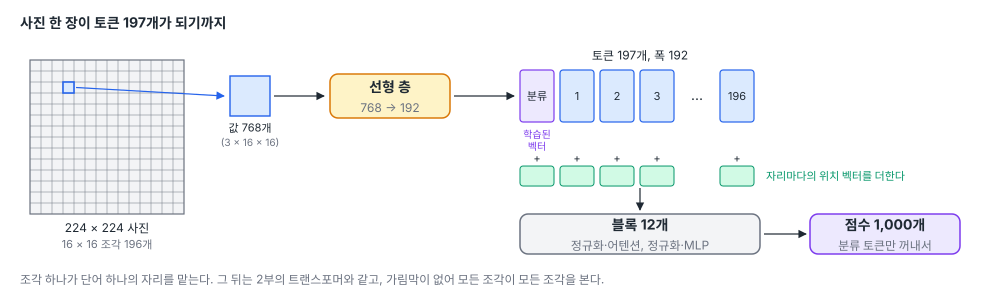
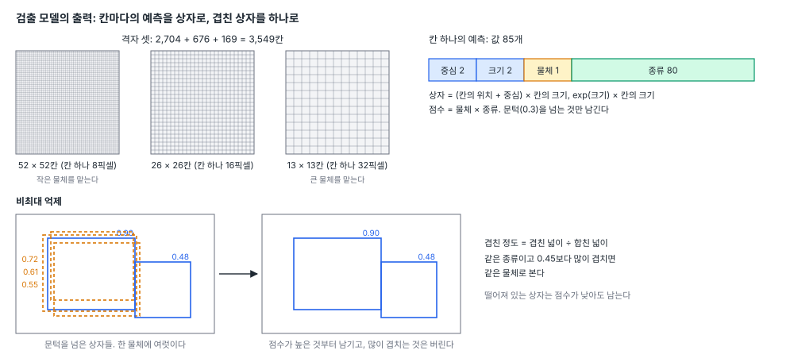

# 비전 트랜스포머와 객체 검출

[27장](ch27_convolution.md)부터 다섯 장 동안 사진을 다룬 모델은 모두 합성곱이었고, 하는 일은
모두 분류였습니다. 이 장에서 둘을 하나씩 바꿉니다.

**구조를 바꿉니다.** 비전 트랜스포머(Vision Transformer, ViT)는 합성곱
없이 사진을 분류합니다. 사진을 조각으로 잘라 조각 하나하나를 토큰처럼
다루고, 2부에서 만든 트랜스포머에 넣습니다. 2부의 코드가 얼마나 그대로
쓰이는지가 볼 것입니다.

**하는 일을 바꿉니다.** 객체 검출(object detection)은 사진에 무엇이
**어디에** 있는지를 답합니다. 모델의 출력이 점수 1,000개가 아니라 "칸마다의
예측" 수천 개이고, 그것을 상자로 바꾸는 일이 모델 밖에 남아 있습니다.

결과를 미리 적어 둡니다.

- ViT-Tiny를 2부의 방식(계산 순서를 코드로 적기)으로 만들었습니다. 사진
  다섯 장의 점수가 PyTorch와 10만분의 1.5 안에서 같습니다.
- ViT의 시간은 스레드 하나에서 38.2밀리초입니다. [31장](ch31_mobile_engines.md)의 SME 커널을
  선형 층에 쓰고 지수 함수를 벡터 명령으로 바뀌는 근사로 바꾸면
  12.38밀리초가 됩니다. PyTorch는 6.14밀리초입니다.
- 같은 코드가 열다섯 배 큰 ViT-B/16을 그대로 읽습니다. 가중치 파일만
  바꾸면 됩니다. 스레드 하나에서 403밀리초, 빠른 길로 64밀리초이고
  PyTorch는 36밀리초입니다.
- 검출 모델 YOLOX-Tiny는 4부의 방식(그래프 해석기)으로 실행합니다. 연산
  다섯 가지와 패스 넷을 더했습니다. ONNX 파일의 마디 279개가 옮기면
  612개, 최적화하면 129개가 됩니다. 출력은 ONNX Runtime과 1만분의 1.4
  안에서 같습니다.
- 사진 파일에서 상자까지 갑니다. 찾은 물체와 상자가 ONNX Runtime의
  출력으로 만든 것과 같습니다(상자의 차이 0.2픽셀 이하).
- YOLOX-Tiny의 시간은 스레드 하나에서 81.0밀리초, SME 커널로
  27.2밀리초이고 ONNX Runtime은 12.4밀리초입니다. 합성곱이
  빨라지자 활성화 함수 SiLU의 지수 함수가 병목으로 드러났습니다.
- YOLOX 프로젝트의 전처리 코드는 판에 따라 다릅니다. 받은 파일이 어느
  쪽인지는 넣어 봐서 정했습니다.

| 하는 일 | 절 |
|---|---|
| 두 모델을 구한다 | 32.1 |
| 사진을 토큰으로 바꾼다 | 32.2 |
| 2부의 트랜스포머와 견준다 | 32.3 |
| 층 정규화와 GELU를 만든다 | 32.4 |
| ViT를 짜고 PyTorch와 대조한다 | 32.5 |
| ViT의 시간을 잰다 | 32.6 |
| 검출 모델의 출력을 이해한다 | 32.7 |
| 새 연산 다섯을 더한다 | 32.8 |
| 패스 넷을 더한다 | 32.9 |
| SiLU의 지수 함수를 고친다 | 32.10 |
| 전처리를 정한다 | 32.11 |
| 출력을 상자로 바꾼다 | 32.12 |
| 시간을 잰다 | 32.13 |

## 32.1 두 모델

| | ViT-Tiny | YOLOX-Tiny |
|---|---|---|
| 하는 일 | 분류 (ImageNet의 1,000가지) | 검출 (COCO의 80가지) |
| 입력 | `224 × 224` | `416 × 416` |
| 파라미터 | 572만 개 (ViT-B/16은 8,657만 개) | 506만 개 |
| 받는 곳 | timm의 Hugging Face 저장소 | YOLOX 프로젝트의 릴리스 |
| 파일 | `model.safetensors` (22.9MB) | `yolox_tiny.onnx` (20.2MB) |
| 허가 조건 | Apache-2.0 | Apache-2.0 |
| 실행하는 방식 | 코드로 적는다 (2부) | 그래프 해석기 (4부) |

```bash
sh scripts/download_ch32.sh
```

두 파일 모두 **원래 배포한 곳에서** 받습니다. 판을 고정하고 해시를
확인합니다. [27장](ch27_convolution.md)과 [30장](ch30_graph_optimization.md)에서는 우리가 형식을 바꾼 파일을 따로 올려
두었는데, 이번에는 바꿀 것이 없습니다. ViT는 가중치만 있으면 되고
(safetensors는 [6장](../part1/ch06_model_files.md)에서 읽었습니다), YOLOX는 프로젝트가 ONNX 파일을 직접
내놓았습니다([30장](ch30_graph_optimization.md)에서 읽었습니다).

두 모델을 서로 다른 방식으로 실행하는 것은 일부러 그런 것입니다. [1장](../part1/ch01_landscape.md)에서
엔진을 두 계열로 나눴습니다. 계산 순서를 코드로 적는 쪽과 데이터로 받는
쪽. ViT는 구조가 2부의 Llama와 거의 같아서 앞쪽이 쉽고, YOLOX는 마디가
279개인 그래프라 뒤쪽이 맞습니다. 같은 장에서 둘을 나란히 해 보면 각
방식이 어디서 편하고 어디서 불편한지가 보입니다.

## 32.2 사진을 토큰으로

트랜스포머는 토큰의 줄을 받습니다. 사진을 그 모양으로 바꾸는 방법이
ViT의 생각 전부입니다.[^vit]



`224 × 224` 사진을 `16 × 16` 조각으로 자르면 조각이 `14 × 14 = 196`개
나옵니다. 조각 하나는 값 `3 × 16 × 16 = 768`개입니다. 그것을 한 줄로
펴서 선형 층 하나에 넣으면 폭 192인 벡터가 됩니다. 조각 하나가 토큰
하나입니다.

가중치 파일에는 이 층이 합성곱의 필터 `(192, 3, 16, 16)`으로 들어
있습니다. 창이 `16 × 16`이고 보폭도 16인 합성곱입니다. 창이 겹치지
않으므로 창마다 한 번씩 하는 선형 층과 같습니다. 27.5절에서 `1 × 1`
합성곱이 선형 층이었던 것과 같은 이치입니다. 필터를 `(192, 768)` 행렬로
펴서 [5장](../part1/ch05_operators.md)의 선형 층에 넣습니다.

```rust
{{#include ../../../crates/badak_models/src/vit.rs:patches}}
```

두 가지를 더합니다.

**분류 토큰.** 조각 196개 앞에 토큰 하나를 끼워 넣습니다. 사진과 무관한,
학습된 벡터입니다. 블록들을 지나는 동안 이 토큰이 다른 토큰들을 보고
정보를 모으고, 맨 끝에서 **이 토큰 하나만** 꺼내 점수로 바꿉니다. 토큰이
197개가 됩니다.

**위치.** 어텐션은 토큰의 순서를 모릅니다. Llama는 회전으로 위치를
넣었습니다(9.7절). ViT는 더 단순합니다. 자리마다 학습된 벡터가 하나씩
있고, 그것을 토큰에 더합니다. `(197, 192)` 텐서 하나입니다. 그래서 이
모델은 조각이 196개인 사진만 받습니다.

## 32.3 2부의 트랜스포머와 무엇이 다른가

| | Llama (2부) | ViT |
|---|---|---|
| 토큰 | 단어 조각의 번호 → 임베딩 표 | 사진 조각 → 선형 층 |
| 어텐션이 보는 범위 | 자기 앞의 토큰만 (가림막) | 모든 토큰 |
| 위치 | 질의와 키를 회전 | 학습된 벡터를 처음에 한 번 더함 |
| 질의·키·값 | 선형 층 셋 | 선형 층 하나가 셋을 이어서 냄 |
| 정규화 | RMS 정규화 | 층 정규화 |
| MLP | 게이트가 있는 SiLU | 선형, GELU, 선형 |
| 선형 층의 치우침 | 없음 | 있음 |
| 실행 | 토큰 하나씩 되풀이, KV 캐시 | 한 번 |

블록의 뼈대는 같습니다. 정규화하고 어텐션, 정규화하고 MLP, 둘 다 건너뛰는
길에 더합니다. 달라진 것은 대부분 **빠진** 것입니다. 가림막이 없고,
회전이 없고, 캐시가 없고, 되풀이가 없습니다. 사진은 한꺼번에 들어오고
답도 한 번에 나옵니다.

```rust
{{#include ../../../crates/badak_models/src/vit.rs:attention}}
```

9.6절의 어텐션과 견주면 절반 길이입니다. 점수를 구하는 부분이 눈여겨볼
곳입니다. "질의 `i`와 키 `j`의 내적"을 모든 `(i, j)`에 대해 구하는 일은
**키들을 가중치로 하는 선형 층**입니다. [17장](../part3/ch17_simd.md)의 커널을 그대로 부릅니다.
값을 섞는 일도 같습니다.

## 32.4 층 정규화와 GELU

새로 만들 연산이 둘입니다.

**층 정규화**(layer normalization)는 벡터마다 평균을 빼고 표준편차로
나눈 뒤, 원소마다 학습된 배율을 곱하고 치우침을 더합니다.[^layer-norm]

```rust
{{#include ../../../crates/badak_core/src/ops.rs:layer_norm}}
```

9.5절의 RMS 정규화에 "평균 빼기"와 치우침이 더해진 것입니다. 이름이
비슷한 [30장](ch30_graph_optimization.md)의 배치 정규화와는 중요한 점에서 다릅니다. 배치 정규화는
추론할 때 평균과 분산이 **파일에 적힌 상수**였고, 그래서 앞의 합성곱에
접어 넣을 수 있었습니다. 층 정규화는 평균과 분산을 **지금 들어온
벡터에서** 구합니다. 실행 전에는 알 수 없으므로 접을 수 없습니다. ViT의
그래프를 [30장](ch30_graph_optimization.md)의 패스에 넣어도 정규화 25개는 그대로 남습니다.

**GELU**는 `x × Φ(x)`입니다. `Φ`는 표준 정규 분포에서 "`x`보다 작을
확률"입니다.[^gelu] ReLU처럼 음수를 누르되, 0에서 꺾이지 않고 매끄럽게
넘어갑니다. `Φ`를 계산하려면 오차 함수 `erf`가 있어야 하는데 Rust의 표준
라이브러리에 없습니다. 근사식을 씁니다.

```rust
{{#include ../../../crates/badak_core/src/nn.rs:gelu}}
```

수학 책에 실려 있는 오래된 식입니다.[^erf] 다항식 하나와 지수 함수
하나이고 오차가 `f32`의 정밀도와 같은 크기입니다. 시험은 `erf(0.5)`,
`erf(1)`, `erf(2)`, `erf(3.5)`를 Python의 `math.erf`가 내는 값과
견줍니다. 다음 절에서 모델 전체로도 확인됩니다.

## 32.5 모델과 대조

가중치를 읽습니다. timm이 저장한 이름을 그대로 씁니다.

```rust
{{#include ../../../crates/badak_models/src/vit.rs:load}}
```

블록의 수는 파일에서 셉니다. `blocks.0`, `blocks.1`, …의 이름이 있는
만큼입니다. 조각의 크기는 필터의 형상에서, 사진의 크기는 위치 벡터의
수에서 나옵니다. 헤드의 수만은 파일의 어디에도 없어서 받습니다. 폭 192를
헤드 셋으로 나누든 넷으로 나누든 가중치의 형상은 같기 때문입니다. 모델의
구조 가운데에는 가중치 파일만으로 알 수 없는 것이 있습니다.

순전파입니다.

```rust
{{#include ../../../crates/badak_models/src/vit.rs:forward}}
```

[10장](../part2/ch10_forward_pass.md)의 `forward`에서 되풀이와 캐시를 걷어 낸 모양입니다. [7장](../part1/ch07_mnist.md)에서 한
것처럼 단계마다의 값을 남겨 PyTorch의 값과 견줍니다.

```bash
python reference/ch32_make_reference.py
cargo run --release -p badak_models --example ch32_vit_verify
```

```text
{{#include output/ch32_vit_verify.txt}}
```

조각을 벡터로 바꾼 직후의 차이가 100만분의 6이고, 블록 열두 개를 지난
뒤에 1,000분의 1입니다. 그 자리의 값이 468까지 커져 있으므로 상대
오차로는 100만분의 2입니다. 마지막 정규화가 값을 다시 줄이고, 점수의
차이는 10만분의 1.4입니다. 다섯 장 모두 PyTorch와 같은 이름을 고릅니다.

고양이 사진을 "식탁"이라고 한 것은 틀린 계산이 아닙니다. PyTorch도
그렇게 답합니다. [27장](ch27_convolution.md)의 두 합성곱 모델도 이 사진을 서로 다르게
읽었습니다.

## 32.6 ViT의 시간

```bash
cargo run --release -p badak_models --example ch32_vit_bench
```

```text
{{#include output/ch32_vit_bench.txt}}
```

스레드 하나에서 38.2밀리초이고 선형 층이 그 가운데 24밀리초입니다.
곱셈이 10억 번 남짓이므로 [17장](../part3/ch17_simd.md)의 커널의 속도 그대로입니다. 눈에 띄는 것은
나머지입니다. `map`이 GELU이고 4.6밀리초입니다. 표에 없는 7밀리초의
대부분은 어텐션의 소프트맥스일 것입니다(따로 재지는 않았습니다). 블록마다 헤드마다 `197 × 197`개의
점수에 지수 함수를 계산합니다. 모두 140만 번입니다. 두 곳 모두 **지수
함수를 값 하나씩 부르는** 자리입니다.

같은 일을 PyTorch는 6.14밀리초에 합니다. [31장](ch31_mobile_engines.md)에서 본 그대로입니다.
행렬 곱이 다른 명령 집합으로 계산됩니다. [31장](ch31_mobile_engines.md)의 커널을 가져옵니다.

```rust
{{#include ../../../crates/badak_models/src/vit.rs:fast}}
```

선형 층의 가중치를 한 번 다시 늘어놓아 두고(31.6절) SME 커널로
계산합니다. GELU와 소프트맥스의 지수 함수는 32.10절에서 만들 근사로
바꿉니다.

```text
{{#include output/ch32_vit_bench_fast.txt}}
```

| ViT-Tiny, 사진 한 장 (ms) | 스레드 1 | 4 | 12 |
|---|---:|---:|---:|
| 기본 (NEON, `f32::exp`) | 38.2 | 14.31 | 8.67 |
| 빠른 길 (SME, 근사한 지수 함수) | 12.38 | 9.31 | 9.23 |
| PyTorch | 6.14 | 5.31 | 7.94 |

스레드 하나에서 세 배 빨라지고 PyTorch의 두 배까지 옵니다. 답은 여전히
PyTorch와 10만분의 1.5 안입니다(앞 절의 출력의 "빠른 길").

스레드를 늘려도 빠른 길은 거의 빨라지지 않습니다. 열둘에서는 기본보다
조금 느립니다. 우리 SME 커널은
스레드에 일을 나누지 않습니다. 31.7절의 합성곱은 조각을 스레드에 나눈 뒤
조각마다 커널을 불렀는데, 여기서는 선형 층 하나가 커널을 한 번 부릅니다.
PyTorch도 스레드 열둘에서는 하나일 때보다 느립니다. 일이 작아서입니다.
197개의 토큰에 폭 192인 행렬을 곱하는 일은 스레드를 깨우는 시간과 비슷한
크기입니다(18.6절).

### ViT-B/16

timm은 같은 구조의 더 큰 모델도 배포합니다. ViT-B/16은 조각의 크기가
같고(16), 폭이 768, 헤드가 12개입니다.[^vit-base] 파라미터가 8,657만
개로 ViT-Tiny의 열다섯 배이고 파일은 346MB입니다.

```bash
sh scripts/download_ch32.sh base
```

모델 코드는 고칠 것이 없습니다. 폭, 블록의 수, 조각의 크기를 모두
가중치 파일에서 읽기 때문입니다. 헤드의 수만 12로 바꿔 줍니다. 계산
순서를 코드로 적는 방식에서도, 크기만 다른 모델은 같은 코드가 받습니다.
32.5절의 출력 끝에 그 결과가 있습니다. 다섯 장 모두 PyTorch와
10만분의 4 안에서 같고, 고양이 사진을 이번에는 고양이(`tiger cat`)라고
합니다.

| ViT-B/16, 사진 한 장 (ms) | 스레드 1 | 4 | 12 |
|---|---:|---:|---:|
| 기본 (NEON, `f32::exp`) | 403 | 134 | 54.4 |
| 빠른 길 (SME, 근사한 지수 함수) | 64.5 | 50.8 | 49.8 |
| PyTorch | 35.8 | 24.9 | 25.0 |

세 차례 번갈아 잰 값의 가운데입니다(`BASE=1 sh scripts/bench_ch32.sh`).
스레드 하나에서 빠른 길이 여섯 배입니다. ViT-Tiny에서는 세 배였습니다.
모델이 클수록 행렬 곱이 차지하는 몫이 크고, 그 몫이 [31장](ch31_mobile_engines.md)의 커널로
가는 만큼입니다. PyTorch와는 1.8배가 남습니다.

남은 시간이 어디에 있는지는 끝까지 따라가지 않았습니다. 이 모델
코드는 [5장](../part1/ch05_operators.md)의 텐서 연산으로 적혀 있어서 층마다 새 텐서를 만들고, 어텐션은
헤드마다 값을 옮겨 담습니다. [22장](../part3/ch22_memory.md)에서 Llama에 한 일(자리를 돌려 쓰기)을
여기에는 하지 않았습니다.

## 32.7 검출 모델의 출력

분류 모델에 사진을 넣으면 점수 1,000개가 나옵니다. 검출 모델
YOLOX-Tiny에 `416 × 416` 사진을 넣으면 `(3549, 85)`가 나옵니다.[^yolox]

**3,549는 칸의 수입니다.** 사진을 8픽셀씩 나누면 `52 × 52 = 2,704`칸,
16픽셀씩 나누면 `26 × 26 = 676`칸, 32픽셀씩 나누면 `13 × 13 = 169`칸입니다.
셋을 더하면 3,549입니다. 모델은 **칸마다** 예측을 하나씩 냅니다. "이 칸에
중심이 있는 물체가 있다면 이런 상자이고 이런 종류다."

격자가 셋인 까닭은 물체의 크기가 제각각이기 때문입니다. 촘촘한 격자의 한
칸은 사진의 작은 부분을 보고 작은 물체를 맡습니다. 성긴 격자의 한 칸은
넓은 부분을 보고 큰 물체를 맡습니다.

**85는 칸 하나의 예측입니다.** 상자를 정하는 값 넷(중심의 가로와 세로,
너비와 높이), "여기에 물체가 있다"는 점수 하나, 그리고 종류 80가지의
점수입니다.



모델 안은 세 부분입니다.

- **몸통.** [27장](ch27_convolution.md)의 분류 모델과 같은 일을 합니다. 합성곱으로 사진을
  줄여 가며 채널을 늘립니다. 다만 끝까지 줄이지 않고, 8분의 1, 16분의 1,
  32분의 1 크기의 특징 지도 셋을 모두 내놓습니다.
- **목.** 세 지도의 정보를 섞습니다. 작은 지도는 넓게 보지만 흐릿하고,
  큰 지도는 또렷하지만 좁게 봅니다. 작은 지도를 **키워서** 큰 지도에
  **이어 붙이고**, 반대 방향으로도 합니다. 분류 모델에 없던 연산 둘이
  여기서 나옵니다.
- **머리.** 지도마다 합성곱 몇 개로 칸마다의 85개를 만듭니다.

파일을 열어 보면 그대로입니다.

```text
{{#include output/ch32_yolox_verify.txt:1:2}}
```

합성곱 83개, 시그모이드 80개, 곱셈 74개. 시그모이드와 곱셈이 짝을 이루는
까닭은 32.9절에서 봅니다.

## 32.8 새 연산 다섯

[30장](ch30_graph_optimization.md)에서 ONNX의 연산 열네 가지를 옮겼습니다. 이 모델에는 다섯이 더
있습니다. 모두 값을 **계산하지 않고 옮기는** 연산이거나 원소마다 하는
연산입니다.

| ONNX | 우리 그래프 | 하는 일 | 모델의 어디에 |
|---|---|---|---|
| `Concat` | `CONCAT` | 한 축을 따라 이어 붙인다 | 목, 머리 |
| `Resize` | `RESIZE` | 사진을 정수 배로 키운다 | 목 |
| `Slice` | `SLICE` | 축마다 일부를 골라낸다 | 몸통의 첫 층 |
| `Reshape` | `RESHAPE` | 형상만 바꾼다 | 머리의 끝 |
| `Sigmoid` | `SIGMOID` | 0과 1 사이로 누른다 | 활성화 함수, 머리의 끝 |

이어 붙이기입니다.

```rust
{{#include ../../../crates/badak_graph/src/shaping.rs:concat}}
```

어느 축으로 붙이든 한 가지 눈으로 봅니다. 붙이는 축부터 끝까지를 한
덩어리로 보면, 출력은 입력들의 덩어리를 번갈아 놓은 것입니다.

골라내기는 몸통의 첫 층이 씁니다. 사진에서 "짝수 줄의 짝수 칸", "짝수
줄의 홀수 칸", "홀수 줄의 짝수 칸", "홀수 줄의 홀수 칸"을 따로 골라내
넷을 채널 방향으로 이어 붙입니다.[^yolox-focus] `416 × 416 × 3`이
`208 × 208 × 12`가 됩니다. 픽셀을 하나도 버리지 않고 해상도를 절반으로
줄이는 방법입니다.

```rust
{{#include ../../../crates/badak_graph/src/shaping.rs:slice}}
```

키우기는 가장 가까운 픽셀을 되풀이합니다. 27.9절에서 사진을 **줄일**
때는 여러 픽셀의 평균을 내야 했지만, 정수 배로 키울 때는 계산이 없습니다.

```rust
{{#include ../../../crates/badak_graph/src/shaping.rs:resize}}
```

### 옮기는 코드가 형상을 알아야 한다

30.4절의 옮기는 코드는 형상을 몰랐습니다. 다 옮긴 뒤에 한꺼번에
구했습니다. 이번에는 그럴 수 없습니다. `Concat`은 축의 번호를 받는데,
같은 "1번 축"이 4차원 텐서에서는 채널이고(NHWC로 바꾸면 3번 축이 됩니다)
3차원 텐서에서는 그냥 둘째 축입니다. 입력이 몇 차원인지 알아야 옮길 수
있습니다. 그래서 마디를 하나 옮길 때마다 커널에게 출력의 형상을 물어
적어 둡니다.

```rust
{{#include ../../../crates/badak_graph/src/onnx.rs:concat}}
```

`Slice`의 범위에는 작은 함정이 있습니다. "끝까지"를 뜻하려고 끝 자리에
64비트 정수의 가장 큰 값을 적어 두는 파일이 있습니다. [30장](ch30_graph_optimization.md)의 파서는
32비트에 담기지 않는 값을 만나면 거절했습니다. 자르도록 고쳤습니다.

## 32.9 패스 넷

옮긴 그래프는 마디가 612개입니다. [30장](ch30_graph_optimization.md)의 패스를 그대로 돌리면 465개에서
멈춥니다. `TRANSPOSE` 334개 가운데 147개만 사라집니다. 새 연산들이 길을
막고 있습니다. 규칙 넷을 더합니다.

**같은 계산 합치기.** 첫 층의 `Slice` 넷은 모두 같은 입력을 읽습니다.
기계적으로 옮기면 그 입력을 NHWC로 바꾸는 `TRANSPOSE`가 넷 생깁니다. 넷은
같은 값을 냅니다. 30.13절에서 남겨 둔 패스입니다.

```rust
{{#include ../../../crates/badak_graph/src/optimize.rs:merge_duplicates}}
```

이 패스는 ONNX 파일에 원래 있던 중복도 찾아냈습니다. `Slice` 8개가
6개가 됩니다. "짝수 줄"을 고르는 마디와 "홀수 줄"을 고르는 마디가 둘씩
있었습니다.

**`TRANSPOSE`를 이어 붙이기 뒤로.** 30.7절의 패스는 원소마다 하는 연산
뒤로 `TRANSPOSE`를 옮겼습니다. 이어 붙이기도 값을 옮기기만 하므로 같은
일을 할 수 있습니다. 다만 붙이는 축이 달라집니다. "축을 바꾼 것들을 1번
축으로 붙이기"는 "붙이고 나서 축을 바꾸기"와 같은데, 붙이는 축은 바꾸기
전의 번호여야 합니다. [30장](ch30_graph_optimization.md)의 `sink_transposes`에 그 계산 한 줄과
시그모이드가 더해졌습니다.

**`RESHAPE`와 `TRANSPOSE`의 자리 바꾸기.** 머리의 끝에서 특징 지도
`(1, 85, 52, 52)`를 칸의 목록 `(1, 85, 2704)`로 다시 묶습니다. 우리
그래프에서 그 앞에는 NHWC를 NCHW로 되돌리는 `TRANSPOSE`가 있고, 형상을
바꾸는 마디는 `TRANSPOSE`가 지나갈 수 없는 벽입니다.

```rust
{{#include ../../../crates/badak_graph/src/optimize.rs:swap_reshapes}}
```

NHWC `(1, 52, 52, 85)`의 가운데 두 축을 합치면 `(1, 2704, 85)`입니다.
칸마다 85개가 이어져 있는, **우리가 마지막에 원하는 바로 그 모양**입니다.
ONNX의 그래프는 `(1, 85, 2704)`를 만든 뒤 맨 끝에서 축을 바꿔
`(1, 3549, 85)`로 만드는데, 고쳐 쓰고 나면 그 끝의 `TRANSPOSE`가 우리가
넣은 것과 마주 보고 사라집니다. NCHW로 적힌 그래프가 끝에서 하던 일이
NHWC에서는 처음부터 필요 없던 일이었습니다.

**SiLU 붙이기.** 이 모델의 활성화 함수는 SiLU, `x × sigmoid(x)`입니다.
ONNX에는 그런 연산이 없어서 `Sigmoid`와 `Mul` 두 마디로 적혀 있습니다.
[30장](ch30_graph_optimization.md)의 MobileNetV2에서 ReLU6이 `Clip`으로 적혀 있던 것과 같은
사정입니다. 모양이 조금 까다롭습니다. 합성곱의 결과를 **둘이** 읽습니다.

```rust
{{#include ../../../crates/badak_graph/src/optimize.rs:fuse_silu}}
```

30.5절에서 "값을 없애려면 그 값을 읽는 것이 하나뿐이어야 한다"고
했습니다. 여기서는 둘이고, 그 둘이 정확히 시그모이드와 곱셈일 때만
합칩니다. 조건이 하나에서 "정해진 둘"로 바뀌었을 뿐 같은 원칙입니다.

```text
{{#include output/ch32_yolox_verify.txt:1:10}}
```

612개가 129개가 됩니다. `TRANSPOSE`는 입력을 NHWC로 바꾸는 하나만
남습니다. 곱셈 74개가 모두 사라지고, 시그모이드는 머리의 끝에서 점수를
0과 1 사이로 누르는 여섯 개만 남습니다.

```text
{{#include output/ch32_yolox_verify.txt:11:}}
```

출력 30만 개의 가장 큰 차이가 1만분의 1.4입니다. 최적화한 쪽의 차이가
옮긴 그대로의 것과 조금 다른 까닭은 다음 절에 있습니다.

## 32.10 SiLU가 병목이 될 때

합친 그래프를 재 보면 이상한 것이 보입니다. [31장](ch31_mobile_engines.md)의 SME 커널로 합성곱을
계산해도 두 배밖에 빨라지지 않습니다. ResNet-50에서는 여섯 배였습니다.

| YOLOX-Tiny, 스레드 1 (ms) | NEON 커널 | SME 커널 |
|---|---:|---:|
| SiLU를 값 하나씩 | 97.9 | 51.2 |
| SiLU를 근사한 지수 함수로 | 81.0 | 27.2 |

합성곱에 붙인 SiLU가 범인입니다. 이 모델의 합성곱 출력을 모두 더하면
값이 수백만 개이고, 그 하나하나에 `f32::exp`를 부르고 있었습니다. ReLU는
비교 한 번이지만 SiLU는 지수 함수 한 번입니다. 합성곱이 80밀리초일 때는
눈에 띄지 않던 20밀리초 남짓이, 합성곱이 25밀리초가 되자 절반이
되었습니다.
31.7절에서 창을 펼치는 복사가 드러난 것과 같은 일입니다.

`f32::exp`는 값 하나를 받는 함수 호출입니다. 반복문 안에 함수 호출이
있으면 컴파일러는 그 반복문을 벡터 명령으로 바꾸지 못합니다.
지수 함수를 덧셈, 곱셈, 버림만으로 적으면 바꿀 수 있습니다.

```rust
{{#include ../../../crates/badak_core/src/nn.rs:silu_many}}
```

`e^x`를 `2ⁿ × e^r`로 나눕니다. `n`은 정수이고 `r`은 `−0.35`와 `0.35`
사이입니다. 좁은 구간의 `e^r`은 6차 다항식으로 충분하고, `2ⁿ`은 `f32`의
지수 비트에 `n`을 적어 넣으면 됩니다.
계수는 오래된 수학 라이브러리 Cephes의 것입니다.[^cephes] 상대 오차가
1,000만분의 2쯤이어서 SiLU의 결과는 `f32::exp`로 계산한 것과
100만분의 2 안에서 같습니다. 앞 절에서 "최적화한 것"의 차이가 조금
달라진 까닭입니다.

GELU와 소프트맥스에도 같은 근사를 쓴 판을 만들었습니다. 32.6절의 "빠른
길"이 쓴 것이 그것입니다. [11장](../part2/ch11_kv_cache.md)의 소프트맥스는 그대로 두었습니다. 2부와
3부의 "같은 비트" 시험들이 거기에 기대고 있습니다.

`SLICE`도 고쳤습니다. 처음 짠 것은 값 하나마다 자리를 계산했습니다. 뒤쪽
축들이 통째로 골라지는 경우(사진에서 줄이나 픽셀을 고르면 채널은
그대로입니다) 그 축들을 한 덩어리로 복사하게 하자 2.0밀리초가
0.6밀리초가 되었습니다.

## 32.11 전처리: 문서와 파일이 다를 때

27.9절에서 분류 모델의 전처리를 봤습니다. 짧은 변을 맞추고 가운데를
잘랐습니다. 검출에서는 그럴 수 없습니다. 잘라 낸 곳에 있던 물체는 찾을
수 없습니다. 비율을 무시하고 정사각형으로 늘여도 안 됩니다. 물체의
모양이 달라집니다.

비율을 지켜 줄여 정사각형 안에 넣고, 남는 자리를 회색으로 채웁니다.

```rust
{{#include ../../../crates/badak_image/src/lib.rs:letterbox}}
```

줄인 비율을 돌려주는 것이 중요합니다. 모델이 내는 상자는 줄인 사진
위의 좌표입니다. 원래 사진의 좌표로 되돌리려면 그 비율로 나눠야 합니다.

색의 순서와 값의 범위를 정하는 데서 걸렸습니다. YOLOX 프로젝트의 전처리
코드를 읽으면, 모델 파일과 같은 판(`0.1.1rc0`)의 코드는 색을 RGB로 바꾸고
0~1로 나눈 뒤 평균과 표준편차로 정규화합니다.[^yolox-preproc] [27장](ch27_convolution.md)의
분류 모델과 같은 방식입니다. 그런데 그대로 하면 아무것도 찾지 못합니다.

```bash
python reference/ch32_preprocess.py
```

```text
{{#include output/ch32_preprocess.txt}}
```

사진마다 가장 높은 점수입니다. 정규화한 입력에서는 0.01을 넘지 못합니다.
0~255를 그대로 넣어야 합니다. 그 릴리스에 올라와 있는 모델 파일은, 같은
이름의 태그가 가리키는 코드보다 **나중의** 방식으로 학습한
것이었습니다. 릴리스의 설명에 "전처리를 고쳤다"는 줄이 있을 뿐, 파일이
어느 쪽인지는 적혀 있지 않습니다.

색의 순서는 어느 쪽이든 물체를 찾습니다. 네 장 가운데 세 장에서 BGR이
조금 높고, 프로젝트의 코드가 BGR로 읽는 라이브러리를 쓰므로 BGR로
정했습니다.

27.10절에서 전처리가 다르면 점수가 달라지는 것을 봤습니다. 여기서는
**문서조차 믿을 수 없었습니다.** 모델 파일에는 전처리가 적혀 있지 않고
(ONNX 파일의 입력은 "`(1, 3, 416, 416)`의 실수"일 뿐입니다), 적어 둔
곳과 파일이 어긋날 수 있습니다. 확인하는 방법은 넣어 보는 것입니다.

## 32.12 출력을 상자로

모델의 출력 3,549줄을 상자로 바꿉니다.

**해독.** 모델이 내는 상자의 값 넷은 픽셀이 아닙니다. 중심은 "자기 칸의
왼쪽 위에서 얼마나 떨어졌는가"를 칸의 크기로 잰 것이고, 크기는
로그입니다. 칸의 위치를 더하고 칸의 크기를 곱해 픽셀로 바꿉니다. 모델이
칸마다 **자기 자리를 기준으로** 답하게 하면, 사진의 어디에 있는 칸이든
같은 종류의 숫자를 내면 되므로 학습이 쉽습니다.

```rust
{{#include ../../../crates/badak_graph/src/detect.rs:decode}}
```

점수는 두 값의 곱입니다. "여기에 물체가 있다" × "그것이 이 종류다".
문턱(0.3)을 넘는 것만 남깁니다.

**비최대 억제.** 문턱을 넘는 상자가 물체 하나에 하나가 아닙니다. 컵 하나에
열 개가 나옵니다. 컵의 중심 근처에 있는 칸들이, 그리고 세 격자가 저마다
"여기 컵이 있다"고 답합니다. 상자들은 거의 겹칩니다. 그 가운데 하나만
남기는 일이 비최대 억제(non-maximum suppression, NMS)입니다.

두 상자가 같은 물체를 가리키는지는 겹친 정도로 봅니다. 겹친 넓이를 둘을
합친 넓이로 나눕니다(intersection over union, IoU).

```rust
{{#include ../../../crates/badak_graph/src/detect.rs:iou}}
```

점수가 높은 상자부터 보면서, 이미 남기기로 한 **같은 종류**의 상자와
많이 겹치면 버립니다.

```rust
{{#include ../../../crates/badak_graph/src/detect.rs:nms}}
```

이 장에서 가장 짧은 알고리즘이고, 검출 모델을 쓸 때 가장 자주 틀리는
곳입니다. 문턱 둘(점수 0.3, 겹침 0.45)에 따라 답이 달라집니다. 점수의
문턱을 낮추면 흐릿한 물체까지 나오고 헛것도 늘어납니다. 겹침의 문턱을
높이면 붙어 있는 두 물체를 구별하지만 한 물체에 상자가 둘 남기도 합니다.
이 숫자들은 모델의 일부가 아닙니다. 쓰는 사람이 정합니다.

사진 파일에서 상자까지 이어 봅니다.

```bash
cargo run --release -p badak_image --example ch32_detect
```

```text
{{#include output/ch32_detect.txt}}
```

읽을 것이 셋입니다.

**입력이 Python의 것과 조금 다릅니다.** 51만 개 가운데 수백에서 만칠천
개입니다. 27.9절에서 본 대로 JPEG을 푸는 라이브러리가 달라 픽셀이 1씩
다른 곳이 있습니다. 그런데 찾은 물체와 상자는 Python의 입력으로 만든
ONNX Runtime의 출력과 같습니다. 상자가 0.2픽셀 안에서 같습니다. 분류에서
점수가 소수점 아래에서 달라져도 답이 같았던 것과 같은 일입니다.

**컵 하나에 상자 열 개가 나오고 하나가 남습니다.** 억제가 하는 일이
숫자로 보입니다.

**기타 사진에서는 아무것도 찾지 못합니다.** COCO의 80가지에 기타가
없습니다. 검출 모델은 모르는 물체를 "모른다"고 하지 않습니다. 아무 말도
하지 않습니다. 고양이 사진의 의자(34%)는 사진 위쪽에 실제로 의자의 일부가
있어서 나온 것입니다.

해독과 억제에 드는 시간은 0.1밀리초입니다. 모델의 200분의 1입니다. 문턱을
넘는 상자가 열 개쯤이어서 그렇습니다. 사람이 수십 명 있는 사진이나, 점수의
문턱을 아주 낮게 잡는 평가에서는 상자가 수천 개가 되고, 억제는 상자 수의
제곱에 비례하므로 이야기가 달라집니다.

## 32.13 시간

```bash
sh scripts/bench_ch32.sh
```

| YOLOX-Tiny, 사진 한 장 (ms) | 스레드 1 | 4 | 12 |
|---|---:|---:|---:|
| `badak`, NEON 커널 | 81.0 | 24.0 | 11.06 |
| `badak`, SME 커널 | 27.2 | 11.97 | 8.23 |
| ONNX Runtime | 12.4 | 9.72 | 7.31 |

[31장](ch31_mobile_engines.md)의 표와 같은 모양입니다. 스레드 하나에서 NEON 커널은 ONNX Runtime의
여섯 배가 넘고, SME 커널로 두 배 남짓까지 옵니다. 스레드 열둘에서는 셋이
비슷한 자리에 모입니다.

연산별로 나눠 보면(스레드 12개, SME 커널) 합성곱이 70%쯤이고, 나머지가
작지 않습니다.

```text
{{#include output/ch32_bench.txt}}
```

이어 붙이기가 0.7밀리초, 골라내기가 0.6밀리초, 풀링이 0.3밀리초입니다.
모두 스레드 하나로 값을 옮기는 연산입니다. 분류 모델에는 없던 몫입니다.
검출 모델은 특징 지도를 이어 붙이고 키우는 일이 많아서, 합성곱을 아무리
빠르게 해도 이만큼은 남습니다.

사진 한 장을 처음부터 끝까지 보면 모델이 가장 큰 덩어리가 아닙니다.
`4032 × 3024` 사진에서 파일을 푸는 데 56밀리초, 줄이고 채우는 데
20밀리초, 모델이 18밀리초, 해독과 억제가 0.1밀리초였습니다(32.12절의
출력, 스레드 16개). 27.12절에서 본 것과 같습니다. 검출을 영상에
쓴다면(카메라의 프레임은 이미 풀려 있습니다) 모델과 줄이기가 남습니다.

## 32.14 남긴 것

**ViT를 그래프로.** ViT를 ONNX로 내보내 4부의 해석기로 실행하는 일은
하지 않았습니다. 층 정규화와 GELU가 ONNX에서는 마디 여러 개로 풀려
나오고(평균, 빼기, 제곱, 나누기), 그것을 다시 하나로 묶는 패스가
필요합니다. [30장](ch30_graph_optimization.md)과 이 장에서 본 "풀린 마디를 찾아 붙이기"의 더 긴
판입니다.

**ViT의 남은 시간.** 층마다 새 텐서를 만드는 것, 어텐션에서 값을 옮겨
담는 것, SME 커널을 스레드에 나누지 않는 것을 그대로 두었습니다.

**다른 크기의 사진.** ViT의 위치 벡터는 조각 196개에 맞춰져 있습니다.
다른 크기의 사진을 넣으려면 위치 벡터를 보간해야 합니다. YOLOX는
합성곱뿐이라 32의 배수이면 어떤 크기든 받을 수 있지만, 우리 `RESHAPE`는
옮길 때 형상을 숫자로 굳혀 버립니다.

**정확도.** 사진 다섯 장으로 본 것이 전부입니다. COCO의 평가 데이터로
정확도(mAP)를 재지 않았습니다.

**빠른 억제.** 상자가 수천 개일 때의 억제, 종류를 가리지 않는 억제,
점수를 깎기만 하는 부드러운 억제는 다루지 않았습니다.

**억제가 없는 검출기.** 상자를 겹치지 않게 내도록 학습해 억제 자체가
필요 없는 모델들이 있습니다. 트랜스포머로 만든 검출기가 그렇습니다.
이 장의 두 주제가 만나는 곳인데 다루지 않았습니다.

**정수 모델.** [29장](ch29_integer_inference.md)의 정수 해석기는 이 장의 새 연산을 모릅니다.

## 32.15 실전 엔진에서는

**해독과 억제를 그래프 안에 넣기도 합니다.** 모델 파일의 끝에 해독과
억제까지 마디로 넣어 두면 쓰는 쪽이 편합니다. 대신 문턱이 파일에
굳어지고, 엔진이 그 연산을 알아야 합니다. ONNX에는 억제를 하는 연산이
표준으로 있습니다. YOLOX의 파일은 넣지 않는 쪽을 골랐습니다. 프로젝트의
ONNX Runtime 예제가 우리가 한 것과 같은 해독과 억제를 Python으로
합니다.[^yolox-demo]

**전처리는 모델 파일 밖에 있습니다.** 32.11절에서 본 대로입니다. 그래서
모델을 배포하는 쪽은 전처리 설정을 따로 적어 함께 내놓습니다. timm의
저장소에는 `config.json`이 있고 거기에 평균, 표준편차, 줄이는 방법이
적혀 있습니다. 그런 파일이 없거나 틀렸을 때 할 수 있는 일은 이 장에서
한 것입니다.

**활성화 함수의 속도는 엔진마다 신경 쓰는 곳입니다.** 지수 함수가 드는
활성화 함수(SiLU, GELU, 시그모이드)를 쓰는 모델이 늘면서, 엔진들은 그
함수들의 벡터 판을 따로 갖추고 있습니다. 표로 미리 계산해 두는 방법,
정밀도를 낮춘 다항식을 쓰는 방법, 모양이 비슷하고 계산이 싼 다른 함수로
바꿔 학습하는 방법이 있습니다. 이 장에서 확인한 것은 우리 엔진에서의
크기뿐입니다. 다른 엔진의 구현은 읽지 않았습니다.

## 정리

- ViT는 사진을 조각으로 잘라 조각마다 선형 층으로 벡터를 만들고, 분류
  토큰을 끼우고 위치 벡터를 더한 뒤, 2부의 트랜스포머에 넣습니다. 보폭이
  창과 같은 합성곱은 조각마다 하는 선형 층입니다.
- 2부의 Llama와 견주면 가림막, 회전, 캐시, 되풀이가 없습니다. 새로 만든
  것은 층 정규화와 GELU뿐입니다.
- 층 정규화는 평균과 분산을 들어온 벡터에서 구하므로 배치 정규화처럼
  접어 넣을 수 없습니다.
- 검출 모델은 칸마다 예측을 냅니다. YOLOX-Tiny는 크기가 다른 격자 셋의
  3,549칸에 대해 상자 넷, 물체 점수 하나, 종류 점수 80개를 냅니다.
- 검출 모델에는 값을 옮기기만 하는 연산이 많습니다. 이어 붙이기, 키우기,
  골라내기, 다시 묶기.
- 옮기는 코드가 마디마다 형상을 알아야 합니다. 축의 번호가 몇 차원
  텐서냐에 따라 다른 뜻이 됩니다.
- 패스 넷을 더해 마디 612개가 129개가 됩니다. 같은 계산을 합치고,
  `TRANSPOSE`를 이어 붙이기와 다시 묶기 너머로 보내고, 시그모이드와
  곱셈을 SiLU로 묶어 합성곱에 붙입니다.
- 합성곱이 빨라지면 활성화 함수가 드러납니다. 지수 함수를 덧셈과 곱셈과
  버림으로 적으면 컴파일러가 벡터 명령으로 바꿉니다.
- 전처리는 모델 파일에 없습니다. 문서와 파일이 어긋나 있었고, 넣어 봐서
  정했습니다.
- 출력을 상자로 바꾸는 일(해독)과 겹친 상자를 하나만 남기는 일(비최대
  억제)은 모델 밖에 있고, 문턱 둘은 쓰는 사람이 정합니다.

## 연습 문제

1. `Vit::cut`이 만드는 `(196, 768)` 행렬을 27.4절의 `unfold`로도 만들 수
   있습니다(창 16, 보폭 16, 덧대기 없음). 두 결과의 값의 순서가 같습니까.
   다르다면 필터를 어떻게 펴야 같은 답이 나옵니까.
2. 위치 벡터를 더하지 않고 ViT를 실행해 보십시오. 다섯 장의 답이 어떻게
   됩니까. 조각의 순서를 뒤섞은 사진을 넣었을 때와 견줘 보십시오. 어텐션이
   순서를 모른다는 것이 무슨 뜻인지 설명해 보십시오.
3. `ch32_vit_verify`에서 마지막 블록 뒤의 값이 468까지 커진다고
   나옵니다. 블록마다의 가장 큰 값을 찍어 보십시오. 어느 블록에서
   커집니까. 그 값이 큰데도 점수가 멀쩡한 까닭은 무엇입니까.
4. `nn::erf`의 근사를 −4에서 4까지 0.001 간격으로 `f64`의 정확한 값과
   견줘 보십시오(정확한 값은 급수로 구하거나 Python에서 표를 만들어
   옵니다). 오차가 가장 큰 곳은 어디이고 얼마입니까.
5. `exp_fast`의 다항식을 4차로 줄이면 오차가 얼마가 됩니까. 그것으로
   계산한 SiLU로 YOLOX를 실행했을 때 출력의 차이와 찾은 상자는 어떻게
   됩니까. 시간은 얼마나 줍니까.
6. `non_max_suppression`에서 "같은 종류일 때만"이라는 조건을 빼고 고양이
   사진에 돌려 보십시오. 무엇이 달라집니까. 사람이 자전거를 타고 있는
   사진이라면 어떤 일이 생길지 생각해 보십시오.
7. 점수의 문턱을 0.3에서 0.01로 낮추고 문턱을 넘는 상자의 수와 억제에
   드는 시간을 재 보십시오. 억제를 종류마다 따로 하도록 고치면(종류로
   먼저 나누고, 종류 안에서만 견준다) 얼마나 빨라집니까.
8. `fuse_silu`는 시그모이드와 곱셈이 합성곱 뒤에 있을 때만 붙입니다.
   YOLOX의 머리 끝에 남은 시그모이드 여섯 개는 무엇의 뒤에 있습니까.
   그것을 합성곱에 붙이려면 `Activation`에 무엇을 더해야 하고, 그러면
   어떤 패스가 그 일을 합니까. 붙였을 때 시간이 얼마나 줍니까.

## 참고 문헌

[^vit]: A. Dosovitskiy 외, "An Image is Worth 16x16 Words: Transformers
    for Image Recognition at Scale", 2020. arXiv:2010.11929. 서지 정보만
    확인했습니다. 이 장의 구조(조각을 선형 층으로, 분류 토큰, 더하는 위치
    벡터, 정규화가 앞에 오는 블록)는 논문이 아니라 timm 1.0.31의
    `timm/models/vision_transformer.py`(`_pos_embed`는 1088번째 줄,
    블록의 순서는 250번째 줄)와 `timm/layers/attention.py`(질의·키·값을
    한 선형 층으로 만드는 102번째 줄)에서 확인했고, 그 구현의 중간 값과
    우리 값을 대조했습니다. 가중치는
    <https://huggingface.co/timm/vit_tiny_patch16_224.augreg_in21k_ft_in1k>
    (판 `7d3afdd0cf93`, Apache-2.0)입니다.
    <https://arxiv.org/abs/2010.11929>

[^vit-base]: 가중치는
    <https://huggingface.co/timm/vit_base_patch16_224.augreg2_in21k_ft_in1k>
    (판 `063c6c38a5d8`, Apache-2.0)의 `model.safetensors`입니다. 폭과
    블록의 수는 그 파일의 텐서 모양에서, 헤드의 수는 timm 1.0.31의
    `vit_base_patch16_224` 정의(`num_heads=12`)에서 확인했습니다.
    파라미터의 수는 파일에 든 텐서의 원소를 센 값입니다.

[^layer-norm]: J. L. Ba, J. R. Kiros, G. E. Hinton, "Layer
    Normalization", 2016. arXiv:1607.06450. 서지 정보만 확인했습니다.
    `eps`가 `1e-6`이라는 것은 timm의 `timm/layers/norm.py`(`LayerNorm`의
    기본값)에서 확인했습니다.
    <https://arxiv.org/abs/1607.06450>

[^gelu]: D. Hendrycks, K. Gimpel, "Gaussian Error Linear Units (GELUs)",
    2016. arXiv:1606.08415. 서지 정보만 확인했습니다.
    <https://arxiv.org/abs/1606.08415>

[^erf]: M. Abramowitz, I. A. Stegun, *Handbook of Mathematical
    Functions*, 1964, 식 7.1.26. 책을 열어 보지 못했습니다. 계수는 널리
    옮겨 적힌 값을 썼고, 이 식이 내는 값을 Python의 `math.erf`와 대조해
    오차가 `5 × 10⁻⁷` 안임을 시험으로 확인했습니다.

[^cephes]: S. L. Moshier, Cephes Mathematical Library, `single/expf.c`.
    `ln 2`를 둘로 나눈 `C1 = 0.693359375`, `C2 = −2.12194440e-4`
    (70~71번째 줄)와 다항식의 계수(116~121번째 줄)를 옮겼습니다. 주석에
    "Theoretical peak relative error in [-0.5, +0.5] is 4.2e-9"라고 적혀
    있습니다. 우리 구현의 오차(`3 × 10⁻⁷` 이하)는 시험으로 쟀습니다.
    <https://www.netlib.org/cephes/>

[^yolox]: Z. Ge 외, "YOLOX: Exceeding YOLO Series in 2021", 2021.
    arXiv:2107.08430. 서지 정보만 확인했습니다. 격자의 크기와 출력의
    순서는 YOLOX 저장소(태그 `0.1.1rc0`, 커밋 `e1052df71842`)의
    `yolox/utils/demo_utils.py` 71~96번째 줄(`demo_postprocess`)에서
    확인했습니다. 모델 파일은 그 릴리스의 `yolox_tiny.onnx`
    (Apache-2.0)입니다.
    <https://github.com/Megvii-BaseDetection/YOLOX/blob/0.1.1rc0/yolox/utils/demo_utils.py>

[^yolox-focus]: YOLOX (같은 태그), `yolox/models/network_blocks.py`
    188~210번째 줄의 `Focus`.
    <https://github.com/Megvii-BaseDetection/YOLOX/blob/0.1.1rc0/yolox/models/network_blocks.py>

[^yolox-preproc]: YOLOX (같은 태그), `yolox/data/data_augment.py`
    182~204번째 줄의 `preproc`. 114로 채우고, 색의 순서를 뒤집고, 255로
    나누고, 평균과 표준편차로 정규화합니다. 릴리스에 올라온
    `yolox_tiny.onnx`가 이 코드와 맞지 않는다는 것은 32.11절의 실험으로
    확인했습니다. 릴리스의 설명에 "Optimize the preprocessing for faster
    training"이라는 줄이 있습니다. 모델 파일이 언제의 코드로 학습된
    것인지를 적은 글은 찾지 못했습니다.
    <https://github.com/Megvii-BaseDetection/YOLOX/blob/0.1.1rc0/yolox/data/data_augment.py>

[^yolox-demo]: YOLOX (같은 태그), `demo/ONNXRuntime/onnx_inference.py`
    86번째 줄: `multiclass_nms(boxes_xyxy, scores, nms_thr=0.45,
    score_thr=0.1)`. 겹침의 문턱 0.45는 여기서 가져왔습니다. 점수의
    문턱은 이 예제가 0.1로 거른 뒤 그릴 때 다시 0.3으로 거릅니다. 우리는
    처음부터 0.3을 썼습니다.
    <https://github.com/Megvii-BaseDetection/YOLOX/blob/0.1.1rc0/demo/ONNXRuntime/onnx_inference.py>
