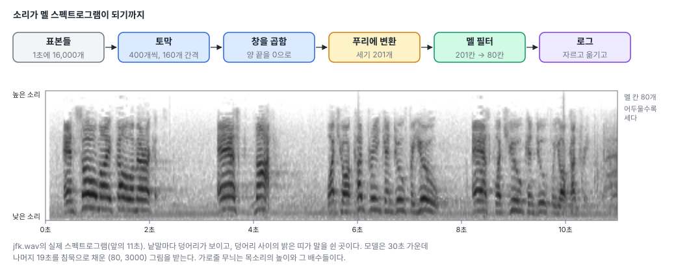
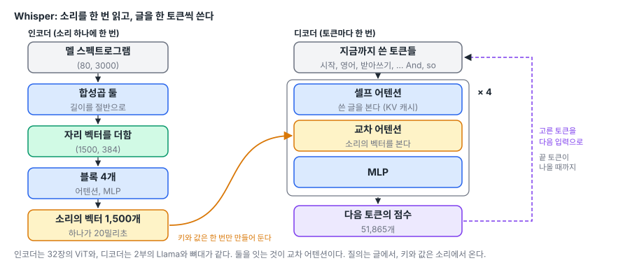

# 음성 인식

지금까지의 입력은 글과 사진이었습니다. 이 장의 입력은 소리입니다. 사람의
말이 담긴 소리 파일을 받아 글로 받아씁니다.

모델은 OpenAI의 Whisper입니다. 구조는 새롭지 않습니다. 앞 절반(인코더)은
[32장](ch32_vit_detection.md)의 ViT이고 뒤 절반(디코더)은 2부의
Llama입니다. 새로운 것은 둘을 잇는 어텐션 하나와, 모델의 앞뒤에서 하는
일입니다. 소리를 모델이 읽을 수 있는 그림으로 바꾸는 일, 글을 고르는
방법, 그리고 30초보다 긴 소리를 다루는 일입니다.

결과를 미리 적어 둡니다.

- 소리 파일을 읽고, 푸리에 변환을 직접 짜고, 멜 스펙트로그램을 만듭니다.
  Python(transformers)이 만든 것과 10만분의 1.4 안에서 같습니다.
- Whisper-tiny를 2부의 방식으로 만들었습니다. 인코더의 출력이
  transformers와 1,000분의 1 안에서 같고(값의 크기는 17), 받아쓴 토큰이
  탐욕 디코딩과 빔 서치 모두에서 **하나도 다르지 않습니다**.
- 탐욕 디코딩과 빔 서치는 다른 글을 냅니다. 쉼표 하나가 다르고, 빔
  서치가 찾은 글의 확률이 더 높습니다.
- 빔 서치를 처음 짰을 때는 글이 중간에 끊겼습니다. 끝 토큰을 언제
  받아들이느냐의 문제였습니다.
- 말이 없는 곳을 찾아 긴 소리를 30초 이하로 나눕니다. 64초짜리 소리를
  1.0초에 받아씁니다.
- 11초짜리 소리를 받아쓰는 데 스레드 하나로 683밀리초,
  [31장](ch31_mobile_engines.md)의 SME 커널을 쓰면 240밀리초입니다.
  whisper.cpp는 287밀리초입니다. 스레드 12개에서는 우리 111밀리초,
  whisper.cpp 63밀리초입니다.

| 하는 일 | 절 |
|---|---|
| 소리 파일을 읽는다 | 33.1 |
| 푸리에 변환을 이해한다 | 33.2 |
| 빠른 푸리에 변환을 짠다 | 33.3 |
| 길이 400의 변환을 한다 | 33.4 |
| 멜 스펙트로그램을 만든다 | 33.5 |
| Whisper의 구조를 본다 | 33.6 |
| 인코더를 짠다 | 33.7 |
| 디코더와 교차 어텐션을 짠다 | 33.8 |
| 지시 토큰을 다룬다 | 33.9 |
| transformers와 대조한다 | 33.10 |
| 글을 고른다: 탐욕과 빔 서치 | 33.11 |
| 긴 소리를 나눈다 | 33.12 |
| whisper.cpp와 겨룬다 | 33.13 |

## 33.1 소리 파일을 읽는다

소리는 공기의 압력이 떨리는 것입니다. 마이크는 그 압력을 전압으로
바꾸고, 컴퓨터는 전압을 **일정한 간격으로 재서** 숫자의 열로 적습니다.
한 번 잰 값이 **표본**<sup>sample</sup>이고, 1초에 재는 횟수가 **표본
속도**<sup>sample rate</sup>입니다.

이 장의 소리는 1초에 16,000번 잰 것입니다. 16kHz라고 씁니다. 음악에는
모자라지만 사람의 말에는 충분합니다. 표본 속도의 절반까지의 떨림만 담을
수 있고(8kHz), 말소리에서 뜻을 가르는 떨림은 그 아래에 있습니다.
Whisper는 16kHz만 받습니다.

WAV는 그 숫자를 압축하지 않고 담는 형식입니다. 파일은 이름이 붙은 덩어리
여럿으로 되어 있고, 하나가 형식을 적고 하나가 표본을 담습니다.

```rust
{{#include ../../../crates/badak_audio/src/wav.rs:parse}}
```

표본은 16비트 정수입니다. 32,768로 나눠 −1과 1 사이의 실수로 바꿉니다.
27.9절에서 JPEG을 풀 때는 외부 크레이트를 썼습니다. WAV는 풀 것이 없어서
직접 읽습니다. MP3나 AAC 같은 압축 형식은 읽지 않습니다.

시험할 소리는 케네디 대통령의 1961년 취임 연설의 한 대목입니다. 11초이고
표본이 176,000개입니다.

```bash
sh scripts/download_ch33.sh
```

## 33.2 푸리에 변환은 떨림의 빠르기를 구한다

표본 176,000개를 그대로 모델에 넣지 않습니다. 사람의 귀가 하는 일을 먼저
합니다. 귀는 압력의 값을 듣지 않고 **떨림의 빠르기**를 듣습니다. 낮은
소리는 느린 떨림이고 높은 소리는 빠른 떨림입니다. "아"와 "이"가 다른
것은 어떤 빠르기의 떨림이 얼마나 섞여 있느냐가 다르기 때문입니다.

소리의 한 토막이 어떤 빠르기의 떨림으로 되어 있는지를 구하는 계산이
**푸리에 변환**<sup>Fourier transform</sup>입니다. 표본 `n`개를 넣으면
값 `n`개가 나옵니다. `k`번째 값은 "토막 안에서 `k`번 떠는 성분이 얼마나
들어 있는가"입니다.

값은 복소수입니다. 크기가 그 성분의 세기이고 각도가 떨림이 시작하는
때입니다. 우리는 세기만 씁니다.

```rust
{{#include ../../../crates/badak_audio/src/fft.rs:complex}}
```

정의를 그대로 옮기면 이렇습니다.

```rust
{{#include ../../../crates/badak_audio/src/fft.rs:dft}}
```

`k`번째 출력은 입력과 "토막 안에서 `k`번 도는 회전"의 내적입니다.
[5장](../part1/ch05_operators.md)의 내적과 같은 일입니다. 입력에 그
빠르기의 떨림이 들어 있으면 곱이 같은 방향으로 쌓여 값이 커지고, 없으면
서로 지워져 0에 가까워집니다.

출력이 `n`개이고 하나마다 곱셈이 `n`번이므로 모두 `n²`번입니다.

## 33.3 빠른 푸리에 변환을 짠다

`n²`은 많습니다. 줄이는 방법이 빠른 푸리에 변환(FFT)입니다.

길이 `n`인 변환은 **짝수 번째 표본들의 변환**과 **홀수 번째 표본들의
변환**으로 만들 수 있습니다. 둘 다 길이가 `n/2`입니다.

```text
X[k]       = E[k] + wᵏ × O[k]
X[k + n/2] = E[k] − wᵏ × O[k]        w = e^(−2πi/n)
```

`E`와 `O`가 짝수 쪽과 홀수 쪽의 변환입니다. 길이 `n/2`짜리 변환 둘에
곱셈 `n/2`번을 더하면 길이 `n`짜리 변환이 됩니다. 반으로 나누기를 길이
1까지 되풀이하면 단계가 `log₂ n`개이고 단계마다 곱셈이 `n/2`번입니다.
`n = 512`이면 정의로는 262,144번, 이 방법으로는 2,304번입니다.

```rust
{{#include ../../../crates/badak_audio/src/fft.rs:fft}}
```

재귀로 부르지 않고 아래에서부터 합쳐 올라갑니다. 그러려면 표본이 "끝까지
나눴을 때 놓일 위치"에 미리 가 있어야 합니다. 짝수와 홀수로 나누기를
되풀이하면 표본은 **번호의 비트를 뒤집은 위치**로 갑니다. 번호의 가장
낮은 비트가 첫 나눔을 정하고, 그다음 비트가 둘째 나눔을 정하기
때문입니다. 함수의 첫 반복문이 그 일을 합니다.

테스트는 두 가지를 봅니다. 한 토막 안에서 세 번 떠는 코사인을 넣으면 3번
위치(와 그 짝)에만 값이 나오는지, 그리고 정의대로 계산한 것과
같은지입니다.

## 33.4 400은 2의 거듭제곱이 아니다

방금의 방법은 길이가 2의 거듭제곱일 때만 쓸 수 있습니다. 반으로 나누기를
끝까지 할 수 있어야 하기 때문입니다. Whisper는 표본 400개짜리 토막을
변환합니다. 16kHz에서 25밀리초입니다. 400은 2의 거듭제곱이 아닙니다.

512로 늘리면 안 됩니다. 뒤에 0을 붙여 변환하면 주파수의 눈금이 달라져
다른 값이 나오고, 모델은 길이 400의 변환으로 학습되었습니다.

길이가 무엇이든 FFT로 계산하는 방법이 있습니다. 정의의 지수에 있는
`k × t`를 `(k² + t² − (k − t)²) / 2`로 바꿔 씁니다. 그러면 변환이
이런 꼴이 됩니다.

```text
X[k] = c[k] × Σₜ (x[t] × c[t]) × conj(c[k − t])        c[m] = e^(−πi·m²/n)
```

가운데의 합은 `k − t`만 보는 꼴, 곧 **합성곱**입니다. 합성곱은 두 쪽을
각각 변환해 곱하고 되돌리면 됩니다. 길이는 2의 거듭제곱으로 넉넉히
늘려도 답이 같습니다. 길이 400의 변환이 길이 1,024의 FFT 두 번이
됩니다(한 번은 미리 해 둡니다).

```rust
{{#include ../../../crates/badak_audio/src/fft.rs:bluestein}}
```

세 가지를 재 봅니다.

```text
{{#include output/ch33_mel.txt:5:8}}
```

정의 그대로가 751마이크로초, 이 방법이 14마이크로초로 쉰 배 빠릅니다.
길이 512의 FFT는 3마이크로초이지만 다른 답을 내므로 쓸 수 없습니다.

whisper.cpp는 다른 방법을 씁니다. 반으로 나누다가 길이가 홀수가 되면
거기서부터 정의대로 계산합니다.[^whisper-cpp-fft] 400은 200, 100, 50,
25로 나뉘고 25에서 멈춥니다. 길이 25짜리 정의 계산 열여섯 번입니다. 어느
방법이든 소리 30초에 변환을 3,000번 하고, 그 시간은 모델에 견주면
작습니다.

## 33.5 멜 스펙트로그램을 만든다

변환을 토막마다 해서 나란히 세우면 그림이 됩니다. 가로가 시간, 세로가
떨림의 빠르기, 값이 세기입니다.
**스펙트로그램**<sup>spectrogram</sup>이라고 합니다. Whisper가 받는 것은
거기에 세 가지 처리를 더 한 것입니다.



**토막과 창.** 표본 400개(25밀리초)짜리 토막을 160개(10밀리초)씩 옮겨
가며 자릅니다. 토막이 겹칩니다. 소리를 그대로 끊으면 끊긴 곳이 급한
변화처럼 보여 원래 없던 높은 떨림이 변환에 나타납니다. 그래서 토막에
가운데가 높고 양 끝이 0인 곡선을 곱해 끝을 줄입니다.

```rust
{{#include ../../../crates/badak_audio/src/mel.rs:window}}
```

**멜 눈금.** 변환은 주파수를 같은 간격으로 나눕니다. 0Hz부터 8,000Hz까지
40Hz 간격의 201칸입니다. 사람의 귀는 그렇게 듣지 않습니다. 100Hz와
200Hz는 또렷이 다르게 들리지만 5,000Hz와 5,100Hz는 거의 같게 들립니다.
"같은 간격이 같은 차이로 들리게" 만든 눈금이 **멜**<sup>mel</sup>입니다.
낮은 쪽은 촘촘하고 높은 쪽은 성깁니다.

```rust
{{#include ../../../crates/badak_audio/src/mel.rs:mel_scale}}
```

201칸을 멜 눈금에서 같은 간격인 80칸으로 묶습니다. 묶는 가중치가 세모
꼴입니다.

```rust
{{#include ../../../crates/badak_audio/src/mel.rs:filters}}
```

`(80, 201)` 행렬이고 토막마다 세기 201개에 곱합니다. 선형 층입니다. 다만
가중치를 학습하지 않고 귀를 흉내 내어 정했습니다.

**로그.** 소리의 세기는 범위가 넓습니다. 속삭임과 고함의 세기는 백만
배가 다르지만 사람은 "몇 배 크다"로 듣습니다. 그래서 세기에 로그를
취합니다. 그리고 가장 큰 값에서 8 아래(1억분의 1)는 잘라 내고, 값이 0
근처에 오도록 옮기고 줄입니다.

```rust
{{#include ../../../crates/badak_audio/src/mel.rs:spectrogram}}
```

마지막 숫자들(`1e-10`, `8.0`, `4.0`)은 Whisper를 학습한 사람들이 정한
것입니다.[^whisper-audio] 27.10절과 32.11절에서 본 그대로입니다. 전처리는
모델의 일부이고, 한 군데라도 다르면 모델은 본 적 없는 그림을 받게
됩니다.

소리는 30초로 맞춥니다. 짧으면 뒤에 0(침묵)을 붙이고 길면 자릅니다.
토막이 3,000개이므로 그림은 `(80, 3000)`입니다.

```bash
cargo run --release -p badak_audio --example ch33_mel
```

```text
{{#include output/ch33_mel.txt:1:3}}
```

24만 개의 값이 transformers가 만든 것과 10만분의 1.4 안에서 같습니다.

## 33.6 Whisper는 인코더와 디코더로 되어 있다

Whisper는 두 부분입니다.[^whisper]



| Whisper-tiny | 인코더 | 디코더 |
|---|---|---|
| 입력 | 멜 스펙트로그램 `(80, 3000)` | 지금까지 쓴 토큰들 |
| 출력 | 벡터 1,500개, 폭 384 | 다음 토큰의 점수 51,865개 |
| 블록 | 4개 | 4개 |
| 어텐션 헤드 | 6개 | 6개 |
| 실행 | 소리 하나에 한 번 | 토큰마다 한 번 |
| 닮은 것 | [32장](ch32_vit_detection.md)의 ViT | 2부의 Llama |

파라미터는 3,776만 개이고 파일은 151MB입니다. OpenAI가 Hugging Face에
올려 둔 것을 그대로 받습니다.

**인코더**는 소리의 그림을 읽어 벡터 1,500개로 바꿉니다. 벡터 하나가
소리 20밀리초를 맡습니다. 소리 하나에 한 번만 실행합니다.

**디코더**는 글을 씁니다. 지금까지 쓴 토큰을 받아 다음 토큰의 점수를
냅니다. [10장](../part2/ch10_forward_pass.md)에서 Llama가 한 일과
같습니다. 다른 점은 쓰는 동안 계속 **인코더의 출력을 읽는다**는
것입니다.

이런 구조를 인코더-디코더라고 합니다. 2부의 Llama는 디코더만 있는
모델이었습니다. 입력과 출력이 같은 종류(글)이면 디코더 하나로 되고, 다른
종류(소리와 글)이면 입력을 읽는 부분을 따로 둡니다.

## 33.7 인코더를 짠다

인코더의 앞에는 합성곱이 둘 있습니다. 시간 방향으로만 움직이는
합성곱입니다. 창이 3칸이고, 첫째는 멜 칸 80개를 폭 384로 바꾸고, 둘째는
스트라이드 2로 길이를 절반으로 줄입니다. 토막 3,000개가 위치 1,500개가 됩니다.

27.4절의 방법 그대로 합니다. 창을 펼쳐 선형 층에 넣습니다.

```rust
{{#include ../../../crates/badak_models/src/whisper.rs:conv}}
```

그다음은 [32장](ch32_vit_detection.md)의 ViT입니다. 위치마다의 벡터를
더하고, 블록을 넷 지나고, 층 정규화를 합니다. 분류 토큰은 없고, 벡터
1,500개를 모두 내놓습니다.

```rust
{{#include ../../../crates/badak_models/src/whisper.rs:encode}}
```

끝의 3번이 이 모델에만 있는 일입니다. 다음 절에서 봅니다.

ViT와 견주면 어텐션이 무겁습니다. ViT-Tiny는 토큰이 197개였습니다.
여기는 1,500개입니다. 어텐션의 점수는 토큰 수의 제곱이므로
`1500 × 1500`, 225만 개를 헤드마다, 블록마다 구합니다. 5,400만 번의 지수
함수가 소프트맥스에 듭니다. 32.10절에서 본 지수 함수의 비용이 여기서는
더 큽니다(33.13절).

## 33.8 디코더와 교차 어텐션을 짠다

디코더의 블록은 Llama의 블록에 한 층이 더 있습니다.

1. 셀프 어텐션. 지금까지 쓴 토큰들을 봅니다.
2. **교차 어텐션**(cross-attention). 인코더의 출력을 봅니다.
3. MLP.

교차 어텐션은 9.6절의 어텐션과 계산이 같습니다. 질의, 키, 값이 어디서
오는가만 다릅니다. **질의는 글에서, 키와 값은 소리에서 옵니다.** "지금
쓰려는 글자는 소리의 어디에 해당하는가"를 묻고, 그 위치의 소리 정보를
가져옵니다.

```rust
{{#include ../../../crates/badak_models/src/whisper.rs:step}}
```

캐시가 두 가지입니다.

**셀프 어텐션의 캐시**는 11.4절의 KV 캐시입니다. 토큰을 하나 넣을 때마다
그 토큰의 키와 값이 쌓입니다. 질의는 새 토큰 하나뿐이고, 쌓인 것 전부를
봅니다. 뒤의 토큰은 아직 캐시에 없으므로 마스크가 필요 없습니다.

**교차 어텐션의 캐시**는 쌓이지 않습니다. 키와 값이 인코더의 출력에서
나오고, 인코더의 출력은 토큰을 몇 개 쓰든 바뀌지 않습니다. 그래서
인코더가 끝났을 때 **한 번** 만들어 둡니다. 앞 절의 3번입니다. 이것을
토큰마다 다시 만들면 벡터 1,500개에 선형 층 둘을 블록마다 다시 하게
되고, 디코더가 인코더만큼 느려집니다.

질의가 하나일 때의 어텐션은 따로 짰습니다.

```rust
{{#include ../../../crates/badak_models/src/whisper.rs:attend}}
```

앞의 것(`attend`)은 인코더가 쓰는 것으로, 여러 질의가 여러 키를 한꺼번에
봅니다. 뒤의 것(`attend_one`)은 질의 하나가 쌓인 키를 봅니다. 내적 몇
개와 소프트맥스 하나입니다.

## 33.9 할 일을 지시 토큰으로 알린다

Whisper의 토큰 51,865개는 두 종류입니다. 번호 50,257 아래는 글의
조각입니다. [8장](../part2/ch08_tokenizer.md)에서 본 바이트 단위
BPE입니다. 그 위는 **지시**입니다.
| 토큰 | 번호 | 뜻 |
|---|---|---|
| `<\|endoftext\|>` | 50257 | 끝 |
| `<\|startoftranscript\|>` | 50258 | 시작 |
| `<\|en\|>`, `<\|ko\|>`, … | 50259~ | 언어 (99가지) |
| `<\|translate\|>`, `<\|transcribe\|>` | 50358, 50359 | 영어로 번역 / 받아쓰기 |
| `<\|notimestamps\|>` | 50363 | 시각을 적지 않음 |
| `<\|0.00\|>` ~ `<\|30.00\|>` | 50364~51864 | 시각 (0.02초 간격, 1,501개) |

모델에게 무엇을 할지를 **토큰으로** 알립니다. 디코더에 시작, 언어,
받아쓰기, 시각 없이의 네 토큰을 먼저 넣고, 그 뒤부터 모델이 쓰게 합니다.
언어 토큰을 한국어로 바꾸면 한국어로 받아쓰고, 받아쓰기를 번역으로
바꾸면 영어로 옮깁니다. 모델 하나가 여러 일을 하는 방법입니다. 8.9절에서
대화의 역할을 특수 토큰으로 적은 것과 같은 방식입니다.

```rust
{{#include ../../../crates/badak_models/src/whisper.rs:vocabulary}}
```

토큰을 글로 바꾸는 쪽만 있으면 됩니다. 글을 토큰으로 바꾸는 일([8장](../part2/ch08_tokenizer.md)의
병합)은 받아쓰기에는 필요 없습니다.

언어를 모를 때는 모델에게 묻습니다. 시작 토큰 하나만 넣고, 언어 토큰
99개 가운데 점수가 가장 높은 것을 고릅니다.

```rust
{{#include ../../../crates/badak_models/src/whisper.rs:language}}
```

고르면 안 되는 토큰이 있습니다. 모델과 함께 오는 설정 파일에 번호가 적혀
있습니다. 88개는 언제나(대부분 말소리가 아닌 기호입니다), 빈칸과 끝
토큰은 첫 토큰으로 고르지 못하게 합니다. 점수를 음의 무한대로 바꿔
둡니다.

```rust
{{#include ../../../crates/badak_models/src/whisper.rs:suppress}}
```

## 33.10 transformers와 대조한다

```bash
python reference/ch33_make_reference.py
cargo run --release -p badak_models --example ch33_verify
```

```text
{{#include output/ch33_verify.txt}}
```

멜 스펙트로그램, 인코더의 출력, 디코더의 첫 점수를 차례로 견줍니다.
인코더의 출력은 1,000분의 1이 다릅니다. 값의 크기가 17이므로 상대
오차는 10만분의 6입니다. 디코더의 첫 점수는 10만분의 5가 다릅니다.

그리고 받아쓴 토큰이 **모두 같습니다**. 탐욕 디코딩의 23개, 빔 서치의
24개가 모두 같습니다. [7장](../part1/ch07_mnist.md)부터 해 온 "값이 거의
같다"와는 다른 종류의 확인입니다. 토큰은 정수이고 같거나 다릅니다.
점수가 소수점 아래에서 조금 달라도 가장 큰 것이 같으면 같은 토큰이
나오고, 스물세 번을 내리 그렇게 됐습니다.

언어도 맞게 찾습니다. 영어, 97.8%입니다.

## 33.11 탐욕 디코딩과 빔 서치로 글을 고른다

디코더는 다음 토큰의 **점수**를 낼 뿐입니다. 어느 토큰을 고를지는 따로
정해야 합니다. [12장](../part2/ch12_sampling.md)에서 Llama로 다룬
일입니다. 받아쓰기는 사정이 다릅니다. 글을 지어내는 것이 아니라 정답이
있는 일이므로, 무작위로 뽑지 않고 **가장 그럴듯한 글**을 찾습니다.

**탐욕 디코딩**은 걸음마다 점수가 가장 높은 토큰을 고릅니다.

```rust
{{#include ../../../crates/badak_models/src/whisper.rs:greedy}}
```

문제는 "걸음마다 가장 좋은 것"이 "전체로 가장 좋은 것"이 아니라는
점입니다. 글 전체의 확률은 토큰마다의 확률의 곱입니다(로그로는 합). 지금
조금 덜 좋은 토큰을 골랐을 때 뒤의 토큰이 훨씬 확실해진다면 그쪽이
전체로는 낫습니다. 탐욕 디코딩은 그런 경우를 찾지 못합니다.

**빔 서치**<sup>beam search</sup>는 후보를 여럿 가지고 갑니다.

```rust
{{#include ../../../crates/badak_models/src/whisper.rs:beam}}
```

후보(빔)가 다섯이면, 걸음마다 후보 다섯 각각에서 다음 토큰을 펼쳐 보고,
합친 로그 확률이 큰 다섯을 남깁니다. 후보마다 디코더의 캐시를 따로
가지고 있어야 합니다. 후보가 갈라질 때 캐시를 복사합니다.

결과가 다릅니다.

| | 받아쓴 글 | 로그 확률의 합 |
|---|---|---|
| 탐욕 | … can do for you ask what you can do … | −3.378 |
| 빔 5 | … can do for you**,** ask what you can do … | −3.104 |

쉼표 하나입니다. "you" 다음에 탐욕 디코딩은 "ask"를 골랐습니다. 그
단계에서는 "ask"의 점수가 쉼표보다 높았습니다. 빔 서치는 쉼표를 고른
후보도 가지고 갔고, 그 후보가 뒤에서 더 확실한 토큰을 만나 전체로는 더
높아졌습니다. 토큰이 하나 더 많은데도 로그 확률의 합이 더 큽니다.

### 끝 토큰은 상위 다섯에 들 때만 받는다

빔 서치를 처음 짰을 때는 이렇게 나왔습니다.

```text
빔 5: 토큰 10개, 로그 확률의 합 -1.719
  " And so my fellow Americans ask not what your country"
```

글이 중간에 끊겼습니다. 까닭은 끝 토큰입니다. 처음 짠 것은 후보마다 가장
좋은 다음 토큰 다섯을 보다가 **끝 토큰이 그 안에 있으면 다 쓴 글로
모았습니다.** 끝 토큰의 확률이 1%여도 다섯 안에는 들 수 있습니다. 그렇게
쓰다 만 글이 다섯 개 모이자 멈췄고, 그 가운데 평균이 가장 좋은 것이
뽑혔습니다. 짧은 글은 곱하는 확률의 수가 적어서 유리합니다.

고친 것이 위의 코드입니다. 끝 토큰은 **모든 후보를 통틀어 상위 다섯 안에
들었을 때만** 받아들입니다. 그리고 다 쓴 글이 다섯 개 모여도, 아직 쓰고
있는 후보가 그 가운데 가장 나쁜 것보다 좋으면 계속합니다. 이렇게 하자
transformers와 같은 토큰이 나왔습니다.

빔 서치는 알고리즘의 핵심이 다섯 줄이고, 나머지가 전부 이런 규칙입니다.
언제 끝났다고 볼지, 길이가 다른 글을 어떻게 견줄지를 정해야 합니다.
규칙이 구현마다 조금씩 다르고, 그래서 구현마다 받아쓴 글이 조금씩
다릅니다. OpenAI의 구현은 다 쓴 글을 길이로 나눠 견주는 대신 다른 벌점을
쓸 수 있게 해 두었고, 얼마나 더 기다릴지를 정하는 값도
있습니다.[^whisper-beam]

비용도 있습니다. 후보 다섯이 저마다 디코더를 부르므로 시간이 다섯 배
듭니다. 이 소리에서 탐욕 디코딩이 47밀리초, 빔 서치가
245밀리초였습니다(33.13절).

## 33.12 긴 소리를 나눈다

Whisper는 30초를 받습니다. 더 긴 소리는 나눠야 합니다.

30초마다 그대로 자르면 말하는 도중에 끊깁니다. 낱말이 반으로 잘리면 두
조각 어디에서도 그 낱말을 알아듣지 못합니다. **말이 없는 곳에서** 잘라야
합니다. 말이 있는 구간을 찾는 일을 **음성 구간
검출**<sup>voice activity detection, VAD</sup>이라고 합니다.

가장 단순한 방법을 씁니다. 짧은 토막마다 소리의 크기를 재고, 조용한
토막보다 뚜렷이 큰 토막을 말소리로 봅니다.

```rust
{{#include ../../../crates/badak_audio/src/vad.rs:loudness}}
```

```rust
{{#include ../../../crates/badak_audio/src/vad.rs:segments}}
```

문턱을 정하는 것이 전부입니다. "조용한 토막"의 크기를 아래에서 10분의 1
위치의 값으로 잡고, 그보다 12데시벨(열여섯 배) 큰 토막을 말소리로
봅니다. 그다음은 다듬기입니다. 낱말 사이의 짧은 숨(0.5초 미만)은 잇고,
딸깍 소리 같은 짧은 것(0.1초 미만)은 버리고, 구간의 앞뒤에 0.1초를
붙입니다. 말의 첫소리와 끝소리는 작아서 문턱 아래일 수 있기 때문입니다.

구간을 30초 이하의 창으로 묶습니다.

```rust
{{#include ../../../crates/badak_audio/src/vad.rs:windows}}
```

시험할 긴 소리가 없어서 만들었습니다. 케네디의 연설을 침묵을 사이에
두고 다섯 번 이어 붙인 64초짜리입니다.

```bash
cargo run --release -p badak_models --example ch33_transcribe
```

```text
{{#include output/ch33_transcribe.txt}}
```

구간 다섯을 찾고 창 셋으로 묶었습니다. 앞의 둘은 연설 둘씩, 마지막은
하나입니다. 창마다 그림을 만들고, 인코더를 돌리고, 빔 서치로 받아씁니다.

눈여겨볼 것이 하나 있습니다. 같은 연설인데 **창에 따라 쉼표가 있기도
하고 없기도 합니다.** 연설 하나만 든 창에서는 쉼표가 있고, 둘이 든
창에서는 없습니다. 같은 소리라도 앞뒤에 무엇이 있느냐에 따라 모델이 쓰는
글이 달라집니다. 받아쓰기의 결과를 글자 하나까지 믿으면 안 되는
까닭입니다.

이 방법의 한계는 분명합니다. 배경에 음악이나 소음이 있으면 "조용한
토막"이 조용하지 않아서 문턱을 쓸 수 없습니다. 실전에서는 말소리를
가려내도록 학습한 작은 신경망을 씁니다.

## 33.13 whisper.cpp와 견준다

whisper.cpp는 llama.cpp와 같은 사람들이 만든, Whisper만을 위한
엔진입니다. 같은 소리, 같은 모델로 잽니다. 다만 whisper.cpp의 모델
파일(`ggml-tiny.bin`, 78MB)은 가중치를 16비트로 담고 있습니다. GPU는
껐습니다.

```bash
sh scripts/bench_ch33.sh
```

| 스레드 1 (ms) | 멜 스펙트로그램 | 인코더 | 탐욕 디코딩 (토큰당) | 빔 5 |
|---|---:|---:|---:|---:|
| `badak` 기본 | 62.1 | 573 | 47.2 (1.68) | 245 |
| `badak` 빠른 길 | 61.7 | 132 | 46.5 (1.66) | 244 |
| whisper.cpp | 8.7 | 242 | 35.7 (1.27) | 143 |

| 스레드 4 (ms) | 멜 스펙트로그램 | 인코더 | 탐욕 디코딩 (토큰당) | 빔 5 |
|---|---:|---:|---:|---:|
| `badak` 기본 | 17.0 | 194 | 31.7 (1.13) | 167 |
| `badak` 빠른 길 | 17.0 | 85.7 | 31.6 (1.13) | 165 |
| whisper.cpp | 2.8 | 76.4 | 17.1 (0.61) | 55.0 |

| 스레드 12 (ms) | 멜 스펙트로그램 | 인코더 | 탐욕 디코딩 (토큰당) | 빔 5 |
|---|---:|---:|---:|---:|
| `badak` 기본 | 6.0 | 77.5 | 30.8 (1.10) | 159 |
| `badak` 빠른 길 | 6.0 | 74.7 | 30.1 (1.08) | 157 |
| whisper.cpp | 2.0 | 45.0 | 16.0 (0.57) | 34.4 |

세 차례의 중앙값입니다. whisper.cpp의 값은 그 프로그램이 스스로 찍는
단계별 시간이고, 디코딩은 "decode"와 "batchd" 두 줄을 더한 것입니다.
모델을 읽는 시간은 어느 쪽에도 넣지 않았습니다.

**스레드 하나에서 우리 기본 구현은 인코더가 두 배 넘게 느립니다.**
인코더의 일은 대부분 행렬 곱이고, 거기에 지수 함수 5,400만 번이
더해집니다(33.7절).

**빠른 길에서는 스레드 하나의 인코더가 whisper.cpp보다 빠릅니다.** 세
가지를 바꿨습니다.

- 선형 층을 [31장](ch31_mobile_engines.md)의 SME 커널로.
- 어텐션 안의 두 곱(질의와 키, 점수와 값)도 SME 커널로. 키와 값은 실행할
  때마다 달라지므로 그때마다 다시 늘어놓습니다. `1500 × 64`짜리라
  늘어놓는 비용이 계산에 견주어 작습니다.
- GELU와 소프트맥스의 지수 함수를 32.10절의 근사로. 소프트맥스에 지수
  함수가 5,400만 번입니다.

whisper.cpp가 무엇으로 계산하는지는 가려내지 못했습니다. 실행할 때
출력하는 기능 목록에 `NEON = 1`, `SME = 1`, `ACCELERATE = 1`이 함께
있습니다. Apple의 행렬 라이브러리(Accelerate)를 쓰도록 빌드된 것이고,
프로세서에 SME가 있다는 것을 알고 있습니다. 어느 곱을 어느 쪽에서
계산하는지는 31.4절처럼 기계어까지 내려가 보지 않았습니다.

**스레드를 늘리면 whisper.cpp가 더 빠릅니다.** 스레드 12개에서 인코더가
우리 74.7밀리초, whisper.cpp 45.0밀리초입니다. 31.9절에서 본 대로 SME는
스레드를 늘려도 덜 늘고, 우리 인코더에는 스레드에 나누지 않은 곳이 남아
있습니다. 창을 펼치는 일, 헤드마다 값을 옮겨 담는 일, 층 정규화입니다.

**디코더는 비슷합니다.** 토큰 하나에 1밀리초 남짓입니다. 디코더의 일은
벡터 하나짜리 선형 층이고, 가장 큰 것이 마지막에 점수 51,865개를 내는
층입니다(곱셈 2,000만 번). 26.12절부터 남아 있는 "벡터 하나짜리 선형
층"의 문제가 여기서도 시간을 정합니다.

**멜 스펙트로그램**은 스레드 하나에서 62밀리초, whisper.cpp는
8.7밀리초로 일곱 배 차이입니다. 우리는 변환을 `f64`로, 길이 1,024의 FFT
두 번으로 합니다. whisper.cpp는 `f32`로, 사인과 코사인을 표로 만들어
두고 합니다. 인코더가 빨라지고 나면 이 시간이 작지 않습니다. 빠른 길의
스레드 하나에서 전체 240밀리초의 4분의 1입니다. 31.7절과 32.10절에서 본
일이 또 일어났습니다.

11초짜리 소리를 받아쓰는 데 걸리는 시간은 소리 길이의 수십 분의 1입니다.
다만 Whisper는 소리가 1초든 30초든 30초짜리 그림을 만들어 인코더에
넣습니다. 짧은 소리일수록 손해입니다.

## 33.14 남긴 일을 적어 둔다

**시각.** 낱말이나 문장이 소리의 몇 초에 있는지를 내는 기능을 만들지
않았습니다. 시각 토큰을 고르게 하고 그 규칙(시각은 뒤로 가지 않는다,
쌍으로 나온다)을 지키게 해야 합니다. 자막을 만들려면 필요합니다.

**30초 창을 잇는 방법.** OpenAI의 구현은 음성 구간 검출 없이 시각
토큰으로 창을 옮깁니다. 모델이 마지막으로 낸 시각에서 다음 창을
시작합니다. 앞 창에서 받아쓴 글을 다음 창의 디코더에 미리 넣어 주어
문맥을 잇기도 합니다. 둘 다 하지 않았습니다.

**실패했을 때 다시 하기.** 받아쓴 글이 같은 말을 되풀이하거나 확률이
너무 낮으면, 무작위로 뽑는 정도를 올려 다시 해 보는 방법이 있습니다.
만들지 않았습니다. 침묵을 넣었을 때 없는 말을 지어내는 문제도 다루지
않았습니다.

**정확도.** 연설 한 대목으로 본 것이 전부입니다. 낱말 오류율을 재지
않았고, 한국어는 시험하지 않았습니다. Whisper-tiny는 가장 작은 모델이고
한국어에서는 많이 틀립니다.

**다른 표본 속도.** 16kHz가 아닌 소리를 16kHz로 바꾸는 일을 하지
않았습니다.

**더 나은 음성 구간 검출.** 학습한 모델을 쓰지 않았습니다.

**디코더의 속도.** 캐시가 토큰마다 벡터를 다시 늘려 잡고, 빔이 갈라질
때 캐시를 통째로 복사합니다.

## 33.15 실전 엔진에서는

**whisper.cpp도 30초 그림을 만듭니다.** 토막의 길이 400, 간격 160, 창
30초가 머리 파일에 상수로 적혀 있습니다.[^whisper-cpp-fft] 모델이 그
숫자들로 학습되었으므로 어느 엔진이든 같습니다.

**음성 구간 검출은 따로 학습한 모델로 합니다.** whisper.cpp는 그런
모델을 받아 말소리 구간만 받아쓰는 기능을 갖추고 있습니다.[^whisper-cpp-vad]
말이 없는 구간을 건너뛰면 빨라지고, 침묵에서 없는 말을 지어내는 일도
줄어듭니다.

**빔 서치의 규칙은 구현마다 다릅니다.** 33.11절에서 본 대로입니다.
OpenAI의 구현, transformers, whisper.cpp가 저마다 끝내는 조건과 길이를
다루는 방법을 가지고 있습니다. 같은 모델, 같은 소리, 같은 빔의 폭으로도
받아쓴 글이 다를 수 있습니다.

**교차 어텐션의 키와 값을 한 번만 만드는 것은 모든 구현이 하는
일입니다.** 인코더-디코더 구조에서 가장 먼저 하는 최적화입니다. 하지
않으면 디코더의 시간이 몇 배가 됩니다.

## 정리

- 소리는 일정한 간격으로 잰 압력의 값들입니다. Whisper는 1초에
  16,000개를 받습니다.
- 푸리에 변환은 소리의 한 토막이 어떤 빠르기의 떨림들로 되어 있는지를
  구합니다. 정의대로는 `n²`번, 반으로 나누기를 되풀이하면 `n log n`번의
  곱셈입니다.
- 길이가 2의 거듭제곱이 아닌 변환은 합성곱으로 바꿔 써서 2의 거듭제곱
  길이의 변환으로 계산할 수 있습니다.
- 멜 스펙트로그램은 겹치는 토막마다 변환하고, 주파수를 귀의 눈금으로
  묶고, 세기에 로그를 씌운 그림입니다. 숫자 하나하나가 모델과 함께
  정해진 것입니다.
- Whisper의 인코더는 ViT의 뼈대이고 디코더는 Llama의 뼈대입니다. 둘을
  교차 어텐션이 잇습니다. 질의는 글에서, 키와 값은 소리에서 옵니다.
- 교차 어텐션의 키와 값은 인코더가 끝났을 때 한 번 만들어 둡니다.
- 모델에게 할 일을 토큰으로 알립니다. 언어, 받아쓰기인지 번역인지,
  시각을 적을지.
- 탐욕 디코딩은 걸음마다 가장 좋은 토큰을, 빔 서치는 전체로 가장
  그럴듯한 글을 찾습니다. 둘의 결과가 다르고, 빔 서치의 것이 확률이
  높습니다.
- 빔 서치는 끝 토큰을 언제 받아들이는지, 길이가 다른 글을 어떻게
  견주는지에 따라 결과가 달라집니다. 그 규칙을 잘못 정하면 글이
  끊깁니다.
- 긴 소리는 말이 없는 곳에서 나눕니다. 같은 소리도 창에 무엇이 함께
  들었느냐에 따라 받아쓴 글이 조금 달라집니다.
- 스레드 하나에서 SME 커널을 쓴 우리 인코더가 NEON으로 계산하는
  whisper.cpp를 앞서고, 스레드가 많으면 whisper.cpp가 앞섭니다.

## 연습 문제

1. `fft`의 첫 반복문(비트 뒤집기)을 빼고 길이 8짜리 입력을 넣어
   보십시오. 출력이 어떻게 틀립니까. 번호 0부터 7까지가 어느 자리로
   가야 하는지 손으로 적고, 짝수와 홀수로 나누기를 세 번 한 결과와
   견줘 보십시오.
2. whisper.cpp처럼 "반으로 나누다가 홀수가 되면 정의대로"하는 변환을
   짜 보십시오. 길이 400에서 `Bluestein`과 어느 쪽이 빠릅니까. 길이
   401(소수)에서는 어떻습니까.
3. 멜 필터를 그림으로 그려 보십시오(가로가 주파수, 필터마다 세모
   하나). 필터의 폭이 어디서부터 넓어집니까. `mels`를 80에서 40으로
   줄이면 그림이 어떻게 바뀌고, 그 스펙트로그램을 Whisper에 넣으면
   어떤 일이 생깁니까(넣을 수 있습니까).
4. `LogMel::spectrogram`에서 창을 곱하지 않고(모두 1) 받아써
   보십시오. 받아쓴 글이 달라집니까. 스펙트로그램의 어디가 달라지는지
   찾아보십시오.
5. `Whisper::encode`의 3번(교차 어텐션의 키와 값을 미리 만들기)을
   `step` 안으로 옮겨 토큰마다 다시 만들게 해 보십시오. 디코더의 시간이
   몇 배가 됩니까.
6. `beam`의 폭을 1, 2, 5, 10으로 바꿔 받아쓴 글과 로그 확률의 합,
   디코더를 부른 횟수를 표로 만들어 보십시오. 폭을 키우면 로그
   확률의 합이 늘 좋아집니까.
7. 33.11절의 "처음 짠 빔 서치"를 되살려 보십시오(끝 토큰을 후보마다의
   상위 다섯 안에 있으면 받아들이기). 글이 어디서 끊깁니까. 평균 대신
   합으로 견주면 어떻게 됩니까.
8. `vad::Settings`의 `margin`을 6과 24로 바꿔 `ch33_transcribe`를 돌려
   보십시오. 구간이 어떻게 달라집니까. 연설의 소리에 백색 잡음을 섞어
   가며(크기를 조금씩 키워서) 검출이 어디서 무너지는지 찾아보십시오.

## 참고 문헌

[^whisper]: A. Radford 외, "Robust Speech Recognition via Large-Scale
    Weak Supervision", 2022. arXiv:2212.04356. 서지 정보만 확인했습니다.
    이 장의 구조는 논문이 아니라 가중치 파일의 이름과 형상, 그리고
    transformers 5.12.1의 구현이 내는 중간 값과의 대조로 확인했습니다.
    가중치는 <https://huggingface.co/openai/whisper-tiny>(판
    `169d4a4341b3`)이고, 그 저장소의 설명에는 허가 조건이 Apache-2.0으로
    적혀 있습니다. OpenAI의 코드 저장소는 MIT입니다.
    <https://arxiv.org/abs/2212.04356>

[^whisper-audio]: OpenAI Whisper (커밋 `86098128c0b4`),
    `whisper/audio.py`. 토막의 길이 400과 간격 160, 30초는 14~18번째
    줄이고, 로그와 자르기와 옮기기(`clamp(min=1e-10).log10()`,
    `max() − 8.0`, `(x + 4.0) / 4.0`)는 154~156번째 줄입니다.
    transformers의 같은 계산은
    `transformers/models/whisper/feature_extraction_whisper.py`
    128~130번째 줄에 있고, 멜 눈금은 `transformers/audio_utils.py`의
    `hertz_to_mel`(`mel_scale="slaney"`)에서 옮겼습니다. 우리 결과는
    transformers의 것과 대조했습니다.
    <https://github.com/openai/whisper/blob/86098128c0b4/whisper/audio.py>

[^whisper-beam]: OpenAI Whisper (같은 커밋), `whisper/decoding.py`.
    `BeamSearchDecoder`는 301번째 줄부터이고, 다 쓴 글을 견주는
    `MaximumLikelihoodRanker`는 190~213번째 줄입니다(길이로 나누거나,
    `length_penalty`가 있으면 `((5 + 길이) / 6)`의 거듭제곱으로
    나눕니다). 기다리는 정도를 정하는 `patience`는 93번째 줄입니다. 이
    장의 빔 서치는 이 구현을 옮긴 것이 아닙니다. transformers가 고른
    토큰과 같아지도록 규칙을 정했고, 소리 하나로 확인했습니다.
    <https://github.com/openai/whisper/blob/86098128c0b4/whisper/decoding.py>

[^whisper-cpp-fft]: whisper.cpp v1.8.7 (커밋 `48f628a84833`),
    `src/whisper.cpp` 3038번째 줄의 `dft`와 3060번째 줄의 `fft`. 주석이
    "Cooley-Tukey FFT / poor man's implementation"이고, 길이가 홀수이면
    `dft`를 부릅니다. 상수 `WHISPER_N_FFT 400`, `WHISPER_HOP_LENGTH 160`,
    `WHISPER_CHUNK_SIZE 30`은 `include/whisper.h` 34~36번째 줄입니다.
    <https://github.com/ggml-org/whisper.cpp/blob/v1.8.7/src/whisper.cpp>

[^whisper-cpp-vad]: whisper.cpp v1.8.7, `README.md`의 "Voice Activity
    Detection (VAD)" 절(775번째 줄부터). Silero-VAD라는 모델을 쓴다고
    적혀 있습니다. 써 보지는 않았습니다.
    <https://github.com/ggml-org/whisper.cpp/blob/v1.8.7/README.md>
