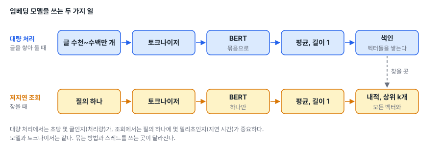
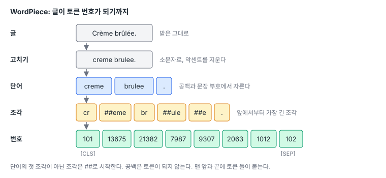
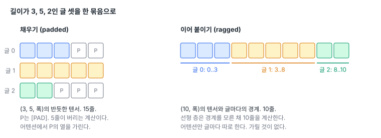
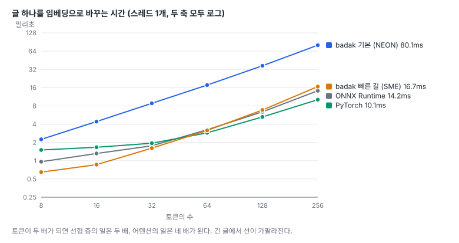
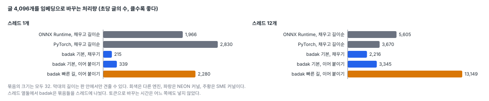

# 임베딩과 검색

지금까지의 모델은 무언가를 **골랐습니다**. 다음 토큰을, 사진의 이름을,
상자를, 받아쓸 글자를 골랐습니다. 이 장의 모델은 고르지 않습니다. 글
하나를 받아 **벡터 하나**를 냅니다. 그 벡터가
**임베딩**<sup>embedding</sup>입니다.

임베딩 모델은 뜻이 비슷한 글을 비슷한 방향의 벡터로 보내도록 학습됩니다.
그러면 "뜻이 가까운 글 찾기"가 "방향이 가까운 벡터 찾기"가 됩니다.
[2장](../part1/ch02_math.md)에서 만든 코사인 유사도를 여기서 씁니다.
검색, 질문에 맞는 문서를 찾아 언어 모델에 넘겨주는 일, 비슷한 글끼리
묶는 일이 모두 임베딩을 바탕으로 합니다.

이 장은 4부에서 처음으로 **여러 입력을 한 번에** 계산합니다. 임베딩
모델이 하는 일은 두 가지이고 성격이 다릅니다.

- **대량 처리.** 찾을 글 수천, 수백만 개를 미리 벡터로 바꿔 쌓아 둡니다.
  글 하나가 얼마나 걸리는지는 상관없고, 1초에 몇 글을 바꾸는지(처리량)가
  중요합니다.
- **저지연 조회.** 사람이 질의를 넣으면 그 하나를 벡터로 바꿔 쌓아 둔
  것들과 견줍니다. 질의 하나에 몇 밀리초가 걸리는지(지연 시간)가
  중요합니다.



결과를 미리 적어 둡니다.

- WordPiece 토크나이저를 만들었습니다. 소문자로 바꾸고 악센트를 지우는
  일에 유니코드의 분해 표가 필요합니다. 한글은 표 없이 식으로 풀립니다.
  시험한 글 16개에서 토큰이 transformers와 모두 같습니다.
- BERT 계열의 all-MiniLM-L6-v2를 2부의 방식으로 만들었습니다. 임베딩이
  PyTorch와 100만분의 1 안에서 같고, STS 벤치마크에서 사람의 점수와의
  순위 상관이 0.8203으로 넷째 자리까지 같습니다.
- 길이가 다른 글을 한 배치로 만드는 방법은 둘입니다. 채우고 가리는
  방법과, 채우지 않고 이어 붙이는 방법입니다. 받은 순서대로 채우면
  계산의 3분의 1을 채운 위치에 쓰고, 하나씩 넣는 것보다 느립니다.
- 대량 처리에서는 스레드를 **배치 안**이 아니라 **배치들**에 나눠야
  합니다. 스레드 12개에서 초당 2,745글이 13,149글이 됩니다. ONNX
  Runtime은 5,605글, PyTorch는 3,670글입니다.
- 조회에서는 8토큰짜리 질의 하나가 0.65밀리초입니다. ONNX Runtime은
  0.96, PyTorch는 1.50밀리초입니다. 256토큰짜리 긴 글에서는 우리가
  느립니다(16.7, 14.2, 10.2밀리초. 스레드를 쓰면 ONNX Runtime이 4.3).
- 검색은 선형 층 하나입니다. 벡터 100만 개와 견주는 데 17밀리초입니다.

| 하는 일 | 절 |
|---|---|
| 모델을 고르고 구조를 본다 | 34.1 |
| 글을 고친다: 소문자와 악센트 | 34.2 |
| 단어를 조각으로 자른다 | 34.3 |
| 인코더를 짠다 | 34.4 |
| 벡터 하나로 줄인다 | 34.5 |
| transformers와 대조한다 | 34.6 |
| 여러 글을 한 배치로 만든다 | 34.7 |
| 대량 처리의 처리량을 잰다 | 34.8 |
| 조회의 지연 시간을 잰다 | 34.9 |
| 가까운 벡터를 찾는다 | 34.10 |
| ONNX Runtime, PyTorch와 견준다 | 34.11 |

## 34.1 모델을 고르고 구조를 본다

모델은 `all-MiniLM-L6-v2`입니다.[^minilm-card] 문장 임베딩에 널리 쓰이는
작은 모델입니다. 구조는 BERT입니다.[^bert]

BERT는 **인코더만 있는 트랜스포머**입니다. 2부의 Llama와 견주면 다음이
다릅니다.

| | Llama (2부) | BERT (이 장) |
|---|---|---|
| 토큰이 보는 범위 | 자기와 그 앞 | 글 전체 (앞과 뒤) |
| 내는 것 | 다음 토큰의 점수 | 토큰마다 벡터 하나 |
| 실행 횟수 | 토큰을 낼 때마다 한 번 | 글 하나에 한 번 |
| KV 캐시 | 필요 ([11장](../part2/ch11_kv_cache.md)) | 필요 없음 |
| 위치 정보 | 회전 (RoPE) | 자리마다 배운 벡터를 더함 |
| 정규화의 자리 | 어텐션과 MLP의 앞 | 더한 다음 |

한 번 실행하면 끝난다는 점이 엔진에는 가장 큰 차이입니다. 토큰을 하나씩
내는 반복이 없으므로 KV 캐시도, 샘플링도 없습니다.
[32장](ch32_vit_detection.md)의 ViT와 같은 종류의 일이고, 블록을 이루는
연산도 같습니다. 어텐션, 층 정규화, GELU, 선형 층입니다.

| | all-MiniLM-L6-v2 |
|---|---|
| 블록 | 6개 |
| 폭 | 384 |
| 헤드 | 12개 (헤드 하나의 폭 32) |
| MLP의 가운데 폭 | 1,536 |
| 단어 사전 | 조각 30,522가지 |
| 받는 길이 | 토큰 256개까지 |
| 파라미터 | 2,271만 개 |
| 파일 | `model.safetensors` (90.9MB) |
| 허가 조건 | Apache-2.0 |

파라미터의 절반이 넘는 1,172만 개가 토큰마다의 벡터를 담은 표입니다
(30,522 × 384). [9장](../part2/ch09_transformer.md)에서 본 대로 그 표는 곱셈 없이 꺼내기만 합니다.
계산은 나머지 1,065만 개가 합니다.

이 모델은 MiniLM이라는 작은 BERT를[^minilm] 문장 쌍 10억 개로 다시
학습한 것입니다. 쌍을 이루는 두 글의 벡터는 가깝게, 나머지와는 멀게
만드는 학습입니다.[^minilm-card] 이런 식으로 문장 임베딩을 만드는 방법은
Sentence-BERT에서 왔습니다.[^sbert] 학습은 이 책의 범위가 아닙니다.
우리가 알아야 할 것은 모델 카드에 적힌 사용법입니다. **토큰의 벡터를
평균하고 길이를 1로 맞춘다**는 것(34.5절)과, 글이 256조각보다 길면 뒤를
자른다는 것입니다.

```bash
sh scripts/download_ch34.sh
```

가중치와 단어 사전은 모델의 원래 저장소에서 받습니다. 시험에 쓸 글은 STS
벤치마크입니다.[^stsb] 문장 쌍 8,628개에 사람이 "두 문장의 뜻이 얼마나
같은가"를 0에서 5까지 매긴 것입니다. 이 장에서는 두 가지로 씁니다.
사람의 점수와 우리 임베딩의 코사인 유사도가 같은 순서인지를
보고(34.6절), 그 안의 문장을 검색할 글로 씁니다(34.10절).

## 34.2 WordPiece 1: 글을 고친다

BERT의 토크나이저는 [8장](../part2/ch08_tokenizer.md)의 BPE가 아니라 WordPiece입니다.[^wordpiece]
[8장](../part2/ch08_tokenizer.md)에서 "하나 더 구현한다"고 미뤄 둔 것입니다. 세 단계입니다. 글을 고치고,
단어로 자르고, 단어를 조각으로 자릅니다.



첫 단계는 BPE에 없던 일입니다. BPE는 글을 받은 그대로 바이트로 봤습니다.
`A`와 `a`는 다른 토큰이었습니다. 이 모델은 **소문자만 아는**(uncased)
모델입니다. 학습할 때 모든 글을 소문자로 바꾸고 악센트를 지웠으므로,
실행할 때도 똑같이 해야 합니다. 하지 않으면 모델이 본 적 없는 조각이
들어갑니다.

```rust
{{#include ../../../crates/badak_models/src/tokenizer/wordpiece.rs:normalize}}
```

네 가지 일을 합니다. 기준은 Hugging Face의 `tokenizers`
라이브러리입니다.[^hf-bert-normalizer]

**제어 문자와 공백.** 눈에 보이지 않는 제어 문자를 지우고, 탭과 줄
바꿈을 포함한 온갖 공백을 빈칸 하나로 바꿉니다.

**한자.** 한자는 글자마다 양옆에 빈칸을 넣습니다. 중국어는 단어 사이를
띄우지 않으므로, 글자 하나를 단어 하나로 다루려는 것입니다. 한글과
가나는 여기에 들지 않습니다.

**악센트.** `é`를 `e`로 바꿉니다. 유니코드에서 `é`는 한
글자(U+00E9)로도, `e`와 그 위에 얹는 기호(U+0301)의 두 글자로도 적을 수
있습니다. 한 글자짜리를 두 글자로 푸는 것을 정준 분해(NFD)라고 합니다.
풀고 나서 얹는 기호(유니코드의 범주 Mn)를 지우면 바탕 글자만 남습니다.

**소문자.** 글자마다 소문자로 바꿉니다.

분해에는 표가 필요합니다. 어느 글자가 무엇과 무엇으로 풀리는지는 계산으로
나오지 않습니다. 표준 라이브러리에 그 표가 없어서, [8장](../part2/ch08_tokenizer.md)에서 글자 분류
표를 만든 스크립트에 표 넷을 더 만들게 했습니다(분해 2,081줄, 얹는
기호와 문장 부호와 제어 문자의 구간).

```rust
{{#include ../../../crates/badak_models/src/tokenizer/unicode.rs:decompose}}
```

표 없이 풀리는 글자가 있습니다. **한글**입니다. 한글 음절 11,172자는
유니코드에 초성 19 × 중성 21 × 종성 28(없음 포함)의 순서로 빈틈없이 놓여
있습니다. 그래서 `가`(U+AC00)에서 얼마나 떨어져 있는지를 나눗셈하면
초성, 중성, 종성의 번호가 나옵니다. 11,172자 모두에서 Python의
`unicodedata`가 내는 분해와 같은지 확인했습니다.

분해하면 한글에서는 예상하지 못한 일이 생깁니다. `한`이 `ㅎ`, `ㅏ`,
`ㄴ`의 세 글자로 풀리고, 자모는 얹는 기호가 아니어서 지워지지 않습니다.
이 모델의 단어 사전에는 한글 음절이 없고 자모 조각만 있으므로, 한국어
글은 자모의 열이 됩니다. "한글은 자모로 풀립니다."라는 글이 토큰 28개가
됩니다(34.6절). 토큰이 되기는 하지만, 이 모델은 영어로 학습한 모델이어서
한국어 글의 임베딩은 쓸모가 없습니다. 한국어에는 여러 언어로 학습한 다른
모델을 써야 합니다.

## 34.3 WordPiece 2: 단어를 조각으로 자른다

고친 글을 **단어**로 자릅니다. 공백에서 자르고 공백은 버립니다. 문장
부호는 하나하나가 단어입니다.[^hf-bert-pretokenizer]

```rust
{{#include ../../../crates/badak_models/src/tokenizer/wordpiece.rs:words}}
```

`it's`는 `it`, `'`, `s`의 세 단어가 됩니다. BPE와 다른 점이 여기에도
있습니다. BPE는 공백을 다음 단어의 앞에 붙여 토큰에 남겼습니다([8장](../part2/ch08_tokenizer.md)의
`Ġ`). 그래서 토큰을 이어 붙이면 원래 글이 그대로 나왔습니다. WordPiece는
공백을 버리므로 원래 글을 되살릴 수 없습니다. 임베딩 모델은 글을 다시
내지 않으므로 상관없습니다.

단어 하나를 **조각**으로 자릅니다.

```rust
{{#include ../../../crates/badak_models/src/tokenizer/wordpiece.rs:pieces}}
```

방법은 단순합니다. 단어의 앞에서부터, 단어 사전에 있는 **가장 긴 조각**을
떼어 냅니다. 남은 것에서 또 가장 긴 조각을 뗍니다. 단어의 첫 조각이
아닌 조각은 `##`를 앞에 붙여서 찾습니다. `brulee`는 `br`, `##ule`,
`##e`가 됩니다.[^hf-wordpiece]

| | BPE ([8장](../part2/ch08_tokenizer.md)) | WordPiece (이 장) |
|---|---|---|
| 글을 고치는가 | 아니다 (바이트 그대로) | 소문자로, 악센트를 지움 |
| 공백 | 토큰에 남는다 | 버린다 |
| 필요한 것 | 단어 사전과 병합 규칙의 순서 | 단어 사전 |
| 자르는 방법 | 우선순위가 높은 쌍부터 합친다 | 앞에서부터 가장 긴 조각을 뗀다 |
| 단어 안의 조각 | 표시 없음 | `##`로 시작 |
| 사전에 없는 글자 | 없다 (바이트 256개가 모두 있다) | 단어 전체가 `[UNK]` |
| 토큰에서 글로 | 그대로 되살아난다 | 되살릴 수 없다 |

마지막에서 둘째 줄이 중요합니다. BPE는 어떤 글이든 바이트까지 내려가면
토큰이 됩니다. WordPiece는 중간에 맞는 조각이 하나라도 없으면 **단어
전체**가 "모르는 단어" 토큰 `[UNK]` 하나가 됩니다. 앞에서 찾은 조각도
버립니다. 그림 문자 `🙂`가 그렇게 됩니다.

끝으로 앞뒤에 토큰을 붙입니다.

```rust
{{#include ../../../crates/badak_models/src/tokenizer/wordpiece.rs:encode}}
```

`[CLS]`는 글의 시작, `[SEP]`는 글의 끝입니다. BERT는 원래 두 글을
`[SEP]`로 갈라 함께 넣을 수 있게 만들어졌고, 그 흔적입니다. 이 장에서는
글을 하나씩만 넣습니다. 길이의 한도 256은 두 토큰을 포함한 수입니다.

## 34.4 인코더를 짠다

```rust
{{#include ../../../crates/badak_models/src/bert.rs:model}}
```

[32장](ch32_vit_detection.md)의 `Vit`와 거의 같습니다. 다른 점만 적습니다.

**들어가는 벡터는 셋의 합입니다.** 토큰의 벡터, 위치의 벡터, 그리고
"문장의 종류"의 벡터입니다. 셋째는 두 글을 함께 넣을 때 첫 글과 둘째
글을 가르는 데 쓰던 것입니다. 글을 하나만 넣으면 늘 첫째(0번)이므로 모든
토큰에 같은 벡터를 더합니다. 더한 다음에 층 정규화를 한 번
합니다.[^hf-bert-model]

```rust
{{#include ../../../crates/badak_models/src/bert.rs:embed_tokens}}
```

**질의, 키, 값을 만드는 선형 층이 따로 있습니다.** ViT는 한 층이 셋을
이어 붙여 냈습니다. 계산은 같습니다.

**정규화가 뒤에 있습니다.** ViT와 Llama는 정규화하고 나서 어텐션을
했습니다. BERT는 어텐션의 결과를 더하고 나서 정규화합니다. 순서만
다릅니다.

```rust
{{#include ../../../crates/badak_models/src/bert.rs:forward}}
```

`spans`와 `Batching`은 여러 글을 한 번에 넣기 위한 것입니다. 34.7절에서
봅니다. 글이 하나일 때는 `spans`가 "0번 줄부터 끝까지" 하나입니다.

## 34.5 벡터 하나로 줄인다

인코더는 토큰마다 벡터 하나를 냅니다. 토큰이 12개면 12개입니다. 글
하나에 벡터 하나가 필요하므로 줄여야 합니다. 이 모델은 **평균**을
냅니다.[^minilm-card]

```rust
{{#include ../../../crates/badak_models/src/bert.rs:pool}}
```

평균을 낸 다음 **길이를 1로** 맞춥니다. [2장](../part1/ch02_math.md)에서 본 대로 코사인 유사도는
두 벡터의 내적을 두 길이로 나눈 것입니다. 길이가 모두 1이면 나눌 것이
없어서 **내적이 곧 코사인 유사도**입니다. 벡터를 쌓아 둘 때 한 번 맞춰
두면, 찾을 때마다 나눗셈을 하지 않아도 됩니다.

줄이는 방법은 모델마다 다릅니다. 맨 앞 `[CLS]`의 벡터 하나만 쓰는 모델도
있고, 마지막 토큰의 벡터를 쓰는 모델도 있습니다. 모델이 학습한 방법대로
해야 합니다. 이 모델의 저장소에는 그 설정이 `1_Pooling/config.json`에
적혀 있습니다(`pooling_mode_mean_tokens`가 참).

## 34.6 transformers와 대조한다

정답은 Python의 transformers 라이브러리로 만들었습니다
(`reference/ch34_make_reference.py`). 시험할 글 16개를
`reference/ch34_sentences.txt`에 적어 두었습니다. 악센트, 한글, 한자,
그림 문자, 사전에 없을 긴 단어, 256조각을 넘는 긴 글이 들어 있습니다.

```bash
cargo run --release -p badak_models --example ch34_verify
```

```text
{{#include output/ch34_verify.txt}}
```

**토큰은 16개 글 모두에서 같습니다.** 1번 글의 조각을 보면 `café`가
`cafe`가 되었고, `crème`이 `cr`과 `##eme`으로 잘렸습니다.

**블록마다의 차이는 100만분의 3쯤입니다.** 값의 크기가 1 안팎이므로
`f32`의 끝자리입니다.

**STS 벤치마크의 순위 상관이 같습니다.** 시험 쌍 1,379개에서 두 문장의
코사인 유사도를 구하고, 사람이 매긴 점수와 **순서가 얼마나 같은지**를
봅니다. 값이 아니라 순위끼리의 상관(스피어먼 상관)을 쓰는 까닭은, 코사인
유사도 0.7이 사람의 점수 몇 점인지는 정해져 있지 않기 때문입니다.
"사람이 더 비슷하다고 한 쌍을 모델도 더 비슷하다고 하는가"만 봅니다.
0.8203이고 transformers로 계산한 값과 넷째 자리까지 같습니다. 이것으로
엔진이 맞게 계산한다는 것을 확인합니다. 모델이 얼마나 좋은지는 엔진이
정하지 않습니다.

"채운 배치"과 "이어 붙인 배치"은 다음 절의 것입니다.

## 34.7 여러 글을 한 배치로 만든다

지금까지의 계산은 글 하나였습니다. 글이 만 개면 만 번 부르면 됩니다.
그런데 선형 층은 입력이 많을수록 유리합니다. 16.4절에서 본 대로 벡터
여러 개를 한 번에 넣으면 가중치를 한 번만 훑으면서 여러 결과를 냅니다.
그래서 여러 글을 **한 배치**<sup>batch</sup>으로 만들어 넣습니다.

문제는 글마다 길이가 다르다는 것입니다. 사진은 모두 `224 × 224`로
맞췄지만 글은 3토큰일 수도 200토큰일 수도 있습니다.



```rust
{{#include ../../../crates/badak_models/src/bert.rs:batching}}
```

### 채우고 가린다

텐서는 줄마다 길이가 같아야 합니다. `(글의 수, 길이, 폭)`이려면 글의
길이가 같아야 합니다. 그래서 가장 긴 글에 맞춰 나머지의 뒤를 아무 뜻
없는 토큰 `[PAD]`로 **채웁니다**(padding). 텐서를 주고받는 엔진은 모두
이렇게 합니다.

채운 위치는 진짜 토큰이 아니므로 결과에 영향을 주면 안 됩니다. 두 곳에서
막습니다.

- **어텐션.** 진짜 토큰이 채운 위치를 보면 안 됩니다. 채운 위치의 점수를
  −∞로 바꿔 소프트맥스를 지나면 비중이 0이 되게 합니다.
  [9장](../part2/ch09_transformer.md)에서 "뒤의 토큰을 보지 못하게" 가린
  것과 같은 방법이고, 가리는 곳만 다릅니다. 이것이 **어텐션
  마스크**<sup>attention mask</sup>입니다.[^hf-bert-model]
- **평균.** 채운 위치의 벡터는 평균에 넣지 않습니다(34.5절의
  `span.real`).

```rust
{{#include ../../../crates/badak_models/src/bert.rs:attention}}
```

`attend`의 `row[real..].fill(f32::NEG_INFINITY)` 한 줄이 마스크입니다.
채운 위치도 질의로서는 계산합니다. 그 결과는 의미 없는 값이고, 아무도
쓰지 않습니다.

마스크를 빠뜨리면 **같은 글의 임베딩이 함께 묶인 글에 따라 달라집니다.**
짧은 글이 긴 글과 묶이면 채운 위치가 많아지고, 그 위치를 보게 되기
때문입니다. 틀린 값이 나오는데 오류는 나지 않습니다. 34.6절의 출력에서
"채운 배치 ↔ 하나씩"의 차이 `9.31e-8`로 마스크가 제대로 동작한다는 것을
확인합니다.

### 채우지 않고 이어 붙인다

채우기는 낭비입니다. 3토큰짜리 글이 200토큰짜리와 묶이면 197줄이 버리는
계산입니다.

그런데 블록 안의 계산을 다시 보면, **글의 경계를 알아야 하는 곳은
어텐션뿐**입니다. 선형 층, 층 정규화, GELU는 줄 하나하나를 따로
계산하고, 옆줄이 같은 글인지 다른 글인지 모릅니다. 그렇다면 채울 까닭이
없습니다. 글을 그냥 **이어 붙여** `(토큰의 합, 폭)`으로 만들고, 글마다
몇 번째 줄부터 몇 번째 줄까지인지만 따로 적어 두면 됩니다. 어텐션은 그
경계를 보고 글마다 따로 합니다.

위의 코드는 두 방법을 함께 처리합니다. `layout`이 글마다 차지할
줄(`Span`)을 정하고, 나머지는 그 줄만 봅니다. 채웠으면 `rows`가
`real`보다 크고, 이어 붙였으면 둘이 같습니다. 이어 붙였을 때는 가릴 것이
없습니다(`row[real..]`이 비어 있습니다).

34.6절의 출력에서 "이어 붙인 배치 ↔ 하나씩"의 차이는 **0**입니다. 줄마다
하는 계산이 글을 하나씩 넣을 때와 같은 순서이기 때문입니다.

이것은 계산 순서를 코드로 적는 엔진이어서 쉬운 일입니다. 그래프를
해석하는 엔진에서는 텐서의 줄마다 길이가 같아야 하고, 그래프에 "글마다
따로"를 적을 방법이 마땅치 않습니다. 그런 엔진은 채우되 낭비를 줄이는
방법을 씁니다. **길이가 비슷한 글끼리 묶는 것**입니다.

```rust
{{#include ../../../crates/badak_models/src/bert.rs:plan}}
```

## 34.8 대량 처리의 처리량을 잰다

글이 많을 때를 잽니다. STS 벤치마크의 앞에서부터 글 4,096개를 임베딩으로
바꾸고 1초에 몇 글인지를 봅니다. 글 하나는 평균 11토큰이고, 가장 짧은
것이 5토큰, 가장 긴 것이 33토큰입니다. 토큰으로 바꾸는 시간은 넣지
않았습니다(따로 잽니다).

```bash
PYTHON=python3 sh scripts/bench_ch34.sh 3
```

세 차례 잰 값의 중앙값입니다. "빠른 길"은
[32장](ch32_vit_detection.md)의 `Vit::fast`와 같습니다. 선형 층을
[31장](ch31_mobile_engines.md)의 SME 커널로, GELU와 소프트맥스의 지수
함수를 근사로 계산합니다.

### 스레드 하나에서는 묶는 방법이 정한다

| 묶는 방법 (스레드 1개) | 줄 / 토큰 | 기본 (글/초) | 빠른 길 (글/초) |
|---|---:|---:|---:|
| 하나씩 | 1.00 | 314 | 1,268 |
| 32개씩, 채우기, 받은 순서 | 1.57 | 215 | 1,403 |
| 32개씩, 채우기, 길이순 | 1.01 | 336 | 2,236 |
| 32개씩, 이어 붙이기, 받은 순서 | 1.00 | 339 | 2,246 |
| 32개씩, 이어 붙이기, 길이순 | 1.00 | 339 | 2,280 |

"줄 / 토큰"은 배치가 차지한 줄의 합을 진짜 토큰의 합으로 나눈 것입니다.
1.57이면 계산의 3분의 1 남짓을 채운 위치에 썼습니다.

**받은 순서대로 채우면 하나씩 넣는 것보다 느립니다.** 기본 구현에서
314가 215가 됩니다. 묶어서 얻는 것보다 채워서 잃는 것이 큽니다. 묶기만
하면 빨라지는 것이 아닙니다.

**길이순으로 정렬하면 채울 위치가 거의 없어집니다.** 1.57이 1.01이 되고
처리량이 215에서 336으로 돌아옵니다.

**이어 붙이면 정렬할 필요가 없습니다.** 받은 순서 그대로 339입니다.
정렬해도 같습니다.

**묶어서 얻는 것은 커널에 따라 다릅니다.** 기본 구현(NEON)에서는 하나씩
314, 묶어서 339로 8%입니다. 빠른 길(SME)에서는 1,268이 2,246으로 1.8배가
됩니다. SME 커널은 부를 때마다 입력을 다시 늘어놓고 스트리밍 모드에
들어갔다 나옵니다([31장](ch31_mobile_engines.md)). 글 하나의 15줄을 위해
그 일을 하는 것과 500줄을 위해 한 번 하는 것의 차이입니다. 한 번에 넣는
줄이 많을수록 유리한 커널일수록 배치가 중요합니다.

### 스레드 열둘은 배치들에 나눈다

스레드를 쓰는 방법이 둘 있습니다.

- **배치 안에서 나눈다.** 배치는 하나씩 차례로 계산하고, 그 안의 행렬
  곱을 스레드에 나눕니다. [18장](../part3/ch18_multithreading.md)부터 해 온 방법입니다.
- **배치들을 나눈다.** 배치 하나를 스레드 하나가 처음부터 끝까지
  맡습니다. 배치끼리는 서로 무관하므로 기다릴 것이 없습니다.

```rust
{{#include ../../../crates/badak_models/src/bert.rs:embed_many}}
```

둘째 방법의 코드는 짧습니다. 배치마다 `forward`를 부르는 일을 풀에 맡길
뿐입니다. 그 안에서 선형 층이 다시 풀을 부르지만,
[18장](../part3/ch18_multithreading.md)에서 만든 풀은 **이미 바쁘면 부른
스레드가 혼자 하게** 되어 있어서 배치 안의 계산은 스레드 하나가 하게
됩니다.

| 스레드 12개, 32개씩 | 기본 (글/초) | 빠른 길 (글/초) |
|---|---:|---:|
| 이어 붙이기, 배치 안에서 나누기 | 2,924 | 2,745 |
| 채우기, 받은 순서, 배치들을 나누기 | 2,216 | 8,224 |
| 채우기, 길이순, 배치들을 나누기 | 3,471 | 12,749 |
| 이어 붙이기, 받은 순서, 배치들을 나누기 | 3,345 | 12,831 |
| 이어 붙이기, 길이순, 배치들을 나누기 | 3,315 | 13,149 |

**빠른 길은 배치 안에서 나누면 스레드를 늘려도 소용이 없습니다.**
2,745로, 스레드 하나일 때(2,246)와 거의 같습니다. SME 커널이 스레드
하나로만 돌기 때문입니다([31장](ch31_mobile_engines.md)에서 남겨 둔
일입니다). 배치들을 나누면 12,831이 됩니다. 커널을 고치지 않고 **일을
나누는 단위를 바꿔서** 4.7배를 얻었습니다.

**기본 구현도 배치들을 나누는 방법이 낫습니다.** 2,924와 3,345입니다.
배치 안에서 나누면 행렬 곱 하나가 끝날 때마다 스레드가 모였다가
흩어지고, 나눌 수 없는 부분(층 정규화, 더하기, 조각을 모으는 일)은
스레드 하나가 합니다. 배치들을 나누면 그 부분도 함께 나뉩니다.

| 스레드 | 1 | 2 | 4 | 8 | 12 |
|---|---:|---:|---:|---:|---:|
| 기본 (글/초) | 339 | 664 | 1,298 | 2,456 | 3,315 |
| 스레드 하나의 몇 배 | 1.0 | 2.0 | 3.8 | 7.2 | 9.8 |
| 빠른 길 (글/초) | 2,280 | 4,511 | 6,777 | 11,093 | 13,149 |
| 스레드 하나의 몇 배 | 1.0 | 2.0 | 3.0 | 4.9 | 5.8 |

기본 구현은 스레드 12개에서 9.8배입니다. 빠른 길은 둘까지는 정확히 두
배이고 그 뒤로 덜 늘어 5.8배입니다. [31장](ch31_mobile_engines.md)에서
SME가 스레드를 늘려도 잘 빨라지지 않는다는 것을 봤는데, 배치를 통째로
나눠도 마찬가지입니다. 이 기계의 SME 계산 장치가 코어마다 있지
않아서라고 짐작하지만 확인하지는 않았습니다. 그래도 스레드 12개에서 빠른
길이 기본 구현의 네 배입니다.

| 배치의 크기 (스레드 12개) | 1 | 8 | 32 | 128 |
|---|---:|---:|---:|---:|
| 기본 (글/초) | 3,226 | 3,428 | 3,315 | 2,975 |
| 빠른 길 (글/초) | 7,815 | 12,015 | 13,149 | 12,036 |

배치가 크다고 좋지는 않습니다. 128개씩이면 배치가 32개뿐이어서 스레드
12개에 고르게 돌아가지 않습니다. 길이순으로 정렬했으므로 앞의 배치는
길고 뒤의 배치는 짧은데, 긴 배치를 맡은 스레드가 끝날 때까지 나머지가
기다립니다. [18장](../part3/ch18_multithreading.md)에서 본 대로 조각이
스레드보다 넉넉히 많아야 합니다.

### 토크나이저는 병목이 아니다

글 17,256개(100만 바이트)를 토큰 253,365개로 바꾸는 데 40밀리초입니다.
글 하나에 2.3마이크로초입니다. 빠른 길의 임베딩이 글 하나에
76마이크로초(스레드 12개)이므로 토크나이저는 그 3%입니다. 이 장에서는
토크나이저가 병목이 아닙니다. 모델이 열 배 빨라지면(GPU) 사정이
달라집니다.

## 34.9 조회의 지연 시간을 잰다

이번에는 글 하나입니다. 길이를 바꿔 가며 잽니다.

| 토큰의 수 | 8 | 16 | 32 | 64 | 128 | 256 |
|---|---:|---:|---:|---:|---:|---:|
| 기본, 스레드 1 (ms) | 2.25 | 4.42 | 8.83 | 17.64 | 36.77 | 80.11 |
| 기본, 스레드 4 (ms) | 0.79 | 1.43 | 2.89 | 6.17 | 14.20 | 33.69 |
| 기본, 스레드 12 (ms) | 0.62 | 0.89 | 1.57 | 3.24 | 7.34 | 17.38 |
| 빠른 길, 스레드 1 (ms) | 0.65 | 0.86 | 1.61 | 3.16 | 6.86 | 16.67 |
| 빠른 길, 스레드 4 (ms) | 0.63 | 0.84 | 1.59 | 3.16 | 6.71 | 16.24 |
| 빠른 길, 스레드 12 (ms) | 0.62 | 0.87 | 1.64 | 3.32 | 6.89 | 16.51 |



**질의는 짧습니다.** 사람이 검색창에 넣는 글은 대개 열 토큰 안팎입니다.
8토큰짜리 질의는 빠른 길에서 0.65밀리초입니다. 스레드를 늘려도
그대로입니다. 나눌 것이 없습니다.

**기본 구현은 스레드를 12개 써야 빠른 길의 스레드 하나와 같아집니다.**
8토큰에서 0.62와 0.65, 256토큰에서 17.38과 16.67입니다. 조회에서는
스레드 하나로 끝나는 편이 낫습니다. 서버라면 남은 11개로 다른 질의를
받을 수 있기 때문입니다.

**길어지면 시간이 더 빨리 늘어납니다.** 기본 구현에서 토큰이 128에서
256으로 두 배가 되면 시간이 2.2배가 됩니다. 선형 층의 일은 토큰의 수에
비례하고, 어텐션 안의 두 곱(질의와 키, 점수와 값)은 **제곱**에
비례합니다. [9장](../part2/ch09_transformer.md)에서 본 대로입니다.
256토큰에서 그 두 곱은 `256 × 256 × 32`번의 곱셈을 헤드 12개, 블록
6개에서 두 번씩 합니다. 3억 번입니다.

빠른 길에서 그 곱을 어떻게 할지 재 봤습니다. 선형 층의 가중치는 한 번
늘어놓으면 되지만, 키와 값은 실행할 때마다 달라서 그때마다 다시
늘어놓아야 SME 커널에 넣을 수 있습니다.

| 어텐션 안의 곱 (빠른 길, 스레드 1, ms) | 8 | 16 | 32 | 64 | 128 | 256 |
|---|---:|---:|---:|---:|---:|---:|
| 늘 NEON | 0.67 | 0.96 | 1.66 | 3.26 | 7.91 | 22.57 |
| 늘 SME | 0.74 | 1.00 | 1.64 | 3.12 | 6.86 | 16.58 |
| 32토큰부터 SME | 0.68 | 0.96 | 1.65 | 3.11 | 6.87 | 16.60 |

짧은 글에서는 늘어놓는 비용이 더 들고(8토큰에서 0.67과 0.74), 긴
글에서는 SME가 빠릅니다(256토큰에서 22.6과 16.6). 32토큰을 임계값으로
삼았습니다. 한 번씩만 잰 값이고 차이가 작은 칸은 감안해서 읽어야 합니다.

## 34.10 가까운 벡터를 찾는다

```rust
{{#include ../../../crates/badak_models/src/search.rs:index}}
```

벡터를 `(개수, 폭)`으로 이어 붙여 둡니다. 질의와 모든 벡터의 내적은 **그
벡터를 가중치로 하는 선형 층에 질의 하나를 넣는 것**과 같은 계산입니다.
3부의 커널을 그대로 부릅니다. 스레드에 나누는 일도 그 커널이 합니다.

가까운 `count`개를 고를 때 전부 정렬하지 않습니다. 앞의 `count`개만
골라내고(`select_nth_unstable_by`, 평균적으로 벡터의 수에 비례하는
시간) 그것만 정렬합니다.

```bash
cargo run --release -p badak_models --example ch34_search
```

```text
{{#include output/ch34_search.txt}}
```

STS 벤치마크의 서로 다른 글 15,487개를 1.45초에 쌓았습니다(대량 처리).
질의 하나는 임베딩에 0.8밀리초, 검색에 0.15밀리초쯤입니다(저지연 조회).
첫 질의의 검색만 0.44밀리초입니다. 색인을 처음 읽어서라고 짐작합니다.

찾은 글을 보면 낱말이 아니라 뜻으로 찾습니다. "someone cooking dinner"의
첫 결과 "A chef prepared a meal."에는 질의와 같은 낱말이 하나도
없습니다. "날씨" 질의의 결과는 좋지 않습니다. 찾을 글 가운데 내일 날씨를
묻는 글이 없기 때문이고, 점수(0.48)가 낮은 데서 알 수 있습니다. 가까운
것이 없어도 검색은 늘 무언가를 돌려줍니다.

벡터가 많아지면 어떻게 되는지 재 봤습니다. 같은 벡터들을 되풀이해
100만 개로 채운 색인입니다.

| 벡터의 수 | 색인의 크기 | 스레드 1 (ms) | 스레드 12 (ms) |
|---:|---:|---:|---:|
| 4,096 | 6.3MB | 0.07 | 0.02 |
| 1,003,520 | 1.5GB | 17.3 | 7.0 |

100만 개에서 스레드 하나로 17밀리초입니다. 그 가운데 내적이
15.7밀리초이고 고르는 데 1.5밀리초입니다. 1.5GB를 한 번 훑는 일이라
계산보다 메모리를 읽는 속도가 한계입니다(스레드를 12개 써도 2.5배). 쓸
만한 시간이지만 벡터의 수에 비례해 늘어납니다. 1억 개면 1.7초이고
메모리가 150GB입니다. 그쯤에서는 모든 벡터와 견주기를 그만두고 일부만
보는 색인을 써야 합니다(34.13절).

## 34.11 ONNX Runtime, PyTorch와 견준다

같은 모델을 두 엔진으로 실행해 견줍니다. ONNX Runtime은 모델 저장소에
함께 올라 있는 `onnx/model.onnx`를 씁니다(`sh scripts/download_ch34.sh
onnx`). 둘 다 토큰으로 바꾸는 시간은 빼고, 평균을 내고 길이를 맞추는
시간은 넣었습니다(`reference/ch34_time.py`). 버전은 ONNX Runtime
1.32.0, PyTorch 2.14.1입니다.

### 글 하나는 짧을 때 우리가 빠르다

| 토큰의 수 | 8 | 16 | 32 | 64 | 128 | 256 |
|---|---:|---:|---:|---:|---:|---:|
| badak 기본, 스레드 1 (ms) | 2.25 | 4.42 | 8.83 | 17.64 | 36.77 | 80.11 |
| badak 빠른 길, 스레드 1 (ms) | 0.65 | 0.86 | 1.61 | 3.16 | 6.86 | 16.67 |
| ONNX Runtime, 스레드 1 (ms) | 0.96 | 1.31 | 1.76 | 3.24 | 6.40 | 14.21 |
| PyTorch, 스레드 1 (ms) | 1.50 | 1.67 | 1.94 | 2.88 | 5.27 | 10.15 |
| badak 빠른 길, 스레드 12 (ms) | 0.62 | 0.87 | 1.64 | 3.32 | 6.89 | 16.51 |
| ONNX Runtime, 스레드 12 (ms) | 0.73 | 0.81 | 1.10 | 1.64 | 2.56 | 4.26 |
| PyTorch, 스레드 12 (ms) | 2.27 | 2.47 | 2.75 | 3.34 | 6.06 | 7.44 |

**짧은 질의에서는 우리 빠른 길이 가장 빠릅니다.** 8토큰에서 0.65, 0.96,
1.50밀리초입니다. 일이 작을 때는 계산보다 계산을 준비하는 데 드는 시간이
큽니다. PyTorch는 토큰이 8개든 32개든 1.5~1.9밀리초인데, 그 최소 시간이
준비하는 시간입니다. 우리 코드는 준비하는 일이 적습니다.

**긴 글에서는 느립니다.** 256토큰에서 16.7, 14.2, 10.2입니다. 스레드를
12개 쓰면 ONNX Runtime이 4.3밀리초까지 내려가는데 우리 빠른 길은
그대로입니다. 긴 글 하나를 빨리 끝내려면 행렬 곱 하나를 스레드에 나눠야
하고, 우리 SME 커널은 그것을 하지 못합니다.

**기본 구현은 다섯 배 넘게 느립니다.**
[31장](ch31_mobile_engines.md)에서 본 NEON 커널의 속도입니다.

### 많은 글은 배치들을 나눈 쪽이 빠르다

두 엔진은 채워서 묶습니다. 받은 순서와 길이순을 모두 쟀습니다.

| 글 4,096개 (글/초) | 하나씩 | 32개씩, 받은 순서 | 32개씩, 길이순 |
|---|---:|---:|---:|
| ONNX Runtime, 스레드 1 | 910 | 1,273 | 1,966 |
| PyTorch, 스레드 1 | 614 | 1,967 | 2,830 |
| badak 빠른 길, 스레드 1 (이어 붙이기) | 1,268 | 2,246 | 2,280 |
| ONNX Runtime, 스레드 12 | 1,321 | 3,897 | 5,605 |
| PyTorch, 스레드 12 | 400 | 2,949 | 3,670 |
| badak 빠른 길, 스레드 12 (이어 붙이기, 배치들을 나누기) | 7,815 | 12,831 | 13,149 |



**어느 엔진에서든 길이순으로 정렬하면 1.2~1.5배입니다.** 채우는
엔진이라면 가장 먼저 할 일입니다.

**스레드 하나에서는 PyTorch가 가장 빠릅니다.** 2,830이고 우리는
2,280입니다.

**스레드 열둘에서는 우리가 두 배 넘게 빠릅니다.** 13,149와 5,605입니다.
커널이 좋아서가 아닙니다. 두 엔진은 배치 안에서 스레드를 나누고(우리
표의 "배치 안에서 나누기"에 해당합니다), 우리는 배치들을 나눴습니다. 두
엔진도 프로세스를 여럿 띄우거나 세션을 스레드마다 두면 같은 일을 할 수
있습니다. 그렇게 재지는 않았습니다. 이 표가 보여 주는 것은 "대량
처리에서는 일을 큰 단위로 나누는 쪽이 빠르다"는 것이고, 엔진의 우열이
아닙니다.

PyTorch가 스레드 12개에서 하나씩 넣을 때 400으로, 스레드 하나(614)보다
느린 것도 같은 까닭입니다. 작은 일을 여러 스레드에 나누면 나누는 비용이
더 듭니다([18장](../part3/ch18_multithreading.md)).

## 34.12 남긴 일을 적어 둔다

**근사 검색.** 모든 벡터와 견주는 검색만 만들었습니다. 벡터가 수백만
개를 넘으면 일부만 견주는 색인을 씁니다.

**벡터 줄이기.** 임베딩을 `f32`가 아니라 8비트나 1비트로 담아 색인을
줄이는 방법을 다루지 않았습니다. 3부의 양자화를 가중치가 아니라 결과에
쓰는 일입니다.

**긴 글.** 256조각이 넘으면 뒤를 버립니다. 실제로는 긴 문서를 여러
토막으로 나눠 토막마다 임베딩을 만듭니다. 어디서 나누느냐가 검색의
품질을 크게 좌우하는데, 엔진의 일은 아닙니다.

**두 글을 함께 넣는 모델.** 질의와 문서를 `[SEP]`로 이어 한 번에 넣고
점수 하나를 내는 모델(재순위 모델)은 다루지 않았습니다. 검색으로 고른
수십 개를 다시 줄 세우는 데 씁니다. 인코더는 같고, "문장의 종류" 벡터의
둘째를 쓰고 끝에 선형 층 하나가 붙습니다.

**다른 줄이는 방법과 지시문.** `[CLS]`나 마지막 토큰을 쓰는 모델,
질의와 문서의 앞에 서로 다른 지시문을 붙여야 하는 모델이 있습니다.

**채운 배치의 빠른 길.** 채운 위치의 질의를 계산하지 않는 최적화는 하지
않았습니다. 이어 붙이면 필요 없기 때문입니다.

**토크나이저의 유니코드.** 결합 기호를 정해진 순서로 다시 놓는 일을 하지
않습니다(지워질 것이어서 결과에 남지 않습니다). 유니코드의 버전이 다르면
아주 새로운 글자에서 기준 구현과 다를 수 있습니다.

**GPU.** [23장](../part3/ch23_gpu.md)의 GPU 경로를 쓰지 않았습니다. 큰 배치의 행렬 곱은 GPU가
잘하는 일입니다.

## 34.13 실전 엔진에서는

**길이순으로 정렬하는 것은 기본입니다.** sentence-transformers의
`encode`는 받은 글을 긴 것부터 정렬해 묶고, 끝나면 원래의 순서로
돌려놓습니다.[^st-sort] `Bert::embed_many`의 `sorted`가 하는 일과
같습니다.

**배치의 크기를 글의 수가 아니라 토큰의 수로 정합니다.** Hugging Face의
임베딩 서버(text-embeddings-inference)는 한 배치에 들어갈 토큰의 합에
한도를 둡니다. 짧은 글은 많이, 긴 글은 적게 묶입니다.[^tei] 배치의
계산량이 글의 수가 아니라 줄의 수에 달려 있기 때문입니다.

**서버에서는 두 부하가 섞입니다.** 색인을 만드는 큰 일과 사람의 질의가
같은 모델로 들어옵니다. 들어오는 요청을 잠깐 모아 한 배치로 만드는
일(동적 배칭)이 그래서 필요합니다. 얼마나 기다릴지가 지연 시간과
처리량을 맞바꿉니다. [40장](../part5/ch40_throughput.md)에서 언어 모델로 이 문제를 다룹니다.

**llama.cpp도 임베딩 모델을 실행합니다.** 토크나이저의 종류에
WordPiece가 있고, 벡터 하나로 줄이는 방법(평균, `[CLS]`, 마지막 토큰)을
고르는 설정이 있습니다.[^llama-pooling]

**근사 검색.** 벡터가 많으면 모든 벡터와 견줄 수 없습니다. 가까운
벡터끼리 미리 이어 둔 그래프를 따라가며 찾는 방법(HNSW)이 널리
쓰입니다.[^hnsw] 일부만 보므로 가장 가까운 것을 놓칠 수 있고, 얼마나
놓치는지(재현율)와 속도를 맞바꿉니다. 이것은 추론 엔진이 아니라 벡터
데이터베이스의 일입니다.

## 정리

- 임베딩 모델은 글 하나를 벡터 하나로 바꿉니다. 인코더만 있는
  트랜스포머이고 한 번 실행하면 끝납니다. KV 캐시도 샘플링도 없습니다.
- WordPiece는 글을 고치고(소문자, 악센트), 공백과 문장 부호에서 자르고,
  단어를 앞에서부터 가장 긴 조각으로 자릅니다. 맞는 조각이 없으면 단어
  전체가 `[UNK]`입니다.
- 토큰들의 벡터를 평균하고 길이를 1로 맞춥니다. 그러면 내적이 코사인
  유사도입니다. 줄이는 방법은 모델이 학습한 대로 해야 합니다.
- 길이가 다른 글을 묶으려면 채우고 가립니다. 마스크를 빠뜨리면 오류
  없이 틀린 값이 나옵니다. 채우는 낭비는 길이순으로 줄 세워 줄입니다.
- 계산 순서를 코드로 적는 엔진에서는 채우지 않고 이어 붙일 수 있습니다.
  글의 경계를 알아야 하는 곳은 어텐션뿐입니다.
- 대량 처리는 처리량, 조회는 지연 시간입니다. 대량 처리에서는 배치를
  통째로 스레드에 나누고, 조회에서는 스레드 하나로 빨리 끝냅니다.
- 정확한 검색은 선형 층 하나와 같은 계산입니다. 벡터의 수에 비례해
  느려지고, 아주 많으면 일부만 보는 색인으로 넘어갑니다.

## 연습 문제

1. `WordPiece::normalize`에서 악센트를 지우는 줄을 빼고
   `reference/ch34_sentences.txt`의 1번 글을 토큰으로 바꿔 보십시오.
   토큰이 몇 개가 됩니까. 그 토큰들로 만든 임베딩과 원래 임베딩의 코사인
   유사도는 얼마입니까.
2. `pieces`가 "가장 긴 조각"이 아니라 "가장 짧은 조각"을 떼도록 바꿔
   보십시오. `unaffable`이 어떻게 잘립니까. STS 벤치마크의 순위 상관은
   어떻게 됩니까.
3. `attend`에서 마스크의 한 줄을 빼고 `ch34_verify`를 돌려 보십시오.
   어느 줄이 얼마나 달라집니까. 달라지지 않는 줄은 왜 그렇습니까.
4. 평균 대신 `[CLS]`의 벡터를 임베딩으로 써 보십시오(`pool`에서 첫 줄만
   쓰기). STS 벤치마크의 순위 상관이 얼마가 됩니까. 이 모델이 평균으로
   학습되었다는 것을 그 숫자에서 읽을 수 있습니까.
5. `Plan::sorted`가 배치를 "긴 글부터" 만드는 것을 "짧은 글부터"로 바꿔
   보십시오. 처리량이 달라집니까. 서버라면 어느 쪽이 나을지, 첫 배치가
   끝날 때까지 걸리는 시간으로 생각해 보십시오.
6. 배치의 크기를 글의 수가 아니라 토큰의 합(예를 들어 512)으로 정하도록
   `embed_many`를 바꿔 보십시오. 길이순으로 줄 세웠을 때 배치마다 걸리는
   시간이 얼마나 고르게 됩니까.
7. `Index`에 벡터를 `i8`로 담는 버전을 만들어 보십시오(값에 127을 곱해
   반올림). 색인이 4분의 1이 됩니다. 상위 10개가 `f32`일 때와 몇 개나
   같습니까. [19장](../part3/ch19_quantization_theory.md)의 정수 내적을 쓰면 얼마나 빨라집니까.
8. 길이가 256인 글 하나의 시간에서 어텐션이 차지하는 몫을 [14장](../part3/ch14_measurement.md)의
   프로파일러로 재 보십시오. 길이 16에서는 얼마입니까.

## 참고 문헌

[^minilm-card]: sentence-transformers, `all-MiniLM-L6-v2`의 모델 카드와
    저장소(버전 `1110a243fdf4`, Apache-2.0). 문장 쌍 10억 개로 다시
    학습했다는 것은 카드의 102~103번째 줄, 256조각에서 자른다는 것은
    115번째 줄, 평균을 내고 길이를 1로 맞추는 코드는 67~91번째 줄입니다.
    한도 256은 `sentence_bert_config.json`의 `max_seq_length`에도, 평균을
    낸다는 것은 `1_Pooling/config.json`에도 적혀 있습니다. 블록의 수와
    폭, 헤드의 수는 `config.json`에서, 파라미터의 수는
    `model.safetensors`에 든 텐서의 원소를 세어 확인했습니다(쓰지 않는
    `pooler` 15만 개를 포함합니다).
    <https://huggingface.co/sentence-transformers/all-MiniLM-L6-v2>

[^bert]: J. Devlin 외, "BERT: Pre-training of Deep Bidirectional
    Transformers for Language Understanding", 2018. arXiv:1810.04805.
    서지 정보만 확인했습니다. 이 장의 구조는 논문이 아니라 가중치 파일의
    이름과 형상, 그리고 transformers 5.12.1의 구현이 내는 중간 값과의
    대조로 확인했습니다. <https://arxiv.org/abs/1810.04805>

[^minilm]: W. Wang 외, "MiniLM: Deep Self-Attention Distillation for
    Task-Agnostic Compression of Pre-Trained Transformers", 2020.
    arXiv:2002.10957. 서지 정보만 확인했습니다. 이 장의 모델이 출발한
    가중치(`nreimers/MiniLM-L6-H384-uncased`)의 이름은 모델 카드에서
    확인했고, 그 가중치가 이 논문의 방법으로 만들어졌는지는 확인하지
    않았습니다. <https://arxiv.org/abs/2002.10957>

[^sbert]: N. Reimers, I. Gurevych, "Sentence-BERT: Sentence Embeddings
    using Siamese BERT-Networks", 2019. arXiv:1908.10084. 서지 정보만
    확인했습니다. <https://arxiv.org/abs/1908.10084>

[^stsb]: D. Cer 외, "SemEval-2017 Task 1: Semantic Textual Similarity -
    Multilingual and Cross-lingual Focused Evaluation", 2017.
    arXiv:1708.00055. 서지 정보만 확인했습니다. 파일은
    sentence-transformers 프로젝트가 올려 둔 한 파일짜리
    (<https://sbert.net/datasets/stsbenchmark.tsv.gz>)를 받았고, 쌍의
    수(학습 5,749, 검증 1,500, 시험 1,379)는 그 파일을 세어 확인했습니다.
    벤치마크의 원래 배포처는 내려받기를 거절해서(403) 쓰지 못했습니다.
    sbert.net의 주소는 다름슈타트 공대의 서버로 넘어가는데, GitHub의 CI에서는
    그 서버에 닿지 않아 CI는 이 파일 없이 토큰과 임베딩만 대조합니다.
    <https://arxiv.org/abs/1708.00055>

[^wordpiece]: WordPiece라는 이름은 Y. Wu 외, "Google's Neural Machine
    Translation System: Bridging the Gap between Human and Machine
    Translation", 2016(arXiv:1609.08144)에서 왔다고 알려져 있습니다.
    서지 정보만 확인했고, 이 장의 방법이 그 논문의 것과 같은지는
    확인하지 않았습니다. 이 장은 아래의 구현들을 기준으로 삼았습니다.
    <https://arxiv.org/abs/1609.08144>

[^hf-bert-normalizer]: Hugging Face tokenizers 0.22.2,
    `tokenizers/src/normalizers/bert.rs`. 한자의 구간은 36~48번째 줄,
    제어 문자를 지우고 공백을 바꾸는 일은 92~96번째 줄, 풀고 나서 얹는
    기호를 지우는 일은 110~112번째 줄이고, 순서(지우기, 한자, 악센트,
    소문자)는 120~136번째 줄의 `normalize`에 있습니다. 우리 토큰은 이 라이브러리가 낸
    토큰과 대조했습니다(34.6절).
    <https://github.com/huggingface/tokenizers/blob/v0.22.2/tokenizers/src/normalizers/bert.rs>

[^hf-bert-pretokenizer]: Hugging Face tokenizers 0.22.2,
    `tokenizers/src/pre_tokenizers/bert.rs` 5~7번째 줄. ASCII의 문장
    부호이거나 유니코드의 범주가 P인 글자를 문장 부호로 봅니다.
    <https://github.com/huggingface/tokenizers/blob/v0.22.2/tokenizers/src/pre_tokenizers/bert.rs>

[^hf-wordpiece]: Hugging Face tokenizers 0.22.2,
    `tokenizers/src/models/wordpiece/mod.rs`. 가장 긴 조각부터 찾는
    반복문은 224~283번째 줄의 `tokenize`이고, `##`와 글자 100개의
    한도는 49~50번째 줄의 기본값입니다.
    <https://github.com/huggingface/tokenizers/blob/v0.22.2/tokenizers/src/models/wordpiece/mod.rs>

[^hf-bert-model]: Hugging Face transformers 5.12.1,
    `transformers/models/bert/modeling_bert.py`. 세 벡터를 더하고
    정규화하는 곳은 103~110번째 줄, 더한 다음에 정규화하는 두 곳은
    296번째와 354번째 줄입니다. 마스크를 "가릴 자리에 그 자료형의 가장
    작은 값을 더하는" 식으로 만드는 곳은 `transformers/modeling_attn_mask_utils.py`
    (211번째 줄 등)입니다. 우리는 −∞를 넣습니다. 소프트맥스를 지난 값은
    같습니다.

[^st-sort]: sentence-transformers 5.1.0,
    `sentence_transformers/SentenceTransformer.py` 1014~1015번째 줄
    (긴 글부터 줄 세우기)과 1091번째 줄(원래 순서로 돌려놓기). 배치
    크기의 기본값 32는 421번째 줄입니다.
    <https://github.com/UKPLab/sentence-transformers/blob/v5.1.0/sentence_transformers/SentenceTransformer.py>

[^tei]: Hugging Face text-embeddings-inference 1.8.0, `README.md`
    54번째 줄("Token based dynamic batching")과 184~194번째 줄
    (`--max-batch-tokens`, 기본값 16,384).
    <https://github.com/huggingface/text-embeddings-inference/blob/v1.8.0/README.md>

[^llama-pooling]: llama.cpp (커밋 `b4c0e00a4fcc`), `include/llama.h`
    76번째 줄(`LLAMA_VOCAB_TYPE_WPM`)과 179~184번째 줄
    (`enum llama_pooling_type`).
    <https://github.com/ggml-org/llama.cpp/blob/b4c0e00a4fcc/include/llama.h>

[^hnsw]: Y. A. Malkov, D. A. Yashunin, "Efficient and robust approximate
    nearest neighbor search using Hierarchical Navigable Small World
    graphs", 2016. arXiv:1603.09320. 서지 정보만 확인했습니다.
    <https://arxiv.org/abs/1603.09320>
