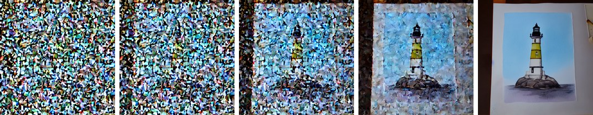
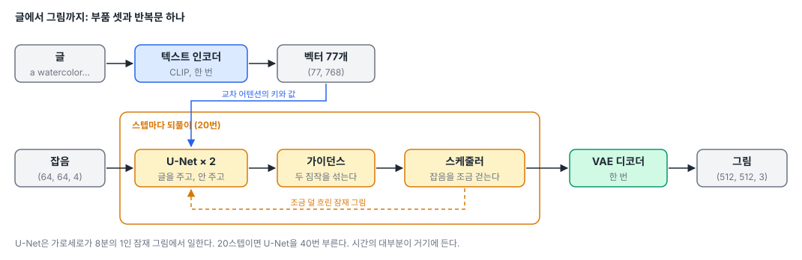
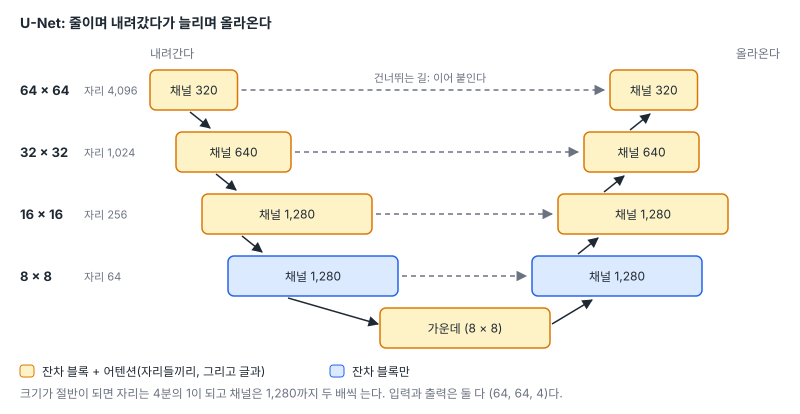

# 이미지 생성

지금까지의 모델은 무언가를 받아 그보다 작은 것을 냈습니다. 사진을 받아
이름 하나를, 소리를 받아 글 한 줄을, 글을 받아 벡터 하나를 냈습니다. 이
장의 모델은 반대입니다. 글 한 줄을 받아 **그림 한 장**을 냅니다. 픽셀
78만 개입니다.

모델은 Stable Diffusion 1.5입니다. 이 장에서 새로운 것은 계산이 아니라
**실행하는 방법**입니다. 지금까지의 모델은 한 번 실행하면 끝났거나(사진
분류), 토큰 하나를 낼 때마다 한 번씩 실행했습니다(언어 모델). 확산
모델은 같은 큰 모델을 **같은 크기의 입력으로 수십 번** 실행합니다. 그림
한 장에 드는 시간이 "모델 한 번의 시간 × 횟수"로 정해지고, 그 횟수를
사람이 고릅니다.

결과를 미리 적어 둡니다.

- 부품 셋을 모두 2부의 방식(계산 순서를 코드로 적기)으로 만들었습니다.
  글을 읽는 CLIP 텍스트 인코더, 잡음을 짐작하는 U-Net, 그림을 푸는 VAE
  디코더입니다. 합성곱과 그룹 정규화를 모델 코드가 부르는 함수로 새로
  만들었습니다.
- 부품마다 Python(diffusers)과 대조했습니다. U-Net 한 번의 출력이
  10만분의 1 안에서 같습니다. 20스텝을 모두 거쳐 만든 `512 × 512` 그림은
  78만 바이트 가운데 383개가 1씩 다릅니다.
- 그림 한 장(20스텝)에 스레드 12개로 28초입니다. 그 가운데 26.6초가
  U-Net을 40번 부르는 시간입니다. [31장](ch31_mobile_engines.md)의 SME
  커널을 쓰지 않으면 68초입니다.
- 시간은 스텝의 수에 정확히 비례하고, 가이던스를 쓰면 두 배입니다. 둘 다
  엔진 밖에서 정해지는 숫자입니다.
- 빠른 길에서 시간을 가장 많이 쓰는 것은 합성곱이 아니라 어텐션입니다.
  합성곱을 줄이고 나니 그것이 남았습니다.
- 같은 CPU에서 stable-diffusion.cpp는 85초, PyTorch는 17초쯤입니다.
  stable-diffusion.cpp를 GPU로 돌리면 10초입니다.

| 하는 일 | 절 |
|---|---|
| 확산 모델이 하는 일을 본다 | 35.1 |
| 부품 셋을 본다 | 35.2 |
| CLIP의 토크나이저를 짠다 | 35.3 |
| 텍스트 인코더를 짠다 | 35.4 |
| 특징 맵과 합성곱을 정한다 | 35.5 |
| 그룹 정규화를 짠다 | 35.6 |
| U-Net을 짠다 | 35.7 |
| 잡음을 걷어 내는 반복문을 짠다 | 35.8 |
| 잠재 그림을 픽셀로 푼다 | 35.9 |
| diffusers와 대조한다 | 35.10 |
| 스텝의 수와 가이던스를 바꿔 본다 | 35.11 |
| 시간이 어디에 드는지 잰다 | 35.12 |
| PyTorch, stable-diffusion.cpp와 견준다 | 35.13 |

## 35.1 잡음을 걷어 내며 그린다

**확산 모델**<sup>diffusion model</sup>의 학습은 그림을 **망가뜨리는**
데서 시작합니다.[^ddpm] 그림에 잡음을 조금 섞습니다. 또 섞습니다.
1,000번쯤 섞으면 그림은 사라지고 잡음만 남습니다. 모델에게는 그 중간의
한 장을 보여 주고 "여기에 섞인 잡음이 무엇이냐"를 묻습니다. 모델이 답을
맞히도록 학습시킵니다.

잡음을 맞힐 수 있으면 걷어 낼 수 있습니다. 그리기는 학습의 반대
방향입니다. **순전한 잡음**에서 시작해, 모델에게 잡음을 묻고, 그만큼을
조금 걷어 내고, 다시 묻습니다. 되풀이하면 그림이 나옵니다.



우리 엔진이 20스텝으로 그린 그림을 다섯 군데에서 꺼내 본 것입니다. 처음
몇 스텝은 잡음 그대로로 보입니다. 열 스텝째에 등대의 자리가 잡히고,
나머지 스텝이 세부를 채웁니다.

"얼마나 섞였는가"는 단계 번호 `t`로 적습니다. 0이면 깨끗한 그림, 999면
거의 잡음입니다. 단계 `t`의 그림 `xₜ`는 원래 그림 `x₀`와 잡음 `ε`을
정해진 비율로 섞은 것입니다.

```text
xₜ = √ᾱₜ · x₀ + √(1 − ᾱₜ) · ε
```

`ᾱₜ`("알파 바")는 단계마다 정해진 숫자입니다. 단계 0에서 0.999, 단계
999에서 0.005입니다. 그 표가 모델과 함께 정해져 있고, 35.8절에서
만듭니다.

엔진에서 보면 이렇습니다.

- 모델은 **잡음을 짐작하는 함수** 하나입니다. 잡음 섞인 그림과 단계
  번호를 받아 같은 크기의 잡음을 냅니다.
- 그 함수를 수십 번 부르는 **반복문**이 모델 밖에 있습니다. 스텝마다
  얼마나 걷어 낼지를 정하는 부분을 **스케줄러**<sup>scheduler</sup>라고
  합니다.
- 언어 모델의 반복과 달리 **스텝마다의 일이 똑같습니다.** 입력의 크기가
  늘지 않고, 이전 스텝에서 남겨 쓸 것(KV 캐시 같은)이 없습니다.

## 35.2 부품 셋으로 되어 있다

그림은 큽니다. `512 × 512`에 색 셋이면 값이 78만 개입니다. 그 크기에서
큰 모델을 수십 번 돌리면 너무 느립니다. Stable Diffusion의 핵심은 **작은
그림에서 일하자**는 것입니다.[^ldm] 그림을 가로세로 8분의 1로 줄인 "잠재
그림"<sup>latent</sup>을 만들어 두고, 잡음을 섞고 걷어 내는 일을 모두
거기서 합니다. 잠재 그림은 `64 × 64`에 채널 넷, 값이 16,384개로 픽셀의
48분의 1입니다. 다 걷어 낸 뒤에 한 번만 픽셀로 풉니다.



| 부품 | 하는 일 | 실행 횟수 | 파라미터 | 파일 |
|---|---|---|---:|---:|
| 텍스트 인코더 (CLIP) | 글을 벡터 77개로 | 1번 (빈 글까지 2번) | 1억 2,306만 | 492MB |
| U-Net | 잠재 그림의 잡음을 짐작 | 스텝마다 2번 | 8억 5,952만 | 3.4GB |
| VAE 디코더 | 잠재 그림을 픽셀로 | 1번 | 4,949만 | 335MB (인코더 포함) |

세 부품이 따로 학습된 모델입니다. 텍스트 인코더는 OpenAI의 CLIP에서
글을 읽는 쪽을 떼어 온 것이고,[^clip] VAE는 그림을 줄였다 되살리도록
학습한 것이고, U-Net만이 잡음을 짐작하도록 학습한 것입니다. VAE에는
그림을 잠재 그림으로 줄이는 인코더도 있지만 글에서 그림을 만들 때는
쓰지 않습니다.

```bash
sh scripts/download_ch35.sh
```

4.3GB를 받습니다. 가중치는 `stable-diffusion-v1-5/stable-diffusion-v1-5`
저장소의 것입니다.[^sd-card] 이 모델을 처음 올린 저장소는 내려갔고, 이
저장소는 그 사본입니다. 허가 조건은 CreativeML OpenRAIL-M입니다.
가중치를 쓰고 그림을 만드는 것은 자유이되, **만든 그림으로 해서는 안
되는 일**이 조건에 적혀 있습니다. 받기 전에 읽어 보아야 합니다. 이 책의
저장소에는 가중치를 넣지 않습니다.

## 35.3 CLIP의 토크나이저를 짠다

CLIP의 토크나이저는 [8장](../part2/ch08_tokenizer.md)의 바이트 단위
BPE와 같은 계열입니다. 다른 점은 셋입니다.[^clip-tokenizer]

| | [8장](../part2/ch08_tokenizer.md)의 BPE (Llama 3) | CLIP |
|---|---|---|
| 대소문자 | 그대로 | 소문자로 바꾼다 |
| 공백 | 다음 단어의 앞에 붙는다 (`Ġ`) | 버린다 |
| 단어의 경계 | 공백이 적어 준다 | 마지막 조각에 `</w>`가 붙는다 |
| 결과의 길이 | 글만큼 | 늘 77 |

단어로 자르는 규칙이 다릅니다. 글자가 이어진 것이 한 단어이고, 숫자는
하나하나가 단어이고, 그 밖의 기호는 이어진 것이 한 단어입니다.

```rust
{{#include ../../../crates/badak_models/src/tokenizer/clip.rs:words}}
```

합치는 반복은 [8장](../part2/ch08_tokenizer.md)과 같습니다. 출발점의 마지막 바이트에 `</w>`를 붙여
두는 것만 다릅니다. 그래서 `cat`의 `t`와 `cats`의 `t`가 다른 조각으로
출발하고, "단어의 끝에 오는 `cat</w>`"이 토큰 하나가 됩니다.

```rust
{{#include ../../../crates/badak_models/src/tokenizer/clip.rs:bpe}}
```

마지막이 엔진에게 중요합니다. **결과는 늘 77개입니다.**

```rust
{{#include ../../../crates/badak_models/src/tokenizer/clip.rs:encode}}
```

시작 토큰, 글, 끝 토큰의 순서로 놓고, 77개가 안 되면 끝 토큰으로 채우고,
넘으면 자릅니다. [34장](ch34_embedding_search.md)에서는 채운 위치를
마스크로 가렸는데 여기서는 가리지 않습니다. 모델이 채운 위치까지 본
채로 학습되었기 때문입니다. 글이 짧든 길든 U-Net이 받는 것은
`(77, 768)`입니다. 글이 길어도 그림이 느려지지 않고, 77토큰을 넘는 글은
잘려서 그림에 반영되지 않습니다.

기준 구현은 글을 고칠 때 유니코드의 합치기(NFC)도 합니다. 우리는 하지
않았습니다. 악센트가 붙은 글자를 풀어서 적은 글은 다르게 잘립니다.

## 35.4 텍스트 인코더를 짠다

토큰 77개를 벡터 77개로 바꿉니다. 블록 12개, 폭 768, 헤드 12개입니다.
[32장](ch32_vit_detection.md)의 ViT와 같은 블록이고(정규화가 앞에
옵니다), 다른 점은 둘입니다.

```rust
{{#include ../../../crates/badak_models/src/diffusion/clip.rs:encode}}
```

**뒤를 보지 않습니다.** 인코더인데도
[9장](../part2/ch09_transformer.md)의 언어 모델처럼 토큰이 자기와 그
앞만 봅니다. CLIP이 그렇게 학습되었습니다. 77토큰뿐이어서 어텐션을 행렬
곱으로 만들지 않고 정의 그대로 짰습니다.

**활성화 함수가 "빠른 GELU"입니다.** `x × sigmoid(1.702 x)`입니다.
GELU를 시그모이드로 근사한 것이어서 값이 조금 다릅니다. 모델이 이 함수로
학습되었으므로 진짜 GELU로 바꾸면 안 됩니다. 모델의 설정 파일에
`quick_gelu`라고 적혀 있습니다.

글 하나에 30밀리초가 걸립니다. 그림 한 장에 두 번 부릅니다. 한 번은
글로, 한 번은 **빈 글**로 부릅니다(까닭은 35.8절). 반복문 밖에서 한
번씩이므로 여기는 빠르게 만들 까닭이 없습니다.

## 35.5 특징 맵과 합성곱을 정한다

U-Net과 VAE는 합성곱을 씁니다. 4부의 앞에서 합성곱은 그래프 해석기의
커널로 만들었는데([27장](ch27_convolution.md)), 여기서는 모델을 코드로
적으므로 합성곱도 모델 코드가 부를 함수로 다시 만듭니다. 새 기법은
없습니다.

먼저 특징 맵을 어떻게 담을지 정합니다.

```rust
{{#include ../../../crates/badak_models/src/diffusion/layers.rs:map}}
```

`(자리 수, 채널)`의 줄입니다. 자리는 `세로 × 가로`를 줄 순서로 편
것입니다. [28장](ch28_conv_kernels.md)의 "채널을 뒤에 두는 배치"(NHWC)와
같습니다. 이렇게 두면 두 가지가 쉬워집니다.

- **`1 × 1` 합성곱이 그대로 선형 층입니다.** 자리마다 채널에 행렬을
  곱하는 것이기 때문입니다.
- **어텐션이 보는 토큰이 그대로 줄입니다.** U-Net의 어텐션은 그림의 자리
  하나하나를 토큰으로 봅니다. 옮겨 적을 것이 없습니다.

`3 × 3` 합성곱은 [27장](ch27_convolution.md)의 방법 그대로입니다.
자리마다 둘레의 값을 한 줄로 늘어놓으면(창) 합성곱이 선형 층이 됩니다.

```rust
{{#include ../../../crates/badak_models/src/diffusion/layers.rs:conv}}
```

창 안의 순서를 (채널, 세로, 가로)로 했습니다. 파일에 든 필터가 그
순서이기 때문입니다. 필터 `(출력, 입력, 3, 3)`을 `(출력, 입력 × 9)`의
행렬로 **보기만 하면** 되고, 3.4GB의 가중치를 옮겨 적지 않아도
됩니다([20장](../part3/ch20_weight_quantization.md)의 메모리 맵 그대로
씁니다).

창을 다 늘어놓으면 큽니다. VAE의 마지막 단은 `512 × 512` 자리에 채널이
128이라, 창만 `262,144 × 1,152`로 1.2GB입니다. 그래서 자리를 토막으로
나눠, 토막마다 창을 늘어놓고 곱합니다. 빠른 길에서는 그 토막을 스레드에
나눕니다. [34장](ch34_embedding_search.md)에서 본 대로 SME 커널은 스레드
하나로 돌기 때문에, 일을 커널 밖에서 나눠 줍니다.

크기를 줄일 때는 스트라이드 2의 합성곱을, 늘릴 때는 값을 네 번씩 적고 나서
합성곱을 합니다.

```rust
{{#include ../../../crates/badak_models/src/diffusion/layers.rs:upsample}}
```

## 35.6 그룹 정규화를 짠다

4부의 합성곱 모델은 배치 정규화를 썼고,
[30장](ch30_graph_optimization.md)에서 그것을 합성곱에 접어 넣어
없앴습니다. 실행할 때는 정해진 숫자를 곱하고 더할 뿐이었기 때문입니다.
이 모델은 **그룹 정규화**<sup>group normalization</sup>를
씁니다.[^group-norm]

```rust
{{#include ../../../crates/badak_models/src/diffusion/layers.rs:group_norm}}
```

채널을 32개의 묶음으로 나누고, 묶음마다 **그 그림의 모든 자리에 걸친**
평균과 분산을 내어 정규화합니다. 평균과 분산이 학습 때 정해진 숫자가
아니라 **실행할 때마다 입력에서 계산하는 값**입니다. 그래서 접어 넣을 수
없습니다. U-Net 한 번에 61번, 디코더 한 번에 30번 계산합니다.

세 가지를 고려했습니다.

- **더하는 값이 많습니다.** 디코더의 마지막 정규화는 묶음 하나가 값
  100만 개입니다. `f32`로 그냥 더하면 끝자리가 깎이므로 합을 `f64`로
  냅니다([2장](../part1/ch02_math.md)).
- **두 번 훑습니다.** 한 번은 합과 제곱의 합을 내고, 한 번은 값을
  고칩니다. 둘째 번에서 `(x − 평균) / √분산 × w + b`를 채널마다
  `x × a + c`로 줄여 두었습니다. 자리마다 곱셈 하나와 덧셈 하나입니다.
- **뒤따르는 SiLU를 같은 반복문에서 합니다.** 이 모델들에서 그룹 정규화
  뒤에는 거의 늘 SiLU가 옵니다. 값을 한 번 더 훑지 않으려고 함께
  했습니다. [30장](ch30_graph_optimization.md)의 "활성화 함수 접어 넣기"를 손으로 한 것입니다.

## 35.7 U-Net을 짠다

U-Net은 이름대로 U자 구조입니다.[^unet]



그림을 줄이며 내려갑니다. `64 × 64`에서 `8 × 8`까지 세 번 절반으로
줄이고, 그때마다 채널을 늘립니다. 그리고 늘리며 올라옵니다. 내려갈 때의
결과를 버리지 않고 쌓아 두었다가, 올라올 때 같은 크기의 단에서 꺼내
**채널 방향으로 이어 붙입니다.** 줄이면서 잃은 세부를 그렇게
돌려받습니다.

단마다 두 가지 블록이 번갈아 놓입니다.

### 잔차 블록에 단계 번호를 더한다

```rust
{{#include ../../../crates/badak_models/src/diffusion/unet.rs:resnet}}
```

정규화, SiLU, 합성곱을 두 번 하고 들어온 것에 더합니다.
[27장](ch27_convolution.md)의 ResNet과 같은 구조입니다. 하나가 더
있습니다. **단계 번호**입니다. 모델은 지금이 몇 번째 단계인지 알아야
합니다. 잡음이 많을 때와 적을 때 할 일이 다르기 때문입니다. 단계 번호를
벡터로 바꿔 두 합성곱 사이에서 채널마다 더합니다.

```rust
{{#include ../../../crates/badak_models/src/diffusion/unet.rs:time}}
```

숫자 하나를 벡터로 바꾸는 방법은 [9장](../part2/ch09_transformer.md)에서
본 "자리를 사인과 코사인으로 적기"입니다. 주파수가 다른 사인과 코사인
160쌍으로 320개의 값을 만들고, 선형 층 둘을 지나 1,280개로 만듭니다.
U-Net 한 번에 한 번만 계산하고 잔차 블록 22개가 나눠 씁니다.

### 어텐션 블록은 자리를 토큰으로 본다

```rust
{{#include ../../../crates/badak_models/src/diffusion/unet.rs:transformer}}
```

그림의 자리를 토큰으로 보는 트랜스포머 블록입니다. 어텐션이 둘 있습니다.

**셀프 어텐션**은 그림의 자리가 서로를 봅니다. 합성곱은 둘레 `3 × 3`만
보므로, 그림의 왼쪽 끝과 오른쪽 끝이 서로를 알려면 이것이 필요합니다.

**교차 어텐션**은 [33장](ch33_speech_recognition.md)의 Whisper에서 본
것입니다. 질의는 그림의 자리이고 키와 값은 **글의 벡터 77개**입니다.
글이 그림에 반영되는 경로는 이것 하나입니다. U-Net에 16군데 있습니다.

MLP는 조금 다릅니다. 첫 층이 폭의 여덟 배를 내고, 반으로 갈라 한쪽에
GELU를 적용해 다른 쪽에 곱합니다(GEGLU라고 부릅니다).[^diffusers-unet]

어텐션의 크기가 문제입니다. 가장 큰 단에서 자리가 4,096개이므로 셀프
어텐션의 점수 표가 `4,096 × 4,096`입니다. 헤드가 8개이니 한꺼번에 만들면
1억 3천만 개(0.5GB)입니다. 그래서 질의를 토막으로 나눠, 토막마다 점수를
내고 소프트맥스를 하고 값을 섞는 데까지 끝냅니다.

```rust
{{#include ../../../crates/badak_models/src/diffusion/layers.rs:attend}}
```

### 내려가며 쌓고 올라오며 꺼낸다

```rust
{{#include ../../../crates/badak_models/src/diffusion/unet.rs:forward}}
```

`skips`가 쌓아 두는 곳입니다. 내려가며 12개를 쌓고(처음의 합성곱 뒤에
하나, 잔차 블록마다 하나, 줄일 때마다 하나), 올라오며 뒤에서부터 12개를
꺼냅니다. 이어 붙이므로 올라오는 쪽 잔차 블록의 입력은 채널이 많습니다.
가장 큰 것이 2,560입니다.

들어가는 것과 나오는 것이 같은 형상 `(64, 64, 4)`입니다. 그래야 나온
잡음을 들어간 그림에서 뺄 수 있습니다.

## 35.8 잡음을 걷어 내는 반복문을 짠다

### 일정은 모델이 정한다

```rust
{{#include ../../../crates/badak_models/src/diffusion/scheduler.rs:schedule}}
```

`ᾱ`의 표입니다. 학습할 때 단계마다 잡음을 얼마나 섞었는지가 이 숫자
1,000개에 들어 있고, 그 규칙(β의 제곱근이 고르게 늘어난다)과 두 끝값이
모델의 설정 파일에 적혀 있습니다. 모델이 이 표로 학습되었으므로 엔진이
바꿀 수 없습니다.

엔진이, 정확히는 쓰는 사람이 고르는 것은 **1,000단계 가운데 몇 개를
거치느냐**입니다. 20스텝이면 951, 901, …, 51, 1을 거칩니다. 50단계씩
건너뜁니다.

### 한 스텝은 DDIM으로 간다

건너뛰어도 되는 까닭이 DDIM입니다.[^ddim]

```rust
{{#include ../../../crates/badak_models/src/diffusion/scheduler.rs:ddim}}
```

35.1절의 식 `xₜ = √ᾱₜ · x₀ + √(1 − ᾱₜ) · ε`를 두 번 씁니다. 모델이 `ε`을
짐작해 주었으므로 식을 뒤집어 깨끗한 그림 `x₀`를 짐작할 수 있습니다. 그
`x₀`와 같은 `ε`으로, 이번에는 **가고 싶은 단계의 `ᾱ`**를 넣어 식을 다시
계산합니다. 951에서 901로 가든 951에서 1로 가든 식은 같습니다. 한 번에
멀리 갈수록 짐작이 거칠 뿐입니다.

이 스텝에는 무작위가 없습니다. 같은 잡음에서 시작하면 같은 그림이
나옵니다. 그래서 다른 구현과 숫자로 대조할 수 있습니다(35.10절).

스케줄러는 이것 말고도 많습니다. 스텝마다 잡음을 조금 다시 섞는 것, 앞의
스텝의 짐작을 함께 쓰는 것이 있습니다. 어느 것이든 **U-Net을 부르는
횟수가 시간을 정하고**, 스케줄러 자신의 계산은 값 16,384개에 곱셈 몇
번이라 시간에 드러나지 않습니다.

### 가이던스는 U-Net을 두 번 부른다

글을 주고 잡음을 짐작하게 하는 것만으로는 그림이 글을 약하게 따릅니다.
그래서 U-Net을 **두 번** 부릅니다.[^cfg] 한 번은 글의 벡터를 주고, 한
번은 빈 글의 벡터를 줍니다. 그리고 "글이 없을 때의 짐작에서 글이 있을
때의 짐작으로 가는 방향"으로 더 멀리 갑니다.

```rust
{{#include ../../../crates/badak_models/src/diffusion/scheduler.rs:guidance}}
```

`scale`이 가이던스의 세기입니다. 1이면 글을 준 짐작 그대로이고, 흔히
7.5를 씁니다. **분류기 없는
가이던스**<sup>classifier-free guidance</sup>라고 부릅니다. 엔진에서는
**시간이 두 배**가 됩니다.

### 스텝마다 같은 일을 되풀이한다

```rust
{{#include ../../../crates/badak_models/src/diffusion/mod.rs:denoise}}
```

이것이 전부입니다. 스텝마다 U-Net을 두 번 부르고, 두 짐작을 섞고, 한
스텝 갑니다. 시작하는 잡음은 정규 분포에서 뽑습니다.

```rust
{{#include ../../../crates/badak_models/src/diffusion/mod.rs:noise}}
```

**시작하는 잡음이 그림을 정합니다.** 같은 글이라도 잡음이 다르면 다른
그림이 나옵니다. 그 잡음을 만든 번호(seed)를 적어 두면 같은 그림을 다시
만들 수 있습니다. 다만 난수 생성기가 같아야 합니다. 우리 번호 35와
PyTorch의 번호 35는 다른 잡음을 냅니다.

## 35.9 잠재 그림을 픽셀로 푼다

```rust
{{#include ../../../crates/badak_models/src/diffusion/vae.rs:decode}}
```

디코더는 U-Net의 오른쪽 절반과 비슷합니다. `64 × 64`에서 시작해 세 번 두
배로 늘려 `512 × 512`로 만듭니다. 이어 붙이는 연결도, 단계 번호도, 글도
없습니다. 가장 작은 크기에서 어텐션을 한 번 합니다.

잠재 그림을 넣기 전에 `0.18215`로 나눕니다. 학습할 때 잠재 그림의 크기를
1 안팎으로 맞추려고 곱해 둔 숫자입니다.[^diffusers-pipeline]

디코더는 파라미터가 4,949만 개로 U-Net의 17분의 1인데 시간은 U-Net 한
번의 두 배가 넘게 걸립니다(35.12절). **자리가 많기 때문입니다.** 마지막
단의 합성곱은 채널이 128뿐이지만 자리가 262,144개입니다. 합성곱의 일은
자리 수 × 입력 채널 × 출력 채널 × 9이고, 파라미터의 수에는 자리 수가
들어 있지 않습니다. [27장](ch27_convolution.md)에서 본 대로입니다.

나온 값은 −1에서 1 사이입니다. 0에서 255로 옮겨 PNG 파일로 씁니다.

```rust
{{#include ../../../crates/badak_image/src/png.rs:encode}}
```

PNG는 픽셀을 zlib 형식으로 싸서 담습니다. 압축하는 코드를 짜지 않고
zlib의 "그대로 담기"만 썼습니다. 파일은 786KB로 크지만 어느
프로그램에서나 열립니다.

## 35.10 diffusers와 대조한다

정답은 Python의 diffusers 라이브러리로 만들었습니다
(`reference/ch35_make_reference.py`). 부품을 하나씩 불러 반복문을 직접
돌리고, 단계마다의 값을 남겼습니다.

정답을 만들다가 한 번 틀렸습니다. 처음 만든 그림이 얼룩무늬
잡음이었습니다. 텍스트 인코더의 가중치를 읽을 때 "이름이 맞지 않는 것은
넘어가라"는 옵션을 켜 두었는데, 파일의 이름 앞머리가 라이브러리가
기대하는 것과 달라 **가중치가 하나도 읽히지 않았고**, 오류 없이 무작위
가중치로 실행되었습니다. 이름이 하나라도 맞지 않으면 멈추게 고쳤습니다.
정답을 만드는 쪽도 틀릴 수 있고, 그림이 나왔다고 해서 맞는 것이
아닙니다. 우리 엔진도 가중치의 이름을 찾지 못하면 멈춥니다.

```bash
cargo run --release -p badak_models --example ch35_verify
```

```text
{{#include output/ch35_verify.txt}}
```

**토큰은 세 글 모두에서 같습니다.** 셋째 글에는 대문자, 숫자, 줄임말,
악센트가 들어 있습니다.

**U-Net 한 번의 출력이 10만분의 1 안에서 같습니다.** 값의 크기는 4쯤
입니다. 합성곱 52개, 그룹 정규화 61개, 어텐션 32개를 지난 결과입니다.

**디코더가 푼 그림도 10만분의 2 안에서 같습니다.**

부품마다 맞아도 20스텝을 이으면 어긋날 수 있습니다. 스텝마다의 작은
차이가 다음 스텝의 입력이 되기 때문입니다. 끝까지 돌려 봅니다.

```bash
cargo run --release -p badak_models --example ch35_generate
```

```text
{{#include output/ch35_generate.txt}}
```

U-Net을 40번 지난 뒤의 잠재 그림이 diffusers의 것과 1만분의 3 안에서
같습니다. 픽셀로 풀어 8비트로 바꾸면 786,432바이트 가운데 **383개가 1씩
다릅니다**(0.05%). 반올림의 경계에 걸린 값입니다. 눈으로는 같은
그림입니다. 이 실행은 빠른 길(SME 커널, 근사한 지수 함수)로 했습니다.

글은 "a watercolor painting of a lighthouse on a cliff at sunset"였고,
35.1절의 마지막 그림이 그 결과입니다. 절벽과 노을은 보이지 않지만
수채화로 그린 등대입니다.

## 35.11 스텝의 수와 가이던스를 바꿔 본다

사람이 고르는 숫자 둘을 바꿔 봅니다. 같은 잡음, 같은 글입니다.


| 스텝 | 5 | 10 | 20 | 50 |
|---|---:|---:|---:|---:|
| U-Net을 부른 횟수 | 10 | 20 | 40 | 100 |
| 걷어 내는 시간 (초) | 6.1 | 12.2 | 24.4 | 61.0 |
| 디코더까지의 합 (초) | 7.4 | 13.5 | 25.7 | 62.3 |

**시간은 스텝의 수에 정확히 비례합니다.** 스텝마다 1.22초입니다(이 절의
그림은 코어 16개를 모두 써서 만들었습니다). 스텝 사이에 남겨 쓰는 것이
없으니 당연합니다.

**그림은 그렇지 않습니다.** 다섯 스텝의 그림은 뭉개져 있고, 열 스텝이면
형체가 잡히고, 20스텝과 50스텝은 세부만 조금 다릅니다. 20스텝에서
50스텝으로 가면 시간은 2.5배인데 얻는 것은 눈에 잘 띄지 않습니다. 이
모델과 이 스케줄러에서 20~30스텝을 흔히 쓰는 까닭입니다.


| 가이던스 | 1 | 3 | 7.5 | 15 |
|---|---:|---:|---:|---:|
| U-Net을 부른 횟수 | 20 | 40 | 40 | 40 |
| 걷어 내는 시간 (초) | 12.2 | 24.4 | 24.4 | 24.5 |

**세기가 1이면 빈 글로 한 번 더 부를 까닭이 없습니다.** 시간이
절반입니다. 그림은 글을 약하게만 따릅니다. 흐릿한 건물 같은 것이
나왔습니다.

**세기는 시간을 바꾸지 않습니다.** 3이든 15든 U-Net을 두 번 부르는 것은
같습니다. 그림은 달라집니다. 3에서는 옅고, 15에서는 색이 진하고 선이
거칩니다. 세기를 너무 키우면 짐작을 원래 범위 밖으로 밀어내기
때문입니다.

엔진을 만드는 사람에게 중요한 것은 다음입니다. **그림 한 장의 시간은
`스텝 × (1 또는 2) × U-Net 한 번 + 디코더 한 번`입니다.** 앞의 두 숫자는
엔진 밖에서 정해집니다. 엔진이 줄일 수 있는 것은 뒤의 둘입니다.

## 35.12 시간이 어디에 드는지 잰다

U-Net 한 번과 디코더 한 번을 따로 잽니다.

```bash
PYTHON=python3 sh scripts/bench_ch35.sh 3
```

| U-Net 한 번 (초) | 스레드 1 | 4 | 12 |
|---|---:|---:|---:|
| 기본 (NEON) | 11.47 | 3.62 | 1.55 |
| 빠른 길 (SME) | 2.17 | 0.95 | 0.66 |
| PyTorch | 0.95 | 0.50 | 0.39 |

| 디코더 한 번 (초) | 스레드 1 | 4 | 12 |
|---|---:|---:|---:|
| 기본 (NEON) | 30.20 | 11.34 | 5.08 |
| 빠른 길 (SME) | 4.61 | 1.87 | 1.27 |
| PyTorch | 2.08 | 1.40 | 1.31 |

세 차례 번갈아 잰 값의 중앙값입니다.

빠른 길은 [31장](ch31_mobile_engines.md)의 SME 커널을 모든 합성곱과 선형
층에 쓰고, SiLU와 GELU와 소프트맥스의 지수 함수를
[32장](ch32_vit_detection.md)의 근사로 계산합니다. 스레드는
[34장](ch34_embedding_search.md)의 방법으로 씁니다. 커널 안에서 나누지
않고, 자리를 토막 내어 토막을 스레드에 나눕니다.

**스레드 하나에서 빠른 길이 U-Net은 5.3배, 디코더는 6.6배입니다.**
디코더가 더 크게 빨라집니다. 디코더는 거의 전부가 합성곱이기 때문입니다.

**스레드 12개에서는 차이가 줄어듭니다.** U-Net 2.4배, 디코더
4.0배입니다. [34장](ch34_embedding_search.md)에서 본 대로 SME는 스레드를
늘려도 NEON만큼 빨라지지 않습니다.

[14장](../part3/ch14_measurement.md)의 프로파일러로 U-Net 한 번의 시간을 나눠 봤습니다.


| U-Net 한 번, 스레드 12개 (ms) | 합성곱 | 선형 층 | 어텐션 | 그룹 정규화 | 나머지 | 합 |
|---|---:|---:|---:|---:|---:|---:|
| 기본 (NEON) | 676 | 364 | 335 | 25 | 155 | 1,555 |
| 빠른 길 (SME) | 149 | 129 | 264 | 16 | 100 | 659 |

**기본 구현에서는 합성곱이 가장 큽니다.** 절반 가까이입니다.

**빠른 길에서는 어텐션이 가장 큽니다.** 합성곱과 선형 층이 SME로 몇 배씩
줄어든 뒤에 남은 것입니다. 어텐션 32개 가운데 시간을 쓰는 것은 가장 큰
단(`64 × 64`)의 셀프 어텐션 다섯 개입니다. 하나가 `4,096 × 4,096`의
점수를 헤드 8개에서 냅니다. 곱셈은 SME가 하지만 소프트맥스의 지수 함수
1억 3천만 번이 남습니다. 스레드 하나에서는 어텐션이 57%입니다.
[16장](../part3/ch16_matmul.md)부터 여러 번 본 일입니다. **가장 큰 것을
줄이면 그다음 것이 가장 커집니다.**

**디코더는 처음부터 끝까지 합성곱입니다.** 빠른 길에서도 83%가
합성곱이고, 그룹 정규화가 12%로 그다음입니다. 자리가 26만 개인 곳에서는
값을 두 번 훑는 것만으로도 시간이 듭니다.

메모리도 봅니다. 가중치는 파일을 메모리에 비춰
쓰므로([20장](../part3/ch20_weight_quantization.md)) 읽는 데 0.02초이고,
쓰는 만큼만 실제 메모리를 차지합니다. 빠른 길은 SME 커널이 읽는 순서로
가중치를 **다시 늘어놓은 사본**을 만듭니다. U-Net에서 0.8초가 걸리고
3.4GB를 더 씁니다.

## 35.13 PyTorch, stable-diffusion.cpp와 견준다

위의 표에 PyTorch(diffusers 0.43.0, PyTorch 2.14.1)의 시간을 함께
적었습니다. 같은 입력으로 같은 부품을 한 번씩 실행한 시간입니다.

**U-Net은 PyTorch가 어느 스레드 수에서나 빠릅니다.** 스레드 하나에서
2.3배, 12개에서 1.7배입니다. 스레드 하나에서의 차이가 큽니다. PyTorch의
"스레드 하나"가 이 기계에서 무엇으로 계산하는지는 확인하지 않았습니다.
[31장](ch31_mobile_engines.md)에서 SME를 쓰는 엔진과 쓰지 않는 엔진의
차이를 본 바로는 SME를 쓰는 엔진의 속도입니다. 우리에게 남은 것은 위에서
본 어텐션입니다.

**디코더는 스레드 12개에서 같습니다.** 1.27초와 1.31초입니다. 스레드
하나에서는 PyTorch가 2.2배 빠릅니다. 토막을 스레드에 나누는 방법이
자리가 많은 합성곱에서 효과가 큽니다.

stable-diffusion.cpp와도 견줍니다.[^sdcpp] 한 파일짜리
체크포인트(`v1-5-pruned-emaonly.safetensors`, 같은 저장소)를 읽고, 같은
글, 20스텝, 가이던스 7.5로 그림 한 장을 만드는 시간입니다. 스케줄러는
그쪽의 오일러 방법입니다. 스텝마다 U-Net을 두 번 부르는 것은 같습니다.

| 그림 한 장, 20스텝 (초) | 걷어 내기 | 풀기 |
|---|---:|---:|
| stable-diffusion.cpp, CPU, 스레드 4 | 190.3 | 16.6 |
| stable-diffusion.cpp, CPU, 스레드 12 | 77.5 | 7.5 |
| badak 기본, 스레드 12 | 63.1 | 5.0 |
| badak 빠른 길, 스레드 4 | 38.4 | 2.0 |
| badak 빠른 길, 스레드 12 | 26.6 | 1.3 |
| PyTorch, 스레드 12 (U-Net 한 번 × 40) | 15.6 | 1.3 |
| stable-diffusion.cpp, GPU (Metal) | 8.0 | 2.0 |

**같은 CPU에서 우리 기본 구현이 stable-diffusion.cpp보다 조금 빠르고,
빠른 길은 세 배 빠릅니다.** 조건이 똑같지는 않습니다. 그쪽은 가중치를
읽으며 일부를 16비트로 바꿔 메모리에 둡니다(U-Net이 2.2GB라고 출력하는
데서 미루어 본 것이고, 코드로 확인하지는 않았습니다). CPU 쪽은 한 번씩만
잰 값입니다.

**GPU가 가장 빠릅니다.** stable-diffusion.cpp를 그냥 빌드하면
macOS에서는 Metal로 GPU를 씁니다. 처음에 그것을 모르고 재서, 스레드를
1개로 하든 12개로 하든 8초가 나오는 것을 보고서야 알았습니다. CPU만 쓰는
빌드를 따로 만들어 다시 쟀습니다. 걷어 내기가 8.0초로 우리 빠른 길의
3.3배, PyTorch의 CPU 실행의 두 배 빠릅니다. 큰 합성곱과 큰 행렬 곱이
되풀이되는 이 일은 GPU에 맞는 일입니다. [23장](../part3/ch23_gpu.md)에서
만든 GPU 경로를 이 모델에 잇는 일은 하지 않았습니다.

이 표에서 PyTorch의 줄만 직접 잰 것이 아니라 U-Net 한 번의 시간에 40을
곱한 것입니다. 나머지는 그림 한 장을 실제로 만든 시간입니다.

## 35.14 남긴 일을 적어 둔다

**다른 스케줄러.** DDIM 하나만 만들었습니다. 이 모델의 저장소가 기본으로
적어 둔 것(PNDM)도, 널리 쓰는 오일러 방법도 만들지 않았습니다. 적은
스텝으로 좋은 그림을 내는 스케줄러가 있고, 그것이 속도를 올리는 가장
쉬운 방법입니다.

**U-Net 두 번을 한 묶음으로.** 글을 준 실행과 주지 않은 실행은 입력의
크기가 같습니다. [34장](ch34_embedding_search.md)처럼 한 묶음으로 만들면 선형 층과 합성곱이 줄을
두 배로 받습니다. 하지 않았습니다.

**그림에서 그림으로, 일부만 다시 그리기.** VAE의 인코더를 만들지
않았습니다. 그림을 잠재 그림으로 줄여 잡음을 섞은 데서 시작하면 그림을
고칠 수 있습니다.

**다른 크기.** `512 × 512`만 시험했습니다. 코드는 크기를 가리지 않지만
모델이 그 크기로 학습되었습니다.

**16비트와 양자화.** 가중치를 `f32` 그대로 씁니다. 3.4GB입니다. 빠른
길은 그것을 다시 늘어놓은 사본을 하나 더 가집니다. 16비트나 8비트로
줄이는 일(3부)을 이 모델에 하지 않았습니다.

**GPU.** 이 일은 GPU가 잘하는 일입니다. 큰 합성곱과 큰 행렬 곱이
되풀이됩니다. [23장](../part3/ch23_gpu.md)의 GPU 경로를 쓰지 않았습니다.

**어텐션의 소프트맥스.** 빠른 길에서 U-Net 시간의 40%가 어텐션이고, 그
가운데 많은 부분이 `4,096 × 4,096`의 지수 함수입니다. 더 줄이지
않았습니다.

**유니코드의 합치기.** CLIP 토크나이저가 글을 고칠 때 하는 NFC를 하지
않습니다.

**안전 검사.** 저장소에는 만든 그림을 검사하는 모델이 함께 들어
있습니다. 쓰지 않았습니다.

**CI.** 가중치가 4.3GB여서 CI는 토크나이저와 텍스트 인코더만 대조합니다.
U-Net과 디코더의 테스트는 파일이 있을 때만 돕니다.

## 35.15 실전 엔진에서는

**stable-diffusion.cpp는 llama.cpp와 같은 텐서 라이브러리 위에 있습니다.**
합성곱, 그룹 정규화, 어텐션을 그 라이브러리의 연산으로 그래프를 만들어
실행합니다. 가중치는 한 파일짜리 체크포인트를 읽고, 그 안의 이름을
제 이름으로 바꿉니다.[^sdcpp]

**스텝을 줄이는 것이 가장 큰 최적화입니다.** 모델을 다시 학습해 네 스텝,
한 스텝에 그리게 만든 것이 있습니다. 가이던스를 모델 안에 넣어 U-Net을
스텝마다 한 번만 부르게 한 것도 있습니다. 엔진을 두 배 빠르게 만드는
것보다 스텝을 열 배 줄이는 효과가 큽니다. stable-diffusion.cpp도 그런
모델을 받습니다.[^sdcpp] 이것은 엔진이 아니라 모델에서 하는 일이지만,
엔진을 만드는 사람이 알아야 합니다.

**디코더를 가벼운 것으로 바꾸기도 합니다.** 스텝이 줄면 디코더가
차지하는 비율이 커집니다. 20스텝에서는 5%이지만 네 스텝이면 20%입니다.
작은 디코더를 따로 학습해 쓰는 까닭입니다.[^sdcpp]

**메모리가 모자라면 디코더를 조각내어 실행합니다.** `512 × 512`보다 큰
그림에서 디코더의 마지막 단은 수 GB를 씁니다. 잠재 그림을 타일로 나눠
따로 풀고 이어 붙입니다.[^sdcpp] 우리가 창을 토막으로 나눈 것과 같은
방법을 잠재 그림 전체에 쓰는 것입니다.

**글의 벡터는 한 번만 만듭니다.** 같은 글로 그림을 여러 장 만들면
텍스트 인코더의 결과를 다시 씁니다. [33장](ch33_speech_recognition.md)에서 인코더의 출력으로 교차
어텐션의 키와 값을 한 번만 만든 것과 같은 일을 여기서도 할 수
있습니다. 교차 어텐션의 키와 값은 스텝이 바뀌어도 같습니다. 우리는
스텝마다 다시 계산합니다(작은 일입니다).

## 정리

- 확산 모델은 잡음을 짐작하는 함수 하나와 그것을 수십 번 부르는
  반복문입니다. 스텝마다의 일이 같고, 스텝 사이에 남겨 쓰는 것이
  없습니다.
- Stable Diffusion은 가로세로가 8분의 1인 잠재 그림에서 일하고 마지막에
  한 번만 픽셀로 풉니다. 부품은 텍스트 인코더, U-Net, VAE 디코더입니다.
- U-Net은 잔차 블록과 어텐션을 번갈아 놓고, 내려갈 때의 결과를 올라올
  때 이어 붙입니다. 글은 교차 어텐션으로만 들어옵니다.
- 그룹 정규화는 실행할 때마다 평균과 분산을 계산합니다. 배치 정규화처럼
  접어 넣을 수 없습니다.
- 스케줄러는 1,000단계 가운데 몇 개를 밟을지, 한 스텝에 얼마나 걷어
  낼지를 정합니다. 가이던스는 U-Net을 두 번 불러 두 짐작을 섞습니다.
- 그림 한 장의 시간은 `스텝 × (1 또는 2) × U-Net 한 번 + 디코더 한
  번`입니다. 엔진이 줄이는 것은 U-Net 한 번과 디코더 한 번입니다.
- 파라미터가 적어도 자리가 많으면 느립니다. 디코더가 그렇습니다.
- 정답을 만드는 쪽도 틀립니다. 이름이 맞지 않는 가중치를 넘어가게 두면
  오류 없이 엉뚱한 결과가 나옵니다.

## 연습 문제

1. `ClipTokenizer::words`가 숫자를 하나씩 자르지 않고 이어진 숫자를 한
   단어로 보게 바꿔 보십시오. "a photo of 2024"의 토큰이 어떻게
   달라집니까. 그 토큰으로 그린 그림은 어떻습니까.
2. 텍스트 인코더의 빠른 GELU를 [32장](ch32_vit_detection.md)의 GELU로 바꿔 `ch35_verify`를 돌려
   보십시오. 차이가 얼마나 됩니까. 그 벡터로 그림을 그려 보십시오.
3. `GroupNorm::apply`의 합을 `f32`로 내도록 바꿔 보십시오. 디코더의
   출력이 정답과 얼마나 달라집니까. U-Net에서는 어떻습니까. 왜 한쪽이
   더 크게 달라집니까.
4. `Unet::forward`에서 건너뛰는 길을 끊어 보십시오(이어 붙일 때 쌓아
   둔 것 대신 0을 붙이기). 그림이 어떻게 됩니까.
5. 교차 어텐션의 키와 값(`key.linear(context)`, `value.linear(context)`)을
   U-Net 밖에서 한 번만 계산해 두고 스텝마다 다시 쓰게 고쳐 보십시오.
   스텝마다 몇 밀리초가 줄어듭니까.
6. 글을 준 실행과 주지 않은 실행을 한 묶음으로 만들어 보십시오.
   합성곱과 선형 층은 줄을 두 배로 받고, 그룹 정규화와 어텐션은 그림마다
   따로 해야 합니다. 스텝마다의 시간이 얼마나 줄어듭니까.
7. 스텝을 20으로 두고 가이던스를 1, 3, 5, 7.5, 10, 15, 20으로 바꿔
   그림을 그려 보십시오. 세기를 키울수록 잠재 그림의 값의 크기(가장 큰
   절댓값)가 어떻게 변합니까. 색이 타는 것과 관계가 있습니까.
8. 같은 글로 시작하는 잡음의 번호만 바꿔 그림 여덟 장을 그려 보십시오.
   무엇이 같고 무엇이 다릅니까. 잡음 두 개를 반씩 섞은 데서 시작하면
   어떤 그림이 나옵니까.
9. DDIM의 한 스텝에 잡음을 조금 다시 섞는 버전을 만들어 보십시오(짐작한
   잡음의 일부를 새 잡음으로 바꾸기). 같은 번호에서 그림이 어떻게
   달라집니까.

## 참고 문헌

[^ddpm]: J. Ho, A. Jain, P. Abbeel, "Denoising Diffusion Probabilistic
    Models", 2020. arXiv:2006.11239. 서지 정보만 확인했습니다. 이 장의
    식은 diffusers의 구현에서 확인했고(아래), 그 구현이 낸 값과 우리 값을
    대조했습니다. <https://arxiv.org/abs/2006.11239>

[^ldm]: R. Rombach 외, "High-Resolution Image Synthesis with Latent
    Diffusion Models", 2021. arXiv:2112.10752. 서지 정보만 확인했습니다.
    <https://arxiv.org/abs/2112.10752>

[^clip]: A. Radford 외, "Learning Transferable Visual Models From Natural
    Language Supervision", 2021. arXiv:2103.00020. 서지 정보만
    확인했습니다. 이 모델의 텍스트 인코더가 CLIP ViT-L/14의 것이라는
    것은 모델 카드(54번째, 148번째 줄)와 `text_encoder/config.json`의
    `_name_or_path`에서 확인했습니다. <https://arxiv.org/abs/2103.00020>

[^sd-card]: `stable-diffusion-v1-5/stable-diffusion-v1-5`의 모델 카드와
    저장소(버전 `451f4fe16113`). 이 저장소가 내려간 원래 저장소의 사본이라는
    것은 카드의 12번째 줄, 허가 조건은 2번째와 53번째 줄, 해서는 안 되는
    쓰임은 81번째 줄부터입니다. 부품의 구조(블록의 채널 수, 헤드의 수,
    일정의 끝값)는 부품마다의 `config.json`에서, 파라미터의 수는 부품마다의
    safetensors 파일에 든 텐서의 원소를 세어 확인했습니다.
    <https://huggingface.co/stable-diffusion-v1-5/stable-diffusion-v1-5>

[^clip-tokenizer]: Hugging Face transformers 5.12.1,
    `transformers/models/clip/tokenization_clip.py`. 글을 고치는 순서
    (NFC, 공백 정리, 소문자), 단어로 자르는 정규식, `</w>`가 그 파일에
    있습니다. 우리 토큰은 이 구현이 낸 토큰과 대조했습니다(35.10절).

[^group-norm]: Y. Wu, K. He, "Group Normalization", 2018.
    arXiv:1803.08494. 서지 정보만 확인했습니다.
    <https://arxiv.org/abs/1803.08494>

[^unet]: O. Ronneberger, P. Fischer, T. Brox, "U-Net: Convolutional
    Networks for Biomedical Image Segmentation", 2015. arXiv:1505.04597.
    서지 정보만 확인했습니다. <https://arxiv.org/abs/1505.04597>

[^diffusers-unet]: Hugging Face diffusers 0.43.0. 잔차 블록은
    `diffusers/models/resnet.py`의 `ResnetBlock2D`(188번째 줄부터),
    트랜스포머 블록은 `diffusers/models/attention.py`의
    `BasicTransformerBlock`(758번째 줄부터), GEGLU는
    `diffusers/models/activations.py` 90~117번째 줄, 단계 번호를 사인과
    코사인으로 적는 함수는 `diffusers/models/embeddings.py`의
    `get_timestep_embedding`(27번째 줄부터), 올라올 때 이어 붙이는 순서는
    `diffusers/models/unets/unet_2d_blocks.py` 2295번째 줄입니다. 구조는
    이 코드와 가중치 파일의 이름에서 읽었고, U-Net 한 번의 출력을 이
    구현의 것과 대조했습니다.

[^ddim]: J. Song, C. Meng, S. Ermon, "Denoising Diffusion Implicit
    Models", 2020. arXiv:2010.02502. 서지 정보만 확인했습니다. 한 스텝의
    식은 diffusers 0.43.0의 `diffusers/schedulers/scheduling_ddim.py`
    456~491번째 줄, 밟을 단계를 고르는 규칙은 365~366번째 줄, 맨 끝
    스텝이 쓰는 `ᾱ`는 236번째 줄, 일정의 규칙(`scaled_linear`)은
    216번째 줄에서 확인했습니다. <https://arxiv.org/abs/2010.02502>

[^cfg]: J. Ho, T. Salimans, "Classifier-Free Diffusion Guidance", 2022.
    arXiv:2207.12598. 서지 정보만 확인했습니다. 두 짐작을 섞는 식은
    diffusers 0.43.0의
    `diffusers/pipelines/stable_diffusion/pipeline_stable_diffusion.py`
    1055번째 줄입니다. 이 모델이 학습할 때 글의 10%를 비워 두었다는 것은
    모델 카드의 19번째 줄에 있습니다. <https://arxiv.org/abs/2207.12598>

[^diffusers-pipeline]: diffusers 0.43.0, 같은 파일의 1085번째 줄
    (`latents / self.vae.config.scaling_factor`). 값 `0.18215`는
    diffusers의 `AutoencoderKL`이 쓰는 기본값이고, 이 저장소의
    `vae/config.json`에는 따로 적혀 있지 않습니다.

[^sdcpp]: leejet, stable-diffusion.cpp (커밋 `532d2c15c430`). 텐서
    라이브러리 ggml이 저장소 안에 들어 있고, 이름을 바꾸는 코드는
    `src/name_conversion.cpp`입니다. `README.md`의 45번째 줄(SD-Turbo),
    102번째 줄(LCM), 103번째 줄(작은 디코더 TAESD), 125번째 줄(VAE를
    타일로 나눠 풀기)에 본문에서 말한 기능들이 적혀 있습니다. 그 기능들의
    구현은 읽지 않았습니다.
    <https://github.com/leejet/stable-diffusion.cpp/tree/532d2c15c430a785a712b2d94281f04e733008a4>
