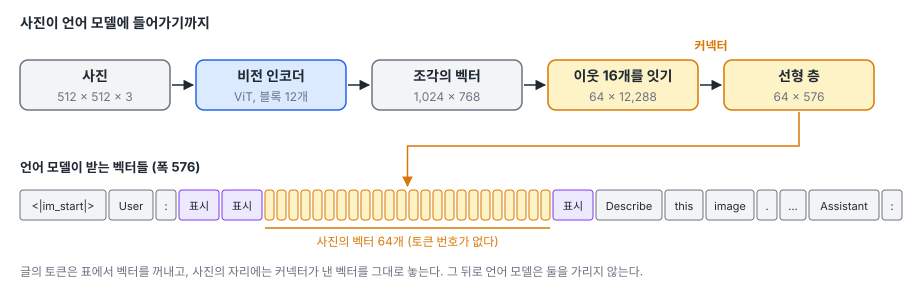
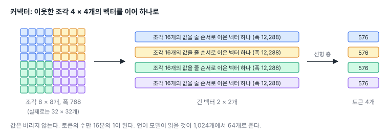

# 멀티모달

2부의 언어 모델은 글만 읽었습니다. 이 장의 모델은 **사진을 보고 글로
답합니다.** 사진 한 장과 "이 사진을 설명해 줘"라는 글을 받아 설명을
씁니다. 입력의 종류가 둘 이상인 모델을 멀티모달(multimodal) 모델이라고
부릅니다.

새로 만들 것이 거의 없다는 것이 이 장의 요점입니다. 사진을 읽는 모델은
[32장](ch32_vit_detection.md)에서 만들었고, 글을 쓰는 모델은 2부에서 만들었습니다. 둘을 잇는
작은 부품 하나와, 언어 모델에 **토큰이 아닌 것을 넣는 길** 하나가
필요할 뿐입니다.

결과를 미리 적어 둡니다.

- SmolVLM-256M을 만들었습니다. 비전 인코더는 [32장](ch32_vit_detection.md)의 ViT, 언어 모델은
  2부의 Llama이고, 새로 짠 것은 둘을 잇는 커넥터와 "사진의 벡터를 글의
  벡터 사이에 끼우는" 열 줄입니다.
- 사진 두 장에서 쓴 토큰 48개가 Python(transformers)과 **하나도 다르지
  않습니다**.
- 전처리의 란초스 필터를 짰습니다. 식으로 만든 사진에서는 Pillow와
  바이트까지 같습니다. 진짜 사진에서는 같지 않았는데, JPEG 파일을 푼
  픽셀이 구현마다 달랐기 때문입니다.
- 사진 한 장을 보고 48토큰을 쓰는 데 스레드 12개로 0.37초입니다. 그
  절반이 사진을 보는 시간입니다.
- 비전 인코더가 스레드를 늘려도 빨라지지 않아서 보니, `tanh`를 부르는
  활성화 함수가 스레드 하나로 돌고 있었습니다. 고쳐서 394밀리초가
  186밀리초가 되었습니다.
- 사진 한 장의 인코딩은 llama.cpp의 CPU 빌드가 396밀리초, PyTorch가
  101밀리초, llama.cpp의 GPU 빌드가 23~35밀리초입니다. 토큰을 쓰는
  속도는 우리가 PyTorch의 두 배입니다.

| 하는 일 | 절 |
|---|---|
| 사진이 어떻게 언어 모델에 들어가는지 본다 | 36.1 |
| 모델의 부품 셋을 본다 | 36.2 |
| 사진을 줄인다: 란초스 필터 | 36.3 |
| 비전 인코더를 짠다 | 36.4 |
| 커넥터를 짠다 | 36.5 |
| 사진의 벡터를 글 사이에 끼운다 | 36.6 |
| 답을 쓴다 | 36.7 |
| transformers와 대조한다 | 36.8 |
| 시간이 어디에 드는지 잰다 | 36.9 |
| llama.cpp와 견준다 | 36.10 |

## 36.1 사진을 토큰처럼

언어 모델이 실제로 받는 것은 토큰 번호가 아닙니다. [9장](../part2/ch09_transformer.md)에서 본 대로 첫
단계가 토큰 번호를 표에서 찾아 **벡터**로 바꾸고, 그 뒤의 블록들은
벡터만 봅니다. 그 벡터가 표에서 나왔는지는 블록이 알지 못합니다.

그렇다면 표에 없는 벡터를 넣어도 됩니다. 사진을 **언어 모델의 벡터와
폭이 같은 벡터 몇 개**로 바꿔 글의 벡터들 사이에 끼워 넣으면, 언어
모델은 그것을 "뜻을 아는 토큰 몇 개"처럼 읽습니다. 그렇게 읽도록
학습시킨 것이 이 장의 모델입니다.



[35장](ch35_image_generation.md)과 견주어 볼 만합니다. 거기서는 글이 그림 쪽 모델에 **교차
어텐션**으로 들어갔습니다. 그림의 자리들이 글의 벡터들을 키와 값으로
봤습니다. 여기서는 사진이 글 쪽 모델에 **입력의 일부로** 들어갑니다.
교차 어텐션이 없고, 언어 모델은 한 글자도 고칠 필요가 없습니다. 두
종류의 입력을 섞는 방법이 이 둘입니다.

## 36.2 부품 셋

모델은 SmolVLM-256M입니다.[^smolvlm] 이름대로 파라미터가 2억 5,600만 개인
작은 모델입니다.

| 부품 | 하는 일 | 구조 | 파라미터 |
|---|---|---|---:|
| 비전 인코더 | 사진을 조각마다의 벡터 1,024개로 | SigLIP의 ViT. 블록 12개, 폭 768, 조각 16픽셀 | 8,643만 |
| 커넥터 | 벡터 1,024개를 64개로, 폭 768을 576으로 | 이웃 16개를 잇고 선형 층 하나 | 708만 |
| 언어 모델 | 사진과 글을 읽고 답을 쓴다 | 2부의 Llama 꼴. 블록 30개, 폭 576 | 1억 3,459만 |
| 출력 층 | 벡터를 토큰마다의 점수로 | 선형 층 하나 | 2,839만 |

비전 인코더는 SigLIP이라는 모델의 사진 쪽이고,[^siglip] 언어 모델은
2부에서 쓴 SmolLM2-135M과 모양이 같습니다. 단어 사전만 128개 늘었습니다
(49,280). 사진 자리를 나타내는 토큰 같은 것들이 더해졌습니다. 2부의
모델은 토큰 벡터의 표와 출력 층이 같은 가중치였는데 이 모델은
따로입니다.

```bash
sh scripts/download_ch36.sh
```

513MB입니다. 가중치가 16비트(bfloat16)로 저장되어 있습니다. [19장](../part3/ch19_quantization_theory.md)에서 본
형식이고, 읽으면서 `f32`로 넓힙니다. 허가 조건은 Apache-2.0입니다.

## 36.3 사진을 줄인다

비전 인코더는 `512 × 512`의 사진만 받습니다. 사진을 그 크기로 줄여야
합니다. [27장](ch27_convolution.md)에서 "전처리가 학습 때와 다르면 정확도가 조용히
떨어진다"는 것을 봤습니다. 이 모델의 전처리는 그때와 두 가지가
다릅니다.[^idefics-processor]

- **가로세로의 비율을 지키지 않습니다.** 가운데를 잘라 내지 않고 사진
  전체를 정사각형으로 **눌러** 넣습니다. 가로로 긴 사진은 좁아집니다.
- **줄이는 필터가 란초스입니다.** [27장](ch27_convolution.md)의 쌍선형이 아닙니다.

란초스(Lanczos) 필터는 새 픽셀 하나를 만들 때 둘레를 더 넓게 봅니다.
쌍선형은 양쪽으로 한 픽셀씩 봤는데 란초스는 세 픽셀씩 봅니다. 비중은
삼각형이 아니라 잦아드는 물결 모양이고, 중간에 **음수**가 있습니다.

```rust
{{#include ../../../crates/badak_image/src/lanczos.rs:kernel}}
```

음수 비중이 가장자리를 또렷하게 합니다. 밝은 곳과 어두운 곳의 경계에서
어두운 쪽을 조금 더 어둡게, 밝은 쪽을 조금 더 밝게 만듭니다. 그래서
줄인 사진이 쌍선형보다 덜 뭉개집니다.

나머지는 [27장](ch27_convolution.md)과 같습니다. 한 축씩 두 번에 나눠 하고, 비중을 정수로
바꿔 계산합니다.

```rust
{{#include ../../../crates/badak_image/src/lanczos.rs:resize}}
```

[27장](ch27_convolution.md)에서 찾은 Pillow의 숨은 규칙(세로로 크게 줄일 때는 세로를 먼저)이
여기에도 있었습니다. 처음에는 넣지 않았고, 식으로 만든 사진 네 장
가운데 한 장이 Pillow와 4만 바이트 넘게 달랐습니다. 넣고 나서 네 장
모두 **바이트까지 같습니다.**

```rust
{{#include ../../../crates/badak_image/src/lanczos.rs:preprocess}}
```

두 번 줄입니다. 긴 변을 2,048로 맞추고 나서 다시 `512 × 512`로
줄입니다. 한 번에 줄이면 될 것을 두 번 하는 까닭은 이 모델이 원래
**사진을 여러 조각으로 나눠** 보기 때문입니다. 큰 사진을 `512 × 512`
조각 여럿으로 자르고, 조각마다 따로 비전 인코더에 넣고, 사진 전체를
줄인 한 장을 더 넣습니다. 첫 줄이기는 그 조각들을 자르기 위한
것입니다. 이 장에서는 그 기능을 끄고 **전체를 줄인 한 장만** 넣습니다.
그러면 첫 줄이기는 쓸모가 없지만, 기준 구현이 하는 대로 따라야 같은
픽셀이 나옵니다.

### 어디까지 같은가

식으로 만든 사진에서는 바이트까지 같았습니다. 진짜 사진 파일에서
시작하면 그렇지 않습니다.

```bash
python reference/ch36_preprocess.py
```

```text
{{#include output/ch36_preprocess.txt}}
```

우리 전처리와 Pillow의 것이 78만 개 가운데 수천 개에서 1단계씩
다릅니다. 줄이기 전에 이미 다르기 때문입니다. **JPEG 파일을 푼 픽셀이
다릅니다.** [27장](ch27_convolution.md)에서 본 그 차이이고, 이번에 세어 봤습니다. 고양이 사진의 3,658만 바이트 가운데 54,748개
(0.15%)가 우리가 쓰는 `jpeg-decoder`와 Pillow(libjpeg 계열) 사이에서
다릅니다. JPEG는 푸는 쪽이 계산을 어떻게 어림하느냐에 따라 끝자리가
달라질 수 있는 형식입니다. 줄이기는 같아도 줄일 것이 다릅니다.

그리고 **transformers의 전처리는 Pillow와도 다릅니다.** 1~2%의
값에서 1단계씩입니다. 이 버전의 transformers는 사진을 Pillow가 아니라
다른 구현으로 줄입니다(어느 구현인지는 따라가지 않았습니다).

정리하면 세 구현이 서로 1단계씩 다르고, 가장 큰 차이가 1단계입니다.
이 정도의 차이로는 모델이 쓰는 글이 달라지지 않았습니다(36.8절). 다만
"전처리를 바이트까지 맞춘다"는 말은 **같은 픽셀에서 시작했을 때**의
이야기입니다. 파일에서 시작하면 푸는 쪽까지 같아야 합니다.

## 36.4 비전 인코더

```rust
{{#include ../../../crates/badak_models/src/smolvlm.rs:encode}}
```

[32장](ch32_vit_detection.md)의 ViT입니다. 조각으로 자르고, 조각마다 선형 층으로 벡터를
만들고, 자리의 벡터를 더하고, 블록 12개를 지납니다. 다른 점은
셋입니다.

- **분류 토큰이 없습니다.** [32장](ch32_vit_detection.md)의 ViT는 맨 앞에 토큰 하나를 끼워 그
  벡터만 꺼내 이름을 골랐습니다. 여기서는 사진의 어디에 무엇이 있는지를
  언어 모델에 넘겨야 하므로 **조각 1,024개의 벡터를 모두** 씁니다.
- **조각이 많습니다.** `512 × 512`를 16픽셀 조각으로 자르면 1,024개
  입니다. [32장](ch32_vit_detection.md)은 196개였습니다. 어텐션의 일은 조각 수의 제곱에
  비례하므로 27배입니다.
- **GELU가 `tanh`로 근사한 판입니다.** [35장](ch35_image_generation.md)의 "빠른 GELU"처럼, 모델이
  이 근사로 학습되었으므로 정확한 GELU로 바꾸면 안 됩니다.

코드는 [35장](ch35_image_generation.md)에서 만든 층들을 그대로 씁니다. 선형 층(`Kernel`),
어텐션(`attend`), 층 정규화입니다. [35장](ch35_image_generation.md)에서 그림의 자리 4,096개를
토큰으로 보는 어텐션을 만들었으므로 1,024개는 그 함수가 그대로
받습니다. 빠른 길(SME 커널)도 따라옵니다.

## 36.5 커넥터

비전 인코더가 낸 것은 벡터 1,024개입니다. 그대로 언어 모델에 넣으면
토큰 1,024개짜리 글을 읽는 셈입니다. 질문은 열 토큰인데 사진이
천 토큰입니다. 언어 모델의 시간이 거의 다 사진을 읽는 데 듭니다.

그래서 줄입니다. 줄이는 방법이 재미있습니다. **버리지 않고 잇습니다.**



```rust
{{#include ../../../crates/badak_models/src/smolvlm.rs:shuffle}}
```

이웃한 조각 `4 × 4`개의 벡터 16개를 이어 붙여 긴 벡터 하나로
만듭니다. 폭이 768에서 12,288이 되고 개수가 1,024에서 64가 됩니다.
값은 786,432개 그대로입니다. 그다음 선형 층 하나가 12,288을 언어
모델의 폭 576으로 줄입니다.

```rust
{{#include ../../../crates/badak_models/src/smolvlm.rs:connect}}
```

평균을 내거나 하나만 고르는 것과 견주면, 이어 붙이기는 16개 가운데
무엇을 남길지를 **선형 층이 배우게** 합니다. 엔진에게는 값을 옮겨 적는
일과 선형 층 하나입니다. 1.6밀리초입니다.

이 방법은 사진을 키우는 모델에서 쓰던 연산(픽셀 셔플)을 거꾸로 쓴
것입니다.[^pixel-shuffle] 기준 구현은 텐서의 모양을 바꾸고 축을 뒤집는
일을 네 번 해서 이것을 만듭니다.[^idefics-model] 우리는 반복문으로
직접 옮겨 적었습니다. 이어 붙이는 순서(줄 순서)가 다르면 선형 층이
엉뚱한 값을 받으므로, 순서를 그 구현의 결과와 맞췄습니다.

## 36.6 사진을 글 사이에

언어 모델이 받을 글은 이렇게 생겼습니다.

```rust
{{#include ../../../crates/badak_models/examples/ch36_describe.rs:prompt}}
```

`<image>`가 64번 되풀이됩니다. **사진의 벡터가 들어갈 자리**입니다.
토크나이저에게는 보통의 특수 토큰 하나(번호 49,190)이고, 글의 길이를
사진의 벡터 수만큼 늘려 두는 구실을 합니다. 앞뒤의
`<fake_token_around_image>`는 사진이 시작하고 끝나는 곳을, `<global-img>`는
이것이 사진 전체를 줄인 한 장이라는 것을 모델에 알립니다. 모두 학습할
때 쓴 틀이고, 다르게 쓰면 모델이 사진을 잘 읽지
못합니다.[^idefics-processor]

토큰을 벡터로 바꾼 다음 자리를 바꿔 넣습니다.

```rust
{{#include ../../../crates/badak_models/src/smolvlm.rs:embed}}
```

이것이 이 장에서 가장 중요한 코드이고, 열 줄입니다. 토큰 79개를 표에서
찾아 벡터 79개로 만들고, 그 가운데 `<image>`였던 64개를 커넥터가 낸
벡터로 **덮어씁니다.** `<image>`의 원래 벡터는 쓰이지 않습니다.

2부의 언어 모델은 토큰 번호를 받았습니다. 벡터를 직접 받는 길이
없었으므로 두 함수를 더했습니다. 토큰을 벡터로 바꾸기만 하는 `embed`와,
벡터를 받아 블록들을 지나는 `hidden_cached_from`입니다. 블록의 코드는
건드리지 않았습니다.

**사진도 KV 캐시에 들어갑니다.** 사진의 벡터 64개는 글의 일부로 한 번
읽히고, 그 키와 값이 [11장](../part2/ch11_kv_cache.md)의 캐시에 쌓입니다. 답을 쓰는 동안 사진을
다시 읽지 않습니다. 같은 사진에 질문을 여러 번 한다면, 사진까지 읽은
캐시를 남겨 두고 질문만 바꿔 넣을 수 있습니다.

## 36.7 답 쓰기

```rust
{{#include ../../../crates/badak_models/src/smolvlm.rs:generate}}
```

글을 읽은 뒤로는 2부와 같습니다. 점수가 가장 높은 토큰을 고르고, 그
토큰을 넣어 다음 점수를 냅니다. 끝을 알리는 토큰(`<end_of_utterance>`)이
나오면 멈춥니다.

전체를 잇는 코드는 짧습니다.

```rust
{{#include ../../../crates/badak_models/src/smolvlm.rs:model}}
```

## 36.8 대조

정답은 Python의 transformers 라이브러리로 만들었습니다
(`reference/ch36_make_reference.py`). 사진 두 장에 "Describe this
image."를 묻고 단계마다의 값을 남겼습니다. 전처리만 따로 견주려고,
비전 인코더에는 정답 파일에 든 픽셀을 넣습니다.

```bash
cargo run --release -p badak_models --example ch36_verify
```

```text
{{#include output/ch36_verify.txt}}
```

**쓴 토큰 48개가 두 사진 모두에서 정답과 같습니다.** 비전 인코더의
출력은 1,000분의 1 안에서 같고(값의 크기는 20쯤), 글을 읽은 직후의
점수는 1만분의 1 안에서 같습니다.

"전처리" 줄은 사진 파일에서 우리가 만든 픽셀과 정답의 픽셀을 견준
것입니다. 36.3절에서 본 대로 1~3%의 값이 1단계씩 다릅니다.

이번에는 사진 파일에서 시작해 끝까지 우리 코드로 합니다. 전처리도
우리 것입니다.

```bash
cargo run --release -p badak_models --example ch36_describe
```

```text
{{#include output/ch36_describe.txt}}
```

고양이와 펠리컨의 글이 위의 것과 같습니다. 픽셀이 1단계씩 달라도 쓰는
글은 달라지지 않았습니다.

글을 읽어 보면 모델의 한계가 보입니다. 펠리컨을 황새(stork)라고 하고,
개가 입에 가지를 물고 있다고 합니다(물고 있지 않습니다). 기타의
설명에서는 같은 낱말을 되풀이합니다. 파라미터 2억 5천만 개짜리 모델이
사진 한 장을 64토큰으로 본 결과입니다. 엔진이 맞게 계산했다는 것과
모델이 맞게 답했다는 것은 다른 이야기이고, 이 장이 확인한 것은
앞쪽입니다.

## 36.9 시간이 드는 곳

고양이 사진 한 장을 보고 48토큰을 쓰는 일을 단계로 나눠 잽니다.

```bash
PYTHON=python3 sh scripts/bench_ch36.sh 3
```

| 단계 (ms) | 스레드 1 | 4 | 12 |
|---|---:|---:|---:|
| 사진 보기: 비전 인코더, 기본 | 2,713 | 933 | 305 |
| 사진 보기: 비전 인코더, 빠른 길 | 438 | 230 | 186 |
| 커넥터, 기본 | 12.8 | 4.2 | 1.3 |
| 커넥터, 빠른 길 | 1.3 | 0.7 | 0.4 |
| 글 읽기 (토큰 79개, 첫 토큰까지) | 202 | 56 | 23 |
| 쓰기 (토큰마다) | 6.1 | 3.6 | 3.4 |

세 차례 번갈아 잰 값의 가운데입니다.

"빠른 길"은 비전 인코더와 커넥터에만 있습니다. 언어 모델은 2부의 길
그대로입니다(그래서 글 읽기와 토큰마다의 시간이 두 길에서 같습니다).

**가장 큰 몫이 사진을 보는 데 듭니다.** 스레드 12개의 빠른 길에서
사진 보기 186, 글 읽기 23, 48토큰 쓰기 158밀리초로 합이 368밀리초이고
그 절반이 비전 인코더입니다. 기본 길에서는 63%입니다. 사진 한 장은 토큰
64개로 줄어 언어 모델에는 가볍지만, 그 64개를 만드는 비전 인코더가
조각 1,024개를 블록 12개에 지나게 합니다.

**글 읽기는 싸고, 스레드를 잘 씁니다.** 토큰 79개를 한꺼번에 읽는
일이라 행렬 곱에 들어가는 줄이 많습니다. 스레드 하나에서 202밀리초가 12개에서 23밀리초가 됩니다.

**토큰을 쓰는 속도는 2부와 같습니다.** 스레드 12개에서 토큰마다 3.4밀리초, 1초에 300토큰쯤입니다. 사진이 캐시에 들어 있는
것 말고는 글만 쓰는 모델과 다를 것이 없습니다.

### `tanh` 하나

처음 잰 값은 이 표와 달랐습니다. 빠른 길의 비전 인코더가 스레드를
늘려도 빨라지지 않았습니다.

| 비전 인코더, 빠른 길 (ms) | 스레드 1 | 4 | 12 |
|---|---:|---:|---:|
| 처음 | 633 | 449 | 394 |
| GELU를 고친 뒤 | 438 | 230 | 186 |

행렬 곱은 SME로 빨라졌는데 그 사이의 GELU가 남아 있었습니다. 이 모델의
GELU는 `tanh`를 부릅니다. 블록마다 값 315만 개에, 블록 12개에서
3,800만 번입니다. 그것을 값 하나씩, 스레드 하나로 하고 있었습니다.

```rust
{{#include ../../../crates/badak_models/src/smolvlm.rs:gelu_tanh}}
```

스레드에 나누고, 빠른 길에서는 `tanh`를 [32장](ch32_vit_detection.md)의 근사한 지수 함수로
바꿨습니다. `tanh(u) = 1 − 2 / (e^(2u) + 1)`입니다. [32장](ch32_vit_detection.md)에서 SiLU의 지수
함수가 병목이었던 것과 같은 일이 함수만 바뀌어 다시 나왔습니다.
**활성화 함수는 값마다 한 번이라 싸 보이지만, 행렬 곱이 빨라지고 나면
그렇지 않습니다.**

## 36.10 llama.cpp, PyTorch와 견주기

같은 표에 PyTorch(transformers 5.12.1)의 시간을 넣었습니다. PyTorch는
사진 보기와 글 읽기를 따로 재기가 번거로워, 비전 인코더만 따로 재고
"첫 토큰까지"를 함께 적었습니다.

| 스레드 12개 (ms) | 비전 인코더 | 첫 토큰까지 | 토큰마다 |
|---|---:|---:|---:|
| badak 기본 | 305 | 329 | 3.4 |
| badak 빠른 길 | 186 | 210 | 3.4 |
| PyTorch | 101 | 146 | 7.8 |

| 스레드 1개 (ms) | 비전 인코더 | 첫 토큰까지 | 토큰마다 |
|---|---:|---:|---:|
| badak 기본 | 2,713 | 2,928 | 6.1 |
| badak 빠른 길 | 438 | 641 | 6.1 |
| PyTorch | 306 | 338 | 6.5 |

우리 쪽의 "첫 토큰까지"는 비전 인코더, 커넥터, 글 읽기를 더한 값입니다.

**사진 보기는 PyTorch가 빠릅니다.** 스레드 12개에서 101과 186밀리초
입니다. 우리 비전 인코더에는 스레드 하나로 하는 일이 아직 남아
있습니다(층 정규화, 더하기, 어텐션의 값을 모으는 일).

**토큰을 쓰는 것은 우리가 빠릅니다.** 스레드 12개에서 3.4와 7.8밀리초
입니다. PyTorch는 스레드를 늘릴수록 토큰마다의 시간이 **늘어납니다**
(6.5, 7.2, 7.8). 토큰 하나의 일은 작아서 나누는 수고가 더 듭니다.
[18장](../part3/ch18_multithreading.md)에서 보고 "토큰을 쓸 때는 스레드를 적게"로 정해 둔 것이 여기서도
듣습니다.

llama.cpp는 GGUF로 바꿔 둔 파일을 씁니다(`ggml-org/SmolVLM-256M-Instruct-GGUF`,
16비트). 한 가지가 달랐습니다. **llama.cpp는 사진을 나눕니다.** 원래
크기의 고양이 사진(4,032 × 3,024)을 주면 조각 수십 개를 하나씩
인코딩해서 25초가 걸립니다. 미리 `512 × 512`로 줄인 사진을 줘도 조각
하나와 전체 한 장, 두 장을 인코딩합니다. 그래서 쓰는 글도 우리와
다릅니다. 견줄 수 있는 것은 **사진 한 장을 인코딩하는 시간**입니다.

| 사진 한 장(512 × 512) 인코딩, 스레드 12개 | 시간 (ms) |
|---|---:|
| badak 기본 (NEON) | 305 |
| llama.cpp, CPU만 쓰는 빌드 | 396 |
| badak 빠른 길 (SME) | 186 |
| PyTorch | 101 |
| llama.cpp, 기본 빌드 (Metal, GPU) | 23~35 |

llama.cpp의 값은 그 프로그램이 스스로 적는 시간이고 두 번 잰 것입니다.
[35장](ch35_image_generation.md)과 같은 그림입니다. CPU끼리는 우리 빠른 길이 llama.cpp의 두 배
빠르고, PyTorch가 그보다 빠르고, GPU는 자릿수가 다릅니다. 조각
1,024개에 큰 행렬을 되풀이해 곱하는 일은 GPU의 일입니다.

## 36.11 남긴 것

**사진을 여러 조각으로 나누기.** 큰 사진을 `512 × 512` 조각 여럿으로
잘라 조각마다 64토큰을 쓰는 기능을 껐습니다. 작은 글씨를 읽거나 사진의
한 구석을 묻는 일에는 그 기능이 필요합니다. 조각마다 줄과 칸의 번호를
적은 표시 토큰이 붙고, 조각의 수만큼 비전 인코더를 실행합니다.

**사진 여러 장, 동영상.** 사진 한 장만 넣었습니다. 틀은 여러 장을
받습니다.

**무작위로 고르기.** 점수가 가장 높은 토큰만 골랐습니다. [12장](../part2/ch12_sampling.md)의 샘플링을
잇지 않았습니다.

**비전 인코더를 16비트나 8비트로.** 가중치를 `f32`로 넓혀 씁니다. 3부의
양자화를 비전 인코더에 하지 않았습니다. 언어 모델 쪽도 `f32`입니다.

**정확도.** 사진 다섯 장을 눈으로 본 것이 전부입니다. 모델이 사진에 없는
것을 쓰는 일(36.8절의 황새)을 재는 방법을 다루지 않았습니다.

**JPEG 풀기의 차이.** 우리가 쓰는 크레이트와 Pillow가 왜 다른지
따라가지 않았습니다. 다르다는 것만 쟀습니다.

**PNG 읽기.** 사진은 JPEG만 읽습니다.

**GPU.** 비전 인코더는 GPU에서 열 배 넘게 빠릅니다(36.10절). [23장](../part3/ch23_gpu.md)의 GPU
경로를 잇지 않았습니다.

## 36.12 실전 엔진에서는

**llama.cpp는 비전 쪽을 따로 떼어 둡니다.** 언어 모델의 GGUF 파일과
비전 인코더·커넥터의 GGUF 파일(`mmproj`)이 따로이고, 사진을 벡터로
바꾸는 라이브러리가 언어 모델 라이브러리 밖에 있습니다.[^llama-mtmd]
언어 모델 쪽에는 "토큰 대신 벡터를 받는" 입구 하나만 있으면 된다는
것을 그 구조가 보여 줍니다. 우리가 `hidden_cached_from`을 더한 것과
같은 자리입니다.

**사진을 나눌지는 엔진마다 다르게 정합니다.** 36.10절에서 본 대로
llama.cpp는 `512 × 512` 사진에도 조각 하나와 전체 한 장을 따로
넣었습니다. 같은 모델, 같은 사진이어도 엔진에 따라 사진이 차지하는
토큰의 수가 다르고, 쓰는 글도 다릅니다.

**사진의 토큰 수가 비용을 정합니다.** 사진 한 장이 64토큰인 모델과
수천 토큰인 모델이 있습니다. 언어 모델의 시간과 메모리(KV 캐시)가 그
수에 비례합니다. 이 모델이 작은 기기를 겨냥하면서 한 일이 그 수를
줄이는 것이었습니다.[^smolvlm-paper]

**사진까지 읽은 캐시를 다시 씁니다.** 같은 사진에 질문을 이어 가는
대화에서는 사진의 키와 값을 한 번만 만듭니다. [11장](../part2/ch11_kv_cache.md)의 KV 캐시가 그대로
그 일을 합니다. 서버라면 39장에서 볼 접두사 캐시가 사진에도 듣습니다.

## 정리

- 언어 모델은 벡터를 읽습니다. 사진을 같은 폭의 벡터 몇 개로 바꿔
  글의 벡터 사이에 끼우면 언어 모델을 고치지 않고 사진을 읽힐 수
  있습니다.
- 비전 인코더는 ViT이고, 분류 토큰 없이 조각마다의 벡터를 모두 씁니다.
- 커넥터는 이웃한 조각의 벡터를 이어 붙여 토큰의 수를 줄이고, 선형
  층으로 폭을 맞춥니다. 사진의 토큰 수가 언어 모델의 비용을 정합니다.
- 글 속의 사진 자리 토큰은 벡터가 들어갈 칸을 잡아 두는 구실을 합니다.
  틀은 학습 때의 것을 그대로 써야 합니다.
- 사진의 벡터도 KV 캐시에 들어갑니다. 한 번 읽으면 다시 읽지 않습니다.
- 전처리를 바이트까지 맞추는 것은 같은 픽셀에서 시작했을 때의
  이야기입니다. JPEG를 푸는 구현이 다르면 거기서 이미 갈립니다.
- 행렬 곱이 빨라지면 활성화 함수가 병목이 됩니다. 이번에는 `tanh`였습니다.

## 연습 문제

1. `lanczos::resize`에서 "세로를 먼저"의 규칙을 빼고 `tests/lanczos.rs`를
   돌려 보십시오. 어느 사진이 몇 바이트 달라집니까. 가장 큰 차이는 몇
   단계입니까.
2. 전처리를 [27장](ch27_convolution.md)의 쌍선형(`Resampling::Area`)으로 바꿔 사진 다섯 장을
   설명하게 해 보십시오. 글이 달라집니까. 비전 인코더의 출력은 얼마나
   달라집니까.
3. 사진을 누르지 않고 [27장](ch27_convolution.md)처럼 가운데를 잘라 `512 × 512`로 만들어
   넣어 보십시오. 가로로 긴 펠리컨 사진의 설명이 어떻게 달라집니까.
4. `shuffle`이 이어 붙이는 순서를 칸 순서(위에서 아래로 먼저)로 바꿔
   보십시오. 모델이 무엇을 씁니까. 왜 조금만 틀리지 않고 크게 틀립니까.
5. 커넥터가 16개를 잇는 대신 평균을 내게 하면(폭 768의 벡터 64개)
   선형 층의 입력 폭이 맞지 않습니다. 평균을 열여섯 번 되풀이해 이어
   붙여 넣어 보십시오. 모델이 사진을 얼마나 알아봅니까.
6. `embed`에서 사진의 벡터를 넣지 않고 `<image>`의 원래 벡터를 그대로
   둔 채 답을 쓰게 해 보십시오. 모델이 무엇을 씁니까.
7. 사진까지 읽은 KV 캐시를 남겨 두고 질문만 바꿔 세 번 묻는 예제를
   짜 보십시오. [11장](../part2/ch11_kv_cache.md)의 `KvCache::truncate`를 씁니다. 둘째 질문부터 글
   읽기가 얼마나 빨라집니까.
8. 사진을 넷으로 잘라(위 왼쪽, 위 오른쪽, 아래 왼쪽, 아래 오른쪽) 각각
   `512 × 512`로 만들고, 조각 넷과 전체 한 장을 차례로 넣어 보십시오.
   조각 앞에는 `<row_1_col_1>` 같은 표시 토큰이 옵니다. 토큰이 몇 개가
   되고 글 읽기가 몇 밀리초가 됩니까.

## 참고 문헌

[^smolvlm]: Hugging Face, `SmolVLM-256M-Instruct`의 모델 카드와 저장소
    (판 `d039ab0d4b93`, Apache-2.0). 사진 한 장이 64토큰이라는 것은
    카드의 45번째 줄, 비전 인코더와 언어 모델의 출처는 11~12번째와
    297번째 줄입니다. 부품의 크기는 `config.json`에서, 파라미터의 수는
    `model.safetensors`에 든 텐서의 원소를 부품마다 세어 확인했습니다.
    카드는 비전 인코더를 9,300만 개라고 적는데(47번째 줄), 이 파일의
    `vision_model`에 든 것은 8,643만 개입니다.
    <https://huggingface.co/HuggingFaceTB/SmolVLM-256M-Instruct>

[^smolvlm-paper]: A. Marafioti 외, "SmolVLM: Redefining small and
    efficient multimodal models", 2025. arXiv:2504.05299. 서지 정보만
    확인했습니다. <https://arxiv.org/abs/2504.05299>

[^siglip]: X. Zhai 외, "Sigmoid Loss for Language Image Pre-Training",
    2023. arXiv:2303.15343. 서지 정보만 확인했습니다. 이 장의 비전
    인코더의 구조는 가중치 파일의 이름과 형상, 그리고 transformers의
    구현이 내는 값과의 대조로 확인했습니다.
    <https://arxiv.org/abs/2303.15343>

[^idefics-processor]: Hugging Face transformers 5.12.1,
    `transformers/models/idefics3/`. 긴 변을 맞추는 규칙(소수점 아래를
    버리고 홀수이면 1을 더한다)은 `image_processing_pil_idefics3.py`
    70~105번째 줄, 나누지 않을 때 정사각형으로 줄이는 곳은 같은 파일
    379번째 줄 언저리, 사진 한 장의 틀(표시 토큰, `<global-img>`,
    `<image>` 64개, 표시 토큰)은 `processing_idefics3.py` 221~224번째
    줄입니다. 필터가 란초스라는 것은 모델 저장소의
    `preprocessor_config.json`(`resample`이 1)에서 확인했습니다.

[^idefics-model]: Hugging Face transformers 5.12.1,
    `transformers/models/idefics3/modeling_idefics3.py`. 이웃한 조각을
    잇는 `pixel_shuffle`은 403~412번째 줄, 사진의 벡터를 글의 벡터 사이에
    넣는 `inputs_merger`는 539번째 줄부터입니다. 우리 결과는 이 구현의
    것과 단계마다 대조했습니다(36.8절).

[^pixel-shuffle]: W. Shi 외, "Real-Time Single Image and Video
    Super-Resolution Using an Efficient Sub-Pixel Convolutional Neural
    Network", 2016. arXiv:1609.05158. 서지 정보만 확인했습니다. 이
    장의 연산이 그 논문의 것을 거꾸로 한 것이라는 설명은 기준 구현이
    함수에 붙인 이름(`pixel_shuffle`)에서 미룬 것입니다.
    <https://arxiv.org/abs/1609.05158>

[^llama-mtmd]: llama.cpp (커밋 `b4c0e00a4fcc`), `tools/mtmd/`. 이 모델
    계열을 다루는 곳은 `mtmd.cpp` 964~967번째 줄(사진을 나누는 틀을
    고른다)과 `mtmd-graph.cpp` 756번째 줄입니다. 구조에 관한 본문의
    설명은 디렉터리의 구성과 실행 파일이 받는 인자(`-m`과 `--mmproj`)에서
    읽은 것이고, 코드를 끝까지 따라가지는 않았습니다.
    <https://github.com/ggml-org/llama.cpp/tree/b4c0e00a4fcc/tools/mtmd>
