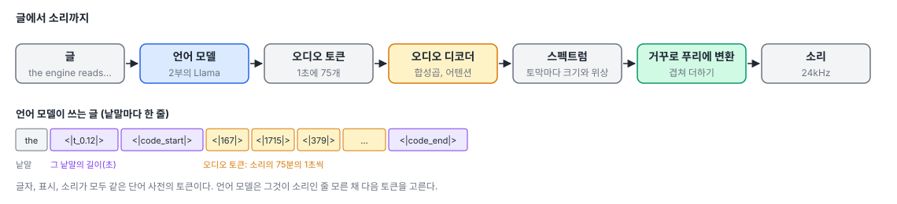
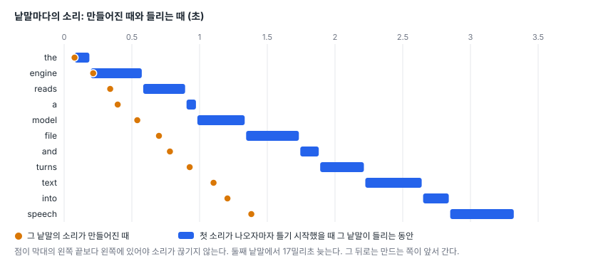

# 음성 합성

[33장](ch33_speech_recognition.md)은 소리를 글로 바꿨습니다. 이 장은 반대로 **글을 소리로** 바꿉니다.
"the engine reads a model file"이라는 글을 넣으면 그 글을 읽는 목소리가
WAV 파일로 나옵니다.

방법이 재미있습니다. 소리를 만드는 모델이 따로 있는 것이 아니라 **2부의
언어 모델이 소리를 "씁니다".** 소리의 짧은 토막 하나하나에 번호를
붙여 두고, 언어 모델이 글자 대신 그 번호들을 다음 토큰으로 고릅니다.
그 번호들을 진짜 소리로 바꾸는 작은 모델이 뒤에 붙습니다.

그래서 엔진이 새로 만들 것은 뒤의 작은 모델뿐입니다. 그리고 이 장에서
처음으로 **결과를 다 만들기 전에 내보내는 일**을 다룹니다. 소리는 듣는
데 시간이 걸리므로, 3초짜리 소리를 3초 기다렸다 주는 것과 0.1초 뒤부터
흘려 주는 것은 다른 제품입니다.

결과를 미리 적어 둡니다.

- OuteTTS-0.1-350M으로 글을 소리로 바꿉니다. 언어 모델은 2부의 것
  그대로이고, 오디오 디코더와 거꾸로 가는 푸리에 변환을 새로
  만들었습니다.
- 언어 모델이 쓴 토큰 302개가 PyTorch와 **하나도 다르지 않고**, 만든
  소리 3.25초의 표본이 1만분의 1 안에서 같습니다.
- 디코더의 가중치는 피클 파일로만 배포됩니다. 텐서만 푸는 방법으로
  열어 safetensors로 옮겼습니다.
- 첫 소리까지 77밀리초, 소리의 길이의 2.3배 빠르게 만듭니다. 그런데
  첫 소리가 나오자마자 틀면 둘째 낱말에서 17밀리초 끊깁니다.
- 낱말마다 조각내어 푼 소리는 한 번에 푼 소리와 **같은 소리가
  아닙니다.** 이 디코더가 소리 전체를 보도록 만들어졌기 때문입니다.
- 토큰을 쓰는 속도가 스레드 12개에서 4.1밀리초로 PyTorch(12.5밀리초)의
  세 배입니다. PyTorch는 그 설정에서 실시간에 못 미칩니다.
- 만든 소리를 [33장](ch33_speech_recognition.md)의 Whisper로 받아써 봤습니다. 네 번 가운데 한 번만
  알아들을 만합니다. 엔진의 계산은 기준 구현과 같고, 소리의 품질은 이
  장이 확인하지 못했습니다.

| 하는 일 | 절 |
|---|---|
| 소리가 어떻게 토큰이 되는지 본다 | 37.1 |
| 모델을 고르고 가중치를 받는다 | 37.2 |
| 피클 파일을 안전하게 연다 | 37.3 |
| 글의 틀을 만들고 오디오 토큰을 쓴다 | 37.4 |
| 오디오 디코더를 짠다 | 37.5 |
| 스펙트럼을 소리로 바꾼다 | 37.6 |
| PyTorch와 대조한다 | 37.7 |
| 만든 소리를 받아써 본다 | 37.8 |
| 낱말마다 흘려보낸다 | 37.9 |
| 조각내어 푼 소리를 견준다 | 37.10 |
| 시간을 잰다 | 37.11 |

## 37.1 소리를 토큰으로

[33장](ch33_speech_recognition.md)에서 본 대로 소리는 숫자의 긴 줄입니다. 1초가 표본 수만 개입니다.
언어 모델이 표본을 하나씩 쓸 수는 없습니다. 1초에 24,000토큰이
됩니다.

그래서 소리를 **압축해 번호로** 바꿉니다. 오디오 코덱(audio codec)
이라고 부르는 모델이 그 일을 합니다. 인코더가 소리를 짧은 토막으로 나눠
토막마다 "미리 정해 둔 4,096가지 가운데 이것과 가장 비슷하다"는 번호
하나를 붙이고, 디코더가 번호들에서 소리를 되살립니다. 이 장의 코덱인
WavTokenizer는 1초를 번호 **75개**로 줄입니다.[^wavtokenizer] 번호
하나가 75분의 1초, 표본 320개입니다.

번호가 4,096가지뿐이면 언어 모델의 단어 사전에 넣을 수 있습니다. `<|0|>`
부터 `<|4095|>`까지 토큰 4,096개를 더하고, "글 다음에 그 글을 읽은
소리의 번호들이 온다"는 꼴의 글로 언어 모델을 학습시킵니다. 그러면
언어 모델이 글을 받아 소리의 번호를 이어 씁니다.[^valle]



엔진의 눈으로 보면 이렇습니다.

- **앞 절반은 2부 그대로입니다.** 토큰을 읽고, KV 캐시를 쌓고, 다음
  토큰을 고릅니다. 그 토큰이 글자인지 소리인지는 엔진이 알 바가
  아닙니다.
- **뒤 절반이 새것입니다.** 오디오 디코더가 번호들을 스펙트럼으로
  바꾸고, [33장](ch33_speech_recognition.md)의 푸리에 변환을 거꾸로 해서 표본으로 바꿉니다.
- **1초의 소리가 토큰 75개 남짓입니다.** 언어 모델이 1초에 75토큰보다
  빨리 써야 듣는 속도를 따라갑니다. 이 숫자가 이 장의 지표를 정합니다.

## 37.2 모델

언어 모델은 OuteTTS-0.1-350M입니다.[^outetts]

| | OuteTTS-0.1-350M |
|---|---|
| 구조 | 2부의 Llama 그대로 |
| 블록 | 20개 |
| 폭 | 896 |
| 헤드 | 16개 (키와 값은 8개) |
| 단어 사전 | 67,584 (오디오 토큰 4,096개와 길이 토큰들 포함) |
| 파라미터 | 3억 6,199만 (블록 2억 4,088만, 토큰 벡터의 표와 출력 층이 6,056만씩) |
| 파일 | `model.safetensors` (724MB, 16비트) |
| 허가 조건 | CC-BY-4.0 |

[36장](ch36_multimodal.md)의 모델처럼 토큰 벡터의 표와 출력 층이 따로입니다. 그것 말고는
2부의 `LlamaModel`이 그대로 읽습니다.

오디오 디코더는 WavTokenizer의 디코더입니다. 코드북(번호마다의 벡터
4,096개)과 합성곱 모델로, 값이 6,498만 개입니다. 허가 조건은 MIT입니다.

이 모델은 실험 버전입니다. 모델 카드가 스스로 "낱말을 바꾸거나 빠뜨릴
수 있다"고 적고 있고, 영어만 됩니다.[^outetts] 그래도 고른 까닭은
구조가 2부의 것 그대로이고, 작고, 허가 조건이 분명해서입니다. 이 장이
보려는 것은 소리의 품질이 아니라 **구조와 지표**입니다.

```bash
sh scripts/download_ch37.sh decoder
```

**견주는 상대가 처음 계획과 다릅니다.** 이 책의 계획은 이 장을 llama.cpp와
견주는 것이었습니다. 책이 고정해 둔 llama.cpp에는 이 모델을 돌리던 예전
예제가 다른 구조로 바뀌어 있어서, PyTorch와 견줍니다.

## 37.3 피클을 여는 법

디코더의 가중치는 지금까지와 다른 형식으로 배포됩니다. `.ckpt` 파일,
PyTorch가 학습 도중에 저장한 **피클**(pickle)입니다.

피클은 Python의 객체를 통째로 저장하는 형식입니다. 숫자만 담는
safetensors와 달리 **"이 함수를 이 인자로 불러라"를 담을 수
있습니다.** 그래서 피클을 읽는 것은 그 파일이 시키는 코드를 실행하는
것입니다. 믿을 수 없는 곳에서 받은 피클을 여는 것은 믿을 수 없는
프로그램을 실행하는 것과 같습니다. safetensors라는 형식이 생긴 까닭이
이것이고, 이 책이 처음부터 그 형식만 읽은 까닭도 이것입니다.

이 파일은 원래 만든 쪽의 저장소에서 받고 해시를 고정했습니다. 그래도
그냥 열지 않습니다. PyTorch에는 **텐서와 기본 자료형만 풀고 그 밖의
것은 거절하는** 방법이 있습니다.[^weights-only]

```python
state = torch.load(SOURCE, map_location="cpu", weights_only=True)["state_dict"]
```

이 방법으로 열리지 않는 파일(모델 객체를 통째로 담은 것)은 열지
않았습니다. 같은 가중치를 그렇게 담은 파일도 배포되어 있는데 쓰지
않았습니다.

연 다음에는 필요한 것만 골라 safetensors로 옮깁니다
(`reference/ch37_convert.py`). 1.75GB 가운데 소리를 만드는 데 쓰는 것은
260MB입니다. 나머지는 학습에만 쓰는 것들입니다.

```bash
python reference/ch37_convert.py
```

옮긴 파일은 이 책이 따로 배포하지 않습니다. 독자의 기계에서 원본을 받아
바꿉니다. 그래서 이 장의 뒤 절반을 따라 하려면 Python과 PyTorch가
있어야 합니다. 앞 절반(오디오 토큰을 쓰는 데까지)은 없어도 됩니다.

옮기면서 한 가지를 미리 정리했습니다. 이 디코더의 층 정규화 가운데
일부는 "압축의 세기"에 따라 가중치를 골라 쓰게 되어 있는데(네 가지),
이 모델은 그 가운데 첫째만 씁니다. 첫째만 남겼습니다. 그러면 실행할
때는 보통의 층 정규화입니다.

## 37.4 틀과 오디오 토큰

모델이 학습한 글의 꼴은 이렇습니다.[^outetts-prompt]

```rust
{{#include ../../../crates/badak_models/src/tts.rs:prompt}}
```

읽을 글을 낱말로 잘라 표시 토큰으로 가르고, 끝에 "여기서부터 소리"를
둡니다. 그 뒤를 모델이 이어 씁니다. 낱말마다 한 줄입니다.

```text
the<|t_0.12|><|code_start|><|167|><|1715|><|379|>…<|code_end|>
engine<|t_0.39|><|code_start|><|107|><|451|><|88|>…<|code_end|>
```

낱말을 다시 쓰고, 그 낱말을 몇 초 동안 읽을지를 쓰고(`<|t_0.12|>`는
0.12초), 그만큼의 오디오 토큰을 씁니다. 0.12초면 9개입니다. 모델이
길이를 먼저 정하고 그 수만큼 채우는 셈입니다. 글과 소리가 한 줄에 섞여
있어서, 모델이 지금 어느 낱말을 읽고 있는지 잃지 않습니다.

토큰을 고르는 코드는 2부의 것입니다.

```rust
{{#include ../../../crates/badak_models/src/tts.rs:generate}}
```

[12장](../part2/ch12_sampling.md)의 샘플러를 그대로 씁니다. 이 모델의 권장 설정은 온도 0.4, 상위
40개, 누적 확률 0.9, **반복 벌점 1.1**입니다.[^outetts-prompt] 반복
벌점이 중요합니다. 오디오 토큰은 같은 번호가 이어지기 쉬운데(같은
소리가 길게 나면), 그대로 두면 모델이 한 번호에 갇힙니다.

여기서 한 번 틀렸습니다. [12장](../part2/ch12_sampling.md)에 반복 벌점이 이미 있는데 이 장의 코드에
새로 짜 넣었고, 토큰이 **나온 횟수만큼** 벌점을 주게 짰습니다. 처음
202개 토큰은 정답과 같았고 203번째에서 갈렸습니다. 그 뒤로는 끝 토큰을
쓰지 못하고 한도까지 썼습니다. 기준 구현은 몇 번 나왔든 한 번만
깎습니다. [12장](../part2/ch12_sampling.md)의 함수가 그렇게 되어 있었습니다. 그 함수를 쓰도록
고쳤습니다. 이미 있는 것을 다시 짜면 이미 고친 것을 다시 틀립니다.

## 37.5 오디오 디코더

오디오 토큰들을 받아 토막마다의 벡터를 냅니다.[^vocos]

| 단계 | 하는 일 | 처음 나온 곳 |
|---|---|---|
| 코드북 | 번호를 폭 512의 벡터로 | [9장](../part2/ch09_transformer.md)의 임베딩 |
| 합성곱 (창 7) | 폭을 768로, 이웃 토막과 섞기 | [27장](ch27_convolution.md), 여기서는 1차원 |
| 잔차 블록 둘 | 그룹 정규화, SiLU, 합성곱 (창 3) | [35장](ch35_image_generation.md) |
| 어텐션 | 모든 토막이 서로를 본다. 헤드 하나 | [35장](ch35_image_generation.md)의 VAE와 같은 것 |
| 잔차 블록 둘, 그룹 정규화 | | [35장](ch35_image_generation.md) |
| ConvNeXt 블록 12개 | 채널마다의 합성곱, 층 정규화, MLP | 이 장 |
| 층 정규화 | | [32장](ch32_vit_detection.md) |

[35장](ch35_image_generation.md)의 VAE 디코더를 1차원으로 눕힌 것에 가깝습니다. 그림의 자리
(`세로 × 가로`) 대신 소리의 토막(시간)이 줄을 섭니다. 특징을 `(토막 수,
채널)`로 담으면 [35장](ch35_image_generation.md)의 그룹 정규화와 어텐션이 그대로 맞습니다.

1차원 합성곱은 [33장](ch33_speech_recognition.md)의 Whisper에서 한 번 만들었습니다. 같은
방법입니다. 토막마다 둘레의 값을 창으로 늘어놓고 선형 층에 넣습니다.

```rust
{{#include ../../../crates/badak_models/src/tts.rs:conv1d}}
```

새로운 것은 ConvNeXt 블록입니다.[^convnext]

```rust
{{#include ../../../crates/badak_models/src/tts.rs:decode}}
```

블록의 첫 합성곱은 **채널마다 따로** 합니다. 27.6절에서 MobileNet의
깊이별 합성곱으로 본 것입니다. 보통의 합성곱은 출력 채널 하나가 입력 채널
768개를 모두 보는데, 이것은 제 채널의 둘레 일곱 토막만 봅니다. 곱셈이
768분의 1입니다. 채널을 섞는 일은 그 뒤의 선형 층 둘이 합니다. 폭을 세
배로 늘렸다가 되돌리는, 트랜스포머의 MLP와 같은 모양입니다. 합성곱
모델에 트랜스포머의 블록 모양을 옮겨 온 것이 ConvNeXt입니다.

눈여겨볼 것이 둘 있습니다. **어텐션이 모든 토막을 봅니다.** 그리고
**그룹 정규화가 모든 토막에 걸쳐 평균을 냅니다.** 둘 다 "소리 전체를
한꺼번에 받는다"를 전제로 합니다. 37.10절에서 이것이 문제가 됩니다.

## 37.6 스펙트럼에서 소리로

디코더의 마지막 선형 층은 토막마다 값 1,282개를 냅니다.

```rust
{{#include ../../../crates/badak_models/src/tts.rs:spectrum}}
```

**표본을 직접 내지 않고 스펙트럼을 냅니다.** 앞의 641개가 주파수마다의
크기(의 로그), 뒤의 641개가 위상입니다. [33장](ch33_speech_recognition.md)에서 소리를 토막 내어
푸리에 변환한 것의 정확히 반대쪽입니다. 토막 하나(표본 320개)를 표본
1,280개의 스펙트럼으로 적고, 변환을 거꾸로 해서 표본을 얻습니다. 표본을
하나씩 만드는 것보다 훨씬 쌉니다. 토막 75개면 1초입니다.

```rust
{{#include ../../../crates/badak_audio/src/istft.rs:istft}}
```

세 가지를 적어 둡니다.

**거꾸로 가는 변환은 앞으로 가는 변환으로 계산합니다.** 스펙트럼의
켤레를 넣고 결과를 길이로 나누면 됩니다. [33장](ch33_speech_recognition.md)의 코드를 고치지
않았습니다.

**토막들이 겹칩니다.** 토막 하나가 표본 1,280개인데 320개씩 밀려
놓이므로 자리마다 토막 넷이 겹칩니다. 창을 곱해 더합니다. [33장](ch33_speech_recognition.md)에서
토막의 양 끝을 눌러 준 그 창입니다.

**나누는 값이 이상합니다.** 토막에는 창을 한 번 곱했는데 나눌 때는 창의
**제곱**의 합으로 나눕니다. 그러면 소리의 크기에 4/3이 남습니다. 틀린
것처럼 보이지만 기준 구현이 그렇게 하고,[^vocos-istft] 모델이 그
규칙으로 학습되었습니다. "바르게" 고치면 정답과 달라집니다. 시험에서
이것을 확인해 두었습니다.

### 길이 1,280의 변환

1,280은 2의 거듭제곱이 아닙니다. [33장](ch33_speech_recognition.md)에서 길이 400을 만났을 때는
Bluestein의 방법을 썼습니다. 여기에도 그대로 썼더니, 디코더의 시간
가운데 큰 몫이 이 변환이었습니다. Bluestein은 길이 1,280을 위해 길이
4,096의 FFT를 토막마다 두 번 합니다.

`1,280 = 5 × 256`입니다. 2의 거듭제곱은 아니지만 거의 그렇습니다.

```rust
{{#include ../../../crates/badak_audio/src/fft.rs:split}}
```

입력을 다섯 줄로 갈라 줄마다 길이 256의 FFT를 하고 합칩니다. [33장](ch33_speech_recognition.md)의
FFT가 "짝수 번째와 홀수 번째"의 둘로 가르는 것을 다섯으로 가르는
것으로 바꿨을 뿐입니다. 1초 분량(토막 75개)을 푸는 시간이 스레드
하나에서 22.1밀리초에서 17.3밀리초가 되었습니다. 한 번씩 잰 값입니다.

## 37.7 대조

정답은 PyTorch로 만들었습니다(`reference/ch37_make_reference.py`). 언어
모델은 transformers가 계산하고, 디코더는 OuteTTS 저장소에 들어 있는
WavTokenizer의 모듈을 그대로 불러 원본 가중치를 넣어 계산합니다.
[35장](ch35_image_generation.md)의 일이 있었으므로, 가중치의 이름이 하나라도 맞지 않으면 멈추게
했습니다.

무작위가 있으면 견줄 수 없으므로 점수가 가장 높은 토큰을 고릅니다(반복
벌점 1.1은 그대로).

```bash
cargo run --release -p badak_models --example ch37_verify
```

```text
{{#include output/ch37_verify.txt}}
```

**쓴 토큰 302개가 모두 같습니다.** 그 가운데 244개가 오디오 토큰이고
3.25초의 소리입니다.

**디코더의 몸통이 1만분의 4 안에서 같습니다**(값의 크기는 52).

**소리의 표본 78,080개가 1만분의 1 안에서 같습니다.** 16비트로 적으면
한 단계가 3만분의 1이므로 서너 단계의 차이입니다.

## 37.8 들어 보기

소리를 파일로 씁니다. [33장](ch33_speech_recognition.md)에서 읽기만 만든 WAV에 쓰기를 더했습니다.

```rust
{{#include ../../../crates/badak_audio/src/wav.rs:write}}
```

숫자가 정답과 같다는 것은 **PyTorch와 같은 소리를 낸다**는 뜻이지 그
소리가 글을 제대로 읽는다는 뜻이 아닙니다. 이 책은 소리를 들려줄 수
없으니 다른 방법으로 확인합니다. [33장](ch33_speech_recognition.md)에서 만든 Whisper에게 들려주고
받아쓰게 합니다. 글을 소리로 바꾸는 엔진과 소리를 글로 바꾸는 엔진을
이으면 한 바퀴가 됩니다.

Whisper는 16kHz만 받고 이 소리는 24kHz입니다. 표본 속도를 바꿉니다.

```rust
{{#include ../../../crates/badak_audio/src/resample.rs:resample}}
```

새 표본 하나를 둘레의 옛 표본들로 만듭니다. [36장](ch36_multimodal.md)에서 사진을 줄인
란초스 필터와 같은 생각입니다. 속도를 낮출 때는 새 속도가 담지 못하는
높은 떨림(8kHz 위)을 지워야 하는데, 비중의 모양을 넓히면 그 일이 함께
됩니다. 시험에서 11kHz의 소리를 넣어 그것이 사라지는지 확인했습니다.
지우지 않으면 5kHz의 없던 소리가 됩니다.

```rust
{{#include ../../../crates/badak_models/examples/ch37_speak.rs:listen}}
```

읽힌 글은 "the engine reads a model file and turns text into
speech"입니다. Whisper-tiny가 받아쓴 것은 이렇습니다.

| 고르는 방법 | 받아쓴 글 |
|---|---|
| 점수가 가장 높은 토큰 | The Azure Eye will sign when Trump's taxing speech. |
| 무작위, 번호 1 | The engine reads a line of file and tows text into speech. |
| 무작위, 번호 3 | The engine is a lot of power and try to extend the speeds. |
| 무작위, 번호 7 | The engine rigged a lot of fun in terms to execute a speech. |

**알아들을 만한 것은 넷 가운데 하나입니다.** 번호 1은 열한 낱말 가운데
여덟이 맞습니다. 나머지는 앞뒤의 낱말만 맞습니다.

이 결과가 누구의 탓인지는 가르지 못했습니다. 셋이 겹쳐 있습니다.
음성 합성 모델이 실험 버전이고 목소리를 정해 주지 않았습니다. 받아쓰는
쪽이 가장 작은 Whisper입니다. 그리고 3.25초에 열한 낱말은 빠른 말입니다. 확실한 것은
**엔진의 계산이 기준 구현과 같다**는 것까지입니다. 그 소리가 좋은
소리인지는 이 장이 답하지 못합니다.

점수가 가장 높은 토큰만 고른 쪽이 가장 나쁜 것은 눈여겨볼 만합니다.
[12장](../part2/ch12_sampling.md)에서 글을 쓸 때도 그랬듯, 늘 가장 유력한 것만 고르면 모델이 흔히
가는 길에서 벗어나 엉뚱한 데로 갑니다. 소리에서는 그것이 뭉개진
발음으로 나타납니다. 대조에는 이 방법이 필요하지만 쓸 때는 권장
설정을 따라야 합니다.

## 37.9 흘려보내기

소리 3.25초를 만드는 데 1.4초가 걸립니다. 다 만든 뒤에 주면 듣는
사람은 1.4초를 기다립니다. 그럴 까닭이 없습니다. 첫 낱말의 소리는 훨씬
먼저 나옵니다.

```rust
{{#include ../../../crates/badak_models/examples/ch37_speak.rs:stream}}
```

모델이 낱말 하나의 오디오 토큰을 다 쓰면(`<|code_end|>`) 그 낱말의
소리를 풀어 내보냅니다. 언어 모델이 토큰을 쓰는 사이사이에 디코더가
돕니다.

```bash
cargo run --release -p badak_models --example ch37_speak -- --whisper
```

```text
{{#include output/ch37_speak.txt}}
```

지표가 둘 나옵니다.

**첫 소리까지의 시간**(time to first byte)이 77밀리초입니다. 글을 읽고
(토큰 30개), 첫 낱말의 토큰 13개를 쓰고, 그 소리를 푸는 데까지입니다.
[11장](../part2/ch11_kv_cache.md)에서 본 "첫 토큰까지의 시간"의 소리 판입니다. 사람이 느끼는 응답
속도가 이 숫자입니다.

**실시간의 2.3배**로 만듭니다. 3.25초의 소리를 1.39초에 만들었습니다.
이 값이 1보다 작으면 흘려보낼 수 없습니다. 듣는 속도를 만드는 속도가
따라가지 못해 소리가 끊깁니다.

2.3배이니 넉넉해 보이지만 그림을 그려 보면 그렇지만은 않습니다.



첫 소리가 나오자마자 틀기 시작하면 **둘째 낱말에서 17밀리초 끊깁니다.**
첫 낱말 "the"는 0.12초인데 둘째 낱말 "engine"의 소리는 137밀리초 뒤에야
나옵니다. 평균은 2.3배이지만 낱말마다는 고르지 않습니다. 낱말마다
소리가 아닌 토큰(낱말 자신, 길이, 표시)이 대여섯 개씩 붙어서, 짧은
낱말일수록 손해입니다. 전체로 보면 토큰 302개 가운데 58개가 소리가
아닙니다.

그래서 흘려보내는 쪽은 **조금 모았다가** 틀기 시작합니다. 여기서는
20밀리초만 더 기다리면 끝까지 끊기지 않습니다. 첫 소리까지의 시간을
조금 내주고 끊김을 없애는 것입니다. 얼마나 모을지는 만드는 속도가
얼마나 고른지에 달려 있습니다.

## 37.10 조각내어 푼 소리는 같은 소리가 아니다

위의 출력에 한 줄이 더 있습니다. 조각내어 푼 소리와 한 번에 푼 소리의
가장 큰 차이가 1.6입니다. 소리의 가장 큰 값이 1.19인데 차이가 그보다
큽니다. 거의 다른 파형입니다.

처음에는 조각을 자르는 자리를 틀렸다고 생각했습니다. 확인하려고 조각을
풀 때 앞뒤의 코드를 **모두** 함께 넣고 가운데만 꺼내 봤습니다. 그러면
한 번에 푼 것과 같아야 하고, 같았습니다. 자르는 자리는 맞습니다.

그렇다면 함께 넣는 앞뒤의 코드가 모자라서입니다. 얼마나 넣어야 하는지
쟀습니다.

```bash
cargo run --release -p badak_models --example ch37_bench chunks
```

| 함께 넣은 앞의 코드 | 뒤의 코드 | 파형의 SNR (dB) | 멜의 차이 (dB) | 푸는 시간의 합 (ms) |
|---:|---:|---:|---:|---:|
| 0 | 0 | 0.0 | 5.3 | 66 |
| 0 | 8 | 2.2 | 4.3 | 84 |
| 25 | 0 | 1.1 | 4.4 | 121 |
| 25 | 8 | 1.7 | 3.8 | 136 |
| 75 | 0 | 1.5 | 4.0 | 206 |
| 75 | 8 | 2.6 | 3.3 | 224 |
| 모두 | 0 | 1.5 | 3.7 | 322 |
| 모두 | 8 | 2.8 | 2.6 | 326 |

정답의 오디오 코드 244개를 낱말 11개로 조각내어 푼 것입니다. 표에 싣지
않은 줄은 `bench/ch37/chunks.txt`에 있습니다.

"파형의 SNR"은 한 번에 푼 소리를 신호로, 차이를 잡음으로 본 비입니다.
0dB이면 차이가 소리만큼 크다는 뜻입니다. "멜의 차이"는 [33장](ch33_speech_recognition.md)의 멜
스펙트로그램으로 바꿔 견준 것이고, 위상이 달라도 들리는 소리가
비슷하면 작게 나옵니다.

**앞의 코드를 모두 넣어도 같아지지 않습니다.** 파형의 SNR이 1.5dB
입니다. 지금까지 쓴 것을 전부 다시 풀어도, 아직 쓰지 않은 뒤쪽이
없으면 다른 소리가 납니다.

까닭은 37.5절에서 표시해 둔 둘입니다. **어텐션이 모든 토막을 보고,
그룹 정규화가 모든 토막의 평균을 씁니다.** 뒤의 토막이 더해지면 앞의
토막의 값도 바뀝니다. 그리고 이 디코더는 위상까지 내므로, 값이 조금만
달라도 파형은 크게 달라집니다. 멜로 보면 차이가 덜하지만(2.5~5dB)
작지는 않습니다.

이것은 구현의 문제가 아니라 **이 디코더가 소리 전체를 받도록 만들어졌기
때문**입니다. 조각내어 푼 소리도 말소리이기는 합니다(37.8절의 표는
모두 조각내어 푼 소리를 받아쓴 것입니다). 다만 한 번에
푼 소리와 같은 소리는 아니고, 조각의 이음매에서 무슨 일이 생기는지는
귀로 확인해야 합니다. 이 책은 그것을 하지 못했습니다.

엔진을 만드는 사람에게 남는 것은 이것입니다. **흘려보낼 수 있느냐는
엔진이 아니라 모델이 정합니다.** 언어 모델은 앞만 보므로 토큰을 하나씩
내보내도 결과가 같습니다. 이 디코더는 앞뒤를 다 보므로 그렇지
않습니다. 뒤를 보지 않게 만든 디코더를 써야 조각마다 푼 소리가 한
번에 푼 소리와 같아집니다.

## 37.11 시간

```bash
OUTETTS=<OuteTTS 저장소의 경로> PYTHON=python3 sh scripts/bench_ch37.sh 3
```

세 차례 번갈아 잰 값의 가운데입니다.

### 언어 모델

| | 스레드 1 | 4 | 12 |
|---|---:|---:|---:|
| 글 읽기, 토큰 30개 (ms): badak | 193 | 52 | 22 |
| 글 읽기, 토큰 30개 (ms): PyTorch | 25 | 21 | 22 |
| 쓰기, 토큰마다 (ms): badak | 11.3 | 4.6 | 4.1 |
| 쓰기, 토큰마다 (ms): PyTorch | 10.7 | 11.6 | 12.5 |

**토큰을 쓰는 속도가 이 장의 지표를 정합니다.** 37.9절에서 본 대로
소리 1초에 토큰이 93개쯤 필요합니다(오디오 토큰 75개와 그 사이의
토큰들). 토큰마다 10.7밀리초면 1초에 93개입니다. 딱 실시간입니다.
4.1밀리초면 1초에 240개, 실시간의 2.6배입니다.

**PyTorch는 스레드를 늘릴수록 느려집니다.** 10.7, 11.6, 12.5밀리초
입니다. [36장](ch36_multimodal.md)에서 본 것과 같습니다. 스레드 12개에서는 1초에 80토큰으로
실시간에 못 미칩니다. 우리는 [18장](../part3/ch18_multithreading.md)에서 "토큰을 쓸 때는 스레드를 적게"로
정해 두어 4밀리초에서 멈춥니다.

**글 읽기는 스레드 하나에서 우리가 여덟 배 느립니다.** 193과
25밀리초입니다. 토큰 30개를 한꺼번에 읽는 일은 큰 행렬 곱이고,
PyTorch의 스레드 하나가 그것을 훨씬 빨리 합니다([31장](ch31_mobile_engines.md)에서 본 SME의
자리입니다. 언어 모델 쪽에는 그 커널을 붙이지 않았습니다). 스레드를
쓰면 같아집니다. 글 읽기는 첫 소리까지의 시간에 그대로 들어갑니다.

### 오디오 디코더

| 디코더 (ms) | 1초 분량 (코드 75개) | 4초 (300개) | 16초 (1,200개) |
|---|---:|---:|---:|
| badak 기본, 스레드 1 | 111 | 433 | 1,753 |
| badak 기본, 스레드 12 | 18.7 | 72.7 | 296 |
| badak 빠른 길, 스레드 1 | 17.4 | 64.7 | 287 |
| badak 빠른 길, 스레드 12 | 12.7 | 49.9 | 189 |
| PyTorch, 스레드 1 | 27.2 | 48.8 | 150 |
| PyTorch, 스레드 4 | 132 | 141 | 204 |
| PyTorch, 스레드 12 | 364 | 378 | 428 |

**디코더는 언어 모델보다 훨씬 쌉니다.** 1초 분량을 푸는 데 빠른 길로
13~17밀리초입니다. 같은 1초를 언어 모델이 쓰는 데는 380밀리초가
듭니다. 음성 합성의 시간은 거의 다 언어 모델의 시간입니다.

**빠른 길은 [31장](ch31_mobile_engines.md)의 SME 커널을 합성곱과 선형 층에 붙인 것입니다.**
스레드 하나에서 111이 17.4밀리초가 됩니다. 여기에 [36장](ch36_multimodal.md)에서 배운 것
(GELU를 스레드에 나누고 근사하기)과 37.6절의 변환을 더했습니다.

**짧은 소리는 우리가, 긴 소리는 PyTorch가 빠릅니다.** 우리 시간은
길이에 비례하고(1초에 17, 16초에 287), PyTorch는 길이가 16배가 되어도
5.5배입니다(27에서 150). 우리 디코더에는 스레드 하나로 값을 하나씩
다루는 곳이 남아 있습니다(채널마다의 합성곱, 창을 늘어놓는 일, 그룹
정규화). 흘려보낼 때 푸는 조각은 1초 안팎이므로 이 장의 쓰임에는
우리 쪽이 맞습니다.

**PyTorch의 디코더는 스레드를 늘리면 크게 느려집니다.** 1초 분량이
27밀리초에서 364밀리초가 됩니다. 까닭은 따라가지 않았습니다. 작은 일을
여러 스레드에 나눌 때의 수고가 일보다 큰 것으로 짐작합니다([18장](../part3/ch18_multithreading.md)).
기본 설정 그대로 재면 이런 값이 나온다는 것은 적어 둘 만합니다.

## 37.12 남긴 것

**목소리 고르기.** 이 모델은 다른 사람의 목소리 몇 초와 그 글을 틀의
앞에 넣어 그 목소리로 읽게 할 수 있습니다. 넣지 않았습니다. 넣지
않으면 목소리가 실행마다(번호마다) 달라집니다. 넣으려면 소리를 오디오
토큰으로 바꾸는 인코더와, 낱말마다의 길이를 재는 정렬이 필요합니다.

**글 다듬기.** 숫자를 낱말로 풀지 않고(`5`는 버려집니다), 영어가 아닌
글은 다루지 않습니다. 기준 구현은 숫자를 풀고 다른 글자를 로마자로
바꿉니다.

**긴 글.** 문장 하나만 시험했습니다. 긴 글은 문장으로 나눠 따로
읽혀야 합니다. 모델이 받는 길이에 한도가 있고, 길어질수록 낱말을
빠뜨립니다.

**흘려보내기에 맞는 디코더.** 37.10절에서 본 대로 이 디코더는 조각내어
풀면 다른 소리를 냅니다. 뒤의 토막을 보지 않는 디코더를 쓰거나, 조각을
겹쳐 풀어 이음매를 섞는 방법이 있습니다. 하지 않았습니다.

**디코더의 나머지.** 채널마다의 합성곱, 창을 늘어놓는 일, 그룹
정규화가 스레드 하나로 돕니다. 긴 소리에서 PyTorch보다 느린 까닭입니다.

**소리의 품질을 재는 일.** Whisper로 받아써 본 것이 전부입니다. 사람이
듣고 매기는 점수도, 받아쓴 글의 낱말 오류율을 여러 문장으로 재는 일도
하지 않았습니다.

**언어 모델의 양자화.** 가중치를 16비트 그대로 씁니다. 3부의 4비트
양자화가 소리에 얼마나 영향을 주는지는 보지 않았습니다.

**llama.cpp와 견주기.** 37.2절에 적은 까닭으로 하지 않았습니다.

**CI.** 디코더의 가중치를 만들려면 Python이 필요해서, CI는 언어 모델이
쓴 토큰만 대조합니다.

## 37.13 실전 엔진에서는

**언어 모델 엔진이 그대로 음성 합성 엔진의 앞 절반이 됩니다.** 오디오
토큰을 쓰는 모델은 언어 모델 엔진에 올리면 됩니다. 뒤에 붙일 것은
토큰을 걸러 디코더에 넘기는 일과 디코더입니다. 이 장의 `generate`가
2부의 것과 다르지 않은 것이 그 뜻입니다.

**지표는 둘입니다.** 첫 소리까지의 시간과, 소리의 길이에 견준 만드는
시간입니다. 뒤의 것은 쓰는 사람마다 방향이 다릅니다. "실시간 배수"를
만드는 시간을 소리의 길이로 나눈 값(작을수록 좋다)으로 쓰는 쪽과 그
반대(클수록 좋다)로 쓰는 쪽이 있습니다. 이 장은 "실시간의 몇 배
빠른가"로 적었습니다. 남의 숫자를 볼 때는 어느 쪽인지부터 확인해야
합니다.

**첫 소리까지의 시간은 서버에서 달라집니다.** 이 장의 77밀리초는 모델이
메모리에 올라와 있고 다른 요청이 없을 때의 값입니다. 요청이 겹치면
기다리는 시간이 더해집니다. 5부에서 다룹니다.

**흘려보내려면 디코더가 그렇게 만들어져 있어야 합니다.** 뒤의 토막을
보지 않도록 학습한 코덱은 토큰이 오는 대로 풀어도 한 번에 푼 것과
같은 소리를 냅니다. 이 장의 디코더는 그렇지 않고, 그 차이를
37.10절에서 쟀습니다. 모델을 고를 때 볼 것입니다.

**토큰의 수가 비용입니다.** 1초에 75토큰인 코덱과 25토큰인 코덱은 같은
언어 모델에서 속도가 세 배 다릅니다. [36장](ch36_multimodal.md)에서 사진 한 장의 토큰
수가 그랬듯, 여기서는 1초의 토큰 수가 그렇습니다.

## 정리

- 오디오 코덱이 소리를 번호로 바꾸면 언어 모델이 소리를 쓸 수 있습니다.
  1초가 번호 75개입니다.
- 음성 합성 엔진의 앞 절반은 언어 모델 엔진 그대로입니다. 뒤 절반이
  번호를 스펙트럼으로 바꾸는 디코더와 거꾸로 가는 푸리에 변환입니다.
- 피클은 읽을 때 코드를 실행합니다. 텐서만 푸는 방법으로 열고, 그렇게
  열리지 않는 파일은 열지 않습니다.
- 지표는 첫 소리까지의 시간과 실시간 배수입니다. 평균이 실시간보다
  빨라도 짧은 낱말에서 끊길 수 있어서, 조금 모았다가 틉니다.
- 흘려보낼 수 있느냐는 모델이 정합니다. 앞뒤를 다 보는 디코더는
  조각내면 다른 소리를 냅니다.
- 시간의 대부분은 언어 모델이 토큰을 쓰는 데 듭니다. 1초의 토큰 수가
  비용입니다.
- 이미 있는 것을 다시 짜면 이미 고친 것을 다시 틀립니다. 반복 벌점이
  그랬습니다.
- 숫자가 기준 구현과 같다는 것과 결과가 좋다는 것은 다릅니다. 이 장은
  앞의 것만 확인했습니다.

## 연습 문제

1. `Sampler`의 반복 벌점을 1.0으로 두고(벌점 없음) 같은 글을 읽혀
   보십시오. 쓴 토큰에서 같은 오디오 토큰이 몇 번까지 이어집니까. 끝
   토큰이 나옵니까.
2. 번호(`--seed`)를 1부터 10까지 바꿔 같은 글을 읽히고 Whisper로
   받아써 보십시오. 원래 글과 가장 가까운 것과 가장 먼 것은 어느
   번호입니까. 소리의 길이는 얼마나 다릅니까.
3. `Istft::synthesize`에서 나누는 값을 창의 제곱의 합이 아니라 창의
   합으로 바꿔 보십시오. 정답과의 차이가 얼마가 됩니까. 소리의 크기는
   몇 배가 됩니까.
4. `Split::new(size, 7)`의 한도를 0으로 두어 늘 Bluestein을 쓰게 하고
   `ch37_bench`의 디코더 시간을 견줘 보십시오. 16초 분량에서는 몇
   밀리초가 다릅니까.
5. 길이 1,280의 스펙트럼은 켤레 대칭입니다(뒤 절반이 앞 절반의 켤레).
   그 사실을 써서 길이 640의 복소수 변환 하나로 계산하는 방법을 찾아
   짜 보십시오. 얼마나 빨라집니까.
6. `ch37_speak`에서 낱말마다가 아니라 오디오 토큰 25개(3분의 1초)마다
   소리를 내보내게 바꿔 보십시오. 첫 소리까지의 시간과 소리가 끊기는
   곳이 어떻게 달라집니까.
7. 조각을 풀 때 앞뒤로 겹치는 부분을 두고, 겹친 표본들을 한쪽은 줄이고
   한쪽은 키우며 섞어(교차 페이드) 이어 보십시오. 한 번에 푼 소리와의
   멜 차이가 줄어듭니까.
8. 만든 소리를 [33장](ch33_speech_recognition.md)의 Whisper에 넣기 전에 `resample`을 거치지 않고
   표본을 셋에 둘씩 그냥 골라내 보십시오. 받아쓴 글이 달라집니까.
   스펙트로그램의 어디가 달라지는지 찾아보십시오.

## 참고 문헌

[^wavtokenizer]: S. Ji 외, "WavTokenizer: an Efficient Acoustic Discrete
    Codec Tokenizer for Audio Language Modeling", 2024. arXiv:2408.16532.
    서지 정보만 확인했습니다. 1초에 75개라는 것은 OuteTTS의 모델
    카드(83번째 줄)에서, 번호가 4,096가지라는 것은 가중치 파일의 코드북
    형상 `(4096, 512)`에서 확인했습니다. 가중치는
    <https://huggingface.co/novateur/WavTokenizer-large-speech-75token>
    (판 `f0eafde4078a`, MIT)입니다. <https://arxiv.org/abs/2408.16532>

[^valle]: 언어 모델로 오디오 코덱의 번호를 쓰게 해 음성을 합성하는
    방법을 널리 알린 논문은 C. Wang 외, "Neural Codec Language Models
    are Zero-Shot Text to Speech Synthesizers", 2023(arXiv:2301.02111)
    입니다. 서지 정보만 확인했습니다. <https://arxiv.org/abs/2301.02111>

[^outetts]: OuteAI, `OuteTTS-0.1-350M`의 모델 카드와 저장소(판
    `2191ede86648`, CC-BY-4.0). 구조가 Llama라는 것은 카드의 71번째와
    77번째 줄, 한계는 99번째 줄입니다. 블록과 폭과 헤드의 수는
    `config.json`에서, 파라미터의 수는 `model.safetensors`에 든 텐서의
    원소를 세어 확인했습니다.
    <https://huggingface.co/OuteAI/OuteTTS-0.1-350M>

[^weights-only]: PyTorch 2.6.0, `torch/serialization.py`. `torch.load`의
    `weights_only`가 2.6부터 기본으로 켜진다는 안내가 89번째 줄에
    있습니다. 이 장은 2.14.1에서 그 인자를 명시해 썼습니다. 이 옵션이
    막아 주는 범위에 대한 본문의 설명은 그 인자의 문서에 따른 것이고,
    구현을 읽어 확인하지는 않았습니다.
    <https://github.com/pytorch/pytorch/blob/v2.6.0/torch/serialization.py>

[^outetts-prompt]: edwko, OuteTTS (커밋 `f5eac6e70d79`, Apache-2.0).
    글의 틀과 낱말마다의 줄은 `outetts/version/v1/prompt_processor.py`,
    권장 설정(온도 0.4, 반복 벌점 1.1, 상위 40, 누적 0.9)은
    `outetts/models/config.py` 13~17번째 줄입니다. 그 설정은 여러 버전이
    함께 쓰는 기본값이고, 0.1 버전만의 권장값이 따로 있는지는 확인하지
    않았습니다. <https://github.com/edwko/OuteTTS/tree/f5eac6e70d792844c6a6959d900a47af2c061a5b>

[^vocos]: 디코더의 구조는 H. Siuzdak, "Vocos: Closing the gap between
    time-domain and Fourier-based neural vocoders for high-quality audio
    synthesis", 2023(arXiv:2306.00814)의 것을 WavTokenizer가 고쳐 쓴
    것으로 보입니다(모듈의 이름이 `VocosBackbone`입니다). 서지 정보만
    확인했습니다. 이 장의 구조는 OuteTTS 저장소(같은 커밋)에 들어 있는
    `outetts/wav_tokenizer/decoder/models.py` 152~235번째 줄
    (`VocosBackbone`)과 `modules.py`(`ConvNeXtBlock`은 8번째 줄,
    `AdaLayerNorm`은 63번째 줄)에서 읽었고, 그 모듈이 낸 값과
    대조했습니다. <https://arxiv.org/abs/2306.00814>

[^convnext]: Z. Liu 외, "A ConvNet for the 2020s", 2022.
    arXiv:2201.03545. 서지 정보만 확인했습니다.
    <https://arxiv.org/abs/2201.03545>

[^vocos-istft]: OuteTTS 저장소(같은 커밋),
    `outetts/wav_tokenizer/decoder/spectral_ops.py`. 거꾸로 가는 변환과
    창을 곱하는 곳은 56~57번째 줄, 창의 제곱을 겹쳐 더해 나누는 곳은
    67~73번째 줄입니다. 크기를 100에서 자르는 것은 `heads.py`의
    `ISTFTHead`(24번째 줄부터)에 있습니다.
