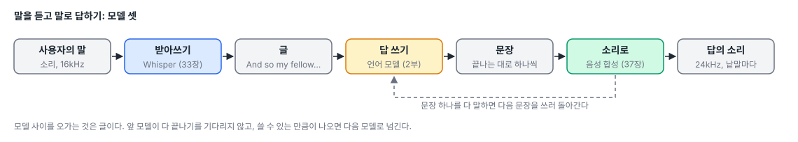
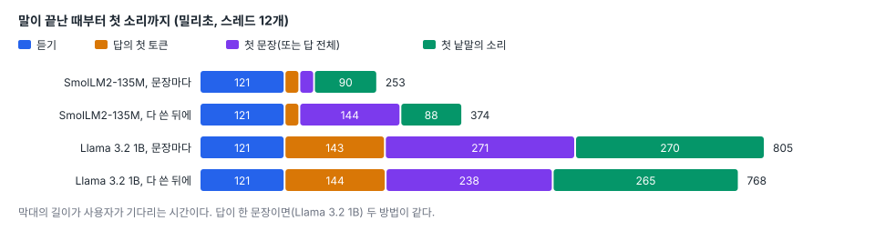

# 종합 실습: 음성 대화 파이프라인

4부의 마지막 장입니다. 새 모델도 새 연산도 없습니다. 지금까지 만든
것 셋을 **잇습니다.** 사람이 말하면 엔진이 듣고, 답을 생각하고, 말로
답합니다.

- 듣기: [33장](ch33_speech_recognition.md)의 Whisper가 소리를 글로 바꿉니다.
- 생각하기: 2부의 언어 모델이 그 글에 답을 씁니다.
- 말하기: [37장](ch37_speech_synthesis.md)의 음성 합성이 답을 소리로 바꿉니다.

모델 하나를 빠르게 만드는 일은 3부에서 했습니다. 이 장의 주제는
다릅니다. **모델 여럿을 이었을 때 사람이 기다리는 시간이 어디서
생기는가**입니다. 모델마다의 시간을 그냥 더하면 그 답이 나올 것
같지만, 그렇지 않습니다. 어떻게 잇느냐가 더 크게 듣습니다.

결과를 미리 적어 둡니다.

- 말이 끝나고 **0.25초** 뒤에 답의 첫 소리가 나옵니다(스레드 12개).
  듣기 121, 답의 첫 문장 42, 첫 낱말의 소리 90밀리초입니다.
- 답을 다 쓴 뒤가 아니라 **문장이 끝날 때마다** 소리로 넘기면 응답
  지연이 4분의 1에서 3분의 1 줄어듭니다. 모델은 하나도 고치지 않았습니다.
  다만 **답이 한 문장이면 줄일 것이 없습니다.** 답을 쓰는 모델을 Llama 3.2
  1B로 바꾸자 한 문장으로 답했고, 두 방법이 같았습니다(0.8초).
- 사슬 전체를 PyTorch로 똑같이 돌려 견줬습니다. 답의 토큰 60개와 소리
  토큰 1,332개가 모두 같습니다. 넘기는 때를 바꿔도 만들어지는 소리는
  표본까지 같습니다.
- 가장 큰 몫을 쓰는 것은 가장 작은 모델입니다. Whisper-tiny가 응답
  지연의 절반입니다.
- 스레드 하나에서는 만드는 속도가 듣는 속도보다 느려 소리가 20번
  끊깁니다. 첫 소리까지의 시간은 그 뒤를 댈 수 있을 때만 뜻이 있습니다.
- 이 숫자들에는 "말이 끝났는지 알아차리는 시간"이 들어 있지 않습니다.
  실제 시스템에서는 그것이 모델 셋의 시간보다 큽니다.

| 하는 일 | 절 |
|---|---|
| 모델 셋을 잇는 모양을 본다 | 38.1 |
| 무엇을 지연이라고 부를지 정한다 | 38.2 |
| 문장이 끝나는 대로 넘긴다 | 38.3 |
| 한 바퀴 돌려 본다 | 38.4 |
| PyTorch로 같은 사슬을 돌려 대조한다 | 38.5 |
| 구간마다의 지연을 잰다 | 38.6 |
| 소리가 끊기지 않는지 본다 | 38.7 |
| 한 기계에 모델 셋을 올린다 | 38.8 |

## 38.1 모델 셋



세 모델 사이를 오가는 것은 **글**입니다. Whisper가 글을 내고, 언어
모델이 글을 받아 글을 내고, 음성 합성이 글을 받습니다. 그래서 잇는
코드는 어렵지 않습니다. 한 모델의 출력을 다음 모델의 입력에 넣으면
됩니다.

| 단계 | 모델 | 만든 곳 | 가중치 |
|---|---|---|---:|
| 듣기 | Whisper-tiny | [33장](ch33_speech_recognition.md) | 151MB |
| 생각하기 | SmolLM2-135M-Instruct | 2부 | 269MB |
| 말하기: 오디오 토큰 | OuteTTS-0.1-350M | [37장](ch37_speech_synthesis.md) | 724MB |
| 말하기: 소리 | WavTokenizer의 디코더 | [37장](ch37_speech_synthesis.md) | 260MB |

모두 작은 모델입니다. 답을 쓰는 모델은 파라미터가 1억 3천만 개로, 이
책에서 쓴 것 가운데 가장 작은 언어 모델입니다. 뒤에서 Llama 3.2 1B로
바꿔도 봅니다.

```bash
sh scripts/download_ch33.sh
sh scripts/download_smollm2.sh
sh scripts/download_ch37.sh decoder && python reference/ch37_convert.py
sh scripts/download_ch38.sh
```

사용자의 말은 마이크가 아니라 **파일**에서 읽습니다. [33장](ch33_speech_recognition.md)에서 쓴
연설의 한 대목(11초)입니다. 답의 소리도 스피커가 아니라 파일에 씁니다.
마이크와 스피커를 다루는 일은 운영체제마다 다르고 추론의 일이
아닙니다. 대신 소리 조각이 **언제** 만들어졌는지를 모두 적어, 그것을
바로 틀었다면 어떻게 들렸을지를 계산합니다.

## 38.2 무엇이 지연인가

사람이 말을 마치고 답의 첫 소리가 들릴 때까지의 시간. 이것이 음성
대화에서 사람이 느끼는 지연입니다. 이 장에서는 **응답 지연**이라고
부릅니다. 답이 얼마나 길든, 다 만드는 데 얼마가 걸리든, 첫 소리만
빨리 나오면 사람은 기다렸다고 느끼지 않습니다. [37장](ch37_speech_synthesis.md)의 "첫 소리까지의
시간"을 파이프라인 전체로 넓힌 것입니다.

그 사이에 일어나는 일을 차례로 적으면 이렇습니다.

```rust
{{#include ../../../crates/badak_models/src/talk.rs:turn}}
```

시각을 일곱 개 적습니다. 모두 "사용자의 말이 끝난 때"부터 잰 초입니다.

1. 소리를 멜 스펙트로그램으로 바꾸고 인코더를 지난 때
2. 받아쓰기가 끝난 때
3. 언어 모델이 답의 첫 토큰을 쓴 때
4. 답의 첫 문장이 끝난 때
5. 언어 모델이 답을 다 쓴 때
6. **첫 소리가 나온 때**
7. 모두 끝난 때

6번이 응답 지연입니다. 5번과 6번 가운데 어느 것이 먼저인지가 이 장의
핵심입니다.

한 가지를 먼저 밝혀 둡니다. **이 숫자에는 "말이 끝났는지 알아차리는
시간"이 들어 있지 않습니다.** 파일을 통째로 받으므로 말이 끝난 때를
처음부터 압니다. 마이크로 받는다면 사람이 말을 멈춘 뒤에도 "정말
끝났나, 숨을 쉬는 것인가"를 판단하려고 조금 기다려야 합니다. [33장](ch33_speech_recognition.md)의
음성 구간 검출은 침묵이 0.5초 이어져야 말이 끝났다고 봤습니다. 그런
시스템에서는 이 장의 숫자에 그 0.5초가 더해집니다. 뒤에서 보겠지만
그 0.5초가 나머지 전부보다 큽니다.

## 38.3 기다리지 않고 넘기기

가장 쉬운 잇는 방법은 차례로 끝내는 것입니다. 받아쓰기가 끝나면 답을
쓰고, 답을 다 쓰면 소리로 바꿉니다. 이러면 응답 지연이 "받아쓰는 시간
+ 답을 **다** 쓰는 시간 + 첫 소리를 만드는 시간"입니다. 답이 길수록
늦습니다.

답을 다 쓸 때까지 기다릴 까닭이 없습니다. 언어 모델은 토큰을 하나씩
쓰고, 첫 문장은 답의 앞부분에서 끝납니다. **문장 하나가 끝나면 그
문장부터 소리로 바꿉니다.**

토큰마다가 아니라 문장마다 넘기는 까닭은 음성 합성 쪽에 있습니다.
[37장](ch37_speech_synthesis.md)의 모델은 읽을 글 전체를 틀의 앞에 받고 나서 소리를 씁니다.
낱말을 하나씩 흘려 넣을 수 없습니다. 문장은 그 모델이 한 번에 받기에
알맞은 단위이고, 사람의 말도 문장에서 숨을 쉽니다.

```rust
{{#include ../../../crates/badak_models/src/talk.rs:sentences}}
```

흘러 들어오는 글에서 문장의 끝을 찾습니다. 마침표를 봤다고 바로 자르지
않고 **그 뒤에 빈칸이 오는 것을 본 다음에** 자릅니다. `3.14`의 점에서
자르지 않으려는 것입니다. 값을 치르는 것이 있습니다. 문장이 끝난 줄을
다음 문장의 첫 토큰이 나와야 압니다. 토큰 하나만큼 늦습니다. 이
모델에서 2밀리초입니다.

전체를 잇는 코드입니다.

```rust
{{#include ../../../crates/badak_models/src/talk.rs:respond}}
```

언어 모델이 토큰을 쓸 때마다 불리는 함수 안에서 문장을 모으고, 문장이
끝나면 **그 자리에서** 음성 합성을 부릅니다. 음성 합성이 그 문장을 다
말할 때까지 언어 모델은 멈춰 있습니다. 두 모델이 번갈아 돕니다.
계산하는 기계가 하나이므로 가장 단순한 방법입니다.

문장 하나를 말하는 쪽은 37.9절의 것 그대로입니다. 낱말이 끝날 때마다
소리 조각을 내보냅니다.

```rust
{{#include ../../../crates/badak_models/src/talk.rs:speak}}
```

그래서 넘기는 단위가 두 겹입니다. 언어 모델에서 음성 합성으로는
**문장마다**, 음성 합성에서 듣는 사람에게는 **낱말마다** 넘어갑니다.

## 38.4 한 바퀴

```bash
cargo run --release -p badak_models --example ch38_talk -- --listen
```

```text
{{#include output/ch38_talk.txt}}
```

**말이 끝나고 0.25초 뒤에 답의 첫 소리가 나옵니다.** 모델 셋을 읽는
데 0.2초가 걸리는 것은 가중치를 메모리에 비추기만 하기 때문입니다
([20장](../part3/ch20_weight_quantization.md)).

구간을 보면 듣기가 121밀리초로 절반입니다. 그 가운데 88밀리초가 멜
스펙트로그램과 인코더입니다. Whisper는 말이 11초든 1초든 30초 창을
통째로 계산하므로 이 시간은 말의 길이와 상관없이 듭니다. 언어 모델은
첫 문장(9토큰)을 쓰는 데 43밀리초, 음성 합성은 첫 낱말의 소리를 내는
데 85밀리초입니다.

답 전체를 말하는 데는 6.5초가 걸렸고 소리는 14.3초입니다. 소리의
길이의 2.2배 빠르게 만들었으므로, 첫 소리부터 틀기 시작해도 끊기지
않습니다.

**답의 내용은 엉뚱합니다.** 케네디의 연설 한 대목을 듣고 "대화를
즐기고 계시다니 기쁩니다"라고 답합니다. 파라미터 1억 3천만 개짜리
모델의 한계입니다. 그리고 그 답을 읽은 소리를 Whisper가 다시 받아쓴
글은 원래 답과 절반쯤만 맞습니다([37장](ch37_speech_synthesis.md)의 한계 그대로입니다). 이
장이 보여 주는 것은 좋은 대화가 아니라 **이어진 엔진**입니다.

답을 쓰는 모델을 Llama 3.2 1B로 바꿔 봅니다.

```bash
cargo run --release -p badak_models --example ch38_talk -- --chat llama32_1b --listen
```

```text
{{#include output/ch38_talk_llama.txt}}
```

답이 훨씬 그럴듯해졌습니다. 그 말이 유명한 문구라는 것을 알아봅니다.
다만 누구의 말인지는 틀렸습니다(킹 목사가 아니라 케네디입니다).
응답 지연은 0.81초입니다. 답을 쓰는 모델이 아홉 배 커진 값입니다.

눈여겨볼 것이 하나 더 있습니다. 지시문이 "짧은 두 문장"을 시켰는데
이 모델은 쉼표로 이은 **한 문장**(24토큰)으로 답했습니다. 첫 문장이 곧
답 전체입니다. 문장마다 넘기는 방법이 여기서는 무엇을 얻는지를 38.6절에서
봅니다.

## 38.5 대조

모델마다의 대조는 앞 장들에서 했습니다. 이 장에서는 **이은 것**을
대조합니다. 한 모델의 출력이 다음 모델의 입력이 되므로, 앞에서 글자
하나가 달라지면 뒤가 모두 달라집니다. 사슬 전체를 PyTorch로 똑같이
돌려(`reference/ch38_make_reference.py`) 단계마다의 토큰을 견줍니다.
세 모델 모두 점수가 가장 높은 토큰을 고르게 해서 무작위를 없앴습니다.

```bash
cargo run --release -p badak_models --example ch38_verify
```

```text
{{#include output/ch38_verify.txt}}
```

**답의 토큰 60개와 소리 토큰 1,332개가 모두 같습니다.** 받아쓴 글이
같아야 답이 같고, 답이 같아야 문장이 같고, 문장이 같아야 소리 토큰이
같습니다. 끝이 같으므로 중간이 모두 같습니다.

**넘기는 때를 바꿔도 만들어지는 소리는 표본까지 같습니다.** 문장마다
넘기든 답을 다 쓴 뒤에 넘기든, 달라지는 것은 순서와 시각뿐입니다.
지연을 줄이려고 결과를 바꾸지 않았다는 확인입니다.

정답을 만드는 쪽에서 두 번 틀렸습니다. 토크나이저에 끝 토큰의 번호가
적혀 있지 않아 끝 토큰을 걸러 내지 못했고, 토큰을 글로 바꾸는 함수가
글이 아니라 목록을 돌려주었습니다. 둘 다 "답의 토큰이 다름"으로
드러났습니다. 우리 쪽이 아니라 정답이 틀린 것이었습니다. [35장](ch35_image_generation.md)에 이어
또 한 번입니다. 다를 때는 양쪽을 다 의심해야 합니다.

## 38.6 구간마다의 지연

```bash
PYTHON=python3 sh scripts/bench_ch38.sh 3
```

세 차례 잰 값의 가운데입니다. 사용자의 말은 같은 11초짜리 파일입니다.

### 넘기는 때

| 응답 지연 (ms) | 스레드 1 | 4 | 12 |
|---|---:|---:|---:|
| SmolLM2-135M, 답을 다 쓴 뒤에 | 1,060 | 489 | 374 |
| SmolLM2-135M, 문장마다 | 803 | 343 | 253 |
| Llama 3.2 1B, 답을 다 쓴 뒤에 | 3,630 | 1,163 | 768 |
| Llama 3.2 1B, 문장마다 | 3,673 | 1,179 | 805 |



**답이 여러 문장이면 문장마다 넘기는 쪽이 4분의 1에서 3분의 1
빠릅니다.** SmolLM2의 답은 네 문장입니다. 모델을 하나도 고치지 않고
얻은 것입니다. 3부에서 커널을 고쳐 가며 얻은 것과 견줄 만한 크기입니다.

**답이 한 문장이면 얻는 것이 없습니다.** Llama 3.2 1B의 답은 한
문장이었습니다. 첫 문장이 끝나는 때가 답이 끝나는 때이므로 두 방법이
같은 일을 합니다. 표의 두 줄은 잴 때마다의 흔들림 안에서 같습니다(세
차례 가운데 한 차례는 784 대 768이었습니다). 넘기는 단위가 문장인 한,
이 방법의 이득은 **모델이 첫 문장을 얼마나 일찍 끝내느냐**에 달렸습니다.
모델이 정하는 것이고 엔진이 정하는 것이 아닙니다. 더 작은 단위로
넘기는 방법은 38.10절에서 이야기합니다.

**답이 길수록 차이가 커집니다.** 다 쓴 뒤에 넘기면 답 전체를 쓰는
시간이 그대로 지연이 됩니다. 문장마다 넘기면 첫 문장을 쓰는 시간만
들고, 답이 열 문장이어도 같습니다. 여기서는 지시문이 "짧은 두 문장"을
시켜 답이 짧았습니다. 긴 답을 시키면 위 표의 "다 쓴 뒤에"만 늘어납니다.

### 구간

| 스레드 12개, 문장마다 (ms) | SmolLM2-135M | Llama 3.2 1B |
|---|---:|---:|
| 듣기: 멜과 인코더 | 88 | 88 |
| 듣기: 글 쓰기 | 33 | 33 |
| 답: 글을 읽고 첫 토큰까지 | 21 | 143 |
| 답: 첫 문장이 끝날 때까지 | 21 | 271 |
| 말: 첫 낱말의 소리까지 | 90 | 270 |
| **응답 지연** | **253** | **805** |

**가장 작은 모델이 가장 큰 몫을 씁니다.** SmolLM2를 쓸 때 듣기가
121밀리초로 절반입니다. Whisper-tiny는 셋 가운데 가장 작지만, 말의
길이와 상관없이 30초 창 전체를 인코더에 넣습니다. 파라미터의 수가
아니라 하는 일의 크기가 시간을 정합니다.

**답을 쓰는 모델을 키우면 듣기는 그대로이고 나머지가 늘어납니다.**
답의 두 줄이 42밀리초에서 414밀리초가 됩니다. 말하기도 늘었는데(90에서
270), 모델이 느려져서가 아니라 첫 문장이 달라져서입니다. 음성 합성
모델은 문장 전체를 읽은 뒤에 첫 낱말의 소리를 쓰는데, 그 문장이 세 배
깁니다. 앞 모델의 출력이 뒤 모델의 일의 크기를 정합니다.

**첫 소리가 나온 뒤의 일은 응답 지연에 들지 않습니다.** 답 전체를
말하는 데는 6초 안팎이 걸립니다. 사용자는 그 시간을 기다리지 않고
듣습니다.

### PyTorch로 이었다면

같은 사슬을 PyTorch로 돌릴 때의 구간을 쟀습니다
(`reference/ch38_time.py`). 우리 파이프라인이 문장마다 넘길 때와 같은
양의 일을 시켰습니다. 받아쓰기 전체, 답의 첫 문장까지, 첫 낱말의
오디오 토큰까지입니다. 오디오 디코더의 시간은 넣지 않았습니다.

| SmolLM2-135M, 첫 소리까지 (ms) | 스레드 1 | 4 | 12 |
|---|---:|---:|---:|
| PyTorch: 듣기 | 142 | 125 | 104 |
| PyTorch: 답의 첫 문장까지 | 81 | 98 | 94 |
| PyTorch: 첫 낱말의 오디오 토큰까지 | 179 | 200 | 197 |
| PyTorch: 셋의 합 (디코더 빼고) | 400 | 423 | 394 |
| badak: 응답 지연 (디코더 넣고) | 803 | 343 | 253 |

**스레드 하나에서는 PyTorch의 절반 속도이고, 12개에서는 1.6배
빠릅니다.** [37장](ch37_speech_synthesis.md)과 [36장](ch36_multimodal.md)에서 본 것이 합쳐진 결과입니다. 스레드
하나에서는 큰 행렬 곱(글 읽기, Whisper의 인코더)에서 PyTorch가
앞서고, 토큰을 하나씩 쓰는 일에서는 우리가 스레드를 쓸 줄 압니다.
PyTorch의 값은 스레드를 늘려도 400밀리초에서 움직이지 않습니다.


## 38.7 소리가 끊기지 않으려면

첫 소리가 빨리 나오는 것만으로는 모자랍니다. 그 뒤로 **끊기지 않아야**
합니다. 소리 조각마다 만들어진 때를 적어 두었으므로, 첫 소리가
나오자마자 틀기 시작했다면 어디서 끊겼을지를 계산할 수 있습니다. 앞의
조각을 다 튼 때보다 다음 조각이 늦게 나오면 끊긴 것입니다.

| 스레드 | 답 전체를 말하는 시간 (초) | 소리의 길이 (초) | 끊긴 횟수 | 끊긴 시간의 합 (초) |
|---:|---:|---:|---:|---:|
| 1 | 17.8 | 14.3 | 20 | 3.1 |
| 4 | 7.5 | 14.3 | 0 | 0 |
| 12 | 6.5 | 14.3 | 0 | 0 |

SmolLM2-135M으로 문장마다 넘겼을 때입니다.

**만드는 속도가 듣는 속도보다 느리면 끊깁니다.** 스레드 하나에서는
14.3초의 소리를 만드는 데 17.8초가 걸립니다. 실시간의 0.80배입니다.
그러면 무엇을 해도 끊깁니다. 첫 소리를 3.1초 늦게 틀기 시작해야
끝까지 이어지는데, 그것은 응답 지연이 3.9초라는 뜻입니다. 응답 지연이
0.80초라는 앞의 표의 숫자는 이 설정에서 쓸모가 없습니다. **첫 소리까지의
시간은 그 뒤를 끊기지 않고 댈 수 있을 때만 뜻이 있습니다.**

**스레드가 넷이면 넉넉합니다.** 만드는 속도가 실시간의 1.9배이고
끊기지 않습니다.

문장 사이는 어떨까요. 언어 모델과 음성 합성이 번갈아 돌므로, 한
문장의 소리를 다 만든 뒤에야 다음 문장을 쓰기 시작합니다. 그 사이에
듣는 쪽은 앞 문장을 듣고 있습니다. 38.4절의 출력에서 첫 문장의 소리는
1.81초이고 0.25초에 틀기 시작하므로 2.06초에 끝납니다. 둘째 문장의
첫 조각은 1.08초에 나옵니다. 1초 가까이 여유가 있습니다. 만드는
속도가 실시간의 두 배이면 문장을 말하는 동안 다음 문장을 쓰고 그 첫
낱말을 만들 시간이 남습니다.

여유가 없어지는 것은 답을 쓰는 모델이 훨씬 느릴 때입니다. 문장 하나를
쓰는 시간이 앞 문장의 소리 길이를 넘으면 문장 사이에서 끊깁니다. 그때는
두 모델을 번갈아 돌리지 말고 함께 돌려야 합니다. 이 장의 모델들로는
거기까지 가지 않았습니다.


## 38.8 한 기계에 모델 셋

세 모델이 한 프로세스에 함께 올라 있습니다. 걱정할 만한 것이 셋인데
이 크기에서는 모두 가볍게 지나갑니다.

**메모리.** 가중치가 합쳐 1.4GB입니다(Llama 3.2 1B로 바꾸면 3.6GB).
모두 파일을 메모리에 비춘 것이어서([20장](../part3/ch20_weight_quantization.md)) 읽는 데 0.2초가 걸리고, 실제
메모리는 쓰는 만큼만 차지합니다. KV 캐시는 언어 모델 둘에 하나씩이고
문장마다 새로 만듭니다.

**처음 한 번.** 비추기만 한 가중치는 처음 쓸 때 디스크에서 올라옵니다.
Llama 3.2 1B로 처음 돌렸을 때 답의 첫 토큰까지 0.84초가 걸렸고, 바로
다시 돌리자 0.14초였습니다(한 번씩 잰 값입니다). 대화의 첫 마디가
둘째 마디보다 느린 까닭이고, 5부에서 서버를 다룰 때 "미리 데워
두기"로 다시 나옵니다.

**스레드.** 모델 셋이 [18장](../part3/ch18_multithreading.md)의 스레드 풀 하나를 함께 씁니다. 번갈아
돌므로 다투지 않습니다. 함께 돌리려면 스레드를 어떻게 나눌지를 정해야
합니다. 토큰을 쓰는 일은 스레드를 넷 넘게 써도 빨라지지 않으므로([18장](../part3/ch18_multithreading.md)),
언어 모델에 넷, 음성 합성에 넷을 주는 식으로 나눌 수 있을 것입니다.
해 보지 않았습니다.

## 38.9 남긴 것

**마이크와 스피커.** 소리를 파일로 받고 파일로 냈습니다. 실제로
들어오는 소리를 조금씩 받아 처리하는 일은 하지 않았습니다.

**말이 끝났는지 알아차리기.** 38.2절에서 밝힌 대로 응답 지연에 이
시간이 들어 있지 않습니다. [33장](ch33_speech_recognition.md)의 크기 기반 검출을 흘러 들어오는
소리에 쓰는 일, 침묵을 얼마나 기다릴지 정하는 일을 하지 않았습니다.

**말하는 도중에 듣기.** 사람이 엔진의 말을 끊고 끼어들 수 있어야
합니다. 그러려면 말하는 동안에도 듣고 있어야 하고, 끼어들면 쓰던 답과
만들던 소리를 버려야 합니다.

**받아쓰기를 흘려보내기.** 말이 끝난 뒤에 받아쓰기를 시작합니다.
말하는 도중에 미리 받아써 두면 듣기의 시간이 응답 지연에서 빠집니다.
Whisper는 30초 창을 통째로 보는 모델이라 그렇게 쓰기에 알맞지
않습니다.

**모델 둘을 함께 돌리기.** 언어 모델과 음성 합성이 번갈아 돕니다.
스레드를 나눠 둘을 동시에 돌리면 긴 답에서 소리가 끊길 위험이
줄어듭니다. 하지 않았습니다.

**이어지는 대화.** 한 번 묻고 한 번 답했습니다. 여러 번 주고받으면
앞의 대화가 언어 모델의 글에 쌓이고, [11장](../part2/ch11_kv_cache.md)의 KV 캐시를 남겨 두면 다시
읽지 않아도 됩니다.

**소리의 품질과 답의 품질.** [37장](ch37_speech_synthesis.md)의 한계가 그대로입니다. 답을 쓰는
모델도 작아서 엉뚱한 답을 합니다.

**다른 말.** 영어뿐입니다.

## 38.10 실전 엔진에서는

**응답 지연의 가장 큰 몫은 대개 모델이 아닙니다.** 이 장의 숫자로 보면
모델 셋이 0.25초를 쓰는데, 말이 끝났다고 판단하려고 기다리는 침묵이
그 두 배입니다. 여기에 소리가 오가는 통신의 지연이 더해집니다. 엔진을
더 빠르게 만들기 전에 어디서 시간이 가는지를 재야 한다는, [14장](../part3/ch14_measurement.md)의
이야기 그대로입니다.

**넘기는 단위를 줄이는 것이 엔진을 빠르게 하는 것보다 쌉니다.** 문장
전체가 아니라 첫 구절(쉼표까지)에서 넘기면 더 빨라집니다. 대신 음성
합성이 문장의 뒤를 모른 채 읽으므로 억양이 어색해질 수 있습니다.
어디서 자를지는 품질과 지연을 맞바꾸는 일입니다.

**모델을 따로따로 서버에 두면 사이마다 지연이 생깁니다.** 이 장에서는
세 모델이 한 프로세스 안에 있어서 글을 넘기는 데 시간이 들지
않았습니다. 받아쓰기, 언어 모델, 음성 합성을 다른 서비스로 두면
사이마다 통신이 끼고, 각각의 "첫 결과까지의 시간"이 따로 더해집니다.

**소리를 받아 소리를 내는 모델 하나로 하는 방법도 있습니다.** 글을
거치지 않으므로 사이의 지연이 없고 목소리의 느낌이 살아남습니다.
이 책은 다루지 않습니다.

## 정리

- 음성 대화는 듣기, 생각하기, 말하기의 세 모델을 글로 잇습니다.
- 사람이 느끼는 지연은 말이 끝난 때부터 답의 첫 소리까지입니다. 답을
  다 만드는 시간이 아닙니다.
- 앞 모델이 끝나기를 기다리지 않고, 다음 모델이 쓸 수 있는 만큼이
  나오면 넘깁니다. 언어 모델에서 음성 합성으로는 문장마다, 음성
  합성에서 듣는 사람에게는 낱말마다입니다.
- 넘기는 때를 바꾸는 것은 결과를 바꾸지 않습니다. 순서와 시각만
  바꿉니다.
- 구간을 재면 뜻밖의 곳이 큽니다. 가장 작은 모델이 가장 오래
  걸렸습니다.
- 첫 소리가 빨라도 만드는 속도가 듣는 속도보다 느리면 끊깁니다. 두
  숫자를 함께 봐야 합니다.
- 모델 밖의 시간(말의 끝을 알아차리기, 통신)이 모델의 시간보다 클 수
  있습니다.

### 4부를 마치며

4부는 엔진에 모델의 종류를 더해 왔습니다. 그래프를 해석하는 엔진을
만들었고([26장](ch26_graph_interpreter.md)), 합성곱과 그 커널(27, [28장](ch28_conv_kernels.md)), 정수 추론([29장](ch29_integer_inference.md)), 그래프
최적화([30장](ch30_graph_optimization.md))를 거쳐 다른 엔진들과 견줬습니다([31장](ch31_mobile_engines.md)). 그 뒤로는 분야마다
모델 하나씩을 끝까지 돌렸습니다. 사진을 분류하고 물체를 찾고([32장](ch32_vit_detection.md)),
말을 받아쓰고([33장](ch33_speech_recognition.md)), 글을 벡터로 바꿔 찾고([34장](ch34_embedding_search.md)), 그림을 그리고([35장](ch35_image_generation.md)),
사진을 보고 답하고([36장](ch36_multimodal.md)), 글을 읽어 주고([37장](ch37_speech_synthesis.md)), 이 장에서 그것들을
이었습니다.

돌아보면 분야가 바뀔 때마다 새로 만든 것은 생각보다 적었습니다.
어텐션, 선형 층, 합성곱, 정규화, 그리고 토큰을 하나씩 고르는 반복이
모양을 바꿔 되풀이되었습니다. 새로 필요했던 것은 대개 모델의
**앞뒤**였습니다. 소리를 그림으로 바꾸는 일, 사진을 줄이는 일,
스펙트럼을 소리로 되돌리는 일, 그리고 이 장처럼 모델과 모델 사이를
잇는 일입니다.

지금까지는 한 번에 한 사람의 요청만 받았습니다. 5부에서는 이 엔진을
여러 사람이 함께 쓰는 서버로 만듭니다.

## 연습 문제

1. `Sentences`가 마침표뿐 아니라 쉼표 뒤에서도 자르게 바꿔 보십시오.
   응답 지연이 얼마나 줄어듭니까. 음성 합성이 쓰는 소리 토큰의 수는
   어떻게 달라집니까.
2. 지시문("Answer in two short sentences.")을 "Answer in one
   word."와 "Answer in detail."로 바꿔 보십시오. 응답 지연과 전체
   시간이 각각 어떻게 달라집니까. 문장마다 넘길 때와 다 쓴 뒤에 넘길
   때를 견주십시오.
3. `BADAK_THREADS=1`로 돌리면 소리가 끊깁니다. 끊기지 않으려면 첫
   소리를 얼마나 늦게 틀어야 하는지 계산하는 함수를 짜 보십시오
   (`Turn::chunks`를 씁니다).
4. 언어 모델이 첫 문장을 쓰고 나서 음성 합성으로 넘어가기 전에, 둘째
   문장까지 미리 써 두게 바꿔 보십시오. 응답 지연은 얼마나 늘고,
   문장 사이의 쉼은 얼마나 줄어듭니까.
5. 사용자의 말에 침묵 0.5초를 덧붙이고, [33장](ch33_speech_recognition.md)의 `vad::segments`로 말의
   끝을 찾은 뒤에 파이프라인을 시작하게 해 보십시오. 응답 지연을 "진짜
   말이 끝난 때"부터 재면 얼마입니다.
6. 두 번째 질문을 이어서 넣을 수 있게 `Assistant`가 대화의 기록과 KV
   캐시를 쥐고 있게 바꿔 보십시오. 둘째 차례에서 "답: 글 읽고 첫
   토큰"이 얼마나 줄어듭니까.
7. 답의 소리를 Whisper로 받아쓴 글과 언어 모델이 쓴 답을 낱말 단위로
   견줘 틀린 낱말의 비율을 내 보십시오. 음성 합성의 번호를 바꿔 가며
   열 번 재면 얼마나 흩어집니까.

## 참고 문헌

이 장은 새 모델이나 새 방법을 들여오지 않았습니다. 쓴 모델과 그 출처는
앞 장들에 있습니다. Whisper-tiny는 [33장](ch33_speech_recognition.md), SmolLM2-135M-Instruct와 Llama
3.2 1B는 2부, OuteTTS-0.1-350M과 WavTokenizer는 [37장](ch37_speech_synthesis.md)입니다.
이 장의 숫자는 모두 이 책이 잰 것이고, 다른 시스템의 지연에 관한
38.10절의 이야기는 이 장의 측정에서 미룬 것이지 다른 시스템을 재서
확인한 것이 아닙니다.
