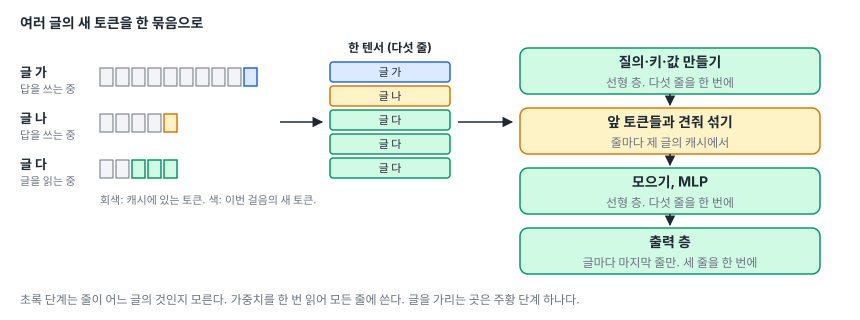
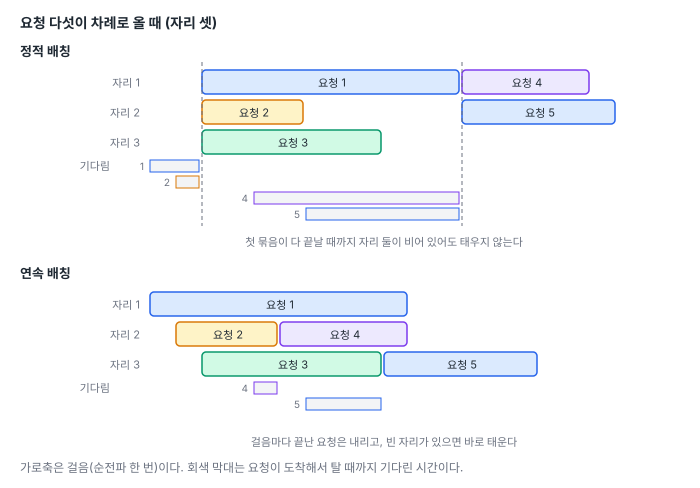
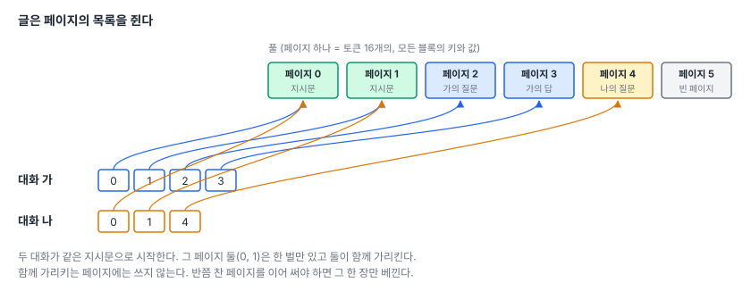
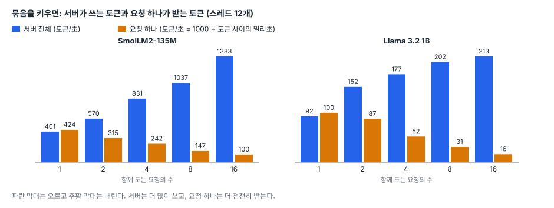

# 처리량 높이기

[39장](ch39_inference_server.md)의 서버는 한 번에 한 요청만
처리했습니다. 두 요청이 같은 때에 오면 나중 것은 먼저 것이 끝날 때까지
첫 글자도 받지 못했습니다. 사용자가 열이면 열째는 아홉 사람을
기다립니다.

이 장에서 그것을 고칩니다. 방법은 여러 요청의 토큰을 **순전파 한 번에
함께** 넣는 것입니다. [7장](../part1/ch07_mnist.md)에서 사진 여러 장을
묶어 본 그 일을 언어 모델에 합니다. 언어 모델에서는 효과가 훨씬 큽니다.
토큰 하나를 쓰는 일의 한계가 계산이 아니라 **가중치를 메모리에서 읽어
오는 속도**이기 때문입니다([15장](../part3/ch15_bottleneck.md)).
가중치는 한 번 읽고, 그 가중치로 여러 요청의 토큰을 함께 계산합니다.

결과를 미리 적어 둡니다.

- 요청 여덟을 묶으면 서버가 쓰는 토큰이 초당 92개에서 202개가
  됩니다(Llama 3.2 1B, 스레드 12개). SmolLM2-135M에서는 열여섯을 묶어
  381개가 1,178개가 됩니다. 대신 요청 하나가 보는 토큰 사이의 시간은
  10밀리초에서 32밀리초가(Llama), 2.4밀리초에서 10밀리초가(SmolLM2)
  됩니다. 이 장의 주제는 이 맞바꿈입니다.
- 묶는 이득은 **남는 계산 능력이 있을 때만** 있습니다. 스레드를 넷으로
  줄이면 Llama 3.2 1B는 열여섯을 묶어도 1.4배밖에 늘지 않습니다.
- 묶어 계산한 답은 하나씩 계산한 답과 **비트 단위로 같습니다.**
- 요청을 모았다가 함께 시작하는 방법(정적 배칭)보다, 순전파 한 번마다
  태우고 내리는 방법(연속 배칭)이 첫 글까지의 시간을 크게 줄입니다.
  요청이 초당 2개꼴로 올 때 762밀리초가 76밀리초가
  됩니다(Llama 3.2 1B).
- 긴 글을 읽는 요청이 끼어들면 옆에서 답을 쓰던 요청이 9초 동안
  멈춥니다. 글을 64토큰씩 끊어 읽으면 그 멈춤이 258밀리초가
  됩니다.
- KV 캐시를 토큰 16개짜리 페이지로 나눠, 같은 지시문으로 시작하는 대화
  여덟이 그 지시문의 캐시를 함께 쓰게 했습니다. 캐시의 페이지가 448장에서
  126장이 되고, [39장](ch39_inference_server.md)에서 서로의 캐시를 밀어내던 대화들이 저마다
  제 캐시를 그대로 씁니다.

| 하는 일 | 절 |
|---|---|
| 지연과 처리량을 무엇으로 잴지 정한다 | 40.1 |
| 여러 글을 순전파 한 번에 넣는다 | 40.2 |
| 요청을 모아 함께 시작한다 (정적 배칭) | 40.3 |
| 걸음마다 태우고 내린다 (연속 배칭) | 40.4 |
| 긴 글을 끊어 읽는다 | 40.5 |
| KV 캐시를 페이지로 나눈다 | 40.6 |
| 하나씩 처리한 답과 대조한다 | 40.7 |
| 묶음의 크기와 방법을 바꿔 가며 잰다 | 40.8 |
| 지연과 처리량 사이에서 고른다 | 40.9 |

## 40.1 지연과 처리량을 숫자 셋으로 잰다

지금까지는 요청 하나의 속도를 쟀습니다. 서버는 요청 여럿을 받으므로
숫자가 더 필요합니다.

| 이름 | 뜻 | 누가 느끼는가 |
|---|---|---|
| 첫 글까지의 시간 | 요청을 보낸 때부터 답의 첫 조각까지 | 사용자. 기다린 시간이 여기 든다 |
| 토큰 사이의 시간 | 답의 한 조각과 다음 조각 사이 | 사용자. 글이 흘러나오는 빠르기다 |
| 처리량 | 서버가 1초에 쓰는 토큰. **모든 요청의 것을 더한다** | 서버를 가진 쪽. 같은 기계로 몇 사람을 받는가 |

앞의 둘이 **지연**입니다. [39장](ch39_inference_server.md)까지의
"토큰/초"는 요청 하나의 것이었고, 토큰 사이의 시간의 역수였습니다.
요청이 하나일 때는 그것이 처리량과 같았습니다. 요청이 여럿이 되면 둘이
달라집니다. 이 장에서 보게 되는 것은 **처리량을 올리면 지연이
늘어난다**는 것이고, 어디까지 맞바꿀지를 정하는 것이 서버를 만드는 일의
절반입니다.

숫자 하나로 말하지 않습니다. 지연은 요청마다 다르므로 **가운데
값**(절반의 요청이 이보다 빨랐다)과 **95번째 백분위**(스무 요청 가운데
하나는 이보다 느렸다)를 함께 적습니다. 평균은 느린 몇 개 때문에 커져서,
대부분의 사용자가 겪는 것도 운 나쁜 사용자가 겪는 것도 알려 주지
못합니다.

## 40.2 여러 글을 순전파 한 번에 넣는다

[11장](../part2/ch11_kv_cache.md)의 순전파는 글 하나의 새 토큰들을 받았습니다. 새 토큰이 여럿이면
한 텐서의 줄들이 되어 블록을 함께 지나갔습니다. 프롬프트를 읽을 때가
그랬습니다.

여기서 눈여겨볼 것이 있습니다. **그 줄이 같은 글의 것이어야 할 까닭이
대부분의 층에는 없습니다.** 선형 층은 줄마다 따로 계산합니다. 정규화도,
MLP도 그렇습니다. 줄 셋이 한 글의 토큰 셋이든 세 글의 토큰 하나씩이든 이
층은 알지 못하고, 결과도 같습니다. 글을 가려야 하는 곳은 하나뿐입니다.
어텐션에서 토큰은 **자기 글의** 앞 토큰만 봐야 합니다.



그러니 이렇게 합니다. 여러 글의 새 토큰을 한 텐서에 이어 붙입니다.
질의·키·값을 만드는 층은 그 텐서 전체에 한 번 부릅니다. 어텐션의 가운데
단계(앞 토큰과 견줘 섞는 일)만 줄마다 자기 글의 캐시를 찾아가
계산합니다. 결과를 모으는 층과 MLP는 다시 전체에 한 번 부릅니다.

```rust,ignore
{{#include ../../../crates/badak_models/src/llama/paged.rs:attention_batch}}
```

[11장](../part2/ch11_kv_cache.md)의 `attention_cached`와 나란히 놓고 보면 달라진 것은 둘째와 셋째
단계뿐입니다. 위치를 돌리는 각도가 글마다 다르고(같은 묶음의 두 줄이
한 글에서는 100번째, 다른 글에서는 7번째 토큰입니다), 줄마다 볼 캐시가
다릅니다.

모델 쪽은 글마다의 **마지막 줄만** 골라 출력 층에 넣습니다.

```rust,ignore
{{#include ../../../crates/badak_models/src/llama/model.rs:forward_batch}}
```

글마다 넣는 토큰의 수가 달라도 됩니다. 프롬프트를 읽고 있는 글은
수십 개를, 답을 쓰고 있는 글은 방금 고른 하나를 냅니다. 한 묶음에
둘이 섞여 있어도 됩니다.

**채우는 토큰이 없습니다.**
[34장](../part4/ch34_embedding_search.md)에서 문장 여럿을 묶을 때는
길이를 맞추려고 짧은 문장을 빈 토큰으로 채우거나, 채우지 않으려고
문장마다의 범위를 따로 적어 두었습니다. 여기서는 처음부터 뒤의
방법입니다. 텐서는 (글, 토큰)의 직사각형이 아니라 줄의 목록이고, 줄마다
어느 글의 몇 번째 토큰인지를 따로 압니다.

### 가중치를 한 번 읽고 여러 줄을 계산한다

토큰 하나를 쓰는 순전파는 가중치 전체를 한 번 읽습니다. Llama 3.2 1B라면
2.5GB입니다. [15장](../part3/ch15_bottleneck.md)에서 계산한 대로, 그
순전파의 시간은 곱셈을 하는 시간이 아니라 그 2.5GB를 메모리에서 꺼내
오는 시간입니다. 코어는 대부분의 시간을 메모리를 기다리며 보냅니다.

줄을 하나 더 넣으면 무엇이 더 드는지 생각해 봅니다. 가중치는 이미 읽어
왔습니다. 둘째 줄은 그 가중치에 곱하기만 하면 됩니다. 메모리를 더 읽지
않고 계산만 더 합니다. 그리고 계산 능력은 남아 있었습니다.

프롬프트를 읽는 일이 토큰을 쓰는 일보다 토큰당 훨씬 빠른 것과 같은
까닭입니다(Llama 3.2 1B에서 초당 340토큰 대 99토큰.
[39장](ch39_inference_server.md)). 그때는 **한 글의** 토큰 여럿이
가중치를 함께 썼습니다. 지금은 **여러 글의** 토큰 하나씩이 함께 씁니다.
엔진에서는 같은 일입니다.

### 묶어도 답은 비트까지 같다

묶음에 어떤 요청이 함께 들어 있는지에 따라 답이 달라진다면 곤란합니다.
같은 질문에 다른 답이 나오고, 왜 그런지 되짚을 수 없게 됩니다.
테스트합니다. 길이가 다른 글 셋을 함께 읽히고 여섯 토큰을 쓰게 하면서,
걸음마다의 점수 전체를 글을 하나씩 계산한 것과
견줍니다(`tests/llama_batch.rs`).

**비트 단위로 같습니다.** 줄마다 따로 계산하는 층은 줄이 몇 개든 한 줄의
계산이 같아야 하고, [16장](../part3/ch16_matmul.md)에서 커널을 만들 때
그렇게 지켰습니다. 그 약속 덕분입니다.
[11장](../part2/ch11_kv_cache.md)에서 인용한 대로 llama.cpp의 문서는
이것을 보장하지 않는다고 적습니다.

## 40.3 정적 배칭은 모았다가 함께 시작한다

묶어 계산하는 함수가 생겼습니다. 이제 **무엇을 언제 묶을지**가
남았습니다. 요청은 불규칙하게 옵니다.

가장 단순한 방법은 **모았다가 함께 시작하는 것**입니다. 요청이 넷 모이면
넷을 함께 돌립니다. 넷이 안 모일 수도 있으므로 기다리는 한도를 둡니다.
첫 요청이 0.1초를 기다렸으면 모인 만큼만으로 시작합니다.
[7장](../part1/ch07_mnist.md)의 사진 분류라면 이것으로 충분합니다. 사진
넷을 넣으면 답 넷이 함께 나옵니다.

```rust,ignore
{{#include ../../../crates/badak_server/src/scheduler.rs:policy}}
```

언어 모델에서는 문제가 둘 생깁니다.

**요청마다 끝나는 때가 다릅니다.** 사진은 한 번 지나가면 끝이지만 글은
토큰 수만큼 지나가야 하고, 그 수가 요청마다 다릅니다. 여덟 토큰짜리 답과
이백 토큰짜리 답이 한 묶음에 있으면, 짧은 것이 끝난 뒤에 그 자리가
빕니다. 묶음은 점점 작아지고, 마지막에는 요청 하나가 혼자 돕니다.

**그동안 새 요청은 기다립니다.** 묶음이 다 끝나야 다음 묶음을 만들기
때문입니다. 자리가 비어 있는데도 태우지 못합니다.



## 40.4 연속 배칭은 걸음마다 태우고 내린다

고치는 방법은 묶음을 **순전파 한 번마다 다시 짜는 것**입니다.[^orca]
순전파 한 번을 "걸음"이라고 부르겠습니다. 걸음과 걸음 사이에서, 끝난
요청은 내리고 기다리던 요청은 탑니다. 버스가 정류장마다 서는 것과
같습니다. 정적 배칭은 종점까지 문을 열지 않는 버스였습니다.

[39장](ch39_inference_server.md)의 엔진은 요청을 받은 스레드가 저마다
모델을 불렀고 잠금이 차례를 정했습니다. 이제는 그렇게 할 수 없습니다.
여러 요청이 순전파 한 번을 함께 지나가야 하므로, **모델을 부르는 것은 한
스레드**여야 합니다. 그 스레드가 스케줄러입니다. 요청을 받은 스레드는
요청을 스케줄러에 넘기고, 글 조각이 돌아오기를 기다립니다.

```rust,ignore
{{#include ../../../crates/badak_server/src/scheduler.rs:run}}
```

태우는 코드입니다. 두 방법의 차이가 여기 다 들어 있습니다.

```rust,ignore
{{#include ../../../crates/badak_server/src/scheduler.rs:admit}}
```

한 걸음입니다.

```rust,ignore
{{#include ../../../crates/badak_server/src/scheduler.rs:step}}
```

돌고 있는 요청마다 "아직 넣지 않은 토큰들"(`pending`)을 쥡니다. 글을
읽는 동안은 그것이 프롬프트의 나머지이고, 답을 쓰는 동안은 방금 고른
토큰 하나입니다. 걸음은 요청마다 거기서 토큰을 꺼내 묶음을 만들고,
순전파를 한 번 돌고, 프롬프트를 다 읽은 요청마다 다음 토큰을 고릅니다.
샘플러([12장](../part2/ch12_sampling.md))와 글자를 모으는 `StreamDecoder`([8장](../part2/ch08_tokenizer.md))는 요청마다 따로
있습니다. 온도도 시드도 요청마다 다를 수 있습니다.

**한 요청의 일이 다른 요청에 영향을 주지 않게 합니다.** 받는 쪽이 연결을
끊은 요청은 그 걸음에 내립니다. [39장](ch39_inference_server.md)에서는
받는 쪽이 없는 답을 쓰는 것이 "다른 요청을 기다리게 하는" 문제였는데,
여기서는 "다른 요청의 걸음을 느리게 하는" 문제입니다.

## 40.5 긴 글을 끊어 읽는다

연속 배칭에는 문제가 하나 있습니다. 답을 쓰는 요청은 걸음마다 토큰
하나를 넣습니다. 그런데 **방금 탄 요청은 프롬프트 전체를 넣습니다.**
3,000토큰짜리 문서를 든 요청이 타면 그 걸음은 3,000줄짜리 순전파가 되고,
몇 초가 걸립니다. 같은 걸음에 탄 다른 요청은 그동안 토큰 하나를 받지
못합니다. 흘러나오던 글이 갑자기 멈춥니다.

고치는 방법은 프롬프트를 **한 걸음에 다 넣지 않는 것**입니다.[^sarathi]
걸음마다 정해진 수(여기서는 `chunk`)까지만 넣습니다. 3,000토큰을
64토큰씩 넣으면 47걸음이 걸리고, 그 걸음마다 다른 요청도 토큰을 하나씩
받습니다. 코드로는 40.4절의 `step`에서 `pending.len().min(chunk)` 한
줄입니다. KV 캐시가 있으므로 끊어 읽은 결과는 한 번에 읽은 것과
같습니다([11장](../part2/ch11_kv_cache.md). 40.2절의 테스트가 끊어 읽은
것도 비트 단위로 견줍니다).

대가가 없는 것은 아닙니다. 끊어 읽으면 긴 글을 든 요청 자신은 더 늦게
시작합니다. 한 번에 읽을 때 가장 빠르게 읽히기 때문입니다. 얼마나
끊을지는 **이미 답을 쓰고 있는 요청과 방금 온 요청 가운데** 어느 쪽을 덜
기다리게 할지를 정하는 일입니다. 40.8절에서 잽니다.

## 40.6 KV 캐시를 페이지로 나눈다

묶어 처리하면 캐시가 여럿이 됩니다. [11장](../part2/ch11_kv_cache.md)의
캐시는 글 하나의 키와 값을 하나의 이어진 메모리에 담았습니다. 글이
하나일 때는 그것이 가장 빠릅니다. 여럿이 되면 문제가 셋 생깁니다.

**얼마나 잡아 둘지 모릅니다.** 글이 얼마나 길어질지 모르므로, 공간을
넉넉히 잡거나(한도가 4,096토큰이면 요청마다 270MB) 모자랄 때마다 더 큰
공간으로 옮겨야 합니다([22장](../part3/ch22_memory.md)에서 본 그
복사입니다). 앞의 것은 메모리를 낭비하고 뒤의 것은 시간을 낭비합니다.

**같은 것을 여러 벌 가지고 있습니다.** 같은 지시문으로 시작하는 대화
여덟이 그 지시문의 키와 값을 여덟 벌 만듭니다. 내용이 글자까지 같은
740토큰이 대화마다 49MB씩입니다.

**[39장](ch39_inference_server.md)의 접두사 캐시가 하나뿐이었습니다.**
대화 둘이 번갈아 오면 서로의 캐시를 밀어냈습니다.

셋을 한꺼번에 푸는 방법이 있습니다. 운영체제가 메모리를 다루는
방법입니다.[^vllm] 캐시를 **크기가 같은 페이지**로 나눕니다. 글은 키와
값을 직접 가지지 않고 **페이지의 목록**을 가집니다.



```rust,ignore
{{#include ../../../crates/badak_models/src/llama/paged.rs:pool}}
```

페이지 하나에 토큰 열여섯 개의, 모든 블록의 키와 값이 들어갑니다. Llama
3.2 1B에서 1MB쯤입니다. 풀은 페이지를 내주고 돌려받습니다. 한도가
있어서, 서버가 쓰는 캐시의 메모리가 **요청이 몇 개든 그 한도를 넘지
않습니다.**

```rust,ignore
{{#include ../../../crates/badak_models/src/llama/paged.rs:cache}}
```

- **공간은 쓰는 만큼만 잡습니다.** 토큰이 열여섯 개 늘 때마다 페이지
  하나를 받습니다. 미리 잡아 두지도, 옮기지도 않습니다. 낭비하는 공간은
  글마다 많아야 마지막 페이지의 토큰 열다섯 개 분량입니다.
- **앞부분을 빌려 줍니다.** `fork`는 아무것도 복사하지 않습니다. 새 글의
  목록이 같은 페이지를 가리키게 할 뿐입니다. 740토큰을 빌려 주는 데 드는
  것은 참조 횟수를 46번 올리는 일입니다.
- **쓸 때에만 복사합니다.** 함께 가리키는 페이지에는 쓰지 않습니다. 빌린
  앞부분이 페이지의 가운데에서 끝나면, 그 반쯤 찬 페이지 하나만 복사한
  뒤에 이어 씁니다. 꽉 찬 페이지는 끝까지 함께 씁니다.

마지막 것이 운영체제의 **쓸 때 복사**<sup>copy-on-write</sup>입니다.
Rust에서는 이것을 짧게 적을 수 있습니다. 페이지를 `Arc`로 가지고 있으면,
`Arc::get_mut`이 "나 혼자 가리키는가"를 알려 줍니다.

대가는 어텐션에서 치릅니다. 키가 하나의 이어진 메모리에 있지 않으므로,
내적을 구하는 커널을 한 번이 아니라 페이지마다 한 번씩 부릅니다.

```rust,ignore
{{#include ../../../crates/badak_models/src/llama/paged.rs:kernels}}
```

[24장](../part3/ch24_attention.md)에서 키를 헤드마다 나란히 놓아 얻은
것(커널 한 번에 모든 키)을 조금 잃습니다. 얼마나 잃는지는 40.8절에서
잽니다.

스케줄러는 끝난 요청의 캐시를 버리지 않고 몇 개 남겨 둡니다. 새 요청이
오면 그 가운데 앞부분이 가장 길게 겹치는 것에서 빌립니다.

```rust,ignore
{{#include ../../../crates/badak_server/src/scheduler.rs:start}}
```

[39장](ch39_inference_server.md)의 접두사 캐시와 같은 일인데 두 가지가 다릅니다. 빌려 준 쪽이
**그대로 남습니다**([39장](ch39_inference_server.md)에서는 캐시를 잘라 냈습니다). 그리고 여럿이
**동시에** 빌릴 수 있습니다. 페이지가 모자라면 남겨 둔 캐시를 오래된
것부터 버립니다. 돌고 있는 요청이 함께 가리키는 페이지는 그때에도
남습니다. 가리키는 쪽이 하나라도 있으면 풀로 돌아가지 않기 때문입니다.

## 40.7 하나씩 처리한 답과 대조한다

질문 여섯을 [39장](ch39_inference_server.md)의 엔진으로 하나씩 처리한 답을 정답으로 삼고, 같은
질문 여섯을 **같은 순간에** 보내 묶어 처리한 답과 견줍니다.

```bash
cargo run --release -p badak_server --example ch40_verify
```

```text
{{#include output/ch40_verify.txt}}
```

묶는 방법을 넷으로 바꿔도 답 여섯이 글자까지 같습니다. 연속 배칭이든
정적 배칭이든, 한 걸음에 한 토큰씩 읽든 끊지 않고 읽든 같습니다.
"순전파 몇 번에 토큰 몇 개"가 묶음이 실제로 만들어졌다는 확인입니다.

뒤의 셋은 페이지입니다. 같은 지시문으로 시작하는 요청 다섯이 그
지시문을 캐시에서 얻었고, 남겨 둔 캐시 여섯이 여섯 배보다 훨씬 적은
페이지를 씁니다. 번갈아 오는 두 대화는 둘째 차례에 **저마다 제 앞
차례 전체**를 캐시에서 얻습니다. [39장](ch39_inference_server.md)에서는 함께 쓰는 지시문만
남았습니다. 그리고 페이지의 한도를 열네 장으로 조여도 답이 같습니다. 남겨
둔 캐시를 버려 가며 돕니다.

## 40.8 묶음의 크기와 방법을 바꿔 가며 잰다

```bash
sh scripts/build_llama_cpp.sh --plain llama-server
sh scripts/bench_ch40.sh 3
```

세 차례 잰 값의 가운데 값입니다. 요청마다 다른 질문을 보내고 64토큰을
쓰게 했습니다. 앞 요청의 캐시는 쓰지 않게 했습니다(묶는 효과만 보려는
것입니다).

SmolLM2-135M의 숫자는 47.3절의 수정 뒤에 다시 잰 것입니다. 이 측정의
요청은 질문 하나만 보내고, 서버는 이 모델의 기본 지시문(21토큰)을 그
앞에 놓습니다. 처음 쟀을 때는 그 줄이 없어서 읽을 글이 짧았고 처리량이
더 높게 나왔습니다(열여섯을 묶었을 때 1,383). Llama 3.2 1B의 숫자는
그대로입니다.

### 묶음을 키우면 처리량이 늘고 지연도 는다

클라이언트 여럿이 쉬지 않고 요청을 보냅니다. 클라이언트의 수와 함께 도는
요청의 한도를 같이 키웁니다. 서버는 늘 꽉 차 있습니다.



| Llama 3.2 1B | 함께 도는 요청 | 처리량 (토큰/초) | 혼자일 때의 몇 배 | 토큰 사이 (ms) | 요청 하나의 토큰/초 | 첫 글 (ms) |
|---|---:|---:|---:|---:|---:|---:|
| 스레드 12개 | 1 | 92 | 1.00 | 10.1 | 100 | 57 |
| 스레드 12개 | 2 | 152 | 1.64 | 11.4 | 87 | 116 |
| 스레드 12개 | 4 | 177 | 1.91 | 19.3 | 52 | 231 |
| 스레드 12개 | 8 | 202 | 2.18 | 32.5 | 31 | 460 |
| 스레드 12개 | 16 | 213 | 2.30 | 61.9 | 16 | 927 |
| 스레드 4개 | 1 | 71 | 1.00 | 11.9 | 84 | 137 |
| 스레드 4개 | 2 | 75 | 1.05 | 23.1 | 43 | 259 |
| 스레드 4개 | 4 | 80 | 1.12 | 42.6 | 23 | 519 |
| 스레드 4개 | 8 | 92 | 1.30 | 71.1 | 14 | 1,035 |
| 스레드 4개 | 16 | 98 | 1.38 | 132.4 | 8 | 2,083 |

| SmolLM2-135M | 함께 도는 요청 | 처리량 (토큰/초) | 혼자일 때의 몇 배 | 토큰 사이 (ms) | 요청 하나의 토큰/초 | 첫 글 (ms) |
|---|---:|---:|---:|---:|---:|---:|
| 스레드 12개 | 1 | 381 | 1.00 | 2.4 | 413 | 15 |
| 스레드 12개 | 2 | 515 | 1.35 | 3.3 | 301 | 30 |
| 스레드 12개 | 4 | 740 | 1.94 | 4.4 | 225 | 54 |
| 스레드 12개 | 8 | 942 | 2.47 | 6.8 | 148 | 103 |
| 스레드 12개 | 16 | 1,178 | 3.09 | 10.4 | 96 | 201 |
| 스레드 4개 | 1 | 297 | 1.00 | 2.9 | 348 | 34 |
| 스레드 4개 | 2 | 395 | 1.33 | 4.1 | 244 | 66 |
| 스레드 4개 | 4 | 484 | 1.63 | 6.3 | 159 | 133 |
| 스레드 4개 | 8 | 571 | 1.92 | 10.1 | 99 | 258 |
| 스레드 4개 | 16 | 620 | 2.08 | 18.2 | 55 | 504 |

**묶을수록 서버는 더 쓰고, 요청 하나는 더 천천히 받습니다.** Llama 3.2
1B에서 둘을 묶으면 처리량이 1.64배가 되는데 토큰 사이의 시간은
10.1밀리초에서 11.4밀리초로 13% 늘 뿐입니다. 둘째 요청에는 비용이 거의
들지 않습니다. 40.2절에서 본 대로 가중치는 이미 읽어 왔고, 계산 능력은
남아 있었습니다.

**거기까지입니다.** 넷부터는 걸음 하나의 시간이 요청의 수를 따라
늘어납니다(19, 32, 62밀리초). 남던 계산 능력을 다 썼기 때문입니다.
여덟을 묶어 2.2배, 열여섯을 묶어 2.3배입니다. 한계가 어디인지는
[39장](ch39_inference_server.md)에서 이미 쟀습니다. 이 모델이 글을
**읽는** 속도가 초당 340토큰쯤이었습니다. 읽기는 한 글의 토큰을 묶은
것이므로 그것이 "가중치를 한 번 읽을 때 계산이 감당하는 만큼"입니다.
여러 글의 토큰을 묶은 것은 거기에 못 미칩니다. 답을 쓸 때는 줄마다 출력
층을 지나가야 하기 때문입니다(읽을 때는 마지막 줄만 지나갑니다). 이
모델에서 출력 층은 가중치의 5분의 1입니다.

**작은 모델이 더 많이 얻습니다.** SmolLM2-135M은 열여섯을 묶어
3.1배입니다. 토큰 하나를 쓰는 데 드는 계산이 적어서, 같은 코어로 더 많은
줄을 감당합니다.

**남는 계산 능력이 없으면 얻는 것도 없습니다.** 스레드를 넷으로 줄인
Llama 3.2 1B는 둘을 묶어 1.05배, 열여섯을 묶어 1.38배입니다. 코어
넷으로는 토큰 하나를 쓰는 일의 한계가 이미 계산입니다. 줄을 하나 더
넣으면 걸음이 그만큼 길어질 뿐입니다(12, 23, 43밀리초). "묶으면
빨라진다"는 말은 **메모리를 기다리며 쉬는 코어가 있을 때**에만 맞습니다.
스레드를 넷에서 열둘로 늘려도 혼자 쓰는 속도는 71에서 92로밖에 늘지
않습니다. 그 남는 코어가 둘째 요청의 일을 합니다.

**첫 글까지의 시간도 늘어납니다.** 묶음이 클수록 방금 탄 요청이
프롬프트를 읽는 걸음도 길어집니다. 다른 요청의 줄이 함께 들어 있기
때문입니다.

### 꽉 찬 서버에서는 두 방법이 같다

클라이언트를 여덟으로 두고 서버의 방법만 바꿉니다.

| Llama 3.2 1B, 클라이언트 8 | 처리량 (토큰/초) | 첫 글: 가운데 (ms) | 95% | 토큰 사이: 가운데 (ms) | 요청 전체: 가운데 (ms) |
|---|---:|---:|---:|---:|---:|
| 한 번에 하나 ([39장](ch39_inference_server.md)) | 87 | 5,062 | 5,278 | 10.4 | 5,703 |
| 정적, 넷씩 | 177 | 1,680 | 1,689 | 19.3 | 2,903 |
| 정적, 여덟씩 | 209 | 444 | 445 | 31.9 | 2,456 |
| 연속, 둘까지 | 152 | 2,579 | 2,606 | 11.5 | 3,351 |
| 연속, 넷까지 | 178 | 1,612 | 1,629 | 19.3 | 2,880 |
| 연속, 여덟까지 | 202 | 460 | 462 | 32.5 | 2,513 |

| SmolLM2-135M, 클라이언트 8 | 처리량 (토큰/초) | 첫 글: 가운데 (ms) | 95% | 토큰 사이: 가운데 (ms) | 요청 전체: 가운데 (ms) |
|---|---:|---:|---:|---:|---:|
| 한 번에 하나 ([39장](ch39_inference_server.md)) | 377 | 1,207 | 1,217 | 2.5 | 1,361 |
| 정적, 넷씩 | 723 | 406 | 409 | 4.7 | 706 |
| 정적, 여덟씩 | 943 | 101 | 103 | 6.8 | 543 |
| 연속, 둘까지 | 520 | 751 | 765 | 3.3 | 982 |
| 연속, 넷까지 | 761 | 373 | 395 | 4.4 | 671 |
| 연속, 여덟까지 | 942 | 103 | 104 | 6.8 | 539 |

**한 번에 하나씩 처리하면 처리량도 지연도 가장 나쁩니다.** 요청 하나가
받는 토큰은 가장 빠르지만(10밀리초에 하나), 그 요청이 타기까지 5초를
기다립니다. 요청 전체로는 5.7초가 걸립니다. 여덟을 함께 태우면 토큰은 세
배 느리게 오는데 요청 전체는 2.5초에 끝납니다. **기다리는 시간이
계산하는 시간보다 컸습니다.**

**자리의 수가 같으면 정적 배칭과 연속 배칭이 같습니다.** 이 측정의
클라이언트는 응답을 받자마자 다음 요청을 보내고, 모든 요청이 같은
길이(64토큰)의 답을 씁니다. 여덟이 함께 타서 함께 내리므로 언제
태우는지가 달라질 일이 없습니다. 두 방법은 요청이 불규칙하게 올 때
달라집니다.

### 요청이 불규칙하게 오면 연속 배칭이 빠르다

앞의 두 측정은 클라이언트가 응답을 받자마자 다음 요청을 보냈습니다. 실제
요청은 서버의 상태와 상관없이 옵니다. 요청 서른 개가 초당 정해진
개수꼴로, 서로 상관없이 도착하게 했습니다(도착 사이의 시간이 지수 분포를
따릅니다. 시각은 시드로 정해 두어 잴 때마다 같습니다).

| Llama 3.2 1B | 초당 요청 | 첫 글: 가운데 (ms) | 95% | 토큰 사이: 가운데 (ms) | 요청 전체: 가운데 (ms) | 95% |
|---|---:|---:|---:|---:|---:|---:|
| 한 번에 하나 | 1 | 1,332 | 3,299 | 10.2 | 1,966 | 3,933 |
| 정적, 넷씩, 0.1초까지 기다림 | 1 | 225 | 915 | 10.7 | 1,057 | 1,787 |
| 정적, 넷씩, 1초까지 기다림 | 1 | 737 | 1,176 | 16.8 | 1,718 | 2,317 |
| 연속, 여덟까지 | 1 | 74 | 81 | 11.4 | 890 | 1,438 |
| 한 번에 하나 | 2 | 6,071 | 9,238 | 10.3 | 6,730 | 9,890 |
| 정적, 넷씩, 0.1초까지 기다림 | 2 | 762 | 1,686 | 17.4 | 1,756 | 2,632 |
| 정적, 넷씩, 1초까지 기다림 | 2 | 1,084 | 2,295 | 19.2 | 2,163 | 3,557 |
| 연속, 여덟까지 | 2 | 76 | 624 | 18.5 | 1,392 | 2,410 |

| SmolLM2-135M | 초당 요청 | 첫 글: 가운데 (ms) | 95% | 토큰 사이: 가운데 (ms) | 요청 전체: 가운데 (ms) | 95% |
|---|---:|---:|---:|---:|---:|---:|
| 한 번에 하나 | 4 | 213 | 789 | 2.4 | 365 | 941 |
| 정적, 넷씩, 0.1초까지 기다림 | 4 | 136 | 244 | 3.4 | 353 | 496 |
| 정적, 넷씩, 1초까지 기다림 | 4 | 240 | 1,067 | 4.4 | 513 | 1,323 |
| 연속, 여덟까지 | 4 | 19 | 40 | 3.6 | 278 | 403 |
| 한 번에 하나 | 8 | 1,384 | 2,048 | 2.5 | 1,540 | 2,203 |
| 정적, 넷씩, 0.1초까지 기다림 | 8 | 173 | 401 | 4.4 | 413 | 680 |
| 정적, 넷씩, 1초까지 기다림 | 8 | 219 | 905 | 4.6 | 520 | 1,129 |
| 연속, 여덟까지 | 8 | 20 | 126 | 5.1 | 358 | 519 |

한 번에 하나씩 처리하는 Llama 3.2 1B는 초당 1.4개쯤을 감당합니다(요청
하나에 0.7초). 초당 1개는 그보다 느리게, 2개는 그보다 빠르게 오는
것입니다.

**감당하는 것보다 느리게 와도 대기열이 생깁니다.** 초당 1개일 때 한 번에
하나씩 처리하는 서버의 첫 글까지의 시간이 가운데 값으로 1.3초, 95번째
백분위로 3.3초입니다. 평균으로는 감당하는데도 그렇습니다. 요청이 고르게
오지 않고 몰려서 오기 때문입니다. 몰린 요청이 대기열을 이루고, 그
대기열이 비기 전에 다음 요청이 몰려옵니다.

**감당하는 것보다 빨리 오면 대기열이 끝없이 길어집니다.** 초당 2개일 때
가운데 값이 6초, 95번째 백분위가 9초입니다. 요청을 서른 개만 보냈기에
이만큼이고, 더 보냈다면 더 늘었을 것입니다.

**연속 배칭은 기다림을 없앱니다.** 자리가 있으면 다음 걸음에 탑니다. 첫
글까지의 시간이 가운데 값으로 74~76밀리초입니다. 혼자 보냈을 때의
57밀리초와 거의 같습니다. 초당 2개일 때 95번째 백분위가 624밀리초인 것은
자리 여덟이 다 찬 순간이 있었기 때문입니다.

**정적 배칭은 기다리는 한도가 지연이 됩니다.** 넷이 모이기를 1초까지
기다리게 하면, 요청이 드물 때(초당 1개) 첫 글까지의 시간이 0.7초입니다.
모이지 않을 요청을 기다린 시간입니다. 한도를 0.1초로 줄이면 그 시간은
줄지만 묶음이 작아집니다. 그리고 어느 쪽이든 **앞 묶음이 끝날 때까지**
기다립니다. 요청이 몰릴 때(초당 2개) 0.1초 한도의 정적 배칭이 762밀리초,
연속 배칭이 76밀리초입니다.

**토큰 사이의 시간은 연속 배칭이 더 깁니다.** 초당 2개일 때 18.5밀리초
대 17.4밀리초입니다. 더 많은 요청을 함께 태우고 있기 때문입니다. 기다린
시간을 계산하는 시간으로 바꾼 것입니다.

### 긴 글이 끼어들면 쓰던 요청이 멈춘다

한 요청이 답 192토큰을 쓰고 있습니다. 0.3초 뒤에 긴 글(지시문 96줄)을
든 요청이 옵니다.

| Llama 3.2 1B | 쓰던 요청의 토큰 사이: 가운데 (ms) | 95% | 가장 긴 멈춤 (ms) | 쓰던 요청 전체 (ms) | 긴 요청의 첫 글 (ms) |
|---|---:|---:|---:|---:|---:|
| 한 번에 하나 ([39장](ch39_inference_server.md)) | 10.1 | 10.4 | 11 | 1,973 | 10,605 |
| 연속, 끊지 않고 | 10.1 | 10.7 | 9,055 | 11,060 | 9,064 |
| 연속, 256토큰씩 | 10.1 | 657.0 | 934 | 10,750 | 8,836 |
| 연속, 64토큰씩 | 10.3 | 229.8 | 258 | 10,858 | 9,313 |
| 연속, 16토큰씩 | 55.5 | 67.3 | 69 | 9,850 | 10,491 |

| SmolLM2-135M | 쓰던 요청의 토큰 사이: 가운데 (ms) | 95% | 가장 긴 멈춤 (ms) | 쓰던 요청 전체 (ms) | 긴 요청의 첫 글 (ms) |
|---|---:|---:|---:|---:|---:|
| 한 번에 하나 ([39장](ch39_inference_server.md)) | 2.5 | 2.7 | 3 | 502 | 2,159 |
| 연속, 끊지 않고 | 2.6 | 3.1 | 2,196 | 2,750 | 2,198 |
| 연속, 256토큰씩 | 2.6 | 131.8 | 249 | 2,706 | 2,193 |
| 연속, 64토큰씩 | 2.6 | 61.1 | 71 | 2,741 | 2,335 |
| 연속, 16토큰씩 | 2.6 | 11.9 | 14 | 1,078 | 2,872 |

**끊지 않으면 쓰던 요청이 9초 동안 멈춥니다.** 2,883토큰을 한 걸음에
읽는 동안입니다. 가운데 값(10.1밀리초)에는 드러나지 않습니다. 192번
가운데 한 번이기 때문입니다. 지연을 가운데 값만으로 보면 안 되는
까닭입니다.

**끊어 읽으면 멈춤이 걸음 하나로 줄어듭니다.** 256토큰씩이면 0.93초,
64토큰씩이면 0.26초, 16토큰씩이면 0.07초입니다.

**그 대신 쓰던 요청의 모든 토큰이 느려집니다.** 16토큰씩 읽으면 긴 글을
읽는 180걸음 내내 걸음마다 17줄이 들어가고, 쓰던 요청의 토큰 사이의
시간이 가운데 값으로 55밀리초가 됩니다. 한 번의 긴 멈춤을 여러 번의 작은
느려짐으로 바꾼 것입니다. 걸린 시간의 합은 줄지 않습니다. 쓰던 요청
전체가 어느 쪽이든 10~11초입니다.

**긴 글을 든 요청은 조금 늦어집니다.** 끊지 않으면 9.1초, 16토큰씩이면
10.5초입니다. 한 번에 읽을 때 토큰당 가장 빠르기 때문입니다.

**[39장](ch39_inference_server.md)의 서버에서는 쓰던 요청이 멈추지
않습니다.** 긴 글을 든 요청이 잠금이 풀릴 때까지 기다리기 때문입니다. 그
요청의 첫 글이 10.6초로 가장 늦습니다. 어느 요청을 기다리게 할지가 다를
뿐, 기다림이 사라지는 방법은 없습니다.

SmolLM2-135M에서는 16토큰씩 읽을 때 쓰던 요청 전체가 오히려 빨리
끝납니다(1.1초 대 2.7초). 걸음마다 넣는 줄이 적어 걸음이 짧고, 쓰던
요청이 긴 글의 읽기가 끝나기를 기다리지 않고 자기 192토큰을 먼저 다 쓰기
때문입니다.

### 대화 여덟이 지시문의 캐시를 함께 쓴다

39.7절의 측정을 키웠습니다. 긴 지시문 하나를 대화 여덟이 함께 쓰고, 세
차례씩 번갈아 묻습니다.

| Llama 3.2 1B | 차례 | 읽은 토큰 | 캐시에서 온 것 | 첫 글 (ms) | 쓰는 페이지 |
|---|---:|---:|---:|---:|---:|
| 한 번에 하나 ([39장](ch39_inference_server.md)) | 1 | 752 | 650 | 30.5 | - |
| 한 번에 하나 ([39장](ch39_inference_server.md)) | 2 | 804 | 743 | 172.0 | - |
| 한 번에 하나 ([39장](ch39_inference_server.md)) | 3 | 856 | 743 | 322.5 | - |
| 연속, 페이지 캐시 | 1 | 752 | 651 | 28.7 | 70 |
| 연속, 페이지 캐시 | 2 | 804 | 783 | 62.9 | 102 |
| 연속, 페이지 캐시 | 3 | 856 | 835 | 65.2 | 126 |

| SmolLM2-135M | 차례 | 읽은 토큰 | 캐시에서 온 것 | 첫 글 (ms) | 쓰는 페이지 |
|---|---:|---:|---:|---:|---:|
| 한 번에 하나 ([39장](ch39_inference_server.md)) | 1 | 839 | 725 | 8.6 | - |
| 한 번에 하나 ([39장](ch39_inference_server.md)) | 2 | 892 | 829 | 31.9 | - |
| 한 번에 하나 ([39장](ch39_inference_server.md)) | 3 | 945 | 829 | 56.3 | - |
| 연속, 페이지 캐시 | 1 | 839 | 726 | 9.3 | 83 |
| 연속, 페이지 캐시 | 2 | 892 | 870 | 14.8 | 107 |
| 연속, 페이지 캐시 | 3 | 945 | 923 | 14.6 | 134 |

**대화마다 자기 캐시가 남습니다.** [39장](ch39_inference_server.md)의
서버는 캐시가 하나여서 둘째 차례부터는 함께 쓰는 지시문(743토큰)만
캐시에서 얻고, 자기 대화의 나머지를 차례마다 다시 읽었습니다. 그래서 첫
글까지의 시간이 차례마다 늘었습니다(31, 172, 323밀리초). 페이지
캐시에서는 대화 여덟이 저마다 자기 앞 차례 전체를 얻고, 새로 온 질문만
읽습니다(63, 65밀리초).

**메모리는 여덟 배가 아닙니다.** 셋째 차례가 끝났을 때 대화 하나는
890토큰쯤이고 페이지로 56장입니다. 여덟이 따로 가지고 있었다면
448장(470MB)입니다. 실제로 쓴 것은 **126장**(132MB)입니다. 지시문의
마흔여섯 장이 한 벌만 있기 때문입니다.

### 페이지로 나누면 긴 글에서 느려진다

키가 하나의 이어진 메모리에 있지 않아서 드는 비용을 봅니다. 요청 하나를
[39장](ch39_inference_server.md)의 엔진(이어진 캐시)과 이 장의
스케줄러(페이지 캐시, 한 번에 하나)로 처리했습니다.

| 스레드 12개 | 읽은 토큰 | 글 읽기 (ms) | 토큰 사이 (ms) |
|---|---:|---:|---:|
| SmolLM2-135M, 이어진 캐시, 긴 글 | 3,260 | 2,088 | 4.46 |
| SmolLM2-135M, 페이지 캐시, 긴 글 | 3,260 | 2,335 | 6.70 |
| SmolLM2-135M, 이어진 캐시, 짧은 글 | 54쯤 | 15 | 2.42 |
| SmolLM2-135M, 페이지 캐시, 짧은 글 | 54쯤 | 15 | 2.42 |
| Llama 3.2 1B, 이어진 캐시, 긴 글 | 2,886 | 9,374 | 11.39 |
| Llama 3.2 1B, 페이지 캐시, 긴 글 | 2,886 | 9,870 | 12.78 |
| Llama 3.2 1B, 이어진 캐시, 짧은 글 | 33쯤 | 57 | 11.03 |
| Llama 3.2 1B, 페이지 캐시, 짧은 글 | 33쯤 | 57 | 10.05 |

**글이 짧으면 비용이 없습니다.** 볼 키가 수십 개일 때는 커널을 몇 번
부르든 차이가 나지 않습니다.

**글이 길면 비용이 드러납니다.** 3,000토큰쯤의 글 뒤에서 토큰을 쓸 때,
Llama 3.2 1B는 12% 느려지고 SmolLM2-135M은 50% 느려집니다. 작은
모델일수록 토큰 하나를 쓰는 시간에서 어텐션(앞의 키 3,000개를 보는 일)이
차지하는 비율이 크기 때문입니다.

페이지의 크기를 바꿔 SmolLM2-135M의 같은 측정을 두 번씩 더 했습니다
(이것은 스크립트에 넣지 않고 따로 잰 값입니다).

| 페이지 하나의 토큰 | 토큰 사이 (ms) | 이어진 캐시보다 |
|---:|---:|---:|
| 16 | 6.6 | 47% 느림 |
| 64 | 5.2 | 16% 느림 |
| 256 | 4.8 | 8% 느림 |
| 이어진 캐시 | 4.5 | |

페이지가 클수록 커널을 덜 부르고, 그만큼 빠릅니다. 대신 글마다 낭비하는
공간(마지막 페이지의 빈 부분)과 앞부분을 빌릴 때 복사하는 양이
늘어납니다. 이 장은 16으로 두었습니다. 이 책이 재 본 것은 여기까지이고,
어느 크기가 맞는지는 글의 길이와 요청의 수에 달려 있습니다.

### llama.cpp의 서버와 견준다

llama.cpp의 서버는 자리를 여럿 두면 스스로 묶어 처리합니다(연속 배칭이
기본으로 켜져 있습니다).[^llama-server] 자리 여덟(`-np 8`)으로 띄우고
같은 클라이언트로 불렀습니다. [39장](ch39_inference_server.md)과 같은
빌드(직접 짠 CPU 코드만)입니다.

| Llama 3.2 1B, 스레드 12개 | 클라이언트 | badak: 처리량 | 토큰 사이 (ms) | 첫 글 (ms) | llama.cpp: 처리량 | 토큰 사이 (ms) | 첫 글 (ms) |
|---|---:|---:|---:|---:|---:|---:|---:|
| | 1 | 92 | 10.1 | 57 | 45 | 19.3 | 224 |
| | 2 | 152 | 11.4 | 116 | 66 | 24.0 | 460 |
| | 4 | 177 | 19.3 | 231 | 77 | 37.9 | 996 |
| | 8 | 202 | 32.5 | 460 | 87 | 64.9 | 1,842 |

| SmolLM2-135M, 스레드 12개 | 클라이언트 | badak: 처리량 | 토큰 사이 (ms) | 첫 글 (ms) | llama.cpp: 처리량 | 토큰 사이 (ms) | 첫 글 (ms) |
|---|---:|---:|---:|---:|---:|---:|---:|
| | 1 | 381 | 2.4 | 15 | 317 | 2.7 | 15 |
| | 2 | 515 | 3.3 | 30 | 476 | 3.5 | 26 |
| | 4 | 740 | 4.4 | 54 | 661 | 4.9 | 51 |
| | 8 | 942 | 6.8 | 103 | 831 | 7.6 | 90 |

**두 서버의 처리량이 같은 비율로 늘어납니다.** 클라이언트가 하나에서
여덟이 될 때 llama.cpp의 처리량은 Llama 3.2 1B에서 1.9배,
SmolLM2-135M에서 2.6배가 됩니다. 우리는 2.2배와 2.5배입니다. 속도 자체의
차이는 [39장](ch39_inference_server.md)에서 본 대로 서버가 아니라 커널의
차이입니다(직접 짠 CPU 코드만 쓰는 빌드입니다). SmolLM2-135M에서는 두
서버가 읽는 글도 다릅니다. 우리 서버는 기본 지시문 21토큰을 더
읽고(47.3절), llama.cpp의 서버는 읽지 않습니다. 처리량에는 글을 읽는
시간이 들어 있으므로 그만큼 우리에게 불리한 비교입니다. 견주려는 것은
"묶으면 얼마나 느는가"이고, 이 표에서 그것이 같은 크기임을 알 수
있습니다.

## 40.9 지연과 처리량 사이에서 고른다

측정을 모아서 봅니다.

**묶음의 크기로 조절합니다.** 키우면 서버가 쓰는 토큰이 늘고 요청 하나가
보는 속도가 줄어듭니다. 어디에 둘지는 숫자가 아니라 **용도**가 정합니다.
사람이 글을 읽는 속도보다 빠르기만 하면 되는 대화라면 묶음을 크게 잡아도
됩니다. 답 전체가 빨리 필요한 프로그램(다른 프로그램이 답을 받아 다음
일을 하는 경우)이라면 작게 잡습니다. 밤새 문서 만 건을 요약하는 일이라면
지연은 아무도 보지 않으므로 처리량만 봅니다.

**한도를 정하지 않으면 지연이 끝없이 늘어납니다.** 함께 도는 요청의
한도가 없으면 요청이 몰릴 때 모두가 느려집니다. 한도가 있으면 넘치는
요청은 기다리고, 타 있는 요청은 정해진 속도로 갑니다. 기다리는 요청의 첫
글까지의 시간이 늘어날 뿐입니다. 어느 쪽이 나은지도 용도가 정합니다.
흘러나오던 글이 느려지는 것보다 시작이 조금 늦는 것이 대개 낫습니다.

**대기열에도 한도가 있어야 합니다.** 서버가 감당하는 것보다 요청이 빨리
오면 대기열이 끝없이 길어지고, 대기열의 끝에 있는 요청은 사용자가 떠난
뒤에야 차례가 옵니다. 그런 요청은 받지 않는 것이 낫습니다. 이 장의
서버는 연결의 수([39장](ch39_inference_server.md)의 64개)로만 막습니다.

**끊어 읽는 크기로도 조절합니다.** 작게 잡으면 타 있는 요청의 글이
고르게 흘러나오고, 방금 온 긴 요청이 늦어집니다.

**숫자를 볼 때는 무엇을 고정했는지를 봅니다.** "초당 몇 토큰"이라는
처리량은 묶음의 크기 없이는 의미가 없고, 지연은 요청이 얼마나 몰렸는지
없이는 의미가 없습니다. 서버의 성능은 점이 아니라 곡선입니다.

## 40.10 남긴 일을 적어 둔다

**공평함.** 먼저 온 요청을 먼저 태울 뿐입니다. 긴 답을 쓰는 요청이
자리를 오래 차지해도 내리게 하지 않습니다. 사용자마다 쓸 수 있는 양을
정하는 일, 급한 요청을 먼저 처리하는 일을 하지 않았습니다.

**대기열의 한도와 거절.** 40.9절에 적은 대로입니다.

**묶음의 크기를 스스로 고르기.** 한도를 사람이 정합니다. 토큰 사이의
시간을 재면서 그 시간이 목표를 넘지 않는 데까지 묶음을 키우는 서버를
만들 수 있습니다.

**16비트 페이지.** 페이지 캐시는 32비트로만 담습니다. [21장](../part3/ch21_quantization_quality.md)의 16비트
캐시를 페이지에 옮기지 않았습니다.

**페이지 캐시를 파일에.** [39장](ch39_inference_server.md)의 저장과 복원은 [39장](ch39_inference_server.md)의 엔진에만
있습니다.

**페이지가 모자랄 때.** 남겨 둔 캐시를 다 버리고도 모자라면 돌고 있던
요청이 모두 실패합니다. 하나만 내리거나 디스크로 내보내는 일을 하지
않았습니다.

**스레드를 나누는 방법.** 스케줄러의 스레드 하나가 순전파를 부르고,
그 안에서 3부의 스레드들이 일합니다. 요청의 수에 따라 스레드의 수를
바꾸지 않았습니다.

**읽지 않아도 되는 점수.** 글을 끊어 읽는 동안에도 걸음마다 그 요청의
마지막 줄을 출력 층에 넣습니다. 그 점수는 버립니다.

## 40.11 실전 엔진에서는

**연속 배칭은 이제 기본입니다.** 걸음마다 묶음을 다시 짜는 방법은 Orca가
"반복 단위의 일정 짜기"라는 이름으로 내놓았고,[^orca] 그 뒤로 언어
모델을 서빙하는 엔진이 대개 이렇게 합니다. llama.cpp의 서버도
그렇습니다.[^llama-server]

**페이지로 나눈 캐시는 vLLM이 널리 알렸습니다.** 그 논문이 든 까닭이 이
장의 것과 같습니다. 요청마다 캐시의 크기가 다르고 자라는데, 한 덩어리로
잡으면 낭비하는 공간이 많아 묶음을 키우지 못한다는 것입니다.[^vllm]
GPU에서는 이 문제가 더 심각합니다. GPU의 메모리가 곧 함께 돌릴 수 있는
요청의 수이기 때문입니다.

**끊어 읽기에도 이름이 있습니다.** Sarathi-Serve는 글을 읽는 일과 토큰을
쓰는 일이 한 묶음에 섞일 때 생기는 멈춤을 재고, 글을 끊어 읽으며 한
걸음에 드는 일의 양을 고르게 맞추는 방법을 내놓았습니다.[^sarathi]

**GPU에서는 묶는 이득이 더 큽니다.** CPU에서 토큰 하나를 쓰는 일의
한계가 메모리라면, GPU에서는 줄 하나짜리 행렬 곱이 GPU의 계산 능력을
거의 쓰지 못합니다. 줄을 수십 개로 늘려도 걸음 하나의 시간이 별로 늘지
않습니다. 이 장의 측정에서 묶음을 키울 때 걸음이 느려진 것은 CPU의 계산
능력을 금방 다 쓰기 때문입니다. [42장](ch42_datacenter.md)에서 다시
봅니다.

**묶기는 서빙의 오래된 방법입니다.** 요청을 모아 함께 계산해 처리량을
올리는 방법은 언어 모델보다 먼저, 한 번 지나가면 끝나는 모델을 서빙하던
시스템이 쓰던 것입니다.[^clipper] 언어 모델이 더한 것은 "요청마다 끝나는
때가 다르다"는 사정과 그 해결책인 연속 배칭입니다.

## 정리

- 서버의 성능은 숫자 셋으로 봅니다. 첫 글까지의 시간, 토큰 사이의
  시간, 그리고 모든 요청의 것을 더한 처리량입니다.
- 선형 층은 줄들이 어느 글의 것인지 모릅니다. 여러 글의 토큰을 한
  텐서에 넣고, 어텐션의 가운데에서만 글을 가립니다.
- 토큰을 쓰는 일은 가중치를 읽어 오는 일에 묶여 있습니다. 묶으면
  가중치를 한 번 읽고 여러 토큰을 얻습니다.
- 묶어 계산한 답은 하나씩 계산한 답과 비트 단위로 같아야 하고,
  같습니다.
- 정적 배칭은 묶음이 끝날 때까지 문을 닫습니다. 연속 배칭은 걸음마다
  태우고 내립니다.
- 긴 글을 한 걸음에 읽으면 다른 요청들이 멈춥니다. 끊어 읽으면 멈춤이
  줄고, 긴 글을 든 요청이 늦어집니다.
- KV 캐시를 페이지로 나누면 쓰는 만큼만 잡고, 같은 앞부분을 여러 글이
  함께 쓰고, 쓸 때에만 베낍니다.
- 처리량을 올리면 지연이 늘어납니다. 어디까지 맞바꿀지는 쓰임새가
  정합니다.

## 연습 문제

1. 함께 도는 요청의 한도를 없애고(아주 큰 수로 두고) 클라이언트를 32,
   64로 늘려 보십시오. 처리량은 어디서 더 늘지 않습니까. 그때 토큰
   사이의 시간은 얼마입니까.
2. 정적 배칭에서 기다리는 한도를 0, 10, 100, 1,000밀리초로 바꿔 가며
   "요청이 제멋대로 올 때"를 재 보십시오. 요청이 드물 때와 몰릴 때
   가장 나은 값이 같습니까.
3. 글을 읽는 요청이 있는 걸음과 없는 걸음의 시간을 따로 재 보십시오.
   끊어 읽는 크기를 "한 걸음이 몇 밀리초를 넘지 않게"로 스스로
   고르게 하려면 무엇을 알아야 합니까.
4. 페이지의 크기를 4, 16, 64토큰으로 바꿔 보십시오. 토큰을 쓰는 속도와
   버리는 자리가 각각 어떻게 달라집니까. 같은 앞부분을 빌릴 때 베끼는
   양은 어떻게 달라집니까.
5. 글을 끊어 읽는 동안에는 마지막 조각이 아니면 출력 층을 지나가지
   않게 `forward_batch`를 고쳐 보십시오. 긴 글을 든 요청의 첫 글까지의
   시간이 얼마나 줄어듭니까.
6. 기다리는 요청이 여덟을 넘으면 새 요청을 503으로 거절하게 해
   보십시오. 요청이 초당 감당하는 것의 두 배로 올 때, 받은 요청들의
   첫 글까지의 시간이 어떻게 달라집니까.
7. 돌고 있는 요청 가운데 가장 많이 쓴 것을 잠깐 내리고 기다리던 요청을
   태우는 일정 짜기를 만들어 보십시오. 내린 요청의 캐시는 어디에
   둡니까. 짧은 답을 바라는 요청들의 전체 시간이 얼마나 줄어듭니까.
8. 남겨 둔 캐시가 함께 가리키는 페이지를 빼고, **그것을 버리면 실제로
   풀로 돌아가는 페이지**가 가장 많은 것부터 버리게 바꿔 보십시오.
   오래된 것부터 버리는 것과 언제 달라집니까.

## 참고 문헌

이 장의 숫자는 모두 이 책이 잰 것입니다.

[^orca]: G.-I. Yu, J. S. Jeong, G.-W. Kim, S. Kim, B.-G. Chun, "Orca: A
    Distributed Serving System for Transformer-Based Generative Models",
    OSDI 2022. <https://www.usenix.org/conference/osdi22/presentation/yu>.
    초록까지만 읽었습니다. 묶음에 든 요청이 먼저 끝나도 돌려보내지
    못하고 새 요청이 묶음이 끝나기를 기다려야 하는 것을 문제로 들고,
    반복 단위의 일정 짜기(iteration-level scheduling)를 내놓는다고
    적혀 있습니다.

[^sarathi]: A. Agrawal 외, "Taming Throughput-Latency Tradeoff in LLM
    Inference with Sarathi-Serve", 2024. arXiv:2403.02310. 초록까지만
    읽었습니다. 글을 읽는 걸음은 길고 토큰을 쓰는 걸음은 짧아서 둘이
    섞이면 처리량과 지연을 함께 얻기 어렵다는 것, 그리고 끊어 읽기
    (chunked-prefills)를 내놓는다는 것이 적혀 있습니다.

[^vllm]: W. Kwon, Z. Li, S. Zhuang, Y. Sheng, L. Zheng, C. H. Yu, J. E.
    Gonzalez, H. Zhang, I. Stoica, "Efficient Memory Management for Large
    Language Model Serving with PagedAttention", SOSP 2023.
    arXiv:2309.06180. 초록까지만 읽었습니다. 요청마다의 KV 캐시가
    크고 자랐다 줄었다 해서 조각나고 겹치는 메모리가 묶음의 크기를
    막는다는 것, 운영체제의 가상 메모리와 페이지에서 생각을 얻었다는
    것, 캐시를 요청 안에서도 요청끼리도 함께 쓴다는 것이 적혀
    있습니다.

[^llama-server]: llama.cpp(커밋 `b4c0e00a4fcc`),
    `tools/server/README.md`. `-np, --parallel N`(자리의 수)과
    `-cb, --cont-batching`("default: enabled").

[^clipper]: D. Crankshaw, X. Wang, G. Zhou, M. J. Franklin, J. E.
    Gonzalez, I. Stoica, "Clipper: A Low-Latency Online Prediction
    Serving System", 2016. arXiv:1612.03079. 초록까지만 읽었습니다.
    캐시와 묶기로 예측의 지연을 줄이고 처리량을 올린다고 적혀
    있습니다.
