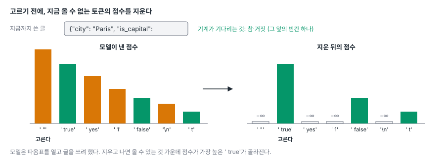
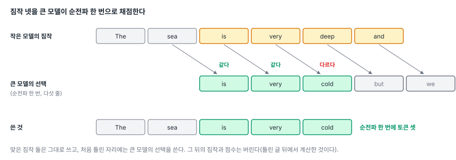
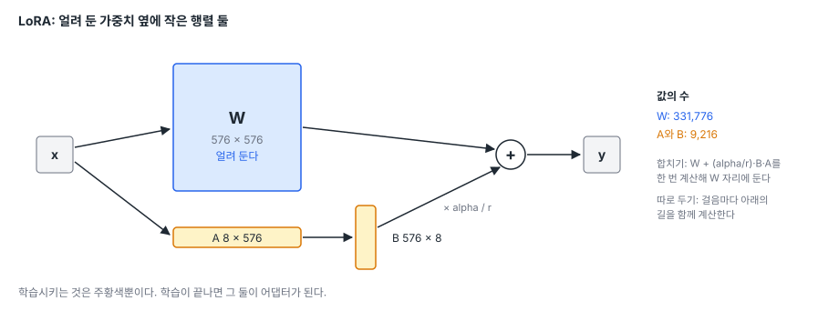

# 생성 제어와 가속

지금까지의 생성 루프는 단순했습니다. 모델이 점수를 내면 샘플러가 토큰
하나를 고르고, 그 토큰을 다시 모델에
넣었습니다([11장](../part2/ch11_kv_cache.md),
[12장](../part2/ch12_sampling.md)). 이 장에서는 그 루프의 세 군데를
고칩니다.

- **고르기 전에** 점수를 고칩니다. 지금 오면 안 되는 토큰을 지워서,
  모델이 무엇을 쓰든 결과가 정해 둔 형식을 벗어나지 않게 합니다.
- **모델을 부르는 횟수**를 줄입니다. 다음 토큰 몇 개를 미리 짐작해 두고
  큰 모델이 한 번에 채점하게 합니다.
- **가중치 옆에** 작은 행렬을 덧붙입니다. 모델을 다시 만들지 않고 조금
  고쳐 씁니다.

셋 모두 모델의 가중치는 건드리지 않습니다. 앞의 둘은 답의 **형식**과
**속도**를 바꾸고, 셋째는 답의 **내용**을 바꿉니다.

결과를 미리 적어 둡니다.

- JSON 스키마를 주면 그 형식의 JSON만 쓰게 했습니다. 도시 스무 곳을
  물었을 때 그냥 쓴 답 가운데 스키마에 맞는 것은 0곳(SmolLM2-135M)과
  2곳(Llama 3.2 1B)이고, 문법에 묶어 쓴 답은 스무 곳 모두 맞습니다.
  Python의 `jsonschema`로 다시 검사해 확인했습니다.
- 올 수 있는 토큰을 찾는 일이 토큰 하나를 쓰는 시간에 더해집니다. 단어
  사전 전체를 훑으면 4.3밀리초, 단어 사전을 나무로 엮어 두면 3.5밀리초,
  모델이 고른 토큰부터 보면 0.09밀리초입니다(Llama 3.2 1B, 토큰 12만 8천
  개).
- 형식은 지켜지지만 **내용이 옳아지는 것은 아닙니다.** 작은 모델은
  형식에 맞는 틀린 답을 씁니다.
- 추측 디코딩의 결과는 큰 모델이 혼자 쓴 것과 **토큰까지 같습니다.**
  속도는 일에 따라 다릅니다. SmolLM2-1.7B에 SmolLM2-135M을 초안으로
  붙이면 자유롭게 쓸 때 1.1배, 글을 베껴 고칠 때 1.9배입니다. 모델 없이
  지금까지의 글에서 찾아 짐작하면 베껴 고칠 때 2.4배이고, 자유롭게 쓸
  때는 얻는 것이 없습니다.
- CPU에서는 짐작을 채점하는 데 비용이 듭니다.
  [40장](ch40_throughput.md)에서 본 대로 줄을 늘리면 순전파가
  길어집니다. 짐작을 많이 할수록 느려지는 경우가 그래서 생깁니다.
  스레드를 넷으로 줄이면 거의 모든 경우에 혼자 쓰는 것보다 느립니다.
- LoRA 어댑터를 가중치에 합치든 따로 두든 PEFT와 같은 토큰을 쓰고,
  점수는 1만 분의 1 안에서 같습니다. 따로 두면 토큰 속도가 5% 느려지고,
  합친 것도 2% 느립니다(합친 가중치가 두 배 큰 f32이기 때문입니다).

| 하는 일 | 절 |
|---|---|
| 꼴이 틀린 답을 본다 | 41.1 |
| 고르기 전에 점수를 지운다 | 41.2 |
| JSON 스키마를 기계로 바꾼다 | 41.3 |
| 올 수 있는 토큰을 찾는다 | 41.4 |
| 묶어 쓴 답을 검사하고, 서버에 싣는다 | 41.5 |
| 짐작하고 채점한다 (추측 디코딩) | 41.6 |
| 작은 모델로 짐작한다 | 41.7 |
| 지금까지의 글에서 찾아 짐작한다 | 41.8 |
| 확률로 뽑을 때의 채점을 본다 | 41.9 |
| 학습된 헤드를 읽는다 | 41.10 |
| LoRA 어댑터를 붙인다 | 41.11 |

## 41.1 모델은 형식이 틀린 답을 쓴다

언어 모델의 답을 사람이 읽는다면 형식은 문제가 되지 않습니다. 프로그램이
읽는다면 다릅니다. 도시의 이름을 받아 나라와 인구를 돌려주는 기능을
모델로 만든다고 합시다. 답을 받는 코드는 다음과 같을 것입니다.

```python
city = json.loads(answer)
print(city["country"], city["population_millions"])
```

그래서 모델에게 JSON으로 답하라고 시킵니다. 이 장의 예제가 묻는
질문입니다.

```text
Describe the city of Paris as a JSON object with the fields city, country,
continent, is_capital, population_millions and languages. Reply with JSON only.
```

SmolLM2-135M의 답입니다.

````text
```json
{
  "city": "Paris",
  "country": "France",
  "continent": "Europe",
  "is_capital": "Paris",
  "population_millions": 120,
  "languages": [
    "French",
    "English",
    "Spanish"
  ]
}
```
````

거의 맞습니다. 그리고 "거의"가 문제입니다. 앞뒤에 마크다운의 울타리가
붙어서 `json.loads`가 첫 글자에서 실패합니다. `is_capital`은 참이나
거짓이어야 하는데 글이 들어 있습니다. 다른 도시에서는 닫는 괄호 앞에
쉼표를 남기고, 목록을 끝없이 이어 쓰고, JSON 뒤에 설명을 덧붙입니다.
지시를 더 길게 써도 나아질 뿐 없어지지 않습니다. 모델은 확률로 쓰기
때문입니다. 백 번에 한 번 틀리는 답은 하루에 만 번 부르는 서비스에서
하루에 백 번 실패합니다.

## 41.2 고르기 전에 지운다

생성 루프를 다시 봅니다. 모델은 다음 토큰을 정하지 않습니다. **모든
토큰의 점수**를 낼 뿐이고, 고르는 것은 우리입니다. 그렇다면 고르기
전에 "지금 와서는 안 되는 토큰"의 점수를 지워 버릴 수 있습니다.
지금까지 `{"city":`까지 썼다면 다음에 올 수 있는 것은 따옴표(와 그
앞의 빈칸)뿐입니다. 나머지 토큰의 점수를 음의 무한대로 만들면, 온도가
얼마든 샘플러는 따옴표로 시작하는 토큰만 고릅니다.



코드로는 [12장](../part2/ch12_sampling.md)의 루프에 두 줄이 더해집니다.

```rust,ignore
{{#include ../../../crates/badak_models/src/constrain.rs:generate}}
```

`constraint.mask`가 점수를 지우고, `constraint.accept`가 고른 토큰을
알려 "지금 어디까지 썼는지"를 한 걸음 나아가게 합니다. 남은 일은
둘입니다. "지금 와도 되는가"를 판단하는 기계를 만드는 일(41.3절)과, 그
판단을 토큰 수만 개에 대해 빨리 하는 일(41.4절)입니다.

이 방법이 보장하는 것은 정확히 하나입니다. **쓴 글이 문법에 맞는 글의
앞부분이라는 것**입니다. 다 쓴 글이 문법에 맞는 것까지 보장하려면 끝까지
써야 합니다. 토큰의 한도에서 잘린 JSON은 여전히 깨진 JSON입니다.

## 41.3 JSON 스키마를 기계로 바꾼다

"어떤 형식이어야 하는가"는 JSON 스키마로 받습니다.[^json-schema] JSON의
형식을 JSON으로 적는 규약입니다. 이 장의 예제가 쓰는 스키마입니다.

```json
{{#include ../../../reference/ch41_schema.json}}
```

스키마의 전부를 구현하지는 않았습니다.

| 받는 것 | 뜻 |
|---|---|
| `type`: `object`, `properties`, `required` | 객체. 필드를 **모두**, `required`의 순서대로 쓴다 |
| `type`: `array`, `items`, `minItems`, `maxItems` | 배열과 원소의 꼴, 개수의 범위 |
| `type`: `string`, `maxLength` | 문자열과 길이의 한도 |
| `type`: `integer`, `number`, `boolean`, `null` | 정수, 수, 참·거짓, 없음 |
| `enum` | 정해진 문자열들 가운데 하나 |

**모르는 낱말이 하나라도 있으면 스키마를 받지 않습니다.** `minimum`,
`pattern`, `anyOf` 같은 것입니다. 조용히 넘기면 "스키마에 맞는 답을
보장한다"는 말이 거짓이 됩니다. `minimum: 0`이 적힌 스키마를 받아 놓고
음수를 쓰게 두는 것보다, 못 받는다고 알리는 편이 낫습니다.

```rust,ignore
{{#include ../../../crates/badak_models/src/constrain.rs:grammar}}
```

기계는 바이트를 하나씩 받습니다. 상태는 **"지금 기다리고 있는 것"을 쌓아
둔 스택**입니다. 객체 안의 배열 안의 문자열을 쓰는 중이라면 셋이 쌓여
있습니다. 문자열이 닫히면 하나를 꺼내고, 그 아래의 것(쉼표나 닫는
대괄호를 기다리는)이 다음 바이트를 봅니다.

```rust,ignore
{{#include ../../../crates/badak_models/src/constrain.rs:matcher}}
```

기다리는 것의 종류마다 "이 바이트가 와도 되는가"를 판단합니다. 문자열의
안이 가장 깁니다.

```rust,ignore
{{#include ../../../crates/badak_models/src/constrain.rs:text}}
```

닫는 따옴표, 역슬래시 뒤에 올 수 있는 글자, `\u` 뒤의 16진수 네 자리를
받고, 제어 문자는 받지 않습니다. 그리고 UTF-8을 확인합니다. 한글 한
글자는 세 바이트이고 토큰 둘에 걸쳐 올 수 있습니다. 첫 바이트를 보고
뒤에 몇 바이트가 더 와야 하는지를 적어 두었다가, 그것이 다 오기 전에는
따옴표를 닫지 못하게 합니다. 이 부분이 없으면 형식은 맞는데 글자가 깨진
JSON이 나옵니다.

숫자는 다르게 다뤄야 합니다.

```rust,ignore
{{#include ../../../crates/badak_models/src/constrain.rs:number}}
```

**숫자에는 끝을 알리는 글자가 없습니다.** 문자열은 따옴표로, 배열은
대괄호로 닫히지만 `12` 뒤에 `3`이 올지 쉼표가 올지는 와 봐야 압니다.
그래서 숫자가 될 수 없는 바이트가 오면, 지금까지가 온전한 숫자인지를
보고, 그렇다면 그 바이트를 스택의 아래에 있는 것에게 넘깁니다.

### 한도를 두어 끝나지 않는 글을 막는다

문법에 맞는 글이 끝없이 길 수 있습니다. 문자열은 따옴표를 닫지 않는 한
계속되고, 숫자는 자릿수를 얼마든지 늘릴 수 있고, 배열은 원소를 끝없이
더할 수 있습니다. 점수를 지우는 것만으로는 모델이 닫게 만들 수 없습니다.
41.1절의 작은 모델이 그랬듯, 같은 낱말을 되풀이하다가 토큰의 한도에
닿으면 **문법에 맞는 앞부분이지만 끝나지 않은 JSON**이 됩니다.

그래서 한도를 둡니다. 문자열은 스키마가 정하지 않으면 256자, 배열은
64개, 숫자의 정수부와 소수부는 15자리까지입니다. 한도에 닿으면 올 수
있는 것이 "닫기"뿐이 되고, 모델은 닫을 수밖에 없습니다.

빈칸도 같은 문제입니다. JSON은 값 사이에 빈칸과 줄바꿈을 얼마든지
허락합니다. 그대로 허락하면 줄바꿈만 쓰다가 한도에 닿는 모델이 생깁니다.
여기서는 **쌍점과 쉼표 뒤의 빈칸 하나**만 받습니다. 모델이 가장 흔히
쓰는 형식이면서 끝없이 이어질 수 없는 형식입니다.

## 41.4 토큰은 바이트가 아니다

기계는 바이트를 받는데 모델은 토큰을 씁니다. 그리고 토큰의 경계는 JSON의
경계와 아무 상관이 없습니다. SmolLM2의 단어 사전에는 `",`가 토큰
하나이고 `":`도, ` "`도 토큰 하나입니다. 토큰 하나가 문자열을 닫고,
쉼표를 찍고, 다음 필드를 여는 일을 한꺼번에 할 수 있습니다. 반대로 한글
한 글자가 토큰 둘에 나뉘어 오기도 합니다.

그래서 "이 토큰이 와도 되는가"는 토큰의 **바이트를 하나씩 기계에 넣어
봐야** 압니다. 기계를 복사해 놓고, 토큰의 바이트를 차례로 넣고, 끝까지
받으면 올 수 있는 토큰입니다.

```rust,ignore
{{#include ../../../crates/badak_models/src/constrain.rs:vocabulary}}
```

찾는 방법 셋을 만들어 견줬습니다.

**모두 하나씩.** 단어 사전의 모든 토큰을 넣어 봅니다. 12만 8천 번입니다.

**나무를 따라.** 토큰을 바이트의 나무(트라이)로 엮어 둡니다. 앞부분이
같은 토큰은 같은 가지에 있습니다. SmolLM2의 단어 사전에는 따옴표로
시작하는 토큰이 49개 있는데, 따옴표를 한 번만 넣어 보면 됩니다. 기계가
받지 않으면 그 가지 전체를 건너뜁니다.

**점수가 높은 것부터.** 모델이 가장 높은 점수를 준 토큰을 넣어 봅니다.
되면 끝입니다. 안 되면 그다음으로 높은 것을 봅니다. 모델이 문법을 대체로
따르고 있다면 한두 번에 끝납니다. 온도가 0일 때(점수가 가장 높은 토큰을
고를 때)만 쓸 수 있습니다. 확률로 뽑으려면 올 수 있는 토큰을 모두 알아야
하기 때문입니다.

```bash
cargo run --release -p badak_models --example ch41_json -- --model llama32_1b
```

| 찾는 방법 | SmolLM2-135M (토큰 49,152개) | Llama 3.2 1B (토큰 128,256개) |
|---|---:|---:|
| 모두 하나씩 | 1.55ms | 4.28ms |
| 나무를 따라 | 0.91ms | 3.51ms |
| 점수가 높은 것부터 | 0.04ms | 0.09ms |
| 묶지 않고 토큰 하나를 쓰는 시간 | 2.4ms | 10ms |

토큰 하나를 쓸 때마다 드는 시간입니다(세 차례 잰 값의 중앙값). 세 방법이
쓴 글은 같습니다.

**찾는 비용이 작지 않습니다.** 단어 사전을 다 훑으면 토큰 하나에
4.3밀리초가 더 듭니다. Llama 3.2 1B가 토큰 하나를 쓰는 데 10밀리초이므로
속도가 3분의 2가 됩니다. 문법에 묶는 데는 비용이 듭니다.

**나무는 생각만큼 줄이지 못합니다.** 3.5밀리초입니다. 올 수 있는 토큰의
수를 보면 까닭을 알 수 있습니다. 중앙값은 8개인데, 가장 많을 때는 12만
3천 개입니다. **문자열의 안**이 그때입니다. 따옴표와 제어 문자만 빼고
무엇이든 올 수 있어서, 건너뛸 가지가 거의 없고 나무 전체를 따라가야
합니다. 나무가 효과를 내는 것은 올 수 있는 것이 몇 개뿐인 위치(필드의
이름, 쉼표, 참·거짓)이고, 그런 위치에서는 모두 훑는 방법도 금방
끝납니다(첫 바이트에서 대부분이 떨어집니다).

**모델을 믿으면 비용이 거의 없습니다.** 점수가 가장 높은 토큰부터 보면
0.09밀리초입니다. 올 수 있는 토큰을 모두 찾는 것이 아니라 하나를 찾기
때문입니다. 모델이 문법을 대체로 따르고 있어서 첫 번째나 두 번째에서
끝납니다. 서버는 온도가 0인 요청에 이 방법을, 그렇지 않은 요청에 나무를
씁니다.

남은 비용을 더 줄이는 방법은 41.14절에 적었습니다. 같은 상태에서 올 수
있는 토큰은 늘 같으므로, 한 번 찾은 것을 남겨 두면 됩니다.

## 41.5 묶어 쓴 답은 모두 스키마에 맞는다

```text
{{#include output/ch41_json.txt}}
```

Llama 3.2 1B는 그냥 쓴 답도 JSON처럼 보입니다. 그런데 스무 곳 가운데
열여덟 곳이 스키마에 맞지 않습니다. 언어를 셋까지만 적으라고 스키마가
정했는데 다섯을 적고, 열을 넘게 적다가 토큰의 한도에서 잘립니다. 질문에
스키마를 적어 주지 않았으니 모델의 잘못이라고 하기는 어렵습니다.
**중요한 것은 모델이 스키마를 알든 모르든, 묶으면 맞는다는 것입니다.**

묶어 쓴 답은 스무 곳 모두 스키마에 맞습니다. 언어가 셋에서 멈추고(넷째를
쓰려 해도 닫는 대괄호만 올 수 있습니다), 대륙은 정해 둔 여섯 가운데
하나이고, 줄바꿈이 없습니다.

### 다른 구현으로 다시 검사한다

"문법에 맞다"고 판단한 것이 우리가 만든 기계입니다. 같은 기계로 답을
검사하면 기계가 틀렸을 때 알 수 없습니다. 답 마흔 개를 파일에 적어
Python의 `jsonschema`로 다시 검사했습니다(`reference/ch41_validate.py`).

```text
{{#include output/ch41_validate.txt}}
```

### 서버가 response_format을 받는다

[39장](ch39_inference_server.md)의 서버가 `response_format`을 받게
했습니다. OpenAI의 API에서 구조가 정해진 출력을 시키는
이름입니다.[^openai-types] 받지 못하는 스키마는 400으로 답하고 무엇을 못
받는지 알립니다.

```python
reply = client.chat.completions.create(
    model=model,
    messages=[{"role": "user", "content": question}],
    response_format={"type": "json_schema", "json_schema": {"name": "city", "schema": SCHEMA}},
)
```

같은 요청 스무 개를 OpenAI의 공식 클라이언트로 badak의 서버와
llama.cpp의 서버에 보냈습니다. llama.cpp도 JSON 스키마를 문법으로 바꿔
같은 방법으로 묶습니다.[^llama-grammar]

```text
{{#include output/ch41_servers.txt}}
```

두 서버 모두 스무 개가 다 스키마에 맞습니다. 형식이 다른 것이 눈에
띕니다. llama.cpp는 줄을 바꾸고 들여 씁니다. llama.cpp의 문법이 값
사이의 빈칸을 허락하기 때문입니다(한도를 두고 허락합니다). 그래서 같은
내용에 토큰을 더 씁니다. 형식을 좁게 잡을수록 토큰이 줄어듭니다.

### 형식이 맞아도 내용은 틀릴 수 있다

SmolLM2-135M이 묶여서 쓴 답을 봅니다(바로 위의 badak 서버의 출력).
파리의 인구가 100만 "백만 명"입니다. 나이로비를 물은 답은 도시의
이름부터 키갈리입니다(`bench/ch41/answers_smollm2_135m.jsonl`). **형식은
모두 맞고 내용은 틀렸습니다.** 문법은 `population_millions`에 숫자가
오게 할 뿐, 옳은 숫자가 오게 하지 못합니다.

오히려 더 조심해야 합니다. 형식이 틀린 답은 받는 쪽에서 오류가 나므로
눈에 띕니다. 형식이 맞는 틀린 답은 조용히 지나갑니다. 문법에 묶는 것은
"답을 해석할 수 있다"를 보장하는 도구이지 "답이 옳다"를 보장하는 도구가
아닙니다.

묶으면 모델이 쓰려던 것과 다른 글이 나온다는 점도 적어 둡니다. 모델은
마크다운의 울타리부터 쓰려 했고, 문법이 그것을 지웠습니다. 모델이 고른
토큰이 아니라 "허락된 것 가운데 가장 점수가 높은" 토큰이 골라집니다. 그
뒤의 글은 모델이 학습 때 드물게 본 글을 이어 쓰는 것이 됩니다. 이것이
답의 질을 얼마나 바꾸는지는 재지 않았습니다.

## 41.6 짐작하고 채점한다

이제 속도입니다. [40장](ch40_throughput.md)에서 두 가지를 보았습니다.
토큰 하나를 쓰는 비용은 가중치를 한 번 읽어 오는 비용이고, 그때 토큰을
몇 개 더 계산하는 것은(남는 계산 능력이 있는 한) 훨씬 쌉니다.
[40장](ch40_throughput.md)은 그 "몇 개 더"를 **다른 요청의** 토큰으로
채웠습니다. 요청이 하나뿐이면 채울 것이 없습니다. 다음 토큰은 지금
토큰을 써야 알 수 있기 때문입니다.

그런데 **짐작**은 할 수 있습니다.[^speculative] 다음 토큰 넷을 누가 미리
짐작해 준다고 합시다. 큰 모델에 지금 토큰과 그 짐작 넷을 한꺼번에
넣으면, 순전파 한 번으로 다섯 위치의 점수가 나옵니다. "지금 토큰 다음에
올 것", "첫 짐작 다음에 올 것", "둘째 짐작 다음에 올 것"…입니다. 첫
점수에서 큰 모델이 고른 토큰이 첫 짐작과 같다면, 둘째 점수는 **옳은 글
뒤에서 계산한 것**이므로 그대로 쓸 수 있습니다. 둘째도 같다면 셋째도
씁니다. 처음으로 다른 위치에서 멈추고, 그 위치에는 큰 모델이 고른 토큰을
씁니다. 나머지 짐작은 버립니다.



```rust,ignore
{{#include ../../../crates/badak_models/src/llama/speculative.rs:speculate}}
```

**결과는 큰 모델이 혼자 쓴 것과 같습니다.** 받아들인 토큰은 모두 큰
모델이 그 위치에서 고른 토큰이기 때문입니다. 짐작이 틀려도 답은 틀리지
않고, 느려질 뿐입니다. 짐작이 하나도 안 맞아도 순전파 한 번에 토큰
하나는 얻습니다.

"같다"는 말이 성립하려면 조건이 하나 있습니다. 토큰 다섯 개를 한꺼번에
계산한 점수와 하나씩 계산한 점수가 같아야 합니다.
[11장](../part2/ch11_kv_cache.md)부터 지켜 온 비트 단위의 약속을 여기서
세 번째로 씁니다([39장](ch39_inference_server.md)의 접두사 캐시,
[40장](ch40_throughput.md)의 묶음에 이어).

틀린 짐작은 KV 캐시에도 들어가 있으므로 지워야 합니다.
`KvCache::truncate`가 그 일을 합니다.
[39장](ch39_inference_server.md)에서 접두사 캐시에 쓴 그 함수입니다.

짐작은 어떤 방법으로 해도 됩니다.

```rust,ignore
{{#include ../../../crates/badak_models/src/llama/speculative.rs:proposer}}
```

## 41.7 작은 모델로 짐작한다

가장 널리 쓰는 방법은 **같은 토크나이저를 쓰는 작은 모델**에게 초안을
쓰게 하는 것입니다. 큰 모델은 SmolLM2-1.7B-Instruct, 작은 모델은 2부의
SmolLM2-135M-Instruct입니다. 값의 수가 13배 다릅니다.

```bash
sh scripts/download_ch41.sh
cargo run --release -p badak_models --example ch41_speculate
```

```text
{{#include output/ch41_speculate.txt}}
```

질문은 모델의 틀대로 적었습니다. SmolLM2의 틀은 시스템의 말이 없으면
기본 지시문 한 줄을 앞에 놓습니다(47.3절. 처음에는 그 줄 없이 쟀고,
그것을 고친 뒤 다시 잰 숫자입니다).

세 차례 잰 값의 중앙값입니다. "맞은 짐작"과 "큰 모델의 순전파"는 큰
모델이 1.7B일 때의 것입니다. 큰 모델을 SmolLM2-360M으로 바꾼 것과
스레드를 넷으로 줄인 것을 함께 적었습니다.

| 일 | 짐작하는 방법 | 미리 | 맞은 짐작 | 큰 모델의 순전파 | 1.7B, 스레드 12 | 1.7B, 스레드 4 | 360M, 스레드 12 |
|---|---|---:|---:|---:|---:|---:|---:|
| 자유롭게 쓰기 | 혼자 | | | | 66토큰/초 | 57토큰/초 | 214토큰/초 |
| | 작은 모델로 | 2 | 69/117 (59%) | 59 | 1.09배 | 0.59배 | 0.81배 |
| | 작은 모델로 | 4 | 80/192 (42%) | 48 | 0.85배 | 0.48배 | 0.71배 |
| | 작은 모델로 | 8 | 84/346 (24%) | 44 | 0.64배 | 0.37배 | 0.49배 |
| | 글에서 찾아 | 4 | 2/34 (6%) | 126 | 0.95배 | 0.80배 | 0.94배 |
| | 글에서 찾아 | 8 | 2/59 (3%) | 126 | 0.91배 | 0.76배 | 0.90배 |
| | 글에서 찾아 | 16 | 2/90 (2%) | 126 | 0.86배 | 0.70배 | 0.84배 |
| 묻고 답하기 | 혼자 | | | | 66토큰/초 | 56토큰/초 | 218토큰/초 |
| | 작은 모델로 | 2 | 74/107 (69%) | 54 | 1.14배 | 0.64배 | 0.84배 |
| | 작은 모델로 | 4 | 88/160 (55%) | 40 | 1.02배 | 0.57배 | 0.74배 |
| | 작은 모델로 | 8 | 92/283 (33%) | 36 | 0.77배 | 0.46배 | 0.55배 |
| | 글에서 찾아 | 4 | 13/75 (17%) | 115 | 0.90배 | 0.68배 | 1.00배 |
| | 글에서 찾아 | 8 | 13/147 (9%) | 115 | 0.79배 | 0.60배 | 0.92배 |
| | 글에서 찾아 | 16 | 13/284 (5%) | 115 | 0.65배 | 0.44배 | 0.84배 |
| 고쳐 쓰기 | 혼자 | | | | 61토큰/초 | 52토큰/초 | 193토큰/초 |
| | 작은 모델로 | 2 | 63/65 (97%) | 33 | 1.46배 | 0.79배 | 1.01배 |
| | 작은 모델로 | 4 | 76/80 (95%) | 20 | 1.53배 | 0.85배 | 1.05배 |
| | 작은 모델로 | 8 | 85/87 (98%) | 11 | 1.88배 | 1.10배 | 1.06배 |
| | 글에서 찾아 | 4 | 74/76 (97%) | 22 | 2.07배 | 1.06배 | 2.49배 |
| | 글에서 찾아 | 8 | 82/88 (93%) | 14 | 2.42배 | 1.40배 | 2.75배 |
| | 글에서 찾아 | 16 | 86/112 (77%) | 10 | 2.40배 | 1.25배 | 3.28배 |

**쓴 토큰은 모든 경우에 혼자 쓴 것과 같습니다.** 측정하는 프로그램이
경우마다 견줍니다.

**이득은 작습니다.** 자유롭게 쓸 때 1.09배, 묻고 답할 때 1.14배, 베껴
고칠 때 1.88배입니다. 논문이 보고하는 두세 배와는 차이가 큽니다. 까닭을
따져 봅니다.

한 번의 반복에 드는 것은 **작은 모델의 순전파 k번**과 **큰 모델의 순전파
한 번**(k + 1줄)입니다. 얻는 것은 **맞은 짐작의 수 + 1**개의 토큰입니다.
이득이 있으려면 세 가지가 맞아야 합니다.

1. **짐작이 맞아야 합니다.** 자유롭게 쓸 때 둘을 짐작하면 59%가 맞고,
   여덟을 짐작하면 24%가 맞습니다. 뒤로 갈수록 틀립니다. 앞의 짐작이
   틀리면 뒤의 짐작은 채점할 것도 없이 버려지기 때문입니다. 베껴 고칠
   때는 98%가 맞습니다. 작은 모델도 글을 베낄 줄은 압니다.
2. **짐작이 싸야 합니다.** 작은 모델이 토큰 하나에 2.4밀리초, 큰
   모델이 15밀리초입니다. 여섯 배 차이입니다. 여덟을 짐작하면 작은
   모델만으로 19밀리초를 씁니다. 큰 모델의 순전파 한 번보다 깁니다.
3. **줄을 늘려도 순전파가 길어지지 않아야 합니다.** 여기가 CPU에서
   어긋나는 곳입니다. [40장](ch40_throughput.md)에서 본 대로 줄이 둘일 때는 거의 공짜지만
   넷, 여덟으로 늘리면 걸음이 길어집니다.

자유롭게 쓸 때 짐작을 늘릴수록 느려지는 것(1.09, 0.85, 0.64배)은 셋이
함께 작용한 결과입니다. 맞는 비율은 떨어지고, 짐작하는 비용과 채점하는
비용은 늘어납니다.

**큰 모델과 작은 모델의 차이가 작으면 손해입니다.** 큰 모델을 360M으로
바꾸면 자유롭게 쓸 때와 묻고 답할 때는 작은 모델로 짐작하는 것이 모두
혼자 쓰는 것보다 느리고(0.49~0.84배), 베껴 고칠 때에야 겨우
같습니다(1.01~1.06배). 360M은 135M보다 두 배 느릴 뿐이어서, 짐작하는
비용이 아끼는 비용보다 큽니다.

**남는 계산 능력이 없으면 손해입니다.** 스레드를 넷으로 줄이면 작은
모델로 짐작하는 것이 거의 다 0.4~0.85배입니다(베껴 고치며 여덟을 짐작할
때만 1.10배). [40장](ch40_throughput.md)에서 스레드 넷의 Llama가 묶어도
빨라지지 않던 것과 같은 까닭입니다. 채점할 줄을 늘린 만큼 순전파가
길어집니다. 추측 디코딩은 **한 요청의 토큰으로 묶음을 만드는 것**이고,
묶음이 효과가 없는 곳에서는 이것도 효과가 없습니다.

## 41.8 지금까지의 글에서 찾아 짐작한다

모델 없이도 짐작할 수 있습니다. 글이 **자기 앞부분을 되풀이할
때**입니다. 문서를 주고 고쳐 쓰라고 하면 답의 대부분은 문서에 있던
글입니다. 코드를 주고 함수 하나를 바꾸라고 해도, 긴 대화에서 앞의 말을
인용할 때도 그렇습니다.

방금 쓴 토큰 몇 개와 같은 곳을 지금까지의 글에서 찾아, 그 뒤에 왔던
토큰을 짐작으로 내놓습니다.[^lookup] 41.6절의 `Lookup`이 그것입니다.
스무 줄이고, 순전파를 돌지 않으므로 짐작하는 비용이 0에 가깝습니다.

결과는 41.7절의 표에 함께 있습니다.

**베껴 고칠 때 가장 빠릅니다.** 큰 모델이 1.7B일 때 2.4배, 360M일 때
3.3배입니다. 여덟씩 짐작하면 순전파 95번이 14번이 됩니다. 작은 모델로
짐작한 것보다 빠른 것은 맞는 비율이 비슷한데 짐작하는 비용이 없기
때문입니다.

**되풀이하지 않는 글에서는 얻는 것이 없습니다.** 자유롭게 쓸 때 맞는
짐작이 126번 가운데 2번입니다. 그리고 여기서도 틀린 짐작에는 비용이
듭니다. 열여섯을 짐작하면 0.86배, 묻고 답할 때는 0.65배입니다. 맞지 않을
짐작을 채점하느라 순전파가 길어졌습니다.

그래서 맞춰 본 길이에 문턱을 두었습니다(두 토큰 넘게 맞아야 짐작합니다).
더 나은 방법은 **맞는 비율을 보면서 짐작의 수를 줄이는 것**이고, 하지
않았습니다.

어느 방법이 좋은지는 **글이 무엇을 하고 있는가**에 달려 있습니다. 같은
대화 안에서도 문서를 인용하는 구간과 새로 쓰는 구간이 섞여 있습니다.

## 41.9 확률로 뽑을 때는 비율로 받아들인다

지금까지는 점수가 가장 높은 토큰을 골랐습니다. 온도를 주고 확률로
뽑을 때는 "짐작이 큰 모델의 선택과 같은가"를 물을 수 없습니다. 큰
모델의 선택이 하나로 정해져 있지 않기 때문입니다.

방법이 있습니다.[^speculative] [^speculative-sampling] 초안이 분포
`q`에서 토큰 `x`를 뽑았고 큰 모델의 분포가 `p`라고 합시다.

1. `min(1, p(x) / q(x))`의 확률로 `x`를 받아들입니다. 큰 모델이 초안보다
   `x`를 더 좋아하면 늘 받아들이고, 덜 좋아하면 그 비율만큼만
   받아들입니다.
2. 받아들이지 않았으면 `max(0, p − q)`를 다시 고르게 만든 분포에서 새로
   뽑습니다. 큰 모델이 초안보다 더 주고 싶어 한 만큼만 남긴 분포입니다.

이렇게 고른 토큰은 **`p`에서 바로 뽑은 것과 같은 분포**를 따릅니다.
초안이 얼마나 엉터리든 그렇습니다.

```rust,ignore
{{#include ../../../crates/badak_models/src/llama/speculative.rs:judge}}
```

정말 그런지 테스트합니다. 서로 꽤 다른 두 분포를 놓고, 난수 셋(초안이
뽑는 것, 받아들일지, 다시 뽑는 것)을 고르게 800만 가지로 훑어 결과를
셉니다. 토큰마다의 비율이 `p`와 100분의 1 안에서 같고, 받아들인 비율은
두 분포가 겹치는 넓이(`Σ min(p, q)`)와 같습니다. 초안이 큰 모델과
닮을수록 많이 받아들입니다.

이 채점을 생성 루프에 넣는 일은 하지 않았습니다. 이 장의 측정은 모두
점수가 가장 높은 토큰을 고르는 경우입니다.

## 41.10 학습된 헤드로 짐작할 수도 있다

초안을 쓰는 모델을 따로 두는 것이 번거로울 때가 있습니다. 같은
토크나이저를 쓰는 작은 모델이 있어야 하고, 그것을 메모리에 함께 올려야
하고, 둘의 버전을 맞춰 관리해야 합니다.

다른 방법은 **큰 모델에 작은 헤드를 덧붙여** 그것이 짐작하게 하는
것입니다. 큰 모델의 마지막 은닉 벡터에는 다음 토큰만이 아니라 그 뒤의
토큰에 대한 정보도 들어 있습니다. 그 벡터를 받아 "두 번째 뒤의 토큰",
"세 번째 뒤의 토큰"을 짐작하는 작은 층을 따로 학습시킵니다. 큰 모델의
가중치는 고정하고 헤드만 학습시킵니다.[^medusa] 여기서 더 나아가, 토큰이
아니라 은닉 벡터 자체를 이어서 짐작하게 하는 방법도 있습니다.[^eagle]

**이 책에서는 구현하지 않았습니다.** 헤드의 가중치가 있어야 하는데,
우리가 쓰는 모델에 맞춰 학습시킨 것을 찾지 못했고, 학습은 이 책의 범위
밖입니다. 추론 엔진이 할 일은 41.6절과 다르지 않습니다. 짐작하는 코드가
`Proposer`를 구현하면 됩니다. 달라지는 것은 그 짐작이 큰 모델의 순전파
안에서(같은 은닉 벡터에서) 나온다는 것이고, 그래서 따로 도는 순전파가
없습니다.

## 41.11 LoRA 어댑터를 붙인다

마지막은 모델의 **내용**을 바꾸는 일입니다. 모델이 우리 회사의 말투로
답하게 하거나, 특정한 일을 더 잘하게 하고 싶을 때 가중치를 다시
학습시킵니다(미세 조정). 그런데 가중치 전체를 다시 학습시키면 결과도
가중치 전체입니다. 용도가 열 가지면 모델이 열 벌입니다.

LoRA는 이렇게 합니다.[^lora] 원래의 가중치 `W`는 얼려 두고, 선형 층마다
**작은 행렬 둘**을 덧붙여 그것만 학습시킵니다.

```text
y = W x + (alpha / r) · B (A x)
```



`W`가 576 × 576이면 `A`는 8 × 576, `B`는 576 × 8입니다. `r = 8`이 그
"작은 쪽"의 크기입니다. 값의 수로는 33만 대 9천입니다. 학습이 끝나면
남는 것은 `A`와 `B`뿐이고, 그것이 **어댑터**입니다.

추론 엔진이 할 일은 이 식을 계산하는 것이고, 방법이 둘입니다.

```rust,ignore
{{#include ../../../crates/badak_models/src/llama/lora.rs:adapter}}
```

**합치기.** `B A`를 미리 곱해 `W`에 더해 버립니다. 그 뒤로는 보통의
모델입니다.

```rust,ignore
{{#include ../../../crates/badak_models/src/llama/lora.rs:merge}}
```

**따로 두기.** `W`는 그대로 두고, 걸음마다 `B (A x)`를 따로 계산해
더합니다. [23장](../part3/ch23_gpu.md)에서 "곱셈을 다른 곳에 맡기는
행렬"을 만들어 두었습니다. GPU에 맡기려고 만든 그 종류에 이번에는
어댑터를 넣습니다.

```rust,ignore
{{#include ../../../crates/badak_models/src/llama/lora.rs:beside}}
```

어댑터가 있어야 재 볼 수 있습니다. 직접
학습시켰습니다(`reference/ch41_train_lora.py`. PEFT로 CPU에서 30초쯤
걸립니다). 학습시키는 대화도 모델의 틀대로 적습니다(기본 지시문이 앞에
놓입니다. 47.3절). 가르친 것은 하나입니다. **답을 모두 대문자로
쓰기**입니다. 쓸모는 없지만 어댑터가 붙었는지를 눈으로 확인할 수
있습니다. 같은 스크립트가 어댑터를 붙인 모델의 점수와 쓴 토큰을 정답으로
남깁니다.

```bash
python reference/ch41_train_lora.py
cargo run --release -p badak_models --example ch41_lora
```

```text
{{#include output/ch41_lora.txt}}
```

**PEFT와 같은 토큰을 씁니다.** 따로 두든 합치든 쓴 토큰 24개가 PEFT의
것과 같고, 점수의 가장 큰 차이가 0.00005입니다. 두 방법이 서로 조금 다른
것(0.000050 대 0.000047)은 더하는 순서가 달라서입니다. `W x`를 구한 뒤에
`B A x`를 더하는 것과, `W + B A`를 구한 뒤에 `x`를 곱하는 것은 실수의
끝자리가 다릅니다.

**값이 46만 개인 어댑터가 답 전체를 바꿉니다.** 모델의 0.34%입니다.
파일로는 1.9MB입니다.

**따로 두면 5% 느립니다.** 세 차례의 중앙값으로 초당 399토큰이 381토큰이
됩니다. 층 60개에서 걸음마다 작은 곱셈 둘을 더 하는 비용입니다. 위의
출력은 세 차례 가운데 하나이고, 차례마다 흔들립니다(따로 둔 것이 369,
381, 396).

**합친 것도 2% 느립니다**(392토큰). 차이가 흔들림만큼 작아서, 세 차례
가운데 한 번은 합친 것이 더 빠르게 나왔습니다. 그래도 느린 쪽으로 기우는
것은 예상 밖입니다. 합치면 보통의 모델이 되므로 비용이 없어야 합니다.
까닭은 **합친 가중치의 자료형**입니다. 원래의 가중치는 파일에
16비트(BF16)로 들어 있고 엔진은 그대로 읽어
계산합니다([20장](../part3/ch20_weight_quantization.md)). 합친 가중치는
`f32`로 새로 만들었습니다. 어댑터가 붙은 행렬 60개가 두 배의 바이트가
되었고(행렬 가중치 전체로 269MB가 296MB), 토큰을 쓰는 속도는 읽어 오는
바이트의 양이 정합니다([15장](../part3/ch15_bottleneck.md)). 합친 뒤에
다시 16비트로 줄이면 되는데, 그러면 PEFT와의 차이가 조금 늘어납니다.
하지 않았습니다.

**어느 방법을 쓸지는 어댑터를 얼마나 자주 바꾸는가에 달려 있습니다.**
어댑터 하나를 계속 쓴다면 합칩니다. 요청마다 다른 어댑터를 써야 한다면
따로 둡니다. 바탕 모델 하나를 메모리에 두고 어댑터만 바꿔 끼우면 되기
때문입니다. 합치는 데 드는 시간은 이 모델에서 43밀리초여서, 가끔 바꾸는
정도라면 그때마다 합쳐도 됩니다.

## 41.12 모델 하나로 대조한다

모델 하나(SmolLM2-135M)만으로 도는 확인입니다.

```bash
cargo run --release -p badak_models --example ch41_verify
```

```text
{{#include output/ch41_verify.txt}}
```

문법에 묶어 쓴 글은 찾는 방법 셋에서 같고, 확률로 뽑아 쓴 글까지 모두
스키마에 맞습니다. 추측 디코딩은 초안을 쓰는 모델을 채점하는 모델과
**같은 것**으로 두고 테스트했습니다. 그러면 모든 짐작이 맞아야 합니다.
하나라도 틀리면 초안이 아니라 채점이나 캐시를 지우는 코드가 틀린
것입니다. 버그를 찾으려고 일부러 만든 설정입니다.

글자를 다루는 코드는 모델 없이 테스트합니다. 스키마에 맞는 JSON 세 개를
받는지, 틀린 것 스무 가지(필드의 순서, 값의 종류, 문자열의 길이, 제어
문자, 틀린 UTF-8, 배열의 개수, 빈칸)를 받지 않는지, 못 받는 스키마 열
가지에 까닭을 알리는지를 봅니다.

## 41.13 남긴 일을 적어 둔다

**스키마의 나머지.** `anyOf`, `$ref`, `pattern`, 숫자의 범위, 써도
되고 안 써도 되는 필드, 필드의 순서를 모델이 고르게 하기를 구현하지
않았습니다. 뒤의 둘은 "지금까지 무엇을 썼는가"를 기계가 기억해야 해서
상태가 늘어납니다.

**JSON이 아닌 문법.** 정규식이나 문맥 자유 문법을 받아 같은 일을 하는
것이 일반적인 방법입니다. 여기서는 JSON 스키마를 기계로 바로 옮겼습니다.

**지운 결과를 남겨 두기.** 같은 상태에서 올 수 있는 토큰은 늘 같습니다.
"문자열의 안, 역슬래시 뒤 아님"이라는 상태는 수천 번 나오는데 그때마다
나무를 다시 따라갑니다. 상태마다의 결과를 남겨 두면 찾는 비용이 표를
보는 비용으로 줄어듭니다.

**확률로 뽑는 추측 디코딩.** 채점하는 함수만 만들고 시험했습니다(41.9절).

**학습된 헤드.** 41.10절에 적은 대로입니다.

**짐작의 수를 스스로 고르기.** 몇 개를 짐작할지를 사람이 정했습니다.
맞는 비율을 보면서 늘리고 줄이는 일을 하지 않았습니다.

**서버에서의 추측 디코딩.** [40장](ch40_throughput.md)의 스케줄러에 넣지 않았습니다. 묶음의
줄을 다른 요청의 토큰으로 채울지, 한 요청의 짐작으로 채울지를 골라야
합니다. 요청이 많을 때는 앞의 것이 낫습니다(짐작은 틀릴 수 있지만 남의
토큰은 틀리지 않습니다).

**어댑터 여럿.** 어댑터를 따로 두면 요청마다 다른 어댑터를 쓸 수
있습니다. 한 묶음 안에서 줄마다 다른 어댑터를 쓰게 하는 일은 하지
않았습니다.

**어댑터의 다른 형식.** PEFT의 기본 형식(과 `use_rslora`)만 읽습니다.
편향을 함께 학습시킨 것, 합성곱 층의 것, GGUF로 바꾼 것은 읽지 않습니다.

## 41.14 실전 엔진에서는

**문법에 묶는 비용은 미리 치러 둡니다.** 이 장에서는 걸음마다 올 수 있는
토큰을 찾았습니다. 실전의 구현은 문법을 받는 순간에 "상태마다 어떤
토큰이 올 수 있는가"의 표를 만들어 두고, 걸음마다는 그 표를 볼 뿐입니다.
정규식과 유한 상태 기계로 이 방법을 처음 정리한 글이 있고,[^outlines]
스택이 필요한 문법(JSON처럼 겹쳐 들어가는 것)에서도 표를 최대한 미리
만들어 두는 방법이 뒤따랐습니다.[^xgrammar]

**llama.cpp는 문법을 직접 받습니다.** 자기 표기법(GBNF)으로 적은 문법을
받고, JSON 스키마는 그 문법으로 바꿔서 씁니다.[^llama-grammar] 이 장의
기계가 JSON 스키마만 아는 것과 달리, 임의의 문법을 받는 계층이 하나 더
있습니다.

**추측 디코딩은 GPU에서 효과가 더 큽니다.** 이 장의 숫자가 작은 까닭은
[40장](ch40_throughput.md)에서 본 그대로입니다. CPU에서는 줄을 늘리면
순전파가 길어집니다. GPU에서는 줄 하나짜리 순전파가 계산 능력을 거의
쓰지 않으므로, 짐작 여덟 개를 함께 채점해도 걸리는 시간이 거의 같습니다.
Medusa의 초록은 걸음마다 모델의 가중치 전체를 메모리에서 가속기의 캐시로
옮겨야 하는 것을 병목으로 듭니다.[^medusa]
[15장](../part3/ch15_bottleneck.md)에서 CPU에 대해 계산한 것과 같은
병목입니다.

**llama.cpp에도 셋이 다 있습니다.** 초안 모델(`--model-draft`), 앞에서
본 글을 찾아 짐작하는 방법(lookup), LoRA 어댑터(`--lora`)를 받는 옵션이
서버에 있습니다.[^llama-server] 이 책은 그것을 돌려 견주지 않았습니다.

**어댑터는 서빙의 단위가 됩니다.** 바탕 모델 하나를 메모리에 두고 어댑터
수십 개를 바꿔 끼우면, 모델 수십 개를 서빙하는 것과 같은 일을 모델
하나의 메모리로 합니다. LoRA의 논문이 든 까닭이 이것입니다. 용도마다
모델을 통째로 두는 것은 너무 비싸다는 것입니다.[^lora]

## 정리

- 모델은 점수를 내고 고르는 것은 엔진입니다. 고르기 전에 점수를 지우면
  답의 꼴을 보장할 수 있습니다.
- "지금 와도 되는가"는 바이트를 먹는 기계가 판단합니다. 상태는 기다리고
  있는 것들을 쌓아 둔 것입니다.
- 토큰의 경계는 문법의 경계와 상관이 없습니다. 토큰의 바이트를 하나씩
  먹여 봐야 합니다. 단어 사전을 나무로 엮으면 같은 앞부분을 한 번만
  봅니다.
- 문법에 맞는 글이 끝없이 길 수 있습니다. 길이의 한도가 있어야
  끝납니다.
- 꼴이 맞는 것과 내용이 맞는 것은 다릅니다.
- 추측 디코딩은 다음 토큰들을 짐작해 큰 모델이 한 번에 채점하게
  합니다. 채점은 큰 모델이 하므로 결과는 같습니다.
- 이득은 짐작이 얼마나 맞는가, 짐작이 얼마나 싼가, 채점할 줄을 늘리는
  값이 얼마인가의 셋으로 정해집니다.
- 글이 제 앞부분을 되풀이하면 모델 없이도 짐작할 수 있습니다.
- LoRA 어댑터는 가중치 옆의 작은 행렬 둘입니다. 합치면 값이 없고,
  따로 두면 갈아 끼울 수 있습니다.

## 연습 문제

1. 써도 되고 안 써도 되는 필드를 받게 해 보십시오(`required`에 없는
   필드). 기계의 상태에 무엇이 더 들어가야 합니까.
2. 기계의 상태를 열쇠로 삼아 "올 수 있는 토큰들"을 남겨 두어 보십시오.
   문자열의 남은 글자 수가 상태에 들어 있으면 열쇠가 걸음마다
   달라집니다. 어떻게 해야 같은 열쇠가 되풀이됩니까.
3. 문자열에 `maxLength`를 주지 않은 스키마로, 토큰의 한도를 32로 두고
   묶어 써 보십시오. 스무 개 가운데 몇 개가 끝나지 않은 JSON이 됩니까.
   한도에 가까워지면 닫게 만들려면 무엇을 알아야 합니까.
4. 짐작의 수를 스스로 고르게 해 보십시오. 지난 몇 번의 채점에서 맞은
   비율이 높으면 늘리고 낮으면 줄입니다. 41.7절의 세 가지 일에서
   고정한 것보다 나아집니까.
5. 작은 모델로 짐작하다가, 글에서 찾은 짐작이 있으면 그것을 먼저
   쓰도록 둘을 이어 보십시오. `Proposer` 둘을 하나로 묶는 `Proposer`를
   만들면 됩니다.
6. `judge`를 생성 루프에 넣어 보십시오. 온도 1에서 추측 디코딩으로 쓴
   글 천 개의 첫 토큰의 분포와, 큰 모델이 혼자 쓴 천 개의 것을
   견주십시오. 같다고 말하려면 얼마나 가까워야 합니까.
7. 어댑터를 따로 둔 모델 둘(서로 다른 어댑터)이 바탕의 가중치를 함께
   쓰게 해 보십시오. 메모리는 얼마나 늘어납니까. [40장](ch40_throughput.md)의 스케줄러가
   요청마다 다른 어댑터를 쓰게 하려면 `forward_batch`의 어디를 고쳐야
   합니까.
8. 어댑터의 `r`을 2, 8, 32로 바꿔 학습시키고, 따로 둘 때의 값이 `r`을
   어떻게 따라가는지 재 보십시오.

## 참고 문헌

이 장의 숫자는 모두 이 책이 잰 것입니다. 논문은 따로 적지 않은 한
초록까지만 읽었습니다.

[^json-schema]: JSON Schema의 명세는 <https://json-schema.org/>에
    있습니다. 이 장은 명세를 구현하지 않고 본문의 표에 적은 낱말만
    받았습니다. 답의 검사에는 Python의 `jsonschema` 4.26.0을
    썼고(`Draft202012Validator`), 그 판단을 기준으로 삼았습니다.

[^openai-types]: OpenAI의 Python 클라이언트 `openai` 3.56.0. 대화
    요청의 `response_format`에 `{"type": "json_schema", "json_schema":
    {"name": …, "schema": …}}`를 싣습니다. 이 클라이언트로 badak의
    서버와 llama.cpp의 서버를 불러 확인했습니다.

[^llama-grammar]: llama.cpp(커밋 `b4c0e00a4fcc`), `grammars/README.md`와
    `tools/server/README.md`의 `json_schema`, `response_format` 항목.

[^speculative]: Y. Leviathan, M. Kalman, Y. Matias, "Fast Inference from
    Transformers via Speculative Decoding", 2022. arXiv:2211.17192.
    초록에 "without any changes to the outputs"라고 적혀 있습니다.

[^speculative-sampling]: C. Chen, S. Borgeaud, G. Irving, J.-B. Lespiau,
    L. Sifre, J. Jumper, "Accelerating Large Language Model Decoding with
    Speculative Sampling", 2023. arXiv:2302.01318. 짧은 이어 쓰기 여럿을
    한꺼번에 채점하는 시간이 큰 모델에서 토큰 하나를 뽑는 시간과
    비슷하다는 관찰과, 큰 모델의 분포를 지키는 채점 방법이 초록에 적혀
    있습니다. 본문의 두 단계는 이 두 논문의 방법이고, 이 책은
    `judge`의 시험으로 분포가 지켜지는 것을 확인했습니다.

[^lookup]: A. Saxena, "Prompt Lookup Decoding", 2023.
    <https://github.com/apoorvumang/prompt-lookup-decoding>. 초안 모델을
    프롬프트에서의 글자 맞추기로 바꾼다는 것, 입력에 바탕을 둔 일에서
    2~4배 빨라진다는 것이 저장소의 설명에 적혀 있습니다. 그 숫자를 이
    책이 확인한 것은 아니고, 이 장의 숫자는 41.8절의 것입니다.

[^medusa]: T. Cai, Y. Li, Z. Geng, H. Peng, J. D. Lee, D. Chen 외,
    "Medusa: Simple LLM Inference Acceleration Framework with Multiple
    Decoding Heads", 2024. arXiv:2401.10774.

[^eagle]: Y. Li, F. Wei, C. Zhang, H. Zhang, "EAGLE: Speculative Sampling
    Requires Rethinking Feature Uncertainty", 2024. arXiv:2401.15077.

[^lora]: E. J. Hu, Y. Shen, P. Wallis, Z. Allen-Zhu, Y. Li, S. Wang 외,
    "LoRA: Low-Rank Adaptation of Large Language Models", 2021.
    arXiv:2106.09685. 어댑터 파일의 꼴과 `alpha / r`은 PEFT 0.22.0의
    소스(`tuners/lora/layer.py`)에서 확인했습니다.

[^outlines]: B. T. Willard, R. Louf, "Efficient Guided Generation for
    Large Language Models", 2023. arXiv:2307.09702. 유한 상태 기계의
    상태마다 단어 사전의 색인을 만들어 둔다는 것이 초록에 적혀
    있습니다.

[^xgrammar]: Y. Dong, C. F. Ruan, Y. Cai, R. Lai, Z. Xu, Y. Zhao 외,
    "XGrammar: Flexible and Efficient Structured Generation Engine for
    Large Language Models", 2024. arXiv:2411.15100.

[^llama-server]: llama.cpp(커밋 `b4c0e00a4fcc`),
    `tools/server/README.md`의 `--spec-draft-model`(`--model-draft`),
    `--lookup-cache-static`, `--lora` 항목.
