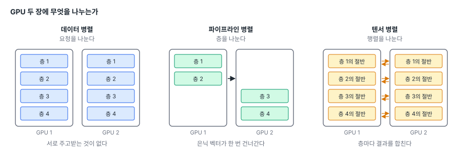
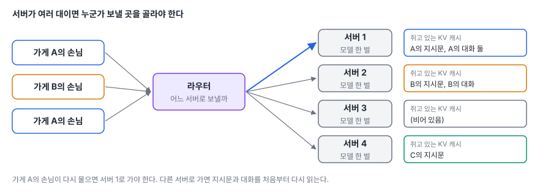
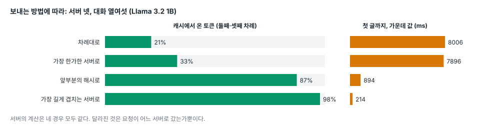
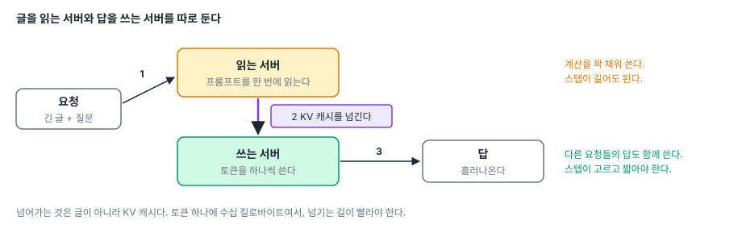

# 데이터센터 규모의 추론

5부의 마지막 장입니다. [39장](ch39_inference_server.md)에서 서버를 만들었고, [40장](ch40_throughput.md)에서 그 서버가
여러 요청을 함께 처리하게 했고, [41장](ch41_control_and_speed.md)에서 생성을 다듬었습니다. 모두
**기계 한 대** 안의 일이었습니다.

실제 서비스는 기계 수백 대에서 돕니다. 기계마다 GPU가 여럿 있고, 모델
하나가 GPU 여러 장에 걸쳐 있기도 하고, 같은 모델을 올린 서버가 수십
벌 떠 있습니다. 이 장은 그 규모에서 새로 생기는 문제들을 봅니다.

먼저 밝혀 둘 것이 있습니다. **이 책에는 데이터센터가 없습니다.** 맥
한 대가 전부이고, 데이터센터의 GPU는 한 장도 없습니다. 그래서 이 장은
세 가지를 섞어서 씁니다. 어느 것이 어느 것인지를 그때마다 적습니다.

- **읽은 것.** vLLM, SGLang, TensorRT LLM의 소스와 문서를 고정한
  커밋에서 읽었습니다. 돌려 보지는 않았습니다.
- **잰 것.** 서버가 여러 대일 때 생기는 문제 가운데 GPU 없이도 생기는
  것들은, badak의 서버를 이 맥에 여러 개 띄워서 쟀습니다.
- **계산한 것.** GPU의 숫자는 제조사가 적어 둔 값에 [15장](../part3/ch15_bottleneck.md)의 계산을
  적용한 것입니다. 잰 것이 아닙니다.

결과를 미리 적어 둡니다.

- 세 엔진의 구조는 이 책의 39~41장과 같습니다. 스텝마다 묶음을 다시 짜는
  스케줄러, 토막으로 나눈 KV 캐시, 앞부분이 같은 요청끼리 그 토막을 함께
  쓰는 기능이 있습니다. 이름과 자료 구조는 다르고(해시, 래딕스 트리),
  방법은 같습니다.
- 서버 넷 앞에 라우터를 두고 대화 열여섯 개를 보냈습니다. 차례대로
  돌아가며 보내면 둘째 차례에 읽은 토큰의 24%만 캐시에서 오고 첫 글까지
  8초가 걸립니다. 그 대화를 읽은 서버로 보내면 98%가 캐시에서 오고
  0.2초입니다(Llama 3.2 1B). **서버의 계산은 한 줄도 바뀌지
  않았습니다.**
- 캐시를 따라 보내면 요청이 한쪽으로 몰립니다. 캐시를 따르는 것과 고르게
  나누는 것은 서로 충돌합니다.
- 글을 읽는 서버와 답을 쓰는 서버를 따로 두고 KV 캐시를 넘겼습니다.
  넘기는 비용은 88밀리초와 189MB입니다(Llama 3.2 1B, 2,890토큰). 첫 글은
  빨라지지 않습니다. 얻는 것은 **답을 쓰던 요청이 멈추지 않는다**는
  것입니다. 한 서버에서 9초이던 멈춤이 26밀리초가 됩니다.
- 서버를 새로 띄워 첫 글이 나오기까지 0.06초(SmolLM2-135M)에서
  0.25초(Llama 3.2 1B, SmolLM2-1.7B)입니다. 가중치 파일이 운영체제의
  캐시에 있을 때의 값입니다. 디스크에서 읽어야 했을 때는 2초 가까이
  걸렸습니다. 미리 데워 두면 첫 요청이 빨라지지만, 띄우고 첫 글까지의
  시간은 줄지 않습니다.
- 서버를 늘리는 데 걸리는 시간이 요청이 몰릴 때의 기다림을 정합니다.
  모의실험에서, 새 서버가 2초 만에 뜨면 가장 오래 기다린 요청이 5초를,
  2분이 걸리면 3분을 기다립니다.

| 하는 일 | 절 |
|---|---|
| 데이터센터의 GPU를 숫자로 본다 | 42.1 |
| 세 엔진의 설계를 읽는다 | 42.2 |
| 모델 하나를 GPU 여럿에 나누는 방법을 읽는다 | 42.3 |
| 캐시가 있는 서버로 요청을 보낸다 | 42.4 |
| 글을 읽는 일과 답을 쓰는 일을 다른 서버에 둔다 | 42.5 |
| 서버를 새로 띄우는 값을 잰다 | 42.6 |
| 서버를 늘리고 줄이는 일을 따져 본다 | 42.7 |

## 42.1 데이터센터의 GPU를 숫자로 본다

[15장](../part3/ch15_bottleneck.md)에서 토큰 하나를 쓰는 속도의 천장을
계산했습니다. 순전파 한 번은 가중치 전체를 읽습니다. 그러니 1초에 쓸 수
있는 토큰은 **메모리에서 1초에 읽어 올 수 있는 바이트를 가중치의
바이트로 나눈 것**을 넘지 못합니다. 이 맥에서는 그 계산이 측정과
맞았습니다. 같은 계산을 데이터센터의 GPU에 해 봅니다.

| | 이 맥 (M4 Max) | NVIDIA H100 | NVIDIA H200 |
|---|---:|---:|---:|
| 메모리 | 48GB (CPU와 함께 씀) | 80GB | 141GB |
| 1초에 읽는 바이트 | 275GB (CPU, [15장](../part3/ch15_bottleneck.md)에서 잼) | 3,350GB[^h100] | 4,800GB[^h200] |
| Llama 3.2 1B(2.5GB)의 천장, 토큰/초 | 110 | 1,340 | 1,920 |
| 실제로 잰 것 | 99 ([40장](ch40_throughput.md)) | 재지 않음 | 재지 않음 |

맥의 줄은 잰 것이고, GPU의 줄은 제조사의 숫자를 나눈 것입니다.

**읽는 속도가 열두 배입니다.** 그만큼 토큰 하나를 쓰는 천장이
올라갑니다. 그런데 이 표에서 더 중요한 것은 **천장을 정하는 것이 여전히
메모리**라는 것입니다. H100이 가중치 2.5GB를 읽는 데 0.75밀리초가
걸립니다. 그 0.75밀리초 동안 H100이 할 수 있는 계산은 수천억 번이
넘고(제원 표의 16비트 연산 능력이 초당 1,979조 번입니다.[^h100] 별표가
붙은 값이어서 절반으로 잡아도 그렇습니다), 토큰 하나를 쓰는 데 필요한
곱셈은 12억 번입니다([15장](../part3/ch15_bottleneck.md)). 줄 하나짜리
순전파는 그동안 GPU가 할 수 있는 계산의 100분의 1도 쓰지 못합니다.

[40장](ch40_throughput.md)에서 묶음을 키울 때 처리량이 늘다가 멈춘 것은
CPU의 계산 능력을 다 썼기 때문입니다. GPU에서는 계산 능력이 훨씬 많이
남습니다. 그래서 데이터센터의 엔진이 하는 일은 한마디로 **묶음을 키우는
것**이고, 이 장에서 볼 설계는 대부분 "묶음을 키우는 것을 막는 것"을
없애는 일입니다. 묶음을 막는 것은 계산이 아니라 **메모리의 크기**입니다.
요청마다의 KV 캐시가 GPU의 80GB를 나눠 써야 하기 때문입니다.

**큰 모델은 한 장에 들어가지 않습니다.** 값이 700억 개인 모델은 값
하나에 2바이트씩 140GB입니다. H100의 80GB에 들어가지 않습니다. 줄여서
넣거나([20장](../part3/ch20_weight_quantization.md)의 양자화), 여러 장에
나눠 넣어야 합니다(42.3절).

## 42.2 세 엔진의 설계를 읽는다

데이터센터에서 언어 모델을 서빙하는 데 널리 쓰이는 공개 엔진 셋의 소스와
문서를 읽었습니다.[^engines] 돌려 보지는 않았습니다. 이 책이 만든 것과
견줍니다.

| | badak (이 책) | vLLM | SGLang | TensorRT LLM |
|---|---|---|---|---|
| 스텝마다 묶음을 다시 짜기 | 스케줄러 ([40장](ch40_throughput.md)) | 스케줄러. 답을 쓰는 요청을 먼저 태우고, 남는 토큰 몫에 글 읽기를 넣는다[^vllm-chunk] | | 스텝마다: 새 요청 받기, 일정 짜기, 순전파, 토큰 고르기[^trt-arch] |
| 글을 끊어 읽기 | `chunk` ([40장](ch40_throughput.md)) | 기본으로 켜져 있다[^vllm-chunk] | 크기를 정하는 옵션이 있다[^sglang-misc] | 있다[^trt-matrix] |
| 토막으로 나눈 KV 캐시 | 16토큰 페이지 ([40장](ch40_throughput.md)) | 블록의 풀 | | 블록의 풀. 블록의 크기는 2의 거듭제곱[^trt-kv] |
| 앞부분이 같은 요청끼리 함께 쓰기 | 남겨 둔 캐시와 견줘 페이지를 함께 가리킨다 ([40장](ch40_throughput.md)) | 블록마다 해시를 붙여 찾는다[^vllm-prefix] | 래딕스 트리 (RadixAttention)[^sglang] | 래딕스 트리. 쫓겨난 블록은 둘째 메모리로 내려간다[^trt-kv] |
| 문법에 묶기 | JSON 스키마 ([41장](ch41_control_and_speed.md)) | JSON, 정규식 등[^vllm-structured] | 있다[^sglang] | 있다[^trt-matrix] |
| 읽기와 쓰기를 다른 서버에 | 흉내만 (42.5절) | 실험 기능[^vllm-disagg] | 있다[^sglang-pd] | 있다[^trt-disagg] |
| GPU 여럿에 모델 나누기 | 없다 | 텐서·데이터 병렬 등[^vllm-parallel] | 텐서 병렬[^sglang-misc] | 여섯 가지[^trt-parallel] |

빈칸은 "없다"가 아니라 "이 책이 확인하지 않았다"입니다.

**구조가 같습니다.** 서로 다른 팀이 만든 엔진 셋이 같은 부품을 갖고
있고, 그 부품이 이 책의 39~41장과 겹칩니다. 문제가 같으면 해결책이
비슷해집니다. 요청마다 끝나는 때가 다르니 스텝마다 묶음을 다시 짜고,
캐시가 요청마다 다르게 자라니 토막으로 나누고, 요청의 앞부분이 겹치니 그
토막을 함께 씁니다.

달라지는 것은 "앞부분이 같은 토막을 어떻게 찾는가"입니다.

**vLLM은 해시로 찾습니다.** 블록마다 "이 블록의 토큰"과 "앞 블록의
해시"를 묶어 해시를 만듭니다. 앞 블록의 해시가 들어가므로, 블록의 해시가
같으면 글의 처음부터 그 블록까지가 모두 같습니다. 꽉 찬 블록만 찾을 수
있게 둡니다.[^vllm-prefix] 우리는 남겨 둔 캐시마다 토큰을 하나씩
견줬습니다. 캐시가 여덟 개일 때는 그것으로 충분하고, 수천 개가 되면
해시가 필요합니다.

**SGLang과 TensorRT LLM은 나무로 찾습니다.** 토큰열을 래딕스 트리에 넣어
두면, 새 요청의 토큰을 따라 내려가다 멈춘 곳이 가장 길게 겹치는
앞부분입니다.[^sglang] [^trt-kv] [41장](ch41_control_and_speed.md)에서
단어 사전을 나무로 엮은 것과 같은 방법입니다.

**캐시를 사람들 사이에 나누지 않는 장치가 들어 있습니다.** vLLM의
해시에는 "소금"을 섞을 수 있습니다. 소금이 다르면 글이 같아도 해시가
달라서, 한 사람의 캐시가 다른 사람의 요청에 쓰이지
않습니다.[^vllm-prefix] 39.7절에서 본 "캐시로 남의 글을 알아내는" 문제의
해결책입니다.

**한 가지는 이 책과 방향이 다릅니다.** vLLM의 스케줄러는 답을 쓰는
요청을 먼저 묶음에 넣고, 남는 토큰 수가 있을 때 글 읽기를
넣습니다.[^vllm-chunk] [40장](ch40_throughput.md)의 스케줄러는 둘을
가리지 않고 요청마다 정해진 수의 토큰을 받았습니다. 그래서 긴 글이
끼어들면 쓰던 요청이 느려졌습니다. 답을 쓰는 요청을 먼저 넣으면 그
느려짐에 한도가 생깁니다.

**이름이 가리키는 것이 바뀌기도 합니다.** TensorRT LLM은 이름과 달리
지금은 TensorRT로 만든 엔진을 쓰지 않습니다. 문서에 "PyTorch가 유일한
실행 백엔드이고 예전의 TensorRT 엔진 백엔드는 없앴다"고 적혀
있습니다.[^trt-arch] 이 책을 계획할 때 생각한 것("그래프를 미리 컴파일해
두는 엔진")과 다릅니다. 엔진은 빨리 바뀌고, 이 절의 표도 읽은 날의
것입니다.

## 42.3 모델 하나를 GPU 여럿에 나눈다

GPU 한 장으로 모자랄 때가 둘입니다. 모델이 한 장의 메모리에 들어가지
않을 때와, 한 장의 속도로 모자랄 때입니다.[^trt-parallel] 나누는 방법이
여럿이고, 무엇을 나누는가에 따라 구분합니다. **이 절은 읽은
것뿐입니다.**



| 방법 | 나누는 것 | 얻는 것 | 치르는 것 |
|---|---|---|---|
| 데이터 병렬 | **요청**. GPU마다 모델 전체를 한 벌씩 | 처리량 | 모델이 한 장에 들어가야 한다 |
| 파이프라인 병렬 | **층**. 앞의 층들은 첫 장에, 뒤의 층들은 둘째 장에 | 큰 모델이 올라간다 | 토큰 하나가 모든 장을 차례로 지나간다. 빨라지지 않는다 |
| 텐서 병렬 | **가중치 행렬**. 행렬 하나를 여러 장에 쪼갠다 | 큰 모델이 올라가고, 토큰 하나가 빨라진다 | 층마다 GPU들이 결과를 주고받는다 |

**데이터 병렬**은 이 책이 이미 한 것입니다. 42.4절에서 서버 넷을 띄운
것이 그것입니다. 서버는 서로를 모릅니다.

**파이프라인 병렬**은 [9장](../part2/ch09_transformer.md)의 블록을
앞뒤로 자르는 것입니다. 블록 사이를 오가는 것은 은닉 벡터 하나(토큰마다
수천 개의 수)뿐이어서 주고받는 양이 적습니다. 대신 토큰 하나를 쓸 때
GPU가 차례로 일하고, 한 장이 일하는 동안 나머지는 기다립니다. 요청
여럿을 엇갈려 넣어야 모든 장이 일합니다.

**텐서 병렬**은 선형 층 하나를 쪼갭니다. 행렬의 줄을 절반씩 나눠 두 장에
두면, 두 장이 같은 입력을 받아 출력의 절반씩을 동시에 계산합니다.
[15장](../part3/ch15_bottleneck.md)의 계산으로 보면 이것은 **메모리를
읽는 속도를 두 배로 늘리는 것**입니다. 가중치의 절반씩을 두 장이 함께
읽으므로, 토큰 하나의 천장이 올라갑니다. 대가는 통신입니다. 쪼개진
결과를 층마다 합쳐야 합니다. 그래서 텐서 병렬은 GPU 사이의 연결이 빠를
때 효과가 있습니다. H100의 문서가 GPU 사이의 연결(초당 900GB)을 메모리의
속도와 나란히 적어 두는 까닭입니다.[^h100]

TensorRT LLM의 문서는 여기에 셋을 더 적습니다. 전문가 여럿을 가진
모델(MoE)에서 전문가를 나누는 것, 긴 글의 처리를 나누는 것, 그리고
전문가 병렬에 부하를 고르게 하는 장치를 더한 것입니다.[^trt-parallel]
모델의 구조가 바뀌면 나누는 방법도 따라 늘어납니다.

## 42.4 캐시가 있는 서버로 요청을 보낸다

이제 재 볼 수 있는 것을 다룹니다. 서버가 여러 대이면 **어느 서버로
보낼지**를 누군가 정해야 합니다. 그 일을 하는 것이 라우터입니다.



서버가 요청마다 처음부터 계산한다면 고민할 것이 없습니다. 가장 한가한
서버로 보내면 됩니다. 그런데 [39장](ch39_inference_server.md)에서 서버는
**앞 요청의 KV 캐시를 가지고** 있게 되었습니다. 대화의 둘째 차례가 첫
차례와 다른 서버로 가면 그 서버는 대화를 처음부터 다시 읽습니다. 캐시는
첫 서버에 있는데 쓰지 못합니다. 39.13절에서 OpenAI의 문서가 "요청이 그
캐시를 가진 기계로 가야 한다"고 적은 것이 이 문제입니다.

보내는 방법 넷을 만들었습니다.

```rust,ignore
{{#include ../../../crates/badak_server/src/router.rs:policy}}
```

```rust,ignore
{{#include ../../../crates/badak_server/src/router.rs:choose}}
```

- **차례대로.** 서버에 고르게 나뉩니다. 캐시는 보지 않습니다.
- **가장 한가한 서버로.** 부하를 보고 나눕니다. 캐시는 보지 않습니다.
- **앞부분의 해시로.** 글의 앞 256바이트로 서버를 정합니다. 같은
  지시문으로 시작하는 요청은 늘 같은 서버로 갑니다. 라우터가 아무것도
  기억하지 않아도 됩니다. 대신 서버의 부하를 보지 않습니다.
- **가장 길게 겹치는 서버로.** 라우터가 서버마다 "최근에 보낸 글"을
  기억해 두고, 새 글과 가장 길게 겹치는 글을 받았던 서버로 보냅니다.
  겹치는 것이 없으면 가장 한가한 서버로 보냅니다.

라우터는 응답을 받는 대로 넘깁니다. 토큰이 흘러나오는 응답을 라우터가
모아 두었다가 보내면 [39장](ch39_inference_server.md)에서 한 일이
소용없어집니다.

```rust,ignore
{{#include ../../../crates/badak_server/src/router.rs:forward}}
```

재 봅니다. `badak serve`를 넷 띄웁니다(스레드 셋씩, 요청 둘까지 함께
처리). 가게 여덟 곳이 있고 가게마다 긴 지시문이 다릅니다. 가게마다
손님 둘이 저마다 대화를 하고, 대화마다 세 차례 묻습니다. 대화가
열여섯 개, 요청이 마흔여덟 개입니다. 한 번에 넷씩 보냅니다.

```bash
cargo build --release -p badak_cli
sh scripts/bench_ch42.sh 3
```

세 차례 잰 값의 가운데입니다. Llama 3.2 1B이고, 서버마다 끝난 요청의
캐시를 넷까지 남겨 둡니다.

| 보내는 방법 | 캐시에서 온 토큰: 첫 차례 | 둘째 | 셋째 | 첫 글: 가운데 (ms) | 95% (ms) | 다 끝나기까지 (초) | 서버마다 받은 요청 |
|---|---:|---:|---:|---:|---:|---:|---|
| 차례대로 | 0% | 24% | 12% | 8,006 | 11,231 | 110.5 | 12/12/12/12 |
| 가장 한가한 서버로 | 7% | 25% | 40% | 7,896 | 9,100 | 89.1 | 16/10/10/12 |
| 앞부분의 해시로 | 49% | 84% | 90% | 894 | 13,379 | 59.9 | 0/18/12/18 |
| 가장 길게 겹치는 서버로 | 43% | 98% | 98% | 214 | 7,666 | 36.9 | 12/12/12/12 |



**보내는 방법만으로 첫 글까지의 시간이 40분의 1이 됩니다.** 8초가
0.2초가 됩니다. 마흔여덟 요청이 다 끝나기까지는 110초가 37초가 됩니다.
서버의 수도, 서버의 코드도 같습니다. 달라진 것은 요청이 자기 캐시가 있는
서버로 갔는가뿐입니다.

**차례대로 보내면 캐시를 대부분 쓰지 못합니다.** 대화의 둘째 차례가 첫
차례와 같은 서버로 갈 확률이 넷에 하나입니다. 그렇게 가지 못하면
740토큰의 지시문과 대화를 처음부터 읽습니다. 캐시에서 온 것이 24%입니다.
서버마다 캐시를 넷까지만 남기므로, 셋째 차례에는 앞에서 남긴 것마저
밀려나 12%로 떨어집니다.

**가장 한가한 서버로 보내는 것은 차례대로와 다르지 않습니다.** 부하는 잘
나누지만(첫 글까지의 시간의 95번째 백분위가 조금 낮습니다) 캐시를 보지
않기는 마찬가지입니다.

**해시는 캐시를 찾지만 부하를 보지 않습니다.** 같은 가게의 요청은 늘
같은 서버로 갑니다. 캐시에서 온 것이 84%, 90%입니다. 그런데 "서버마다
받은 요청"을 보면 0, 18, 12, 18입니다. 가게 여덟 곳이 서버 넷에 고르게
나뉘지 않았고, **서버 하나는 요청을 하나도 받지 못했습니다.** 가운데
값은 좋은데 95번째 백분위(13초)가 넷 가운데 가장 나쁩니다. 몰린 서버에서
기다린 요청입니다. 가게가 수천 곳이면 고르게 퍼지겠지만, 큰 손님 몇이
대부분의 요청을 보내는 것이 보통입니다.

**기억해 두고 보내면 둘 다 얻습니다.** 캐시에서 온 것이 98%이고 서버마다
열두 개씩 받았습니다. 대화를 처음 보낼 때는 가장 한가한 서버를
고르고(그래서 고르게 퍼집니다), 그 뒤로는 그 대화를 읽은 서버로
보냅니다. 첫 차례에도 43%가 캐시에서 옵니다. 같은 가게의 둘째 손님이 첫
손님과 같은 서버로 가서 지시문의 캐시를 함께 씁니다.

**그래도 95번째 백분위는 7.7초입니다.** 캐시가 없는 요청(가게의 첫
손님)은 어디로 가든 740토큰을 읽어야 합니다. 라우터는 있는 캐시를 찾아
줄 뿐, 없는 캐시를 만들어 주지 못합니다.

### 캐시를 따르면 부하가 한쪽으로 쏠린다

SmolLM2-135M으로 같은 측정을 하면서 서버가 남겨 두는 캐시의 수를
바꿨습니다.

남겨 두는 캐시가 넷일 때:

| 보내는 방법 | 캐시에서 온 토큰: 첫 차례 | 둘째 | 셋째 | 첫 글: 가운데 (ms) | 95% (ms) | 다 끝나기까지 (초) | 서버마다 받은 요청 |
|---|---:|---:|---:|---:|---:|---:|---|
| 차례대로 | 0% | 42% | 17% | 1,298 | 2,314 | 19.1 | 12/12/12/12 |
| 가장 한가한 서버로 | 6% | 42% | 30% | 1,254 | 1,510 | 15.3 | 14/10/12/12 |
| 앞부분의 해시로 | 49% | 84% | 95% | 150 | 2,265 | 10.4 | 0/18/12/18 |
| 가장 길게 겹치는 서버로 | 49% | 97% | 90% | 45 | 1,239 | 7.9 | 12/12/6/18 |

여덟일 때:

| 보내는 방법 | 캐시에서 온 토큰: 첫 차례 | 둘째 | 셋째 | 첫 글: 가운데 (ms) | 95% (ms) | 다 끝나기까지 (초) | 서버마다 받은 요청 |
|---|---:|---:|---:|---:|---:|---:|---|
| 차례대로 | 6% | 47% | 57% | 1,247 | 2,194 | 17.2 | 12/12/12/12 |
| 가장 한가한 서버로 | 12% | 54% | 64% | 1,237 | 1,490 | 12.9 | 13/11/12/12 |
| 앞부분의 해시로 | 49% | 98% | 98% | 44 | 2,261 | 8.5 | 0/18/12/18 |
| 가장 길게 겹치는 서버로 | 43% | 98% | 98% | 42 | 1,229 | 7.2 | 12/12/12/12 |

**캐시가 모자라면 라우터의 기억이 틀립니다.** 캐시를 넷만 남길 때 "가장
길게 겹치는 서버로"의 셋째 차례가 90%로 떨어지고, 서버마다 받은 요청이
12, 12, 6, 18로 쏠렸습니다. 라우터는 "이 대화를 저 서버로 보냈다"는 것만
기억합니다. 그 서버가 그 캐시를 **이미 버렸는지**는 모릅니다. 대화가 한
서버에 다섯 개 몰리면 캐시 넷으로는 다 가지고 있을 수 없고, 라우터가
믿고 보낸 요청이 캐시 없는 서버로 갑니다. 캐시를 여덟으로 늘리면 98%로
돌아오고 부하도 고릅니다.

**캐시를 따라가면 부하가 쏠립니다.** 한 서버가 어떤 대화의 캐시를 가지고
있으면 그 대화의 다음 요청이 모두 그 서버로 옵니다. 그 서버가 바쁘다고
다른 서버로 보내면 캐시를 버리는 것이고, 그대로 보내면 대기열이
길어집니다. 어느 쪽에도 비용이 듭니다.

### 실전의 라우터는 서버에게 캐시를 묻는다

SGLang의 라우터가 같은 일을 합니다. SGLang에서는 라우터가 짐작하지
않습니다. 서버가 "내가 이 블록을 가졌다, 버렸다"를 알리고, 따로 도는
색인이 그것을 모아 "이 앞부분을 어느 서버가 가지고 있는가"에
답합니다.[^sglang-router] 우리의 라우터는 자기가 보낸 것만 기억하므로,
서버가 그 캐시를 이미 버렸는지를 모릅니다. 캐시가 넉넉할 때는 그래도
맞고, 모자랄 때는 틀립니다(위의 측정에서 본 그대로입니다).

그 라우터의 문서에는 이 절에서 본 맞바꿈을 다루는 장치가 들어 있습니다.
앞부분을 가진 서버를 고르되, **그 서버의 부하에서 캐시로 아끼는 토큰을
뺀 것**으로 다른 서버와 견줍니다. 캐시가 있어도 대기열이 너무 길면 다른
서버로 보냅니다. 그리고 겹치는 것이 1,024토큰이 안 되면 "가지고 있다"고
보지 않습니다.[^sglang-router]

## 42.5 읽기와 쓰기를 다른 서버에 둔다

[40장](ch40_throughput.md)에서 긴 글을 읽는 요청이 끼어들면 옆에서 답을
쓰던 요청이 멈췄습니다. 끊어 읽으면 멈춤이 줄지만 없어지지 않았고,
얼마나 끊을지를 고르기가 어려웠습니다.

두 일은 성질이 다릅니다. **글을 읽는 일**은 토큰 수천 개를 한 번에
넣으므로 계산 능력을 꽉 채워 씁니다. **답을 쓰는 일**은 토큰 하나씩을
넣으므로 메모리가 한계이고, 스텝마다의 시간이 고르기를 바랍니다. 둘을 한
묶음에 섞으면 서로를 방해합니다.

그래서 **서버를 나눕니다.** 글을 읽기만 하는 서버와 답을 쓰기만 하는
서버를 따로 둡니다. 요청은 먼저 읽는 서버로 가서 프롬프트의 KV 캐시를
만들고, 그 캐시가 쓰는 서버로 넘어가고, 쓰는 서버가 답을 씁니다.



vLLM의 문서가 까닭 둘을 듭니다. 첫 글까지의 시간과 토큰 사이의 시간을
따로 조절할 수 있다는 것, 그리고 토큰 사이의 시간의 꼬리(가장 느린 몇
%)를 줄일 수 있다는 것입니다. 끊어 읽기로도 같은 것을 얻을 수 있지만
알맞은 크기를 찾기가 어렵다고 적습니다. 그리고 한 줄을 굵게 적어 둡니다.
**처리량은 늘지 않는다.**[^vllm-disagg]

넘어가는 것이 KV 캐시입니다. 39.8절에서 그것을 파일에 쓰고 되살리는
기능을 만들었습니다. 그 기능으로 흉내를 냅니다. 읽는 서버(스레드 8개)와
쓰는 서버(스레드 4개)를 띄우고, 같은 디렉터리를 보게 합니다.

1. 읽는 서버에 긴 글을 보내 토큰 하나만 쓰게 합니다. 캐시가 만들어집니다.
2. 읽는 서버가 캐시를 파일에 씁니다(`POST /cache/save`).
3. 쓰는 서버가 그 파일을 되살립니다(`POST /cache/restore`).
4. 쓰는 서버에 같은 글을 보냅니다. 캐시가 다 맞으므로 바로 답을 씁니다.

그러는 동안 쓰는 서버는 **다른 요청의 답 192토큰**을 쓰고 있습니다.

| Llama 3.2 1B, 2,890토큰 | 시간 (ms) |
|---|---:|
| 한 서버(스레드 12개)가 다 할 때: 첫 글까지 | 8,469 |
| 읽는 서버(스레드 8개)가 글을 읽는 데 | 12,544 |
| 캐시를 파일에 쓰는 데 (189MB) | 48.5 |
| 쓰는 서버가 되살리는 데 | 39.2 |
| 쓰는 서버(스레드 4개)가 첫 글을 쓰는 데 | 30.9 |
| **나눴을 때: 첫 글까지** | **12,650** |

| Llama 3.2 1B: 그동안 쓰는 서버에서 다른 답을 쓰던 요청 | 토큰 사이: 가운데 (ms) | 95% | 가장 긴 멈춤 |
|---|---:|---:|---:|
| 혼자 쓸 때 | 13.7 | 15.1 | 15.3 |
| 읽는 서버가 옆에서 긴 글을 읽을 때 | 18.2 | 23.7 | 26.1 |

**넘기는 비용은 작습니다.** 2,890토큰의 캐시 189MB를 쓰고 되살리는 데
88밀리초입니다. 글을 읽는 12.5초에 견주면 드러나지 않습니다. 다만 이것은
같은 기계 안에서 파일로 넘긴 비용입니다. 다른 기계로 보낸다면 189MB가
통신망을 지나가야 합니다. 초당 1.25GB를 나르는 연결(10기가비트
이더넷)이면 0.15초, 그 열 배 빠른 연결이면 0.015초라는 **계산**이
나옵니다. 재지는 않았습니다. 실전의 엔진이 KV 캐시를 넘기는 방법을 따로
만들어 두는 까닭입니다(vLLM의 문서가 적어 둔 "연결기"가 아홉
가지입니다[^vllm-disagg]).

**첫 글은 빨라지지 않습니다.** 한 서버가 다 할 때 8.5초, 나눴을 때
12.7초입니다. 느려진 것은 읽는 서버에 스레드를 여덟만 주었기 때문입니다.
같은 스레드를 주었다면 넘기는 88밀리초만큼 느렸을 것입니다. vLLM의
문서가 굵게 적은 그대로입니다. 나눈다고 일이 줄지는 않습니다.

**얻는 것은 쓰던 요청입니다.** 읽는 서버가 12.5초 동안 긴 글을 읽는
동안, 쓰는 서버의 다른 요청은 가장 길게 26밀리초를 쉬었습니다.
[40장](ch40_throughput.md)에서 같은 일이 한 서버 안에서 일어났을 때는
9초를 쉬었습니다(끊지 않고 읽을 때). 64토큰씩 끊어 읽어도
0.26초였습니다.

**그런데 조금은 느려졌습니다.** 토큰 사이의 시간이 13.7밀리초에서
18.2밀리초가 되었습니다. 서버를 나눴는데도 방해를 받은 것은 **두 서버가
같은 기계에 있기 때문입니다.** 읽는 서버의 스레드 여덟 개와 쓰는 서버의
스레드 네 개가 같은 메모리에서 가중치를 읽어 옵니다.
[15장](../part3/ch15_bottleneck.md)에서 본 대로 이 맥이 메모리에서 읽어
오는 양에는 천장이 있고, 스레드 넷에서 이미 거의 찹니다. 프로세스를
나눠도 메모리는 나뉘지 않았습니다. 기계를 나누면 이 방해는 없을
것입니다. 확인하지는 못했습니다.

SmolLM2-135M에서도 같은 결과입니다.

| SmolLM2-135M, 3,265토큰 | 시간 (ms) |
|---|---:|
| 한 서버(스레드 12개)가 다 할 때: 첫 글까지 | 1,855 |
| 읽는 서버(스레드 8개)가 글을 읽는 데 | 2,604 |
| 캐시를 파일에 쓰는 데 (150MB) | 31.8 |
| 쓰는 서버가 되살리는 데 | 23.4 |
| 쓰는 서버(스레드 4개)가 첫 글을 쓰는 데 | 15.2 |
| **나눴을 때: 첫 글까지** | **2,677** |

| SmolLM2-135M: 그동안 쓰는 서버에서 다른 답을 쓰던 요청 | 토큰 사이: 가운데 (ms) | 95% | 가장 긴 멈춤 |
|---|---:|---:|---:|
| 혼자 쓸 때 | 3.0 | 3.2 | 3.4 |
| 읽는 서버가 옆에서 긴 글을 읽을 때 | 3.0 | 3.8 | 4.1 |

## 42.6 서버를 새로 띄우는 시간을 잰다

요청이 늘면 서버를 더 띄웁니다. 새 서버가 첫 요청을 받을 수 있게
되기까지의 시간이 **콜드 스타트**입니다. 그동안 온 요청은 이미 떠 있는
서버의 대기열에서 기다립니다.

`badak serve`를 새로 띄워, 요청을 받을 수 있게 되기까지와 첫 요청의 첫
글까지를 쟀습니다.

세 차례 잰 값의 가운데 값입니다. 스레드 12개입니다. "데우기"는
39.9절에서 만든 것으로, 요청을 받기 전에 모델을 한 번 돌려 두는
일입니다.

| 모델 (가중치) | 데우기 | 요청을 받기까지 (ms) | 첫 요청의 첫 글 (ms) | 둘째 요청의 첫 글 (ms) | 띄우고 첫 글까지 (ms) |
|---|---|---:|---:|---:|---:|
| SmolLM2-135M (0.27GB) | 함 | 59 | 16 | 16 | 75 |
| SmolLM2-135M (0.27GB) | 안 함 | 41 | 22 | 16 | 63 |
| SmolLM2-360M (0.72GB) | 함 | 85 | 38 | 38 | 122 |
| SmolLM2-360M (0.72GB) | 안 함 | 43 | 47 | 37 | 91 |
| Llama 3.2 1B (2.5GB) | 함 | 198 | 56 | 55 | 254 |
| Llama 3.2 1B (2.5GB) | 안 함 | 136 | 84 | 55 | 218 |
| SmolLM2-1.7B (3.4GB) | 함 | 213 | 163 | 160 | 377 |
| SmolLM2-1.7B (3.4GB) | 안 함 | 52 | 194 | 160 | 246 |

SmolLM2 세 모델의 줄은 47.3절의 수정 뒤에 다시 잰 것입니다. 이 측정의
요청은 질문 하나뿐이어서, 서버가 기본 지시문을 앞에 놓게 된 뒤로 읽을
글이 두 배쯤 길어졌고 첫 글까지의 시간도 그만큼 늘었습니다.

**띄우는 것이 빠릅니다.** 3.4GB짜리 모델이 0.05초 만에 요청을 받을 수
있게 되고, 0.2초 뒤에 첫 글을 냅니다.
[20장](../part3/ch20_weight_quantization.md)에서 가중치를 읽지 않고
**파일을 메모리에 비추게** 한 덕입니다. 띄울 때 하는 일은 파일을 열고
어디에 무엇이 있는지를 적어 두는 것뿐입니다.

**그 숫자에는 조건이 붙어 있습니다.** 가중치 파일이 운영체제의 파일
캐시에 이미 올라 있었습니다. 방금까지 그 모델을 쓰고 있었기 때문입니다.
벤치마크를 돌리기 전에 SmolLM2-1.7B를 한 번 띄워 봤을 때는 요청을
받기까지 1.7초가 걸렸습니다. 그 파일을 한동안 쓰지 않아 디스크에서
올라와야 했던 것으로 보입니다. 뒤에 이 표를 다시 잴 때도 첫 차례에 같은
모델이 1.9초 걸렸습니다(일부러 만들지는 못했습니다. 파일 캐시를 비우려면
관리자 권한이 필요합니다). 이 맥의 디스크가 어느 정도인지는 따로
봤습니다. 이틀 동안 쓰지 않은 3.4GB 파일을 처음 읽는 데 0.52초(초당
6.6GB), 바로 다시 읽는 데 0.16초가 걸렸습니다. 한 번씩 잰 값입니다.

**데워 두면 첫 요청이 빨라집니다.** 데우지 않으면 첫 요청의 첫 글이 둘째
요청보다 1.5배 늦습니다(Llama 3.2 1B에서 84 대 55밀리초). 데워 두면
같습니다.

**그런데 띄우고 첫 글까지의 시간은 줄지 않습니다.** 오히려 조금
늡니다(218밀리초가 254밀리초). 데우는 일도 순전파 한 번이고, 그 시간만큼
요청을 받는 것이 늦어지기 때문입니다. 데우기는 일을 줄이는 것이 아니라
**누가 그 비용을 치르는지를 바꾸는 것**입니다. 데우지 않으면 첫 손님이
치르고, 데우면 서버를 띄우는 쪽이 치릅니다. 요청을 이미 받고 있는 서버
옆에 새 서버를 더할 때는 데우는 편이 낫습니다. 새 서버가 준비되었다고
알리기 전에 느린 첫 스텝을 끝내 두면, 어떤 요청도 그 느린 스텝을 겪지
않습니다. 요청 하나가 서버가 뜨기를 기다리고 있을 때는 데우지 않는 편이
빠릅니다.

### 데이터센터에서는 띄우는 일이 훨씬 길다

데이터센터에서 서버 한 대를 새로 띄우는 일은 훨씬 깁니다. 기계를 얻고,
프로그램이 든 이미지(수 GB에서 수십 GB)를 받고, 가중치(수십 GB)를 받고,
그것을 GPU의 메모리에 올리고, 커널을 준비하고, 한 번 돌려 데웁니다. 이
책이 잰 것은 그 가운데 맨 뒤의 둘, 그것도 CPU에서의 것뿐입니다. 앞의
단계는 재지 않았습니다.

그래도 이 책의 엔진에서 얻은 것이 하나 있습니다. **가중치를 읽는 방법이
띄우는 시간을 정합니다.**
[20장](../part3/ch20_weight_quantization.md)에서 가중치를 파일에 저장된
그대로 메모리에 비추게 했습니다. 읽어서 풀어 놓는 일이 없으므로, 3.4GB
모델을 띄우는 데 드는 시간이 파일을 읽는 시간뿐입니다. 파일의 형식이
메모리의 형식과 같아야 한다는 [6장](../part1/ch06_model_files.md)의
원칙이 서버를 띄우는 시간을 줄였습니다.

## 42.7 서버를 늘리고 줄이는 일을 따져 본다

요청은 고르게 오지 않습니다. 낮과 밤이 다르고, 갑자기 몰립니다. 늘 가장
몰릴 때에 맞춰 서버를 띄워 두면 대부분의 시간에 GPU가 쉽니다. 그래서
**요청을 보고 서버의 수를 바꿉니다.**

재 볼 수 없는 일입니다. 서버를 수십 대 띄울 기계가 없습니다. 대신 **따져
봅니다.** 요청이 몰리는 때를 만들어 내고, 서버가 요청 하나를 처리하는
시간([39장](ch39_inference_server.md)에서 잰 0.72초)과 새 서버가 뜨는 데
걸리는 시간을 넣어, 대기열이 어떻게 자라는지를 계산합니다. 모의실험이고,
넣은 숫자의 출처를 출력에 적었습니다.

```bash
cargo run --release -p badak_server --example ch42_autoscale
```

```text
{{#include output/ch42_autoscale.txt}}
```

**새 서버가 뜨는 시간보다 기다림을 줄일 수는 없습니다.** 요청이 다섯
배로 몰리는 순간부터 새 서버가 준비될 때까지는 있던 서버 하나가 모두를
받습니다. 2초 만에 뜨면 가장 오래 기다린 요청이 5초를 기다립니다. 30초가
걸리면 28초, 2분이 걸리면 3분입니다. 스케줄러를 아무리 잘 짜도 이 시간은
줄지 않습니다.

**늦게 뜰수록 더 많이 띄웁니다.** 표의 마지막 열을 보면, 2초 만에 뜰
때는 다섯 대로 끝났는데, 30초가 걸릴 때는 스무 대, 2분이 걸릴 때는
여든여덟 대를 띄웠습니다. 새 서버를 기다리는 동안 대기열이 계속 자라고,
대기열을 보고 띄우는 규칙은 그 대기열을 보고 또 띄웁니다. 띄운 서버가
한꺼번에 준비되면 필요한 것보다 훨씬 많습니다. 이 모의실험의 규칙이
단순해서 생긴 일이지만, 실제로도 **느리게 반응하는 것을 빠르게
재촉하면** 같은 일이 생깁니다. "이미 띄우고 있는 것"을 계산에 넣고, 띄운
뒤에 한동안은 더 띄우지 않게 해야 합니다.

**무엇을 보고 늘릴지가 중요합니다.** 이 모의실험은 대기열의 길이를
봤습니다. 흔히 쓰는 "CPU 사용률"은 추론 서버에서 쓸모가 없습니다. GPU는
요청이 하나만 있어도 꽉 찬 것처럼 보이고, [40장](ch40_throughput.md)에서
본 대로 묶음이 커져도 "사용률"은 그대로입니다. 봐야 하는 것은
[39장](ch39_inference_server.md)부터 재 온 값입니다. 기다리는 요청의 수,
첫 글까지의 시간, 토큰 사이의 시간입니다.

**0대까지 줄이면 첫 요청이 콜드 스타트를 통째로 치릅니다.** 쓰지 않는
모델의 서버를 모두 내리면 돈은 아끼지만, 다음 요청은 서버가 뜰 때까지
기다립니다. 그래서 띄우는 시간을 줄이는 일(42.6절)이 곧 돈을 아끼는 일이
됩니다.

## 42.8 남긴 일을 적어 둔다

이 장은 책에서 **직접 하지 않은 것**이 가장 많은 장입니다.

**GPU에서의 측정.** 42.1절의 GPU 숫자는 계산입니다. 42.2절의 엔진들을
돌려 보지 않았습니다.

**모델 병렬화.** 42.3절은 읽은 것뿐입니다. 텐서 병렬의 통신 비용이
얼마인지, 파이프라인 병렬에서 요청을 어떻게 엇갈려 넣는지를 재지
않았습니다.

**진짜 통신망.** 서버가 모두 한 기계 안에 있었습니다. KV 캐시를 넘기는
비용은 파일을 쓰고 읽는 비용이었고, 통신망으로 보내는 비용은 계산만
했습니다. 읽는 서버와 쓰는 서버가 같은 메모리를 나눠 써서, 나눠도 서로를
조금 방해했습니다.
**라우터의 나머지.** 서버가 죽었는지 살피는 일, 죽은 서버로 가던
요청을 다시 보내는 일, 서버가 쥔 캐시를 서버에게 직접 묻는 일, 라우터
자신을 여러 대 두는 일을 하지 않았습니다.

**스케줄러와 라우터의 맞물림.** 라우터는 서버의 부하를 "보낸 요청의
수"로만 압니다. 서버가 실제로 얼마나 밀려 있는지(대기열의 길이, 남은
페이지)를 묻지 않습니다.

**콜드 스타트의 앞 단계들.** 42.6절에 적은 대로입니다.

**오토스케일링.** 모의실험뿐입니다. 서버를 줄이는 쪽은 넣지도
않았습니다.

**돈.** 데이터센터의 설계는 결국 "토큰 하나에 얼마가 드는가"로
정해집니다. 그 계산을 하지 않았습니다.

## 5부를 마친다

5부는 엔진을 **남이 쓰는 것**으로 만들었습니다.
[39장](ch39_inference_server.md)에서 요청을 받는 법과 믿을 수 없는
입력을 다루는 법을, [40장](ch40_throughput.md)에서 여러 요청을 함께
처리하는 법을, [41장](ch41_control_and_speed.md)에서 답의 형식과 속도를
다듬는 법을, 이 장에서 서버가 여러 대일 때 생기는 일을 봤습니다.

돌아보면 5부의 거의 모든 것이 **KV 캐시를 어디에 두고 누구와
나누는가**였습니다. 요청 사이에 남겨
두고([39장](ch39_inference_server.md)), 파일에
쓰고([39장](ch39_inference_server.md)), 토막으로 나눠 함께
쓰고([40장](ch40_throughput.md)), 틀린 짐작을
지우고([41장](ch41_control_and_speed.md)), 그것을 가진 서버로 요청을
보내고(42장), 다른 서버로 넘깁니다(42장).
[11장](../part2/ch11_kv_cache.md)에서 "한 번 계산한 것을 다시 계산하지
않는다"로 시작한 방법이 서버의 설계 전체에 쓰였습니다.

그리고 그 바탕에는 3부의 숫자 둘이 있었습니다. 메모리에서 1초에 읽어
오는 바이트와, 1초에 하는 곱셈입니다. 묶으면 왜
빨라지는지([40장](ch40_throughput.md)), 짐작이 왜 싸거나
비싼지([41장](ch41_control_and_speed.md)), GPU에서 왜 묶음의 효과가 더
큰지(42장)가 모두 그 둘의 비율에서 나왔습니다.

6부에서는 반대쪽 끝으로 갑니다. 기계 수백 대가 아니라 **주머니 속의 기계
한 대**입니다. 메모리도, 전력도, 열도 모자랍니다.

## 정리

- 데이터센터의 GPU는 메모리를 훨씬 빨리 읽고, 계산은 그보다도 훨씬
  남습니다. 그래서 묶음을 키우는 것이 설계의 중심이 되고, 묶음을 막는
  것은 KV 캐시가 차지하는 메모리입니다.
- 널리 쓰이는 엔진들의 뼈대는 같습니다. 스텝마다 묶음을 짜는 스케줄러,
  토막으로 나눈 캐시, 앞부분이 같은 토막을 함께 쓰기.
- 모델을 GPU 여럿에 나누는 방법은 무엇을 나누는가로 갈립니다. 요청,
  층, 행렬.
- 서버가 캐시를 쥐면 "어느 서버로 보낼까"가 성능을 정합니다. 캐시를
  따라 보내는 것과 고르게 나누는 것은 서로 당깁니다.
- 글을 읽는 일과 답을 쓰는 일을 다른 서버에 두면 답을 쓰던 요청이
  멈추지 않습니다. 처리량은 늘지 않습니다. 넘기는 것은 KV 캐시이고
  그것은 큽니다.
- 서버를 새로 띄우는 시간이 요청이 몰릴 때의 기다림을 정합니다.
  가중치를 파일의 꼴 그대로 쓰면 그 시간이 파일을 읽는 시간이 됩니다.
- 읽은 것, 잰 것, 계산한 것을 구분해 적습니다.

## 연습 문제

1. 라우터가 서버에게 묻게 해 보십시오. 서버의 `GET /cache`가 남겨 둔
   캐시들의 앞부분(의 해시)을 알려 주고, 라우터가 그것으로 고릅니다.
   서버가 캐시를 버린 뒤에 라우터가 틀리는 일이 얼마나 줄어듭니까.
2. "가장 길게 겹치는 서버"를 고르되, 그 서버가 처리하고 있는 요청이
   다른 서버보다 둘 넘게 많으면 가장 한가한 서버로 보내게 해 보십시오.
   캐시에서 오는 비율과 첫 글까지의 시간의 95번째 백분위가 각각 어떻게
   바뀝니까.
3. 서버 하나를 도중에 죽이고, 라우터가 그것을 알아차려 나머지로
   보내게 해 보십시오. 죽은 서버가 쥐고 있던 대화들은 어떻게 됩니까.
4. 42.5절의 흉내에서, 캐시를 파일이 아니라 TCP 연결로 넘기게 해
   보십시오. 같은 기계 안에서 넘기는 시간은 파일과 얼마나 다릅니까.
   초당 1.25GB(10기가비트 이더넷)로 묶으면 어떻게 됩니까.
5. 읽는 서버가 프롬프트의 **마지막 토큰은 읽지 않고** 넘기게 해
   보십시오. 쓰는 서버가 그 토큰을 읽으며 첫 토큰을 고릅니다. 읽는
   서버가 토큰 하나를 쓰는 시간이 얼마나 줄어듭니까.
6. 모의실험에 "띄운 뒤 30초 동안은 더 띄우지 않기"와 "이미 띄우고 있는
   서버가 준비되면 받을 수 있는 양을 줄에서 빼고 보기"를 넣어
   보십시오. 2분이 걸릴 때 띄우는 서버가 몇 대로 줄어듭니까. 기다림은
   어떻게 됩니까.
7. 모의실험에 서버를 줄이는 규칙을 넣어 보십시오. 줄이는 임계값을
   늘리는 임계값과 같게 두면 어떤 일이 생깁니까.
8. 42.1절의 계산을 이 맥의 GPU에 해 보십시오. [15장](../part3/ch15_bottleneck.md)에서 GPU 쪽이 초당
   447GB를 읽는다고 쟀습니다. [23장](../part3/ch23_gpu.md)과 [25장](../part3/ch25_rematch.md)에서 잰 토큰 속도와
   맞습니까.

## 참고 문헌

이 장의 숫자 가운데 badak의 것은 이 책이 잰 것이고, GPU의 것은 아래의
제조사 문서의 값입니다. 엔진들은 소스를 받아 읽었고 돌려 보지
않았습니다. 웹 문서는 2026년 11월 21일에 열어 확인했습니다.

[^h100]: NVIDIA, "NVIDIA H100 GPU".
    <https://www.nvidia.com/en-us/data-center/h100/>. 제원 표에 H100
    SXM의 GPU 메모리 80GB, 메모리 대역폭 3.35TB/s, BFLOAT16과 FP16
    연산 1,979 테라플롭스(별표가 붙어 있고, 무엇을 뜻하는 별표인지는
    확인하지 않았습니다), 가장 큰 전력 700W가, 본문에 NVLink의 초당
    900GB가 적혀 있습니다.

[^h200]: NVIDIA, "NVIDIA H200 GPU".
    <https://www.nvidia.com/en-us/data-center/h200/>. GPU 메모리 141GB,
    메모리 대역폭 4.8TB/s.

[^engines]: 읽은 판은 다음과 같습니다. vLLM 커밋 `0d93fd5e17ee`,
    SGLang 커밋 `459b85fb6884`, TensorRT LLM 커밋 `54897c5d5eee`. 셋 다
    2026년 11월 20일의 것입니다.

[^vllm-prefix]: vLLM, `docs/design/prefix_caching.md`. 블록의 해시가 앞
    블록의 해시, 블록의 토큰들, 그 밖의 값(LoRA의 번호, 캐시의 소금
    등)으로 이루어진다는 것과 "We only cache full blocks"가 적혀
    있습니다.

[^vllm-chunk]: vLLM, `docs/configuration/optimization.md`의 "Chunked
    Prefill" 절. 기본으로 켜져 있다는 것과, 켜져 있으면 답을 쓰는
    요청을 모두 묶은 뒤에 남는 토큰 몫으로 글 읽기를 넣는다는 것이
    적혀 있습니다.

[^vllm-disagg]: vLLM, `docs/features/disagg_prefill.md`. 본문에 옮긴
    까닭 둘과 "Disaggregated prefill DOES NOT improve throughput"이
    적혀 있습니다. 문서의 제목에 "experimental"이 붙어 있습니다.

[^sglang]: L. Zheng, L. Yin, Z. Xie, C. Sun, J. Huang, C. H. Yu 외,
    "SGLang: Efficient Execution of Structured Language Model Programs",
    2023. arXiv:2312.07104. 초록까지만 읽었습니다. KV 캐시를 다시 쓰는
    RadixAttention과 구조가 정해진 출력을 빨리 푸는 방법이 적혀
    있습니다. 소스에서는 `python/sglang/srt/mem_cache/radix_cache.py`가
    그 나무입니다.

[^sglang-router]: SGLang, `sgl-router/ARCHITECTURE.md`와
    `sgl-router/sgl-kv-indexer/README.md`. 색인이 "어느 서버와 어느
    저장 층이 블록을 쥐고 있는지"를 적어 두어 라우터가 캐시 적중을
    물을 수 있게 한다는 것, 서버의 짐에서 캐시된 앞부분을 뺀다는 것,
    앞부분을 쥐었다고 보는 임계값이 1,024토큰이라는 것이 적혀 있습니다.
    색인의 문서는 스스로를 "experimental"이라고 적습니다.

[^sglang-pd]: SGLang, `docs/docs/advanced_features/pd_disaggregation.mdx`.
    글 읽기가 끼어들어 답 쓰기를 늦춘다는 것을 문제로 듭니다.

[^trt-arch]: TensorRT LLM, `docs/source/torch/arch_overview.md`.
    "PyTorch is the sole execution backend"와, 스텝 하나의 순서, 일정
    짜기의 두 단계가 적혀 있습니다.

[^trt-kv]: TensorRT LLM, `docs/source/features/kvcache.md`.

[^trt-matrix]: TensorRT LLM,
    `docs/source/features/feature-combination-matrix.md`. 기능들을 함께
    쓸 수 있는지를 적은 표에 "Chunked Prefill"과 "Guided Decoding"의
    줄이 있습니다.

[^vllm-structured]: vLLM, `docs/features/structured_outputs.md`.

[^vllm-parallel]: vLLM, `docs/serving/data_parallel_deployment.md`.
    `--data-parallel-size`와 `--tensor-parallel-size`를 함께 쓰는 보기가
    있습니다.

[^sglang-misc]: SGLang, `docs/docs/references/multi_node_deployment/multi_node.mdx`
    (`--tp 16`)와 `docs/docs/supported-models/rerank_models.mdx`
    (`--chunked-prefill-size`). 옵션이 있다는 것만 확인했습니다.

[^trt-parallel]: TensorRT LLM, `docs/source/features/parallel-strategy.md`.
    여러 장이 필요한 까닭 둘과 병렬화 방법 여섯이 적혀 있습니다.
    42.3절의 표는 그 문서의 설명을 이 책의 말로 옮긴 것이고, "치르는
    것"의 칸은 이 책이 9장과 15장에 비추어 적은 것입니다.

[^trt-disagg]: TensorRT LLM, `docs/source/features/disagg-serving.md`.
