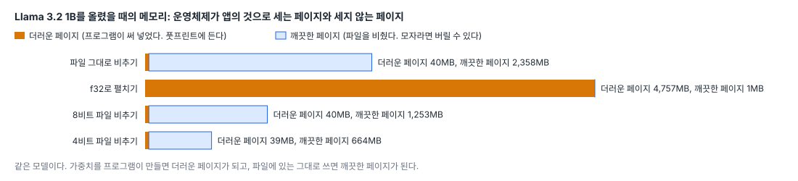

# 기기 위의 제약

6부를 시작합니다. 5부에서는 기계를 늘려 갔습니다. 서버 한 대에서 여러
대로, GPU 한 장에서 여러 장으로 갔습니다. 6부는 반대 방향으로 갑니다.
**사용자의 주머니 속에 있는 기계 한 대**입니다.

폰에서 모델을 돌리는 까닭은 [1장](../part1/ch01_landscape.md)에서
적었습니다. 통신이 끊겨도 돌고, 사용자의 글과 사진이 기기를 떠나지 않고,
서버 비용이 들지 않습니다. 그 대신 치르는 것이 이 장의 주제입니다.
서버에서는 기계가 우리 것이었습니다. 메모리가 모자라면 더 큰 기계를
빌렸습니다. 폰에서는 **기계가 사용자의 것**이고, 우리 앱은 그 기계를
함께 쓰는 여러 앱 가운데 하나입니다.

먼저 밝혀 둡니다. **이 장의 측정은 맥에서 한 것입니다.** 이 책은 폰
실기기의 성능 숫자를 싣지 않습니다(다음 판으로 미뤘습니다). 그래서 이
장은 두 가지를 합니다. 제약이 무엇인지와 그것을 **재는 법**을 적고,
맥에서도 잴 수 있는 것은 재서 그 경향을 봅니다. 폰의 숫자는 다를 것이고
경향은 같을 것입니다.

결과를 미리 적어 둡니다.

- 엔진의 실행 파일은 0.5MB에서 1.2MB입니다. 빌드 설정으로 반까지 줄일 수
  있는데, 마지막 100KB를 줄이는 대가가 **속도 4분의 1**입니다. 크기의
  대부분은 엔진이 아니라 모델입니다.
- 가중치 파일을 메모리에 비추면, 2.5GB짜리 모델을 올려도 운영체제가 세는
  "이 앱의 메모리"는 71MB입니다. 같은 모델을 읽어서 펼치면 5GB입니다.
  폰에서 앱이 죽고 사는 것이 이 숫자에 달려 있습니다.
- 가중치를 **읽을 때** 양자화하면 파일을 비춘 이득이 사라집니다.
  SmolLM2-135M을 읽으면서 4비트로 줄이면 풋프린트가 217MB이고, 미리 줄여
  둔 파일을 비추면(Llama 3.2 1B) 71MB입니다.
- 작은 코어 넷은 큰 코어 넷보다 7배에서 12배 느립니다. 폰의 코어는
  대부분 작은 코어입니다.
- 3분 동안 쉬지 않고 돌려도 이 맥에서는 속도가 떨어지지 않았습니다. 팬이
  있기 때문입니다. 폰에는 팬이 없습니다. 이것은 맥에서 볼 수 없는
  제약입니다. 전력도 재지 못했습니다.

| 하는 일 | 절 |
|---|---|
| 서버와 기기가 어떻게 다른지 본다 | 43.1 |
| 실행 파일과 모델의 크기를 잰다 | 43.2 |
| 시작해서 첫 답이 나오기까지를 잰다 | 43.3 |
| 운영체제가 세는 메모리를 잰다 | 43.4 |
| 큰 코어와 작은 코어를 견준다 | 43.5 |
| 열과 전력을 어떻게 재는지 본다 | 43.6 |
| 마이크로컨트롤러를 훑어본다 | 43.7 |

## 43.1 폰에서는 기계가 사용자의 것이다

서버와 폰을 견줍니다.

| | 서버 (5부) | 폰 (6부) |
|---|---|---|
| 기계 | 우리가 고른다 | 사용자가 가진 것. 수천 가지다 |
| 메모리 | 모자라면 늘린다 | 다른 앱과 나눠 쓴다. 많이 쓰면 운영체제가 앱을 죽인다 |
| 전력 | 요금 | 배터리. 사용자가 지켜본다 |
| 열 | 냉각 장치가 있다 | 팬이 없다. 뜨거워지면 느려진다 |
| 크기 | 디스크는 넉넉하다 | 내려받는 크기에 한도가 있고, 크면 설치하지 않는다 |
| 시작 | 한 번 띄워 계속 쓴다 | 앱을 열 때마다 처음부터. 뒤로 가면 언제든 죽는다 |
| 재는 것 | 처리량, 지연 | 위의 모두 |

5부에서 다듬은 것은 "같은 기계로 더 많은 요청을"이었습니다. 6부에서
다듬는 것은 **"요청 하나를 가장 적게 쓰고"**입니다. 코드가 같아도
보는 숫자가 다릅니다.

## 43.2 실행 파일과 모델의 크기를 잰다

앱의 크기에 따라 사용자가 설치할지 말지가 갈립니다. 가게(앱 스토어)에도
한도가 있습니다. 애플의 문서는 iOS 앱의 풀어 놓은 크기를 4GB까지, 실행
파일의 코드 구역을 500MB까지로 적고,[^apple-size] 구글 플레이의 문서는
앱의 바탕 묶음을 500MB까지, 따로 받는 자산 묶음 하나를 1.5GB까지로
적습니다.[^play-size] 그 한도에 닿기 전에 사용자가 먼저 설치를
그만둡니다.

크기는 둘로 나뉩니다. **엔진**(실행 파일)과 **모델**(가중치 파일)입니다.

### 엔진은 1MB 안팎이다

가장 작은 프로그램 셋을 만들어 크기를 쟀습니다. 사진 한 장을 분류하는
것(`ch43_device`), 언어 모델로 글을 쓰는 것(`ch43_llm`), 그리고
[39장](../part5/ch39_inference_server.md)의 `badak`입니다. 빌드 설정을
하나씩 더해 갑니다.

```bash
sh scripts/bench_ch43.sh 3
```

| 빌드 설정 | 사진 분류 (KB) | 언어 모델 (KB) | `badak` (KB) | MobileNetV2 한 장 (ms) | SmolLM2 (토큰/초) |
|---|---:|---:|---:|---:|---:|
| 저장소의 설정 그대로 | 1,208 | 1,198 | 1,656 | 4.4 | 424 |
| + 기호 떼기 (strip) | 855 | 854 | 1,161 | 4.5 | 424 |
| + 전체를 한 번에 최적화 (LTO) | 701 | 668 | 934 | 4.7 | 394 |
| + 공황에서 바로 멈추기 (panic=abort) | 651 | 635 | 834 | 5.4 | 395 |
| + 크기 위주로 (opt-level s) | 569 | 536 | 702 | 10.2 | 210 |
| + 크기만 보고 (opt-level z) | 537 | 520 | 638 | 18.2 | 97 |

속도는 세 번 잰 값의 중앙값입니다.

**엔진은 작습니다.** 사진을 분류하는 프로그램 전체가 1.2MB이고, 설정
셋으로 0.65MB가 됩니다. [26장](../part4/ch26_graph_interpreter.md)의
해석기, 27~30장의 커널과 최적화가 다 들어 있습니다. 외부 라이브러리를
쓰지 않은 덕을 여기서 봅니다.

**처음 셋은 비용이 거의 없습니다.** 기호를 떼는 것(디버깅에 쓰는 이름을
빼는 것)은 속도를 바꾸지 않습니다. 전체를 한 번에 최적화하는 것(LTO)은
쓰지 않는 코드를 더 잘 지웁니다. 패닉(표의 "공황")이 났을 때 스택을
되감지 않고 바로 멈추게 하면 되감는 데 쓰는 표가 빠집니다. 셋을 더해
1,208KB가 651KB가 됩니다. 속도는 조금 흔들리는 정도입니다.

**그다음부터는 속도와 맞바꿉니다.** 컴파일러에게 "빠르게"가 아니라
"작게" 만들라고 하면(opt-level s) 82KB가 줄고 **속도가 절반**이 됩니다.
더 작게(z) 하면 32KB가 더 줄고 속도가 **4분의 1**이 됩니다. 3부에서 만든
커널이 무엇으로 빨랐는지를 여기서 알 수 있습니다. 루프를 펼치고, 함수를
부르는 대신 부르는 곳에 풀어 넣은 것입니다. "작게"는 그것을 하지 말라는
설정입니다.

그러니 쓸 만한 설정은 넷째 줄까지입니다. 100KB를 더 줄이려고 속도를
반으로 줄일 까닭이 없습니다. 모델이 수백 MB이기 때문입니다. 다만
**커널만 빠르게, 나머지는 작게** 빌드하는 방법이 있습니다. 파일을 읽고
그래프를 짜는 코드는 느려도 됩니다. 크레이트마다 설정을 달리하면 되는데
해 보지 않았습니다.

다른 엔진의 크기도 봅니다. 이 책이 견줘 온 엔진의, 맥용 Python 패키지에
든 라이브러리 파일의 크기입니다.

| 엔진 | 라이브러리 파일 | 크기 |
|---|---|---:|
| badak (사진 분류, 넷째 줄) | 실행 파일 전체 | 0.65MB |
| LiteRT 2.3.0 | `libLiteRt.dylib` | 6.4MB |
| ONNX Runtime 1.32.0 | `libonnxruntime.dylib` | 35.3MB |

**이 표는 공정하지 않습니다.** 두 엔진은 연산을 수백 가지 지원하고
우리는 수십 가지입니다. 그리고 표의 파일은 맥용 패키지이지 폰용으로 줄여
빌드한 것이 아닙니다. 폰에 넣을 때는 쓰는 연산만 남기고 빌드하는 방법이
엔진마다 있습니다. 이 표에서 알 수 있는 것은 하나입니다. **엔진의 크기는
지원하는 범위에 비례합니다.** 모델 하나만 돌리면 되는 앱이라면 그 범위를
다 넣을 까닭이 없습니다.

### 크기의 대부분은 모델이다

| 모델 | 파일 | 크기 |
|---|---|---:|
| MNIST MLP | f32 | 0.4MB |
| MobileNetV2 | f32 | 14.1MB |
| MobileNetV2 | 8비트 정수 ([29장](../part4/ch29_integer_inference.md)) | 4.1MB |
| ResNet-50 | f32 | 102MB |
| Whisper-tiny | f32 | 151MB |
| SmolLM2-135M | BF16 | 269MB |
| Llama 3.2 1B | BF16 | 2,472MB |
| Llama 3.2 1B | 8비트 ([20장](../part3/ch20_weight_quantization.md)) | 1,313MB |
| Llama 3.2 1B | 4비트 ([20장](../part3/ch20_weight_quantization.md)) | 695MB |

**엔진이 0.65MB일 때 모델은 4MB에서 2.5GB입니다.** 크기를 줄이려면
모델을 줄여야 합니다. 3부의 양자화는 속도를 올리기 전에 먼저 크기를
줄이는 방법이었습니다. 8비트 MobileNetV2는 4MB여서 앱에 넣어 보낼 수
있습니다. 언어 모델은 4비트로 줄여도 700MB여서 앱에 넣지 못하고 따로
받아야 합니다([44장](ch44_on_the_phone.md)).

## 43.3 시작해서 첫 답까지를 잰다

서버는 한 번 띄우면 며칠을 돕니다(42.6절). 앱은 사용자가 열 때마다
띄웁니다. 그리고 사용자가 다른 앱으로 갔다 오면 그사이에 죽어 있을 수
있습니다. **띄우는 시간이 쓸 때마다 드는 비용**입니다.

프로세스를 새로 띄워 사진 한 장을 분류하기까지를 쟀습니다. 모델 파일을
여는 방법을 둘로 바꿉니다. 메모리에 비추는
방법([6장](../part1/ch06_model_files.md)부터 써 온 방법)과 통째로 읽어
들이는 방법입니다.

| 모델 | 파일 (MB) | 읽는 방법 | 첫 답까지 (ms) | 둘째 사진 (ms) | 풋프린트 (MB) | 상주 (MB) |
|---|---:|---|---:|---:|---:|---:|
| MobileNetV2 | 14.1 | 비추기 | 11.3 | 4.1 | 14 | 29 |
| MobileNetV2 | 14.1 | 읽기 | 9.9 | 4.4 | 28 | 29 |
| MobileNetV2, int8 | 4.1 | 비추기 | 14.8 | 3.8 | 8 | 13 |
| ResNet-50 | 102.2 | 비추기 | 24.2 | 14.0 | 18 | 121 |
| ResNet-50 | 102.2 | 읽기 | 36.0 | 13.8 | 119 | 120 |

"첫 답까지"는 프로그램이 시작한 때부터 첫 사진의 답이 나온 때까지입니다.
"풋프린트"과 "상주"는 다음 절에서 설명합니다.

**첫 사진이 느립니다.** MobileNetV2의 첫 사진까지 11밀리초가 걸리는데
둘째 사진은 4밀리초입니다. 첫 번째에는 가중치가 메모리에 처음 올라오고,
스레드가 깨어나고, 커널이 쓰는 임시 공간이 처음 잡힙니다. 42.6절에서
서버를 데우던 것과 같은 일인데, 앱에서는 이 비용이 매번 듭니다.

**비추는 방법이 늘 빠르지는 않습니다.** ResNet-50은 비추는 방법이
빠르고(24 대 36밀리초) MobileNetV2는 읽는 방법이 조금 빠릅니다. 비추면
첫 사진을 계산하는 동안 가중치가 조금씩 올라오고, 읽으면 미리 다
올라옵니다. 파일이 작으면 미리 올리는 비용이 작습니다. 그리고 이
측정에서는 파일이 운영체제의 캐시에 이미 있었습니다. 디스크에서 올라와야
하는 첫 실행에서는 둘 다 느려집니다.

비추는 방법을 고르는 까닭은 시간이 아니라 다음 절의 메모리입니다.

## 43.4 운영체제가 세는 메모리를 잰다

폰에서 가장 심각한 제약입니다. 느리면 사용자가 기다리지만, 메모리 한도를
넘기면 **앱이 죽습니다.**

### 운영체제는 더러운 페이지만 센다
폰의 운영체제는 메모리가 모자라면 앱을 골라 죽입니다. iOS의 문서는
이것을 이렇게 적습니다. 메모리가 모자라면 앱들에게 메모리를 내놓으라고
알리고, 그래도 모자라면 앱을 끝내서 메모리를 되찾는다. 화면에 보이던
앱이 그렇게 끝나면 **사용자에게는 앱이 튕긴 것으로 보인다.**[^jetsam]
Android에도 같은 일을 하는 것이 있습니다. 메모리가 모자라면 덜 중요한
프로세스부터 죽이고, 뒤로 간 앱이 가장 먼저입니다.[^lmk]

그러면 운영체제는 "이 앱이 메모리를 얼마나 쓴다"를 무엇으로 셀까요.
여기가 요점입니다. 프로세스가 건드린 메모리를 다 세지 않습니다.
애플의 문서가 앱의 메모리 풋프린트를 이렇게 정의합니다. **"메모리에
잡아 둔 자료 가운데, 늘 메모리에 있어야 하는 것."**[^available]

메모리의 페이지는 둘로 나뉩니다.

- **더러운 페이지.** 프로그램이 값을 써 넣은 페이지입니다. 그 값은
  메모리에만 있으므로 운영체제가 마음대로 버릴 수 없습니다. `Vec`에 넣은
  것, 계산한 중간 결과, KV 캐시가 다 여기입니다.
- **깨끗한 페이지.** 파일의 내용을 그대로 비춘 페이지입니다. 같은 내용이
  디스크에 있으므로 운영체제가 **언제든 버릴 수 있습니다.** 다시
  필요해지면 파일에서 다시 읽으면 됩니다.

풋프린트에 드는 것은 더러운 페이지입니다. 깨끗한 페이지는 메모리가 넉넉할 때는
거기 있고, 모자라면 조용히 사라집니다. 앱을 죽이지 않고 되찾을 수 있는
메모리이기 때문입니다.

[6장](../part1/ch06_model_files.md)에서 가중치 파일을 메모리에 비추기로
했습니다. 그때의 까닭은 "복사하지 않는다"였습니다. 여기서 둘째 까닭이
나옵니다. **비춘 가중치는 깨끗한 페이지입니다.**

### 비춘 가중치는 풋프린트에 들지 않는다

macOS에서는 관리자 권한 없이도 이것을 볼 수 있습니다. `/usr/bin/time
-l`이 프로세스가 끝날 때 가장 컸던 풋프린트와 상주 크기(메모리에 실제로
올라와 있던 페이지 전부)를 알려 주고, `footprint`가 돌고 있는 프로세스의
메모리를 종류별로, 더러운 페이지와 깨끗한 페이지로 나눠 보여 줍니다.

```text
{{#include output/ch43_footprint.txt}}
```

MobileNetV2를 비춰서 분류한 프로세스입니다. `mapped file` 13MB가 깨끗한
페이지에 있습니다. 가중치입니다. 더러운 페이지 13MB는 중간 결과와 사진을
담은 메모리입니다.

앞 절의 표를 다시 봅니다. ResNet-50을 비추면 풋프린트가 **18MB**이고
읽으면 **119MB**입니다. 상주 크기는 둘 다 120MB입니다. 메모리에 올라와
있는 양은 같은데 운영체제가 "이 앱의 것"으로 세는 양이 여섯 배
다릅니다.

언어 모델에서는 차이가 훨씬 큽니다. [20장](../part3/ch20_weight_quantization.md)에서 가중치를 메모리에 두는
방식을 넷 만들었습니다. 넷을 다 쟀습니다.

| 모델 | 가중치를 두는 방식 | 읽기 (ms) | 풋프린트 (MB) | 비춘 파일 (깨끗한 페이지, MB) | 상주 (MB) | 토큰/초 |
|---|---|---:|---:|---:|---:|---:|
| SmolLM2-135M | 파일 그대로 비추기 (BF16) | 41 | 25 | 257 | 295 | 430 |
| SmolLM2-135M | f32로 펼치기 | 86 | 566 | 0 | 812 | 330 |
| SmolLM2-135M | 8비트 | 364 | 286 | 0 | 538 | 627 |
| SmolLM2-135M | 4비트 | 380 | 217 | 0 | 470 | 726 |
| Llama 3.2 1B | 파일 그대로 비추기 (BF16) | 135 | 71 | 2,357 | 2,532 | 99 |
| Llama 3.2 1B | f32로 펼치기 | 554 | 5,018 | 0 | 7,419 | 52 |
| Llama 3.2 1B | 8비트 | 140 | 71 | 1,252 | 1,373 | 172 |
| Llama 3.2 1B | 4비트 | 136 | 71 | 663 | 756 | 236 |



그림은 답을 다 쓴 뒤에 프로세스를 들여다본 것이고(더러운 페이지 40MB), 표의
풋프린트는 도는 동안 가장 컸던 값입니다(71MB).

**Llama 3.2 1B를 비추면 풋프린트가 71MB입니다.** 가중치 2.4GB가 깨끗한
페이지에 있고, 더러운 페이지는 KV 캐시와 계산에 쓰는 메모리뿐입니다.
같은 모델을 `f32`로 펼치면 풋프린트가 **5GB**입니다. 메모리가 8GB인
폰이라면 앞의 것은 돌고 뒤의 것은 뜨기도 전에 죽습니다.

**읽으면서 줄이면 이득이 사라집니다.** SmolLM2-135M의 8비트와 4비트 줄을
보면 풋프린트가 286MB와 217MB입니다. 비춘 것(25MB)의 열 배입니다. 이
모델에는 미리 양자화해 둔 파일이 없어서, 엔진이 BF16 파일을 읽으면서
양자화했습니다. 양자화한 결과는 프로그램이 **써 넣은** 값이므로 더러운
페이지입니다. 읽는 시간도 41밀리초에서 364밀리초가 되었습니다.

Llama 3.2 1B의 8비트와 4비트는 다릅니다. 22.2절에서 양자화한 가중치를
파일로 적어 두었고(`model_q4_0.safetensors`), 엔진은 그것이 있으면
비춥니다. 풋프린트는 71MB 그대로이고 깨끗한 페이지만 663MB로 줄었습니다.
**양자화는 기기에 오기 전에 끝나 있어야 합니다.** 기기에서 하는 일은
파일을 비추는 것뿐이어야 합니다.

깨끗한 페이지에도 비용이 있습니다. 운영체제가 버린 페이지를 다시 쓰려면
파일에서 다시 읽어야 합니다. 메모리가 빠듯한 기기에서 2.4GB 모델을
비추면, 토큰 하나를 쓸 때마다 가중치의 일부를 디스크에서 다시 읽게 될 수
있습니다. 앱은 죽지 않지만 [15장](../part3/ch15_bottleneck.md)의 계산이
맞지 않게 됩니다. 메모리가 아니라 디스크의 속도가 한계가 됩니다. 이
맥에는 메모리가 48GB 있어서 그 상태를 만들지 못했습니다.

### 남은 메모리는 기기에 묻는다

얼마까지 써도 되는지는 기기마다, 순간마다 다릅니다. 두 운영체제 모두
물어볼 방법을 둡니다.

- iOS의 `os_proc_available_memory`는 앱이 한도에 닿기까지 남은
  바이트를 돌려줍니다. 문서는 이 값을 참고로만 쓰고 담아 두지 말라고,
  그리고 한도 아래에서도 메모리를 많이 쓰면 좋지 않다고
  적습니다.[^available]
- Android의 `getMemoryClass`는 앱의 힙에 쓸 수 있는 메가바이트를
  돌려줍니다.[^android-memory] 이것은 Java 쪽의 힙에 대한 것입니다.
  우리 엔진의 메모리는 그 힙 밖에 있습니다. 밖에 있다고 세지 않는 것이
  아닙니다. 프로세스를 죽일지 정할 때는 다 봅니다.

모델을 올리기 전에 물어보고, 모자라면 더 작은 모델을 고르거나 서버로
넘깁니다. [47장](ch47_on_device_llm.md)에서 다시 봅니다.

## 43.5 작은 코어는 7~12배 느리다

[18장](../part3/ch18_multithreading.md)에서 이 맥의 코어가 두 가지라는 것을 봤습니다. 빠르고 전력을 많이
쓰는 큰 코어 열둘과, 느리고 전력을 적게 쓰는 작은 코어 넷입니다. 맥은
큰 코어가 대부분입니다. 폰은 반대입니다.

macOS의 `taskpolicy -b`는 프로세스를 "뒤에서 도는 일"로 표시합니다.
그러면 운영체제가 그 프로세스를 작은 코어에서만 돌립니다. 스레드를
넷으로 두고 견줬습니다.

| 스레드 4개 | 큰 코어 | 작은 코어 | 몇 배 느린가 |
|---|---:|---:|---:|
| SmolLM2-135M (토큰/초) | 357 | 48.9 | 7.3 |
| Llama 3.2 1B (토큰/초) | 78 | 6.6 | 11.7 |
| ResNet-50 사진 한 장 (ms) | 29 | 199 | 6.9 |

**7배에서 12배입니다.** 코어의 수는 같습니다. 3부의 숫자(초당 몇 토큰)가
"이 엔진의 속도"가 아니라 "이 엔진이 **이 코어에서** 내는 속도"였다는
것을 여기서 알 수 있습니다.

이 숫자를 그대로 믿으면 안 됩니다. "뒤에서 도는 일"로 표시하면 작은
코어로 가는 것만이 아니라, 운영체제가 그 일을 서두르지 않습니다(코어의
속도를 낮춰 둘 수 있습니다). 작은 코어를 가장 빠르게 돌린 것과는 다를 수
있습니다. 확인하지 못했습니다.

경향은 폰에서도 같습니다. 폰의 코어 여덟 개 가운데 큰 것은 하나나 둘이고
나머지는 중간과 작은 것입니다. "스레드를 여덟 개 쓰자"가 답이 아닌
까닭입니다. 가장 느린 코어에 맡긴 조각이 끝나야 전체가 끝납니다.
[18장](../part3/ch18_multithreading.md)에서 일을 작은 단위로 나눠
스레드가 하나씩 가져가게 한 것이 여기서 효과를 냅니다. 빠른 코어가 더
많이 가져가기 때문입니다. 몇 개의 코어를 쓸지는 기기마다 재서 정해야
합니다.

## 43.6 열과 전력을 재는 방법을 본다

### 오래 돌려 속도가 떨어지는지 본다

서버의 GPU는 찬 바람을 맞으며 돕니다. 폰은 손바닥 안에서 돕니다.
칩이 뜨거워지면 운영체제가 **속도를 낮춥니다.** 처음 10초의 속도와
3분 뒤의 속도가 다릅니다. 벤치마크는 대개 짧고, 사용자는 오래 씁니다.

3분 동안 쉬지 않고 토큰을 쓰게 하고 10초마다 속도를 적었습니다.
SmolLM2-135M, 스레드 12개입니다. 세 차례의 54개 구간에서 속도는 초당
363에서 396토큰 사이였고, 처음 10초(364~396)와 마지막 10초(382~387)가
다르지 않았습니다. 앞뒤로 `pmset -g therm`을 봤는데 열 때문에 속도를
낮춘 기록이 없었습니다.

**이 맥에서는 아무 일도 일어나지 않았습니다.** 팬이 있고, 3분은
짧습니다. 이 측정에서 얻은 것은 재는 **방법**뿐입니다. 폰에서 같은 것을
재면 속도가 떨어질 것입니다. 얼마나 떨어지는지를 이 책은 모릅니다.

기기에서는 운영체제에 물어볼 수 있습니다. iOS의
`ProcessInfo.thermalState`는 네 단계(보통, 조금 높음, 높음, 위험)를
알려 줍니다.[^thermal-ios] Android의 `PowerManager`에는 열의 단계와,
심하게 느려지기까지 여유가 얼마나 남았는지를 어림해 주는
`getThermalHeadroom`이 있습니다.[^thermal-android] 뜨거워지고 있으면
묶음을 줄이거나, 작은 모델로 바꾸거나, 쉬어 갑니다.

### 전력은 재지 못했다

전력은 재지 못했습니다. macOS에서 칩의 전력을 보는 도구(`powermetrics`)는
관리자 권한이 필요하고, 이 책의 측정은 그 권한 없이 했습니다. 그
도구의 설명서도 스스로 한계를 적어 둡니다. 전력의 값은 어림한 것이고
틀릴 수 있으며, **기기끼리 견주는 데 써서는 안 된다**고요.[^powermetrics]

재지 못했어도 따질 수 있는 것은 있습니다.

**배터리에서 나가는 것은 전력이 아니라 에너지입니다.** 에너지는
전력에 시간을 곱한 것입니다. 큰 코어는 전력을 많이 쓰지만 빨리
끝냅니다. 앞 절에서 작은 코어가 열 배 느렸습니다. 작은 코어의 전력이
큰 코어의 10분의 1보다 크다면, 작은 코어로 돌리는 것이 배터리를 더
씁니다. 어느 쪽인지는 기기에서 재 봐야 압니다.

**빨리 끝내고 쉬는 것이 대개 낫습니다.** 칩은 일이 없으면 깊이 잠들고,
잠든 동안에는 거의 쓰지 않습니다. 3부에서 속도를 올린 일이 여기서는
배터리를 아끼는 일이 됩니다. 같은 답을 절반의 시간에 내면 칩이 절반만
깨어 있습니다.

**빨라진 것과 덜 쓰는 것은 다릅니다.** [18장](../part3/ch18_multithreading.md)에서 스레드를 늘려 토큰을
2.8배 빨리 쓰게 했을 때, 토큰 하나에 쓴 사이클은 2.1배로 늘었습니다.
코어 여럿이 메모리를 기다리며 돌았기 때문입니다. 시간은 줄었는데 일은
늘었습니다. 서버에서는 좋은 거래였습니다. 배터리로 도는 기기에서는
아닐 수 있습니다. 스레드의 수는 속도만 보고 정할 것이 아닙니다.

**열과 전력은 같은 현상입니다.** 쓴 전력은 모두 열이 됩니다. 폰이
뜨거워진다는 것은 전력을 많이 썼다는 것이고, 운영체제가 속도를 낮추는
것은 전력을 덜 쓰게 하는 것입니다.

### 재는 방법을 표로 모은다

| 무엇을 | 이 장에서 쓴 것 (macOS) | 기기에서 묻는 길 |
|---|---|---|
| 실행 파일의 크기 | 파일의 크기 | 가게가 알려 주는 내려받는 크기 |
| 시작 시간 | 프로그램 안의 시계, `/usr/bin/time` | 앱을 누른 때부터 첫 답까지를 앱 안에서 |
| 풋프린트, 상주 크기 | `/usr/bin/time -l` | `os_proc_available_memory`(iOS), `getMemoryClass`(Android) |
| 더러운 페이지와 깨끗한 페이지 | `footprint` | 메모리 때문에 끝난 기록(iOS) |
| 작은 코어 | `taskpolicy -b` | 코어를 골라 돌리기 |
| 열 | `pmset -g therm`, 오래 돌리며 속도 적기 | `thermalState`(iOS), `getThermalHeadroom`(Android) |
| 전력 | 재지 못함 | 재지 못함 |

오른쪽 열은 문서에서 확인한 이름들입니다. 이 책이 기기에서 불러 본
것이 아닙니다.

## 43.7 마이크로컨트롤러를 훑어본다

폰보다 훨씬 작은 기계가 있습니다. 센서, 리모컨, 이어폰 안에 든
마이크로컨트롤러입니다. 폰과 견주면 계산 능력, 메모리, 전력이 백 배에서
천 배 작습니다.[^tflm] 운영체제도, 파일도, 메모리를 얻고 돌려주는
장치도 없는 경우가 많습니다. 메모리는 킬로바이트로 셉니다.

거기서도 모델이 돕니다. "헤이, 누구야"를 알아듣는 일, 진동으로 고장을
알아차리는 일, 사람이 있는지 보는 일입니다. 이 분야에는 따로 성능을
견주는 기준이 있고, 정확도와 지연과 함께 **에너지**를 잽니다.[^mlperf-tiny]

이 책의 엔진은 거기서 돌지 않습니다. 표준 라이브러리에 기대고, 파일을
열고, 스레드를 띄웁니다. 그래도 지금까지 만든 부품 가운데 그쪽으로
가는 것들이 있습니다. 숫자로 봅니다.

| MNIST MLP ([7장](../part1/ch07_mnist.md)) | f32 | 8비트 정수라면 |
|---|---:|---:|
| 가중치 (지워지지 않는 메모리에) | 407KB | 102KB |
| 중간 결과의 자리 (램에) | 3,648바이트 | 912바이트 |

가중치의 크기는 파일에서, 중간 결과의 자리는 [26장](../part4/ch26_graph_interpreter.md)의 계획기가 낸
값입니다. 8비트의 열은 4로 나눈 **계산**이고 돌려 본 것이 아닙니다.

**이 표를 만든 것이 [26장](../part4/ch26_graph_interpreter.md)과
[29장](../part4/ch29_integer_inference.md)입니다.** 마이크로컨트롤러에서
모델을 돌리려면 실행하기 전에 "램이 정확히 몇 바이트 필요한가"를 알아야
합니다. 모자라면 더 얻을 곳이 없기 때문입니다.
[26장](../part4/ch26_graph_interpreter.md)의 계획기가 그 일을 했습니다.
값마다의 수명을 보고 공간을 겹쳐 써서, 실행하는 동안 메모리를 한 번도
할당하지 않게 했습니다. 그리고 실수 연산 장치가 없는 칩이 많으므로
정수만으로 계산해야 합니다.
[29장](../part4/ch29_integer_inference.md)에서 그것을 했습니다.

가중치는 램이 아니라 지워지지 않는 메모리(플래시)에 두고 거기서 바로
읽습니다. 이 장의 "파일을 비춘다"와 같은 방법입니다. 가중치를 램으로
옮기지 않습니다.

남는 일은 엔진에서 표준 라이브러리를 떼어 내는 것입니다. 파일 대신
바이트 배열을, 스레드 대신 루프 하나를, `Vec` 대신 미리 잡아 둔 메모리를
씁니다. 이 책에서는 하지 않았습니다.

## 43.8 남긴 일을 적어 둔다

**폰에서의 측정.** 이 장의 숫자는 모두 맥의 것입니다. [44장](ch44_on_the_phone.md)에서 엔진을
시뮬레이터와 에뮬레이터에 올리지만, 거기서도 성능은 재지 않습니다.
시뮬레이터의 속도는 폰의 속도가 아니기 때문입니다.

**전력과 에너지.** 재지 못했습니다.

**열로 느려지는 곡선.** 이 맥에서는 꺾이지 않았습니다.

**메모리가 모자란 상태.** 깨끗한 페이지가 버려졌다가 다시 읽히는 상태를
만들지 못했습니다.

**크레이트마다 다른 빌드 설정.** 커널은 빠르게, 나머지는 작게 빌드하는
일을 하지 않았습니다.

**쓰는 연산만 남기기.** 모델 하나에 필요한 연산만 넣어 빌드하면 더
작아집니다. [26장](../part4/ch26_graph_interpreter.md)의 레지스트리에서
할 수 있는 일인데 해 보지 않았습니다.

**표준 라이브러리 없는 빌드.** 43.7절에 적은 대로입니다.

## 43.9 실전 엔진에서는

**가중치를 비추는 것은 기기용 엔진의 기본입니다.**
[31장](../part4/ch31_mobile_engines.md)에서 견준 엔진의 모델 파일이
"읽자마자 쓸 수 있는" 형식인 까닭이 이것입니다.
[6장](../part1/ch06_model_files.md)에서 파일 형식을 볼 때는 읽는 속도의
문제로 보였던 것이, 기기에서는 앱이 죽느냐 사느냐의 문제가 됩니다.

**기기의 벤치마크는 여러 숫자를 함께 봅니다.** 지연 하나만 적은 표는
기기에서는 쓸모가 적습니다. 가장 컸던 메모리, 모델을 올리는 시간,
오래 돌렸을 때의 속도, 쓴 에너지가 함께 있어야 "이 기기에서 쓸 수
있는가"를 판단할 수 있습니다.

**첫 실행을 따로 봅니다.** 가게에서 받아 처음 여는 순간에는 파일이
운영체제의 캐시에 없고, 모델을 따로 받아야 할 수도 있습니다. 사용자가
앱을 계속 쓸지를 그 순간이 정합니다.

## 정리

- 폰에서는 기계가 사용자의 것입니다. 메모리, 전력, 열, 크기, 시작
  시간이 모두 제약이고, 모두 재야 합니다.
- 엔진은 작습니다. 크기의 대부분은 모델입니다. 크기를 줄이려면 모델을
  줄입니다.
- 빌드 설정으로 실행 파일을 반으로 줄일 수 있습니다. 그 너머는 속도와
  맞바꿉니다.
- 운영체제는 프로그램이 써 넣은 페이지만 앱의 것으로 셉니다. 파일을 비춘
  가중치는 세지 않고, 모자라면 버렸다가 다시 읽습니다.
- 양자화는 기기에 오기 전에 끝냅니다. 기기에서 양자화하면 그 결과가
  풋프린트가 됩니다.
- 코어마다 속도가 다릅니다. 3부의 숫자는 큰 코어의 숫자였습니다.
- 배터리에서 나가는 것은 에너지입니다. 빨리 끝내고 쉬는 것이 대개
  낫습니다.
- 맥에서 볼 수 없는 것이 있습니다. 열과 전력입니다.

## 연습 문제

1. `Cargo.toml`에서 `badak_core`만 `opt-level = 3`으로, 나머지 크레이트는
   `opt-level = "z"`로 두고 빌드해 보십시오. 크기와 속도가 표의 어느
   줄에 가깝습니까.
2. `ch43_device`에서 [26장](../part4/ch26_graph_interpreter.md)의 등록부에 MobileNetV2가 쓰는 연산만 남겨
   보십시오. 실행 파일이 얼마나 줄어듭니까.
3. `footprint`로 `ch43_llm`의 더러운 페이지를 종류별로 보십시오. KV 캐시는
   어느 줄에 있습니까. 토큰을 1,000개 쓰면 그 줄이 얼마나 늘어납니까.
   [11장](../part2/ch11_kv_cache.md)의 계산과 맞습니까.
4. SmolLM2-135M의 가중치를 4비트로 양자화해 파일에 적어 두고([20장](../part3/ch20_weight_quantization.md)의
   `pack`), 그것을 비춰서 읽게 하십시오. 풋프린트와 읽는 시간이 표의
   Llama 3.2 1B의 줄처럼 됩니까.
5. `ch43_device`를 `--read`로 띄웠을 때 첫 사진까지의 시간에서 파일을
   읽는 몫이 얼마인지 나눠 보십시오. 파일이 몇 MB를 넘으면 비추는 쪽이
   빨라집니까.
6. `taskpolicy -b`로 스레드를 1, 2, 4, 8개로 바꿔 가며 돌려 보십시오.
   작은 코어는 넷뿐입니다. 스레드가 여덟이면 어떻게 됩니까.
7. 관리자 권한이 있다면 `powermetrics`로 큰 코어 넷과 작은 코어 넷이
   같은 글 64토큰을 쓰는 동안의 전력을 적고, 시간을 곱해 에너지를
   견줘 보십시오. 어느 쪽이 덜 씁니까.
8. MNIST MLP를 "표준 라이브러리 없이" 돌리는 함수를 써 보십시오.
   가중치는 `&[i8]`로, 중간 결과의 자리는 `&mut [i8; 912]`로 받습니다.
   `Vec`도 `Box`도 쓰지 않습니다.

## 참고 문헌

이 장의 숫자는 모두 이 책이 맥에서 잰 것입니다. 웹 문서는 2026년 11월
21일에 열어 확인했습니다.

[^apple-size]: Apple, "Maximum build file sizes", App Store Connect
    Help. <https://developer.apple.com/help/app-store-connect/reference/maximum-build-file-sizes>.
    iOS 9.0 이상에서 풀어 놓은 앱의 크기 4GB, 실행 파일의 `__TEXT`
    구역의 합 500MB.

[^play-size]: Google, "Optimize your app's size and stay within Google
    Play app size limits", Play Console Help.
    <https://support.google.com/googleplay/android-developer/answer/9859372>.
    바탕 모듈 500MB, 자산 묶음 하나 1.5GB.

[^jetsam]: Apple, "Identifying high-memory use with jetsam event
    reports". <https://developer.apple.com/documentation/xcode/identifying-high-memory-use-with-jetsam-event-reports>.

[^lmk]: Android Open Source Project, "Low memory killer daemon".
    <https://source.android.com/docs/core/perf/lmkd>. 그리고 Android
    Developers, "Memory allocation among processes".
    <https://developer.android.com/topic/performance/memory-management>.
    뒤로 간 앱이 가장 먼저 죽고 시스템의 프로세스가 가장 나중이라는
    것이 뒤의 문서에 적혀 있습니다.

[^available]: Apple, "os_proc_available_memory".
    <https://developer.apple.com/documentation/os/os_proc_available_memory>.
    본문의 정의는 이 문서의 "Your app's memory footprint consists of
    the data that you allocated in RAM, and that must stay in RAM"을
    옮긴 것입니다.

[^android-memory]: Android Developers, "Overview of memory management".
    <https://developer.android.com/topic/performance/memory-overview>.

[^thermal-ios]: Apple, "ProcessInfo.ThermalState".
    <https://developer.apple.com/documentation/foundation/processinfo/thermalstate-swift.enum>.

[^thermal-android]: Android Developers, "PowerManager".
    <https://developer.android.com/reference/android/os/PowerManager>.
    `getThermalHeadroom`과 `THERMAL_STATUS_*`.

[^powermetrics]: macOS의 `powermetrics(1)` 설명서. "Average power
    values reported by powermetrics are estimated and may be inaccurate"
    라고 적혀 있습니다.

[^tflm]: R. David, J. Duke, A. Jain, V. Janapa Reddi, N. Jeffries 외,
    "TensorFlow Lite Micro: Embedded Machine Learning on TinyML
    Systems", 2020. arXiv:2010.08678. 초록까지만 읽었습니다. 폰과
    견줘 계산 능력, 메모리, 전력이 100~1,000배 차이 난다는 것과 몇
    킬로바이트의 메모리에서 돌아야 한다는 것이 적혀 있습니다.

[^mlperf-tiny]: C. Banbury, V. Janapa Reddi, P. Torelli, J. Holleman,
    N. Jeffries 외, "MLPerf Tiny Benchmark", 2021. arXiv:2106.07597.
    초록까지만 읽었습니다. 정확도, 지연, 에너지를 잰다고 적혀
    있습니다.
