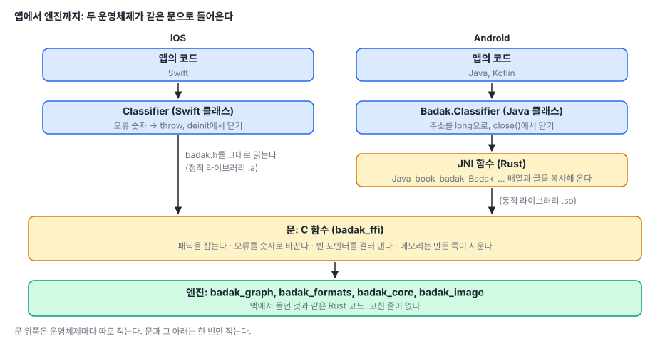
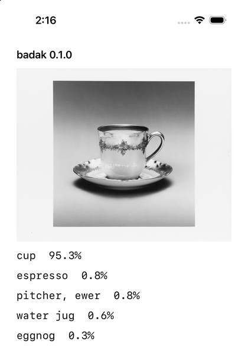
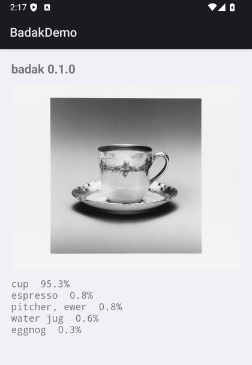
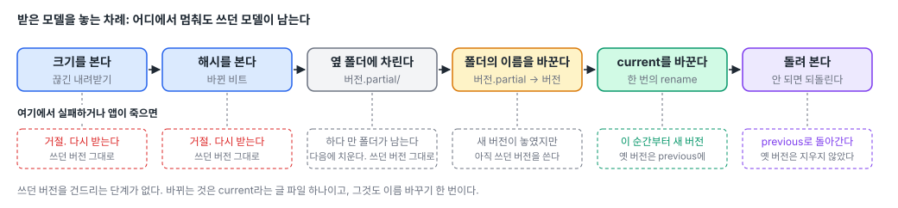

# badak을 폰에 올리기

[43장](ch43_device_constraints.md)에서 기기의 제약을 쟀습니다. 이
장에서는 엔진을 실제로 폰의 운영체제에서 돌립니다. iOS와 Android, 둘
다입니다.

할 일은 넷입니다. 엔진을 폰의 프로세서와 운영체제에 맞춰 **빌드**하고,
Swift나 Java로 쓴 **앱이 엔진을 부를 문**(두 언어 사이의 경계)을 만들고,
그 문으로 앱 하나를 만들어 **맥에서와 같은 답**이 나오는지 보고, 모델
파일을 **어떻게 기기에 가져다 놓고 바꿀지**를 정합니다.

먼저 밝혀 둡니다. **이 장의 앱은 iOS 시뮬레이터와 Android 에뮬레이터에서
돌렸습니다.** 실기기가 아닙니다. 그래서 이 장에는 속도의 숫자가
없습니다. 시뮬레이터의 속도는 폰의 속도가 아닙니다. 확인하는 것은
셋입니다. 빌드가 되는지, 답이 같은지, 크기가 얼마인지입니다.

Xcode의 프로젝트도 Android Studio의 Gradle도 쓰지 않았습니다. 그 도구가
대신 해 주는 일을 한 단계씩 손으로 합니다. 책의 다른 곳과 마찬가지로
무슨 일이 일어나는지 보려는 것입니다. 실제 앱을 만들 때는 그 도구를 써야
합니다.

결과를 미리 적어 둡니다.

- 엔진의 코드는 **한 줄도 고치지 않았습니다.** 더한 것은 문(C 함수
  열다섯 개와 Android용 함수 아홉 개), 파일의 한 구간만 메모리에 비추는
  기능, 스레드의 수를 정하는 함수입니다.
- 두 앱 모두 컵 사진을 컵이라고 답했고(95.3%), 확률 다섯 개의 **비트가
  맥에서 돌린 것과 같았습니다.** 다만 시뮬레이터와 에뮬레이터는 이 맥의
  프로세서를 그대로 쓰므로 같은 것이 당연합니다. 무엇을 확인했고 무엇은
  확인하지 못했는지 44.5절에 적었습니다.
- 엔진이 앱에 더하는 크기는 Android에서 1.0MB(압축하면 0.48MB), iOS에서
  0.85MB입니다. 모델은 14MB입니다. [43장](ch43_device_constraints.md)의
  결론 그대로입니다.
- 크기를 줄이려고 `panic = "abort"`를 켜면 문의 약속 하나가 깨집니다.
  엔진의 버그가 오류로 돌아오지 않고 **앱을 죽입니다.**
- 받은 모델 파일은 해시가 맞아도 돌지 않을 수 있습니다. 놓은 뒤에 **돌려
  보고**, 안 되면 되돌립니다.

| 하는 일 | 절 |
|---|---|
| 무엇이 폰으로 가는지 본다 | 44.1 |
| 다른 언어가 부를 문을 만든다 | 44.2 |
| iOS 앱을 만들어 시뮬레이터에서 돌린다 | 44.3 |
| Android 앱을 만들어 에뮬레이터에서 돌린다 | 44.4 |
| 세 곳의 답을 견준다 | 44.5 |
| 엔진이 앱에 더하는 크기를 잰다 | 44.6 |
| 모델 파일을 어디에 둘지 정한다 | 44.7 |
| 받은 모델 파일을 확인하고 놓는다 | 44.8 |

## 44.1 폰으로 가는 것은 라이브러리다

지금까지 `badak`은 실행 파일이었습니다. 터미널에서 `badak generate`를
쳤습니다. 폰에는 터미널이 없습니다. 폰에서 도는 것은 **앱**이고, 앱은
화면과 버튼과 권한을 다루는 코드로 이루어져 있습니다. 그 코드는
iOS에서는 Swift로, Android에서는 Kotlin이나 Java로 씁니다.

그래서 폰으로 가는 것은 실행 파일이 아니라 **라이브러리**입니다. 앱이
엔진을 포함하고, 필요할 때 함수를 부릅니다.

Rust의 컴파일러는 다른 기계에서 돌 코드를 만들 수 있습니다. 어느 기계를
위한 것인지는 **타깃**으로 정합니다.

```sh
rustup target add aarch64-apple-ios aarch64-apple-ios-sim aarch64-linux-android
cargo build --release -p badak_ffi --target aarch64-apple-ios-sim
```

세 타깃은 모두 Rust가 2등급으로 지원하는 것들입니다. 표준 라이브러리가
미리 빌드되어 배포되고, 빌드가 되는 것까지 보장합니다.[^tier]

| 타깃 | 어디에서 도는가 | 컴파일러가 늘 있다고 믿는 명령 |
|---|---|---|
| `aarch64-apple-darwin` | 이 맥 | NEON, dotprod, fp16 외 |
| `aarch64-apple-ios` | iPhone | NEON |
| `aarch64-apple-ios-sim` | 맥 위의 iOS 시뮬레이터 | NEON, fp16 외 |
| `aarch64-linux-android` | Android 폰과 맥 위의 에뮬레이터 | NEON |

셋째 열은 `rustc --print cfg --target …`이 알려 준 것입니다. 이 표가
[17장](../part3/ch17_simd.md)에서 미뤄 둔 물음의 절반입니다. 44.5절에서 다시 봅니다.

iPhone용과 시뮬레이터용이 따로인 까닭은, 프로세서가 같아도 운영체제의
라이브러리가 다르기 때문입니다. 시뮬레이터는 iPhone을 흉내 내는 기계가
아닙니다. iOS의 라이브러리를 맥의 프로세서 위에서 그대로 돌립니다.
Android 에뮬레이터는 조금 다릅니다. 가상 기계 안에 Android를 통째로
띄웁니다. 그래도 프로세서가 ARM인 맥에서는 ARM용 Android가 번역 없이
돕니다. 그래서 폰에 넣을 `.so` 파일을 **그대로** 에뮬레이터에서 돌릴 수
있습니다.

## 44.2 다른 언어가 부를 문을 만든다

Swift와 Java와 Rust는 서로를 모릅니다. 값을 메모리에 놓는 법도, 함수를
부르는 법도, 메모리를 해제하는 법도 다릅니다. 셋이 함께 아는 것은 하나,
**C의 함수 호출 규약**입니다. 그래서 엔진은 C 함수의 형태로 밖에
내놓습니다.

새 크레이트 `badak_ffi`가 그 문입니다. FFI는 다른 언어의 함수를 부르는
일(foreign function interface)을 줄인 말입니다.
[6장](../part1/ch06_model_files.md)에서 운영체제의 `mmap`을 부를 때 이미
한 번 썼습니다. 그때는 우리가 부르는 쪽이었고, 이번에는 불리는 쪽입니다.



문에서 지킬 약속을 넷으로 정했습니다.

**첫째, 패닉은 문을 넘지 않는다.** Rust 코드는 잘못된 상태를 만나면
패닉을 냅니다. 패닉은 함수를 거슬러 올라가며 스택을 풉니다. 그런데 C
함수의 밖은 Rust가 아닙니다. Swift도 Java도 Rust의 패닉이 무엇인지
모릅니다. 그래서 Rust는 패닉이 `extern "C"` 함수 밖으로 나가려는 순간
프로세스를 끝냅니다.[^abort-unwind] 그러면 앱이 죽습니다. 사진 한 장을
분류하다 엔진의 버그를 만났다고 앱이 통째로 죽어서는 안 됩니다. 문에서
잡습니다.

```rust
{{#include ../../../crates/badak_ffi/src/lib.rs:guard}}
```

문의 모든 함수가 이 `guard` 안에서 일합니다.

**둘째, 오류는 숫자로 나간다.** Rust의 `Result`는 C에 없습니다. 함수는
0(성공)이나 오류의 종류를 나타내는 작은 수를 돌려주고, 사람이 읽을
설명은 스레드마다 하나씩 따로 보관해 두었다가 `badak_last_error`로
내줍니다. C의 `errno`와 `strerror`가 하는 방식입니다.

**셋째, 메모리는 만든 쪽이 해제한다.** 분류기는 Rust가 만들었으므로
Rust가 해제합니다. 부르는 쪽은 `badak_classifier_close`를 부를 뿐입니다.
반대로 글이나 배열은 부르는 쪽이 메모리를 주고 엔진이 거기에 채웁니다.
엔진이 만든 메모리를 부르는 쪽의 `free`로 해제하는 일은 없습니다. 두
쪽의 할당자가 다를 수 있기 때문입니다.

**넷째, 넘겨받은 포인터는 쓰기 전에 확인한다.** 빈 포인터는 오류로
돌려줍니다. 다만 비어 있지 않은 포인터가 정말 쓸 수 있는 곳을
가리키는지는 확인할 방법이 없습니다. 거기서부터는 부르는 쪽이 지켜야
합니다. 함수마다 그 조건을 주석으로 적어 두었습니다.

모델을 여는 함수입니다.

```rust
{{#include ../../../crates/badak_ffi/src/lib.rs:open}}
```

`Box::into_raw`가 핵심입니다. 분류기를 힙에 두고, 그 **주소만** 밖으로
내보냅니다. 부르는 쪽에게 이 주소는 내용을 볼 수 없는 핸들입니다.
`#[unsafe(no_mangle)]`은 함수의 이름을 Rust가 바꾸지 못하게 합니다.
그래야 C에서 `badak_classifier_open`이라는 이름으로 찾을 수 있습니다.

C 쪽에서 보이는 모습은 헤더 파일 하나입니다. 손으로 적었습니다.

```c
typedef struct badak_classifier badak_classifier;

typedef struct {
    uint32_t index;    /* 부류의 번호 */
    float probability; /* 확률 */
} badak_score;

int32_t badak_classifier_open(const char *path, badak_classifier **out);
int32_t badak_classifier_classify_jpeg(badak_classifier *classifier,
                                       const uint8_t *bytes, size_t len,
                                       badak_score *top, size_t capacity,
                                       size_t *written);
void badak_classifier_close(badak_classifier *classifier);
```

`badak_classifier`는 선언만 있고 정의가 없습니다. C는 이 구조체의 크기도
내용도 모르고, 포인터로만 다룰 수 있습니다. 엔진 안의 구조를 바꿔도 앱을
다시 컴파일할 필요가 없습니다.

손으로 적은 헤더는 Rust의 함수와 어긋날 수 있습니다. 인자 하나의 타입을
잘못 적어도 컴파일은 됩니다. [6장](../part1/ch06_model_files.md)에서 본
것과 같은 위험입니다. 그래서 테스트 하나가 **C 컴파일러를 불러** 이
헤더로 C 프로그램을 만들고, 엔진과 링크해 돌려
봅니다(`crates/badak_ffi/tests/host.c`). 이 C 프로그램이 뒤에서 "맥에서
돌린 결과"를 내는 프로그램이기도 합니다.

분류기가 받는 것은 **JPEG 파일의 바이트**입니다. 사진을 풀고, 줄이고,
자르고, 숫자로 바꾸는 일(27.9절)을 엔진 안에서 합니다. 폰의 운영체제에도
사진을 푸는 기능이 있고 그 기능이 더 빠를 것입니다. 그것을 쓰지 않은
까닭은 27.10절에 있습니다. 푸는 방법과 줄이는 방법이 다르면 점수가
달라집니다. 같은 코드로 풀어야 맥에서 확인한 정확도가 폰에서도
그대로입니다.

## 44.3 iOS 앱을 만들어 시뮬레이터에서 돌린다

### 정적 라이브러리로 빌드한다

iOS 앱에는 엔진을 **정적 라이브러리**로 넣습니다. `libbadak_ffi.a` 파일
하나이고, 앱의 실행 파일을 만들 때 그 안에 포함됩니다. `Cargo.toml`에 한
줄이면 됩니다.

```toml
[lib]
crate-type = ["staticlib", "cdylib", "rlib"]
```

`staticlib`이 `.a`를, `cdylib`이 Android에서 쓸 `.so`를 만듭니다.

Swift는 C 헤더를 그대로 읽습니다.[^bridging] 컴파일러에 헤더를 알려
주면(`-import-objc-header`) `badak_classifier_open`을 Swift 함수처럼 부를
수 있습니다. 앱 전체를 만드는 명령이 이것입니다.

```sh
xcrun -sdk iphonesimulator swiftc \
    -target arm64-apple-ios17.0-simulator \
    -parse-as-library -O -Xlinker -dead_strip \
    -import-objc-header crates/badak_ffi/include/badak.h \
    apps/ios/BadakDemo.swift \
    target/aarch64-apple-ios-sim/release/libbadak_ffi.a \
    -o BadakDemo.app/BadakDemo
```

Swift 파일 하나와 라이브러리 하나가 실행 파일 하나가 됩니다.

### C 함수를 Swift 클래스로 감싼다

C 함수를 앱의 여러 곳에서 바로 부르면 문의 약속(오류를 확인한다,
닫는다)을 부를 때마다 지켜야 합니다. 그래서 한 번 감쌉니다.

```swift
{{#include ../../../apps/ios/BadakDemo.swift:wrapper}}
```

오류의 숫자는 Swift의 `throw`가 되고, 닫는 일은 `deinit`이 맡습니다.
Swift는 객체를 가리키는 곳이 없어지는 순간 `deinit`을 부르므로, 분류기를
쓰는 코드는 닫는 일을 잊을 수 없습니다. `OpaquePointer`는 Swift가
"내용을 모르는 C 포인터"를 부르는 이름입니다.

### 앱은 폴더다

iOS 앱은 폴더입니다. 이름이 `.app`으로 끝나는 폴더에 실행 파일과
`Info.plist`(앱의 이름, 식별자, 필요한 iOS의 버전)와 앱이 쓸 파일이 들어
있습니다. 모델도 그 안에 넣었습니다.

```text
{{#include output/ch44_ios.txt}}
```

`apps/ios/build.sh run`의 출력입니다. 스크립트는 폴더를 만들고, 신원 없이
서명하고(서명을 지우고 넣어 보니 시뮬레이터가 앱을 띄워 주지 않았습니다),
켜져 있는 시뮬레이터에 넣고 띄웁니다.

```sh
xcrun simctl install booted BadakDemo.app
xcrun simctl launch --console-pty booted book.badak.demo
```

앱은 꾸러미 안의 모델을 열어 꾸러미 안의 컵 사진을 분류하고, 결과를
화면에 그리면서 `BADAK`으로 시작하는 줄로도 적습니다. 확률은 16진수로
적습니다. `3f73ddd9`는 `f32` 0.9526…의 비트입니다. 스크립트는 맥에서
같은 라이브러리를 C 프로그램으로 불러 얻은 줄과 이 줄을 **글자 그대로**
견줍니다.



iPhone 17 시뮬레이터(iOS 26.5)의 화면입니다.

모델 파일을 여는 방법은 맥에서와 같습니다. `Bundle.main.path`가 꾸러미
안의 파일의 경로를 주고, 엔진은 그 파일을 메모리에 비춥니다. 43.4절에서
본 대로, 이렇게 비춘 14MB는 앱의 메모리로 세지 않습니다.

### 실기기용으로도 묶인다

`apps/ios/build.sh device`는 같은 Swift 파일을 iPhone의 SDK로 컴파일해
`aarch64-apple-ios`용 라이브러리와 링크해 봅니다. 링크는 됩니다. 확인한
것은 거기까지입니다. 기기에 넣으려면 Apple이 내준 인증서로 서명해야
하고, 이 책은 실기기에서 돌려 보지 않았습니다.

같은 스크립트가 **XCFramework**도 만듭니다. 기기용 `.a`와 시뮬레이터용
`.a`를 헤더와 함께 한 폴더에 담은 묶음입니다.[^xcframework] 두 `.a`는
프로세서가 같아서(둘 다 arm64) 파일 하나로 합칠 수 없습니다. Xcode
프로젝트에 엔진을 넣을 때는 이 묶음을 끌어다 놓고, Xcode가 빌드할 때마다
맞는 것을 고릅니다.

## 44.4 Android 앱을 만들어 에뮬레이터에서 돌린다

Android에는 계층이 하나 더 있습니다.

### Java는 JNI의 규칙으로 부른다

Android의 앱은 Java 가상 기계에서 돕니다. Java는 C 함수를 바로 부르지
못합니다. **JNI**(Java Native Interface)의 규칙을 따르는 함수만
부릅니다.[^jni-design] 규칙은 둘입니다.

**이름.** Java에서 이렇게 선언하면,

```java
package book.badak;

public final class Badak {
    static native long open(int fd, long offset, long length);
}
```

가상 기계는 올려 둔 라이브러리에서 `Java_book_badak_Badak_open`이라는
함수를 찾습니다. `Java_`, 패키지와 클래스의 이름, 메서드의 이름을 밑줄로
이은 것입니다. 패키지의 이름을 바꾸면 Rust 쪽의 함수 이름도 바꿔야
합니다.

**인자.** 첫 인자는 `JNIEnv*`, 둘째는 클래스입니다. 그 뒤에 Java에서
적은 인자가 옵니다. `int`와 `long`은 그대로 옵니다. 배열과 글은 **내용을
볼 수 없는 핸들**로 옵니다. Java의 배열은 쓰레기 수집기가 관리하는
메모리에 있고, 수집기는 그것을 언제든 옮길 수 있습니다. 그래서 주소를
그냥 내주지 않습니다.

내용을 보려면 `JNIEnv`를 거쳐야 합니다. `JNIEnv`는 **함수 포인터의 표를
가리키는 포인터**입니다. "이 배열의 길이를 알려 달라", "이 배열의 내용을
여기에 복사해 달라" 같은 함수 이백여 개가 표에 순서대로 들어 있습니다.
C에서는 `jni.h`가 이 표를 구조체로 선언해 줍니다. Rust에서는 보통 `jni`
크레이트를 씁니다. 우리는 필요한 여덟 칸의 번호만 적었습니다.

```rust
{{#include ../../../crates/badak_ffi/src/jni.rs:env}}
```

번호는 NDK에 든 `jni.h`의 구조체에서 세어 확인했습니다(칸이 233개
있습니다). 표의 순서는 JNI 명세의 일부여서 바뀌지 않습니다.
[6장](../part1/ch06_model_files.md)의 `mmap` 선언과 같은 종류의
약속이고, 틀리면 컴파일러가 알려 주지 못한다는 것도 같습니다.

Java의 `byte[]`를 읽는 함수입니다.

```rust
{{#include ../../../crates/badak_ffi/src/jni.rs:copy_in}}
```

`Get<Type>ArrayRegion`은 배열의 한 구간을 우리가 준 메모리에 복사합니다.
복사하지 않고 배열의 주소를 빌리는 함수도 표에 있는데, 빌린 것을
돌려주는 일을 빠뜨리기 쉽습니다. Android의 문서도 복사만 하면 될 때는 이
함수를 권합니다.[^jni-tips] 0.3MB의 JPEG을 한 번 복사하는 비용은 모델을
돌리는 비용에 견주면 드러나지 않습니다.

분류하는 함수는 C 문의 것과 같은 일을 합니다. 받는 것과 돌려주는 것의
형식만 Java에 맞췄습니다.

```rust
{{#include ../../../crates/badak_ffi/src/jni.rs:jni_classify}}
```

`guard`가 여기에도 있습니다. JNI 함수도 C 함수이므로 패닉이 나가면 앱이
죽습니다.

분류기의 주소는 Java의 `long`에 담아 보냅니다. Java에는 포인터가
없으므로 64비트 정수를 대신 씁니다.

```java
{{#include ../../../apps/android/java/book/badak/Badak.java:classifier}}
```

Swift의 `deinit`에 해당하는 것이 Java에는 마땅치 않습니다. 쓰레기
수집기는 엔진이 잡은 메모리를 모르고, 객체를 언제 해제할지도 보장하지
않습니다. 그래서 `AutoCloseable`로 만들어, 쓰는 쪽이 `try (…) { }`
안에서 쓰게 했습니다.

이 JNI 함수를 맥과 CI에서도 테스트합니다. 가상 기계는 없지만, 표의 여덟
칸을 우리가 만든 가짜 함수로 채운 **가짜 `JNIEnv`**를 넘기면
됩니다(`jni.rs`의 `fake` 모듈). 채우지 않은 칸을 부르면 테스트가 바로
죽으므로, 적어 두지 않은 칸을 쓰는 실수도 잡힙니다.

### NDK의 링커로 빌드한다

엔진은 `.so`(동적 라이브러리)로 만듭니다. Rust의 컴파일러는 Android용
기계어를 만들 줄 알지만, 그것을 `.so`로 묶는 **링커**와 Android의 C
라이브러리는 갖고 있지 않습니다. Android의 NDK에 있습니다. cargo에 그
위치를 알려 줍니다.

```sh
CARGO_TARGET_AARCH64_LINUX_ANDROID_LINKER=$NDK/…/bin/aarch64-linux-android24-clang \
CARGO_TARGET_AARCH64_LINUX_ANDROID_RUSTFLAGS="-C link-arg=-Wl,-z,max-page-size=16384" \
    cargo build --release -p badak_ffi --target aarch64-linux-android
```

링커의 이름에 든 `24`는 앱이 돌 수 있는 가장 낮은 Android의 API
수준입니다(Android 7.0).

둘째 줄은 **페이지의 크기** 때문에 있습니다. Android는 오랫동안 메모리를
4KB 단위로 다뤘습니다. Android 15부터 16KB로 다루는 기기를 지원하고,
Google Play는 Android 15 이상을 겨냥한 앱에 16KB 지원을
요구합니다.[^page-16k] `.so`는 여러 구획으로 이루어져 있고 구획마다
권한이 다른데(코드는 실행만, 데이터는 읽고 쓰기), 권한은 페이지 단위로만
줄 수 있습니다. 그래서 구획이 페이지의 경계에서 시작해야 합니다. 4KB에
맞춰 만든 `.so`는 16KB 기기에서 올라가지 않습니다. 16KB에 맞춘 것은 4KB
기기에서도 올라갑니다(16KB의 경계는 4KB의 경계이기도 합니다).

앱의 Java 코드는 두 단계로 바꿉니다. `javac`가 보통의 클래스 파일을
만들고, `d8`이 그것을 Android의 가상 기계가 읽는 형식(`classes.dex`)으로
바꿉니다.

### APK는 손으로 묶는다

Android 앱은 **APK**라는 파일 하나입니다. zip 파일입니다. Gradle이 하는
일을 손으로 하면 이렇습니다.

| 도구 | 하는 일 |
|---|---|
| `aapt2 link` | 앱의 선언 파일(`AndroidManifest.xml`)과 자산을 넣은 zip을 만든다 |
| `zip` | `classes.dex`와 `lib/arm64-v8a/libbadak_ffi.so`를 더한다 |
| `zipalign` | zip 안에서 눌리지 않은 파일의 시작 위치를 맞춘다 |
| `apksigner` | 서명한다. 서명 없는 앱은 설치되지 않는다 |

```text
{{#include output/ch44_android.txt}}
```

`apps/android/build.sh run`의 출력입니다. 윗부분은 꾸러미에 든 파일이고,
화살표의 왼쪽이 원래 크기, 오른쪽이 꾸러미 안에서의 크기입니다.
`Defl:N`은 압축했다는 표시이고 `Stored`는 그대로 넣었다는 표시입니다.

**모델과 엔진은 압축하지 않았습니다.** 일부러 그랬습니다.

압축된 파일은 메모리에 비출 수 없습니다. 풀어서 어딘가에 써야 합니다.
모델이 압축되어 있으면 앱은 처음 켜질 때 14MB를 풀어 저장 공간에 다시
쓰거나(같은 모델이 두 벌이 됩니다) 메모리에 풀어 놓아야 합니다(43.4절의
더러운 쪽 14MB가 됩니다). 압축하지 않고 넣으면 **APK 파일의 그 구간을
그대로** 비출 수 있습니다. Android의 `AssetManager.openFd`가 그 구간을
알려 줍니다. 압축된 자산에는 예외를 던집니다.[^openfd]

```java
try (AssetFileDescriptor model = getAssets().openFd("mobilenetv2.tflite");
        Badak.Classifier classifier = new Badak.Classifier(model)) {
    …
}
```

`AssetFileDescriptor`는 셋을 줍니다. APK를 연 파일 디스크립터, 그 안에서
모델이 시작하는 위치, 길이입니다. 엔진에는 "파일 전체를 비춘다"만
있었으므로 기능 하나를 더했습니다.

```rust
{{#include ../../../crates/badak_formats/src/mmap.rs:open_range}}
```

`mmap`은 페이지의 경계에서만 시작할 수 있습니다. 모델이 APK 안의
307,004번째 바이트에서 시작하면 그 위치에서 바로 비출 수 없습니다. 그
앞의 경계에서 시작해 비추고, 차이만큼 뒤를 가리킵니다. 페이지의 크기는
기기에 물어야 알 수 있는데(4KB일 수도 16KB일 수도 있습니다), 묻는 대신
**64KB의 경계**로 내립니다. 64KB는 쓰이는 모든 페이지 크기의 배수이므로
어느 기기에서도 경계입니다. 최악의 경우 64KB쯤을 더 비추지만, 비춘 것은
읽기 전까지 메모리를 쓰지 않습니다.

```rust
{{#include ../../../crates/badak_ffi/src/lib.rs:open_fd}}
```

파일 디스크립터는 Java 쪽의 것입니다. 빌려 쓸 뿐이고 닫지 않습니다.
`ManuallyDrop`으로 그것을 나타냅니다. 매핑은 디스크립터가 닫힌 뒤에도
남으므로, Java 쪽은 분류기를 만든 뒤 바로 닫아도 됩니다.

엔진의 `.so`도 같은 까닭으로 압축하지 않았습니다. 선언 파일에
`extractNativeLibs="false"`라고 적으면 Android는 `.so`를 꺼내 복사하지
않고 APK 안에 든 채로 올립니다.[^extract] 그러려면 `.so`가 압축되지 않은
채로, 페이지의 경계에 놓여 있어야 합니다. `zipalign -P 16`이 그 일을
합니다.

```text
$ zipalign -c -P 16 -v 4 badak_demo.apk
  307004 assets/mobilenetv2.tflite (OK)
14385152 lib/arm64-v8a/libbadak_ffi.so (OK)
Verification successful
```

14,385,152는 16,384의 배수입니다.



Android 15(API 35) 에뮬레이터의 화면입니다. 이 에뮬레이터의 페이지는
4KB입니다. 16KB에 맞춘 것은 도구(`llvm-readelf`, `zipalign -c`)로
확인했고, **16KB 기기에서 돌려 보지는 않았습니다.**

## 44.5 세 곳의 답이 비트까지 같다

세 곳에서 같은 모델에 같은 사진을 넣었습니다.

| 어디서 | 가장 높은 부류 | 확률 다섯 개의 비트 |
|---|---|---|
| 맥 (C 프로그램) | 컵, 95.3% | `3f73ddd9 3c0898c3 3c017f43 3bbae2f6 3b635598` |
| iOS 시뮬레이터 (Swift 앱) | 컵, 95.3% | 같음 |
| Android 에뮬레이터 (Java 앱) | 컵, 95.3% | 같음 |

비트까지 같습니다. [27장](../part4/ch27_convolution.md)의 예제 `ch27_classify`가 같은 모델로 내는
숫자와도 같습니다(컵 95.3%, 에스프레소 0.8%, 주전자 0.8%).

**이것으로 확인한 것.** 엔진이 두 운영체제용으로 빌드됩니다. 문이 값을
제대로 전달합니다(Swift의 `Data`, Java의 `byte[]`가 엔진에 그대로
전달되고, 구조체의 배열이 그대로 돌아옵니다). 꾸러미 안의 모델이
열립니다. Android에서는 파일의 한 구간을 비추는 기능이 맞게 동작합니다.
사진을 푸는 코드와 줄이는 코드와 모델 전체가 거기서 같은 답을 냅니다.

**확인하지 못한 것.** 시뮬레이터와 에뮬레이터는 **이 맥의 프로세서**에서
돕니다. 프로세서가 같고 코드가 같으니 비트가 같은 것은 당연합니다. 다른
회사가 만든 폰의 프로세서에서도 같은 비트가 나오는지는 이것으로 알 수
없습니다. [17장](../part3/ch17_simd.md)에서 "어느 구현을 골라도 비트가
같다"를 설계의 약속으로 삼았고 x86에서는 CI가 그것을 확인하지만, 폰의
프로세서에서는 확인하지 못했습니다. 속도, 메모리, 열도 당연히 보지
못했습니다.

### 새 명령은 실행할 때 물어서 쓴다

[17장](../part3/ch17_simd.md)에서 물음 하나를 6부로 미뤘습니다.
프로세서의 어떤 명령을 쓸지를 빌드할 때 정할 것인가, 실행할 때 정할
것인가였습니다. 직접 빌드해 쓰는 사람에게는 앞의 것이, 여러 기계에
배포하는 쪽에는 뒤의 것이 맞다고 했습니다.

폰의 앱은 뒤의 경우 가운데서도 가장 심한 경우입니다. **한 번 빌드한
파일이 수천 가지 기기로 갑니다.** 앱이 적은 줄을 봅니다.

```text
맥           빌드 neon+dotprod+fp16  실행 neon+dotprod+fp16  스레드 16
iOS 시뮬레이터  빌드 neon+fp16          실행 neon+dotprod+fp16  스레드 16
Android 에뮬레이터 빌드 neon               실행 neon+dotprod+fp16  스레드 1
```

"빌드"는 컴파일러가 늘 있다고 믿고 쓴 명령이고, "실행"은 엔진이 켜질 때
프로세서에 물어 알아낸 것입니다.

```rust
{{#include ../../../crates/badak_ffi/src/lib.rs:cpu}}
```

Android용 빌드에서 컴파일러가 믿는 것은 NEON뿐입니다. 64비트 ARM이면
어느 폰에나 있는 명령입니다.[^abis] 그래서 이 `.so`는 어느 64비트
Android 폰에서도 돕니다. 그 대신 컴파일러는 더 새로운 명령을 스스로 쓰지
못합니다.

엔진이 새 명령을 쓰는 방법은 둘입니다.

**실행할 때 묻기.** [20장](../part3/ch20_weight_quantization.md)의 정수
내적 커널이 그렇게 합니다. `dotprod`와 `fp16`이 있는지 물어보고, 있으면
그 명령을 쓰는 함수를, 없으면 기준 함수를 고릅니다. 에뮬레이터에서
"실행" 줄에 두 명령이 보이므로, 같은 `.so`가 이 프로세서에서는 빠른
경로로 갑니다. 오래된 폰에서는 느린 경로로 가고, 죽지 않습니다.

**빌드할 때 정하기.** [24장](../part3/ch24_attention.md)의 16비트 실수
변환은 `fp16`을 컴파일할 때 씁니다(`cfg(target_feature = "fp16")`). 맥용
빌드에는 들어가고 Android용 빌드에는 들어가지 않습니다. Android에서는
프로세서에 그 명령이 있어도 쓰지 않습니다. 이것을 켜려면
`-C target-feature=+fp16`으로 빌드해야 하고, 그러면 그 명령이 없는
폰에서 앱이 죽습니다.

iOS는 사정이 낫습니다. 기기의 종류가 적고, 앱이 지원할 가장 낮은 iOS의
버전을 정하면 가장 오래된 프로세서가 정해집니다.
`-C target-cpu=apple-a12`처럼 그 프로세서에 맞춰 빌드할 수 있습니다.
위의 표에서 시뮬레이터용 타깃이 `fp16`을 믿는 것이 그 예입니다. Rust의
iPhone용 타깃은 보수적으로 NEON만 믿습니다(44.1절의 표).

정리하면 이렇습니다. 폰에 배포할 때는 **가장 오래된 기기에 맞춰
빌드하고, 새 명령은 실행할 때 물어서 씁니다.** 빌드할 때 정한 분기는 그
기준에 어긋나지 않는지 하나씩 확인해야 합니다. 우리 엔진에는 둘째 종류가
한 군데 있습니다. 고치지 않고 남겼습니다(44.9절).

Rust의 문서는 이 기능이 Linux 계열 밖에서는 늘 "없다"고 답할 수 있다고
적고 있습니다.[^detect] iOS 시뮬레이터에서는 위에서 보듯 제대로
답했습니다. iPhone 실기기에서는 확인하지 못했습니다.

### 스레드의 수는 앱이 정한다

에뮬레이터의 줄 끝에 `스레드 1`이 있습니다. 이 가상 기기에 코어가 하나만
주어져 있어서입니다. 실제 폰에는 여덟 개쯤이 있고, 43.5절에서 본 대로 그
가운데 대부분은 작은 코어입니다. 엔진은 지금까지 스레드의 수를 환경 변수
`BADAK_THREADS`로 받았습니다. 폰의 앱은 운영체제가 띄우므로 환경 변수를
줄 방법이 없습니다. 그래서 문에 `badak_set_threads`를 두었습니다. 모델을
처음 열기 전에 한 번 부릅니다. 몇 개가 좋은지는 기기에서 재야 알 수
있고, 이 책은 재지 못했습니다.

## 44.6 엔진이 앱에 더하는 크기를 잰다

앱의 크기에서 엔진이 차지하는 크기를 봅니다. 43.2절의 빌드 설정을 그대로
씁니다.

| 빌드 설정 | Android `.so` (KB) | 눌렀을 때 (KB) | iOS 실행 파일 (KB) |
|---|---:|---:|---:|
| 저장소의 설정 그대로 | 1,005 | 483 | 918 |
| + LTO | 933 | 465 | 869 |
| + `panic = "abort"` | 849 | 426 | 770 |
| (견줄 것) 엔진을 부르지 않는 Swift 앱 | | | 70 |

모두 기호를 떼어 낸 뒤의 크기입니다. "눌렀을 때"는 `gzip -9`로 압축한
결과이고, 가게에서 내려받는 크기에 가깝습니다. iOS의 실행 파일에는
Swift로 쓴 앱의 코드도 들어 있습니다. 엔진의 크기는 맨 아래 줄과의
차이인 0.85MB쯤입니다.

엔진은 1MB입니다. 모델은 14MB입니다. **꾸러미의 91%가 모델입니다.**

iOS의 숫자에는 조건이 하나 있습니다. 링커에게 쓰지 않는 함수를 버리라고
해야 합니다(`-dead_strip`). 그러지 않으면 918KB가 **2,201KB**가 됩니다.
정적 라이브러리에는 Rust의 표준 라이브러리 전체가 들어 있고, 링커는
시키지 않으면 라이브러리에 든 것을 다 넣습니다. Xcode의 프로젝트에는
이것을 켜는 설정이 있습니다. 손으로 빌드하면 잊기 쉽습니다.

### `panic = "abort"`는 패닉을 잡지 못하게 한다

43.2절에서 `panic = "abort"`는 크기를 줄이는 쉬운 방법이었습니다. 패닉이
났을 때 스택을 푸는 데 필요한 표와 코드가 빠집니다. 여기서도 84KB에서
99KB를 줄입니다.

그런데 44.2절의 첫째 약속이 "패닉을 잡는다"였습니다. 스택을 푸는 코드가
없으면 잡을 수도 없습니다. 문 안에서 일부러 패닉을 내는 함수를 C에서
불러 봤습니다.

```text
{{#include ../../../bench/ch44/panic.txt}}
```

저장소의 설정으로는 `6`(`BADAK_PANIC`)이 돌아오고 프로그램은 계속
돕니다. `panic = "abort"`로 빌드하면 **돌아오지 않습니다.** 프로그램이
바로 끝납니다(134는 프로세스가 중단 신호로 끝났다는 표시입니다. 128에
신호의 번호 6을 더한 값입니다). 폰에서는 앱이 꺼집니다.

90KB와 "엔진의 버그가 앱을 죽이지 않는다"를 맞바꾸는 것입니다. 어느 쪽이
옳은지는 앱이 정합니다. 엔진이 앱의 일부 기능일 뿐이라면 그 90KB는
아깝지 않습니다. 사진 분류가 안 되면 "분류하지 못했습니다"라고 보여 주면
되고, 앱의 나머지는 살아 있어야 합니다. 저장소의 설정은 그대로
두었습니다.

## 44.7 모델 파일을 둘 곳은 셋 가운데 고른다

엔진은 1MB이고 모델은 그 열 배에서 천 배입니다. 그러니 "앱을 어떻게
배포할 것인가"의 대부분은 "모델 파일을 어떻게 가져다 놓을 것인가"입니다.
방법은 셋입니다.

| | 앱 꾸러미에 넣는다 | 가게가 따로 내려 준다 | 앱이 직접 받는다 |
|---|---|---|---|
| 처음 켰을 때 | 바로 쓴다 | 설정에 따라 바로 쓰거나 기다린다 | 받을 때까지 못 쓴다 |
| 앱의 내려받기 크기 | 모델만큼 커진다 | 나눠 받을 수 있다 | 작다 |
| 모델만 바꾸기 | 앱을 새로 내야 한다 | 앱을 새로 내야 한다(가게마다 다르다) | 언제든 |
| 기기마다 다른 모델 | 어렵다 | 가게가 골라 준다 | 앱이 고른다 |
| 우리가 만들 것 | 없다 | 가게의 설정 | 내려받기, 확인, 교체, 서버 |

**꾸러미에 넣는다.** 이 장의 두 앱이 한 것입니다. 가장 단순하고, 모델이
작을 때는 이 방법을 씁니다. 14MB의 MobileNetV2는 여기에 속합니다. 앱의
크기에는 가게마다 한도가 있고(43.2절), 그 한도에 닿기 전에 **사용자가 큰
앱을 받지 않습니다.**

**가게가 따로 내려 준다.** 두 가게 모두 앱의 본체와 큰 자산을 나눠서
내려 주는 기능이 있습니다. Google Play에는 모델 전용의 것이 있습니다.
Play for On-device AI는 모델을 "AI 팩"으로 묶어 설치할 때, 설치 직후에,
또는 앱이 달라고 할 때 내려 줍니다. 팩 하나가 1.5GB까지입니다.[^play-ai]
Apple에는 Background Assets가 있습니다. 자산 묶음을 만들어 내려받는 때를
정해 두면 운영체제가 받아 줍니다.[^bg-assets] 두 문서 모두 읽기만 했고,
써 보지는 않았습니다.

**앱이 직접 받는다.** 모델을 앱과 따로 고칠 수 있습니다. 앱을 새로 내지
않고 더 나은 모델로 바꾸거나, 기기의 메모리를 보고 큰 모델과 작은 모델
가운데 하나를 고를 수 있습니다. [47장](ch47_on_device_llm.md)의 LLM처럼
모델이 수 GB이면 이 방법이나 둘째 방법밖에 없습니다. 그 대신 내려받기가
끊기는 일, 파일이 깨지는 일, 새 모델이 문제를 일으키는 일을 모두 우리가
처리해야 합니다. 다음 절에서 다룹니다.

내려받기 자체는 엔진이 할 일이 아닙니다. 폰의 운영체제는 앱이 뒤로 가도
이어지고, 끊기면 이어 받고, 와이파이일 때만 받는 내려받기를 제공합니다.
그것을 씁니다. 엔진이 맡는 것은 **받은 뒤**입니다.

## 44.8 받은 모델 파일을 확인하고 놓는다

앱이 새 모델 파일을 받았습니다. 할 일은 셋입니다. 받은 것이 보낸
그대로인지 확인하고, 쓰던 모델을 망가뜨리지 않으면서 정해진 곳에 놓고,
새 모델이 문제를 일으키면 되돌립니다. `badak_formats::store`가 이 일을
합니다.

### 명세로 파일을 설명한다

서버는 모델 파일과 함께 작은 JSON 하나를 내줍니다.

```rust
{{#include ../../../crates/badak_formats/src/store.rs:manifest}}
```

```json
{"name": "classifier", "version": "2026-11-21", "file": "resnet50.tflite",
 "size": 102210836, "sha256": "512cdd53…7bbbeb", "requires": 1}
```

`requires`는 이 파일을 읽는 데 필요한 엔진의 세대입니다. 엔진이 새
연산을 지원하게 되면 세대를 올리고, 그 연산을 쓰는 모델의 명세에 그
세대를 적습니다. 그러면 옛 엔진이 든 앱은 그 파일을 받지 않습니다. 앱은
사용자가 갱신해야 바뀌고, 모델은 서버에서 바로 바뀝니다. **둘의 판이
어긋나는 것이 폰에서는 보통의 상태입니다.**

명세는 네트워크에서 옵니다. [6장](../part1/ch06_model_files.md)에서 모델
파일을 믿을 수 없는 입력으로 다뤘듯이 명세도 그렇게 다룹니다. 이름을
폴더의 이름으로 쓰기 때문에 특히 그렇습니다.

```rust
{{#include ../../../crates/badak_formats/src/store.rs:safe_name}}
```

이 확인이 없으면 `"file": "../../databases/app.db"`라고 적힌 명세가 앱의
다른 파일을 덮어씁니다.

### 해시로 파일을 확인한다

파일이 보낸 그대로인지는 **SHA-256**으로 봅니다. 파일 전체를 32바이트로
줄이는 함수이고, 비트 하나가 달라도 결과가 전혀 달라집니다. 이 책의
모델을 내려받는 스크립트마다 `shasum -a 256`으로 쓴 것입니다. 폰에는
`shasum`이 없으니 엔진이 직접 계산합니다. 미국 표준(FIPS 180-4)에 적힌
대로입니다.[^fips]

```rust
{{#include ../../../crates/badak_formats/src/sha256.rs:compress}}
```

파일을 64바이트씩 잘라, 덩어리마다 32비트 수 여덟 개로 된 상태를 예순네
번 섞습니다. 쓰는 연산은 더하기, 돌리기, 비트 단위의 논리 연산뿐입니다.
표준에 실린 예(빈 글, `abc`, `a` 백만 개)의 해시가 그대로 나오는 것을
테스트가 확인합니다.

빠르게 만들지 않았습니다. 이 맥에서 102MB에 0.27초가 걸립니다. 폰의
프로세서에는 이 계산을 위한 명령이 따로 있어서 그것을 쓰면 더
빨라지지만, 모델 파일은 **받을 때 한 번만** 확인합니다. 열 때마다 다시
계산하지 않습니다. 그러면 43.3절의 시작 시간에 이 시간이 매번
더해집니다.

해시로 막을 수 있는 것과 없는 것을 구분해야 합니다. 명세의 해시는 파일이
**오다가 바뀐 것**을 잡습니다. 명세를 보낸 쪽이 **믿을 만한지**는 알려
주지 않습니다. 누가 명세와 파일을 함께 바꿔치면 해시는 맞습니다. 그것은
명세를 받는 방법으로 막습니다. 앱이 자기 서버와 암호화된 연결로 받거나,
명세에 서명을 붙이고 앱에 든 공개 키로 확인합니다. 서명은 구현하지
않았습니다.

### 쓰던 파일을 건드리지 않고 놓는다

```rust
{{#include ../../../crates/badak_formats/src/store.rs:install}}
```



원칙은 하나입니다. **쓰던 파일을 건드리지 않는다.**

[6장](../part1/ch06_model_files.md)에서 메모리에 비춘 파일의 약점을
적었습니다. 비춘 동안 파일이 바뀌면 안 됩니다. 앱이 모델을 비춰 쓰고
있는데 그 파일을 새 것으로 덮어쓰면, 돌고 있는 모델의 가중치가 실행
도중에 바뀝니다. 그래서 새 판은 늘 **새 폴더**에 놓습니다. 옛 판의
파일은 그대로 있고, 돌고 있는 분류기는 계속 옛 판을 봅니다.

"지금 쓰는 판"은 `current`라는 텍스트 파일 하나가 가리킵니다. 이 파일을
바꾸는 일이 판을 바꾸는 일의 전부입니다. 바꿀 때도 덮어쓰지 않습니다.
옆에 새 파일을 다 쓰고, 디스크에 내려갔는지 확인한 뒤(`sync_all`),
**이름을 바꿉니다.** 이름 바꾸기는 운영체제가 한 번에 해 주는 일입니다.
POSIX는 다른 프로세스가 그 이름으로 옛 파일이나 새 파일 가운데 하나를 늘
보게 된다고 적고 있습니다.[^rename] 반쯤 쓰인 `current`를 읽는 순간은
없습니다.

모델 폴더도 같은 방법으로 놓습니다. `판.partial`이라는 폴더에 다 만들어
놓고 이름을 바꿉니다. 그 사이에 앱이 죽으면 하다 만 폴더가 남을 뿐이고,
다음에 놓을 때 지웁니다.

### 잘못된 경우를 차례로 돌려 본다

`ch44_update`가 이 일을 차례로 실행합니다. 내려받기는 파일 복사로 흉내
냈고, 그 뒤는 실제 코드입니다.

```text
{{#include output/ch44_update.txt}}
```

2번부터 4번까지는 놓기 전에 걸러집니다. 끊긴 내려받기는 크기에서
걸리므로 해시를 계산할 일도 없습니다. 비트 하나가 다른 102MB는 0.24초
뒤에 걸립니다. 그동안 쓰던 판은 그대로입니다.

**5번이 중요합니다.** 서버에서 누가 파일을 잘못 올렸습니다(여기서는
부류의 이름이 적힌 텍스트 파일을 모델이라고 올렸습니다). 명세는 그
파일로 만들었으니 크기도 해시도 맞습니다. `install`은 통과합니다. 해시는
"보낸 그대로인가"만 알려 줄 뿐, **보낸 것이 옳은가**는 알려 주지
않습니다.

그래서 놓은 뒤에 한 번 돌려 봅니다. 답을 아는 입력(여기서는 컵 사진)을
넣어, 열리는지와 아는 답이 나오는지 봅니다. 안 되면 되돌립니다.

```rust
{{#include ../../../crates/badak_formats/src/store.rs:rollback}}
```

되돌리기도 `current`를 바꾸는 일입니다. 옛 판의 폴더를 지우지 않고 둔
까닭이 이것입니다. `prune`이 지금 판과 그 앞의 판만 남기고 지웁니다.
모델이 두 벌 있는 동안은 저장 공간도 두 배를 씁니다. 수 GB의 모델에서는
부담이 커서, 새 판이 잘 도는 것을 확인하면 바로 지워야 합니다.

이 테스트는 "돌지 않는 모델"을 잡습니다. "돌기는 하는데 답이 나빠진
모델"은 사진 한 장으로는 잡지 못합니다. 그것은 서버에서 모델을 내보내기
전에 확인해야 하고, 기기에서는 일부 사용자에게만 먼저 내보내는 방법으로
피해를 줄입니다.

## 44.9 남긴 일을 적어 둔다

**실기기.** 이 장의 모든 것이 시뮬레이터와 에뮬레이터에서의 일입니다.
서명, 실기기 설치, 가게에 올리는 일은 하지 않았습니다.

**16KB 페이지의 기기.** 줄 맞춤은 도구로 확인했고, 그런 기기에서 돌려
보지는 않았습니다.

**다른 프로세서.** 32비트 ARM(`armeabi-v7a`)과 x86용 Android 빌드는
만들지 않았습니다. 지금 팔리는 폰은 64비트 ARM이지만, 오래된 기기까지
지원하려면 ABI마다 `.so`를 하나씩 넣어야 합니다.

**빌드할 때 정한 `fp16` 분기.** 44.5절에 적은 대로,
[24장](../part3/ch24_attention.md)의 16비트 실수 변환은 Android용
빌드에서 느린 경로로 갑니다. 실행할 때 묻도록 바꾸면 되는데, 얼마나 차이
나는지를 기기에서 잴 수 없어 그대로 두었습니다.

**LLM의 문.** 문에는 사진 분류기만 있습니다. 토큰을 하나씩 흘려보내려면
엔진이 앱의 함수를 **거꾸로 부르는** 방법(콜백)이 필요하고, JNI에서는
그것이 한 단계 더 복잡합니다. [47장](ch47_on_device_llm.md)에서
다룹니다.

**Kotlin.** 앱을 Java로 썼습니다. JDK만으로 컴파일할 수 있어서입니다.
Kotlin에서도 `external fun`으로 같은 JNI 함수를 부릅니다.

**서명된 명세, 이어 받기, 바뀐 부분만 받기.** 44.8절의 저장소는 파일을
통째로 받았다고 가정합니다.

**화면이 꺼졌을 때.** 앱이 뒤로 가면 운영체제는 언제든 앱을 멈추거나
죽일 수 있습니다. 긴 추론을 하는 앱은 그 순간에 무엇을 할지(멈춘다,
버린다, 저장한다) 정해야 합니다.

## 44.10 실전 엔진에서는

**문은 손으로 쓰지 않습니다.** 우리는 헤더를 손으로 적고 JNI의 표를
번호로 불렀습니다. 실전에서는 도구가 만듭니다. `cbindgen`은 Rust의
함수에서 C 헤더를 만들어 냅니다.[^cbindgen] UniFFI는 여기서 더 나아가,
Rust로 쓴 것을 Kotlin과 Swift에서 쓸 수 있게 양쪽의 감싸는 코드까지
만듭니다.[^uniffi] `jni` 크레이트는 JNI의 표 전체를 타입과 함께
제공하고,[^jni-rs] `cargo-ndk`는 44.4절에서 환경 변수로 한 링커 설정을
대신 해 줍니다.[^cargo-ndk] 이 장에서 손으로 한 일이 이 도구가 하는
일입니다.

**엔진은 꾸러미로 배포됩니다.**
[31장](../part4/ch31_mobile_engines.md)에서 견준 엔진은 폰의 개발자에게
소스가 아니라 묶음으로 갑니다. Android에서는 Gradle이 받아 오는 묶음,
iOS에서는 44.3절의 XCFramework 같은 묶음입니다. 그 안에 든 것은 우리가
만든 것과 같습니다. ABI마다의 `.so`, 정적 라이브러리, 헤더, 그리고
Java나 Swift로 쓴 감싸는 코드입니다.

**모델의 배포는 가게의 기능이 되어 갑니다.** 44.7절의 Play for On-device
AI의 문서는 LiteRT와 MediaPipe의 모델을 AI 팩에 담아 쓰는 법을 따로 적고
있습니다.[^play-ai] 몇 해 전까지 앱마다 만들던 내려받기와 교체를 이제
플랫폼이 맡아 가고 있습니다. 그래도 44.8절의 물음(받은 것이 맞는가,
엔진과 판이 맞는가, 안 돌면 어떻게 하는가)은 누가 내려 주든 남습니다.

## 정리

- 폰으로 가는 것은 실행 파일이 아니라 라이브러리입니다. 엔진은 고칠 것이
  없었고, 문을 새로 만들었습니다.
- 언어들이 함께 아는 것은 C의 함수 호출 규약입니다. 문에서는 패닉을
  잡고, 오류를 숫자로 바꾸고, 메모리를 만든 쪽이 지웁니다.
- iOS에는 정적 라이브러리로, Android에는 동적 라이브러리로 넣습니다.
  Android에는 JNI라는 한 겹이 더 있습니다.
- 모델과 엔진은 꾸러미 안에 누르지 않고 넣습니다. 그래야 꺼내지 않고
  메모리에 비출 수 있습니다.
- 한 번 빌드한 파일이 모든 기기로 갑니다. 가장 오래된 기기에 맞춰
  빌드하고, 새 명령은 실행할 때 물어서 씁니다.
- 엔진은 1MB이고 나머지는 모델입니다. 배포의 문제는 모델 파일의
  문제입니다.
- 받은 파일은 크기와 해시로 확인하고, 쓰던 것을 건드리지 않는 자리에
  놓고, 돌려 본 뒤에 믿습니다.
- 시뮬레이터가 알려 주는 것은 "빌드되고, 불리고, 같은 답을 낸다"까지
  입니다.

## 연습 문제

1. `badak.h`의 `badak_classifier_run`에서 `input_len`의 타입을 `size_t`
   대신 `int`로 바꾸고 `cargo test -p badak_ffi`를 돌려 보십시오. 시험이
   잡습니까. 잡지 못한다면 왜입니까.
2. `jni.rs`의 `GET_BYTE_ARRAY_REGION`을 200에서 201로 바꾸고 시험을 돌려
   보십시오. 가짜 `JNIEnv`가 어떻게 이 실수를 잡습니까. 진짜 Android
   에서는 무슨 일이 일어났겠습니까.
3. `apps/android/build.sh`에서 `aapt2 link`의 `-0 tflite`를 빼고 앱을
   돌려 보십시오. 어디에서 어떤 오류가 납니까.
4. `Store::install`은 받은 파일을 `rename`으로 옮깁니다. 받은 파일이
   다른 저장 장치에 있으면 어떻게 됩니까. 복사로 바꾼다면 44.8절의 "어디서
   멈춰도 안전하다"를 지키려면 무엇을 더 해야 합니까.
5. `ch44_update`의 5번에서 되돌린 뒤, 같은 판(`2026-11-15`)의 **고친
   파일**을 서버가 다시 내준다고 합시다. 판의 이름이 같은데 해시가 다른
   명세가 옵니다. 지금의 `install`은 어떻게 합니까. 판의 이름을 다시 쓰지
   못하게 하는 편이 나은 까닭을 적어 보십시오.
6. `badak_ffi`에 `badak_classifier_classify_rgb`를 더해 보십시오. 운영체제가
   이미 풀어 준 픽셀을 받는 함수입니다. 27.10절의 실험을 생각하면, 이
   함수의 설명에 무엇을 적어 두어야 합니까.

## 참고 문헌

[^tier]: The rustc book, "Platform Support".
    <https://doc.rust-lang.org/rustc/platform-support.html>.
    `aarch64-apple-ios`, `aarch64-apple-ios-sim`, `aarch64-linux-android`가
    "Tier 2 without Host Tools" 표에 있습니다(2026-11-21에 확인).

[^abort-unwind]: Rust Blog, "Announcing Rust 1.81.0", 2024-09-05.
    <https://blog.rust-lang.org/2024/09/05/Rust-1.81.0/>. "Abort on
    uncaught panics in extern "C" functions" 절. 그 앞의 판에서는 정의되지
    않은 동작이었습니다. The Rustonomicon의 "FFI and unwinding"도 같은
    내용을 적고 있습니다.
    <https://doc.rust-lang.org/nomicon/ffi.html>.

[^bridging]: Apple, "Importing Objective-C into Swift".
    <https://developer.apple.com/documentation/swift/importing-objective-c-into-swift>.
    Xcode에서는 "브리징 헤더"에 C 헤더를 적습니다. 우리가 쓴
    `-import-objc-header`가 그 설정이 컴파일러에 넘기는 것입니다.

[^xcframework]: Apple, "Creating a multiplatform binary framework bundle".
    <https://developer.apple.com/documentation/xcode/creating-a-multi-platform-binary-framework-bundle>.
    시뮬레이터용 빌드를 포함해 여러 플랫폼의 것을 한 묶음에 담고, 헤더도
    함께 담을 수 있다고 적혀 있습니다.

[^jni-design]: Oracle, "Java Native Interface Specification: Design
    Overview" (Java SE 21).
    <https://docs.oracle.com/en/java/javase/21/docs/specs/jni/design.html>.
    "JNI Interface Functions and Pointers" 절이 `JNIEnv`가 함수 표를
    가리키는 포인터의 포인터임을, "Resolving Native Method Names" 절이
    `Java_`로 시작하는 이름을 만드는 법을 적고 있습니다. 표의 칸 번호는
    Android NDK 29.0.13846066의 `jni.h`에 든 `struct JNINativeInterface`
    에서 세었습니다.

[^jni-tips]: Android Developers, "JNI tips".
    <https://developer.android.com/training/articles/perf-jni>. "Region
    calls" 절. JNI에 넘기는 글이 "Modified UTF-8"이어야 한다는 것도 이
    문서에 있습니다. 한글을 포함해 세 바이트까지의 글자는 UTF-8과 같고,
    `jni.rs`의 `new_string`은 그 밖의 글자를 물음표로 바꿉니다.

[^page-16k]: Android Developers, "Support 16 KB page sizes".
    <https://developer.android.com/guide/practices/page-sizes>. "Google
    Play compatibility requirement" 절은 2026-11-21에 읽었을 때 "Starting
    February 1, 2027"부터 16KB를 지원하지 않는 갱신을 올릴 수 없다고 적고
    있었습니다. 날짜는 바뀔 수 있습니다.

[^openfd]: Android Developers, "AssetManager".
    <https://developer.android.com/reference/android/content/res/AssetManager>.
    `openFd`의 설명에 "The asset must be uncompressed, or an exception
    will be thrown"이라고 적혀 있습니다.

[^extract]: Android Developers, "&lt;application&gt;".
    <https://developer.android.com/guide/topics/manifest/application-element>.
    `android:extractNativeLibs` 항목. Gradle을 쓸 때는 이 속성 대신
    `useLegacyPackaging` 설정을 쓰라고 적혀 있습니다.

[^abis]: Android Developers, "Android ABIs".
    <https://developer.android.com/ndk/guides/abis>.

[^detect]: Rust 표준 라이브러리, `std::arch::is_aarch64_feature_detected`.
    <https://doc.rust-lang.org/std/arch/macro.is_aarch64_feature_detected.html>.
    "Currently most features are only supported on linux-based platforms:
    on other platforms the runtime check will always return false"라고
    적혀 있습니다(Rust 1.100의 문서).

[^play-ai]: Android Developers, "Play for On-device AI (beta)".
    <https://developer.android.com/google/play/on-device-ai>. "Individual
    AI packs can be up to 1.5GB"와 세 가지 내려 주는 때, LiteRT와
    MediaPipe를 AI 팩과 함께 쓰는 법이 적혀 있습니다. 2026-11-21에 읽었을
    때 베타였습니다.

[^bg-assets]: Apple, "Background Assets".
    <https://developer.apple.com/documentation/backgroundassets>.

[^fips]: National Institute of Standards and Technology, "Secure Hash
    Standard (SHS)", FIPS PUB 180-4, 2015.
    <https://csrc.nist.gov/pubs/fips/180-4/upd1/final>. SHA-256은 6.2절,
    상수는 4.2.2절과 5.3.3절입니다.

[^rename]: The Open Group, "rename — rename file", *The Open Group Base
    Specifications Issue 8*.
    <https://pubs.opengroup.org/onlinepubs/9799919799/functions/rename.html>.
    "a directory entry named new shall remain visible to other threads
    throughout the renaming operation and refer either to the file
    referred to by new or old before the operation began". 전원이 꺼졌을
    때 무엇이 남는지는 이 문장이 약속하는 것이 아니고 파일 시스템에
    달려 있습니다. 그래서 이름을 바꾸기 전에 파일을, 바꾼 뒤에 폴더를
    `sync_all`로 디스크에 내립니다.

[^cbindgen]: mozilla/cbindgen. <https://github.com/mozilla/cbindgen>.
    README의 첫 문장이 "cbindgen creates C/C++11 headers for Rust
    libraries which expose a public C API"입니다. 써 보지는 않았습니다.

[^uniffi]: mozilla/uniffi-rs. <https://github.com/mozilla/uniffi-rs>.
    README에 Kotlin, Swift, Python, Ruby를 지원한다고 적혀 있습니다. 써
    보지는 않았습니다.

[^jni-rs]: jni-rs/jni-rs. <https://github.com/jni-rs/jni-rs>. 써 보지는
    않았습니다.

[^cargo-ndk]: bbqsrc/cargo-ndk. <https://github.com/bbqsrc/cargo-ndk>.
    써 보지는 않았습니다.
