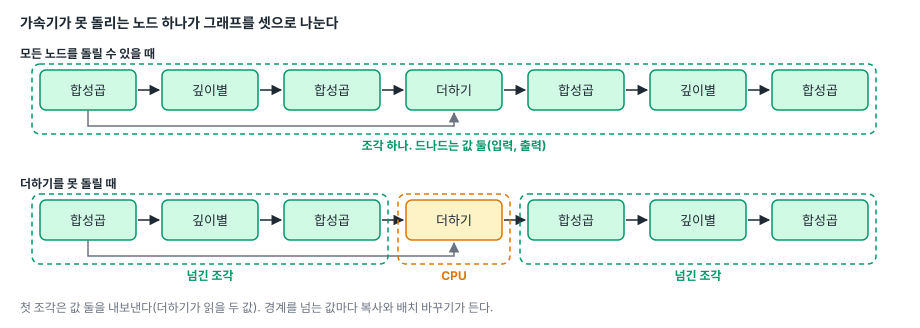
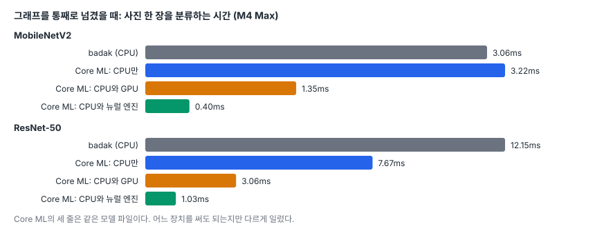
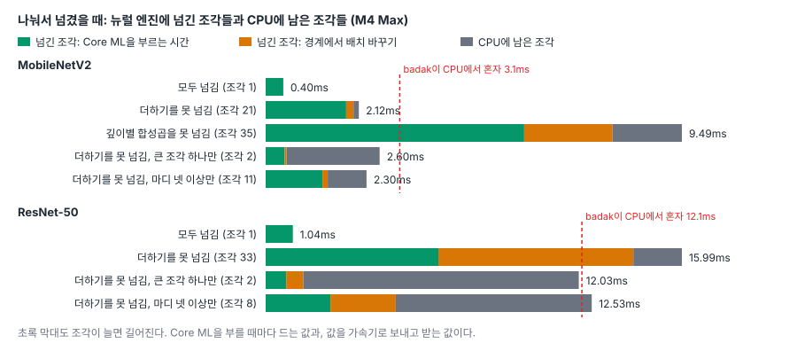

# 모바일 GPU와 NPU

[44장](ch44_on_the_phone.md)에서 엔진을 폰의 운영체제에서 돌렸습니다.
거기서 엔진이 쓴 것은 CPU였습니다. 폰의 칩에는 계산하는 장치가 둘 더
있습니다. 화면을 그리는 **GPU**와, 신경망을 돌리려고 따로 넣은
**NPU**입니다.

이 두 장치를 쓰는 방법은 CPU와 다릅니다.
[23장](../part3/ch23_gpu.md)에서 맥의 GPU를 쓸 때는 우리가 셰이더를 직접
썼습니다. 폰에서는 대개 그렇게 하지 않습니다. 가속기마다 그것을 다루는
소프트웨어가 따로 있고, 엔진은 그래프의 일부를 그 소프트웨어에 **통째로
넘깁니다.** 넘겨받는 쪽을 **델리게이트**<sup>delegate</sup>라고
부릅니다.

넘길 때 문제가 하나 생깁니다. 가속기는 모든 연산을 돌리지 못합니다.
그래서 엔진은 그래프를 넘길 수 있는 조각과 CPU에 남을 조각으로
**나눕니다.** 이 장의 중심은 그 나누기입니다. 어떻게 나누고, 나누면 어떤
비용이 드는지 봅니다.

이 장에서 만드는 것은 셋입니다. 그래프를 나누는 코드, 조각을 넘겨받는
쪽이 지킬 약속, 그리고 실제로 넘겨받는 델리게이트 하나입니다. 넘겨받는
쪽은 **Core ML**입니다. Apple의 기기에서 GPU와 NPU(Apple은 뉴럴
엔진이라고 부릅니다)를 쓰는 운영체제의 기능입니다.

먼저 밝혀 둡니다. **이 장의 측정은 맥에서 한 것입니다.** 이 맥(M4 Max)의
GPU와 뉴럴 엔진은 iPhone의 것과 같은 계열이고 Core ML도 같은 것이지만,
크기와 열의 사정이 다릅니다. 폰에서의 숫자는 다를 것입니다. Android의
가속기는 돌려 보지 못했고, 문서를 읽은 것만 적습니다(45.10절).

결과를 미리 적어 둡니다.

- MobileNetV2 한 장을 분류하는 데 우리 엔진이 CPU에서 3.1ms, Core ML이
  GPU에서 1.4ms, 뉴럴 엔진에서 **0.40ms**가 걸립니다. ResNet-50은
  12.2ms, 3.1ms, 1.0ms입니다.
- 가속기의 답은 CPU의 답과 조금 다릅니다. 점수가 0.02에서 0.04쯤
  어긋납니다. GPU와 뉴럴 엔진이 16비트 실수로 계산하기 때문입니다. 고른
  부류는 같았습니다.
- 가속기는 준비하는 데 오래 걸립니다. 뉴럴 엔진에 ResNet-50을 올리는 데
  0.9초가 듭니다. [43장](ch43_device_constraints.md)의 시작 시간에
  그대로 더해집니다.
- **더하기 하나를 못 넘기면 다 잃습니다.** ResNet-50에서 더하기 열여섯
  개만 CPU에 남겼더니 1.0ms가 16ms가 되었습니다. 엔진이 CPU에서 혼자 다
  돌린 것(12.2ms)보다 느립니다. 경계를 넘는 값이 추론 한 번에
  50MB입니다.
- 그래서 실전의 델리게이트는 작은 조각을 넘기지 않고, 넘기는 조각의 수에
  한도를 둡니다. LiteRT의 GPU 델리게이트는 기본값이 **하나**입니다.
- [31장](../part4/ch31_mobile_engines.md)의 엔진도 쟀습니다. ONNX
  Runtime은 Core ML을 거쳐 우리와 같은 숫자를 냈고, NCNN은 MobileNetV2를
  GPU로 돌리면 CPU보다 두 배 느립니다. 작은 모델에서는 GPU가 늘 빠르지는
  않습니다.

| 하는 일 | 절 |
|---|---|
| 세 가지 계산 장치를 견준다 | 45.1 |
| 넘긴다는 것이 무엇인지 본다 | 45.2 |
| 그래프를 나눈다 | 45.3 |
| 나눈 조각들을 돌린다 | 45.4 |
| 조각을 Core ML의 모델 파일로 옮긴다 | 45.5 |
| Rust에서 Core ML을 부른다 | 45.6 |
| 통째로 넘겨서 잰다 | 45.7 |
| 나눠서 넘겨서 잰다 | 45.8 |
| [31장](../part4/ch31_mobile_engines.md)의 엔진들을 가속기로 잰다 | 45.9 |
| Android의 가속기를 읽는다 | 45.10 |

## 45.1 칩에는 계산 장치가 셋 있다

폰의 칩 하나에 계산 장치가 셋 들어 있습니다.

| | CPU | GPU | NPU |
|---|---|---|---|
| 원래 하는 일 | 무엇이든 | 화면 그리기 | 신경망 |
| 프로그램을 주는 법 | 기계어 | 셰이더 (OpenCL, OpenGL ES, Metal) | 그래프를 통째로. 제조사의 컴파일러가 바꾼다 |
| 돌릴 수 있는 연산 | 전부 | 델리게이트가 구현한 것 | 칩과 컴파일러가 지원하는 것 |
| 숫자 | 32비트 실수, 8비트 정수 | 16비트나 32비트 실수 | 16비트 실수나 8비트 정수 |
| 준비 | 거의 없다 | 셰이더를 컴파일한다 | 그래프를 컴파일한다 |
| 어디에나 있는가 | 그렇다 | 그렇다 | 칩마다 다르다 |

**GPU**는 [23장](../part3/ch23_gpu.md)에서 본 그대로입니다. 작은
프로그램(셰이더)을 수많은 위치에서 동시에 돌립니다. 폰의 GPU도 같습니다.
2019년에 TensorFlow Lite의 GPU 실행기를 만든 사람들은 GPU를 고른 까닭을
"거의 모든 폰에 있는 가속기"라고 적었습니다. 그때 NPU는 고급 폰 일부에만
있었습니다.[^gpu-paper] LiteRT의 문서는 GPU를 쓰는 방법으로 OpenCL과
OpenGL ES를 들고, 지원하는 연산의 목록을 싣고 있습니다. 목록에 있는
연산은 16비트와 32비트 실수로 돕니다.[^litert-gpu]

**NPU**는 신경망의 연산, 그 가운데서도 합성곱과 행렬 곱을 빠르고 적은
전력으로 하려고 만든 회로입니다. CPU나 GPU처럼 "프로그램을 짜서 넣는"
장치가 아닙니다. 그래프를 제조사의 컴파일러에 주면, 컴파일러가 그 칩이
돌릴 수 있는 형태로 바꿉니다. 그래서 NPU는 칩의 제조사마다 쓰는 법이
다릅니다. LiteRT의 문서가 드는 것만 Google Tensor, Qualcomm AI Engine
Direct, MediaTek NeuroPilot, Intel OpenVINO, Samsung Exynos AI
LiteCore로 다섯입니다.[^litert-npu] Apple의 것이 뉴럴 엔진이고, 그것을
쓰는 방법은 Core ML 하나입니다.

Apple이 뉴럴 엔진에 대해 밝힌 것을 옮기면 이렇습니다. 첫 세대는 2017년의
A11 칩에 들어갔고, 16비트 실수로 초당 0.6조 번의 연산을 했습니다.
2021년의 것은 그 26배입니다. 뉴럴 엔진이 가장 잘 다루는 값의 레이아웃은 **네
축이고 채널이 앞에 오는 것**입니다.[^ane] 뒤의 사실은 45.5절에서 우리
코드에 영향을 줍니다.

표의 "숫자" 줄을 봅니다. GPU와 NPU는 대개 **16비트 실수**로 계산합니다.
Core ML의 문서도 그렇게 적고 있습니다. "GPU와 뉴럴 엔진은 16비트 실수를
쓰고, CPU는 32비트 실수를 쓴다."[^typed] 그래서 같은 모델을 가속기에서
돌리면 답이 조금 달라집니다. 얼마나 달라지는지는 45.7절에서 잽니다.

## 45.2 이어진 연산을 묶어서 넘긴다

엔진이 가속기를 쓰는 방법은 두 가지를 생각할 수 있습니다.

**연산마다 넘긴다.** 합성곱 하나를 GPU에서 하고 결과를 받아 오고, 다음
합성곱을 다시 넘깁니다. 23.9절에서 LLM의 선형 층을 GPU에 맡길 때 처음 한
것이 이것입니다. 그때 MLP의 값이 "GPU에서 나와 GPU로 돌아가려고 CPU를
다녀오는" 것을 봤고, 23.10절에서 네 단계를 묶어 한 번에 보내 그것을
없앴습니다.

**이어진 연산을 묶어서 넘긴다.** 그래프에서 가속기가 돌릴 수 있는 노드를
찾아, 이어진 것끼리 묶고, 묶음 하나를 통째로 넘깁니다. 값은 묶음에
들어갈 때 한 번, 나올 때 한 번만 오갑니다. 묶음 안에서 무슨 일이
일어나는지는 넘겨받은 쪽이 알아서 합니다.

실전의 엔진은 모두 뒤의 방법을 씁니다. 이름만 다릅니다.

| 엔진 | 넘겨받는 쪽의 이름 | 나누는 일을 부르는 말 |
|---|---|---|
| LiteRT | 델리게이트 (delegate) | 그래프 분할 |
| ONNX Runtime | 실행 제공자 (execution provider) | 순서대로 물어본다. 앞의 것이 먼저 가져간다 |
| ExecuTorch | 백엔드 (backend) | 분할기(partitioner)가 노드에 꼬리표를 붙인다 |

LiteRT는 이 방식이 필요한 까닭을 이렇게 설명합니다. 가속기마다 쓰는 법이
다르고 어느 가속기도 신경망의 모든 연산을 돌리지는 못하므로, 그 사이를
이어 줄 것이 필요합니다.[^litert-delegates] ONNX Runtime에서는 실행
제공자를 우선순위대로 늘어놓습니다.[^ort-ep] ExecuTorch에서는 백엔드가
넘겨받을 노드에 꼬리표를 붙이고, 꼬리표가 같은 이어진 노드가 조각 하나가
됩니다.[^executorch]

우리 엔진에서 넘겨받는 쪽이 지킬 약속은 이것입니다.

```rust
{{#include ../../../crates/badak_graph/src/delegate.rs:delegate}}
```

물음 하나와 일 둘입니다. 이 노드를 돌릴 수 있는지 답하고(`supports`),
조각을 돌릴 준비를 하고(`compile`), 돌립니다(`run`). `compile`이 따로
있는 까닭은 45.1절의 표에 있습니다. 가속기는 준비가 오래 걸려서, 그 일을
한 번만 하려는 것입니다.

## 45.3 그래프를 조각으로 나눈다

노드마다 "넘길 수 있다"와 "없다"가 정해졌다고 합시다. 이제 노드를
조각으로 묶습니다.

```rust
{{#include ../../../crates/badak_graph/src/delegate.rs:segment}}
```

묶는 규칙은 둘을 지켜야 합니다. 한 조각의 노드는 모두 같은 종류여야
하고, 조각을 차례로 돌릴 수 있어야 합니다. 뒤의 것이 까다롭습니다. 조각
A의 결과를 조각 B가 읽고, B의 결과를 다시 A의 다른 노드가 읽으면, A도
B도 먼저 돌릴 수 없습니다.

[26장](../part4/ch26_graph_interpreter.md)의 위상 정렬을 조금 바꾸면
됩니다. 한 번에 한 조각씩 키웁니다.

```rust
{{#include ../../../crates/badak_graph/src/delegate.rs:color}}
```

지금 실행할 수 있는 노드(입력이 모두 준비된 노드) 가운데 번호가 가장
작은 것이 조각의 종류를 정합니다. 그 뒤로는 실행할 수 있게 된 **같은
종류의** 노드를 더 넣을 수 없을 때까지 넣습니다. 다른 종류의 노드는 다음
조각을 기다립니다. 조각이 닫힌 뒤에야 다음 조각이 시작되므로, 조각은
저절로 실행할 순서대로 놓입니다. LiteRT가 쓰는 방법이 이것이고, 코드를
읽고 따라 했습니다.[^litert-partition]



그림의 아래쪽을 봅니다. 못 돌리는 노드는 하나인데 조각은 셋이 됩니다.
그리고 첫 조각은 더하기가 읽을 값 **둘**을 내보냅니다. 잔차 연결이 있는
모델에서는 조각을 드나드는 값이 조각의 수보다 많습니다.

### 작은 조각은 넘기지 않는다

묶은 조각을 모두 넘기는 것이 늘 좋지는 않습니다. 조각을 넘나들 때마다
비용이 듭니다(45.8절에서 잽니다). 노드 하나짜리 조각을 가속기에 넘기면
얻는 것보다 잃는 것이 많습니다. 그래서 나누는 방법에 설정 두 가지를
둡니다.

```rust
{{#include ../../../crates/badak_graph/src/delegate.rs:partition}}
```

노드가 `min_nodes`보다 적은 조각은 넘기지 않습니다. 넘길 조각이
`max_delegated`보다 많으면 큰 것부터 남깁니다. 넘기지 않기로 한 노드를
"넘길 수 없다"로 바꾸고 한 번 더 묶으면, 이웃한 CPU 조각이 하나로
합쳐집니다.

LiteRT에도 같은 것이 있습니다. 노드가 일정한 수 이상인 조각 가운데 가장
큰 N개를 고르는 함수가 있고, GPU 델리게이트는 넘기는 조각의 수의
기본값이 **1**입니다.[^litert-max] 왜 하나인지는 45.8절의 측정에서
드러납니다.

## 45.4 나눈 조각을 차례로 돌린다

나눈 조각을 차례로 돌리는 실행기가 `Hybrid`입니다. CPU 조각은
[26장](../part4/ch26_graph_interpreter.md)의 해석기로, 넘긴 조각은
델리게이트가 준비한 것으로 돌립니다.

CPU 조각을 해석기로 돌리려면 조각이 따로 돌릴 수 있는 그래프여야 합니다.
그래서 떼어 냅니다.

```rust
{{#include ../../../crates/badak_graph/src/delegate.rs:subgraph}}
```

조각의 입력이 새 그래프의 입력이, 조각의 출력이 새 그래프의 출력이
됩니다. 가중치도 따라갑니다. 텐서는 파일을 매핑한 메모리를 빌린
것이어서([6장](../part1/ch06_model_files.md)) 복사되지 않습니다.

```rust
{{#include ../../../crates/badak_graph/src/delegate.rs:hybrid_run}}
```

조각 사이를 오가는 값은 실행기가 들고 있습니다. 조각마다 입력을 건네고
출력을 받아 둡니다.

이것이 맞게 도는지를 가속기 없이 확인할 방법이 필요합니다. CI의 기계에는
Core ML이 없습니다. 그래서 **넘겨받은 조각을 우리 해석기로 돌리는
델리게이트**를 하나 두었습니다.

```rust
{{#include ../../../crates/badak_graph/src/delegate.rs:cpu_delegate}}
```

어떤 연산을 돌릴 수 있다고 답할지를 함수로 받으므로, "더하기를 못 돌리는
가속기"를 흉내 낼 수 있습니다. 넘긴 쪽도 같은 커널로 계산하니, 어떻게
나누든 결과는 **나누지 않고 돌린 것과 비트까지 같아야** 합니다. 테스트가
MobileNetV2를 다섯 가지로 나눠(조각 하나에서 쉰다섯 개까지) 그것을
확인합니다.

## 45.5 조각을 Core ML의 모델로 옮긴다

이제 진짜 가속기입니다.

Core ML은 엔진입니다. 모델 파일을 주면 그것을 돌립니다. CPU, GPU, 뉴럴
엔진 가운데 어디에서 돌릴지는 Core ML이 정합니다. 우리가 정할 수 있는
것은 "어느 장치를 써도 되는가"뿐입니다.[^units]

그러니 Core ML에 조각을 넘기려면 **조각을 Core ML의 모델 파일로 적어야**
합니다. 한 엔진의 그래프를 다른 엔진의 형식으로 옮기는 일이고,
[30장](../part4/ch30_graph_optimization.md)에서 ONNX를 우리 그래프로
옮긴 것의 반대 방향입니다.

### 모델 파일을 쓴다

Core ML의 모델 파일(`.mlmodel`)은 Protocol Buffers 메시지 하나입니다.
[30장](../part4/ch30_graph_optimization.md)에서 ONNX를 읽으려고 이
형식의 **읽기**를 만들었습니다. 이번에는 **쓰기**가 필요합니다.

```rust
{{#include ../../../crates/badak_formats/src/protobuf.rs:writer}}
```

읽기를 뒤집은 것입니다. 한 가지만 눈여겨봅니다. 안에 든 메시지는 길이를
앞에 적어야 하므로, 안쪽을 먼저 다 적은 뒤에야 바깥에 넣을 수 있습니다.

필드의 번호가 무엇을 뜻하는지는 Apple이 공개한 `.proto` 파일에
있습니다.[^coreml-proto] 모델은 세 부분입니다.

| 필드 | 내용 |
|---|---|
| 1 | 형식의 버전. 4를 적는다 |
| 2 | 설명. 입력과 출력의 이름과 형상 |
| 500 | 신경망. 층들의 목록 |

Core ML에는 모델을 적는 형식이 둘 있습니다. 층을 늘어놓는 "신경망"과, 더
새롭고 표현력이 큰 "ML 프로그램"입니다. 우리는 앞의 것을 씁니다. 합성곱
신경망을 옮기는 데는 충분하고, 파일 하나로 끝납니다.

```rust
{{#include ../../../crates/badak_graph/src/coreml.rs:lower}}
```

### 노드를 층으로 적는다

노드마다 층을 하나나 둘 적습니다. 합성곱을 봅니다.

```rust
{{#include ../../../crates/badak_graph/src/coreml.rs:lower_conv}}
```

세 가지가 엔진마다 달라서 맞춰야 했습니다.

**필터의 축의 순서.** 우리 필터는 `(출력, 높이, 너비, 입력)`이고 Core
ML은 `(출력, 입력, 높이, 너비)`입니다. 값을 옮겨 적습니다. 순서를 틀리면
오류는 나지 않고 **답만 틀립니다.**

**깊이별 합성곱.** Core ML에는 그런 층이 따로 없습니다. "묶음의 수가
채널의 수와 같은 합성곱"으로 적습니다. 27.6절에서 깊이별 합성곱을 설명한
말 그대로입니다.

**활성화 함수.** `.tflite`는 ReLU6을 합성곱에 붙여
적습니다([26장](../part4/ch26_graph_interpreter.md)). Core ML의 합성곱
층에는 그것을 적을 필드가 없습니다. 합성곱 층 뒤에 "0과 6 사이로 자르기"
층을 하나 더 적습니다. 그래서 층의 수가 노드의 수보다 많습니다.
MobileNetV2는 노드 70개가 층 104개가 됩니다.

### 돌릴 수 있는지는 조건까지 본다

`supports`는 연산의 이름만 보지 않습니다.

```rust
{{#include ../../../crates/badak_graph/src/coreml.rs:supports}}
```

같은 합성곱이라도 필터가 가중치가 아니라 계산되는 값이면 옮기지
못합니다. 평균도 높이와 너비를 함께 따라 내는 것(전체 평균 풀링)만
옮깁니다. 실전의 델리게이트도 이렇습니다. "이 연산을 지원한다"는 말은
대개 "이 연산 가운데 이런 조건의 것을 지원한다"는 뜻입니다. 모델을 조금
바꿨더니 갑자기 가속기에서 돌지 않게 되는 일이 여기에서 생깁니다.

### 경계에서 값의 레이아웃을 바꾼다

45.1절에서 뉴럴 엔진이 **채널이 앞에 오는** 레이아웃을 쓴다고 했습니다. Core
ML의 층도 그렇습니다. 값은 `(장 수, 채널, 높이, 너비)`입니다. 우리
그래프는 `.tflite`를 따라 `(장 수, 높이, 너비, 채널)`을 씁니다.

그래서 조각의 **경계에서** 값을 옮겨 적어야 합니다.

```rust
{{#include ../../../crates/badak_graph/src/coreml.rs:layout}}
```

조각 안에서는 이 일이 없습니다. 가중치는 옮길 때 한 번 바꿔 적었고, 층과
층 사이의 값은 Core ML 안에서 Core ML의 레이아웃으로 흐릅니다. 값의
레이아웃이 다른 두 엔진이 만나는 곳에서만, 넘나들 때마다 한 번씩 비용이
듭니다. 이 비용이 45.8절에서 큰 숫자로 돌아옵니다.

재미있는 일이 하나 있었습니다. 두 모델의 그래프는 "축 바꾸기" 노드로
시작합니다. PyTorch에서 온 모델이라 입력이 채널이 앞인데, `.tflite`로
바꾸면서 맨 앞에 채널을 뒤로 보내는 노드가 들어간 것입니다. 이 노드를
Core ML로 옮기면 **할 일이 없습니다.** 입력은 이미 Core ML이 바라는
레이아웃입니다. 층을 적지 않고 이름만 물려줍니다. 한 엔진에서 군더더기였던
노드가 다른 엔진에서는 사라집니다.

## 45.6 Rust에서 Core ML을 부른다

모델 파일을 적었으니 Core ML에 줘야 합니다. Core ML은 Swift와
Objective-C로만 부를 수 있습니다.

[44장](ch44_on_the_phone.md)과 **방향이 반대**입니다. 거기서는 Swift가
Rust를 불렀고, 여기서는 Rust가 Swift를 부릅니다. 문은 같은 것, C의
함수입니다. Swift로 작은 라이브러리를 쓰고, 함수 넷을 C의 이름으로
내놓습니다.

```swift
{{#include ../../../apps/coreml/BadakCoreML.swift:load}}
```

`@_cdecl`이 [44장](ch44_on_the_phone.md)의 `#[unsafe(no_mangle)]`에
해당합니다. 올리는 일은 두 단계입니다. 파일을 이 기기에 맞는 형태로
**컴파일**하고, 그것을 올립니다. 어느 장치에서 돌릴지는 올릴 때
정해집니다.

```swift
{{#include ../../../apps/coreml/BadakCoreML.swift:run}}
```

입력은 엔진의 메모리를 복사하지 않고 감쌉니다(`dataPointer`). 출력은
Core ML이 만든 배열에서 우리 메모리로 복사합니다.

이 Swift 파일은 엔진의 일부로 빌드하지 않습니다. `swiftc`가 있어야 하고
macOS에서만 되기 때문입니다. 따로 동적 라이브러리로 만들어
두고(`scripts/build_coreml.sh`), 엔진이 **실행할 때** 올립니다.

```rust
{{#include ../../../crates/badak_graph/src/coreml.rs:dlopen}}
```

`dlopen`이 라이브러리를 올리고 `dlsym`이 이름으로 함수를 찾습니다.
[6장](../part1/ch06_model_files.md)의 `mmap`처럼 운영체제의 함수를 직접
선언했습니다. 라이브러리가 없으면 델리게이트를 만들 때 오류가 나고,
엔진의 나머지는 그대로 돕니다. 실전의 엔진이 가속기용 코드를 따로 떼어
두는 까닭도 같습니다. 가속기가 없는 기기에서도 엔진은 돌아야 합니다.

돌리는 쪽은 이렇습니다.

```rust
{{#include ../../../crates/badak_graph/src/coreml.rs:coreml_compiled}}
```

레이아웃을 바꾸고, 부르고, 다시 바꿉니다.

## 45.7 통째로 넘겨서 잰다

두 모델은 모든 노드를 옮길 수 있습니다. 조각은 하나입니다.

```text
{{#include output/ch45_delegate.txt}}
```

`ch45_delegate`의 출력입니다. 아래는 세 차례 잰 것의 중앙값입니다. 쉰
번씩 돌렸습니다.

| MobileNetV2 | 준비 (ms) | 첫 실행 (ms) | 그 뒤 (ms) | 점수의 가장 큰 차이 |
|---|---:|---:|---:|---:|
| badak (CPU) | 0 | 15.1 | 3.06 | (기준) |
| Core ML: CPU만 | 48 | 4.3 | 3.22 | 0.0000 |
| Core ML: CPU와 GPU | 56 | 17.2 | 1.35 | 0.0300 |
| Core ML: CPU와 뉴럴 엔진 | 208 | 0.7 | **0.40** | 0.0368 |
| Core ML: 모두 | 186 | 0.7 | 0.40 | 0.0368 |

| ResNet-50 | 준비 (ms) | 첫 실행 (ms) | 그 뒤 (ms) | 점수의 가장 큰 차이 |
|---|---:|---:|---:|---:|
| badak (CPU) | 0 | 21.1 | 12.15 | (기준) |
| Core ML: CPU만 | 255 | 11.1 | 7.67 | 0.0000 |
| Core ML: CPU와 GPU | 282 | 24.2 | 3.06 | 0.0151 |
| Core ML: CPU와 뉴럴 엔진 | 897 | 2.0 | **1.03** | 0.0171 |
| Core ML: 모두 | 859 | 1.8 | 1.04 | 0.0171 |



"badak (CPU)"는 [26장](../part4/ch26_graph_interpreter.md)의 해석기를
`Interpreter::new`로 만든
것입니다([30장](../part4/ch30_graph_optimization.md)의 그래프 최적화는
하지 않았습니다). 여섯 가지를 읽습니다.

**뉴럴 엔진은 한 자릿수가 다릅니다.** MobileNetV2에서 CPU의 8배,
ResNet-50에서 12배입니다. 43.6절에서 "빨리 끝내고 쉬는 것이 배터리를
아낀다"고 했습니다. 전력을 재지는 못했지만, 가속기를 쓰는 까닭의 절반이
거기에 있습니다.

**옮긴 것이 맞습니다.** "CPU만"의 점수가 우리 엔진의 점수와 소수점 넷째
자리까지 같습니다. 필터의 축을 잘못 옮겼거나 패딩을 잘못 적었다면 이
숫자가 0이 아닙니다. 서로 다른 두 엔진이 같은 가중치로 같은 답을
냈습니다.

**가속기의 답은 조금 다릅니다.** GPU와 뉴럴 엔진에서는 점수가 0.015에서
0.037 어긋납니다. 16비트 실수로 계산한 대가입니다. 고른 부류는 모두
컵이었습니다. [20장](../part3/ch20_weight_quantization.md)과
[29장](../part4/ch29_integer_inference.md)에서 한 물음을 여기서도 해야
합니다. 이 차이가 **내 모델과 내 데이터에서** 괜찮은지입니다. 사진 한
장으로는 답할 수 없고, [21장](../part3/ch21_quantization_quality.md)처럼
데이터셋으로 재야 합니다.

**준비가 깁니다.** 우리 해석기는 준비에 0.2ms가 걸립니다(표에는 0으로
적었습니다). Core ML은 CPU만 써도 48ms에서 255ms이고, 뉴럴 엔진은
0.2초에서 0.9초입니다. 모델을 뉴럴 엔진이 돌릴 수 있는 형태로 컴파일하는
시간입니다. 43.3절에서 "앱을 열고 첫 답까지"를 쟀습니다. 가속기는 그
숫자를 키웁니다. 사진 한 장만 분류하고 끝나는 앱이라면 ResNet-50을 뉴럴
엔진에 올리는 0.9초는 CPU에서 일흔 번 추론할 시간입니다.

**첫 실행도 봐야 합니다.** GPU의 첫 실행은 17ms에서 24ms로 그 뒤의 열
배쯤입니다. 이 측정을 처음 했을 때는 430ms와 490ms였습니다. 그 뒤로는 이
숫자가 나오지 않았습니다. 운영체제가 무언가를(컴파일한 셰이더일
것입니다) 디스크에 남겨 두는 것으로 보입니다. 확인하지는 않았습니다.
사용자가 앱을 받아 처음 여는 순간에 걸리는 시간은 뒤의 숫자가 아니라
**앞의 숫자**입니다.

**"모두"는 뉴럴 엔진을 골랐습니다.** Core ML에 다 맡기면 뉴럴 엔진을
씁니다. 숫자가 "CPU와 뉴럴 엔진"과 같습니다.

### Core ML도 그래프를 나눈다

Core ML 안에서도 같은 일이 일어납니다. Core ML의 문서는 "그래프를 뉴럴
엔진, GPU, CPU의 구역으로 나눈다"고 적고 있습니다.[^typed] 층마다 어느
장치를 골랐는지 물어볼 수 있습니다(`MLComputePlan`).[^plan]

```swift
{{#include ../../../apps/coreml/BadakCoreML.swift:plan}}
```

| 모델 | 우리가 적은 층 | Core ML이 본 층 | "CPU와 뉴럴 엔진"에서 뉴럴 엔진을 고른 층 |
|---|---:|---:|---:|
| MobileNetV2 | 104 | 99 | 99 |
| ResNet-50 | 126 | 88 | 88 |

두 모델 모두 **전부** 뉴럴 엔진으로 갔습니다. NPU는 바로 이런 합성곱
신경망을 돌리려고 만든 장치입니다.

둘째와 셋째 열이 다른 것도 볼 만합니다. 우리가 층 104개를 적어 줬는데
Core ML은 99개로 봅니다. Core ML도 컴파일하면서 층을 합칩니다.
MobileNetV2에서 사라진 다섯은 패딩 층의 수와
같고([30장](../part4/ch30_graph_optimization.md)에서 우리가 합성곱에
합친 그 노드입니다), ResNet-50에서는 서른여덟이 사라졌습니다. 무엇과
무엇을 합쳤는지는 확인하지 않았습니다.

## 45.8 나눠서 넘겨서 잰다

이제 이 장의 중심 실험입니다. 가속기가 **어떤 연산을 못 돌린다고 치고**
다시 잽니다. 델리게이트의 `refusing`이 그 일을 합니다. Core ML은
그대로이고, 우리 쪽에서 그 연산을 넘기지 않습니다.

뉴럴 엔진의 결과입니다.

| MobileNetV2, 뉴럴 엔진 | 조각 | 넘긴 조각 | 드나드는 값 | 준비 (ms) | 한 번 (ms) |
|---|---:|---:|---:|---:|---:|
| 모두 넘김 | 1 | 1 | 2 | 229 | **0.40** |
| 더하기를 못 넘김 | 21 | 11 | 27 | 351 | 2.13 |
| 깊이별 합성곱을 못 넘김 | 35 | 18 | 56 | 503 | **9.48** |
| 둘 다 못 넘김 | 55 | 28 | 61 | 661 | 10.58 |
| (견줄 것) badak이 CPU에서 혼자 | | | | 0 | 3.06 |

| ResNet-50, 뉴럴 엔진 | 조각 | 넘긴 조각 | 드나드는 값 | 준비 (ms) | 한 번 (ms) |
|---|---:|---:|---:|---:|---:|
| 모두 넘김 | 1 | 1 | 2 | 901 | **1.04** |
| 더하기를 못 넘김 | 33 | 17 | 38 | 1,095 | **16.04** |
| (견줄 것) badak이 CPU에서 혼자 | | | | 0 | 12.15 |



MobileNetV2에는 더하기가 열 개 있습니다. 노드 일흔 개 가운데 열 개이고,
계산량으로는 거의 없는 것이나 같습니다. 그것을 CPU에 남겼더니 0.40ms가
2.13ms가 되었습니다. **다섯 배** 느려졌습니다.

깊이별 합성곱을 못 넘기면 9.48ms입니다. 가속기를 쓰지 않고 CPU에서 다
돌린 것(3.06ms)보다 **세 배 느립니다.** ResNet-50은 더 심합니다. 더하기
열여섯 개를 CPU에 남기자 1.04ms가 16.04ms가 되어, 역시 CPU에서 혼자 돌린
것보다 느립니다.

노드의 대부분이 가속기에서 도는데 전체는 가속기를 쓰지 않을 때보다
느립니다. 시간이 어디에 들었는지 봅니다.

| | 넘긴 조각들 (ms) | 그 가운데 레이아웃 바꾸기 (ms) | CPU 조각들 (ms) | 경계를 넘은 값 (MB) |
|---|---:|---:|---:|---:|
| MobileNetV2, 모두 넘김 | 0.40 | 0 | 0 | 0 |
| MobileNetV2, 더하기를 못 넘김 | 2.00 | 0.17 | 0.12 | 2.3 |
| MobileNetV2, 깊이별을 못 넘김 | 7.91 | 2.02 | 1.58 | 26.4 |
| ResNet-50, 모두 넘김 | 1.04 | 0 | 0 | 0 |
| ResNet-50, 더하기를 못 넘김 | 14.12 | 7.49 | 1.86 | 50.2 |

"모두 넘김"의 줄에서 경계를 넘은 값이 0인 것은, 입력은 레이아웃을 바꿀
필요가 없었고(45.5절) 출력은 값 천 개뿐이어서입니다.

**CPU에 남은 조각은 느리지 않습니다.** ResNet-50의 더하기 열여섯 개는
1.86ms입니다. 문제는 그것이 아닙니다.

**넘긴 조각이 느려졌습니다.** 같은 뉴럴 엔진, 거의 같은 층인데 1.04ms가
14.12ms가 되었습니다. 둘로 나눠 봅니다.

*레이아웃 바꾸기.* ResNet-50의 중간 값은 큽니다. 가장 큰 것이
`56 × 56 × 256`, 80만 개의 수이고 3.2MB입니다. 조각을 나갈 때 채널을
뒤로, 들어갈 때 다시 앞으로 옮겨 적습니다. 추론 한 번에 경계를 넘는 값을
다 더하면 **50MB**이고, 옮겨 적는 데 7.5ms가 듭니다. 뉴럴 엔진이 모델
전체를 돌리는 시간의 일곱 배입니다.

*부르는 비용.* 나머지 6.6ms는 Core ML을 열일곱 번 부르는 데 듭니다. 한
번 부를 때마다 값을 뉴럴 엔진으로 보내고(16비트로 바꾸고, 뉴럴 엔진의
메모리에 놓고), 돌리고, 받아 옵니다. 통째로 넘기면 이 일이 한 번입니다.

두 비용 모두 **경계를 넘는 값의 크기**에 따라 커집니다. MobileNetV2에서
더하기를 못 넘겼을 때(2.3MB)보다 깊이별 합성곱을 못 넘겼을 때(26.4MB)가
훨씬 나쁜 까닭입니다. 조각의 수만 볼 것이 아니라 **어디에서 잘리는지**를
봐야 합니다. 그래프의 앞쪽, 값이 큰 곳에서 잘리면 비쌉니다.

준비 시간도 늘었습니다. 조각마다 따로 컴파일하기 때문입니다.
MobileNetV2를 쉰다섯 조각으로 나누면 준비가 0.66초입니다.

### 덜 넘기는 편이 낫다

45.3절의 두 가지 설정을 씁니다. 더하기를 못 넘기는 가속기에서입니다.

| 뉴럴 엔진, 더하기를 못 넘김 | 넘긴 조각 | 넘긴 노드 | 한 번 (ms) |
|---|---:|---:|---:|
| MobileNetV2: 넘길 수 있는 것은 다 | 11 | 60 | 2.13 |
| MobileNetV2: 노드 넷 이상인 조각만 | 6 | 45 | 2.29 |
| MobileNetV2: 가장 큰 조각 하나만 | 1 | 12 | 2.60 |
| ResNet-50: 넘길 수 있는 것은 다 | 17 | 62 | 16.04 |
| ResNet-50: 노드 넷 이상인 조각만 | 4 | 24 | 12.54 |
| ResNet-50: 가장 큰 조각 하나만 | 1 | 9 | 12.02 |

ResNet-50에서는 **덜 넘길수록 빠릅니다.** 노드 예순두 개를 넘길 때보다
아홉 개만 넘길 때가 빠릅니다. 그래도 가장 좋은 것이 12.02ms로, CPU에서
혼자 돌린 12.15ms와 다를 것이 없습니다. 이 모델에서 "더하기를 못 돌리는
뉴럴 엔진"은 **쓸모가 없습니다.**

MobileNetV2에서는 반대로 다 넘기는 쪽이 조금 낫습니다. 넘길 것이 줄면
CPU가 맡는 계산이 늘고, 이 모델에서는 그쪽이 더 비쌉니다. 어느 쪽이
나은지는 모델과 가속기에 달려 있고, **재야 압니다.**

LiteRT의 GPU 델리게이트가 넘기는 조각의 수를 기본으로 하나로 둔 까닭을
이제 알 수 있습니다. 조심스러운 기본값입니다. 조각 하나만 넘기면 경계는
많아야 둘이고, 최악의 경우에도 크게 잃지 않습니다.

### 모델을 고치는 편이 낫다

이 절의 숫자가 보여 주는 것은 하나입니다. 가속기를 쓸 때 가장 중요한
것은 가속기의 속도가 아니라 **모델 전체가 가속기에 들어가는가**입니다.

그래서 가속기를 겨냥한 모델은 가속기가 돌리는 연산만으로 짭니다.
45.1절에서 인용한 Apple의 글이 그런 글입니다. 트랜스포머를 뉴럴 엔진에
올리려고 선형 층을 `1 × 1` 합성곱으로 바꾸고(27.5절에서 둘이 같은 것임을
봤습니다), 값의 레이아웃을 네 축으로 바꾸고, 형상을 바꾸는 연산을
없앱니다.[^ane] 엔진을 고치는 것이 아니라 모델을 고칩니다. 추론
엔지니어의 일에는 "이 모델의 이 연산 하나 때문에 가속기에서 돌지
못한다"를 찾아내 모델을 만든 사람에게 돌려보내는 일이 들어 있습니다.
45.7절의 `MLComputePlan` 같은 도구를 그때 씁니다.

## 45.9 다른 엔진을 가속기로 잰다

[31장](../part4/ch31_mobile_engines.md)에서 네 엔진을 CPU로 견주면서
GPU는 이 장으로 미뤘습니다. 이 맥에서 되는 것을 잽니다. ONNX Runtime에는
Core ML 실행 제공자가 있습니다. 우리가 만든 것과 같은 종류입니다. NCNN은
Vulkan으로, MNN은 Metal로 GPU를 직접 씁니다. LiteRT의 파이썬 패키지에는
맥용 GPU 델리게이트가 들어 있지 않아서 **LiteRT는 재지 못했습니다.**

| MobileNetV2 | 설정 | 준비 (ms) | 첫 실행 (ms) | 그 뒤 (ms) | 그 엔진의 CPU와의 차이 |
|---|---|---:|---:|---:|---:|
| ONNX Runtime | CPU | 28 | 3.8 | 1.75 | (기준) |
| | Core ML: CPU와 GPU | 106 | 18.7 | 2.00 | 0.0300 |
| | Core ML: CPU와 뉴럴 엔진 | 371 | 1.1 | **0.45** | 0.0367 |
| NCNN | CPU | 18 | 2.9 | 0.91 | (기준) |
| | Vulkan | 153 | 13.2 | 2.07 | 0.2178 |
| MNN | CPU | 19 | 3.6 | 1.86 | (기준) |
| | Metal | 144 | 1.8 | 1.18 | 0.0366 |
| badak | CPU | 0 | 15.1 | 3.06 | (기준) |
| | Core ML: CPU와 뉴럴 엔진 | 208 | 0.7 | **0.40** | 0.0368 |

| ResNet-50 | 설정 | 준비 (ms) | 첫 실행 (ms) | 그 뒤 (ms) | 그 엔진의 CPU와의 차이 |
|---|---|---:|---:|---:|---:|
| ONNX Runtime | CPU | 46 | 41.3 | 8.10 | (기준) |
| | Core ML: CPU와 GPU | 313 | 18.6 | 3.09 | 0.0151 |
| | Core ML: CPU와 뉴럴 엔진 | 899 | 2.2 | **1.16** | 0.0105 |
| NCNN | CPU | 32 | 7.6 | 5.41 | (기준) |
| | Vulkan | 193 | 18.2 | 4.78 | 0.1055 |
| MNN | CPU | 169 | 8.7 | 8.22 | (기준) |
| | Metal | 497 | 2.6 | 2.35 | 0.0140 |
| badak | CPU | 0 | 21.1 | 12.15 | (기준) |
| | Core ML: CPU와 뉴럴 엔진 | 897 | 2.0 | **1.03** | 0.0171 |

`reference/ch45_time.py`가 잰 것이고 세 차례의 중앙값입니다. 스레드의
수는 엔진마다 기본값 그대로여서, **CPU 줄끼리 견주면 안 됩니다**(같은
조건의 CPU 비교는 [31장](../part4/ch31_mobile_engines.md)에 있습니다).
볼 것은 한 엔진 안에서 CPU와 가속기의 차이입니다.

**ONNX Runtime이 Core ML로 낸 숫자는 우리 것과 같습니다.** 뉴럴 엔진에서
0.45ms와 1.16ms, 우리가 0.40ms와 1.03ms입니다. 준비 시간도, 점수의
차이도 닮았습니다. 놀랄 일이 아닙니다. 둘 다 그래프를 Core ML의 모델로
옮겨 넘길 뿐이고, 계산은 Core ML이 합니다. ONNX Runtime은 세션을 만들 때
나눈 결과를 기록에 적습니다. MobileNetV2는 "조각 1개, 노드 100개 가운데
100개", ResNet-50은 "조각 1개, 122개 가운데 122개"였습니다. 우리와 같이
통째로 넘겼습니다.

**GPU가 늘 빠르지는 않습니다.** NCNN은 MobileNetV2를 Vulkan으로 돌리면
CPU보다 **두 배 느립니다**(0.91ms → 2.07ms). ResNet-50에서는 조금
빠른데(5.41ms → 4.78ms) 차례마다 3.6ms에서 5.0ms까지 흔들렸습니다.
모델이 작으면 GPU에 일을 보내고 받는 비용이 계산보다 커집니다.
23.4절에서 본 것과 같습니다. MNN의 Metal은 두 모델 모두 CPU보다
빨랐습니다(1.6배, 3.5배).

**점수의 차이는 엔진마다 다릅니다.** Core ML과 MNN은 0.01에서 0.04,
NCNN의 Vulkan은 0.1에서 0.2입니다. 고른 부류는 모두 같았습니다. 같은
"16비트로 계산한다"여도 어디에서 16비트로 줄이는지가 다르기 때문일
것입니다. 까닭을 확인하지는 않았습니다.

**준비 시간은 처음이 훨씬 깁니다.** 표의 준비 시간은 여러 번 돌린 뒤의
것입니다. 이 스크립트를 처음 돌렸을 때 NCNN의 Vulkan은 1.6초, MNN의
Metal은 2.4초가 걸렸습니다. 45.7절의 GPU 첫 실행과 같은 일입니다.

## 45.10 Android의 가속기는 문서로 읽는다

돌려 보지 못했습니다. 읽은 것을 적습니다.

**하나의 문은 없어졌습니다.** Android에는 가속기를 한 가지 방법으로 쓰게
해 주는 NNAPI가 있었습니다. Android 8.1에 들어왔고 Android 15에서
**지원이 중단**되었습니다. Google은 그 까닭을, 이 분야가 너무 빨리
바뀌어 운영체제와 함께 갱신되는 것으로는 따라갈 수 없었다고
적었습니다.[^nnapi] 지금 권하는 방법은 엔진(LiteRT)이 앱과 함께 가거나
Google Play 서비스로 갱신되는 것입니다.

**GPU는 엔진이 직접 씁니다.** LiteRT의 GPU 델리게이트는 OpenCL이나
OpenGL ES로 셰이더를 돌립니다. 우리가 [23장](../part3/ch23_gpu.md)에서
한 일을 폰의 GPU에 대고 하는 것입니다. 지원하는 연산이 정해져
있고(45.1절), 준비 시간을 줄이려고 컴파일한 셰이더를 디스크에 남겨 두는
기능이 있습니다. 문서는 그것으로 시작 시간이 90%까지 준다고 적고
있습니다.[^litert-gpu] 우리가 45.7절과 45.9절에서 본 "처음만 오래
걸린다"와 같은 종류의 일입니다.

**NPU는 제조사의 것을 씁니다.** 칩마다 컴파일러와 런타임이 따로 있고,
LiteRT가 그 위에 한 계층을 얹습니다. 컴파일을 언제 하는지가 둘로
나뉩니다. 개발자가 **미리** 칩마다 컴파일해 두거나, **기기에서** 처음
실행할 때 컴파일합니다. 문서는 앞의 것을 큰 모델에, 뒤의 것을 작은
모델에 권하고, 뒤의 것은 첫 실행의 비용이 더 크다고 적고
있습니다.[^litert-npu] 미리 컴파일하면 칩마다 파일이 하나씩 생기고,
44.7절의 "기기마다 다른 모델을 내려 주는 일"이 필요해집니다. 그 문서가
미리 컴파일한 모델을 Google Play의 AI 팩으로 내보내라고 하는 까닭입니다.

**Apple 쪽과 견주면 이렇습니다.** Apple은 칩도 운영체제도 엔진도 한
회사가 만드니 문이 Core ML 하나입니다. Android는 칩을 만드는 회사가
여럿이어서 문이 여럿이고, 엔진이 그 차이를 감춥니다. 어느 쪽이든 엔진이
하는 일은 같습니다. 그래프를 나누고, 조각을 넘기고, 나머지를 CPU에서
돌립니다.

## 45.11 남긴 일을 적어 둔다

**폰에서의 측정.** 이 장의 숫자는 맥의 것입니다. 폰의 뉴럴 엔진은 코어의
수가 같아도 전력과 열의 한도가 다릅니다.

**전력.** 가속기를 쓰는 까닭의 절반인데 재지 못했습니다.

**Android의 가속기.** 읽기만 했습니다.

**LiteRT의 GPU 델리게이트.** [31장](../part4/ch31_mobile_engines.md)의 네 엔진 가운데 이것만 재지
못했습니다.

**정확도.** 16비트 실수의 차이를 사진 한 장의 점수로만 봤습니다.

**8비트 모델.** [29장](../part4/ch29_integer_inference.md)의 정수 모델을 가속기에 넘기지 않았습니다. NPU는
8비트 정수를 가장 잘 다룬다고들 하는데, Core ML의 신경망 형식으로
양자화된 가중치를 적는 일은 하지 않았습니다.

**경계의 레이아웃 바꾸기를 가속기에 맡기기.** 45.8절에서 시간의 절반이 우리
쪽의 레이아웃 바꾸기였습니다. Core ML의 모델 앞뒤에 축을 바꾸는 층을 넣으면
그 일을 Core ML이 합니다. 얼마나 나아지는지 해 보지 않았습니다. 레이아웃
바꾸기 코드도 한 값씩 옮기는 가장 단순한 것입니다.

**값을 복사하지 않고 넘기기.** 출력은 Core ML의 배열에서 우리 메모리로
복사합니다. 우리 메모리에 바로 쓰게 하는 방법이 Core ML에 있는데 쓰지
않았습니다.

**조각을 묶어 한 번에 컴파일하기.** 조각마다 모델 파일을 하나씩 만들어
따로 컴파일합니다.

**ML 프로그램 형식.** Core ML의 새 형식으로는 적지 않았습니다.
트랜스포머를 넘기려면 그 형식이 필요합니다.

**LLM.** 이 장의 모델은 합성곱 신경망입니다. LLM을 폰의 가속기에서
돌리는 이야기는 [47장](ch47_on_device_llm.md)에서 합니다.

## 45.12 실전 엔진에서는

**LiteRT에도 Core ML 델리게이트가 있습니다.** 우리가 만든 것과 같은
종류입니다. `.tflite` 그래프의 조각을 Core ML에 넘겨 뉴럴 엔진을
씁니다.[^litert-delegates] 한 엔진이 다른 엔진을 가속기처럼 쓰는 것이
이상해 보이지만, 뉴럴 엔진으로 가는 문이 Core ML뿐이니 그럴 수밖에
없습니다.

**어느 연산이 어디에서 도는지 보여 주는 도구가 있습니다.** 45.8절에서 본
것 때문입니다. 실전의 엔진은 "이 모델의 노드 몇 개가 가속기로 갔고
조각이 몇 개인가"를 알려 주는 기능을 둡니다. 가속기를 붙였는데
느려졌다면 가장 먼저 볼 숫자가 그것입니다.

**정확도를 견주는 도구도 있습니다.** LiteRT의 문서는 델리게이트가 CPU와
다른 정밀도로 계산하므로 결과를 견줘 보라고 하고, 그 도구를
소개합니다.[^litert-delegates] 45.7절에서 우리가 점수의 차이를 본 것과
같은 일입니다.

**준비한 것을 남겨 둡니다.** 컴파일한 셰이더나 컴파일한 NPU용 모델을
디스크에 두고 다음에 다시 씁니다. [43장](ch43_device_constraints.md)의
시작 시간을 지키는 방법입니다. 모델이나 운영체제가 바뀌면 남겨 둔 것을
버려야 하므로, 44.8절의 "버전을 맞추는 일"이 여기에도 있습니다.

## 정리

- 폰의 칩에는 CPU, GPU, NPU가 있습니다. GPU와 NPU는 빠르고 전력을 덜
  쓰지만, 돌릴 수 있는 연산이 정해져 있고 준비가 오래 걸리고 대개
  16비트로 계산합니다.
- 엔진은 가속기에 연산을 하나씩 넘기지 않습니다. 이어진 노드들을 묶어
  통째로 넘깁니다.
- 그래프를 나누는 일은 위상 정렬에서 "같은 종류끼리만 모은다"를 더한
  것입니다.
- 조각의 경계는 비쌉니다. 값을 보내고 받는 값, 엔진마다 다른 레이아웃을
  맞추는 값, 조각마다 준비하는 값이 듭니다.
- 못 넘기는 연산이 몇 개만 있어도 가속기의 이득이 사라질 수 있습니다.
  CPU만 쓸 때보다 느려지기도 합니다.
- 그래서 작은 조각은 넘기지 않고, 넘기는 조각의 수에 한도를 두고,
  무엇보다 모델을 가속기에 통째로 들어가게 만듭니다.
- 가속기의 답은 CPU의 답과 조금 다릅니다. 괜찮은지는 데이터로 확인합니다.

## 연습 문제

1. `ch45_bench split mobilenetv2`를 돌리고, `refusing`에 `"CONV_2D"`를
   넣은 경우를 더해 보십시오. 조각은 몇 개가 되고 시간은 얼마입니까.
   넘긴 노드가 스물 개도 안 되는데 준비 시간은 왜 깁니까.
2. `partition`에서 `min_nodes`를 1부터 12까지 바꿔 가며 ResNet-50(더하기를
   못 넘김)의 시간을 재 보십시오. 가장 빠른 값은 무엇입니까. 그 값이
   MobileNetV2에서도 가장 빠릅니까.
3. `color`는 조각의 종류를 "실행할 수 있는 노드 가운데 번호가 가장 작은
   것"으로 정합니다. 번호가 가장 큰 것으로 바꾸면 조각의 수가 달라지는
   그래프를 하나 그려 보십시오.
4. `coreml.rs`의 `convolution`에서 필터를 옮겨 적는 줄을 지우고(순서를
   그대로 두고) `ch45_delegate`를 돌려 보십시오. 오류가 납니까. 무엇이
   알려 줍니까.
5. 45.8절의 표에서 ResNet-50의 "레이아웃 바꾸기"는 50MB에 7.5ms입니다.
   `to_channels_first`를 채널마다 따로 도는 반복문으로 바꿔 보십시오
   (지금은 픽셀마다 채널을 돕니다). 빨라집니까. [16장](../part3/ch16_matmul.md)에서 본 무엇
   때문입니까.
6. 뉴럴 엔진의 준비 시간이 ResNet-50에서 0.9초입니다. 사진을 몇 장
   분류해야 CPU만 쓰는 것(준비 0.26초, 장당 7.7ms)보다 뉴럴 엔진(장당
   1.0ms)이 먼저 끝납니까. 앱이 뒤에서 미리 준비해 둘 수 있다면 답이
   어떻게 달라집니까.

## 참고 문헌

[^gpu-paper]: J. Lee, N. Chirkov, E. Ignasheva, Y. Pisarchyk, M. Shieh,
    F. Riccardi, R. Sarokin, A. Kulik, "On-Device Neural Net Inference
    with Mobile GPUs", 2019. arXiv:1907.01989. 초록까지만 읽었습니다.
    초록에 NPU가 고급 폰에 들어가고 있지만 "only a small fraction of
    hand-held devices"라는 것과, GPU가 "a ubiquitous hardware accelerator
    on virtually every phone"이라는 것이 적혀 있습니다. 2019년의
    사정입니다.

[^litert-gpu]: Google AI Edge, "GPU delegates for LiteRT".
    <https://ai.google.dev/edge/litert/performance/gpu>. "The delegate
    supports the following ops in 16-bit and 32-bit float precision"과
    그 목록, 그리고 "Reducing initialization time with serialization"
    절("can reduce startup time by up to 90%")을 읽었습니다(2026-11-21).

[^litert-npu]: Google AI Edge, "NPU acceleration with LiteRT".
    <https://ai.google.dev/edge/litert/next/npu>. "NPU Vendors" 절과
    "AOT and on-device compilation" 절(2026-11-21).

[^ane]: Apple Machine Learning Research, "Deploying Transformers on the
    Apple Neural Engine", 2022.
    <https://machinelearning.apple.com/research/neural-engine-transformers>.
    첫 세대의 성능("0.6 teraflops … in half-precision floating-point"),
    "the most conducive data format for the ANE … is 4D and
    channels-first", 그리고 선형 층을 합성곱으로 바꾸는 것과 형상을
    바꾸는 연산을 피하는 것이 이 글에 있습니다.

[^typed]: Apple, coremltools 문서, "Typed Execution".
    <https://apple.github.io/coremltools/docs-guides/source/typed-execution.html>.
    "The Core ML runtime dynamically partitions the network graph into
    sections for the Neural Engine (NE), GPU, and CPU … The GPU and NE
    use float 16 precision, and the CPU uses float 32."

[^litert-delegates]: Google AI Edge, "LiteRT Delegates".
    <https://ai.google.dev/edge/litert/performance/delegates>. 가속기마다
    쓰는 법이 다르고 모든 연산을 돌리지 못한다는 설명, Core ML
    델리게이트("For newer iPhones and iPads where Neural Engine is
    available"), "Accuracy & correctness" 절("Delegates usually perform
    computations at a different precision than their CPU counterparts")
    을 읽었습니다(2026-11-21).

[^ort-ep]: ONNX Runtime, "Execution Providers".
    <https://onnxruntime.ai/docs/execution-providers/>. "The list of
    providers is ordered by Priority."

[^executorch]: ExecuTorch 문서, "Understanding Backends and Delegates"
    (1.5 버전).
    <https://docs.pytorch.org/executorch/stable/compiler-delegate-and-partitioner.html>.
    "partitioner is an algorithm implemented by the backend to tag the
    nodes to be lowered to the backend. to_backend API will apply the
    partition algorithm and lower each subgraph, which consists of
    connected tagged nodes".

[^litert-partition]: google-ai-edge/LiteRT, `tflite/graph_info.cc`
    (커밋 `f3c8f18acbf1`)의 `PartitionGraphIntoIndependentNodeSubsetsImpl`.
    `UpdateNode`의 주석이 "When we are starting a new epoch, the first
    ready node defines the type of that epoch"라고 적고 있습니다.
    <https://github.com/google-ai-edge/LiteRT/blob/f3c8f18acbf1/tflite/graph_info.cc>.

[^litert-max]: 같은 저장소의 `tflite/delegates/utils.h`에
    `GetFirstNLargestPartitions(n, min_nodes_per_partition)`이 있고,
    `tflite/delegates/gpu/delegate_options.h`의 `max_delegated_partitions`
    옆에 "By default, it's set to 1"이라고 적혀 있습니다.

[^units]: Apple, "MLComputeUnits".
    <https://developer.apple.com/documentation/coreml/mlcomputeunits>.
    네 값은 `cpuOnly`, `cpuAndGPU`, `all`, `cpuAndNeuralEngine`입니다.

[^coreml-proto]: apple/coremltools, `mlmodel/format/Model.proto`,
    `FeatureTypes.proto`, `NeuralNetwork.proto` (커밋 `a207b1a3452e`).
    <https://github.com/apple/coremltools/tree/a207b1a3452e/mlmodel/format>.
    입력의 형상을 적힌 그대로 쓰는 설정(`EXACT_ARRAY_MAPPING`)과 자르기
    층은 형식의 버전 4부터 있다고 `NeuralNetwork.proto`에 적혀 있습니다.

[^plan]: Apple, "MLComputePlan".
    <https://developer.apple.com/documentation/coreml/mlcomputeplan-1w21n>.
    iOS 17.4, macOS 14.4부터 있습니다. ResNet-50을 "CPU와 GPU"로 물었을
    때는 층 88개 가운데 16개에 답이 없었습니다(더하기 뒤의 ReLU
    층들입니다. 까닭은 확인하지 않았습니다).

[^nnapi]: Android Developers, "NNAPI Migration Guide".
    <https://developer.android.com/ndk/guides/neuralnetworks/migration-guide>.
    "The Neural Networks API (NNAPI) is deprecated. It was introduced in
    Android 8.1 … and deprecated in Android 15."
