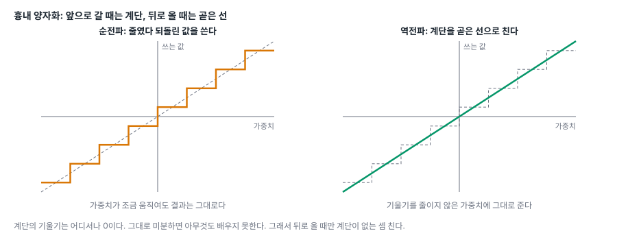
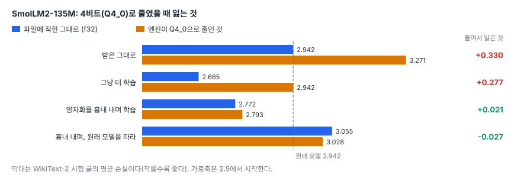
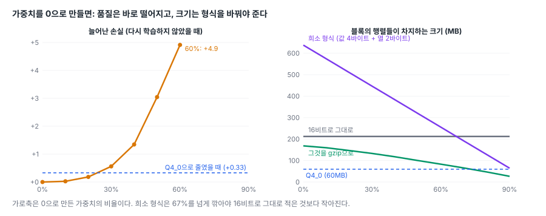
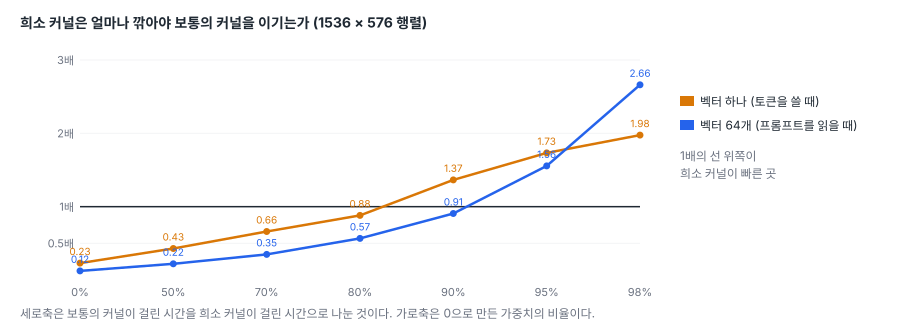
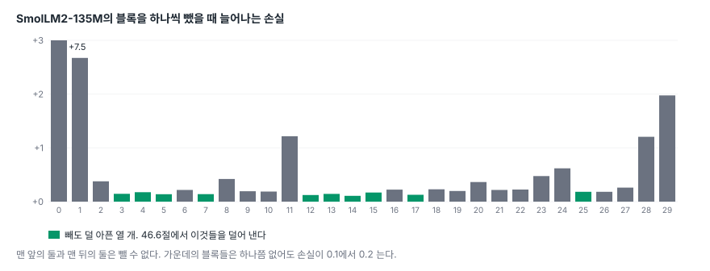

# 기기에 맞게 모델 줄이기

[43장](ch43_device_constraints.md)의 결론은 "엔진은 1MB이고 나머지는
모델"이었습니다. [44장](ch44_on_the_phone.md)에서는 앱의 91%가
모델이었고, [45장](ch45_gpu_npu.md)에서는 가속기에 들어가느냐가 모델의
구조에 달려 있었습니다. 기기에 올릴 때 줄여야 하는 것은 엔진이 아니라
**모델**입니다.

모델을 줄이는 방법 하나는 이미 깊이 봤습니다. 양자화입니다.
[19장](../part3/ch19_quantization_theory.md)부터
[21장](../part3/ch21_quantization_quality.md)까지, 그리고
[29장](../part4/ch29_integer_inference.md)에서 **학습이 끝난 가중치를
그대로** 줄였습니다. 이 장은 **학습을 다시 해야 하는** 세 가지 방법을
봅니다.

- **양자화 인식 학습**<sup>quantization-aware training</sup>: 줄였을
  때의 오차를 모델이 미리 겪게 한다.
- **가지치기**<sup>pruning</sup>: 가중치나 블록을 없앤다.
- **증류**<sup>distillation</sup>: 작은 모델이 큰 모델을 따라 하게 한다.

이 책은 추론 엔진의 책입니다. 모델을 학습시키는 법은 다루지 않았고
여기서도 깊이 다루지 않습니다. 이 장은 추론 엔지니어의 물음을 묻습니다.
**그 방법으로 줄인 모델이 엔진에 오면 무엇이 달라지는가.** 파일이
작아지는지, 빨라지는지, 엔진을 고쳐야 하는지, 그리고 그것을 어떻게
재는지 봅니다.

그래서 실험을 이렇게 짰습니다. 줄이는 일은 PyTorch로 몇 분 동안
하고(`reference/ch46_train.py`), **품질과 크기와 속도는 모두 우리
엔진으로 잽니다.** 모델은 SmolLM2-135M입니다. 폰에 올릴 만한 크기이고,
4비트로 줄이면 품질이 눈에 띄게 떨어지는 모델입니다.
[21장](../part3/ch21_quantization_quality.md)에서 Llama 3.2 1B는
`Q4_0`으로 손실 0.19를 잃었는데, 이 모델은 같은 방법으로 0.33을
잃습니다(46.2절).

먼저 밝혀 둡니다. **학습은 작고 짧습니다.** 한 가지 방법에 400스텝, 이
맥의 GPU로 2분에서 4분입니다. 시드 하나로 한 번씩 돌렸습니다. 이 장의
숫자는 "이 방법이 이만큼 좋다"가 아니라 "이런 경향이 나온다"로 읽어야
합니다. 제대로 하면 스텝이 수천 배 많고, 결과도 더 좋을 것입니다.

결과를 미리 적어 둡니다.

- 받은 모델을 엔진이 4비트(`Q4_0`)로 줄이면 손실이 0.33 늡니다. 양자화를
  흉내 내며 400스텝 학습시키면 줄여서 잃는 것이 **0.02**가 됩니다.
- 그러려면 학습할 때의 흉내가 **엔진의 양자화와 똑같아야** 합니다. 값
  98,304개로 견줘 비트 하나까지 같은 것을 확인했습니다. 양자화 인식
  학습은 엔진을 정해 놓고 하는 학습입니다.
- 가중치의 10%를 0으로 만들어도 손실은 0.03 늘 뿐입니다. 그런데 **파일도
  속도도 그대로**입니다. 0을 적지 않는 형식과 0을 곱하지 않는 커널이
  있어야 하는데, 그 형식은 67%를 넘게 깎아야 이득이고 그 커널은 80%에서
  90%를 넘게 깎아야 더 빠릅니다. 이 모델은 50%에서 이미 무너집니다.
  그리고 95%를 깎은 희소 모델보다 **깎지 않고 4비트로 줄인 모델이
  빠릅니다.**
- 블록을 통째로 덜어 내면 엔진은 아무것도 고치지 않아도 **그만큼
  빨라집니다.** 서른 개 가운데 열 개를 덜면 1.5배입니다. 다만 어느 열
  개를 더느냐에 결과가 달려 있습니다. 뒤의 열 개를 덜면 400스텝 뒤에도
  손실이 5.7이고, 엔진으로 재서 고른 열 개를 덜면 3.4입니다.
- 줄이는 방법을 견줄 때 가장 흔한 실수는 **기준을 잘못 잡는 것**입니다.
  이 장의 학습은 시험 글과 같은 종류의 글로 했고, 그것만으로 손실이 0.28
  내려갑니다. 그것을 빼고 봐야 합니다.

| 하는 일 | 절 |
|---|---|
| 세 가지 방법이 엔진에 무엇을 가져오는지 본다 | 46.1 |
| 재는 법과 기준을 정한다 | 46.2 |
| 양자화를 흉내 내며 학습시킨다 | 46.3 |
| 원래 모델을 따라 하게 한다 | 46.4 |
| 가중치를 0으로 만든다 | 46.5 |
| 0을 곱하지 않는 커널을 만든다 | 46.6 |
| 블록을 통째로 덜어 낸다 | 46.7 |
| 방법들을 합친다 | 46.8 |

## 46.1 세 방법은 엔진에 다른 것을 가져온다

세 가지 방법을 엔진의 처지에서 나란히 놓습니다.

| | 양자화 인식 학습 | 가지치기: 낱낱의 가중치 | 가지치기: 통째로 | 증류 |
|---|---|---|---|---|
| 모델에서 바뀌는 것 | 값이 눈금 위에 놓이기 좋게 바뀐다 | 값의 일부가 0이 된다 | 블록, 채널, 머리가 없어진다 | 더 작은 모델이 된다 |
| 엔진이 받는 파일 | 그대로다. 줄이면 덜 망가진다 | 그대로다. 0이 많을 뿐이다 | 작아진다 | 작아진다 |
| 엔진을 고쳐야 하는가 | 아니다 | 이득을 보려면 그렇다 | 아니다 | 아니다 |
| 저절로 얻는 것 | 품질 | 없다 | 크기와 속도 | 크기와 속도 |
| 조심할 것 | 엔진의 양자화와 같아야 한다 | 크기와 속도는 따로 얻어야 한다 | 무엇을 빼느냐 | 무엇을 따라 하게 하느냐 |

표에서 눈여겨볼 곳은 둘째 열입니다. 논문이 "가중치의 90%를 없앴다"고 할
때 엔진이 받는 것은 **크기가 같고 0이 많은 파일**입니다. 그것이 작은
파일과 빠른 추론이 되려면 엔진 쪽에서 할 일이 따로 있습니다(46.6절).
추론 엔지니어가 줄였다는 모델을 받으면 가장 먼저 물어야 할 것이
이것입니다. **무엇이 줄었는가. 파일인가, 곱셈의 수인가, 0이 아닌 값의
수인가.**

## 46.2 품질은 엔진으로 재고 기준을 정한다

품질은 [21장](../part3/ch21_quantization_quality.md)의 방법으로 잽니다.
WikiText-2의 시험 글을 512토큰씩 예순네 조각으로 잘라 모델에 넣고, 다음
토큰을 얼마나 잘 맞히는지를 **평균 손실**로 냅니다. 작을수록 좋습니다.
손실 0.1의 차이는 퍼플렉서티로 10%쯤입니다.

```bash
cargo run --release -p badak_models --example ch46_quality -- \
    smollm2_135m smollm2_135m_ft smollm2_135m_qat …
```

모델마다 두 번 잽니다. 파일에 적힌 그대로(f32)와, 엔진이 `Q4_0`으로 줄인
것입니다. **폰에 실리는 것은 뒤의 것**이므로 그 숫자가 실제 품질입니다.

```text
{{#include output/ch46_quality.txt}}
```

이 표가 이 장의 재료입니다. 이 장에서 만든 모델 열한 개가 다 들어 있고,
이름은 뒤에서 하나씩 나옵니다. 절마다 필요한 줄을 꺼내 봅니다. 맨 오른쪽
열은 `Q4_0`으로 줄인 모델로 토큰 128개를 쓴 속도입니다. 먼저 맨 위 두
줄입니다.

**첫 줄이 기준입니다.** 받은 그대로의 SmolLM2-135M은 손실이 2.9418이고,
`Q4_0`으로 줄이면 3.2714입니다. 줄여서 0.33을 잃습니다.

**둘째 줄은 견줄 것입니다.** 학습에 쓴 글은 WikiText-2의 학습용
글입니다. 시험 글과 같은 곳(위키백과)에서 온 글입니다. 이런 글로 아무
기법 없이 400스텝 더 학습시키기만 해도 손실이 2.6653으로 **0.28
내려갑니다.** 모델이 좋아진 것이 아니라 시험 글의 말투에 익숙해진
것입니다.

이 0.28을 알아 두지 않으면 틀린 결론을 내립니다. 뒤에서 양자화를 흉내
내며 학습한 모델은 4비트로 줄인 손실이 2.79입니다. "4비트 모델이 원래의
32비트 모델(2.94)보다 낫다"고 쓰고 싶어집니다. 틀린 말입니다. 그 0.15는
양자화 인식 학습으로 얻은 것이 아니라 글에 익숙해져서 얻은 것입니다.
견줄 상대는 첫 줄이 아니라 **둘째 줄**입니다.

줄이는 기법을 다룬 글을 읽을 때도 같은 것을 봅니다. 기준이 무엇인지,
줄인 모델이 본 데이터를 기준 모델도 봤는지 확인합니다.

## 46.3 양자화를 흉내 내며 학습시킨다

### 모델은 양자화를 모르고 학습되었다

[20장](../part3/ch20_weight_quantization.md)의 양자화는 값 32개마다 눈금
하나를 두고, 값을 열여섯 가지 가운데 가장 가까운 것으로 옮겼습니다.
모델은 그런 일이 일어날 줄 모르고 학습되었습니다. 그래서 값이 눈금 사이
아무 데나 놓여 있고, 옮기는 만큼이 그대로 오차가 됩니다.

양자화 인식 학습은 순서를 바꿉니다. **학습하는 동안에** 가중치를 줄였다
되돌린 값으로 순전파를 합니다. 모델은 줄인 값으로 낸 답으로
채점받으므로, 줄여도 답이 덜 바뀌는 쪽으로 가중치를 옮깁니다. 정수만으로
추론하는 방법을 처음 정리한 2017년의 논문이 이 학습을 함께
내놓았습니다.[^jacob]

### 계단은 없는 것으로 치고 미분한다

걸림돌이 하나 있습니다. 학습은 기울기를 따라 가중치를 조금씩 옮기는
일입니다. 그런데 "가장 가까운 눈금으로 옮기기"는 **계단 모양**의
함수입니다. 가중치가 조금 움직여도 결과는 그대로이고, 기울기는 어디서나
0입니다. 그대로 미분하면 모델은 아무것도 배우지 못합니다.



해결책은 속임수에 가깝습니다. 앞으로 갈 때는 계단을 쓰고, **뒤로 올 때는
계단이 없다고 칩니다.** 기울기를 줄이지 않은 가중치에 그대로
줍니다.[^ste] 코드로는 한 줄입니다.

```python
{{#include ../../../reference/ch46_train.py:fake_q4_0}}
```

`weight + (fake_q4_0(weight) - weight).detach()`가 그 한 줄입니다. 값은
줄인 값과 같고, 기울기는 `weight`로만 흐릅니다.

### 흉내는 엔진과 똑같아야 한다

`fake_q4_0`은 [20장](../part3/ch20_weight_quantization.md)의 Rust 코드를
PyTorch로 옮긴 것입니다. 절댓값이 가장 큰 값을 -8에 놓고, 0.5를 더해
버려서 반올림하고, 15에서 자르고, 눈금의 크기를 16비트 실수로 적는
것까지 따라 했습니다.

이렇게까지 맞춘 까닭이 이 절의 요점입니다. 모델은 **학습할 때 본 그
양자화**에 익숙해집니다. 학습할 때는 값 전체에 눈금 하나를 두고 엔진은
32개마다 하나를 두면, 모델이 익숙해진 오차와 실제로 생기는 오차가
다릅니다. 반올림의 방향 하나, 눈금을 정하는 규칙 하나만 달라도
그렇습니다. 그래서 양자화 인식 학습은 **어느 엔진의 어느 형식으로
줄일지를 정해 놓고** 하는 학습입니다. 모델을 만드는 쪽에 "우리 엔진은
이렇게 줄인다"를 정확히 알려 주는 것이 추론 엔지니어의 일입니다.

말로만 맞췄다고 하지 않고 확인합니다. 진짜 가중치 64행을 파이썬이 줄였다
되돌린 것과 엔진이 줄였다 되돌린 것을 견줍니다.

```rust
{{#include ../../../crates/badak_models/examples/ch46_quality.rs:check}}
```

```text
$ cargo run --release -p badak_models --example ch46_quality -- check
값 98304개 가운데 비트가 다른 것 0개
```

### 줄여서 잃는 것이 0.02가 된다



| | f32 손실 | `Q4_0` 손실 | 줄여서 잃은 것 |
|---|---:|---:|---:|
| 받은 그대로 | 2.942 | 3.271 | +0.330 |
| 그냥 더 학습 | 2.665 | 2.942 | +0.277 |
| 양자화를 흉내 내며 학습 | 2.772 | **2.793** | **+0.021** |

같은 글로 같은 400스텝을 학습시킨 두 모델을 봅니다. 그냥 학습시킨 모델은
4비트로 줄이면 여전히 0.28을 잃습니다. 흉내 내며 학습시킨 모델은
**0.02**를 잃습니다. 폰에 실릴 4비트 모델끼리 견주면 2.942와 2.793,
0.15의 차이입니다. [21장](../part3/ch21_quantization_quality.md)에서
`Q4_0`이 잃는 것을 줄이려고 눈금을 더 잘게 나누는 형식(`Q4_K_M`)을
봤습니다. 그 형식은 파일을 조금 키워서 품질을 얻었습니다. 이 방법은
파일은 그대로 두고 **학습으로** 얻었습니다.

대가도 있습니다. f32 손실을 봅니다. 흉내 내며 학습시킨 모델은 2.772로,
그냥 학습시킨 2.665보다 **나쁩니다.** 같은 스텝 동안 한쪽은 글만 배웠고
다른 쪽은 글을 배우면서 눈금에도 맞춰야 했습니다. 줄이지 않고 쓸
모델이라면 이 학습은 손해입니다. 줄여서 쓸 때만 이득입니다.

엔진 쪽에서는 **아무것도 바뀌지 않았습니다.** 파일의 형식도, 커널도,
속도도 같습니다. 가중치의 값만 다릅니다.

## 46.4 정답 대신 원래 모델을 따라 하게 한다

앞 절의 학습에는 걸리는 것이 하나 있습니다. **글이 필요합니다.** 그것도
모델이 쓰일 곳과 닮은 글이 필요합니다. 그리고 그 글의 말투가 모델에
뱁니다(0.28이 그것입니다). 추론 엔지니어가 받은 모델을 줄이려는데, 그
모델이 무슨 데이터로 학습되었는지 모르고 구할 수도 없는 일이 흔합니다.

다른 방법이 있습니다. 정답 대신 **원래 모델의 답**을 쓰는 것입니다.

```python
{{#include ../../../reference/ch46_train.py:losses}}
```

`next_token_loss`는 보통의 학습입니다. 글의 다음 토큰이 정답입니다.
`imitation_loss`는 정답을 보지 않습니다. 줄이지 않은 원래 모델(선생)에게
같은 글을 넣어, 선생이 모든 토큰에 준 확률을 받습니다. 줄인 모델(학생)이
그 확률을 따라 하게 합니다. 이것이 **증류**입니다.[^hinton]

정답은 "다음 토큰은 `the`"라는 한 가지만 알려 줍니다. 선생의 답은
"`the`가 60%, `a`가 30%, `this`가 5%"를 알려 줍니다. 틀린 답 사이의
차이에서도 배울 것이 있습니다. 그리고 목표가 달라집니다. 글을 잘 맞히는
것이 아니라 **원래 모델처럼 답하는 것**이 목표입니다. 양자화가 하려던
일이 원래 그것입니다.

글은 여전히 넣어야 합니다. 그러나 글의 정답을 쓰지 않으므로 어떤 글이든
됩니다. LLM을 낮은 비트로 줄이는 연구에서는 모델이 **스스로 쓴 글**을
넣기도 합니다.[^llm-qat] 그러면 데이터가 하나도 필요 없습니다.

| | f32 손실 | `Q4_0` 손실 | 원래 모델(2.942)과의 차이 |
|---|---:|---:|---:|
| 받은 그대로, 엔진이 줄임 | 2.942 | 3.271 | +0.330 |
| 흉내 내며, 원래 모델을 따라 학습 | 3.055 | **3.028** | **+0.086** |

4비트 모델과 원래 모델의 차이가 0.086까지 줄었습니다. 그냥 줄였을
때(0.330)의 4분의 1입니다. 이번에는 시험 글의 말투를 배우지
않았으므로(선생이 그 말투를 모릅니다) **첫 줄과 바로 견줘도 됩니다.**

이 모델에는 재미있는 점이 있습니다. f32 손실(3.055)이 `Q4_0`
손실(3.028)보다 **나쁩니다.** 줄이지 않은 것이 줄인 것보다 못합니다. 이
모델은 줄인 채로 선생을 따라 하도록 학습되었고, 줄이지 않은 가중치는 그
과정에서 거쳐 가는 값일 뿐이었습니다. 이런 모델을 f32로 배포하면 안
됩니다.

## 46.5 가지치기로 가중치를 0으로 만든다

가지치기는 가중치 가운데 **없어도 되는 것이 있을 것**이라는 단순한
생각에서 나왔습니다. 가장 흔한 기준은 크기입니다. 절댓값이 작은 가중치는
결과에 덜 기여할 테니 0으로 만듭니다.[^han]

```rust
{{#include ../../../crates/badak_core/src/sparse.rs:prune}}
```

블록의 행렬마다 따로 깎고, 임베딩 표는 두었습니다. 다시 학습하지 않고
엔진으로 손실만 잽니다.

```bash
cargo run --release -p badak_models --example ch46_prune -- loss
```

| 0으로 만든 비율 | 늘어난 손실 | 퍼플렉서티 |
|---:|---:|---:|
| 0% | 0 | 19.0 |
| 10% | +0.025 | 19.4 |
| 20% | +0.182 | 22.7 |
| 30% | +0.561 | 33.2 |
| 40% | +1.346 | 72.8 |
| 50% | +3.044 | 398 |
| 60% | +4.912 | 2,576 |



10%는 잃는 것이 거의 없습니다. 20%에서 `Q4_0`으로 줄였을 때의 절반쯤을
잃고, 50%에서 모델이 무너집니다.

큰 모델은 훨씬 잘 견딥니다. 수백억 개의 가중치를 가진 모델을 다시
학습하지 않고 50%에서 60%까지 깎았다는 연구가 있습니다. 다만 그 방법은
크기만 보지 않고 가중치마다 그것이 받는 입력의 크기까지
봅니다.[^sparsegpt] 우리 모델은 1억 개이고 가장 단순한 기준을 썼습니다.
작은 모델에는 남는 가중치가 적습니다. 작은 모델이 양자화에 더 약한
것(위의 0.19와 0.33)과 같은 까닭입니다.

다시 학습하면 되돌아옵니다. 절반을 0으로 만들고, 0은 0으로 둔 채 원래
모델을 따라 하게 400스텝 학습시켰습니다.

```python
{{#include ../../../reference/ch46_train.py:masks}}
```

| 절반을 0으로 | f32 손실 | 원래 모델과의 차이 |
|---|---:|---:|
| 깎기만 | 5.986 | +3.044 |
| 깎고, 원래 모델을 따라 학습 | 3.648 | +0.706 |

3.04가 0.71이 되었습니다. 가지치기를 처음 널리 알린 연구도 "학습하고,
깎고, 다시 학습한다"의 세 단계였습니다.[^han] 그래도 0.71은 `Q4_0`이
잃는 것(0.33)의 두 배입니다.

### 파일도 속도도 줄지 않는다

이제 엔진의 처지로 돌아옵니다. 가중치의 절반이 0인 모델을 받았습니다.

**파일은 그대로입니다.** 0도 16비트를 차지합니다. 212MB입니다.

**속도도 그대로입니다.** [16장](../part3/ch16_matmul.md)의 커널은 0을
만나도 곱하고 더합니다.

줄이려면 형식을 바꿔야 합니다. 두 가지를 재 봤습니다.

| 0으로 만든 비율 | 그대로 (MB) | gzip으로 누르면 (MB) | 희소 형식 (MB) |
|---:|---:|---:|---:|
| 0% | 212 | 168 | 638 |
| 30% | 212 | 133 | 447 |
| 50% | 212 | 100 | 319 |
| 70% | 212 | 66 | 192 |
| 90% | 212 | 27 | 64 |
| (견줄 것) `Q4_0` | 60 | | |

**누르기.** 0이 많은 파일은 잘 눌립니다. 절반이 0이면 gzip으로 100MB가
됩니다. 내려받는 크기는 줄어듭니다(44.7절). 그러나 기기에서는 풀어야 쓸
수 있고, 풀면 다시 212MB입니다. 메모리에 비출 수도 없습니다(44.4절에서
모델을 누르지 않고 번들에 넣은 까닭입니다).

**희소 형식.** 0이 아닌 값만 적습니다. 값마다 "어느 열에 있는가"를 함께
적어야 하므로, 값 하나에 6바이트(값 4, 열 번호 2)가 듭니다. 원래는
2바이트였습니다. 그래서 **세 개 가운데 둘을 없애야** 크기가 같아집니다.
그림의 보라색 선이 회색 선 아래로 내려가는 곳이 67%입니다. 그 왼쪽에서는
희소 형식이 오히려 큽니다. 깎지 않은 모델을 희소 형식으로 적으면 638MB,
세 배입니다.

그리고 맨 아랫줄입니다. `Q4_0`은 60MB이고 손실을 0.33 잃습니다. 희소
형식으로 60MB가 되려면 90%를 깎아야 하고, 그때는 손실이 표에 적기 어려울
만큼 큽니다. **이 모델에서 크기를 줄이는 도구로는 양자화가 가지치기보다
훨씬 낫습니다.**

## 46.6 0을 곱하지 않는 커널을 만든다

크기는 그렇다 치고 속도는 어떨까요. 0을 곱하지 않으면 빨라질 것입니다.
희소 형식을 그대로 읽어 곱하는 커널을 만들었습니다.

```rust
{{#include ../../../crates/badak_core/src/sparse.rs:sparse}}
```

```rust
{{#include ../../../crates/badak_core/src/sparse.rs:sparse_apply}}
```

이 커널을 모델에 끼우는 데는 [23장](../part3/ch23_gpu.md)에서 만든
"곱셈을 다른 곳에 맡긴 행렬"을 씁니다. GPU에 맡기려고 만든 구조에 희소
커널이 그대로 들어갑니다.

행렬 하나로 먼저 잽니다. SmolLM2-135M의 MLP에 있는 `1536 × 576`
행렬입니다.

| 0으로 만든 비율 | 0% | 50% | 70% | 80% | 90% | 95% | 98% |
|---|---:|---:|---:|---:|---:|---:|---:|
| 벡터 하나: 보통의 커널 (µs) | 6.5 | 6.4 | 6.5 | 6.5 | 6.5 | 6.5 | 6.4 |
| 벡터 하나: 희소 커널 (µs) | 28.2 | 15.0 | 9.8 | 7.3 | 4.8 | 3.8 | 3.2 |
| 벡터 하나: 보통 ÷ 희소 | 0.23 | 0.43 | 0.66 | 0.88 | **1.37** | 1.73 | 1.98 |
| 벡터 64개: 보통의 커널 (µs) | 138 | 132 | 122 | 136 | 123 | 132 | 121 |
| 벡터 64개: 희소 커널 (µs) | 1,112 | 594 | 349 | 240 | 136 | 85 | 46 |
| 벡터 64개: 보통 ÷ 희소 | 0.12 | 0.22 | 0.35 | 0.57 | 0.91 | **1.56** | 2.66 |

세 차례 잰 것의 중앙값입니다. 두 커널 모두 엔진의 스레드 풀을 씁니다.



**깎지 않은 행렬에서 희소 커널은 네 배에서 여덟 배 느립니다.** 곱셈의
수가 같은데도 그렇습니다. 절반을 깎아 곱셈이 반으로 줄어도 아직 두 배
넘게 느립니다. 벡터 하나일 때는 80%와 90% 사이에서, 벡터가 64개일 때는
90%와 95% 사이에서야 보통의 커널을 따라잡습니다.

보통의 커널이 걸리는 시간이 깎은 비율과 상관없이 같은 것도 봅니다. 0을
곱하는 것과 다른 수를 곱하는 것이 같은 일입니다.

재다가 하나를 고쳤습니다. 처음에는 "일이 이보다 작으면 스레드에 나누지
않는다"는 임계값을 보통의 커널과 같은 값으로 뒀습니다. 그랬더니 깎을수록
빨라지다가 어느 비율에서 갑자기 느려졌습니다. 0이 아닌 값이 임계값 아래로
내려가 스레드 하나로 돌기 시작한 것입니다. 희소 커널은 곱셈 하나가
비싸므로 더 작은 일부터 나눠야 했습니다. 임계값을 32분의 1로 낮췄습니다.
18.6절에서 정한 숫자는 그 커널에 맞춘 숫자였습니다.

희소 커널이 느린 까닭은 [16장](../part3/ch16_matmul.md)과
[17장](../part3/ch17_simd.md)에 있습니다. 보통의 커널은 값 넷이나 여덟을
한 명령으로 곱하고, 메모리를 앞에서부터 차례로 읽습니다. 희소 커널은
그럴 수 없습니다. 0이 아닌 값이 어느 열에 있는지를 읽고, 그 열의 입력을
**찾아가서** 읽어야 합니다. 읽을 위치가 이어져 있지 않으니 여러 값을 한
명령으로 묶지 못합니다. 곱셈 하나하나가 느립니다. 곱셈의 수를 열 배
줄여도 곱셈 하나가 여러 배 느리면 남는 것이 적습니다.

모델 전체로도 잽니다.

| 가중치 | 커널 | 프롬프트 256토큰 읽기 (토큰/초) | 토큰 쓰기 (토큰/초) |
|---|---|---:|---:|
| f32, 깎지 않음 | 보통 | 3,078 | 310 |
| f32, 깎지 않음 | 희소 | 461 | 171 |
| f32, 50%를 0으로 | 희소 | 854 | 278 |
| f32, 70%를 0으로 | 희소 | 1,332 | 338 |
| f32, 80%를 0으로 | 희소 | 1,857 | 395 |
| f32, 90%를 0으로 | 희소 | 3,153 | 459 |
| f32, 95%를 0으로 | 희소 | 4,493 | 530 |
| `Q4_0`, 깎지 않음 | 보통 | 3,302 | **664** |

블록의 행렬을 모두 깎고(임베딩 표는 두었습니다) 희소 커널에 맡긴
것입니다. 세 차례의 중앙값입니다. 깎은 모델의 품질은 여기서 보지
않습니다. 70% 위는 46.5절에서 본 대로 쓸 수 없는 모델입니다.

토큰을 쓸 때는 60%쯤에서, 프롬프트를 읽을 때는 90%쯤에서 희소 커널이
f32의 보통 커널을 따라잡습니다. 토큰을 쓸 때 더 일찍 따라잡는 까닭은
[15장](../part3/ch15_bottleneck.md)에 있습니다. 토큰을 하나씩 쓸 때는
가중치를 메모리에서 읽어 오는 것이 시간을 정합니다. 희소 형식은 읽어 올
것이 적습니다.

그런데 맨 아랫줄이 있습니다. **깎지 않고 `Q4_0`으로 줄인 모델이 초당
664토큰입니다.** 95%를 깎은 희소 모델(530)보다 빠릅니다. 까닭은
같습니다. 4비트 모델은 읽어 올 가중치가 f32의 7분의 1이고,
[20장](../part3/ch20_weight_quantization.md)의 커널은 그것을 묶어서
계산합니다. 품질은 한쪽이 손실 0.33을 잃었고, 다른 쪽은 글을 쓰지
못합니다.

정리하면 이렇습니다. 낱낱의 가중치를 깎는 가지치기는 **품질, 크기,
속도가 저마다 다른 비율에서 꺾입니다.** 이 모델에서 품질은 20%에서
꺾이고, 크기는 67%부터, 속도는 60%에서 90%부터 이득입니다. 세 가지가
함께 성립하는 비율이 없습니다.

깎는 것이 통하는 곳도 있습니다. 합성곱 신경망은 훨씬 많이 깎여도 견디고,
희소 커널을 잘 만들면 폰의 CPU에서 빽빽한 모델보다 빠르다는 연구가
있습니다.[^sparse-convnets] 그 연구의 저자들도 "곱셈의 수가 준다고
빨라지지는 않는다는 것이 통념"이라는 말로 시작합니다. 통념을 깨려면
모델과 커널을 함께 설계해야 했습니다.

## 46.7 블록을 통째로 덜어 낸다

낱낱의 가중치 대신 **구조를 통째로** 없애는 가지치기가 있습니다.
합성곱의 채널 하나, 어텐션의 머리 하나, 블록 하나를 없앱니다.[^filters]
이 방법은 엔진에 오면 사정이 전혀 다릅니다. 채널이 줄면 행렬이 작아지고,
블록이 줄면 곱할 행렬의 수가 줍니다. **빽빽한 채로 작아집니다.** 형식도
커널도 그대로이고, 엔진은 아무것도 고치지 않아도 그만큼 빨라집니다.

SmolLM2-135M은 블록이 서른 개입니다. 열 개를 덜어 냅니다. 9.2절에서 본
대로 블록은 들어온 값에 무언가를 **더해서** 내보내므로(잔차 연결),
하나를 빼도 앞뒤의 형상이 그대로 맞습니다.

### 뺄 블록은 엔진으로 재서 고른다

가장 쉬운 선택은 뒤의 열 개입니다.

| 뒤의 열 개를 덜어 냄 | 블록 | f32 손실 |
|---|---:|---:|
| 덜기만 | 20 | 22.45 |
| 덜고, 그냥 학습 | 20 | 5.73 |
| 덜고, 원래 모델을 따라 학습 | 20 | 5.77 |

쓸 수 없습니다. 400스텝을 학습시켜도 손실이 5.7입니다.

엔진으로 재서 고릅니다. 블록을 **하나씩** 빼고 손실을 잽니다. 학습은
하지 않습니다. 서른 번 재는 데 7분이 걸립니다.

```rust
{{#include ../../../crates/badak_models/src/llama/model.rs:retain_blocks}}
```

```bash
cargo run --release -p badak_models --example ch46_prune -- blocks
```



블록마다 영향이 다릅니다. 맨 앞의 0번을 빼면 손실이 7.5 늘고, 1번이 2.7,
맨 뒤의 29번이 2.0, 28번이 1.2입니다. 가운데의 블록은 0.1에서 0.2입니다.
11번처럼 가운데에 있으면서 영향이 큰 것도 있습니다. **뒤의 열 개에는
영향이 큰 29번과 28번이 들어 있었습니다.**

뺐을 때 손실이 가장 덜 느는 것부터 열 개를 골라 덜어 냅니다(그림의
초록색).

| 엔진이 고른 열 개를 덜어 냄 | 블록 | f32 손실 | 견줄 것과의 차이 |
|---|---:|---:|---:|
| 덜기만 | 20 | 5.207 | +2.265 (원래 모델과) |
| 덜고, 그냥 학습 | 20 | 3.443 | +0.777 (그냥 학습한 서른 블록과) |
| 덜고, 원래 모델을 따라 학습 | 20 | 3.593 | +0.651 (원래 모델과) |

같은 열 개, 같은 400스텝인데 5.7이 3.4가 되었습니다. 학습을 시작하기
전에 이미 22.45와 5.21로 갈려 있었습니다.

마지막 열은 조심해서 읽어야 합니다. 46.2절에서 말한 기준의 문제입니다.
그냥 학습한 모델(3.443)이 따라 하게 학습한 모델(3.593)보다 손실이 낮아
보이지만, 앞의 것은 시험 글의 말투를 배웠습니다. 각자의 기준과 견주면
블록을 덜어서 잃은 것이 0.78과 0.65입니다. **따라 하게 한 쪽이 조금
낫습니다.**

DistilBERT가 이런 식으로 만들어졌습니다. 큰 모델의 층을 줄인 작은 모델을
만들고, 큰 모델을 따라 하게 학습시켰습니다. 크기를 40% 줄이고 60%
빨라지면서 성능의 97%를 지켰다고 보고합니다.[^distilbert] 우리의
400스텝은 거기에 한참 못 미칩니다. 손실 0.65는 퍼플렉서티로 거의 두
배입니다. 방향이 같다는 것까지만 보였습니다.

### 블록을 던 만큼 빨라진다

엔진으로 토큰을 쓰는 속도를 쟀습니다. 4비트로 줄인 모델입니다.

| 모델 (`Q4_0`) | 블록 | 토큰/초 |
|---|---:|---:|
| 받은 그대로 | 30 | 683 |
| 양자화를 흉내 내며 학습 | 30 | 682 |
| 절반을 0으로 만들고 학습 | 30 | 690 |
| 엔진이 고른 열 개를 덜어 냄 | 20 | 1,020 |

세 차례의 중앙값입니다.

블록이 3분의 2가 되니 시간도 3분의 2가 됩니다. 엔진은 한 줄도 고치지
않았습니다. `config.json`의 블록 수가 30에서 20으로 바뀌었을 뿐입니다.
파일도 그만큼 작아집니다.

46.6절과 견줘 봅니다. 가중치의 3분의 1을 낱낱이 0으로 만들면 엔진에는
아무 일도 일어나지 않았습니다. 블록의 3분의 1을 통째로 없애면 1.5배
빨라집니다. 같은 "3분의 1을 없앴다"가 엔진에서는 전혀 다른 일입니다.

## 46.8 방법을 합쳐서 쓴다

이 방법은 함께 쓸 수 있습니다. 블록을 덜고, 그 모델이 4비트로 줄인 채로
원래 모델을 따라 하게 학습시킵니다. 46.7절과 46.3절과 46.4절을 한 번에
하는 것입니다.

| 20블록, 원래 모델을 따라 학습 | f32 손실 | `Q4_0` 손실 | 줄여서 잃은 것 |
|---|---:|---:|---:|
| 흉내 없이 | 3.593 | 3.909 | +0.316 |
| 양자화를 흉내 내며 | 3.747 | **3.695** | -0.052 |

블록 스무 개짜리 모델에서도 46.3절과 같은 일이 일어납니다. 흉내 없이
학습시킨 모델은 4비트로 줄이면 0.32를 잃고, 흉내 내며 학습시킨 모델은
잃지 않습니다. 폰에 실릴 4비트 모델끼리 견주면 3.909와 3.695입니다.

이 장에서 만든 모델을 기기에 실을 후보로 나란히 놓습니다. 모두
`Q4_0`으로 줄인 것입니다.

| 후보 | 블록 | 블록의 행렬 (MB) | 토큰/초 | 원래 모델(f32)과의 손실 차이 |
|---|---:|---:|---:|---:|
| 받은 그대로 줄임 | 30 | 60 | 683 | +0.330 |
| 흉내 내며, 원래 모델을 따라 학습 | 30 | 60 | 679 | **+0.086** |
| 열 개를 덜고 그대로 줄임 (학습 없음) | 20 | 40 | 1,020 | +2.750 |
| 열 개를 덜고, 흉내 내며, 따라 학습 | 20 | 40 | 1,018 | +0.753 |

위의 두 줄이 이 장에서 가장 쓸 만한 결과입니다. 4분의 학습으로, 정답이
있는 데이터 없이, 크기와 속도는 그대로 두고 품질만 되찾았습니다.

아래의 두 줄은 아직 쓸 수 없습니다. 1.5배 빠르고 3분의 2 크기이지만 손실
0.75는 큽니다. 400스텝으로는 블록 열 개가 하던 일을 스무 개에 나눠
맡기지 못했습니다. 그래도 방향은 보입니다. 학습 없이 2.75였던 것이
0.75가 되었습니다. 더 오래 학습시키면 어디까지 가는지는 이 장이 답하지
못한 물음입니다.

## 46.9 남긴 일을 적어 둔다

**제대로 된 학습.** 400스텝, 시드 하나입니다. 스텝을 늘리면 어디까지
회복되는지, 시드를 바꾸면 얼마나 흔들리는지 보지 않았습니다.

**다른 기준으로 깎기.** 절댓값만 봤습니다. 가중치가 받는 입력의 크기를
함께 보는 방법[^sparsegpt]은 해 보지 않았습니다.

**머리와 채널을 덜어 내기.** 통째로 없애는 가지치기는 블록만 했습니다.

**규칙이 있는 희소.** "값 넷 가운데 둘은 0"처럼 0의 위치에 규칙을 두면
열의 번호를 적을 필요가 줄고 커널도 묶어서 계산할 수 있습니다. 가속기가
이런 형태를 지원하기도 합니다. 다루지 않았습니다.

**희소 커널을 더 빠르게.** 우리 커널은 가장 단순한 것입니다.

**활성화의 양자화.** 46.3절은 가중치만 흉내 냈습니다. 엔진의 `Q4_0`은
입력도 8비트로 줄이는데([20장](../part3/ch20_weight_quantization.md)), 그것은 학습에 넣지 않았습니다. [29장](../part4/ch29_integer_inference.md)의
정수 모델을 위한 양자화 인식 학습도 하지 않았습니다.

**합성곱 신경망.** 이 장의 모델은 LLM 하나입니다. 가지치기는 합성곱
신경망에서 효과가 훨씬 크다고 알려져 있습니다.

**만들어진 모델의 배포.** 학습한 모델은 저장소에도 Hub에도 올리지
않았습니다. `reference/ch46_train.py`나
노트북(`notebooks/ch46_shrink.ipynb`)으로 만들 수 있습니다. 학습은
기계마다 끝자리가 다르게 나옵니다.

## 46.10 실전 엔진에서는

**양자화 인식 학습으로 만든 모델은 그냥 모델입니다.** 엔진에 오는 것은
보통의 양자화된 파일입니다. [29장](../part4/ch29_integer_inference.md)에서 읽은 `.tflite`의 정수 모델이 학습
뒤에 줄인 것인지 흉내 내며 학습한 것인지는 파일만 봐서는 알 수 없고,
알 필요도 없습니다. 달라지는 것은 그 파일을 만든 쪽이 **엔진의 규칙을
알고 있었는가**입니다. 엔진을 만드는 쪽이 양자화의 규칙을 문서로 남기는
까닭입니다.

**희소 모델을 돌리려면 엔진이 그것을 알아야 합니다.** 46.6절에서 본
대로입니다. 희소 커널을 가진 엔진이 있고, 46.6절에서 인용한 연구가 그런
커널을 폰용 엔진에 넣은 이야기입니다.[^sparse-convnets] 그런 엔진에서도
모든 연산이 희소 커널을 갖고 있지는 않습니다. "이 모델은 90% 희소하다"는
말을 들으면 "우리 엔진의 어느 연산이 그것으로 이득을 보는가"를 물어야
합니다.

**먼저 볼 것은 이미 있는 작은 모델입니다.** 이 책에서 쓴 SmolLM2는
세 크기(135M, 360M, 1.7B)로 나와 있습니다. 논문의 초록은 1.7B 모델을
아주 많은 글로 여러 단계에 걸쳐 학습시킨 과정을 적고 있습니다.[^smollm2]
기기용 모델을 고를 때 먼저 볼 것은 "큰 모델을 어떻게 줄일까"보다 "이미
있는 작은 모델 가운데 무엇이 맞는가"입니다. 줄이는 기법은 그다음입니다.

**재는 것은 엔진의 일입니다.** 모델을 줄인 쪽은 자기 도구로 잰 숫자를
줍니다. 그 숫자는 그 도구의 양자화, 그 도구의 커널로 잰 것입니다. 기기에
실리는 것은 우리 엔진이 줄이고 우리 엔진이 돌리는 모델입니다. 이 장에서
품질을 PyTorch가 아니라 `badak`으로 잰 까닭입니다.

## 정리

- 모델을 줄이는 방법이 엔진에 가져오는 것은 저마다 다릅니다. 무엇이
  줄었는지(파일, 곱셈의 수, 0이 아닌 값의 수)를 먼저 묻습니다.
- 양자화 인식 학습은 줄였을 때의 오차를 학습 중에 겪게 합니다. 엔진은
  바뀌지 않고 품질이 오릅니다. 학습할 때의 흉내가 엔진의 양자화와
  같아야 합니다.
- 증류는 정답 대신 원래 모델의 답을 따라 하게 합니다. 데이터의 정답이
  필요 없고, 목표가 "원래 모델처럼 구는 것"이 됩니다.
- 낱낱의 가중치를 0으로 만드는 가지치기는 그 자체로는 파일도 속도도
  바꾸지 않습니다. 희소 형식과 희소 커널이 있어야 하고, 둘 다 많이
  깎아야 이득입니다.
- 통째로 없애는 가지치기는 엔진을 고치지 않아도 크기와 속도로
  이어집니다. 무엇을 없앨지는 재서 정합니다.
- 줄인 모델을 견줄 때는 기준을 봅니다. 같은 데이터를 본 모델끼리
  견줘야 합니다.
- 품질은 기기에 실릴 그대로, 엔진으로 잽니다.

## 연습 문제

1. `reference/ch46_train.py`의 `fake_q4_0`에서 `torch.trunc(… + 8.5)`를
   `torch.round(… + 8.0)`으로 바꾸고 `ch46_quality check`를 돌려 보십시오.
   비트가 다른 값이 몇 개입니까. 왜 다릅니까. 그렇게 학습시킨 모델은
   엔진에서 얼마나 손해를 볼 것 같습니까.
2. `quantized`가 임베딩 표를 빼고 흉내 내게 바꿔 학습시켜 보십시오. 엔진이
   줄였을 때 잃는 것이 얼마가 됩니까. 이 모델에서 임베딩 표가 출력
   층으로도 쓰인다는 것(`config.json`의 `tie_word_embeddings`)과 연결해
   설명해 보십시오.
3. `ch46_prune loss`는 행렬마다 같은 비율을 깎습니다. 46.7절의 그림을
   보고, 블록마다 다른 비율을 깎는다면 어떻게 나눌지 정해 보십시오. 전체로
   30%를 깎되 손실이 덜 늘게 만들 수 있습니까.
4. 희소 형식에서 열의 번호를 2바이트 대신 "앞의 값과의 간격" 1바이트로
   적으면 본전인 비율이 67%에서 얼마로 내려갑니까. 간격이 255를 넘는
   경우는 어떻게 다루겠습니까.
5. `ch46_prune blocks`는 블록을 하나씩 뺀 결과로 순위를 매기고, 그 순위대로
   여럿을 뺍니다. 둘을 함께 뺐을 때의 손실이 따로 뺐을 때의 합보다 큰
   것을 출력에서 확인해 보십시오. 하나를 뺀 뒤에 다시 순위를 매기는
   방법으로 바꾸면 고르는 블록이 달라집니까.
6. 46.2절의 "0.28"이 없는 실험을 설계해 보십시오. 학습에 쓰는 글과 시험에
   쓰는 글을 어떻게 고르면 됩니까. 그때 46.3절의 표에서 달라질 숫자와
   그대로일 숫자는 무엇입니까.

## 참고 문헌

[^jacob]: B. Jacob, S. Kligys, B. Chen, M. Zhu, M. Tang, A. Howard,
    H. Adam, D. Kalenichenko, "Quantization and Training of Neural
    Networks for Efficient Integer-Arithmetic-Only Inference", 2017.
    arXiv:1712.05877. 19장과 29장에서 인용한 논문입니다. 초록이 "We
    also co-design a training procedure to preserve end-to-end model
    accuracy post quantization"이라고 적고 있습니다.

[^ste]: Y. Bengio, N. Léonard, A. Courville, "Estimating or Propagating
    Gradients Through Stochastic Neurons for Conditional Computation",
    2013. arXiv:1308.3432. 초록까지만 읽었습니다. 기울기가 없는 함수를
    지나 역전파하는 방법들을 견준 글이고, 본문에서 설명한 방법
    (straight-through estimator)의 이름이 여기에서 왔다고 알려져
    있습니다.

[^hinton]: G. Hinton, O. Vinyals, J. Dean, "Distilling the Knowledge in a
    Neural Network", 2015. arXiv:1503.02531. 초록까지만 읽었습니다.
    여러 모델의 지식을 배포하기 쉬운 모델 하나로 옮기는 방법으로
    소개합니다.

[^llm-qat]: Z. Liu, B. Oguz, C. Zhao, E. Chang, P. Stock, Y. Mehdad 외,
    "LLM-QAT: Data-Free Quantization Aware Training for Large Language
    Models", 2023. arXiv:2305.17888. 초록까지만 읽었습니다. 학습 뒤의
    양자화가 8비트까지는 잘 되지만 그 아래에서 무너진다는 것과, "a
    data-free distillation method that leverages generations produced by
    the pre-trained model"을 제안한다는 것이 적혀 있습니다.

[^han]: S. Han, J. Pool, J. Tran, W. J. Dally, "Learning both Weights and
    Connections for Efficient Neural Networks", 2015. arXiv:1506.02626.
    초록까지만 읽었습니다. "First, we train the network to learn which
    connections are important. Next, we prune the unimportant
    connections. Finally, we retrain the network"의 세 단계와, AlexNet의
    가중치를 9분의 1로 줄였다는 결과가 적혀 있습니다. 같은 저자들의
    "Deep Compression"(arXiv:1510.00149)은 가지치기, 양자화, 허프만
    부호를 이어 붙여 저장 크기를 35배에서 49배 줄였다고 보고합니다.

[^sparsegpt]: E. Frantar, D. Alistarh, "SparseGPT: Massive Language
    Models Can Be Accurately Pruned in One-Shot", 2023. arXiv:2301.00774.
    초록까지만 읽었습니다. 다시 학습하지 않고 50%, 가장 큰 모델에서는
    60%까지 깎았다고 적혀 있습니다. M. Sun, Z. Liu, A. Bair, J. Z. Kolter,
    "A Simple and Effective Pruning Approach for Large Language Models",
    2023, arXiv:2306.11695의 초록은 가중치의 크기에 "the corresponding
    input activations"를 곱해 기준으로 삼는다고 적고 있습니다.

[^sparse-convnets]: E. Elsen, M. Dukhan, T. Gale, K. Simonyan, "Fast
    Sparse ConvNets", 2019. arXiv:1911.09723. 초록까지만 읽었습니다.
    "the conventional wisdom is that this reduction in theoretical FLOPs
    does not translate into real-world efficiency gains"라는 문장이
    초록에 있습니다.

[^filters]: H. Li, A. Kadav, I. Durdanovic, H. Samet, H. P. Graf,
    "Pruning Filters for Efficient ConvNets", 2016. arXiv:1608.08710.
    초록까지만 읽었습니다. 낱낱의 가중치를 깎는 것과 달리 "this approach
    does not result in sparse connectivity patterns"라고 적혀 있습니다.

[^distilbert]: V. Sanh, L. Debut, J. Chaumond, T. Wolf, "DistilBERT, a
    distilled version of BERT: smaller, faster, cheaper and lighter",
    2019. arXiv:1910.01108. 초록까지만 읽었습니다. "reduce the size of a
    BERT model by 40%, while retaining 97% of its language understanding
    capabilities and being 60% faster".

[^smollm2]: L. Ben Allal 외, "SmolLM2: When Smol Goes Big — Data-Centric
    Training of a Small Language Model", 2025. arXiv:2502.02737.
    초록까지만 읽었습니다. 9장에서 인용한 논문입니다. 작은 두 크기를
    어떻게 만들었는지는 초록에 없고, 확인하지 않았습니다.
