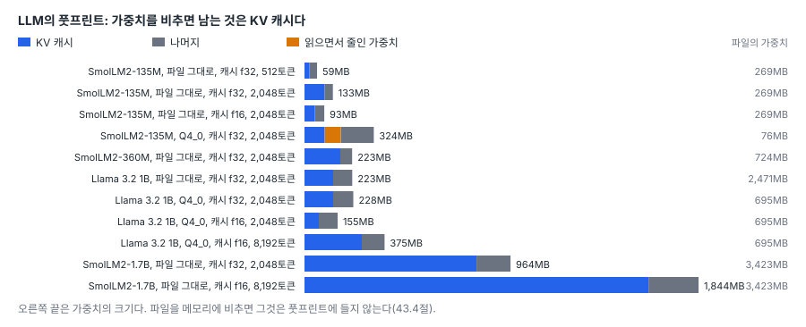
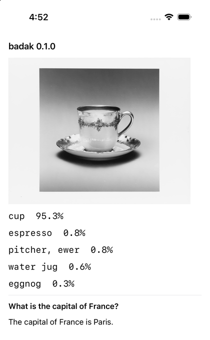
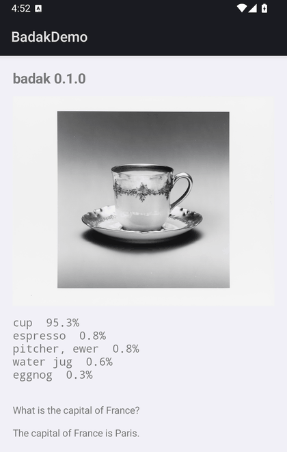
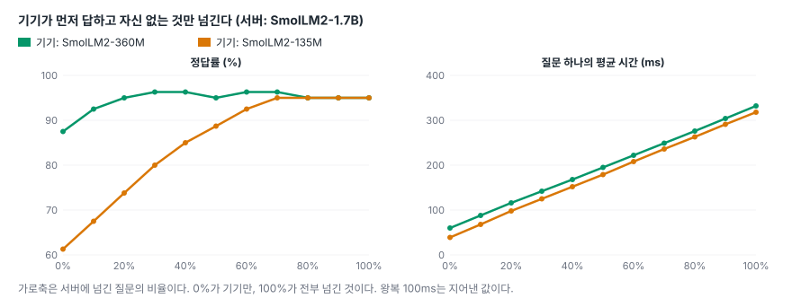
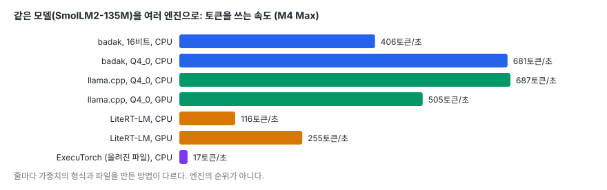

# 온디바이스 LLM

6부의 앞쪽에서 폰에 올린 것은 14MB의 사진 분류 모델이었습니다. 이 책의
중심은 그보다 수십 배에서 수백 배 큰 언어 모델입니다. 이 장에서는 그것을
기기에 올립니다.

LLM을 기기에서 돌리는 까닭은 [1장](../part1/ch01_landscape.md)과
[43장](ch43_device_constraints.md)에서 적었습니다. 사용자의 글이 기기를
떠나지 않고, 통신이 없어도 돌고, 토큰마다 내는 비용이 없습니다. 어려운
까닭도 이미 봤습니다. [43장](ch43_device_constraints.md)의 제약이 모두
한꺼번에 걸립니다. 파일이 크고, 메모리를 많이 쓰고, 토큰을 쓰는 동안
계속 계산합니다.

이 장은 다섯 가지를 합니다.

- LLM 하나가 기기의 **메모리를 얼마나 쓰는지** 계산하고 재서 견줍니다.
- [44장](ch44_on_the_phone.md)에서 미뤄 둔 것, 앱이 엔진의 LLM을 부르는
  **문**을 만듭니다. 토큰이 하나 나올 때마다 엔진이 앱의 함수를 거꾸로
  부릅니다.
- 직접 싣지 않고 **운영체제에 든 모델**을 부르는 방법을 봅니다.
- **기기와 서버를 섞어 쓰는** 구조를 작게 만들어 잽니다.
- 기기용 LLM 엔진 셋(**LiteRT-LM, ExecuTorch, MLC**)을 읽고, 돌릴 수
  있는 것은 돌려 봅니다.

먼저 밝혀 둡니다. 속도의 숫자는 **모두 맥에서 잰 것**입니다. 앱은 iOS
시뮬레이터와 Android 에뮬레이터에서 답이 같은지만 확인했습니다.
운영체제에 든 모델은 이 맥(macOS 27)의 것을 불렀고, Android의 것은
문서만 읽었습니다.

결과를 미리 적어 둡니다.

- 긴 대화에서는 **KV 캐시가 가중치보다 커질 수 있습니다.**
  SmolLM2-1.7B는 토큰 하나에 캐시 393KB를 쓰고, 8,192토큰이면 16비트로
  담아도 1.6GB입니다. 4비트로 줄인 가중치(1.0GB)보다 큽니다. Llama 3.2
  1B는 토큰 하나에 66KB입니다. 여섯 배의 차이가 모델의 설계
  하나(9.8절)에서 옵니다.
- 엔진이 앱의 함수를 거꾸로 부르는 문을 만들었고, 시뮬레이터와
  에뮬레이터에서 맥과 **글자 하나까지 같은 답**이 나왔습니다. 엔진
  라이브러리는 LLM을 넣어 1.0MB에서 1.4MB가 되었습니다.
- **대화의 틀도 모델의 일부입니다.** SmolLM2는 대화의 맨 앞에 기본
  지시문 한 줄을 넣어 학습되었습니다. 그것을 빼면 1.7B 모델이 캐나다의
  수도를 "토론토"라고 답합니다. 80문항의 정답률이 95%에서 83%로 떨어져,
  다섯 배 작은 모델(89%)보다 낮아집니다. 이 책의 앞 장에도 그 한 줄 없이
  돈 예제와 측정이 있었고, 찾아서 다시 돌렸습니다.
- 운영체제에 든 모델을 부르면 앱의 메모리는 **8.6MB**입니다. 모델이 앱
  안에 없기 때문입니다.
- 작은 모델(SmolLM2-360M)이 먼저 답하고, 자신 없는 20%만 큰 모델에
  넘기면 정답률이 88%에서 95%가 됩니다. 큰 모델만 쓴 것과 같은
  정답률이고, 질문의 80%는 기기를 떠나지 않습니다.
- 같은 모델(SmolLM2-135M)을 네 엔진으로 돌렸습니다. 토큰을 쓰는 속도가
  초당 17개에서 687개까지입니다. 가장 큰 차이는 엔진의 완성도가 아니라
  **모델을 어떻게 내보냈는가**에서 왔습니다.

| 하는 일 | 절 |
|---|---|
| 메모리를 계산하고 잰다 | 47.1 |
| 토큰을 앱에 흘려보내는 문을 만든다 | 47.2 |
| 대화의 틀이 답을 바꾸는 것을 본다 | 47.3 |
| 폰의 가속기에서 LLM이 왜 어려운지 읽는다 | 47.4 |
| 운영체제에 든 모델을 부른다 | 47.5 |
| 기기와 서버를 섞어 쓴다 | 47.6 |
| 기기용 LLM 엔진 셋을 견준다 | 47.7 |

## 47.1 메모리 예산을 계산하고 잰다

43.4절에서 폰의 앱은 메모리를 많이 쓰면 죽는다고 했습니다. LLM을 올리기
전에 물어야 할 것은 "얼마나 빠른가"가 아니라 **"들어가는가"**입니다.

LLM이 쓰는 메모리는 셋으로 나뉩니다.

**가중치.** 값의 수에 값 하나의 크기를 곱한 것입니다.
[20장](../part3/ch20_weight_quantization.md)의 표 그대로입니다.

**KV 캐시.** [11장](../part2/ch11_kv_cache.md)에서 만든 것입니다. 읽은
토큰마다 블록마다 키와 값을 남겨 둡니다. 대화가 길어지는 만큼 커집니다.

**나머지.** 계산하는 동안의 중간 결과, 토크나이저, 엔진 자신입니다.

앞의 둘은 모델의 설정 파일만 보고 계산할 수 있습니다.

```rust
{{#include ../../../crates/badak_models/examples/ch47_budget.rs:budget}}
```

이 책에서 쓴 모델 넷입니다.

| 모델 | 가중치의 값 | 16비트 (MB) | `Q4_0` (MB) | 블록 | 키·값 헤드 | 토큰 하나의 KV 캐시 |
|---|---:|---:|---:|---:|---:|---:|
| SmolLM2-135M | 1.3억 | 269 | 76 | 30 | 3 | 46KB |
| SmolLM2-360M | 3.6억 | 724 | 203 | 32 | 5 | 82KB |
| Llama 3.2 1B | 12.4억 | 2,471 | 695 | 16 | 8 | 66KB |
| SmolLM2-1.7B | 17.1억 | 3,423 | 963 | 24 | 32 | **393KB** |

맨 오른쪽 열을 봅니다. 캐시는 32비트 실수로 담았을 때의 크기입니다.
Llama 3.2 1B와 SmolLM2-1.7B는 가중치가 1.4배 차이인데 **토큰 하나의
캐시는 여섯 배** 차이입니다.

까닭은 9.8절에 있습니다. Llama 3.2 1B는 질의 헤드 32개가 키·값 헤드
8개를 넷씩 함께 씁니다. SmolLM2-1.7B는 질의 헤드 32개가 저마다 키와 값을
갖습니다. [9장](../part2/ch09_transformer.md)에서는 그것이 계산을 줄이는
방법이었습니다. 기기에서는 **메모리를 줄이는 방법**입니다. 블록도 Llama
쪽이 적습니다(16개와 24개).

대화가 길어지면 이렇게 됩니다.

| 토큰 | Llama 3.2 1B의 캐시 (f32) | SmolLM2-1.7B의 캐시 (f32) | SmolLM2-1.7B를 16비트로 |
|---:|---:|---:|---:|
| 512 | 34MB | 201MB | 101MB |
| 2,048 | 134MB | 805MB | 403MB |
| 8,192 | 537MB | **3,221MB** | 1,611MB |

SmolLM2-1.7B의 4비트 가중치는 963MB입니다. 8,192토큰의 캐시는 16비트로
담아도 그 1.7배입니다. **가중치를 4비트로 줄였는데 캐시가 그보다
큽니다.** 모델을 고를 때 파일의 크기만 보면 안 되는 까닭입니다.

### 계산한 값을 재서 확인한다

계산이 맞는지 돌려서 봅니다. 그 설정으로 모델을 올려 토큰을 그만큼
읽히고, 프로세스의 풋프린트(43.4절)을 밖에서 잽니다.

```bash
/usr/bin/time -l cargo run --release -p badak_models --example ch47_budget -- \
    run llama32_1b q4_0 f16 2048
```

| 모델 | 가중치 | 캐시의 정밀도 | 토큰 | 가중치 (MB) | 캐시: 계산 (MB) | 풋프린트: 잰 것 (MB) | 풋프린트 − 캐시 |
|---|---|---|---:|---:|---:|---:|---:|
| SmolLM2-135M | 파일 그대로 | f32 | 512 | 269 | 24 | 59 | 35 |
| SmolLM2-135M | 파일 그대로 | f32 | 2,048 | 269 | 94 | 133 | 39 |
| SmolLM2-135M | 파일 그대로 | f16 | 2,048 | 269 | 47 | 93 | 45 |
| SmolLM2-135M | 읽으며 `Q4_0`으로 | f32 | 2,048 | 76 | 94 | **324** | 230 |
| SmolLM2-360M | 파일 그대로 | f32 | 2,048 | 724 | 168 | 223 | 55 |
| Llama 3.2 1B | 파일 그대로 | f32 | 2,048 | 2,471 | 134 | 223 | 89 |
| Llama 3.2 1B | 미리 줄인 `Q4_0` | f32 | 2,048 | 695 | 134 | 228 | 94 |
| Llama 3.2 1B | 미리 줄인 `Q4_0` | f16 | 2,048 | 695 | 67 | 155 | 88 |
| Llama 3.2 1B | 미리 줄인 `Q4_0` | f16 | 8,192 | 695 | 268 | 375 | 106 |
| SmolLM2-1.7B | 파일 그대로 | f32 | 2,048 | 3,423 | 805 | 964 | 159 |
| SmolLM2-1.7B | 파일 그대로 | f16 | 8,192 | 3,423 | 1,611 | 1,844 | 234 |



엔진이 센 캐시의 크기는 계산한 값과 바이트까지 같았습니다. 표에서 읽을
것은 넷입니다.

**매핑한 가중치는 풋프린트에 없습니다.** Llama 3.2 1B의 가중치는 2.5GB인데
풋프린트는 223MB입니다. 43.4절에서 본 대로입니다. 운영체제는 파일을 매핑한
페이지를 앱의 것으로 세지 않습니다. 풋프린트는 **캐시와 나머지**입니다.

**그래서 기기에서 줄일 것은 캐시입니다.** 가중치를 매핑하고 나면 남는 것이
캐시입니다. 21.7절에서 캐시를 16비트로 담으면 품질이 거의 그대로임을
봤습니다. 풋프린트가 228MB에서 155MB가 됩니다. 문맥의 길이에 한도를 두는
것은 품질의 선택이기 전에 **메모리의 선택**입니다.

**읽으면서 줄이면 다 잃습니다.** 넷째 줄입니다. 가중치가 76MB로 가장
작은데 풋프린트는 324MB로 SmolLM2-135M의 줄 가운데 가장 큽니다. 43.4절의
결론 그대로입니다. 양자화는 기기에 오기 전에 끝냅니다.

**나머지는 작지 않습니다.** 마지막 열이 35MB에서 234MB입니다. 모델이
크고 읽는 글이 길수록 큽니다. 프롬프트를 읽는 동안의 중간 결과가
대부분일 것입니다(128토큰씩 끊어 읽었습니다.
[40장](../part5/ch40_throughput.md)에서 본 대로, 한꺼번에 읽으면 더
큽니다). 정확히 무엇인지 나눠 보지는 않았습니다.

### 남는 메모리가 문맥의 길이를 정한다

정리하면 예산은 이렇게 짭니다.

```text
풋프린트 ≈ KV 캐시(토큰 수 × 토큰 하나의 크기) + 나머지(재서 안다)
        + 가중치(파일을 매핑하지 못할 때만)
```

기기가 앱에 허락하는 메모리가 얼마인지는 기기마다, 그때그때 다릅니다.
43.4절에서 본 대로 운영체제에 물어야 합니다. 그 숫자에서 앱의 다른
부분이 쓰는 것을 빼고 남는 것이 모델이 쓸 수 있는 메모리입니다. 거기에서
"나머지"를 빼고 토큰 하나의 캐시로 나누면 **쓸 수 있는 문맥의 길이**가
나옵니다.

가중치를 매핑한다고 비용이 없는 것은 아닙니다. 매핑한 페이지도 읽으려면
메모리에 올라와야 하고, 메모리가 모자라면 운영체제가 그것을 버렸다가
다시 읽습니다. 그러면 죽지는 않지만 느려집니다. 토큰 하나를 쓸 때마다
가중치 전체를 한 번 읽기
때문입니다([15장](../part3/ch15_bottleneck.md)). 그 상태를 이 맥에서
만들어 보지는 못했습니다(43.8절).

## 47.2 토큰을 흘려보내는 문을 만든다

[44장](ch44_on_the_phone.md)에서 사진 분류기의 문을 만들었습니다. 사진을
넣으면 답이 한 번에 나왔습니다. LLM은 다릅니다. 답이 **조금씩**
나옵니다. 사용자는 첫 글자가 나오는 순간부터 읽기 시작하고, 읽다가 그만
쓰라고 할 수도 있습니다.

그래서 문의 형태가 달라집니다. 앱이 엔진을 부르고, 그 호출이 끝나기 전에
**엔진이 앱을 여러 번 거꾸로 부릅니다.**

```rust
{{#include ../../../crates/badak_ffi/src/lib.rs:llm_callback}}
```

C에서 "함수를 넘긴다"는 것은 함수의 주소를 넘기는 것입니다. 그런데
주소만으로는 모자랍니다. 불린 함수는 **자기가 누구의 일을 하는지**, 곧
어느 화면의 어느 글 상자에 붙일 조각인지 알아야 합니다. 그래서 포인터
하나(`user`)를 함께 넘기고, 엔진은 그것을 건드리지 않고 그대로
돌려줍니다. C의 콜백이 늘 이 둘을 짝지어 받는 까닭입니다.

```rust
{{#include ../../../crates/badak_ffi/src/lib.rs:llm_chat}}
```

돌려주는 값으로 **그만 쓰라는 뜻**을 전합니다. 사용자가 멈춤 버튼을
누르면 앱의 함수가 0이 아닌 값을 돌려주고, 엔진은 다음 토큰을 계산하지
않습니다. 토큰 하나에 수십 밀리초가 걸리는 기기에서 쓰지 않을 글을 계속
계산하면 배터리를 버리게 됩니다.

문 안쪽입니다.

```rust
{{#include ../../../crates/badak_ffi/src/llm.rs:chat}}
```

눈여겨볼 곳은 `StreamDecoder`입니다. 토큰 하나가 글자 하나가 아닙니다.
[8장](../part2/ch08_tokenizer.md)에서 본 대로 한글 한 글자가 토큰 둘에
걸쳐 있을 수 있습니다. 토큰이 나올 때마다 그 바이트를 그대로 넘기면,
앱은 **반쪽짜리 글자**를 받습니다. Swift의 `String`도 Java의 `String`도
그것을 글로 만들지 못합니다. 그래서 글자가 완성될 때까지 모았다가
넘깁니다. [39장](../part5/ch39_inference_server.md)의 서버가 조각을
내보낼 때 쓴 것과 같은 도구입니다.

### Swift에서는 클로저를 상자에 담아 넘긴다

```swift
{{#include ../../../apps/ios/BadakDemo.swift:llm_wrapper}}
```

C의 함수는 Swift의 클로저를 직접 받지 못합니다. 클로저는 주변의 변수를
잡고 있는데, C의 함수 포인터에는 그것을 담을 곳이 없습니다. `user`가 그
역할을 합니다. 클로저를 상자에 담고, 상자의 주소를 `user`로 넘기고, C의
함수 안에서 그 주소로 상자를 되찾습니다.

### Java에서는 엔진이 메서드를 찾아 부른다

[44장](ch44_on_the_phone.md)의 JNI 함수는 Java가 엔진을 부르는
함수였습니다. 이번에는 엔진이 Java의 메서드를 부릅니다.

```java
{{#include ../../../apps/android/java/book/badak/Badak.java:llm}}
```

엔진 쪽에서 Java의 메서드를 부르려면 세 단계를 차례로 거쳐야 합니다. 이
객체의 클래스가 무엇인지 묻고, 그 클래스에서 이 이름과 이 형식의
메서드가 어느 것인지 묻고, 그것을 부릅니다.

```rust
{{#include ../../../crates/badak_ffi/src/jni.rs:jni_callback}}
```

`"([B)Z"`는 메서드의 형식을 적는 JNI의 표기입니다. `byte[]` 하나를 받아
`boolean`을 낸다는 뜻입니다.[^jni-signature] 이름이나 형식이 Java 쪽과
한 글자라도 다르면 메서드를 찾지 못합니다. 컴파일러는 알려 주지
않습니다.

조각을 글이 아니라 `byte[]`로 넘기는 까닭은
[44장](ch44_on_the_phone.md)에 있습니다. JNI의 글은 UTF-8과 조금
다릅니다. 바이트로 넘기고 Java 쪽에서 글로 만드는 편이 안전합니다.

조각마다 만든 배열의 핸들을 **바로 돌려주는** 것도
봅니다(`DeleteLocalRef`). 돌려주지 않으면 이 함수가 끝날 때까지
쌓입니다. 분류기는 호출 한 번에 배열 몇 개를 만들었으니 괜찮았습니다.
LLM은 답 하나에 수백 번 부릅니다. Android의 문서는 핸들을 많이 만드는
코드는 직접 지우라고 적고 있습니다.[^jni-local]

[44장](ch44_on_the_phone.md)의 가짜 `JNIEnv`에 칸 일곱 개를 더해, 이
거꾸로 부르기도 맥과 CI에서 테스트합니다. 조각마다 온전한 UTF-8인지,
듣는 쪽이 거짓을 돌려주면 멈추는지, 만든 배열을 모두 돌려받았는지
확인합니다.

### 두 앱에서 맥과 같은 답이 나온다

두 앱에 질문 하나를 더했습니다. 답이 나오는 대로 화면에 붙입니다.




모델은 SmolLM2-135M입니다(0.27GB). iOS에서는 앱 번들에 넣었고,
Android에서는 **앱의 파일 폴더**에 넣었습니다. 44.7절의 세 가지 방법
가운데 "앱이 직접 받는다"에 해당합니다. 실제 앱이라면 처음 켰을 때
내려받아 44.8절의 방법으로 확인하고 놓을 곳입니다. 이 크기의 파일을
번들에 넣으면 앱의 크기가 열여덟 배가 됩니다.

[44장](ch44_on_the_phone.md)과 같은 방법으로 답을 견줬습니다. 앱이 쓴
답의 바이트와 토큰의 수를, 맥에서 같은 라이브러리를 C 프로그램으로 불러
얻은 것과 견줍니다.

| 어디서 | 쓴 토큰 | 답 |
|---|---:|---|
| 맥 (C 프로그램) | 7 | The capital of France is Paris. |
| iOS 시뮬레이터 (Swift 앱) | 7 | 같음 (바이트까지) |
| Android 에뮬레이터 (Java 앱) | 7 | 같음 (바이트까지) |

44.5절에서 한 말을 다시 합니다. 세 곳 모두 이 맥의 프로세서입니다.
확인한 것은 문이 토큰을 제대로 전달한다는 것, 콜백이 두 언어에서 돈다는
것, 모델 파일이 앱의 폴더에서 열린다는 것입니다. 다른 프로세서에서의
답과 **속도는 확인하지 못했습니다.**

LLM을 넣자 엔진의 라이브러리가 커졌습니다. Android의 `.so`가 1,005KB에서
1,374KB가 되었습니다(눌러서 668KB). 토크나이저, 모델, 양자화 커널이
370KB입니다. 그 옆에 놓일 모델은 그 200배입니다.

## 47.3 대화의 틀도 모델의 일부다

이 장을 쓰다가 버그 하나를 만났습니다. 엔진의 버그가 아니었습니다.

47.6절의 실험을 준비하면서 짧은 질문 80개를 세 크기의 모델에 물었습니다.
가장 큰 SmolLM2-1.7B가 캐나다의 수도를 "토론토", 호주의 수도를 "시드니",
7 곱하기 8을 "42"라고 답했습니다. 정답률이 다섯 배 작은 360M 모델보다
낮았습니다.

먼저 양자화를 의심했습니다. 가중치를 줄이지 않고 돌려도 같았습니다.
다음으로 엔진을 의심했습니다. 같은 프롬프트를 PyTorch에 넣었습니다.
**PyTorch도 "토론토"라고 답했습니다.** 엔진은 맞게 계산하고 있었습니다.

틀린 것은 프롬프트였습니다. 8.9절에서 대화를 모델이 학습한 틀에 맞춰
적어야 한다고 했습니다. SmolLM2의 틀에는 우리가 옮기지 않은 줄이 하나
있었습니다. 모델과 함께 배포되는 설정 파일의 틀은 이렇게 시작합니다.

```text

<|im_start|>system
You are a helpful AI assistant named SmolLM, trained by Hugging Face<|im_end|>

```

대화에 시스템의 말이 없으면 **기본 지시문 한 줄을 넣으라**는
뜻입니다.[^smollm-template] 모델은 이 줄이 늘 있는 대화로
학습되었습니다. 우리의 `ChatFormat::ChatMl`은 틀의 뼈대(`<|im_start|>`,
`<|im_end|>`)만 옮겼고 이 줄을 몰랐습니다.

| 80문항의 정답률 | SmolLM2-360M | SmolLM2-1.7B |
|---|---:|---:|
| 기본 지시문 없이 | 88.7% | 82.5% |
| 기본 지시문을 넣고 | 87.5% | **95.0%** |

한 줄을 넣자 큰 모델의 정답률이 83%에서 95%가 되었습니다. 작은 모델은
거의 그대로입니다. 지시문이 없을 때 큰 모델은 "토론토" 한 낱말로 짧게
답했고, 있을 때는 "The capital of Canada is Ottawa."라고 문장으로
답했습니다. 내용이 하나도 없어 보이는 한 줄이 모델을 **학습할 때의
상태**로 돌려놓습니다.

세 가지를 배웁니다.

**틀은 가중치와 함께 다닙니다.** 모델 파일만 옮기고 틀을 손으로 다시
적으면 이런 일이 생깁니다. 47.7절에서 다른 엔진이 틀을 어디에 담는지
봅니다.

**이 버그는 오류를 내지 않습니다.** 모델은 그럴듯한 영어로 답합니다.
속도도, 메모리도, [13장](../part2/ch13_first_showdown.md)부터 해 온
PyTorch와의 대조도 모두 통과합니다. 같은 프롬프트를 넣으면 같은 답이
나오기 때문입니다. 답의 **내용**을 채점해야만 보입니다. 21.3절에서 본
"퍼플렉서티는 그럴듯한데 틀린" 버그와 같은 종류입니다.

**이 책의 앞 장에도 이 줄 없이 돈 곳이 있었습니다.** 어디인지
찾아봤습니다. 서버의 측정 가운데 요청에 시스템의 말을 직접 넣은
것([39장](../part5/ch39_inference_server.md)의 측정 전부,
[40장](../part5/ch40_throughput.md)과
[42장](../part5/ch42_datacenter.md)에서 긴 지시문을 쓰는 측정)은
해당하지 않습니다. 해당하는 곳은 넷입니다.

- **[39장](../part5/ch39_inference_server.md)의 예제 둘.** 39.4절의
  `curl` 예제와 39.5절의 "꾸며 낸 경계" 확인은 시스템의 말 없이
  보냈습니다. 둘 다 다시 돌려 출력과 숫자를 고쳤습니다. 예전에는 여덟
  토큰의 한도까지 "…is Paris. Paris"라고 쓰던 답이, 지금은 "The capital
  of France is Paris."에서 스스로 멈춥니다.
- **[40장](../part5/ch40_throughput.md)의 배치 측정과
  [42장](../part5/ch42_datacenter.md)의 콜드 스타트.** 질문 하나만
  보내는 요청입니다. SmolLM2의 줄을 모두 다시 재서 표를 고쳤습니다. 기본
  지시문 21토큰을 더 읽게 되어 첫 글까지의 시간이 늘고,
  [40장](../part5/ch40_throughput.md)의 처리량은 조금
  낮아졌습니다(열여섯을 묶었을 때 초당 1,383토큰이 1,178토큰). 묶을수록
  처리량이 늘고 지연이 느는 경향은 그대로입니다.
- **[41장](../part5/ch41_control_and_speed.md).** 문법으로 제약한 생성,
  추측 디코딩, LoRA 어댑터의 실험이 SmolLM2에게 시스템의 말 없이
  물었습니다. 아래의 수정을 한 뒤 **모두 다시 돌려
  [41장](../part5/ch41_control_and_speed.md)의 숫자를 고쳤습니다.**
- **11, 12, [14장](../part3/ch14_measurement.md)의 예제.** 질문 하나를
  틀의 뼈대만으로 감쌉니다. 이 장들이 보이는 것은 KV 캐시와 샘플링과
  재는 방법이고, 출력은 그때의 엔진이 낸 것이어서 그대로 두었습니다.
  예제의 코드에 "기본 지시문 없이"라고 적어 두었습니다.

### 엔진이 틀에서 기본 지시문을 읽게 고쳤다

엔진이 **모델과 함께 온 틀에서 기본 지시문을 읽게** 했습니다.

```rust
{{#include ../../../crates/badak_models/src/tokenizer/chat.rs:template}}
```

`ChatTemplate::load`는 모델의 디렉터리에서 `tokenizer_config.json`을
읽어 틀에 기본 지시문이 있는지 봅니다. 있으면, 대화가 시스템의 말로
시작하지 않을 때 그 줄을 앞에 놓습니다.
서버([39장](../part5/ch39_inference_server.md))와 폰의 문(이 장)이
이것을 씁니다. 부르는 쪽이 시스템의 말을 주면 그것을 쓰고 기본 지시문은
넣지 않습니다. 틀이 정한 그대로입니다.

맞는지는 transformers와 견줬습니다. transformers는 틀을 실제로
실행합니다(Jinja 해석기가 들어 있습니다). 대화 셋을 세 모델의 틀로 적게
해서(`reference/ch47_chat_template.py`) 우리가 적은 글, 그 글의 토큰과
견줍니다. 아홉 개가 모두 같습니다(`tests/chat_template.rs`).

**이것은 Jinja 해석기가 아닙니다.** `default_system`은 틀의 글에서 **한
가지 형태**만 알아봅니다. "첫 말이 시스템의 것이 아니면"이라는 조건 뒤에
시스템의 말 하나가 글자 그대로 적혀 있는 형태입니다. SmolLM2의 틀이
그렇게 생겼습니다. 다른 형태이면 아무것도 넣지 않습니다. 틀린 지시문을
지어내는 것보다 넣지 않는 편이 낫다고 보았습니다. 그러니 다른 모델을
올릴 때는 여전히 그 모델의 틀을 사람이 읽어 봐야 합니다.

읽어 보니 **Llama 3.2의 틀도 뼈대만은 아니었습니다.** 그 틀은 시스템의
말이 있든 없든 맨 앞에 시스템의 말을 만들고 거기에 두 줄을 적습니다.
"Cutting Knowledge Date: December 2023"과 "Today Date: "에 이은 그날의
날짜입니다.[^llama-template] 우리의 `ChatFormat::Llama3`은 이 두 줄을
적지 않습니다. [8장](../part2/ch08_tokenizer.md)에서 llama.cpp의 코드에
적힌 형식을 따랐고, 그쪽도 적지 않습니다. 날짜가 들어가는 줄이라 글자
그대로 옮길 수도 없습니다.

SmolLM2에서 한 줄이 12%포인트의 차이를 냈으니 이것도 재 봐야 합니다.
같은 80문항을 Llama 3.2 1B에 두 가지로 물었습니다. 뼈대만으로, 그리고
틀이 적는 두 줄을 넣어서 물었습니다(날짜는 틀이 날짜를 받지 못했을 때
쓰는 기본값 "26 Jul 2024"로 고정했습니다. 그렇게 적은 글과 토큰이
transformers의 것과 같은지 먼저 확인합니다).

```bash
cargo run --release -p badak_models --example ch47_template
```

| 80문항의 정답률 | Llama 3.2 1B |
|---|---:|
| 뼈대만 (우리 엔진, llama.cpp의 코드에 적힌 형식) | 92.5% (74개) |
| 틀이 적는 날짜 두 줄을 넣고 | 91.2% (73개) |

**차이가 없습니다.** 한 문항의 차이이고, 80문항 가운데 66문항은 답의
글자까지 같습니다. 갈린 문항을 보면 방향도 없습니다. 두 줄을 넣자 "12
더하기 30"을 틀리고, 영국의 화폐는 맞게 됩니다(뒤의 것은 "Pounds"와
"Pound"를 가르는 채점 규칙 탓입니다). 이 모델은 그 두 줄 없이도 학습할
때의 상태에서 벗어나지 않습니다.

그래서 **Llama 3의 형식은 고치지 않았습니다.** 다만 이것은 짧은 사실
질문 80개에서의 결과입니다. 날짜를 묻는 질문이나 도구를 부르는
대화에서는 다를 수 있고, 그것은 보지 않았습니다. SmolLM2에서 배운 것은
그대로 남습니다. **틀의 줄 하나가 중요한지는 모델마다 다르고, 재 보기
전에는 알 수 없습니다.**

이 장의 문은 여전히 `system` 인자를 받습니다. 주지 않으면 이제 모델의
기본 지시문이 들어갑니다.

## 47.4 폰의 가속기에서 LLM은 어렵다

[45장](ch45_gpu_npu.md)에서 합성곱 신경망은 뉴럴 엔진에 통째로 들어갔고
한 자릿수 빨라졌습니다. LLM은 그렇게 쉽지 않습니다. 직접 해 보지는
못했고, 해 본 사람들의 기록을 읽습니다.

Apple이 Llama 3.1 8B를 Core ML로 옮긴 과정을 글로 남겼습니다. M1 Max의
GPU에서 토큰을 쓰는 속도가 단계마다 이렇게 바뀝니다.[^apple-llama] GPU를
고른 까닭도 적혀 있습니다. 이런 모델은 메모리에서 읽어 오는 속도가
병목이고, 그 기기에서는 GPU가 계산과 메모리의 속도를 가장 잘 갖췄다는
것입니다.

| 단계 | 토큰/초 (문맥 2,048) |
|---|---:|
| 가장 단순하게 옮김. 형상이 고정되고 KV 캐시가 없다 | 0.19 |
| KV 캐시를 모델의 입력과 출력으로 | 1.25 |
| KV 캐시를 모델의 **상태**로 | 16.26 |
| 가중치를 4비트로, 어텐션을 연산 하나로 | 33.67 |

처음과 끝이 170배 차이입니다. 이 표에서도 45.8절과 같은 결론이 나옵니다.
**가속기의 속도보다 모델을 어떻게 넘기는가가 먼저입니다.**

첫 줄이 느린 까닭은 둘입니다. 가속기는 형상이 정해진 그래프에서 잘
돕니다. 그래서 문맥의 길이를 2,048로 고정하면, 토큰이 일곱 개여도
2,048개의 위치를 모두 계산합니다. 그리고 캐시가 없으면
[11장](../part2/ch11_kv_cache.md)에서 본 대로 토큰마다 앞의 글을 전부
다시 읽습니다.

둘째 줄은 캐시를 넣었는데도 느립니다. 캐시를 "모델의 입력으로 받아
출력으로 돌려주는" 식으로 만들면, 토큰마다 캐시 전체가 엔진과 앱 사이를
오갑니다. 45.8절에서 본 경계를 넘는 비용입니다. 셋째 줄은 캐시를 모델
안에 **머무는 상태**로 만들어 그것을 없앴습니다. 23.10절에서 값을 GPU에
머물게 했던 것과 같은 일입니다.

합성곱 신경망과 견주면 LLM이 가속기에서 어려운 까닭이 보입니다.

| | 합성곱 신경망 ([45장](ch45_gpu_npu.md)) | LLM |
|---|---|---|
| 입력의 형상 | 늘 같다 | 토큰마다 길이가 는다 |
| 호출 사이에 남는 것 | 없다 | KV 캐시 |
| 한 번의 일 | 사진 한 장 | 토큰 하나. 수백 번 되풀이한다 |
| 가중치 | 수십 MB | 수백 MB에서 수 GB |
| 막히는 곳 | 계산 | 메모리에서 가중치를 읽어 오는 속도 ([15장](../part3/ch15_bottleneck.md)) |

마지막 줄이 중요합니다. 토큰을 하나씩 쓸 때 LLM의 병목은 계산이 아니라
메모리입니다. 계산이 빠른 장치로 옮겨도 메모리가 그대로면 얻는 것이
적습니다. Apple의 다른 글은 뉴럴 엔진에서 트랜스포머가 이 상태가 되는
것을 직접 적고 있습니다. 가중치를 메모리에서 가져오는 시간이 지연을
정한다는 것입니다.[^ane-bandwidth]

이 맥에서 우리가 잴 수 있었던 것은 하나입니다. LiteRT-LM은 같은 모델을
CPU와 GPU로 돌릴 수 있습니다(47.7절). SmolLM2-135M에서 GPU가 토큰을 쓰는
속도는 CPU의 2.2배였습니다(초당 116개와 255개). 폰의 GPU에서는 재지
못했습니다.

## 47.5 운영체제에 든 모델을 부른다

모델을 싣지 않는 방법이 있습니다. **운영체제가 이미 갖고 있는 모델**을
부르는 것입니다.

Apple의 기기에는 운영체제가 관리하는 언어 모델이 있고, 앱은 Foundation
Models 프레임워크로 그것을 부릅니다.[^fm] 이 맥에서 불러 봤습니다.

```swift
{{#include ../../../apps/system_model/SystemModel.swift:availability}}
```

가장 먼저 **모델이 있는지** 묻습니다. 기기가 지원하지 않을 수 있고,
사용자가 기능을 꺼 두었을 수 있고, 모델을 아직 내려받는 중일 수
있습니다.[^fm-availability] 우리가 싣는 모델에서는 물을 필요가 없던
것입니다.

```swift
{{#include ../../../apps/system_model/SystemModel.swift:stream}}
```

답이 조금씩 오는 것은 같습니다. 47.2절의 문과 다른 점은 조각이 아니라
**지금까지의 답 전체**가 매번 온다는 것입니다.

질문 셋을 세 번씩 보냈습니다.

| 질문 | 첫 글까지 (ms) | 다 쓰기까지 (ms) | 답의 길이 | 앱의 풋프린트 |
|---|---:|---:|---:|---:|
| What is the capital of France? | 334 | 369 | 1~6 낱말 | 8.4MB |
| Explain in two sentences why the sky is blue. | 378 | 870 | 25~33 낱말 | 8.6MB |
| Write a haiku about the sea. | 454 | 761 | 13~15 낱말 | 8.6MB |

세 번의 중앙값입니다. 맨 처음 부른 한 번은 첫 글까지 965ms가 걸렸습니다.

맨 오른쪽 열이 이 방법의 핵심입니다. **앱의 풋프린트가 8.6MB입니다.**
47.1절에서 가장 작은 모델을 메모리를 가장 적게 쓰는 설정으로 올렸을 때가
59MB였습니다. 모델은 앱 안에 없습니다. 운영체제의 다른 프로세스에 있고,
앱은 말을 주고받을 뿐입니다. 그 모델이 얼마나 큰지, 메모리를 얼마나
쓰는지는 앱에서 보이지 않습니다. 내려받는 크기도 0입니다.

Android에도 같은 것이 있습니다. Gemini Nano라는 모델이 AICore라는 시스템
서비스 안에서 돌고, 앱은 ML Kit의 GenAI API로 부릅니다.[^gemini-nano]
읽기만 했고 불러 보지 못했습니다.

직접 싣는 것과 견줍니다.

| | 모델을 직접 싣는다 | 운영체제의 모델을 부른다 |
|---|---|---|
| 앱의 크기 | 모델만큼 커진다 | 그대로다 |
| 앱의 메모리 | 47.1절의 예산 | 거의 없다 |
| 어느 기기에서 되는가 | 메모리가 되는 모든 기기 | 운영체제가 모델을 준 기기만 |
| 어느 모델인가 | 내가 고른다. 버전을 고정할 수 있다 | 운영체제가 정한다. 갱신되면 바뀐다 |
| 모델을 고칠 수 있는가 | 그렇다 ([46장](ch46_shrinking_models.md), [41장](../part5/ch41_control_and_speed.md)의 어댑터) | 주어진 만큼만 |
| 여러 앱이 쓰면 | 앱마다 한 벌씩 | 한 벌을 함께 쓴다 |
| 엔진 | 내가 싣고 내가 고친다 | 운영체제의 것 |

오른쪽 방법은 추론 엔지니어가 할 일을 거의 다 없앱니다. 그 대신
**통제**를 잃습니다. 운영체제가 갱신되면 모델이 바뀌고, 같은 프롬프트에
다른 답이 나옵니다. 지원하는 기기가 아니면 기능이 없습니다. 문맥의
길이에도 한도가 있고, 넘으면 오류가 납니다.[^fm-context] 그래서 실제
앱은 오른쪽을 먼저 쓰고 안 되는 기기에서는 왼쪽이나 서버로 가는 식으로
둘을 섞습니다. 다음 절에서 다룹니다.

## 47.6 기기와 서버를 섞어 쓴다

기기의 모델은 작고 서버의 모델은 큽니다. 둘 다 쓸 수 있다면 일을 어떻게
나눌까요. 흔한 구조는 넷입니다.

| 구조 | 기기가 하는 일 | 서버가 하는 일 |
|---|---|---|
| 기기 먼저 | 답한다. 자신 없으면 넘긴다 | 넘어온 것만 답한다 |
| 일의 종류로 | 요약, 고쳐 쓰기, 분류 | 긴 추론, 최신 지식 |
| 앞뒤로 | 사적인 정보를 가리거나 줄인다 | 가려진 글로 답한다 |
| 안 될 때만 | 통신이 없을 때, 서버가 느릴 때 | 평소에는 전부 |

실제 제품에서 이 구조를 볼 수 있습니다. Apple은 기기의 모델로 되는 일은
기기에서 하고, 더 큰 모델이 필요한 요청만 전용 서버로 보낸다고
설명합니다. 그 서버가 사용자의 데이터를 볼 수 없게 만든 설계에 Private
Cloud Compute라는 이름을 붙였습니다.[^pcc] Google의 Firebase에는 기기의
모델이 있으면 그것을 쓰고 없으면 서버의 모델로 넘어가는 기능이
있습니다.[^firebase-hybrid]

첫째 구조를 작게 만들어 봅니다.

### 자신 없는 답은 토큰의 확률로 안다

기기의 모델이 "이 답은 자신 없다"를 알아야 넘길 수 있습니다. 엔진은
그것을 알려 줄 재료를 이미 갖고 있습니다. 토큰을 고를 때마다 모델은 모든
토큰에 확률을 줍니다. **고른 토큰의 확률**이 낮으면 모델이 망설인
것입니다.

```rust
{{#include ../../../crates/badak_models/examples/ch47_hybrid.rs:confidence}}
```

답을 이루는 토큰의 확률의 로그를 평균합니다. 0에 가까울수록 자신 있는
답입니다. [21장](../part3/ch21_quantization_quality.md)의 손실과 같은
숫자를, 정답이 아니라 **모델이 스스로 고른 토큰**에 대해 잰 것입니다.

### 자신 없는 답만 서버에 넘겨 본다

짧은 질문 80개를 만들었습니다(`reference/ch47_questions.tsv`). 수도,
산수, 상식처럼 답이 한두 낱말로 정해지는 질문입니다. 기기의 모델은
SmolLM2-360M, "서버"의 모델은 SmolLM2-1.7B입니다. 둘 다 4비트로 줄여 이
맥에서 돌렸습니다. 서버는 흉내입니다. 서버 모델이 답하는 시간은 잰
것이고, 거기에 더하는 네트워크 왕복 100ms는 **지어낸 숫자**입니다.

| | 정답률 | 질문 하나의 시간 |
|---|---:|---:|
| 기기만 (360M) | 87.5% | 60ms |
| 서버만 (1.7B) | 95.0% | 272ms (계산 172 + 왕복 100) |

기기의 모델이 틀린 답 열 개와 맞은 답 일흔 개의 자신감을 견주면, 맞은
답의 평균이 -0.28, 틀린 답의 평균이 -0.52입니다. 틀린 답이 덜 자신
있습니다. 완벽하게 갈리지는 않습니다.

기기의 답을 자신 없는 것부터 줄 세우고, 앞에서부터 몇 %를 서버에
넘길지를 바꿔 봅니다.

```rust
{{#include ../../../crates/badak_models/examples/ch47_hybrid.rs:cascade}}
```

| 넘긴 비율 | 정답률 | 평균 시간 | 넘긴 것 가운데 기기가 틀렸던 것 |
|---:|---:|---:|---:|
| 0% | 87.5% | 60ms | 0 / 0 |
| 10% | 92.5% | 88ms | 4 / 8 |
| **20%** | **95.0%** | **116ms** | 6 / 16 |
| 30% | 96.3% | 142ms | 7 / 24 |
| 50% | 95.0% | 195ms | 9 / 40 |
| 100% | 95.0% | 332ms | 10 / 80 |



**20%만 넘겨도 서버만 쓴 것과 같은 정답률입니다.** 시간은 절반이 안
되고, 질문의 80%는 기기를 떠나지 않습니다. 넘긴 열여섯 개 가운데 여섯이
기기가 틀렸던 질문입니다. 기기가 틀린 열 개 가운데 여섯을 골라낸
것입니다.

30%를 넘기면 96.3%로 **서버만 쓴 것보다 높습니다.** 두 모델이 틀리는
질문이 다르기 때문입니다. 기기가 맞히고 서버가 틀리는 질문이 있고, 그런
질문은 기기가 자신 있어 해서 넘어가지 않습니다.

맨 아랫줄도 봅니다. 전부 넘기면 332ms로, 처음부터 서버만 쓴 272ms보다
느립니다. 기기가 먼저 답해 보는 시간이 더해지기 때문입니다. 이 구조는
**넘기지 않는 질문이 많을 때만** 이득입니다.

기기의 모델이 더 작으면 어떻게 될까요. SmolLM2-135M으로 바꿨습니다.

| 기기의 모델 | 혼자의 정답률 | 95%에 닿으려면 넘겨야 하는 비율 | 그때의 평균 시간 |
|---|---:|---:|---:|
| SmolLM2-360M | 87.5% | 20% | 116ms |
| SmolLM2-135M | 61.3% | 70% | 236ms |

작은 모델은 열 가운데 일곱을 넘겨야 합니다. 거의 서버만 쓰는 것과 같고
이득이 없습니다. 섞어 쓰는 구조는 **기기의 모델이 대부분의 질문을 혼자
풀 수 있을 때** 통합니다.

### 이 실험으로 알 수 없는 것이 있다

질문이 여든 개이고 이 책을 쓰면서 만든 것입니다. 답이 한두 낱말로
정해지는 질문만 있습니다. 긴 글을 쓰는 일에서는 "맞았는가"를 이렇게
채점할 수 없고, 토큰의 확률이 자신감을 얼마나 잘 나타내는지도 다를
것입니다. 왕복 시간은 지어냈습니다. 넘길 비율(임계값)을 **같은 질문으로**
골랐으므로, 새 질문에서는 20%가 가장 좋은 값이 아닐 수 있습니다. 구조가
어떻게 도는지를 보인 것이고, 숫자를 다른 데 가져다 쓸 수는 없습니다.

엔진 쪽에 남는 것은 하나입니다. 섞어 쓰려면 엔진이 답과 함께 **확률을
내줘야 합니다.** [39장](../part5/ch39_inference_server.md)의 서버가 흉내
낸 OpenAI의 API에도 그 필드(`logprobs`)가
있습니다([39장](../part5/ch39_inference_server.md)에서 대조에 쓴 공식
클라이언트의 요청에 그 칸이 있습니다). 우리 서버에는 넣지 않았습니다.

## 47.7 기기용 LLM 엔진 셋을 견준다

이 책의 엔진 말고도 폰에서 LLM을 돌리려고 만든 엔진이 있습니다. 셋을
읽고, 이 맥에서 돌릴 수 있는 것은 돌렸습니다.

| | LiteRT-LM | ExecuTorch | MLC LLM |
|---|---|---|---|
| 만든 곳 | Google | Meta (PyTorch) | MLC 커뮤니티 (Apache TVM) |
| 한 줄 설명 | LiteRT 위에서 LLM을 돌리는 층 | PyTorch 모델을 기기로 가져가는 길 | LLM을 기기에 맞는 코드로 컴파일한다 |
| 모델을 준비하는 법 | 변환해서 `.litertlm` 파일 하나로 | PyTorch에서 내보내(export) `.pte` 파일로 | 가중치를 바꾸고, 모델의 코드를 TVM으로 컴파일 |
| 가속기 | CPU, GPU, NPU | 백엔드마다 따로 내보낸다 (XNNPACK, Core ML, Vulkan, Qualcomm 등) | GPU (Metal, Vulkan, OpenCL, WebGPU) |
| 가속기를 고르는 때 | 실행할 때 | 내보낼 때 | 컴파일할 때 |
| 이 맥에서 | 돌렸다 | 돌렸다 | 돌리지 못했다 |

세 엔진의 소개와 문서에서 옮긴 것입니다.[^litert-lm] [^executorch]
[^mlc]

"가속기를 고르는 때"의 줄이 세 엔진의 성격을 가릅니다. LiteRT-LM은 파일
하나를 실행할 때 `--backend`로 CPU나 GPU를 고릅니다. ExecuTorch는
[45장](ch45_gpu_npu.md)에서 본 "넘기기"를 **모델을 내보낼 때** 합니다.
어느 백엔드에 무엇을 넘길지가 `.pte` 파일 안에 이미 정해져 있습니다.
MLC는 여기서 더 나아가, 모델의 계산 자체를 그 기기의 GPU용 코드로
컴파일합니다. 뒤로 갈수록 기기에서 할 일이 줄고, 기기의 종류마다 따로
준비할 것이 늡니다. 45.10절에서 NPU의 컴파일을 "미리 할 것인가 기기에서
할 것인가"로 나눈 것과 같은 기준입니다.

### 같은 모델이 세 가지 파일이 된다

세 엔진 모두 SmolLM2-135M을 자기 형식으로 바꿔 올려 두었습니다. 파일을
열어 봤습니다.

| | LiteRT-LM | ExecuTorch | MLC LLM | badak |
|---|---|---|---|---|
| 파일 | `.litertlm` 하나 | `.pte`와 토크나이저 | 가중치 조각 셋, 설정, 토크나이저 | `model.safetensors`, 설정, 토크나이저 |
| 크기 | 143MB | 543MB | 76MB | 269MB |
| 가중치 | 8비트로 보임 | 32비트 실수 | 4비트 (`q4f16_1`) | 16비트. 4비트로 줄이면 76MB |
| 토크나이저 | 파일 안에 | 따로 | 따로 | 따로 |
| 대화의 틀 | 파일 안에 | 없음 | 설정 파일 안에 | 코드에 |
| 기본 지시문 (47.3절) | 없음 | 없음 | **있음** | 모델의 `tokenizer_config.json`에서 읽는다 |

LiteRT-LM의 파일은 그 엔진의 도구(`litert-lm-peek`)로 들여다봤습니다. 세
구획이 들어 있습니다. 메타데이터(멈출 토큰, 대화의 틀, 문맥의 한도
4,096), 토크나이저, 그리고 `.tflite` 모델입니다. 구획이 16,384바이트의
경계에서 시작합니다. 44.4절에서 본 그 16KB입니다. 파일을 메모리에 매핑해
쓰려는 레이아웃입니다.

마지막 줄이 47.3절에서 본 문제입니다. 세 곳 가운데 **MLC의 설정 파일만**
SmolLM2의 기본 지시문을 담고 있었습니다. LiteRT-LM의 파일에는 틀의
뼈대만 있고, ExecuTorch의 파일에는 틀이 없습니다(이 파일은 대화용이 아닌
기본 모델을 내보낸 것입니다). 틀을 모델과 함께 배포하는 것은 모든 엔진이
겪는 문제이고, 저마다 다르게 풉니다.

MLC는 돌려 보지 못했습니다. 실행에 필요한 패키지가 그 프로젝트의
사이트에서만 배포되고, 모델의 코드를 이 기기용으로 컴파일하는 단계가
있습니다. 설계만 읽었습니다.

### 같은 모델을 네 엔진으로 돌린다

프롬프트 256토큰을 읽는 속도와 토큰 128개를 쓰는 속도입니다.

| 엔진 | 가중치 | 계산 장치 | 읽기 (토큰/초) | 쓰기 (토큰/초) |
|---|---|---|---:|---:|
| badak | 16비트 (파일 그대로) | CPU | 2,758 | 406 |
| badak | `Q8_0` | CPU | 3,520 | 570 |
| badak | `Q4_0` | CPU | 3,340 | 681 |
| llama.cpp | `Q8_0` | CPU | 9,640 | 633 |
| llama.cpp | `Q8_0` | GPU (Metal) | 28,745 | 496 |
| llama.cpp | `Q4_0` | CPU | 9,372 | **687** |
| llama.cpp | `Q4_0` | GPU (Metal) | 27,588 | 505 |
| LiteRT-LM | 올려진 파일 (143MB) | CPU | 2,019 | 116 |
| LiteRT-LM | 올려진 파일 (143MB) | GPU | 7,027 | 255 |
| ExecuTorch | 올려진 파일 (32비트 실수, 543MB) | CPU (XNNPACK) | 17 | 17 |

세 차례의 중앙값입니다. llama.cpp는 [25장](../part3/ch25_rematch.md)에서
빌드한 것(`llama-bench`), LiteRT-LM은 그 엔진의 `benchmark` 명령,
ExecuTorch는 파이썬 패키지에 든 실행기가 스스로 잰 숫자입니다.



**이 표는 엔진의 순위가 아닙니다.** 줄마다 가중치의 형식이 다르고,
스레드의 수는 엔진마다 기본값이고, 엔진을 만든 쪽이 올려 둔 파일을
그대로 썼습니다. 볼 것은 따로 있습니다.

**쓰기 속도는 CPU의 두 엔진이 같습니다.** badak의 `Q4_0`이 초당 681개,
llama.cpp의 `Q4_0`이 687개입니다. [25장](../part3/ch25_rematch.md)의
재대결에서 본 그대로입니다. 토큰을 하나씩 쓸 때는 둘 다 메모리에서
가중치를 읽어 오는 속도가 한계입니다.

**읽기는 llama.cpp가 세 배 빠릅니다.** 이 작은 모델에서 프롬프트를
한꺼번에 읽는 속도는 우리가 초당 3,340개, llama.cpp가 9,372개입니다.
행렬이 작으면 곱셈보다 그 주변의 일(스레드를 깨우고, 작은 텐서를 만드는
일)이 눈에 띕니다. 3부에서 큰 모델(Llama 3.2 1B)에 맞춰 다듬은 엔진이
가장 작은 모델에서는 덜 다듬어져 있습니다.

**이 모델에서는 GPU가 토큰 쓰기를 느리게 합니다.** llama.cpp는 GPU로
읽기가 세 배 빨라지고(28,745개) 쓰기는 오히려 느려집니다(687 → 505개).
토큰 하나의 계산이 너무 작아서, GPU에 일을 보내고 받는 비용이 더 큽니다.
45.9절에서 NCNN이 MobileNetV2를 GPU로 돌리면 느려졌던 것과 같습니다.
LiteRT-LM은 반대로 GPU가 두 배 빠릅니다(116 → 255개). 엔진마다 CPU 쪽과
GPU 쪽을 다듬은 정도가 다릅니다.

**ExecuTorch의 17은 엔진의 속도가 아니라 그 파일의 속도입니다.** 올려져
있는 `.pte`는 32비트 실수이고, 내보낼 때 KV 캐시를 **크기가 고정된
것**으로 만들었습니다(내보낸 기록에 `StaticCache`가 보입니다). 읽기와
쓰기가 똑같이 17인 것이 그 증거입니다. 프롬프트도 토큰 하나씩 읽고,
토큰마다 문맥 전체의 위치를 계산합니다. 47.4절의 표에서 Apple이 첫
단계에서 겪은 것과 같은 상태입니다. 제대로 내보낸 파일로 다시 재는 일은
하지 않았습니다.

그래서 이 절의 결론은 숫자가 아닙니다. 같은 가중치가 엔진마다 **다른
파일**이 되고, 그 파일을 만든 선택(몇 비트인가, 캐시를 어떻게 두는가,
틀을 담았는가)이 엔진의 완성도보다 큰 차이를 만듭니다. 기기용 엔진을
고를 때 "어느 엔진이 빠른가"와 함께 "내 모델을 그 엔진의 파일로 **잘**
바꿀 수 있는가"를 봐야 합니다.

## 47.8 남긴 일을 적어 둔다

**폰에서의 속도.** 전부 맥의 숫자입니다. 폰에서는 열(43.6절) 때문에
토큰을 오래 쓸수록 느려질 것인데, 보지 못했습니다.

**메모리가 모자란 상태.** 매핑한 가중치가 버려졌다가 다시 읽히는 상태를
만들지 못했습니다.

**여러 차례의 대화.** 문의 `chat`은 질문 하나에 답하고 캐시를 버립니다.
[39장](../part5/ch39_inference_server.md)의 접두사 캐시를 문 너머로 가져오지 않았습니다.

**뒤로 간 앱.** 답을 쓰는 도중에 앱이 뒤로 가면 운영체제가 멈추거나
죽입니다. 캐시를 저장했다 되살리는 일(39.8절)이 여기에 쓰일 텐데,
앱에 넣지 않았습니다.

**Android의 내장 모델.** 문서만 읽었습니다.

**가속기에서의 LLM.** 47.4절은 읽은 것입니다. 우리 엔진의 LLM을 Core
ML에 넘기지 않았습니다. [45장](ch45_gpu_npu.md)의 델리게이트는 합성곱 신경망의 연산만
옮깁니다.

**MLC.** 돌리지 못했습니다.

**ExecuTorch를 제대로 내보내기.** 올려져 있는 파일을 그대로 썼습니다.

**엔진의 `logprobs`.** 47.6절의 실험은 예제 안에서 확률을 직접
계산했습니다. 서버의 API로 내주지 않습니다.

**대화의 틀을 실행하기.** 틀의 뼈대는 여전히 코드에 적힌 두 가지이고,
모델의 설정 파일에서는 기본 지시문 한 줄만 읽습니다(47.3절). 틀(Jinja라는
작은 언어로 적혀 있습니다)을 읽어 실행하지 않습니다. 도구를 부르는
대화나 Llama 3.2의 날짜 줄처럼 그 한 줄을 넘는 것은 다루지 못합니다.
Llama 3.2의 두 줄은 80문항에서 차이를 내지 않아 넣지 않았습니다(47.3절).

## 47.9 실전 엔진에서는

**모델을 한 파일로 묶습니다.** 47.7절에서 본 `.litertlm`처럼, 가중치와
토크나이저와 대화의 틀과 멈출 토큰을 파일 하나에 담습니다. [6장](../part1/ch06_model_files.md)에서 본
GGUF도 같은 생각입니다. 47.3절의 버그는 그것들이 따로 다닐 때
생깁니다.

**캐시를 상태로 둡니다.** 47.4절의 표에서 가장 큰 도약이 그것이었습니다.
가속기를 쓰는 엔진은 KV 캐시를 가속기의 메모리에 두고 호출 사이에
옮기지 않습니다.

**문맥의 길이를 예산으로 정합니다.** 47.7절의 파일에는 문맥의 한도가
적혀 있습니다(4,096, 8,192). 모델이 다룰 수 있는 길이가 아니라 **그
기기에서 쓰기로 한 길이**입니다. 47.1절의 계산이 그 숫자를 정합니다.

**운영체제가 엔진이 되어 갑니다.** 47.5절의 내장 모델은 앱의 처지에서
보면 엔진과 모델을 운영체제가 대신 실어 준 것입니다. 그 안에서 도는 것도
이 장에서 본 엔진과 같은 종류입니다. LiteRT-LM의 소개는 자신이 Chrome과
Pixel Watch의 기기 위 생성 AI를 돌린다고 적고 있습니다.[^litert-lm] 앱이
엔진을 직접 싣는 일은 줄어도, 엔진을 만드는 일은 운영체제 안으로 옮겨 갈
뿐입니다.

## 정리

- LLM의 메모리는 가중치, KV 캐시, 나머지입니다. 가중치를 매핑하면
  풋프린트에 남는 것은 캐시이고, 캐시는 대화의 길이만큼 자랍니다.
- 토큰 하나의 캐시는 블록의 수와 키·값 헤드의 수로 정해집니다. 모델에
  따라 여섯 배가 다릅니다.
- LLM의 문은 엔진이 앱을 거꾸로 부릅니다. 함수와 포인터의 짝을 넘기고,
  돌려주는 값으로 멈춥니다. 조각은 온전한 글자로 넘깁니다.
- 대화의 틀은 모델의 일부입니다. 기본 지시문 한 줄이 빠져도 답이
  나빠지고, 오류는 나지 않습니다.
- 가속기에서 LLM은 합성곱 신경망보다 어렵습니다. 형상이 바뀌고, 캐시가
  남고, 메모리에 막혀 있습니다.
- 운영체제의 모델을 부르면 크기와 메모리의 문제가 사라지고 통제를
  잃습니다.
- 기기가 먼저 답하고 자신 없는 것만 넘기는 구조는, 기기의 모델이
  대부분을 혼자 풀 수 있을 때 통합니다.
- 엔진들의 속도를 견줄 때는 모델을 어떻게 내보냈는지를 먼저 봅니다.

## 연습 문제

1. `ch47_budget predict`의 출력으로, 풋프린트 1GB 안에서 Llama 3.2 1B와
   SmolLM2-1.7B가 쓸 수 있는 문맥의 길이를 각각 계산해 보십시오(캐시는
   16비트, 나머지는 표의 값). 두 모델의 차이는 어디에서 옵니까.
2. `badak_llm_chat`에 넘긴 함수가 세 번째 조각에서 1을 돌려주게 해
   보십시오. `written`은 얼마입니까. 한글로 답하는 질문이라면 "조각의
   수"와 "토큰의 수"가 어떻게 다를지 `StreamDecoder`를 보고 설명해
   보십시오.
3. `jni.rs`의 `Java_book_badak_Badak_llmChat`에서 `DeleteLocalRef`를
   부르는 줄을 지우고 시험을 돌려 보십시오. 어느 확인이 실패합니까.
   가짜 `JNIEnv`가 아니라 진짜 Android였다면 언제 문제가 드러났겠습니까.
4. `ch47_hybrid`를 `CH47_SYSTEM=0`으로 돌려, 기본 지시문이 없을 때
   1.7B 모델이 틀리는 질문들을 보십시오. 어떤 종류의 질문이 많습니까.
   답의 길이는 어떻게 다릅니까.
5. 47.6절의 실험에서 자신감의 신호를 "평균"이 아니라 "가장 낮은 확률"로
   바꾸면 20%를 넘겼을 때의 정답률이 어떻게 됩니까(출력에 있습니다).
   왜 평균 쪽이 나은지 가설을 세워 보십시오.
6. 47.6절의 표에서 왕복 시간을 100ms가 아니라 1,000ms(느린 통신)로
   바꾸면 "20%를 넘긴다"와 "서버만 쓴다"의 평균 시간은 각각 얼마입니까.
   통신이 끊기면 두 구조는 어떻게 됩니까.

## 참고 문헌

[^jni-signature]: Oracle, "Java Native Interface Specification: JNI Types
    and Data Structures" (Java SE 21), "Type Signatures" 절.
    <https://docs.oracle.com/en/java/javase/21/docs/specs/jni/types.html>.
    `[B`가 `byte[]`, `Z`가 `boolean`입니다.

[^jni-local]: Android Developers, "JNI tips", "Local and global
    references" 절.
    <https://developer.android.com/training/articles/perf-jni>.

[^smollm-template]: HuggingFaceTB/SmolLM2-1.7B-Instruct의
    `tokenizer_config.json`(버전 `31b70e2e869a`)에 든 `chat_template`.
    <https://huggingface.co/HuggingFaceTB/SmolLM2-1.7B-Instruct/blob/31b70e2e869a7173562077fd711b654946d38674/tokenizer_config.json>.
    135M과 360M의 파일에도 같은 지시문이 들어 있음을 확인했습니다.
    본문의 틀은 읽기 쉽게 줄을 나눈 것입니다.

[^llama-template]: meta-llama/Llama-3.2-1B-Instruct의 `tokenizer_config.json`
    (버전 `9213176726f5`. `scripts/download_llama32.sh`가 받는 파일)에 든
    `chat_template`. `{#- System message #}` 아래에서 시스템의 머리를 늘
    적고 `"Cutting Knowledge Date: December 2023\n"`과 `"Today Date: " +
    date_string`을 적습니다. 날짜를 주지 않으면 틀을 실행하는 쪽이 주는
    오늘의 날짜(`strftime_now`)를, 그것도 없으면 `"26 Jul 2024"`를 씁니다.
    llama.cpp의 코드에 적힌 Llama 3 형식(`src/llama-chat.cpp`, 커밋
    `b4c0e00a4fcc`, 485번째 줄부터)에는 이 줄들이 없습니다.

[^apple-llama]: Apple Machine Learning Research, "On Device Llama 3.1
    with Core ML", 2024.
    <https://machinelearning.apple.com/research/core-ml-on-device-llama>.
    본문의 네 숫자는 이 글의 표 1, 2, 3, 4에서 문맥 2,048의 값을 옮긴
    것입니다. "We use a Mac with M1 Max and specifically target the GPU,
    as the models like the Llama-3.1-8B-Instruct are usually constrained
    by memory bandwidth".

[^ane-bandwidth]: Apple Machine Learning Research, "Deploying
    Transformers on the Apple Neural Engine", 2022.
    <https://machinelearning.apple.com/research/neural-engine-transformers>.
    "Principle 4: Handling Bandwidth-Boundness" 절. "Fetching from memory
    dominates overall latency in these cases." 45장에서 인용한 글입니다.

[^fm]: Apple, "Foundation Models".
    <https://developer.apple.com/documentation/foundationmodels>. "The
    Foundation Models framework provides access to any large language
    model, like the on-device and Private Cloud Compute models designed
    for Apple Intelligence."

[^fm-availability]: Apple, "SystemLanguageModel".
    <https://developer.apple.com/documentation/foundationmodels/systemlanguagemodel>.
    쓸 수 없는 까닭으로 `deviceNotEligible`, `modelNotReady` 등이 있습니다.

[^fm-context]: Apple, "LanguageModelSession".
    <https://developer.apple.com/documentation/foundationmodels/languagemodelsession>.
    "If your session exceeds the available context size, it throws
    `LanguageModelError.contextSizeExceeded(_:)`."

[^gemini-nano]: Android Developers, "Gemini Nano".
    <https://developer.android.com/ai/gemini-nano>. "Gemini Nano runs in
    Android's AICore system service"와, ML Kit의 GenAI API가 AICore 위에
    만들어졌다는 설명이 있습니다(2026-11-21에 읽음).

[^pcc]: Apple Security Research, "Private Cloud Compute: A new frontier
    for AI privacy in the cloud", 2024-06-10.
    <https://security.apple.com/blog/private-cloud-compute/>. "to process
    more sophisticated requests, Apple Intelligence needs to be able to
    enlist help from larger, more complex models in the cloud."

[^firebase-hybrid]: Firebase, "Build hybrid experiences in Web apps with
    on-device and cloud-hosted models".
    <https://firebase.google.com/docs/ai-logic/hybrid-on-device-inference>.
    "Hybrid inference enables running inference using on-device models
    when available and seamlessly falling back to cloud-hosted models"
    (2026-11-21에 읽음).

[^litert-lm]: google-ai-edge/LiteRT-LM의 README (커밋 `5dcf060207bc`).
    <https://github.com/google-ai-edge/LiteRT-LM/tree/5dcf060207bc>.
    "Google's production-ready orchestration layer to run LLMs with
    LiteRT", "Hardware Acceleration: Peak performance via GPU and NPU
    accelerators", "LiteRT-LM powers on-device GenAI experiences in
    Chrome, Chromebook Plus, Pixel Watch". 돌린 것은 PyPI의 `litert-lm`
    0.19.2입니다.

[^executorch]: pytorch/executorch의 README (커밋 `5c1e0df609ff`)와
    문서의 백엔드 목록.
    <https://github.com/pytorch/executorch/tree/5c1e0df609ff>,
    <https://docs.pytorch.org/executorch/stable/llm/getting-started.html>.
    돌린 것은 PyPI의 `executorch` 1.6.0과 executorch-community가 올린
    `.pte`(버전 `dc98569fae30`)입니다. 그 저장소의 `Export_Recipe.ipynb`는
    이 파일을 `optimum-cli export executorch --recipe "xnnpack"`으로
    만들었다고 적고 있습니다.

[^mlc]: mlc-ai/mlc-llm의 README (커밋 `09096c660dde`)와 문서의 소개.
    <https://github.com/mlc-ai/mlc-llm/tree/09096c660dde>,
    <https://llm.mlc.ai/docs/get_started/introduction.html>. "MLC LLM is
    a machine learning compiler and high-performance deployment engine
    for large language models." 모델을 컴파일해 "binary model library"를
    만드는 단계가 소개에 있습니다. 모델의 설정은
    mlc-ai/SmolLM2-135M-Instruct-q4f16_1-MLC(버전 `aefa3deb0223`)의
    `mlc-chat-config.json`에서 읽었습니다.
