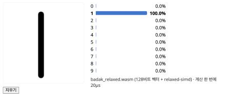
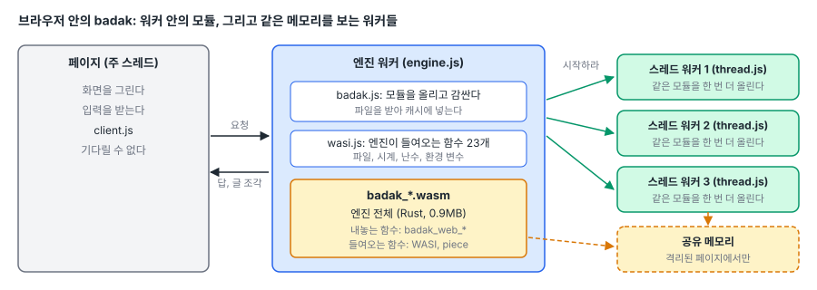
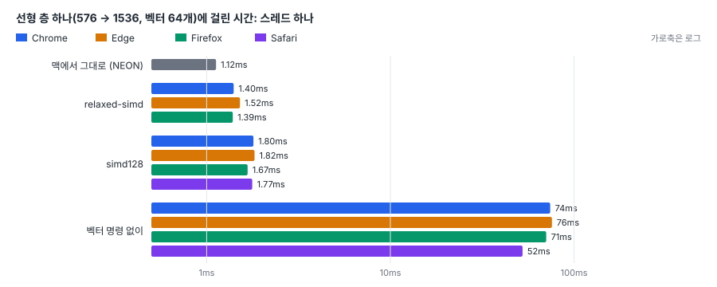
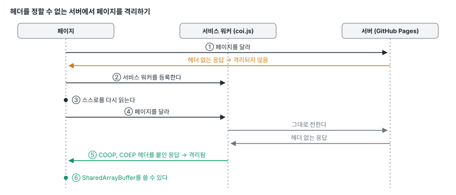
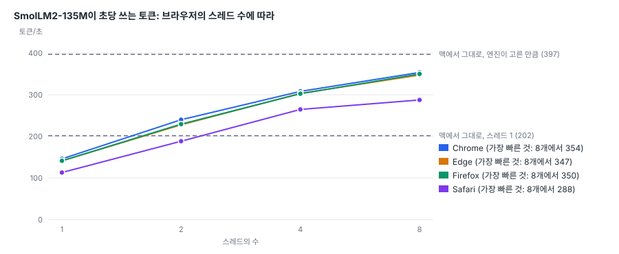

# badak을 브라우저로 옮기기

[44장](ch44_on_the_phone.md)에서 엔진을 폰으로 옮겼습니다. 앱을 만들고, 서명하고, 설치했습니다.
이 장에서는 설치가 없는 곳으로 옮깁니다. 웹 페이지입니다. 주소를 열면
엔진이 내려오고, 그 자리에서 돕니다.

브라우저는 지금까지의 어떤 기기와도 다릅니다. 폰에서는 운영체제가 엔진의
편이었습니다. 파일을 열어 주고, 스레드를 만들어 주고, 메모리를 비춰
줬습니다. 브라우저는 페이지를 **믿지 않습니다.** 누가 만들었는지 모르는
코드를 사용자의 기계에서 돌리는 것이 브라우저의 일이기 때문입니다. 그래서
페이지의 코드는 파일을 열 수 없고, 스레드를 마음대로 만들 수 없고, 시계조차
정확히 읽을 수 없습니다. 이 장의 절반은 그 울타리를 하나씩 만나는
이야기입니다.

이 장은 다섯 가지를 합니다.

- 엔진을 **WebAssembly 모듈**로 빌드합니다. 엔진의 코드는 거의 고치지
  않습니다. 엔진이 운영체제에 부탁하던 일을 JavaScript로 대신 해 줍니다.
- **브라우저용 벡터 명령**으로 커널을 하나 더 짭니다. 그리고 이 책이
  [17장](../part3/ch17_simd.md)부터 지켜 온 약속, "어느 기계에서나 같은 비트"가 브라우저에서도
  지켜지는지 봅니다.
- **스레드**를 씁니다. 브라우저가 스레드를 허락하는 조건을 이 책의 서버
  (GitHub Pages)는 채워 주지 못합니다. 돌아가는 길을 만듭니다.
- **메모리의 한도**를 잽니다.
- 모델을 **내려받고, 브라우저에 넣어 두고, 다시 꺼냅니다.**

그리고 이 페이지 안에서 직접 돌려 봅니다. 아래의 판에 숫자를 하나 그려
보십시오. [7장](../part1/ch07_mnist.md)의 그 신경망이 이 브라우저 안에서 돕니다. 그린 그림은
어디로도 가지 않습니다.

<div id="badak-mnist"></div>
<script type="module" src="../demos/ch48/mnist_demo.js"></script>

판 아래에는 올라간 빌드의 이름과 계산 한 번에 걸린 시간이 나옵니다. 판이
보이지 않거나(인쇄한 책) 엔진이 올라가지 않았다면, 1을 그렸을 때의 모습은
이렇습니다.



언어 모델과 이야기해 보려면 [데모 페이지](../demos/ch48/index.html)를 여십시오.
SmolLM2-135M(269MB)을 받아 이 브라우저 안에서 돌립니다.

먼저 밝혀 둡니다. 숫자는 모두 **저자의 맥 한 대**(M4 Max)에서, 브라우저
넷으로 잰 것입니다. Chrome 157, Edge 153, Firefox 159, Safari 27.0.1입니다.
폰의 브라우저에서는 재지 않았습니다. 브라우저는 몇 주마다 새 판이 나오고,
이 장의 "되는 것과 안 되는 것"은 그때마다 달라질 수 있습니다. 표의 값은
2026년 11월의 것입니다.

결과를 미리 적어 둡니다.

- 엔진 전체가 **0.9MB짜리 모듈 하나**가 됩니다. 눌러서 0.3MB입니다.
  엔진의 코드는 고치지 않았습니다.
- 벡터 명령을 쓰지 않으면 맥에서 그대로 돌릴 때보다 **66배** 느립니다.
  브라우저용 벡터 명령으로 커널을 짜면 **1.25배**까지 좁혀집니다.
- 그 빠른 빌드가 이 맥에서는 기준 구현과 **같은 비트**를 냈습니다. 다만
  명세가 그것을 약속하지 않습니다. 약속할 수 있는 것은 느린 빌드뿐입니다.
- 스레드는 "격리된" 페이지에서만 됩니다. GitHub Pages에서는 서비스 워커로
  돌아가는 길을 만들었고, **브라우저 넷에서 모두** 되었습니다.
- SmolLM2-135M은 Chrome에서 스레드 여덟으로 **초당 354토큰**을 씁니다.
  맥에서 그대로 돌리면 397토큰입니다. 브라우저 안에서 89%가 나옵니다.
- 스레드가 일을 기다리는 방법 하나로 그 숫자가 354에서 144로 떨어집니다.
- 모듈의 메모리는 4GB까지이고(스레드를 쓰는 빌드는 1GB), **줄지 않습니다.**
  한 덩어리는 2GB까지여서, 이 엔진은 2GB가 넘는 가중치 파일을 열지
  못합니다.
- 269MB짜리 모델을 받는 데 저자의 회선에서 25초, 브라우저에 넣어 둔 것을
  다시 꺼내는 데 0.2초가 걸렸습니다.

## 48.1 브라우저라는 기계

브라우저에서 코드를 돌리는 방법은 둘입니다. JavaScript와 WebAssembly입니다.

**WebAssembly**는 브라우저가 실행하는 기계어입니다. 진짜 프로세서의
기계어가 아니라 가상의 것이고, 브라우저가 읽어서 그 기계의 진짜 기계어로
번역합니다. Rust 컴파일러는 ARM이나 x86의 기계어를 내놓듯 WebAssembly를
내놓을 수 있습니다. 그렇게 만든 파일(`.wasm`)을 **모듈**이라고 부릅니다.

모듈이 가진 것은 셋뿐입니다.

- **메모리 하나.** 0번 바이트에서 시작하는 긴 바이트 배열입니다. 모듈의
  포인터는 이 배열의 위치입니다. 배열 밖은 볼 수 없습니다.
- **내놓는 함수들.** JavaScript가 부를 수 있습니다.
- **들여오는 함수들.** 모듈이 부를 수 있는 바깥의 함수입니다. 모듈을
  만들 때 JavaScript가 건네줍니다. 건네받지 않은 것은 부를 수 없습니다.

셋째가 울타리입니다. 모듈은 스스로는 아무것도 하지 못합니다. 화면에 글
한 줄을 적으려 해도, 지금 몇 시인지 알려 해도, 들여온 함수를 불러야
합니다. 운영체제의 시스템 콜이 있던 자리에 "JavaScript가 건네준 함수"가
있는 셈입니다.

엔진을 여기로 옮기면 무엇이 달라지는지 [44장](ch44_on_the_phone.md)의 폰과 견줘 봅니다.

| | 폰 ([44장](ch44_on_the_phone.md)) | 브라우저 |
|---|---|---|
| 엔진의 꼴 | 정적·동적 라이브러리 | `.wasm` 모듈 |
| 부르는 쪽 | Swift, Java | JavaScript |
| 주소 공간 | 64비트 | 32비트 (메모리 4GB까지) |
| 파일 | 운영체제가 연다. 비출 수 있다(`mmap`) | 없다. 받은 바이트를 메모리에 둔다 |
| 스레드 | 운영체제가 만든다 | 워커를 스레드처럼 쓴다. 조건이 붙는다 |
| 프로세서의 기능 | 실행 중에 묻는다 | 물을 수 없다. 빌드를 여러 벌 둔다 |
| 벡터 명령 | NEON (곱하고 더하기를 한 번에) | 128비트. 곱하고 더하기를 한 번에 하는 명령이 표준에 없었다 |
| 모델 | 앱에 싣거나 받아서 파일로 둔다 | 받아서 브라우저의 저장소에 둔다 |
| 설치 | 있다 | 없다 |

표의 줄 하나하나가 이 장의 절 하나씩입니다.



그림은 이 장에서 만들 것 전체입니다. 엔진은 페이지가 아니라 **워커** 안에서
돕니다. 워커는 페이지와 따로 도는 JavaScript의 실행 단위입니다. 엔진을
워커에 두는 까닭은 둘입니다. 페이지의 스레드(주 스레드)는 화면도 그리므로,
거기에서 계산하면 계산이 끝날 때까지 화면이 멈춥니다. 그리고 주 스레드는
"잠들어 기다리기"가 금지되어 있습니다.[^atomics-wait] 엔진의 스레드 풀은
일을 맡기고 끝나기를 기다리는데([18장](../part3/ch18_multithreading.md)), 주 스레드에서는 그것을 할 수
없습니다.

## 48.2 WebAssembly로 빌드하기

Rust에는 WebAssembly 타깃이 여럿 있습니다. 이 책은 `wasm32-wasip1`을
골랐습니다.[^wasip1-target]

```sh
rustup target add wasm32-wasip1
cargo build --release -p badak_web --target wasm32-wasip1
```

이름의 뒷부분 **WASI**(WebAssembly System Interface)는 "모듈이 바깥에
부탁할 수 있는 일"을 정해 둔 목록입니다. 파일을 열어 달라, 시각을 알려
달라 같은 것입니다. 이 타깃으로 빌드하면 Rust의 표준 라이브러리가 그
목록의 함수들을 들여와서 씁니다. `std::fs::read`는 `path_open`과
`fd_read`를 부르고, `Instant::now`는 `clock_time_get`을 부릅니다.

이 타깃을 고른 까닭은 **엔진을 고치지 않아도 되기 때문**입니다. 엔진은
표준 라이브러리만 씁니다(이 책의 규칙입니다). 표준 라이브러리가 통째로
되는 타깃이면 엔진도 통째로 됩니다. 다른 타깃(`wasm32-unknown-unknown`)은
"바깥이 무엇인지 모른다"는 타깃이어서, 파일을 열려고 하면 실행 중에
오류가 납니다. 그 타깃에서는 보통 `wasm-bindgen`이라는 도구로
JavaScript와 잇는 코드를 만들어 냅니다. 이 책은 그 코드를 손으로 씁니다.
무엇이 오가는지 다 보려는 것입니다.

WASI는 원래 브라우저 밖에서 WebAssembly를 돌리려고 만든 것입니다. 그래서
브라우저에는 WASI의 함수들이 없습니다. **우리가 만들어 건네줘야 합니다.**
다음 절의 일입니다.

### 엔진에서 고친 것

`cargo build`를 처음 돌렸을 때 엔진은 고치지 않고도 빌드되었습니다.
경고만 둘 나왔습니다. 유닉스에서만 쓰는 이름을 들여온 곳이었습니다.

고칠 것이 없었던 까닭은 [22장](../part3/ch22_memory.md)과 [44장](ch44_on_the_phone.md)에서 이미 길을 나눠 뒀기
때문입니다. 파일을 메모리에 비추는 코드(`mmap`)는 유닉스에서만 컴파일되고,
다른 곳에서는 파일을 통째로 읽습니다. 벡터 커널은 프로세서마다 따로 있고,
모르는 프로세서에서는 기준 구현을 씁니다. WebAssembly는 "유닉스가 아니고,
모르는 프로세서"입니다. 그래서 가장 느리지만 반드시 되는 길로
빌드되었습니다. 빠르게 하는 일(48.4절)이 남았을 뿐입니다.

### 문

엔진을 JavaScript가 부르게 해 주는 크레이트가 `badak_web`입니다. [44장](ch44_on_the_phone.md)의
`badak_ffi`가 Swift와 Java에게 하던 일을 합니다. 함수는 열다섯 개입니다.

| 함수 | 하는 일 |
|---|---|
| `badak_web_alloc`, `badak_web_free` | 모듈의 메모리에서 자리를 얻고 돌려준다 |
| `badak_web_error` | 마지막 오류의 설명 |
| `badak_web_backend`, `badak_web_threads` | 어떤 커널로 빌드되었는지, 스레드를 몇 개 쓸지 |
| `badak_web_bench_linear` | 선형 층 하나를 재고 결과의 지문을 낸다 (측정용) |
| `badak_web_graph_open`, `_input`, `_input_len`, `_run`, `_output`, `_output_len` | `.tflite` 모델 ([26장](../part4/ch26_graph_interpreter.md)의 해석기) |
| `badak_web_llm_open`, `_chat`, `_close` | 언어 모델 ([47장](ch47_on_device_llm.md)의 `Llm`) |

폰의 문과 다른 점이 둘 있습니다.

**첫째, 글을 건네는 방법입니다.** C에는 포인터가 있어서 Swift의 글을
가리키는 포인터를 그대로 넘겼습니다. JavaScript의 글은 모듈의 메모리 밖에
있고, 모듈은 자기 메모리 밖을 볼 수 없습니다. 그래서 순서가 뒤집힙니다.
JavaScript가 모듈에게 자리를 달라고 하고, 그 자리에 글의 바이트를 써
넣고, 그 위치를 넘깁니다.

```rust
{{#include ../../../crates/badak_web/src/lib.rs:alloc}}
```

```js
{{#include ../../../crates/badak_web/js/badak.js:strings}}
```

JavaScript 쪽에서 모듈의 메모리는 `memory.buffer`라는 바이트 배열로
보입니다. 포인터는 숫자일 뿐입니다. 그 숫자를 배열의 위치로 써서 읽고
씁니다.

거꾸로, 모델의 입력과 출력처럼 큰 배열은 복사하지 않습니다. 모듈의 메모리
가운데 그 부분을 `Float32Array`로 **들여다봅니다.**

```js
{{#include ../../../crates/badak_web/js/badak.js:graph}}
```

주석에 적은 함정이 하나 있습니다. 모듈의 메모리는 자랄 수 있고, 자라면
브라우저는 배열을 새것으로 바꿉니다. 예전에 만들어 둔 `Float32Array`는
길이가 0인 빈 배열이 됩니다. 그래서 들여다보는 배열은 쓸 때마다 새로
만듭니다.

**둘째, 거꾸로 부르기입니다.** [47장](ch47_on_device_llm.md)에서 엔진은 토큰이 나올 때마다 앱의
함수를 불렀고, 그 함수의 포인터를 인자로 받았습니다. WebAssembly에서는
함수를 "들여오기"로 받습니다.

```rust
{{#include ../../../crates/badak_web/src/lib.rs:imports}}
```

`#[link(wasm_import_module = "badak")]`는 "이 함수는 `badak`이라는 이름의
묶음에서 들여온다"는 뜻입니다. 모듈을 만드는 JavaScript가 그 이름으로
함수를 건넵니다. 맥에서 같은 코드를 돌릴 때는 들여올 곳이 없으므로
조각을 모아 두는 함수가 그 자리를 채웁니다. 덕분에 이 문의 함수들을
맥에서도 그대로 부를 수 있고, 브라우저의 답을 맥의 답과 견줄 수 있습니다.

```rust
{{#include ../../../crates/badak_web/src/lib.rs:chat}}
```

### 크기

빌드한 모듈의 크기입니다. 엔진 전체가 들어 있습니다. 텐서와 커널,
`.tflite`와 safetensors를 읽는 코드, 그래프 해석기, 토크나이저, 언어
모델입니다.

| 빌드 | 커널 | 스레드 | 크기 | gzip으로 누르면 |
|---|---|---|---:|---:|
| `badak_scalar.wasm` | 기준 구현 | 없음 | 888KB | 312KB |
| `badak_simd.wasm` | 128비트 벡터 | 없음 | 957KB | 339KB |
| `badak_relaxed.wasm` | 128비트 벡터 + relaxed-simd | 없음 | 963KB | 340KB |
| `badak_scalar_threads.wasm` | 기준 구현 | 있음 | 893KB | 315KB |
| `badak_simd_threads.wasm` | 128비트 벡터 | 있음 | 962KB | 341KB |
| `badak_relaxed_threads.wasm` | 128비트 벡터 + relaxed-simd | 있음 | 968KB | 342KB |

(왜 여섯 벌인지는 48.4절과 48.5절에서 봅니다.)

1MB가 안 됩니다. 브라우저는 파일을 눌러서 받으므로(gzip) 실제로 오가는
것은 0.3MB 남짓입니다. [44장](ch44_on_the_phone.md)에서 Android용 라이브러리가 1.0MB였던 것과
비슷합니다. 엔진에 바깥 라이브러리가 없다는 것이 여기에서도 값을 합니다.
50장에서 다른 엔진들의 크기와 견줍니다.

## 48.3 운영체제의 자리를 채우기

모듈을 열어 무엇을 들여오는지 세어 보면 스물세 개입니다.[^wasi-preview1]

| 묶음 | 함수 | 엔진이 쓰는 곳 |
|---|---|---|
| 파일 | `path_open`, `fd_read`, `fd_seek`, `fd_close`, `fd_filestat_get`, `path_filestat_get`, `fd_fdstat_get`, `fd_prestat_get`, `fd_prestat_dir_name`, `fd_readdir` | 모델 파일 읽기 |
| 쓰기 | `fd_write`, `fd_sync`, `path_create_directory`, `path_remove_directory`, `path_rename`, `path_unlink_file` | 표준 출력. 나머지는 [44장](ch44_on_the_phone.md)의 모델 저장소가 쓴다 |
| 시계 | `clock_time_get` | 시간 재기, 스레드가 기다릴 시간 |
| 난수 | `random_get` | 표준 라이브러리의 해시 표 |
| 환경 | `environ_get`, `environ_sizes_get` | `BADAK_THREADS` 같은 환경 변수 |
| 그 밖 | `sched_yield`, `proc_exit` | 스레드의 양보, 끝내기 |
| 책의 것 | `badak.piece` | 토큰 흘려보내기 |

이것들을 JavaScript로 만든 파일이 `wasi.js`입니다. 300줄이 안 됩니다.

**파일**은 메모리 안에만 있습니다. 길(`"smollm2_135m/config.json"`)에서
바이트 배열로 가는 표 하나가 파일 시스템의 전부입니다. 엔진이 파일을
열면 번호를 하나 주고, 읽으면 그 배열에서 모듈의 메모리로 복사합니다.

```js
{{#include ../../../crates/badak_web/js/wasi.js:files}}
```

`fd_read`의 인자들은 모두 숫자입니다. `vectors`는 모듈의 메모리 안의
위치이고, 거기에 "받을 자리의 주소와 길이"가 `count`쌍 적혀 있습니다.
결과도 돌려주는 것이 아니라 `result`가 가리키는 자리에 써 줍니다.
운영체제의 시스템 콜이 하는 일을 그대로 흉내 내는 것입니다.

쓰는 쪽은 표준 출력만 받습니다. 줄이 끝날 때마다 `console.log`로 보냅니다.
파일을 만들거나 고치려 하면 "읽기만 되는 파일 시스템"이라는 오류를
돌려줍니다. 그래서 [44장](ch44_on_the_phone.md)의 모델 저장소(`Store`)는 브라우저에서 쓰지
못합니다. 받은 모델을 넣어 두는 일은 브라우저의 저장소로 따로 합니다
(48.7절).

**시계**는 브라우저의 시계를 그대로 전합니다.

```js
{{#include ../../../crates/badak_web/js/wasi.js:clock}}
```

이 한 줄 뒤에 브라우저의 울타리가 하나 숨어 있습니다. `performance.now()`는
일부러 **무디게** 만들어져 있습니다. 48.5절에서 다시 만납니다.

### 올리기

모듈을 올리는 순서는 이렇습니다.

1. `.wasm` 파일의 바이트를 받아 컴파일한다 (`WebAssembly.compile`).
2. 들여올 함수들을 건네며 모듈의 실체를 만든다 (`WebAssembly.instantiate`).
3. 모듈의 메모리를 `wasi.js`에 알려 준다.
4. 모듈의 `_initialize`를 부른다. Rust의 전역 초기화가 여기에서 돈다.

그다음부터는 내놓은 함수를 부르면 됩니다. Chrome에서 1~4에 걸리는 시간은
5ms 안쪽이었습니다(파일은 같은 기계에서 받았습니다). 브라우저는 모듈을
받으면서 번역하고, 번역한 것을 넣어 두기도 합니다.

같은 `badak.js`와 `wasi.js`는 Node에서도 돕니다. Node는 브라우저 밖에서
JavaScript와 WebAssembly를 돌리는 프로그램입니다(Chrome과 같은 엔진 V8을
씁니다). 그래서 브라우저를 띄우지 않고도 답을 확인할 수 있습니다.

```sh
sh scripts/build_web.sh
node crates/badak_web/js/run_node.mjs target/web/badak_scalar.wasm 1 llm
```

```text
backend 기준 구현
linear 13x203x9 지문 7c9cf3b9bac345e0 시간 29.8
linear 1536x576x1 지문 1ffd18b2e34ebd4b 시간 1146.4
linear 1536x576x64 지문 d2e6b212b8fce947 시간 74376.2
mnist 답 7 비트 3369265d 3115f113 37ae6191 38813adb 2db0cef4 32714e01 2c201950 3f7ff9e6 34f3ecf3 3729298e
llm 7 546865206361706974616c206f66204672616e63652069732050617269732e
llm-time 6070ms 메모리 281MB
```

`ch48_native`는 같은 문의 함수들을 맥에서 그대로 부릅니다.

```text
$ BADAK_THREADS=1 cargo run --release -p badak_web --example ch48_native -- llm
backend Neon
linear 13x203x9 지문 7c9cf3b9bac345e0 시간 0.8
linear 1536x576x1 지문 1ffd18b2e34ebd4b 시간 32.5
linear 1536x576x64 지문 d2e6b212b8fce947 시간 1124.5
mnist-time 4.2
mnist 답 7 비트 3369265d 3115f113 37ae6191 38813adb 2db0cef4 32714e01 2c201950 3f7ff9e6 34f3ecf3 3729298e
llm-chat native weights 0 short tokens 7 first-ms 134 total-ms 168 per-s 174.2 text 546865206361706974616c206f66204672616e63652069732050617269732e
llm-chat native weights 0 long tokens 96 first-ms 147 total-ms 618 per-s 201.7 text 421bytes
```

지문이 같습니다. 지문은 [17장](../part3/ch17_simd.md)에서 쓴 것으로, 결과 배열 전체를 숫자
하나로 줄인 것입니다. 지문이 같으면 **모든 비트가 같습니다.** 숫자 그림의
점수 열 개도 비트까지 같고, 언어 모델이 쓴 글(`llm` 줄의 16진수, "The
capital of France is Paris.")도 같습니다. CI가 이 둘을 견줍니다
(`scripts/check_web.sh`).

엔진은 브라우저에서 돕니다. 다만 느립니다. 언어 모델이 일곱 토큰을 쓰는
데 6초가 걸렸습니다. 맥에서 그대로 돌리면 스레드 하나로 0.17초입니다.

## 48.4 브라우저용 벡터 명령

느린 까닭은 둘입니다. 벡터 명령을 쓰지 않았고, 그나마의 계산도 돌아서
갑니다.

둘째부터 봅니다. 기준 구현은 내적을 `mul_add`로 계산합니다. "곱하고
더하기를 한 번에, 반올림도 한 번만" 하는 연산입니다([17장](../part3/ch17_simd.md)). ARM과 x86에는
그 명령이 있습니다. WebAssembly에는 없습니다. 그래서 컴파일러는 그
자리에 **소프트웨어로 같은 답을 계산하는 함수**를 부르는 코드를 넣습니다.

```rust
pub fn f(a: f32, b: f32, c: f32) -> f32 { a.mul_add(b, c) }
```

```text
f:
	local.get	0
	local.get	1
	local.get	2
	call	fmaf
```

`fmaf`는 정수 연산 여러 개로 "한 번만 반올림한 답"을 만들어 내는
함수입니다. 답은 정확히 같습니다. 그래서 지문이 같았습니다. 값은 곱셈
하나에 함수 호출 하나입니다.

### 128비트 벡터

WebAssembly의 벡터 명령은 `simd128`이라는 이름으로 묶여 있습니다.[^simd]
레지스터의 폭은 128비트, `f32` 넷입니다. NEON과 같은 폭이어서 커널의
생김새도 [17장](../part3/ch17_simd.md)의 NEON 커널과 같습니다. 레지스터에 값을 싣는 법과 곱하고
더하는 법만 바꿔 끼웠습니다.

```rust
{{#include ../../../crates/badak_core/src/simd/wasm.rs:madd}}
```

`#[cfg(not(...))]` 쪽이 `simd128`만 쓰는 빌드입니다. 곱하고(`f32x4_mul`)
더합니다(`f32x4_add`). **두 번 반올림합니다.** 기준 구현과 끝자리가
달라집니다.

위쪽은 `relaxed-simd`라는 묶음의 명령입니다.[^relaxed] 이 묶음은 "기계마다
답이 조금 달라도 좋으니 그 기계에서 가장 빠른 명령을 쓰라"는 명령들을
모은 것입니다. `f32x4_relaxed_madd`는 `a × b + c`를 계산하되, 한 번에
계산해서 한 번 반올림할지 따로 계산해서 두 번 반올림할지를 **브라우저와
프로세서가 정합니다.** 명세가 둘 다 허락합니다.

빌드할 때 어떤 명령을 쓸지 정합니다.

```sh
RUSTFLAGS="-C target-feature=+simd128" cargo build ...
RUSTFLAGS="-C target-feature=+simd128,+relaxed-simd" cargo build ...
```

### 물을 수 없으면

[17장](../part3/ch17_simd.md)에서 엔진은 실행 중에 프로세서에게 "AVX2가 있습니까" 하고 물었습니다.
WebAssembly에는 묻는 명령이 없습니다. 더 곤란한 것은, 브라우저가 모르는
명령이 **하나라도** 든 모듈은 올리는 단계에서 통째로 거절된다는 것입니다.
그 명령을 실행하지 않더라도 그렇습니다. 모듈 하나에 길 셋을 다 넣어 두고
골라 쓰는 방법이 통하지 않습니다.

그래서 **빌드를 여러 벌** 만듭니다. `scripts/build_web.sh`가 커널 셋
(`scalar`, `simd`, `relaxed`)을 스레드가 있는 것과 없는 것으로 따로 빌드해
여섯 벌을 냅니다. 고르는 일은 JavaScript가 합니다. 묻는 방법은 이렇습니다.
그 명령 하나만 든 아주 작은 모듈을 만들어, 브라우저에게 "이것이 올바른
모듈입니까" 하고 묻습니다.[^feature-detect]

```js
{{#include ../../../crates/badak_web/js/features.js:detect}}
```

`SIMD`는 43바이트, `RELAXED`는 82바이트짜리 모듈입니다. 함수 하나가 들어
있고, 그 함수는 벡터 상수를 하나 만들어 버리거나(`SIMD`) 셋을 만들어
`relaxed_madd`를 한 번 합니다(`RELAXED`).

브라우저 넷의 답입니다.

| | Chrome 157 | Edge 153 | Firefox 159 | Safari 27.0.1 |
|---|---|---|---|---|
| `simd128` | 됨 | 됨 | 됨 | 됨 |
| `relaxed-simd` | 됨 | 됨 | 됨 | **안 됨** |
| 고른 커널 | `relaxed` | `relaxed` | `relaxed` | `simd` |
| 브라우저가 알려 준 코어의 수 | 16 | 16 | 16 | 8 |

마지막 줄은 `navigator.hardwareConcurrency`의 값입니다. 이 맥의 코어는
16개인데 Safari는 8이라고 답합니다. 코어의 수로 사용자를 알아보는 것을
막으려고 8에서 자릅니다.[^webkit-cores]

Safari만 `relaxed-simd`를 모릅니다. Safari에서는 `simd` 빌드가 올라갑니다.

### 잰 것

선형 층 하나(576 → 1536, 벡터 64개)를 스레드 하나로 계산한 시간입니다.
135M 모델의 MLP가 프롬프트 64토큰을 읽을 때 하는 일입니다.



| 빌드 | Chrome | Edge | Firefox | Safari |
|---|---:|---:|---:|---:|
| `scalar` | 74.1ms | 75.7ms | 70.5ms | 52.4ms |
| `simd` | 1.80ms | 1.82ms | 1.67ms | 1.77ms |
| `relaxed` | 1.40ms | 1.52ms | 1.39ms | — |
| 맥에서 그대로 (NEON, 스레드 하나) | 1.12ms | | | |

- **벡터 명령이 41배를 줍니다.** `scalar`와 `simd`의 차이입니다.
  네 값을 한 번에 계산해서 4배, `fmaf`를 부르지 않아서 나머지입니다.
- **`relaxed-simd`가 시간을 20%쯤 더 줄입니다.** 명령 둘이 하나로
  줄어든 값입니다.
- **가장 빠른 빌드도 맥에서 그대로 돌릴 때보다 1.25배 걸립니다.** 같은
  프로세서, 같은 폭의 레지스터, 같은 생김새의 커널인데 그렇습니다.
  브라우저의 번역기는 페이지를 여는 동안 빠르게 번역해야 하고, 메모리를
  읽을 때마다 "배열 안인가"를 지켜야 합니다. 어디에서 얼마가 드는지는 이
  책에서 나눠 재지 않았습니다.
- 브라우저 넷의 차이는 커널의 차이보다 작습니다.

작은 모델에서는 차이가 더 작습니다. 숫자 그림 하나를 알아맞히는 데
걸리는 시간입니다.

| 빌드 | Chrome | Edge | Firefox | Safari |
|---|---:|---:|---:|---:|
| `scalar` | 158µs | 149µs | 123µs | 112µs |
| `simd` | 6.0µs | 6.4µs | 7.3µs | 5.5µs |
| `relaxed` | 5.4µs | 5.6µs | 7.1µs | — |
| 맥에서 그대로 | 4.2µs | | | |

빠른 빌드로는 맥에서 그대로 돌릴 때의 1.3배에서 1.7배입니다. 이 장의
맨 위에 있는 판이 보여 주는 시간은 이보다 조금 깁니다. 그림을 입력으로
써 넣는 시간이 들어가고, 격리되지 않은 페이지의 무딘 시계로 재기
때문입니다.

### 같은 비트를 낼 수 있는가

지문을 봅니다.

| | 선형 층의 지문 | 숫자 그림의 첫 점수 (비트) | 답 |
|---|---|---|---|
| 맥에서 그대로 (NEON) | `d2e6b212b8fce947` | `3369265d` | 7 |
| `scalar` (브라우저 넷, Node) | `d2e6b212b8fce947` | `3369265d` | 7 |
| `simd` (브라우저 넷, Node) | `be74c73fadf32b28` | `33692640` | 7 |
| `relaxed` (Chrome, Edge, Firefox, Node) | `d2e6b212b8fce947` | `3369265d` | 7 |

- `scalar`는 어디에서나 기준 구현과 같습니다. 약속할 수 있습니다. 느립니다.
- `simd`는 다릅니다. 숫자 그림의 점수로 보면 `0x3369265d`가 `0x33692640`이
  되는 정도, 2진수 끝의 다섯 자리쯤이 달라집니다. 고른 답은 같습니다.
- `relaxed`는 **이 맥에서는** 기준 구현과 같았습니다. Chrome, Edge,
  Firefox, Node에서 모두 그랬습니다. 이 맥의 프로세서에 "곱하고 더하기를
  한 번에" 하는 명령이 있고, 세 브라우저가 `relaxed_madd`를 그 명령으로
  번역했다는 뜻입니다. 약속은 아닙니다. 명세는 두 번 반올림하는 것도
  허락하고, 그런 명령이 없는 프로세서에서는 그렇게 될 수밖에 없습니다.

끝자리가 다르면 무슨 일이 생기는지도 측정에 잡혔습니다. 언어 모델에게
긴 글을 쓰게 했을 때, 16비트 가중치로는 `simd` 빌드와 `relaxed` 빌드가
같은 글(421바이트)을 썼습니다. 4비트로 줄인 가중치(`Q4_0`)로는
달랐습니다. Safari의 `simd` 빌드는 371바이트를, 다른 브라우저의 `relaxed`
빌드는 402바이트를 썼습니다. 어느 토큰에서 1등과 2등의 점수가 아주
가까웠고, 끝자리의 차이가 순위를 뒤집었고, 그 뒤로는 다른 글이 된
것입니다. 틀린 것이 아닙니다. 둘 다 그 모델이 쓸 법한 글입니다. 다만
"같은 입력에 같은 출력"을 사용자의 브라우저에 따라 약속할 수 없게 됩니다.

정리하면 이렇습니다. 이 책의 엔진은 맥의 NEON과 서버의 AVX2에서 같은
비트를 냅니다([17장](../part3/ch17_simd.md)). 브라우저에서는 **느린 빌드로만** 그 약속을 지킬 수
있습니다. 빠른 빌드는 "대부분의 기계에서 같고, 다를 수 있다"입니다. 이
장의 데모는 빠른 쪽을 고릅니다. 테스트(`check_web.sh`)는 `scalar`에는
같은 비트를, 나머지에는 같은 답을 요구합니다.

## 48.5 스레드

브라우저에는 스레드를 만드는 함수가 없습니다. **워커**가 있습니다. 워커는
저마다 자기 메모리를 가진 따로 떨어진 세계이고, 서로 메시지만 주고받습니다.
메모리를 나눠 쓰지 않으니 스레드라고 하기 어렵습니다.

WebAssembly의 메모리를 **공유**로 만들면 달라집니다.[^threads] 공유
메모리는 여러 워커에게 건넬 수 있고, 건네받은 워커들은 같은 바이트를
봅니다. 워커마다 같은 모듈을 그 메모리 위에 올리면, 워커들이 한 프로그램의
스레드처럼 됩니다.

Rust에는 이 방식으로 `std::thread`가 되는 타깃이 있습니다.
`wasm32-wasip1-threads`입니다.[^wasip1-threads]

```sh
rustup target add wasm32-wasip1-threads
cargo build --release -p badak_web --target wasm32-wasip1-threads
```

이 타깃으로 빌드한 모듈은 앞의 것과 세 가지가 다릅니다.

- 메모리를 스스로 만들지 않고 **들여옵니다.** 공유 메모리를 JavaScript가
  만들어 건넵니다.
- 함수 하나를 더 들여옵니다. `wasi.thread-spawn`입니다. Rust의
  `std::thread::spawn`이 이것을 부릅니다.
- 함수 하나를 더 내놓습니다. `wasi_thread_start`입니다. 새 스레드가
  실행할 진입점입니다.

약속은 이렇습니다.[^wasi-threads] 모듈이 `thread-spawn(인자)`를 부르면,
바깥은 같은 모듈을 같은 메모리 위에 **한 번 더** 올리고, 새 실체의
`wasi_thread_start(번호, 인자)`를 다른 스레드에서 부릅니다. "다른
스레드"가 브라우저에서는 워커입니다.

```js
{{#include ../../../crates/badak_web/js/badak.js:threads}}
```

워커 쪽은 서른 줄 남짓입니다(`thread.js`). 모듈과 메모리를 받아 실체를
만들고, 기다리다가, 시작하라는 말이 오면 `wasi_thread_start`를 부릅니다.

### 워커를 미리 만든다

위의 코드에서 눈여겨볼 곳은 워커를 **미리** 만들어 둔다는 것입니다.

`new Worker(...)`는 바로 돌아오지만 워커는 그때 아직 없습니다. 브라우저가
스크립트를 받고, 읽고, 실행해야 합니다. 그 일은 워커를 만든 쪽이 하던
일을 마치고 **손을 놓아야** 진행됩니다. 그런데 엔진이 스레드를 달라고
하는 것은 계산의 한가운데이고, 엔진은 스레드를 받자마자 그 스레드에게
일을 주고 끝나기를 기다립니다. 손을 놓지 않습니다. 워커는 영영 시작하지
못하고 엔진은 영영 기다립니다.

그래서 엔진을 올릴 때 쓸 만큼의 워커를 만들어 "준비됐다"는 답까지 받아
둡니다. 엔진이 스레드를 달라고 하면 쉬고 있는 워커에게 메시지 하나를
보내는 것으로 끝납니다. 스레드 풀을 쓰는 다른 WebAssembly 도구들도 같은
방법을 씁니다.[^emscripten-pool] 이 엔진은 스레드를 처음에 한 번만 만들고
계속 쓰므로([18장](../part3/ch18_multithreading.md)) 풀의 크기를 미리 아는 데 어려움이 없습니다.

### 격리된 페이지에서만

여기까지 만들고 페이지를 열면 이런 오류가 납니다.

```text
이 페이지에서는 공유 메모리를 쓸 수 없습니다. 교차 출처 격리가 필요합니다.
```

(`badak.js`가 적는 글입니다. 격리되지 않은 페이지에는 `SharedArrayBuffer`라는
이름 자체가 없습니다.)

브라우저는 공유 메모리를 **교차 출처 격리**(cross-origin isolation)된
페이지에만 줍니다.[^sab] 까닭은 2018년에 알려진 스펙터(Spectre)라는
공격입니다. 이 공격은 프로세서의 빈틈을 써서 같은 프로세스 안의 남의
메모리를 읽어 내는데, 그러려면 **아주 정밀한 시계**가 필요합니다. 공유
메모리가 있으면 시계를 만들 수 있습니다. 워커 하나가 공유 메모리의 숫자
하나를 쉬지 않고 올리면, 다른 워커는 그 숫자를 읽어 시간을 잽니다.
그래서 브라우저들은 공유 메모리를 한때 아예 껐고, 지금은 "이 페이지의
프로세스에는 남의 것이 들어 있지 않다"고 확인된 페이지에만
줍니다.[^coop-coep]

그 확인이 격리입니다. 서버가 페이지를 내줄 때 헤더 둘을 붙여서 알립니다.

```text
Cross-Origin-Opener-Policy: same-origin
Cross-Origin-Embedder-Policy: require-corp
```

앞의 것은 "이 페이지는 다른 출처의 창과 엮이지 않겠다"는 뜻이고, 뒤의
것은 "이 페이지는 허락을 밝힌 것만 다른 출처에서 가져오겠다"는 뜻입니다.
둘 다 있으면 브라우저는 `crossOriginIsolated`를 참으로 하고 공유 메모리를
줍니다.

**무딘 시계**도 같은 까닭에서 나옵니다. 브라우저는 `performance.now()`의
눈금을 일부러 굵게 합니다.[^timer] 재 봤습니다. 시계를 쉬지 않고 읽어서,
값이 바뀔 때 얼마씩 바뀌는지를 봤습니다.

| | Chrome | Edge | Firefox | Safari |
|---|---:|---:|---:|---:|
| 격리되지 않은 페이지 | 100µs | 100µs | 1,000µs | 1,000µs |
| 격리된 페이지 | 5µs | 5µs | 20µs | 20µs |

격리된 페이지는 더 가는 눈금을 받습니다. 격리되었으니 정밀한 시계를 줘도
훔쳐볼 남의 것이 없다는 논리입니다. 이것이 이 장의 측정에 영향을 줍니다.
숫자 그림 하나는 5µs에 끝나는데 눈금이 그보다 굵습니다. 그래서 측정
함수는 한 번을 재지 않고 여러 번을 통째로 재서 나눕니다.

```rust
{{#include ../../../crates/badak_web/src/lib.rs:bench}}
```

### 헤더를 정할 수 없는 서버

이 책은 GitHub Pages에 올라가 있습니다. GitHub Pages는 응답의 헤더를
정하게 해 주지 않습니다.[^pages-headers] 격리할 방법이 없어 보입니다.

돌아가는 길이 있습니다. **서비스 워커**입니다. 서비스 워커는 페이지와
서버 사이에 끼어드는 스크립트입니다. 페이지가 보내는 요청을 가로채고,
응답을 고쳐서 돌려줄 수 있습니다. 원래는 통신이 끊겨도 페이지가 뜨게
하려고 만든 것입니다. 그것으로 **응답에 헤더를 붙입니다.**



```js
{{#include ../../../crates/badak_web/js/coi.js}}
```

페이지 쪽은 이렇습니다.

```js
{{#include ../../../crates/badak_web/web/index.html:isolate}}
```

처음 열 때는 서비스 워커가 아직 없으므로 페이지는 격리되지 않은 채로
옵니다. 페이지가 서비스 워커를 등록하고 **스스로를 한 번 다시 읽습니다.**
다시 읽는 요청은 서비스 워커를 거치고, 워커가 헤더를 붙입니다. 널리
쓰이는 방법이고, 이 일만 하는 작은 라이브러리도 있습니다.[^coi] 이 책은
그 생각을 가져와 서른 줄로 다시 썼습니다.

브라우저 넷에서 확인했습니다. 헤더를 붙이지 않는 서버(`serve_web.py`를
`--isolate` 없이)에서 데모 페이지를 열고, 페이지가 본 것을 받아 적었습니다.

| | Chrome | Edge | Firefox | Safari |
|---|---|---|---|---|
| 서비스 워커로 격리 | 됨 | 됨 | 됨 | 됨 |
| 올라간 빌드 | `relaxed_threads` | `relaxed_threads` | `relaxed_threads` | `simd_threads` |
| 서비스 워커 없이 열면 | `relaxed` | `relaxed` | `relaxed` | `simd` |

넷 모두에서 격리되었고, 스레드를 쓰는 빌드가 올라갔습니다.

값이 없지는 않습니다.

- **처음 한 번은 페이지가 두 번 읽힙니다.**
- **서비스 워커를 쓸 수 없는 곳에서는 안 됩니다.** 그때는 스레드 없는
  빌드로 물러납니다(`setup.js`의 `start`). 데모 페이지의 "서비스 워커
  없이 다시 열기"로 그 경우를 볼 수 있습니다.
- **격리된 페이지는 다른 출처의 것을 마음대로 가져오지 못합니다.**
  허락(CORS)을 밝힌 것만 됩니다. 이 책의 데모는 모델을 Hugging Face에서
  받는데, Hugging Face가 그 허락을 줍니다(48.7절). 광고나 남의 사이트의
  그림을 끼워 넣는 페이지라면 이 조건이 걸림돌이 됩니다.
- 서비스 워커는 **자기가 놓인 폴더 아래의 페이지만** 맡습니다. 이 책은
  `demos/ch48/`에 두었습니다. 책의 나머지 페이지는 건드리지 않습니다.
  그래서 이 장의 맨 위에 있는 숫자 판은 격리되지 않은 페이지 안에 있고,
  스레드 없는 빌드로 돕니다. 숫자 하나에 5µs이므로 아쉬울 것이 없습니다.

헤더를 정할 수 있는 서버라면 이 모든 것이 필요 없습니다. 헤더 두 줄이면
됩니다.

### 잰 것

스레드를 쓰는 빌드로, 스레드 수를 바꿔 가며 쟀습니다. 선형 층 하나(벡터
64개)의 시간과, SmolLM2-135M이 96토큰짜리 글을 쓰는 속도입니다.



선형 층 하나(576 → 1536, 벡터 64개):

| 스레드 | Chrome | Edge | Firefox | Safari |
|---:|---:|---:|---:|---:|
| 1 | 1.50ms | 1.49ms | 1.38ms | 1.72ms |
| 2 | 1.14ms | 1.08ms | 1.08ms | 0.96ms |
| 4 | 0.55ms | 0.52ms | 0.55ms | 0.51ms |
| 8 | 0.21ms | 0.21ms | 0.32ms | 0.36ms |

맥에서 그대로는 스레드 하나로 1.12ms, 엔진이 고른 만큼(16개)으로
0.11ms입니다.

SmolLM2-135M이 쓰는 속도(토큰/초)와, 짧은 질문에 첫 글자가 나올 때까지의
시간:

| 스레드 | Chrome | Edge | Firefox | Safari | 첫 글자까지 (Chrome) |
|---:|---:|---:|---:|---:|---:|
| 1 | 146 | 141 | 141 | 113 | 140ms |
| 2 | 240 | 228 | 230 | 188 | 88ms |
| 4 | 308 | 303 | 303 | 265 | 57ms |
| 8 | **354** | **347** | **350** | **288** | 37ms |

맥에서 그대로는 스레드 하나로 초당 202토큰, 엔진이 고른 만큼으로
397토큰입니다(첫 글자까지 30ms).

- **스레드 하나로는 맥에서 그대로 돌릴 때의 72%입니다** (146 대 202).
  커널만 쟀을 때(1.25배)보다 차이가 큽니다. 언어 모델은 커널 말고도 하는
  일이 많고, 그 일들은 브라우저용으로 따로 손보지 않았습니다.
- **스레드 여덟으로는 89%입니다** (354 대 397). 맥에서도 엔진은 토큰을
  하나씩 쓸 때 스레드를 여덟까지만 쓰므로 같은 조건의 비교입니다.
- 브라우저 셋(Chrome, Edge, Firefox)은 거의 같습니다. Safari는 `relaxed`
  빌드를 쓰지 못해서 20%쯤 느립니다.
- 스레드를 쓰는 데 드는 메모리는 작습니다. 여덟 개일 때 모듈의 메모리가
  16MB 늘었습니다. 스레드마다 스택을 따로 두기 때문으로 보입니다.

데모 페이지는 "브라우저가 알려 준 코어의 수와 8 가운데 작은 쪽"을 씁니다.

### 기다리는 방법

[18장](../part3/ch18_multithreading.md)에서 스레드 풀의 일꾼이 일을 기다리는 방법을 셋 만들었습니다. 바로
잠들기, 돌면서 기다리기, 그리고 그 사이(잠깐 양보하며 돌다가 일이 오지
않으면 잠들기)입니다. 맥에서는 셋째가 기본값이었습니다.

브라우저에서는 어느 쪽이 나은지 Chrome에서 견줬습니다.

| 스레드 | 기본값 (잠깐 돌다가 잠들기) | 바로 잠들기 |
|---:|---:|---:|
| 1 | 146토큰/초 | 145토큰/초 |
| 2 | 240 | 189 |
| 4 | 308 | 191 |
| 8 | **354** | **144** |

바로 잠들게 하면 스레드를 늘릴수록 **도로 느려집니다.** 여덟 개에서는
하나일 때와 같습니다. 135M 모델이 토큰 하나를 쓰는 동안 엔진은 스레드
풀에 일을 200번 넘게 나눠 줍니다(블록 30개에 선형 층이 일곱씩). 그때마다 잠든 일꾼 일곱을 깨워야 하고,
깨우는 데 드는 시간이 일 자체보다 길어집니다. [18장](../part3/ch18_multithreading.md)에서 맥으로 본 것과
같은 일인데 브라우저에서 더 심합니다.

이 책이 처음에 고른 것은 "바로 잠들기"였습니다. 브라우저는 코어를 다른
탭과 나눠 쓰니 돌면서 기다리는 것은 폐가 되리라는 짐작에서였습니다.
재 보니 속도가 절반 아래로 떨어졌습니다. 기본값은 0.2ms만 돌고 잠들기
때문에, 글을 쓰지 않는 동안에는 코어를 쓰지 않습니다. 짐작으로 정하지
말고 재야 한다는 [14장](../part3/ch14_measurement.md)의 이야기입니다.

잠들기와 깨우기는 WebAssembly의 명령(`memory.atomic.wait32`와
`memory.atomic.notify`)으로 합니다. JavaScript의 `Atomics.wait`,
`Atomics.notify`와 같은 일을 하는 명령이고, Rust의 표준 라이브러리가 이
명령들로 뮤텍스와 조건 변수를 만듭니다. 엔진의 코드는 그대로입니다.

## 48.6 메모리의 한도

모듈의 주소는 32비트입니다. 메모리는 64KB짜리 "쪽"으로 세고, 65,536쪽이
끝입니다. **4GB**입니다.[^4gb]

얼마까지 얻을 수 있는지 재 봤습니다. 엔진에게 64MB씩 자리를 달라고 하기를
실패할 때까지 되풀이했습니다.

| 빌드 | Chrome | Edge | Firefox | Safari |
|---|---:|---:|---:|---:|
| 스레드 없는 빌드 | 4,033MB | 4,033MB | 4,033MB | 4,033MB |
| 스레드를 쓰는 빌드 | 961MB | 961MB | 961MB | 961MB |

두 가지가 보입니다.

**스레드 없는 빌드는 4GB를 거의 다 얻었습니다.** 브라우저 넷이 같았습니다.
다만 이것은 "주소를 얻었다"이지 "그만큼을 썼다"가 아닙니다. 얻은 자리에
아무것도 쓰지 않았으므로 운영체제는 아직 진짜 메모리를 내주지 않았습니다.
탭 하나가 실제로 몇 GB를 쓰도록 브라우저가 두는지는 재지 않았습니다.

**스레드를 쓰는 빌드는 1GB에서 멈췄습니다.** 브라우저의 한도가 아니라
빌드의 한도입니다. 공유 메모리는 얼마까지 자랄지를 미리 적어 둬야
하고,[^threads] Rust의 이 타깃은 링커에게 1GB라고 적게
합니다.[^wasip1-threads-spec] 바꿀 수 있습니다.

```sh
RUSTFLAGS="-C link-arg=--max-memory=4294967296" cargo build ...
```

이 장에서는 바꾸지 않았습니다. 이 장에서 돌리는 모델이 그만큼을 쓰지
않습니다. [49장](ch49_browser_gpu.md)에서 더 큰 모델을 열면서 올립니다.

### 줄지 않는다

WebAssembly의 메모리에는 "자라라"는 명령은 있고 "줄어라"는 명령은
없습니다. 한번 커진 메모리는 탭을 닫을 때까지 그 크기입니다.

이것이 [43장](ch43_device_constraints.md)과 [47장](ch47_on_device_llm.md)에서 본 "발자국"의 계산을 바꿉니다. 폰에서는 엔진이
메모리를 돌려주면 운영체제가 도로 가져갔습니다. 브라우저에서는 **가장
많이 쓴 순간이 곧 발자국**입니다.

SmolLM2-135M을 열 때의 일을 따라가 봅니다.


파일을 비출 수 없으므로(`mmap`이 없습니다) 받은 바이트는 먼저
JavaScript의 배열에 있다가, 엔진이 읽으면 모듈의 메모리로 **복사됩니다.**
그 순간 같은 269MB가 두 벌 있습니다. 엔진이 다 읽은 뒤에 JavaScript 쪽
배열을 내려놓습니다(`engine.js`의 `forget`). JavaScript의 메모리는
돌려받을 수 있습니다.

모듈의 메모리는 281MB가 됩니다. 가중치 269MB에 엔진이 쓰는 것이
더해졌습니다. 글을 쓰고 나면 284MB입니다(KV 캐시).

여기에서 "읽으면서 4비트로 줄이기"([20장](../part3/ch20_weight_quantization.md))를 해 보면 줄지 않는다는 것이
무슨 뜻인지 보입니다.

| 가중치 | 여는 시간 | 모듈의 메모리 | 쓰는 속도 (Chrome, 스레드 하나) |
|---|---:|---:|---:|
| 파일 그대로 (16비트) | 0.05초 | 281MB | 145토큰/초 |
| 읽으면서 `Q4_0`으로 | 0.70초 | **462MB** | 117토큰/초 |

4비트로 줄이면 가중치는 3분의 1이 되는데 메모리는 **더 커졌습니다.**
원래 가중치를 읽은 자리와 줄인 가중치를 둘 자리가 한때 함께 있었고,
원래 것을 버린 뒤에도 메모리는 줄지 않기 때문입니다. 폰이라면 줄인 뒤의
발자국만 남았을 것입니다. 속도도 얻지 못했습니다. 이 장에서 브라우저용
벡터 명령으로 짠 것은 16비트와 32비트 가중치의 커널뿐이고, 4비트 커널은
기준 구현으로 돕니다.

브라우저에서 줄인 모델을 쓰려면 **줄여 둔 파일을 받아야** 합니다. 받는
양도 3분의 1이 됩니다. 실전의 웹 엔진들이 그렇게 합니다(50장).

### 무엇이 들어가는가

이 책의 언어 모델들을 브라우저용 모듈에 넣어 봤습니다. 큰 것들은
브라우저가 아니라 Node에서 같은 모듈로 열어 본 것입니다.

| 모델 | 16비트 가중치의 파일 | 열리는가 | 연 뒤 모듈의 메모리 |
|---|---:|---|---:|
| SmolLM2-135M | 0.27GB | 열린다 | 281MB |
| SmolLM2-360M | 0.72GB | 열린다 | 736MB |
| Llama 3.2 1B | 2.47GB | **열리지 않는다** | — |
| SmolLM2-1.7B | 3.42GB | **열리지 않는다** | — |

아래 둘은 4GB에 못 미치는데도 열리지 않습니다. 오류는 이렇습니다.

```text
capacity overflow
RuntimeError: unreachable
```

한도가 하나 더 있었던 것입니다. Rust는 메모리 한 덩어리의 크기를 **주소
공간의 절반**까지만 허락합니다.[^isize-max] 32비트에서는 2GB입니다. 이
엔진은 파일을 메모리에 비출 수 없는 곳에서는 통째로 한 덩어리로
읽으므로([22장](../part3/ch22_memory.md)), 2GB가 넘는 파일은 읽을 자리를 얻는 데에서 실패합니다. 64비트 기계에서는 그 절반이 너무 커서
만날 일이 없던 한도입니다.

오류의 둘째 줄도 봐 둘 만합니다. 엔진이 패닉하자 모듈이 통째로
멈췄습니다. [44장](ch44_on_the_phone.md)에서는 패닉을 문에서 붙잡아 오류 값으로 바꿨는데
(`catch_unwind`), 이 타깃은 패닉하면 그대로 끝나도록 빌드됩니다. 멈춘
모듈은 다시 쓸 수 없고 페이지가 엔진을 새로 올려야 합니다.

4비트로 줄인 가중치는 Llama 3.2 1B가 0.70GB, SmolLM2-1.7B가
0.96GB입니다([47장](ch47_on_device_llm.md)). 주소로는 넉넉히 들어갑니다. 다만 이 엔진이 줄여 둔
파일을 읽으려면 원래 파일도 곁에 있어야 해서(줄여 둔 파일만 주면 "파일을
읽지 못했습니다"로 끝납니다), 지금의 코드로는 원래 파일의 2GB 한도에
똑같이 걸립니다. 줄여 둔 파일 하나만으로 열리게 하는
일은 하지 않았습니다.

주소를 64비트로 넓힌 WebAssembly(memory64)가 2025년에 표준에
들어갔습니다.[^wasm3] 다만 웹에서는 그것도 16GB까지이고, 이 책은 써 보지
않았습니다. 브라우저에서 큰 모델을 돌리는 엔진들은 가중치를 모듈의 메모리가
아니라 **GPU의 메모리**에 둡니다. 다음 장의 이야기입니다.

## 48.7 모델을 받고, 넣어 두고, 꺼내기

폰의 앱은 모델을 싣고 설치됩니다. 페이지는 열릴 때마다 처음부터입니다.
269MB를 열 때마다 받게 할 수는 없습니다.

### 받기

모델은 원래 있던 곳, Hugging Face Hub에서 받습니다. 이 책의 스크립트들이
`curl`로 받던 것과 같은 주소이고, 판(revision)을 고정한 것도 같습니다.

브라우저에서는 조건이 하나 붙습니다. 페이지의 코드가 **다른 출처**의
파일을 읽으려면 그쪽 서버가 허락해야 합니다(CORS). 허락은 응답의 헤더로
옵니다. Hugging Face의 응답을 보면 있습니다.

```text
$ curl -sIL -H "Origin: https://example.com" \
    https://huggingface.co/HuggingFaceTB/SmolLM2-135M-Instruct/resolve/12fd25f7…/model.safetensors
HTTP/2 302
access-control-allow-origin: https://example.com
…
HTTP/2 200
accept-ranges: bytes
content-length: 269060552
access-control-allow-origin: *
```

응답이 둘입니다. Hugging Face는 파일이 실제로 있는 서버의 주소로 돌려
보내고(302), 그 서버가 파일을 줍니다. 둘 다 허락을 밝힙니다.

(2026년 11월 21일에 확인한 것입니다.) 이 허락이 없는 곳에 있는 모델은
브라우저에서 바로 받을 수 없고, 자기 서버로 옮겨야 합니다.

받는 코드는 진행 상황을 알리려고 조각마다 셉니다. 269MB를 받는 동안 아무
표시가 없으면 사용자는 떠납니다.

```js
{{#include ../../../crates/badak_web/js/engine.js:cache}}
```

받은 것은 SHA-256 해시를 확인합니다. [44장](ch44_on_the_phone.md)의 모델 저장소가 하던 확인이고,
해시 값은 `scripts/download_smollm2.sh`에 적힌 것과 같습니다. 해시 계산은
브라우저에 들어 있는 것(`crypto.subtle`)을 씁니다.

### 넣어 두기

브라우저에는 페이지가 쓸 수 있는 저장소가 몇 가지 있습니다. 이 책은
**캐시 저장소**(Cache API)를 씁니다. 요청과 응답의 쌍을 넣어 두는
곳입니다. 서비스 워커와 함께 쓰라고 만든 것이지만 보통의 페이지와
워커에서도 쓸 수 있습니다.

브라우저가 원래 하는 캐싱(HTTP 캐시)에 맡기지 않는 까닭은, 그것은
브라우저가 알아서 관리하는 것이어서 무엇이 들어 있는지 페이지가 물을 수도
지울 수도 없기 때문입니다. 캐시 저장소는 페이지가 넣고, 묻고, 지웁니다.

얼마나 넣을 수 있는지는 브라우저마다 다릅니다.[^quota]

| | Chrome | Edge | Firefox | Safari |
|---|---|---|---|---|
| 문서에 적힌 한도 (사이트 하나) | 디스크의 60% | 디스크의 60% | 디스크의 10%와 10GiB 가운데 작은 쪽 | 디스크의 60%쯤 |
| 브라우저가 답한 값 (새 프로필) | 10.7GB | 10.7GB | 10.7GB | 82.5GB |

"브라우저가 답한 값"은 페이지가 `navigator.storage.estimate()`로 물은
것입니다. 정확한 값이 아니라 일부러 흐린 어림값입니다.[^estimate] 어느
쪽이든 269MB에는 넉넉합니다.

잊지 말아야 할 것이 있습니다. 이 저장소는 기본적으로 **"되는 데까지"**
입니다. 디스크가 모자라면 브라우저가 말없이 지울 수 있고, Safari는 오래
찾지 않은 사이트의 것을 지웁니다.[^quota] 그래서 코드는 "있으면 쓰고,
없으면 다시 받는다"로 짭니다. 넣어 둔 것이 있다고 믿으면 안 됩니다.
지우지 말아 달라고 청할 수는 있습니다(`navigator.storage.persist()`). 이
책은 청하지 않았습니다.

### 잰 것

Chrome에서 데모 페이지를 열고 모델을 받았습니다. 서버는 헤더를 붙이지
않는 것이고(서비스 워커가 격리합니다), 모델은 Hugging Face에서 왔습니다.

| | 모델을 얻는 데 | 여는 데 | 첫 글자까지 |
|---|---:|---:|---:|
| 처음 (Hugging Face에서 받는다) | 24.7초 | 0.05초 | 29ms |
| 브라우저를 껐다 켠 뒤 (넣어 둔 것을 꺼낸다) | 0.2초 | 0.05초 | 37ms |

처음에는 통신 속도가 전부입니다. 저자의 회선에서 25초였습니다.
브라우저를 껐다 켠 뒤에는 넣어 둔 것을 꺼내 해시를 확인하는 데
0.2초가 걸렸습니다. 모델을 여는 데는 0.05초입니다. 가중치가
파일에 든 그대로 쓰이므로(16비트) 바이트를 옮기기만 하면 됩니다.

넣어 둔 것을 꺼내는 시간은 브라우저마다 달랐습니다. 측정 페이지가 같은
기계의 서버에서 모델을 받아 넣고, 다시 꺼낼 때를 잰 것입니다.

| | Chrome | Edge | Firefox | Safari |
|---|---:|---:|---:|---:|
| 넣어 둔 269MB를 꺼내 해시를 확인하기 | 0.18초 | 0.18초 | 0.65초 | 0.22초 |

Safari는 쓰던 프로필이어서 "새 프로필"이 아닙니다.

## 48.8 남긴 것

- **폰의 브라우저.** 재지 않았습니다. 폰에서는 메모리의 한도가 훨씬
  낮고, 탭이 뒤로 가면 브라우저가 탭을 내립니다.
- **4비트 커널.** 브라우저용 벡터 명령으로 짠 것은 `f32`와 16비트
  가중치의 커널뿐입니다. `Q8_0`과 `Q4_0`은 기준 구현으로 돕니다.
- **줄여 둔 모델 받기.** 데모는 16비트 가중치 269MB를 받습니다. 4비트로
  줄인 파일을 받으면 3분의 1이지만, 그러려면 줄여 둔 파일 하나만으로
  모델이 열리게 엔진을 고쳐야 하고, 이 책이 줄인 파일을 어딘가에 올려야
  합니다. 둘 다 하지 않았습니다.
- **2GB가 넘는 파일.** 텐서마다 따로 읽으면 넘을 수 있는 한도입니다.
  [49장](ch49_browser_gpu.md)에서 그렇게 고쳐 Llama 3.2 1B를 엽니다.
- **받으면서 모듈의 메모리에 바로 쓰기.** 지금은 JavaScript의 배열에 다
  받은 뒤 엔진이 복사해 갑니다. 한때 두 벌이 됩니다.
- **쓰는 도중에 멈추기.** 엔진이 글을 쓰는 동안 워커는 메시지를 받지
  못합니다. 데모에는 "그만" 단추가 없고 토큰 수의 한도만 있습니다. 공유
  메모리에 깃발 하나를 두면 됩니다.
- **모듈을 받으면서 번역하기**(`WebAssembly.compileStreaming`). 모듈이
  1MB라서 얻을 것이 적습니다.
- **Whisper.** 이 책이 브라우저에 올리기로 한 모델은 MNIST, SmolLM2,
  Whisper tiny입니다. 이 장은 앞의 둘을 올렸습니다. Whisper는 50장에서 다른
  엔진들과 견줄 때 올립니다.

## 48.9 실전 엔진에서는

브라우저에서 CPU로 추론하는 엔진들은 거의 다 이 장과 같은 길을 갑니다.
C++나 Rust로 짠 엔진을 WebAssembly로 빌드하고, 운영체제의 자리를 채우는
코드를 붙입니다. 다만 그 코드를 손으로 쓰지 않고 **Emscripten**이라는
도구에 맡기는 것이 보통입니다. Emscripten은 C와 C++ 프로그램을
WebAssembly로 빌드하면서 파일 시스템과 스레드(pthreads)를 흉내 내는
JavaScript를 함께 만들어 줍니다. 워커를 미리 만들어 두는 것(48.5절)도 그
도구의 옵션(`PTHREAD_POOL_SIZE`)으로 있습니다.[^emscripten-pool]

이 장에서 부딪힌 것들이 실전 엔진의 문서에 그대로 나옵니다.

- **스레드와 격리.** ONNX Runtime Web의 문서는 스레드의 수(`numThreads`)를
  설명하면서, 브라우저가 WebAssembly의 스레드를 지원하고
  `crossOriginIsolated`일 때에만 여러 스레드가 켜진다고 적습니다. 기본값은
  "코어 수의 절반과 4 가운데 작은 쪽"입니다.[^ort-web] 이 장의
  측정에서는 여덟이 가장 빨랐지만, 기다리는 방법을 바꾸자 넷이 가장
  빨랐습니다. 조심스러운 기본값에는 까닭이 있습니다.
- **빌드를 여러 벌.** llama.cpp를 브라우저로 옮긴 wllama는 스레드 없는
  빌드와 있는 빌드를 함께 두고 브라우저에 맞는 것을 고릅니다. 여러
  스레드를 켜려면 이 장의 헤더 둘이 필요하다고 적습니다.[^wllama]
- **파일의 크기.** wllama는 모델을 512MB 이하의 조각으로 나눠 두기를
  권합니다. 여러 조각을 한꺼번에 받을 수 있고, 메모리가 모자라는 일을
  줄인다고 합니다.[^wllama] 이 장에서는 269MB짜리 하나여서 만나지 않은
  문제입니다.
- **캐시 저장소.** Transformers.js는 받은 모델을 캐시 저장소(Cache API)에
  넣어 두는 것이 기본값입니다.[^transformers-js]

이 엔진들과 속도를 견주는 일은 50장에서 합니다. 그 전에 다음 장에서
브라우저의 GPU를 엽니다. 브라우저에서 CPU는 맥에서 그대로 돌릴 때보다
느리고, 메모리는 4GB에 묶여 있고, 스레드에는 조건이 붙습니다. GPU는
사정이 다릅니다.

## 정리

- 엔진을 WebAssembly로 빌드하는 데 **엔진의 코드는 고칠 것이 없었습니다.**
  표준 라이브러리만 쓴다는 규칙과, 운영체제에 기대는 곳을 미리 나눠 둔
  것 덕분입니다. 대신 운영체제가 하던 일(파일, 시계, 난수) 스물세 가지를
  JavaScript로 채웠습니다.
- 모듈은 1MB가 안 되고, 눌러서 0.3MB입니다.
- 브라우저의 벡터 명령은 **실행 중에 물을 수 없습니다.** 빌드를 여섯 벌
  만들고 JavaScript가 고릅니다.
- **같은 비트의 약속은 느린 빌드로만 지킬 수 있습니다.** 빠른 빌드는 이
  맥에서는 같았지만 명세가 그것을 약속하지 않습니다.
- 스레드는 **격리된 페이지에서만** 됩니다. 헤더를 정할 수 없는 GitHub
  Pages에서는 서비스 워커가 헤더를 붙이게 했고, 브라우저 넷에서
  되었습니다.
- 브라우저는 시계를 일부러 무디게 합니다. 짧은 것은 묶어서 재야 합니다.
- 모듈의 메모리는 4GB까지이고 **줄지 않습니다.** 가장 많이 쓴 순간이
  발자국입니다. 읽으면서 모델을 줄이면 오히려 손해입니다. 그리고 한
  덩어리는 2GB까지입니다. 이 엔진은 2GB가 넘는 가중치 파일을 열지 못합니다.
- 모델은 받아서 해시를 확인하고 캐시 저장소에 넣어 둡니다. 넣어 둔 것은
  브라우저가 지울 수 있다고 보고 짭니다.

## 연습 문제

1. `scripts/build_web.sh`로 빌드하고 `scripts/serve_web.py`를 `--isolate`와
   함께, 또 없이 띄워 데모 페이지를 열어 보십시오. 개발자 도구에서
   `crossOriginIsolated`의 값과 올라간 빌드의 이름을 확인하십시오.
2. `features.js`의 `RELAXED` 모듈을 바이트 단위로 읽어 보십시오. 구획이
   몇 개이고, 함수의 몸은 어디에서 시작합니까. `relaxed_madd` 대신 다른
   명령(예를 들어 `f32x4.relaxed_min`)을 묻게 바꿔 보십시오.
3. 스레드를 쓰는 빌드의 메모리 한도를 2GB로 올려 빌드하고, 48.6절의
   측정을 다시 해 보십시오. 한도를 올리면 모듈을 올리는 시간이
   달라집니까?
4. 받는 도중에 탭을 닫으면 어떻게 됩니까. 다시 열었을 때 처음부터
   받습니까? 이어 받게 하려면 무엇이 필요한지 적어 보십시오(힌트:
   Hugging Face의 응답에 `accept-ranges: bytes`가 있었습니다).
5. `engine.js`의 `chat`에 "그만" 기능을 넣어 보십시오. 공유 메모리의 값
   하나를 페이지가 바꾸고, `piece`가 그 값을 보고 1을 돌려주게 합니다.
   스레드 없는 빌드에서는 왜 이 방법을 쓸 수 없습니까?
6. `wasi.js`의 `fd_write`를 고쳐, 엔진이 쓴 파일을 메모리의 표에 넣어
   두게 해 보십시오. 그러면 [44장](ch44_on_the_phone.md)의 모델 저장소가 브라우저에서 돕니까?
   탭을 닫아도 남게 하려면 무엇을 더 해야 합니까?

## 참고 문헌

[^webkit-cores]: WebKit, `Source/WebCore/page/NavigatorBase.cpp` (커밋
    `aa9b09cf6701`).
    <https://github.com/WebKit/WebKit/blob/aa9b09cf6701/Source/WebCore/page/NavigatorBase.cpp>.
    "Enforce a maximum for the number of cores reported to mitigate
    fingerprinting for the minority of machines with large numbers of
    cores."

[^atomics-wait]: MDN, "Atomics.wait()" (mdn/content 커밋 `b251b9bd2932`).
    <https://developer.mozilla.org/en-US/docs/Web/JavaScript/Reference/Global_Objects/Atomics/wait>.
    "It is blocking and cannot be used in the main thread."

[^wasip1-target]: The rustc book, "wasm32-wasip1" (rust-lang/rust 커밋
    `c7d5ba59d8e1`).
    <https://doc.rust-lang.org/rustc/platform-support/wasm32-wasip1.html>.

[^wasi-preview1]: WebAssembly/WASI, "preview1/docs.md" (`wasi-0.1` 가지).
    <https://github.com/WebAssembly/WASI/blob/wasi-0.1/preview1/docs.md>.
    들여오는 함수의 수는 이 책의 `wasi.js`가 모듈을 올릴 때 요구받은
    것을 센 것입니다.

[^simd]: WebAssembly/simd, "SIMD.md" (커밋 `a78b98a6899c`).
    <https://github.com/WebAssembly/simd/blob/a78b98a6899c/proposals/simd/SIMD.md>.

[^relaxed]: WebAssembly/relaxed-simd, "Overview.md" (커밋 `c3f9359af2cd`).
    <https://github.com/WebAssembly/relaxed-simd/blob/c3f9359af2cd/proposals/relaxed-simd/Overview.md>.
    `relaxed f32x4.madd(a, b, c) = a * b + c`에 대해 "the intermediate
    `a * b` is be rounded first, and the final result rounded again (for a
    total of 2 roundings), or the entire expression evaluated with higher
    precision and then only rounded once (if supported by hardware)."

[^feature-detect]: GoogleChromeLabs/wasm-feature-detect의 README (커밋
    `d99a11e47c83`).
    <https://github.com/GoogleChromeLabs/wasm-feature-detect/tree/d99a11e47c83>.
    같은 방법(작은 모듈을 만들어 `WebAssembly.validate`에 묻기)을 쓰는
    라이브러리입니다. 이 책의 두 모듈은 손으로 적었습니다.

[^threads]: WebAssembly/threads, "Overview.md" (커밋 `cc535ada1aa2`).
    <https://github.com/WebAssembly/threads/blob/cc535ada1aa2/proposals/threads/Overview.md>.
    "If linear memory is marked as shared, the maximum memory size must be
    specified."

[^wasip1-threads]: The rustc book, "wasm32-wasip1-threads" (rust-lang/rust
    커밋 `c7d5ba59d8e1`).
    <https://doc.rust-lang.org/rustc/platform-support/wasm32-wasip1-threads.html>.
    "The target supports `std` fully."

[^wasi-threads]: WebAssembly/wasi-threads의 README (커밋 `f8ea03cc0ffb`).
    <https://github.com/WebAssembly/wasi-threads/tree/f8ea03cc0ffb>.
    `wasi_thread_start(tid, start_arg)`의 약속이 여기에 있습니다. 이
    문서는 스스로를 "legacy proposal"이라고 적습니다. WASI의 다음 판들은
    스레드를 다른 방법으로 다룰 계획입니다.

[^emscripten-pool]: Emscripten 문서, "Pthreads support" (emscripten-core/emscripten
    커밋 `1660caf5af6f`).
    <https://emscripten.org/docs/porting/pthreads.html>.
    "`-sPTHREAD_POOL_SIZE=<expression>` to specify a predefined pool of web
    workers to populate at page `preRun` time before application `main()`
    is called. This is important because if the workers do not already
    exist then we may need to wait for the next browser event iteration".

[^sab]: MDN, "SharedArrayBuffer" (mdn/content 커밋 `b251b9bd2932`).
    <https://developer.mozilla.org/en-US/docs/Web/JavaScript/Reference/Global_Objects/SharedArrayBuffer>.
    "To use shared memory your document must be in a secure context and
    cross-origin isolated."

[^coop-coep]: Eiji Kitamura, "Making your website 'cross-origin isolated'
    using COOP and COEP". <https://web.dev/articles/coop-coep>. "Some web
    APIs increase the risk of side-channel attacks like Spectre."
    (2026-11-21에 읽음.) 공유 메모리로 시계를 만드는 방법의 설명은 이
    글이 아니라 저자가 덧붙인 것입니다.

[^timer]: MDN, "Performance: now() method" (mdn/content 커밋
    `b251b9bd2932`).
    <https://developer.mozilla.org/en-US/docs/Web/API/Performance/now>.
    "Resolution in isolated contexts: 5 microseconds", "Resolution in
    non-isolated contexts: 100 microseconds".

[^pages-headers]: GitHub Community, "Allow setting COOP and COEP headers in
    Github Pages" (토론 13309).
    <https://github.com/orgs/community/discussions/13309>. (2026-11-21에
    제목을 확인했습니다.)

[^coi]: gzuidhof/coi-serviceworker의 README (커밋 `7b1d2a092d0d`).
    <https://github.com/gzuidhof/coi-serviceworker/tree/7b1d2a092d0d>.
    "Cross-origin isolation (COOP and COEP) through a service worker for
    situations in which you can't control the headers (e.g. GH pages)."

[^4gb]: V8 블로그, "Up to 4GB of memory in WebAssembly" (2020-05-14).
    <https://v8.dev/blog/4gb-wasm-memory>.

[^wasip1-threads-spec]: rust-lang/rust,
    `compiler/rustc_target/src/spec/targets/wasm32_wasip1_threads.rs` (커밋
    `c7d5ba59d8e1`).
    <https://github.com/rust-lang/rust/blob/c7d5ba59d8e1/compiler/rustc_target/src/spec/targets/wasm32_wasip1_threads.rs>.
    링커 인자에 `--import-memory`, `--shared-memory`,
    `--max-memory=1073741824`가 있습니다.

[^isize-max]: Rust 표준 라이브러리, `Vec::with_capacity`.
    <https://doc.rust-lang.org/std/vec/struct.Vec.html#method.with_capacity>.
    "Panics if the new capacity exceeds `isize::MAX` _bytes_."

[^wasm3]: "Wasm 3.0 Completed" (2025-09-17).
    <https://webassembly.org/news/2025-09-17-wasm-3.0/>. "on the web, a
    64-bit memory is limited to 16 gigabytes". 같은 글이 relaxed-simd가
    3.0에 들어갔다고 적습니다.

[^quota]: MDN, "Storage quotas and eviction criteria" (mdn/content 커밋
    `b251b9bd2932`).
    <https://developer.mozilla.org/en-US/docs/Web/API/Storage_API/Storage_quotas_and_eviction_criteria>.

[^estimate]: MDN, "StorageManager: estimate() method" (같은 커밋).
    <https://developer.mozilla.org/en-US/docs/Web/API/StorageManager/estimate>.
    "The returned values are not exact: between compression, deduplication,
    and obfuscation for security reasons, they will be imprecise."

[^ort-web]: ONNX Runtime 문서, "The 'env' Flags and Session Options".
    <https://onnxruntime.ai/docs/tutorials/web/env-flags-and-session-options.html>.
    "In browsers, it will be set to half of `navigator.hardwareConcurrency`
    or 4, whichever is smaller.", "Only when the browser supports
    WebAssembly multi-threading and `crossOriginIsolated` mode is enabled,
    multi-threading will be enabled." (2026-11-21에 읽음.)

[^wllama]: ngxson/wllama의 README (커밋 `a4e488ff2c40`).
    <https://github.com/ngxson/wllama/tree/a4e488ff2c40>. "Auto switch
    between single-thread and multi-thread build based on browser
    support", "It is recommended to split the model into chunks of maximum
    512MB."

[^transformers-js]: huggingface/transformers.js,
    `packages/transformers/src/env.js` (커밋 `205e9c251162`).
    <https://github.com/huggingface/transformers.js/blob/205e9c251162/packages/transformers/src/env.js>.
    "`useBrowserCache` Whether to use Cache API to cache models. By
    default, it is `true` if available."
