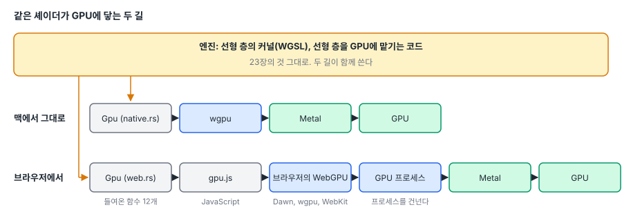
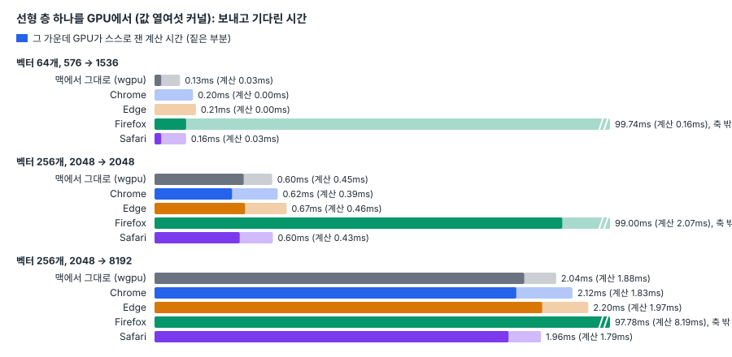
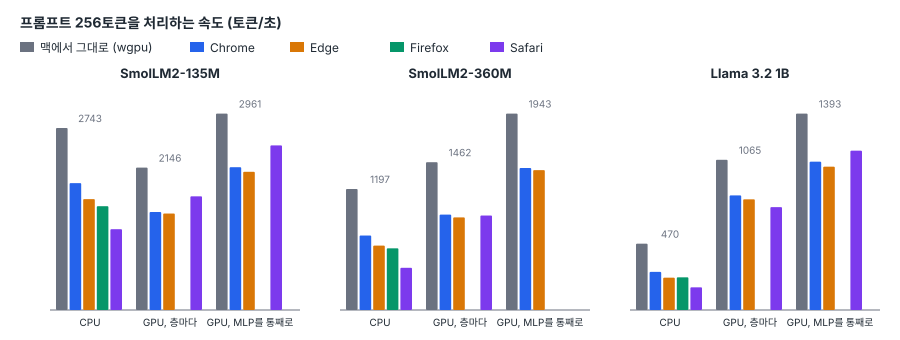

# 브라우저의 GPU

[48장](ch48_browser.md)은 세 가지 한계로 끝났습니다. 브라우저 안의 CPU는 맥에서 그대로
돌릴 때보다 느리고, 모듈의 메모리는 4GB에 묶여 있고, 2GB가 넘는 파일은
열리지도 않았습니다.

GPU는 그 울타리의 바깥에 있습니다. GPU의 메모리는 모듈의 메모리가
아닙니다. 그리고 GPU에서 도는 코드는 WebAssembly가 아닙니다. [23장](../part3/ch23_gpu.md)에서
쓴 그 셰이더가 그 GPU에서 그대로 돕니다.

[23장](../part3/ch23_gpu.md)에서 GPU 백엔드를 만들 때, 운영체제마다 다른 길(Metal, Vulkan,
Direct3D)을 하나로 감싼 약속으로 **WebGPU**를 골랐습니다. 커널은 WebGPU의
셰이더 언어 WGSL로 썼습니다. 그때 적은 까닭 가운데 하나가 "6부에서는
브라우저에서도 돈다"였습니다. 이 장에서 그 말을 지킵니다.

이 장은 다섯 가지를 합니다.

- 엔진이 **브라우저의 WebGPU**를 부르게 합니다. [23장](../part3/ch23_gpu.md)의 커널과, 선형 층을
  GPU에 맡기는 코드는 한 줄도 고치지 않습니다. 그 아래만 바꿉니다.
- 브라우저의 GPU는 "나중에 답하는" 함수로만 부를 수 있습니다. 엔진은
  답을 기다리는 코드입니다. 그 사이를 메웁니다.
- [48장](ch48_browser.md)에서 열지 못한 모델, **Llama 3.2 1B를 브라우저에서 엽니다.**
- 같은 커널과 같은 모델을 **맥에서 그대로 돌린 것과 견줍니다.**
- **브라우저 넷이 어떻게 다른지** 봅니다. 구현이 셋이고, 한도와 기능이
  다르고, 같은 셰이더가 내는 비트도 다릅니다.

이 페이지에서 직접 해 볼 수 있습니다. 아래 단추를 누르면 엔진이 이
브라우저의 GPU로 선형 층 하나(벡터 256개, 2048 → 2048)를 계산하고, 같은
계산을 CPU로도 해서 견줍니다.

<div id="badak-gpu"></div>
<script type="module" src="../demos/ch48/gpu_demo.js"></script>

저자의 맥에서 Chrome으로 누르면 이렇게 나옵니다.

| | |
|---|---:|
| GPU: 명령을 보내고 끝나기를 기다린 시간 | 1.00ms |
| GPU: 그 가운데 GPU가 스스로 잰 계산 시간 | 0.72ms |
| GPU: 결과 2MB를 읽어 오는 시간 | 0.10ms |
| CPU: 같은 계산 (스레드 1개) | 30.80ms |
| 두 결과의 가장 큰 상대 오차 | 1.7e-6 |

이 페이지는 [48장](ch48_browser.md)에서 말한 "격리"가 되어 있지 않아서 CPU 쪽은 스레드
하나로 돕니다. GPU는 격리와 상관없이 쓸 수 있습니다.

먼저 밝혀 둡니다. 숫자는 모두 **저자의 맥 한 대**(M4 Max)의 것입니다.
GPU도 하나입니다. 브라우저 넷은 [48장](ch48_browser.md)과 같습니다(Chrome 157, Edge 153,
Firefox 159, Safari 27.0.1). 다른 GPU, 다른 운영체제, 폰에서는 재지
않았습니다. 브라우저의 WebGPU는 2023년에 Chrome에 처음 들어간 젊은
기능이고, 이 장의 "되는 것과 다른 것"은 몇 달이면 달라질 수 있습니다.

결과를 미리 적어 둡니다.

- [23장](../part3/ch23_gpu.md)의 셰이더와 커널 코드가 **고치지 않은 채로** 브라우저 넷에서
  돕니다. 새로 쓴 것은 맨 아래 한 층입니다. Rust 300줄과 JavaScript
  200줄입니다.
- 브라우저의 GPU는 "나중에 답하는" 함수로만 부를 수 있는데, 엔진의 코드를
  그에 맞춰 고치지 않았습니다. 브라우저가 엔진을 멈췄다 깨워 주는
  기능(JSPI)을 씁니다. 브라우저 넷에 모두 있었습니다.
- **Llama 3.2 1B가 브라우저에서 돕니다.** Chrome의 GPU로 프롬프트를 초당
  813~1,052토큰 처리합니다. 같은 방식으로 맥에서 그대로 돌린 것의
  76%이고, 같은 브라우저의 CPU(270토큰)의 3.0~3.9배입니다.
- 그 모델을 여는 데 걸림돌이 다섯 있었고, 넷이 **32비트 주소**에서
  나왔습니다. 그 가운데 하나는 엔진에서 가장 큰 일이 스레드 하나로 돌게
  만든 버그였습니다.
- GPU는 **일이 이어져야 빨라집니다.** 같은 커널이 쉬었다 돌리면 2.1ms,
  이어 돌리면 0.45ms입니다. 재는 방법을 그에 맞춰야 했습니다.
- GPU가 계산하는 시간은 어디에서나 같습니다. 다른 것은 **GPU와 한 번
  오가는 값**입니다. Chrome, Edge, Safari는 0.1~0.2ms, **Firefox는
  100ms**입니다. 선형 층마다 결과를 읽어 오는 이 책의 엔진은 Firefox에서
  토큰 하나에 30초가 걸립니다.
- 작은 모델(SmolLM2-135M)에서는 GPU가 CPU를 이기지 못합니다.
- 같은 셰이더가 내는 **비트는 브라우저마다 다릅니다.** 맥에서 그대로
  돌린 것과 네 커널 모두 같은 것은 Firefox뿐입니다.
- 측정하는 동안 브라우저가 죽었습니다. Edge는 렌더러가 죽었고, Safari는
  페이지를 처음부터 다시 읽었습니다.

## 49.1 같은 셰이더, 다른 길

[23장](../part3/ch23_gpu.md)의 그림을 다시 그립니다.



맥에서 엔진은 `wgpu`라는 라이브러리를 불렀습니다. `wgpu`는 WGSL로 쓴
셰이더를 Metal의 셰이더 언어로 옮기고, 버퍼를 만들고, 명령을 Metal에
보냈습니다.

브라우저에는 그 일을 하는 것이 **이미 들어 있습니다.** 브라우저의
WebGPU입니다. 페이지가 WGSL 소스를 건네면 브라우저가 그것을 그 기계의
GPU가 아는 언어로 옮깁니다. 이 맥에서는 역시 Metal입니다.

브라우저마다 그 일을 하는 프로그램이 다릅니다.

| 브라우저 | WebGPU를 구현한 것 | 셰이더를 옮기는 것 |
|---|---|---|
| Chrome, Edge | Dawn (C++)[^dawn] | Tint |
| Firefox | wgpu (Rust)[^wgpu] | Naga |
| Safari | WebKit의 것 | WebKit의 것 |

둘째 줄이 눈에 띕니다. **Firefox의 WebGPU는 [23장](../part3/ch23_gpu.md)에서 우리가 쓴 그
라이브러리**입니다. 맥에서 엔진이 직접 부르던 `wgpu`를, Firefox에서는
브라우저를 거쳐서 부르는 셈입니다.

그림에서 브라우저 쪽의 길이 더 깁니다. 페이지의 코드는 GPU를 직접
만지지 못합니다. 페이지가 도는 프로세스는 드라이버에 닿을 수 없게 갇혀
있고(샌드박스), GPU에 닿는 일은 브라우저의 **다른 프로세스**가 합니다.
WebGPU의 호출은 그 프로세스로 건너갑니다.[^dawn] 이것이 이 장에서 재려는
것 가운데 하나입니다. 건너가는 값이 얼마인가.

### `wgpu`는 브라우저에서 무엇을 하는가

`wgpu`도 브라우저에서 돕니다. WebAssembly로 빌드하면 `wgpu`는 자기 일을
하지 않고 브라우저의 WebGPU를 부르는 얇은 껍질이 됩니다.[^wgpu] 셰이더는
옮기지 않고 그대로 브라우저에 넘깁니다. 같은 Rust 코드가 양쪽에서 도니
편리합니다.

이 책은 그 길로 가지 않았습니다. 까닭은 둘입니다.

- 그 껍질은 `wasm-bindgen`이 만들어 주는 JavaScript에 기대고, 그러면
  [48장](ch48_browser.md)에서 고른 타깃(WASI)을 버려야 합니다. 엔진이 파일을 읽고 스레드를
  만드는 길을 다시 놓아야 합니다.
- 브라우저의 WebGPU는 기다리는 일을 모두 "나중에 답하는" 함수로
  내놓습니다. `wgpu`로 그것을 부르면 엔진의 순전파가 통째로 `async`가
  되어야 합니다.

그래서 [48장](ch48_browser.md)에서 파일과 시계에 한 것을 GPU에도 합니다. **엔진이 GPU에
시킬 일을 함수 몇 개로 정해 두고, JavaScript가 그것들을 건넵니다.**
`wgpu`는 맥에서만 씁니다.

```toml
# crates/badak_gpu/Cargo.toml
[target.'cfg(not(target_arch = "wasm32"))'.dependencies]
wgpu = "30"
```

`badak_gpu` 크레이트의 `Gpu`가 두 벌이 됩니다. 맥에서는 `native.rs`의
것([23장](../part3/ch23_gpu.md)의 코드 그대로)이, 브라우저에서는 `web.rs`의 것이 컴파일됩니다.
둘은 같은 이름의 함수를 갖습니다. 그 위의 코드는 어느 쪽인지 모릅니다.

| 층 | 맥 | 브라우저 |
|---|---|---|
| 셰이더 (`shaders/*.wgsl`) | 같은 파일 | 같은 파일 |
| 선형 층의 커널 (`linear.rs`) | 같은 코드 | 같은 코드 |
| 선형 층을 GPU에 맡기기 (`offload.rs`) | 같은 코드 | 같은 코드 |
| `Gpu` | `native.rs`: `wgpu`를 부른다 | `web.rs`: 들여온 함수를 부른다 |
| 그 아래 | `wgpu` → Metal | `gpu.js` → 브라우저의 WebGPU → Metal |

## 49.2 GPU의 문

엔진이 들여오는 함수는 열두 개입니다.

```rust
{{#include ../../../crates/badak_gpu/src/web.rs:imports}}
```

[48장](ch48_browser.md)의 WASI와 생김새가 같습니다. 인자는 모두 수이고, 글과 배열은 모듈의
메모리 안의 위치와 길이로 넘깁니다. 다른 점은 **버퍼와 커널이 모듈 밖에
있다**는 것입니다. GPU의 버퍼는 JavaScript의 객체(`GPUBuffer`)이고 모듈은
그것을 쥘 수 없습니다. 그래서 JavaScript가 표에 넣어 두고 번호를 줍니다.
엔진은 번호만 압니다. 파일을 열면 번호를 받던 것과 같습니다.

JavaScript 쪽은 200줄 남짓입니다(`gpu.js`). 셰이더를 커널로 만드는
곳입니다.

```js
{{#include ../../../crates/badak_web/js/gpu.js:kernel}}
```

`code`에 들어가는 글이 [23장](../part3/ch23_gpu.md)의 `linear_block.wgsl` 같은 파일의 내용
그대로입니다. Rust가 빌드할 때 그 파일들을 모듈 안에 글로 넣어
두었고(`include_str!`), 모듈이 그 글의 위치를 넘기면 JavaScript가 읽어
브라우저에 줍니다.

커널을 실행하라는 명령입니다. 23.3절의 `encode`와 줄마다 대응합니다.

```js
{{#include ../../../crates/badak_web/js/gpu.js:encode}}
```

GPU의 문과 셰이더가 들어가면서 모듈은 조금 커졌습니다. 가장 큰 빌드가
968KB에서 1,056KB가 되었습니다.

### 한도를 달라고 해야 한다

GPU를 여는 곳에 [23장](../part3/ch23_gpu.md)에서도 만난 함정이 있습니다.

```js
{{#include ../../../crates/badak_web/js/gpu.js:open}}
```

WebGPU는 어느 기계에서나 같은 프로그램이 돌게 하려고 **기본 한도를 낮게**
잡아 둡니다. 버퍼 하나는 256MB, 셰이더에 묶을 수 있는 버퍼는 128MB까지
입니다.[^webgpu-limits] Llama 3.2 1B에서 가장 큰 선형 층의 가중치가 `f32`로
64MB이니 걸리지 않을 것 같지만, 올려 두지 않으면 조금 더 큰 모델에서
바로 걸립니다. GPU가 실제로 허락하는 값은 브라우저마다 달랐습니다
(49.8절).

## 49.3 기다릴 수 없는 곳에서 기다리기

들여오는 함수 가운데 셋은 성질이 다릅니다. `wait`(계산이 끝나기를
기다린다), `read`(결과를 읽어 온다), `elapsed`(GPU의 시계를 읽는다)입니다.

엔진의 코드는 이렇게 생겼습니다(23.9절).

```rust
gpu.run(kernel, &[shape, input, &self.weight, output], groups);
gpu.wait();
gpu.read_into(output, y);
// 여기에서 y를 쓴다.
```

`read_into`가 돌아오면 `y`에 값이 들어 있어야 합니다. 그런데 브라우저에서
GPU의 버퍼를 읽는 함수(`mapAsync`)는 값을 주지 않고 **약속**(Promise)을
줍니다.[^webgpu-map] "준비되면 알려 주겠다"는 뜻입니다. 알림은 지금
실행하던 JavaScript가 끝나고 브라우저가 다음 일을 집어 들 때에야 옵니다.

[48장](ch48_browser.md)에서 본 것과 같은 매듭입니다. 엔진은 계산의 한가운데에서 손을 놓지
않는데, 브라우저는 손을 놓아야 다음 일을 줍니다. [48장](ch48_browser.md)에서는 워커를 미리
만들어 두어 피했습니다. 이번에는 피할 수 없습니다. 답을 받아야 다음
계산을 할 수 있습니다.

보통의 해법은 엔진을 고치는 것입니다. 기다리는 함수를 모두 `async`로
바꾸고, 그것을 부르는 함수도, 그것을 부르는 함수도 바꿉니다. 선형 층은
순전파의 가장 안쪽에 있으므로 엔진 전체가 바뀝니다.

다른 해법이 2024년부터 브라우저에 들어오기 시작했습니다. **JSPI**(JavaScript Promise
Integration)입니다.[^jspi] 브라우저가 모듈을 **멈춰 두었다가 다시
깨워** 줍니다.

1. 모듈이 들여온 함수(`read`)를 부릅니다. 그 함수가 약속을 돌려줍니다.
2. 브라우저가 모듈의 실행을 그 자리에서 멈춥니다. 스택을 통째로 치워
   둡니다.
3. 워커는 손이 비었으므로 다음 일을 합니다. GPU의 알림도 그때 옵니다.
4. 약속이 지켜지면 브라우저가 치워 둔 스택을 도로 가져와, 멈춘 자리에서
   모듈을 이어 실행합니다.

모듈의 눈에는 `read`가 **그냥 오래 걸린 함수**입니다. 엔진의 코드는
고칠 것이 없습니다.

JavaScript에서 할 일은 표시 두 가지입니다.

```js
{{#include ../../../crates/badak_web/js/badak.js:jspi}}
```

들여오는 쪽에서 "이 함수는 약속을 돌려주니 멈춰서 기다려라"고 표시하고
(`WebAssembly.Suspending`), 내놓는 쪽에서 "이 함수는 도중에 멈출 수
있으니 약속을 돌려줘라"고 표시합니다(`WebAssembly.promising`). 멈춘 모듈을
부른 JavaScript는 기다릴 수 없으므로, 그쪽은 답 대신 약속을 받습니다.
엔진의 워커(`engine.js`)는 그것을 `await`합니다.

Rust 쪽은 이것이 전부입니다.

```rust
{{#include ../../../crates/badak_gpu/src/web.rs:wait}}
```

JavaScript 쪽의 `read`입니다. 23.3절의 `read_into`와 같은 일을 합니다.
계산에 쓴 버퍼는 CPU가 열 수 없으므로, 열 수 있는 버퍼로 한 번 옮겨 적고
그것을 엽니다.

```js
{{#include ../../../crates/badak_web/js/gpu.js:read}}
```

주석에 적은 것을 하나 짚어 둡니다. `await` 뒤에서 모듈의 메모리를 다시
들여다봅니다(`self.bytes`). 기다리는 동안 다른 일이 끼어들 수 있고, 그
사이에 메모리가 자랐다면 예전 배열은 쓸 수 없게 되어 있습니다(48.2절).

JSPI는 브라우저 넷에 모두 있었습니다.

| | Chrome 157 | Edge 153 | Firefox 159 | Safari 27.0.1 |
|---|---|---|---|---|
| 워커 안의 WebGPU | 됨 | 됨 | 됨 | 됨 |
| JSPI (`WebAssembly.Suspending`) | 됨 | 됨 | 됨 | 됨 |

없는 브라우저에서는 엔진이 GPU를 쓰지 않습니다(`badak.js`가 GPU를 건네지
않고, 엔진은 `open`이 0을 돌려주는 것을 봅니다).

## 49.4 맞는가

속도보다 먼저 답을 봅니다. 측정 함수는 선형 층 하나를 GPU로 계산하고,
같은 입력을 CPU로도 계산해 견줍니다. [48장](ch48_browser.md)의 측정과 같은 입력이어서
지문도 견줄 수 있습니다.

```rust
{{#include ../../../crates/badak_web/src/gpu.rs:linear}}
```

이 함수도 `Gpu`가 어느 쪽인지 모릅니다. 맥에서 부르면 `wgpu`로,
브라우저에서 부르면 들여온 함수로 갑니다. 맥에서 부르는 예제가
`ch49_native`이고, 브라우저에서 부르는 것이 측정 페이지
(`bench_gpu.html`)입니다.

CPU의 결과와 견준 가장 큰 상대 오차입니다(벡터 256개, 2048 → 2048).

| | 맥에서 그대로 | Chrome | Edge | Firefox | Safari |
|---|---:|---:|---:|---:|---:|
| 가장 큰 상대 오차 | 1.7e-6 | 1.7e-6 | 1.7e-6 | 1.7e-6 | 7.7e-6 |

모두 100만 분의 10 안쪽입니다. 23.9절에서 본 크기 그대로이고, 답으로는
같은 답입니다.

비트는 다릅니다. 같은 셰이더, 같은 GPU, 같은 입력인데 **어디에서
돌렸느냐에 따라 결과의 지문이 달랐습니다.**

| 커널 | 맥에서 그대로 | Chrome | Edge | Firefox | Safari |
|---|---|---|---|---|---|
| 단순 | `42abb608` | `42abb608` | `42abb608` | `42abb608` | `42abb608` |
| 넷씩 네 줄기 | `f6beb6a0` | **`272ac7f4`** | **`272ac7f4`** | `f6beb6a0` | **`d09de042`** |
| CPU와 같은 순서 | `042915be` | **`456b4e29`** | **`456b4e29`** | `042915be` | **`7468e7f8`** |
| 값 열여섯 | `c4cefe42` | `c4cefe42` | `c4cefe42` | `c4cefe42` | **`6ca59546`** |

(지문의 앞 여덟 자리입니다. 굵은 것이 맥에서 그대로 돌린 것과 다른 것입니다.)

읽는 법은 이렇습니다.

- **Firefox는 맥에서 그대로 돌린 것과 네 커널 모두 같습니다.** 같은
  라이브러리(`wgpu`)가 같은 번역기(Naga)로 셰이더를 옮겼기 때문입니다.
- **Chrome은 둘이 같고 둘이 다릅니다.** 다른 것은 곱한 것을 여러 줄기로
  나눠 더하는 커널들입니다.
- **Safari는 가장 단순한 커널 하나만 같습니다.**

WGSL은 실수 계산의 비트를 약속하지 않습니다. 곱셈과 덧셈을 하나로 합쳐
한 번만 반올림해도 되고([17장](../part3/ch17_simd.md)의 "곱하고 더하기"), 따로 해도 됩니다. 셰이더를
Metal의 언어로 옮기는 번역기가 셋이고(Tint, Naga, WebKit의 것), Metal의
컴파일러에게 무엇을 허락하는지도 다를 수 있습니다. 어느 단계에서
갈라졌는지는 확인하지 않았습니다. 가장 단순한 커널(곱셈 하나, 덧셈
하나를 차례로)만 넷이 모두 같다는 것이, 갈라지는 곳이 "여러 연산을 어떻게
묶는가"임을 짐작하게 합니다.

[48장](ch48_browser.md)에서 CPU는 "느린 빌드로는 같은 비트를 약속할 수 있다"였습니다.
GPU에서는 그런 빌드가 없습니다. 같은 기계에서 두 번 돌리면 같은 비트가
나옵니다(측정을 두 번 했고 지문이 같았습니다). 브라우저가 다르면
다릅니다.

## 49.5 커널의 속도

선형 층 하나를 GPU에서 계산하는 시간입니다. [23장](../part3/ch23_gpu.md)에서 가장 빨랐던 표준
커널("값 열여섯")로 잽니다. 숫자가 셋입니다.

- **보내고 기다린 시간.** 엔진이 명령을 보내고 `wait`가 돌아올 때까지.
- **GPU가 스스로 잰 계산 시간.** GPU의 시계로 잰, 커널이 실제로 돈
  시간(23.4절). 앞의 것에서 이것을 빼면 "오가는 값"이 남습니다.
- **읽어 오는 시간.** 결과를 모듈의 메모리로 가져오는 `read`.

### GPU는 데워져야 빠르다

재기 전에 짚을 것이 있습니다. 처음에는 이 책이 CPU를 재던 방식대로
쟀습니다([25장](../part3/ch25_rematch.md)). 3초를 쉬고, 스무 번 돌려, 가장 빨랐던 것을 적었습니다. 그런데 같은 커널의
시간이 측정을 돌릴 때마다 세 배씩 달라졌습니다. 되풀이 수를 바꿔 보니
까닭이 보였습니다(맥에서 그대로, 벡터 256개, 2048 → 2048).

| 되풀이 | 보내고 기다린 시간 (가장 빨랐던 것) | GPU가 스스로 잰 시간 |
|---:|---:|---:|
| 5번 | 2.30ms | 2.07ms |
| 20번 | 1.79ms | 1.56ms |
| 50번 | 1.04ms | 0.80ms |
| 100번 | 0.59ms | 0.45ms |
| 400번 | 0.57ms | 0.45ms |
| 20번 | 2.26ms | 2.07ms |

**GPU가 스스로 잰 시간이 네 배 넘게 달라집니다.** 같은 셰이더, 같은
입력입니다. 일이 쉰 번쯤 이어져야 빨라지고, 3초를 쉬면 도로 느려집니다.
GPU가 한가할 때는 느리게 돌다가 일이 이어지면 속도를 올리는 것으로
보입니다. CPU에도 있는 전력 관리([43장](ch43_device_constraints.md))의 GPU 판일 것이라고 짐작하지만,
이 GPU가 실제로 무엇을 하는지는 확인하지 않았습니다.

CPU를 잴 때 3초를 쉰 것은 프로세서를 식혀 측정마다 같은 조건을
만들려는 것이었습니다. GPU에서는 그 쉼이 GPU를 **느린 상태로 되돌립니다.**
그래서 이 장의 커널 측정은 재기 전에 0.5초 동안 같은 커널을 돌려 GPU를
데웁니다. 아래 표에는 쉬었다가 바로 잰 것("식은 GPU")도 한 줄 넣었습니다.

어느 쪽이 "진짜" 속도인가는 쓰임새에 달려 있습니다. 긴 프롬프트를
처리하는 동안에는 GPU가 계속 바쁘므로 데워진 쪽입니다. 가끔 한 번
부르는 앱이라면 식은 쪽이 사용자가 겪는 시간입니다.

### 잰 것



| 선형 층 | | 맥에서 그대로 | Chrome | Edge | Firefox | Safari |
|---|---|---:|---:|---:|---:|---:|
| 벡터 64개, 576 → 1536 | 보내고 기다린 시간 | 0.13ms | 0.20ms | 0.21ms | 100ms | 0.16ms |
|  | GPU가 스스로 잰 시간 | 0.03ms | 0.00ms | 0.00ms | 0.16ms | 0.03ms |
|  | 읽어 오는 시간 | 0.13ms | 0.17ms | 0.19ms | 98ms | 0.16ms |
| 벡터 256개, 2048 → 2048 | 보내고 기다린 시간 | 0.60ms | 0.62ms | 0.67ms | 99ms | 0.60ms |
|  | GPU가 스스로 잰 시간 | 0.45ms | 0.39ms | 0.46ms | 2.07ms | 0.43ms |
|  | 읽어 오는 시간 | 0.28ms | 0.23ms | 0.27ms | 100ms | 0.46ms |
| 벡터 256개, 2048 → 8192 | 보내고 기다린 시간 | 2.04ms | 2.12ms | 2.20ms | 98ms | 1.96ms |
|  | GPU가 스스로 잰 시간 | 1.88ms | 1.83ms | 1.97ms | 8.19ms | 1.79ms |
|  | 읽어 오는 시간 | 0.62ms | 0.43ms | 0.53ms | 100ms | 1.26ms |

쉬었다가 바로 잰 것(식은 GPU)의 "GPU가 스스로 잰 시간":

| 선형 층 | 맥에서 그대로 | Chrome | Edge | Firefox | Safari |
|---|---:|---:|---:|---:|---:|
| 벡터 64개, 576 → 1536 | 0.15ms | 0.13ms | 0.13ms | 0.16ms | 0.15ms |
| 벡터 256개, 2048 → 2048 | 1.17ms | 2.03ms | 2.16ms | 2.09ms | 2.02ms |
| 벡터 256개, 2048 → 8192 | 2.83ms | 2.82ms | 3.02ms | 7.76ms | 2.75ms |

**GPU가 스스로 잰 시간은 어디에서나 비슷합니다.** 같은 GPU가 같은
셰이더를 돌리니 당연합니다. 브라우저를 거친다고 GPU가 느려지지는
않습니다. 예외는 Firefox입니다. Firefox의
숫자는 다른 곳의 "식은 GPU" 숫자와 같습니다(2.07ms 대 2.03~2.16ms).
바로 아래에서 볼 까닭으로, Firefox에서는 커널을 한 번 돌릴 때마다 0.1초를
기다리게 되고, 그동안 GPU가 식습니다. 데울 수가 없습니다.

**차이는 오가는 값에 있습니다.** 아주 작은 일(벡터 넷, 32 → 8)을 시켜
보면 계산은 거의 0이고 오가는 값만 남습니다.

| | 맥에서 그대로 | Chrome | Edge | Firefox | Safari |
|---|---:|---:|---:|---:|---:|
| 작은 일: 보내고 기다린 시간 | 0.18ms | 0.18ms | 0.17ms | 100ms | 0.16ms |
| 작은 일: 읽어 오는 시간 | 0.16ms | 0.16ms | 0.14ms | 100ms | 0.14ms |
| 엔진을 거치지 않고: "다 끝났는가" | — | 0.03ms | 0.03ms | 86ms | 0.00ms |
| 엔진을 거치지 않고: 16바이트 읽기 | — | 0.14ms | 0.15ms | 100ms | 0.12ms |

"엔진을 거치지 않고" 줄은 JavaScript에서 WebGPU를 바로 불러 잰 것입니다.
아무 일도 시키지 않고 "다 끝났는가"를 묻고, 16바이트를 옮겨 적어 열어
달라고 합니다. 엔진도 JSPI도 끼지 않은, 브라우저의 WebGPU만의 값입니다.

- **Chrome, Edge, Safari는 한 번 오가는 데 0.1~0.2ms입니다.** 맥에서
  `wgpu`로 바로 갈 때(0.1ms)와 큰 차이가 없습니다. 프로세스를 건너고
  모듈을 멈췄다 깨우는 값이 그 정도입니다.
- **Firefox는 100ms입니다.** 계산은 0.2ms에 끝나는데 답이 100ms 뒤에
  옵니다. 일의 크기와 상관없이 늘 100ms 언저리인 것으로 보아, 끝났는지를
  0.1초마다 확인하는 것으로 보입니다. 소스를 읽어 확인하지는 않았습니다.

이 차이가 모델에서 어떻게 나타나는지는 49.7절에서 봅니다.

브라우저의 CPU와 견주면 이렇습니다([48장](ch48_browser.md)의 커널, 스레드 여덟).

| 선형 층 (Chrome) | CPU, 스레드 여덟 | GPU (기다리고 읽어 오기까지) | CPU ÷ GPU |
|---|---:|---:|---:|
| 벡터 64개, 576 → 1536 | 0.65ms | 0.36ms | 1.8배 |
| 벡터 256개, 2048 → 2048 | 4.17ms | 0.86ms | 4.9배 |
| 벡터 256개, 2048 → 8192 | 15.42ms | 2.55ms | 6.0배 |

GPU가 데워져 있다면 가장 작은 층에서도 GPU가 앞서고, 큰 층에서는
여섯 배입니다. 23.5절에서 맥으로 본 것과 같은 모양입니다. 일이 클수록
오가는 값이 묻힙니다. (맥에서 그대로 돌리는 CPU는 이 표의 CPU보다
빠릅니다. 스레드가 열여섯이고, 큰 행렬에서는 [48장](ch48_browser.md)의 브라우저용 커널보다
두 배 넘게 빠릅니다.)

## 49.6 48장에서 열지 못한 모델

[23장](../part3/ch23_gpu.md)이 GPU로 잰 모델은 Llama 3.2 1B였고, 그 장은 "표준 WebGPU만 쓴 줄
(926토큰/초)이 브라우저의 출발점"이라고 적었습니다. 그것을 재려면
브라우저에서 그 모델을 열어야 합니다. [48장](ch48_browser.md)에서는 열리지 않았습니다.
가중치 파일이 2.47GB이고, 32비트 모듈에서는 메모리 한 덩어리가 2GB를
넘을 수 없었습니다.

이 절은 그 모델을 여는 이야기입니다. 걸림돌이 다섯 있었고, **그 가운데
넷이 "주소가 32비트"라는 한 가지 사실**에서 나왔습니다. 엔진은 지금까지
64비트 기계에서만 돌았습니다. 거기에서는 드러나지 않던 가정들입니다.

### 하나: 파일을 통째로 쥔다

엔진은 safetensors 파일을 통째로 메모리에 비추고(브라우저에서는 통째로
읽고), 텐서들은 그 한 덩어리의 구간을 빌려 썼습니다([6장](../part1/ch06_model_files.md)). 덩어리가
2GB를 넘을 수 없다면 **덩어리를 나누면** 됩니다. 파일은 2.47GB여도 텐서
하나하나는 작습니다. 가장 큰 것이 임베딩 표로 525MB입니다.

```rust
{{#include ../../../crates/badak_formats/src/safetensors.rs:pieces}}
```

헤더까지만 먼저 읽어 텐서들이 어디에 있는지 알아내고, 텐서마다 자기
구간만 따로 읽습니다. 구간만 비추는 함수(`open_range`)는 [44장](ch44_on_the_phone.md)에서 Android의
앱 꾸러미 안에 든 모델을 열려고 만들어 둔 것입니다. 파일이 한 덩어리로
쥘 수 있는 크기면 예전처럼 통째로 쥡니다. 64비트 기계에서는 언제나
그렇습니다.

### 둘: 주소가 음수가 된다

파일이 열리자 다음 오류가 났습니다.

```text
RangeError: Start offset -1813333184 is outside the bounds of the buffer
```

모듈의 메모리가 2GB를 넘자 그 위의 주소가 JavaScript에서 **음수**로
보인 것입니다. WebAssembly의 32비트 정수에는 부호가 있다는 표시가 없고,
JavaScript로 건너올 때는 부호 있는 수로 읽힙니다. 2GB 아래에서는 어느
쪽으로 읽어도 같은 수여서 드러나지 않았습니다.

```js
{{#include ../../../crates/badak_web/js/wasi.js:unsigned}}
```

`>>> 0`은 JavaScript에서 수를 부호 없는 32비트 정수로 바꾸는 관용구입니다.
엔진이 들여오는 함수들이 받는 수(주소, 길이, 파일 번호)는 음수일 일이
없으므로 한곳에서 모두 바꿉니다. 내놓는 함수가 돌려주는 주소도 같은
방법으로 바꿉니다.

### 셋: 스레드를 쓰는 빌드의 한도

[48장](ch48_browser.md)에서 스레드를 쓰는 빌드는 1GB에서 멈췄습니다. Rust가 정해 둔
값이었습니다. 4GB로 올립니다.

```sh
# scripts/build_web.sh
MAX="-C link-arg=--max-memory=4294967296"
```

올린 값은 없다시피 했습니다. [48장](ch48_browser.md)의 측정을 Chrome에서 다시 해 보면
이렇습니다.

| | 한도 1GB ([48장](ch48_browser.md)) | 한도 4GB |
|---|---:|---:|
| 엔진을 올리는 시간 (스레드 여덟) | 29ms | 32ms |
| SmolLM2-135M이 쓰는 속도 (스레드 여덟) | 354토큰/초 | 350토큰/초 |
| 얻을 수 있는 메모리 | 961MB | 4,033MB |

한도는 "여기까지 자랄 수 있다"는 표시일 뿐이고, 쓰지 않은 메모리에는
값을 치르지 않습니다.

### 넷: 가장 큰 일이 가장 작은 일로 보인다

모델이 열리고 돌았습니다. 그런데 CPU로 프롬프트를 처리하는 속도가
이상했습니다. 초당 45토큰. 같은 브라우저에서 훨씬 작은 SmolLM2-360M이
748토큰인데, 맥에서 그대로 돌리면 Llama 3.2 1B는 480토큰입니다. 열 배가
느립니다.

크기를 바꿔 가며 선형 층 하나를 재 보니 범인이 보였습니다(Node, 스레드
여덟).

| 선형 층 | 곱셈의 수 | 걸린 시간 | 초당 곱셈 |
|---|---:|---:|---:|
| 벡터 256개, 2048 → 2048 | 2³⁰ | 4.0ms | 2,710억 |
| 벡터 256개, 2048 → 4096 | 2³¹ | 7.8ms | 2,740억 |
| 벡터 256개, 2048 → 8192 | **2³²** | **113.0ms** | **380억** |
| 벡터 64개, 2048 → 8192 | 2³⁰ | 4.2ms | 2,550억 |

셋째 줄만 스레드 하나의 속도입니다. 엔진에는 "일이 작으면 스레드에
나누지 않는다"는 판단이 있습니다([18장](../part3/ch18_multithreading.md)).

```rust
let wanted = if count * rows * cols < MIN_PARALLEL_WORK { 1 } else { ... };
```

256 × 8192 × 2048은 정확히 2³²입니다. 32비트 정수에 담으면 **0**입니다.
Llama 3.2 1B의 MLP에서 가장 큰 선형 층이, 프롬프트 256토큰을 처리할 때,
하필 "일의 크기 0"이 되어 스레드 하나로 돌았습니다. 엔진에서 가장 큰
일이 가장 작은 일로 보인 것입니다.

```rust
{{#include ../../../crates/badak_core/src/simd/mod.rs:work}}
```

곱이 넘치면 가장 큰 수에서 멈추게 했습니다. 같은 모양의 곱셈이 엔진에
아홉 군데 있었고(합성곱, 희소 행렬, 어텐션) 모두 바꿨습니다. 고친 뒤
셋째 줄은 15.3ms입니다.

Rust는 디버그 빌드에서 정수가 넘치면 패닉하지만 릴리스 빌드에서는 말없이
감아 넘깁니다. 이 엔진의 테스트는 64비트에서만 돌았고, 64비트에서 이
곱은 넘치려면 멀었습니다. **느려질 뿐 틀리지는 않는** 버그여서 답을
견주는 테스트로는 잡히지 않습니다. 잰 숫자가 이상하다는 데에서만
보였습니다.

### 다섯: 파일만 한 배열

마지막 것은 32비트의 문제가 아니라 JavaScript 쪽의 문제였습니다.
Chrome에서는 모델이 열렸는데 Edge에서는 이렇게 끝났습니다.

```text
llm-failed llama32_1b cpu Array buffer allocation failed
```

[48장](ch48_browser.md)의 내려받기 코드는 받은 조각들을 **큰 배열 하나로 이어 붙였습니다.**
2.47GB짜리 배열입니다. 이 맥의 Edge는 그 크기의 배열을 만들지
못했습니다. 만들 수 있는 브라우저에서도 이어 붙이는 동안에는 조각들과
큰 배열이 함께 있어서 파일이 두 벌이 됩니다.

이어 붙이지 않기로 합니다. 받은 조각들을 그대로 두고, 엔진이 파일을
읽을 때 조각들을 건너가며 복사해 줍니다.

```js
{{#include ../../../crates/badak_web/js/wasi.js:chunks}}
```

[48장](ch48_browser.md)에서 "파일 시스템"은 길에서 배열로 가는 표였습니다. 이제 그 배열이
조각들의 줄일 수도 있습니다. 엔진은 모릅니다. `fd_read`가 달라는 만큼을
어느 조각에서든 채워 줄 뿐입니다. 고친 뒤 Edge에서도 열렸습니다.

브라우저에 넣어 두는 파일([48장](ch48_browser.md)의 SmolLM2-135M)은 여전히 이어 붙입니다.
해시를 확인하는 함수가 한 덩어리를 받기 때문입니다.

이제 모델이 브라우저 넷에서 열립니다. 모듈의 메모리는 2.6GB가 됩니다.

## 49.7 모델의 속도

23.10절과 같은 측정입니다. 프롬프트 256토큰을 한꺼번에 처리하고, 이어서
토큰 32개를 하나씩 처리합니다. 토큰도 [23장](../part3/ch23_gpu.md)과 같은 것(같은 씨앗의
난수)입니다. 방식은 넷입니다.

| 방식 | 선형 층을 계산하는 곳 |
|---|---|
| CPU | 모두 CPU ([48장](ch48_browser.md)) |
| GPU, 층마다 | 블록의 선형 층 일곱 개를 하나씩 GPU에 보내고 결과를 읽어 온다 |
| GPU, MLP를 통째로 | MLP의 세 층은 한 번에 보내고 가운데 결과는 GPU에 둔다 (23.10절) |
| 벡터 32개부터만 GPU | 위와 같되, 입력이 적은 일(토큰 생성)은 CPU에 남긴다 (23.11절) |

```rust
{{#include ../../../crates/badak_web/src/gpu.rs:offload}}
```

[23장](../part3/ch23_gpu.md)의 `load_on_gpu`를 문 안으로 옮긴 것입니다. 모델을 고치는 코드는
같습니다.

### Llama 3.2 1B



| 프롬프트 처리 / 토큰 생성 (토큰/초) | 맥에서 그대로 | Chrome | Edge | Firefox | Safari |
|---|---:|---:|---:|---:|---:|
| CPU | 470 / 100 | 270 / 93 | 229 / 92 | 232 / 96 | 161 / 78 |
| GPU, 층마다 | 1,065 / 16 | 813 / 14 | 785 / 14 | — | 730 / 16 |
| GPU, MLP를 통째로 | 1,393 / 20 | 1,052 / 17 | 1,016 / 18 | — | 1,130 / 18 |
| 벡터 32개부터만 GPU | 1,278 / 99 | 1,011 / 95 | 964 / 95 | — | 다시 읽힘 |

칸마다 "프롬프트 처리 / 토큰 생성"입니다.

- **브라우저의 GPU는 맥에서 그대로 돌린 것의 76%입니다.** "층마다"로
  Chrome 813 대 맥 1,065, "MLP를 통째로"로 1,052 대 1,393입니다. [23장](../part3/ch23_gpu.md)이
  출발점이라고 적은 숫자(926)는 그날의 맥에서 잰 것이고, 오늘 같은 것을
  다시 재니 1,065입니다.
- **브라우저 안에서는 GPU의 이득이 맥에서보다 큽니다.** Chrome에서 GPU는
  CPU의 3.0~3.9배입니다(270 → 813, 1,052). 맥에서는 2.3~3.0배였습니다.
  GPU는 브라우저를 거쳐도 4분의 3이 남는데 CPU는 절반 남짓만 남기
  때문입니다(470 → 270).
- **토큰을 하나씩 쓸 때는 GPU가 여섯 배 넘게 느립니다** (93 → 14). 토큰
  하나에 선형 층 112개를 지나고, 그때마다 GPU와 오갑니다. 계산이 작으니
  오가는 값만 남습니다. 23.11절에서 본 그대로입니다.
- 그래서 **큰 일만 GPU에 보내는 것**이 여기에서도 답입니다. 프롬프트는
  GPU의 속도로(1,011), 토큰은 CPU의 속도로(95) 갑니다.
- Safari는 CPU가 가장 느리고(161. [48장](ch48_browser.md)에서 본 대로 빠른 커널을 쓰지
  못합니다) GPU는 다른 브라우저와 비슷합니다.

맥에서 표준 밖의 기능 둘(23.6절의 행렬 연산, 23.8절의 버퍼를 곧바로
열기)을 켜면 "층마다"가 2,262, "MLP를 통째로"가 2,859토큰입니다. 브라우저는
거기에 갈 수 없습니다. 표준 WebGPU만으로 얻는 것의 두 배입니다.

메모리는 두 곳에 듭니다. 모듈의 메모리가 2.6GB(16비트 가중치와 엔진),
GPU에 올린 것이 3.9GB(`f32`로 펼친 가중치)입니다. 올리는 데 Chrome에서
3.6초, 맥에서 그대로는 2.6초가 걸렸습니다.

### 작은 모델

SmolLM2-135M:

| 프롬프트 처리 / 토큰 생성 (토큰/초) | 맥에서 그대로 | Chrome | Edge | Firefox | Safari |
|---|---:|---:|---:|---:|---:|
| CPU | 2,743 / 364 | 1,913 / 297 | 1,672 / 292 | 1,565 / 291 | 1,218 / 254 |
| GPU, 층마다 | 2,146 / 17 | 1,477 / 12 | 1,455 / 12 | — | 1,714 / 12 |
| GPU, MLP를 통째로 | 2,961 / 22 | 2,152 / 16 | 2,084 / 15 | 9 / 0.03 | 2,481 / 15 |
| 벡터 32개부터만 GPU | 2,519 / 362 | 2,005 / 289 | 1,948 / 284 | — | 2,261 / 249 |

SmolLM2-360M:

| 프롬프트 처리 / 토큰 생성 (토큰/초) | 맥에서 그대로 | Chrome | Edge | Firefox | Safari |
|---|---:|---:|---:|---:|---:|
| CPU | 1,197 / 209 | 737 / 172 | 637 / 169 | 610 / 168 | 417 / 128 |
| GPU, 층마다 | 1,462 / 14 | 944 / 9 | 916 / 9 | — | 935 / 10 |
| GPU, MLP를 통째로 | 1,943 / 18 | 1,405 / 12 | 1,384 / 12 | — | 다시 읽힘 |
| 벡터 32개부터만 GPU | 1,674 / 207 | 1,306 / 168 | 1,309 / 166 | — | 1,622 / 150 |

- **SmolLM2-135M에서는 GPU를 쓸 까닭이 없습니다.** 프롬프트 처리가
  CPU와 비슷하고(Chrome에서 1,913 대 1,477~2,152), 토큰 생성은 스무 배
  느립니다. 선형 층 하나가 576 × 576이면 계산은 순식간이고 오가는 값이
  전부입니다. [48장](ch48_browser.md)의 데모 페이지가 CPU로 답하는 까닭입니다.
- **360M부터 GPU가 앞섭니다.** Chrome에서 프롬프트 처리가 1.3~1.9배입니다.
- 모델이 커질수록 GPU의 이득이 커집니다. 135M에서 1.1배, 360M에서 1.9배,
  1B에서 3.9배입니다("MLP를 통째로", Chrome).

### 시간은 어디에 쓰였나

Chrome에서 Llama 3.2 1B를 "층마다" 방식으로 돌릴 때, GPU에 맡긴 일에 든
시간입니다(`Offload`의 기록).

| 선형 층 하나에 (평균) | 맥에서 그대로 | Chrome |
|---|---:|---:|
| 입력을 GPU에 적기 | 36µs | 28µs |
| 계산을 시키고 기다리기 | 377µs | 451µs |
| 결과를 읽어 오기 | 144µs | 183µs |
| 합 | 557µs | 662µs |

(GPU에 맡긴 선형 층 18,480번의 평균입니다. 프롬프트를 처리할 때의 큰 일과 토큰을 하나씩 쓸 때의 작은 일이 섞여 있습니다.)

선형 층 하나를 GPU에 맡기는 데 Chrome에서 0.66ms, 맥에서 그대로는
0.56ms입니다. **브라우저를 거치는 값은 층마다 0.1ms, 19%입니다.**
프로세스를 건너고, 모듈을 멈췄다 깨우고, 값을 한 번 더 옮겨 적는 일이 다
그 안에 있습니다.

모델의 속도는 24% 느렸습니다(813 대 1,065). GPU에 맡긴 일이 19% 느려진
것에, **CPU에 남은 일**이 더해진 값입니다. 어텐션, 정규화, 임베딩은 여전히
CPU가 하고, 그 일들은 [48장](ch48_browser.md)에서 본 대로 브라우저에서 더 느립니다.

### Firefox

Firefox의 표가 비어 있는 까닭입니다. 가장 작은 모델을 가장 유리한
방식("MLP를 통째로")으로 한 번만 돌렸습니다.

| SmolLM2-135M, Firefox | |
|---|---:|
| 프롬프트 256토큰 처리 | 초당 9토큰 (29초) |
| 토큰 하나 쓰기 | 30초 |
| 그 가운데 GPU에 값을 적는 시간 | 0.08초 |
| 계산이 끝나기를 기다린 시간 | 47초 |
| 결과를 읽어 온 시간 | 48초 |

(아래 세 줄은 순전파 네 번의 합입니다.)

순전파 한 번에 GPU와 150번 오갑니다(블록 30개에, 어텐션의 선형 층 넷과
MLP 한 번). 오갈 때마다 "끝났는가"와 "읽어 달라"로 약속을 둘 기다리고,
Firefox에서는 약속 하나가 0.1초입니다. 150 × 2 × 0.1초 = 30초. 계산
자체는 다 합쳐도 0.1초가 안 됩니다.

같은 엔진이 Chrome에서는 같은 일을 0.12초에 합니다(초당 2,152토큰).
**240배의 차이가 GPU의 속도가 아니라 답을 받는 방법에서 나옵니다.**
브라우저의 GPU를 쓰는 엔진이 CPU로 오가는 횟수를 줄여야 하는 까닭이
이것입니다. 순전파 한 번에 한 번만 읽는다면 Firefox에서도 0.2초가 더해질
뿐입니다.

## 49.8 브라우저 넷의 차이

지금까지 나온 것을 한자리에 모읍니다.

| | Chrome 157 | Edge 153 | Firefox 159 | Safari 27.0.1 |
|---|---|---|---|---|
| WebGPU를 구현한 것 | Dawn | Dawn | wgpu | WebKit의 것 |
| 워커 안의 WebGPU, JSPI | 됨 | 됨 | 됨 | 됨 |
| GPU가 밝힌 이름 | apple metal-3 | apple metal-3 | (없음) | apple |
| 버퍼 하나의 최대 크기 | 4GB | 4GB | 2GB | 2GB |
| 셰이더 하나에 묶을 수 있는 버퍼 | 10개 | 10개 | 9개 | 44개 |
| 16비트 실수 (`shader-f16`) | 됨 | 됨 | 됨 | 됨 |
| GPU의 시계 (`timestamp-query`) | 됨 | 됨 | 됨 | 됨 |
| GPU와 한 번 오가는 값 | 0.2ms | 0.2ms | **100ms** | 0.2ms |
| 맥의 `wgpu`와 비트가 같은 커널 | 넷 중 둘 | 넷 중 둘 | **넷 모두** | 넷 중 하나 |
| Llama 3.2 1B, GPU로 프롬프트 처리 ("층마다") | 813토큰/초 | 785토큰/초 | 재지 못함 | 730토큰/초 |
| 측정하는 동안 | | 렌더러가 죽음 (여섯 번 중 세 번) | | 페이지를 다시 읽음 (한 번에 두 단계) |

몇 줄을 풀어 둡니다.

**GPU의 이름.** 브라우저는 GPU가 무엇인지 자세히 알려 주지 않습니다.
맥에서 `wgpu`는 "Apple M4 Max"라고 답하는데, 브라우저는 "apple"까지만
말하거나 아무 말도 하지 않습니다. 명세가 그렇게 정했습니다. 무엇을 알려
줄지는 브라우저가 정하고, 빈 글을 돌려줘도 됩니다.[^webgpu-info] 기계의
생김새로 사용자를 알아보는 것을 막으려는 것입니다([48장](ch48_browser.md)의 코어 수와 같은
이야기입니다). 엔진은 GPU의 이름을 보고 설정을 고를 수 없습니다. [23장](../part3/ch23_gpu.md)에서
"이 GPU에서는 묶음의 크기를 얼마로"를 정할 때 쓴 방법이 여기에서는 통하지
않고, 재 보고 정해야 합니다.

**한도.** 버퍼 하나의 최대 크기가 Chrome과 Edge는 4GB, Firefox와 Safari는
2GB입니다. 이 장의 모델에서는 걸리지 않습니다(가장 큰 버퍼가 64MB).
가중치를 한 버퍼에 몰아 담는 설계였다면 2GB에서 갈렸을 것입니다.

**GPU의 시계.** `timestamp-query`는 넷 모두에 있습니다. 명세는 이 시계의
눈금을 100µs로 무디게 하라고 정합니다([48장](ch48_browser.md)의 CPU 시계와 같은
까닭입니다).[^webgpu-time] 잰 값을 보면
Chrome과 Edge가 그렇게 하는 것으로 보입니다. 맥에서 그대로 재면 0.03ms인
커널이 두 브라우저에서는 0으로 나왔습니다. 큰 값들은 100µs의 배수가
아니었는데(393µs, 1,835µs), 시작과 끝의 시각을 따로 무디게 한 뒤에 뺀
값이라면 그럴 수 있습니다. 확인하지는 않았습니다. 어느 쪽이든 브라우저의
GPU 시계로는 0.1ms보다 짧은 일을 잴 수 없습니다.

**죽는 방법.** 측정하는 동안 브라우저가 두 가지 방법으로 죽었습니다.

- **Edge는 렌더러가 죽었습니다.** 모델 셋을 차례로 재는 측정을 여섯 번
  돌렸는데 세 번이 SmolLM2-360M을 재는 도중에 멈췄습니다. macOS가 남긴
  충돌 보고서에는 "잘못된 명령"(`EXC_BAD_INSTRUCTION`, SIGILL)이라고 적혀
  있고, 죽은 스레드의 스택에는 이름 없는 주소뿐이었습니다. 브라우저가
  실행 중에 만든 코드 안에서 죽었다는 뜻으로 읽힙니다. 이 맥의 Edge는
  153판이고, 같은 엔진의 157판인 Chrome에서는 한 번도 나지 않았습니다.
  원인은 찾지 못했습니다.
- **Safari는 페이지를 다시 읽었습니다.** 모델 셋을 재는 동안 두 번씩
  그랬고, 측정을 돌릴 때마다 다른 단계에서 그랬습니다(위의 표에서는
  SmolLM2-360M의 "MLP를 통째로"와 Llama 3.2 1B의 "벡터 32개부터만").
  화면은 보지 못했고, 측정 페이지가 본 것은 "스크립트가 처음부터 다시
  시작됐다"는 것입니다. Safari는 메모리를 많이 쓰는 페이지를 그렇게
  합니다.

둘 다 페이지의 코드가 붙잡을 수 있는 오류가 아닙니다. 예외가 나지 않고,
페이지가 통째로 사라지거나 처음부터 다시 시작됩니다. 측정 페이지는
그래서 단계를 하나 끝낼 때마다 결과를 서버에 보내고, 어디까지 했는지를
탭에 적어 둡니다. 다시 읽히면 하던 단계를 건너뛰고 이어서 합니다. 큰
모델을 다루는 페이지는 "브라우저가 나를 지울 수 있다"를 설계에 넣어야
합니다.

## 49.9 남긴 것

- **값을 GPU에 머물게 하기.** 이 장의 엔진은 선형 층(또는 MLP)마다 결과를
  CPU로 읽어 옵니다. 어텐션과 정규화가 CPU에 있기 때문입니다. 오가는
  횟수가 블록마다 다섯 번에서 일곱 번이고, 그것이 토큰 생성을 느리게
  하고 Firefox에서는 쓸 수 없게 합니다. 순전파 전체를 GPU에 두면 토큰
  하나에 한 번만 읽으면 됩니다. [23장](../part3/ch23_gpu.md)에서 남긴 것이 여기에서 더 크게
  돌아왔습니다.
- **가중치를 모듈의 메모리에 두지 않기.** Llama 3.2 1B를 열면 모듈의
  메모리가 2.6GB가 됩니다. GPU에 올린 3.9GB와 별개입니다. 임베딩 표와,
  작은 일을 CPU에서 할 때 쓰는 원래 가중치가 거기에 있습니다. 파일을
  읽는 대로 GPU에 올리고 버리면 모듈에는 임베딩 표만 남습니다.
- **16비트 가중치.** GPU에는 `f32`로 펼쳐 올립니다. 16비트 실수를 셰이더가
  바로 읽는 기능(`shader-f16`)이 브라우저 넷에 모두 있었습니다. 쓰면
  GPU의 메모리가 절반이 됩니다. 쓰지 않았습니다.
- **다른 GPU.** Apple의 GPU 하나에서만 쟀습니다.
- **Edge가 죽는 까닭.** 충돌 보고서까지만 봤습니다.
- **데모 페이지의 대화.** [48장](ch48_browser.md)의 데모 페이지는 여전히 CPU로 답합니다.
  SmolLM2-135M에서는 그쪽이 빠릅니다.

## 49.10 실전 엔진에서는

브라우저에서 GPU로 추론하는 엔진들은 "남긴 것"의 첫 줄을 합니다. **모든
계산을 GPU에 두고, CPU로 오가는 횟수를 줄입니다.**

- **WebLLM**은 언어 모델의 순전파 전체를 WebGPU로 돌립니다. 소개의 첫
  문장이 "WebGPU로 가속한다"입니다.[^webllm] 모델마다 셰이더를 미리
  만들어 두는 방식입니다(MLC, 47.7절).
- **ONNX Runtime Web**에는 WebGPU 실행 제공자가 있습니다. 문서는 텐서를
  GPU에 그대로 두는 설정(`preferredOutputLocation: 'gpu-buffer'`)을 따로
  설명합니다. 기본값에서는 입력과 출력이 CPU의 메모리에 있다고
  적습니다.[^ort-webgpu] 이 장에서 값을 치른 그 왕복을 줄이는 손잡이입니다.
- **`wgpu`를 쓰는 Rust 프로그램**은 이 장과 다른 길로 브라우저에 옵니다.
  49.1절에 적은 대로 `wgpu`가 브라우저의 WebGPU를 부르는 껍질이 되고,
  기다리는 곳은 `async`로 씁니다.[^wgpu]

이 엔진들과 같은 모델로 견주는 일이 다음 장입니다.

## 정리

- [23장](../part3/ch23_gpu.md)의 GPU 백엔드가 **셰이더도 커널도 그대로** 브라우저에서 돕니다.
  바꾼 것은 맨 아래 한 층입니다. `wgpu` 대신 들여온 함수 열두 개가
  브라우저의 WebGPU를 부릅니다.
- 브라우저의 GPU는 약속(Promise)으로만 답합니다. **JSPI**가 그 사이에
  엔진을 멈췄다 깨워 줘서, 엔진의 코드를 `async`로 바꾸지 않았습니다.
  브라우저 넷에 모두 있었습니다.
- [48장](ch48_browser.md)에서 열지 못한 Llama 3.2 1B를 열었습니다. 걸림돌 넷이 모두 **32비트
  주소**에서 나왔습니다. 2GB가 넘는 덩어리, 음수가 되는 주소, 1GB로 적힌
  한도, 0이 되는 곱셈.
- 같은 셰이더가 내는 **비트는 브라우저마다 다릅니다.** 답은 같습니다.
- GPU가 계산하는 시간은 어디에서나 같고, **차이는 오가는 값**에 있습니다.
  Chrome과 Safari에서는 0.1~0.2ms, Firefox에서는 100ms였습니다.
- Llama 3.2 1B의 프롬프트 처리가 Chrome의 GPU로 초당 813~1,052토큰입니다.
  같은 방식의 맥의 76%이고 브라우저 CPU의 3~4배입니다. 토큰을 하나씩 쓸
  때는 GPU가 CPU보다 느리고, 작은 모델에서는 GPU를 쓸 까닭이 없습니다.
- 브라우저는 큰 페이지를 **말없이 지우거나 다시 읽습니다.** 붙잡을 수
  있는 오류가 아닙니다.

## 연습 문제

1. 이 장의 맨 위에 있는 단추를 브라우저를 바꿔 가며 눌러 보십시오.
   "보내고 기다린 시간"과 "GPU가 스스로 잰 시간"의 차이가 브라우저마다
   얼마나 다릅니까?
2. `gpu.js`의 `read`는 읽을 때마다 옮겨 적고 엽니다. 옮겨 적는 버퍼를
   크기마다 하나씩 두고 돌려 쓰는데, 왜 계산에 쓴 버퍼를 바로 열지
   않습니까? 23.7절을 다시 읽고 답해 보십시오.
3. `web.rs`의 `wait`를 아무 일도 하지 않는 함수로 바꿔도 엔진은 맞는 답을
   냅니다(`read`가 앞선 일이 끝나기를 기다리므로). 그렇게 바꾸면
   Firefox에서 모델의 속도가 어떻게 달라질지 49.5절의 숫자로 어림해
   보십시오.
4. 256 × 8192 × 2048이 32비트에서 0이 되는 것을 직접 확인해 보십시오.
   `cargo build --target wasm32-wasip1`을 디버그로 하면 무슨 일이
   일어납니까?
5. `safetensors.rs`의 `open_in_pieces`는 텐서마다 한 덩어리를 얻습니다.
   텐서 하나가 2GB를 넘으면 어떻게 됩니까? 그런 모델이 있는지 찾아보고,
   있다면 어떻게 읽어야 할지 적어 보십시오.
6. 모듈의 메모리를 쓰지 않고 가중치를 GPU에 올리려면, JavaScript가 받은
   바이트를 엔진을 거치지 않고 `writeBuffer`에 넘기면 됩니다. 그러려면
   들여오는 함수와 safetensors를 읽는 코드에서 무엇이 달라져야 합니까?

## 참고 문헌

[^dawn]: google/dawn의 README (커밋 `fec851bab7b3`).
    <https://github.com/google/dawn/tree/fec851bab7b3>. "Dawn is meant to be
    integrated as part of a larger system and is the underlying
    implementation of WebGPU in Chromium.", "A client-server implementation
    of WebGPU for applications that are in a sandbox without access to
    native drivers", "Tint is a compiler for the WebGPU Shader Language
    (WGSL)". Edge가 Chromium 위에 만들어졌다는 것은 이 글이 아니라 Edge의
    사용자 에이전트 글(`Chrome/153.0.0.0 … Edg/153.0.0.0`)로 봤습니다.

[^wgpu]: gfx-rs/wgpu의 README (커밋 `0432ab7fb70b`).
    <https://github.com/gfx-rs/wgpu/tree/0432ab7fb70b>. "It serves as the
    core of the WebGPU integration in Firefox, Servo, and Deno.", "When
    running in a web browser (by compilation to WebAssembly) … `wgpu` relies
    on the browser's own WebGPU implementation. WGSL shaders are simply
    passed through to the browser".

[^webgpu-limits]: W3C, "WebGPU" (Candidate Recommendation Draft, 2026년 11월
    16일 판), 3.6.2절 "Limits". <https://www.w3.org/TR/webgpu/#limits>.
    `maxBufferSize`의 기본값 268435456, `maxStorageBufferBindingSize`의
    기본값 134217728.

[^webgpu-map]: 같은 문서, 5.2절. <https://www.w3.org/TR/webgpu/#buffer-mapping>.
    "`mapAsync(mode, offset, size)` Maps the given range of the `GPUBuffer`
    and resolves the returned Promise when the `GPUBuffer`'s content is
    ready to be accessed with `getMappedRange()`."

[^webgpu-info]: 같은 문서, 3.6.2.4절 "GPUAdapterInfo".
    <https://www.w3.org/TR/webgpu/#gpu-adapterinfo>. "None of the members in
    `GPUAdapterInfo` are guaranteed to be populated with any particular
    value; if no value is provided, the attribute will return the empty
    string".

[^webgpu-time]: 같은 문서, 2.1.7.2절과 20.4절.
    <https://www.w3.org/TR/webgpu/#security-timing-device>. "To mitigate
    security and privacy concerns, the timing query values are aligned to a
    lower precision", "Cross-origin isolation never applies to the device
    timeline or queue timeline".

[^jspi]: Francis McCabe, Thibaud Michaud, Ilya Rezvov, Brendan Dahl,
    "Introducing the WebAssembly JavaScript Promise Integration API", V8
    블로그 (2024-07-01). <https://v8.dev/blog/jspi>. 그리고
    WebAssembly/js-promise-integration의 "Overview.md" (커밋
    `5b247b1026d2`).
    <https://github.com/WebAssembly/js-promise-integration/blob/5b247b1026d2/proposals/js-promise-integration/Overview.md>.
    "The `WebAssembly.Suspending` object is used to mark imports to a
    WebAssembly module such that, when called, the WebAssembly code will
    suspend until the `Promise` returned by the import is resolved."

[^webllm]: mlc-ai/web-llm의 README (커밋 `df83db6cb05b`).
    <https://github.com/mlc-ai/web-llm/tree/df83db6cb05b>. "Everything runs
    inside the browser with no server support and is accelerated with
    WebGPU."

[^ort-webgpu]: ONNX Runtime 문서, "Using the WebGPU Execution Provider".
    <https://onnxruntime.ai/docs/tutorials/web/ep-webgpu.html>. "By default,
    a model's inputs and outputs are tensors that hold data in CPU memory.",
    "By specifying the config `preferredOutputLocation`, ONNX Runtime Web
    will keep the output data on the specified device." (2026-11-21에
    읽음.)
