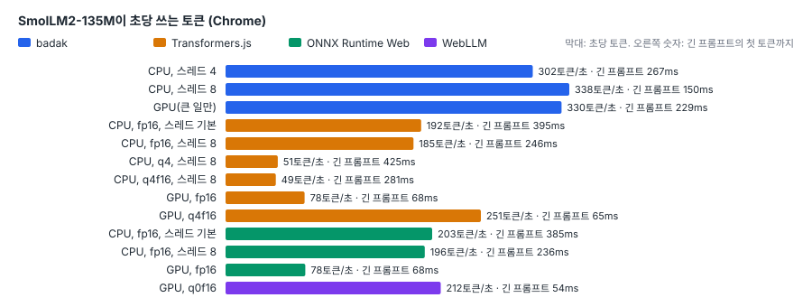
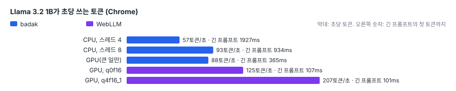

# 웹 AI 생태계와 대결

[48장](ch48_browser.md)과 [49장](ch49_browser_gpu.md)에서 엔진을
브라우저에 올렸습니다. CPU로도 GPU로도 돕니다. 이제 **이미 있는 엔진과
견주면 어떤지** 물을 차례입니다.

브라우저에서 모델을 돌리는 엔진은 여럿 있고, 그 가운데 셋이 널리
쓰입니다. **ONNX Runtime Web**, 그 위에 만든 **Transformers.js**, 그리고
**WebLLM**입니다. 이 책은 부가 끝날 때마다 실전 엔진과 견줬습니다. 3부는
llama.cpp와([25장](../part3/ch25_rematch.md)), 4부는 LiteRT와 ONNX
Runtime과([31장](../part4/ch31_mobile_engines.md)) 견줬습니다. 6부의
상대는 이 셋입니다.

이 장은 다섯 가지를 합니다.

- 세 엔진이 **어떻게 만들어졌는지** 봅니다. [48장](ch48_browser.md)과
  [49장](ch49_browser_gpu.md)에서 우리가 고른 방법과 어디가 같고 어디가
  다른지 봅니다.
- **같은 모델, 같은 질문**으로 넷을 견줍니다. 작은 모델(SmolLM2-135M)과
  큰 모델(Llama 3.2 1B)로 따로 봅니다.
- [48장](ch48_browser.md)에서 미뤄 둔 **Whisper를 브라우저에 올리고**,
  받아쓰기로도 견줍니다.
- 엔진이 **무엇을 얼마나 받아 가는지** 셉니다. 페이지에서는 받는 양이 곧
  기다리는 시간입니다.
- 엔진을 싣지 않는 방법을 봅니다. 브라우저가 신경망의 연산을 대신 해
  주는 **WebNN**과, 브라우저가 모델까지 갖고 있는 **내장 AI**입니다.

먼저 밝혀 둡니다. 숫자는 모두 **저자의 맥 한 대**(M4 Max)에서 브라우저
넷으로 잰 것입니다. 엔진의 버전은 2026년 11월의 것입니다(ONNX Runtime
Web 1.31.1, Transformers.js 4.3.2, WebLLM 0.2.89). 그리고 이 비교는
**언어 모델 둘과 받아쓰기 모델 하나**에 대한 것입니다. 세 엔진은 이 책의
엔진이 돌리지 못하는 모델 수백 가지를 돌립니다. 그 폭은 이 장의 표에
나오지 않습니다.

결과를 미리 적어 둡니다.

- **작은 모델에서는 이 책의 엔진이 가장 빠릅니다.** SmolLM2-135M을
  Chrome에서 초당 338토큰 씁니다. WebLLM이 212, ONNX Runtime Web이 203,
  Transformers.js가 192입니다(각자 가장 빠른 16비트 설정).
- **큰 모델에서는 느립니다.** Llama 3.2 1B에서 우리가 초당 93토큰일 때
  WebLLM은 같은 16비트로 125토큰, 4비트로 207토큰입니다. 긴 프롬프트의
  첫 토큰은 우리가 0.37초, WebLLM이 0.1초입니다.
- 결과가 갈리는 까닭은 하나, **계산 전체를 GPU에 두는가**입니다. 작은
  모델에서는 CPU가 GPU보다 빠르고, 큰 모델에서는 그 반대입니다.
- 페이지가 받아야 하는 코드는 우리가 0.5MB, 나머지가
  3.3~7.3MB입니다(눌렀을 때).
- 받아쓰기(Whisper tiny)는 Transformers.js가 조금 빠릅니다. 11초짜리
  소리에 우리가 0.29초, Transformers.js가 0.21~0.23초입니다.
- **Firefox에서는 GPU를 쓰는 엔진이 모두 초당 10토큰을 넘지 못합니다.**
  [49장](ch49_browser_gpu.md)에서 본 0.1초의 기다림이 토큰마다 한 번씩
  듭니다. WebLLM은 Firefox에서 열리지도 않았습니다. 셰이더 하나에 버퍼
  열 개를 달라는데 Firefox는 아홉까지 줍니다.
- WebNN은 브라우저 넷 어디에도 켜져 있지 않았습니다. 브라우저에 든 언어
  모델을 부르는 API는 Chrome에만 있었습니다.

## 50.1 세 엔진은 만든 방법이 다르다

| | 무엇으로 만들었나 | CPU의 길 | GPU의 길 | 읽는 모델 |
|---|---|---|---|---|
| ONNX Runtime Web | C++ 엔진을 WebAssembly로 빌드[^ort-web] | WebAssembly (SIMD, 스레드) | WebGPU, WebNN | ONNX |
| Transformers.js | JavaScript. 계산은 ONNX Runtime Web에 맡긴다[^transformers-js] | (ONNX Runtime Web) | (ONNX Runtime Web) | ONNX와 토크나이저 |
| WebLLM | 모델마다 컴파일한 코드(MLC, TVM)와 JavaScript[^webllm] | 없다 | WebGPU | MLC의 형식 |
| badak | Rust 엔진을 WebAssembly로 빌드 ([48장](ch48_browser.md)) | WebAssembly (SIMD, 스레드) | WebGPU, 선형 층만 ([49장](ch49_browser_gpu.md)) | safetensors |

**ONNX Runtime Web**은 [31장](../part4/ch31_mobile_engines.md)에서 견준
ONNX Runtime의 브라우저용 버전입니다. 같은 C++ 엔진을 Emscripten으로
WebAssembly로 빌드했습니다. [48장](ch48_browser.md)에서 우리가 한
일(엔진을 그대로 빌드하고 운영체제가 하던 일을 채우기)을 도구로 한
것입니다. 엔진이 크고 연산자가 많아서 모듈도 큽니다. 꾸러미에 든 모듈이
넷입니다.

| 파일 | 크기 |
|---|---:|
| `ort-wasm-simd-threaded.wasm` | 14.8MB |
| `ort-wasm-simd-threaded.jspi.wasm` | 17.9MB |
| `ort-wasm-simd-threaded.asyncify.wasm` | 28.7MB |
| `ort-wasm-simd-threaded.jsep.wasm` | 29.5MB |

어느 것을 받는지는 무엇을 쓰느냐에 달렸습니다. 측정에서 CPU만 쓰겠다고
했을 때는 첫째 것(14.8MB)을, GPU를 쓰겠다고 했을 때는 셋째 것(28.7MB)을
받아 갔습니다. Transformers.js는 CPU만 쓸 때에도 셋째 것을 받았습니다.

파일 이름에 [49장](ch49_browser_gpu.md)에서 다룬 문제가 들어 있습니다.
C++ 엔진도 우리 엔진처럼 "답을 기다리는" 코드이고, 브라우저의 GPU는
약속으로만 답합니다. 그 차이를 메우는 방법이 둘입니다. **JSPI**는
[49장](ch49_browser_gpu.md)에서 우리가 쓴 것입니다. **Asyncify**는
그보다 먼저 나온 방법으로, 브라우저의 도움 없이 컴파일할 때 모듈의
코드를 "멈췄다 이어 할 수 있는 형태"로 고쳐 씁니다. 어디에서나 돌지만
모듈이 커집니다.[^asyncify] 표의 둘째 줄과 셋째 줄의 차이 11MB가 그
대가로 보입니다.

**Transformers.js**는 Python의 `transformers`를 JavaScript로 옮긴
것입니다. 모델의 계산은 하지 않고 ONNX Runtime Web에 맡깁니다. 그 앞뒤의
일을 합니다. 토크나이저, 대화의 틀(47.3절), 토큰을 고르는
반복문([12장](../part2/ch12_sampling.md)), 소리를 스펙트로그램으로
바꾸는 일([33장](../part4/ch33_speech_recognition.md)), 모델을 받아 넣어
두는 일(48.7절)입니다. 이 책이 2부와 4부에서 손으로 짠 것입니다. 세
줄이면 모델이 돕니다.

```js
import { pipeline } from '@huggingface/transformers';
const generator = await pipeline('text-generation', 'HuggingFaceTB/SmolLM2-135M-Instruct', { device: 'webgpu' });
const output = await generator(messages, { max_new_tokens: 96 });
```

**WebLLM**은 방법이 다릅니다. 엔진이 모델을 "해석"하지 않고 **미리
컴파일**합니다(MLC, 47.7절). 모델마다 그 모델의 계산을 하는 코드가 따로
나오고(6MB쯤의 `.wasm` 파일. 안에 WebGPU의 셰이더가 들어 있습니다),
브라우저는 그것을 받아 실행합니다. CPU로 도는 구현은 없습니다. WebGPU가
없으면 돌지 않습니다. 논문은 이 방식으로 맥에서 그대로 돌릴 때의 80%까지
낸다고 적습니다.[^webllm-paper] 컴파일하는 방식 자체는
[52장](../part7/ch52_ml_compilers.md)에서 다룹니다.

세 엔진과 우리 엔진의 가장 큰 차이는 **GPU에 무엇을 두는가**입니다. 셋은
모델의 계산 전체를 GPU에 둡니다. 우리는 선형 층만
둡니다([49장](ch49_browser_gpu.md)). 이 차이가 아래의 측정에서 어떻게
나타나는지가 이 장의 중심입니다.

## 50.2 넷을 같은 조건에서 잰다

넷을 같은 조건에 놓습니다.

- **같은 모델.** SmolLM2-135M-Instruct입니다. 16비트 가중치로
  견줍니다(우리 엔진은 safetensors, ONNX 쪽은 `model_fp16.onnx`,
  WebLLM은 `q0f16`). 엔진마다 줄인 버전도 따로 잽니다.
- **같은 질문, 같은 길이.** 47.3절의 기본 지시문과 "로봇이 그림을 배우는
  짧은 이야기를 써 달라"는 질문입니다. 토큰 96개를 쓰게 하고, 걸음마다
  가장 높은 토큰을 고르게 합니다(탐욕).
- **두 번 묻는다.** 첫 번째에는 셰이더를 옮기는 일 같은 준비가 섞입니다.
  두 번째의 속도를 적습니다.
- **긴 프롬프트.** 200단어짜리 글을 주고 한 문장으로 줄이라고 합니다. 첫
  토큰이 나올 때까지의 시간을 봅니다. 프롬프트를 읽는 속도입니다.
- **엔진마다 페이지를 새로 읽는다.** 앞의 엔진이 받아 둔 코드나 데운
  GPU를 다음 엔진이 이어 쓰지 못하게 합니다.

엔진과 모델은 모두 이 맥의 서버에서 받게 했습니다(`download_ch50.sh`가
버전을 고정해 받아 둔 것입니다). 서버가 **내준 바이트를
셉니다**(`serve_web.py`). 엔진이 무엇을 얼마나 받아 갔는지가 거기에서
나옵니다.

ONNX Runtime Web은 두 가지로 쟀습니다. Transformers.js를 거친 것과, 바로
부른 것입니다. 바로 부를 때는 토큰을 고르는 반복문을 측정 페이지가
돌립니다. [11장](../part2/ch11_kv_cache.md)에서 만든 것과 같은
반복문입니다. 모델을 한 걸음 돌리고, 나온 캐시를 다음 걸음의 입력으로
돌려줍니다.

## 50.3 작은 모델에서는 이 책의 엔진이 가장 빠르다

SmolLM2-135M, Chrome입니다.



| 엔진 | 계산하는 곳 | 가중치 | 토큰/초 | 첫 토큰 | 긴 프롬프트의 첫 토큰 | 여는 시간 |
|---|---|---|---:|---:|---:|---:|
| badak | CPU, 스레드 4 | 16비트 | 302 | 59ms | 267ms | 0.2초 |
| badak | CPU, 스레드 8 | 16비트 | 338 | 31ms | 150ms | 0.1초 |
| badak | GPU (큰 일만) | 16비트 | 330 | 160ms | 229ms | 0.6초 |
| Transformers.js | CPU, 스레드 기본 | 16비트 | 192 | 88ms | 395ms | 1.1초 |
| Transformers.js | CPU, 스레드 8 | 16비트 | 185 | 60ms | 246ms | 0.6초 |
| Transformers.js | CPU, 스레드 8 | 4비트 | 51 | 71ms | 425ms | 0.5초 |
| Transformers.js | CPU, 스레드 8 | 4비트 + 16비트 | 49 | 74ms | 281ms | 0.5초 |
| Transformers.js | GPU | 16비트 | 78 | 49ms | 68ms | 0.5초 |
| Transformers.js | GPU | 4비트 + 16비트 | 251 | 47ms | 65ms | 0.4초 |
| ONNX Runtime Web | CPU, 스레드 기본 | 16비트 | 203 | 85ms | 385ms | 0.8초 |
| ONNX Runtime Web | CPU, 스레드 8 | 16비트 | 196 | 58ms | 236ms | 0.5초 |
| ONNX Runtime Web | GPU | 16비트 | 78 | 46ms | 68ms | 1.0초 |
| WebLLM | GPU | 16비트 | 212 | 38ms | 54ms | 0.9초 |

"토큰/초"는 두 번째로 물었을 때 첫 토큰 뒤의 속도, "첫 토큰"은 그때 첫
토큰까지의 시간, "여는 시간"은 엔진과 모델을 받아(같은 기계의 서버에서)
쓸 수 있게 될 때까지입니다.

- **이 책의 엔진이 가장 빠릅니다.** 초당 338토큰입니다. 16비트
  가중치끼리 견주면 둘째(WebLLM, 212)의 1.6배이고, CPU끼리 견주면 ONNX
  Runtime Web(203)의 1.7배입니다. 표에서 둘째로 빠른 것은 4비트를 섞은
  Transformers.js의 GPU(251)인데, 그것보다도 1.3배 빠릅니다.
- **CPU가 GPU보다 빠릅니다.** 이 크기의 모델에서는
  [49장](ch49_browser_gpu.md)에서 본 대로 계산이 작고 오가는 비용이
  큽니다. GPU를 쓰는 엔진은 토큰마다 적어도 한 번 결과(다음 토큰의
  점수)를 CPU로 읽어 와야 합니다. WebLLM의 212토큰은 토큰 하나에
  4.7ms이고, 그 가운데 계산이 얼마이고 기다림이 얼마인지는 나눠 재지
  않았습니다.
- **프롬프트를 읽는 것은 GPU가 빠릅니다.** 긴 프롬프트의 첫 토큰이 GPU
  엔진은 54~68ms, 우리(CPU)는 150ms입니다. 한꺼번에 계산할 것이 많을
  때에는 GPU가 효과를 냅니다.
- **우리 엔진의 GPU는 여기에서 쓸모가 없습니다.** "큰 일만 GPU에"로 돌린
  것이 CPU만 쓴 것보다 느립니다(긴 프롬프트의 첫 토큰 229ms 대 150ms).
  선형 층마다 오가는 설계의 대가입니다.
- **스레드를 늘려도 ONNX Runtime Web은 빨라지지 않았습니다** (203 →
  196). 기본값 넷이 이 모델에는 맞는 값입니다. 우리 엔진은 넷에서 302,
  여덟에서 338입니다.
- 이상한 숫자가 둘 있습니다. Transformers.js의 CPU에서 4비트가
  16비트보다 네 배 느리고(51 대 185), GPU에서는 16비트만 쓴 것이 4비트를
  섞은 것보다 세 배 느립니다(78 대 251). ONNX Runtime Web을 바로 불러도
  GPU의 16비트는 78이므로 Transformers.js의 탓은 아닙니다. 모델
  파일(ONNX 그래프)이 어떤 연산자로 내보내졌는가에 달린 일로 보이지만
  확인하지 않았습니다.

우리 엔진이 CPU에서 앞서는 까닭을 짐작해 보면 이렇습니다. 이 엔진은 언어
모델 하나의 구조에 맞춰 3부에서 손본 것입니다. 선형 층의 커널이 16비트
가중치를 변환 없이 바로
읽고([20장](../part3/ch20_weight_quantization.md)), KV 캐시가 커지는
방식([22장](../part3/ch22_memory.md)), 스레드를 나누는
문턱([18장](../part3/ch18_multithreading.md))이 이 모델들로
정해졌습니다. ONNX Runtime은 어떤 그래프든 돌리는 엔진이고, 그
일반성에는 대가가 따릅니다. [31장](../part4/ch31_mobile_engines.md)에서
본 것의 반대입니다. 그때는 비전 모델에서 그쪽의 일반적인 최적화가 우리를
앞섰습니다.

브라우저를 바꾸면 이렇습니다(초당 토큰).

| 엔진 | 계산하는 곳 | 가중치 | Chrome | Edge | Firefox | Safari |
|---|---|---|---:|---:|---:|---:|
| badak | CPU, 스레드 4 | 16비트 | 302 | 286 | 290 | 260 |
| badak | CPU, 스레드 8 | 16비트 | 338 | 330 | 336 | 289 |
| badak | GPU (큰 일만) | 16비트 | 330 | 324 | 319 | 284 |
| Transformers.js | CPU, 스레드 기본 | 16비트 | 192 | 176 | 153 | 162 |
| Transformers.js | CPU, 스레드 8 | 16비트 | 185 | 171 | 135 | 152 |
| Transformers.js | CPU, 스레드 8 | 4비트 | 51 | 51 | 48 | 43 |
| Transformers.js | CPU, 스레드 8 | 4비트 + 16비트 | 49 | 48 | 45 | 42 |
| Transformers.js | GPU | 16비트 | 78 | 77 | 10 | 46 |
| Transformers.js | GPU | 4비트 + 16비트 | 251 | 239 | 실패 | 165 |
| ONNX Runtime Web | CPU, 스레드 기본 | 16비트 | 203 | 190 | 162 | 192 |
| ONNX Runtime Web | CPU, 스레드 8 | 16비트 | 196 | 178 | 141 | 180 |
| ONNX Runtime Web | GPU | 16비트 | 78 | 76 | 10 | 46 |
| WebLLM | GPU | 16비트 | 212 | 217 | 실패 | 155 |

- 순위는 브라우저 넷에서 같습니다. 우리 엔진이 어디에서나 가장 빠릅니다.
- **Firefox의 GPU는 초당 10토큰입니다.** Transformers.js도 ONNX Runtime
  Web도 정확히 10.0입니다. 토큰마다 GPU의 답을 한 번 기다리고,
  Firefox에서는 그 기다림이 0.1초입니다(49.5절). 엔진이 아무리 계산을
  GPU에 잘 두어도 토큰을 고르려면 한 번은 읽어 와야 합니다.
- **WebLLM은 Firefox에서 열리지 않았습니다.** 오류는 "셰이더 하나에 버퍼
  열 개를 달라고 했는데 한도가 아홉"입니다. 49.8절의 표에 있던 그
  숫자입니다. 미리 컴파일한 셰이더는 브라우저의 한도에 맞춰 고칠 수
  없습니다.
- Transformers.js의 GPU 4비트 설정도 Firefox에서 실패했습니다.
- Safari에서는 모두 돌지만 GPU 쪽이 Chrome보다 느립니다.

## 50.4 큰 모델에서는 WebLLM이 빠르다

모델을 키웁니다. [49장](ch49_browser_gpu.md)에서 연 Llama 3.2 1B입니다.
우리 엔진과 WebLLM을 견줍니다(WebLLM에는 이 모델을 컴파일한 것이
준비되어 있습니다. 16비트 그대로인 것과 4비트로 줄인 것입니다).



| 엔진 | 계산하는 곳 | 가중치 | 토큰/초 | 첫 토큰 | 긴 프롬프트의 첫 토큰 | 여는 시간 |
|---|---|---|---:|---:|---:|---:|
| badak | CPU, 스레드 4 | 16비트 | 57 | 369ms | 1927ms | 0.7초 |
| badak | CPU, 스레드 8 | 16비트 | 93 | 177ms | 934ms | 0.7초 |
| badak | GPU (큰 일만) | 16비트 | 88 | 264ms | 365ms | 4.3초 |
| WebLLM | GPU | 16비트 | 125 | 82ms | 107ms | 3.4초 |
| WebLLM | GPU | 4비트 | 207 | 64ms | 101ms | 1.5초 |

- **WebLLM이 빠릅니다.** 같은 16비트 가중치로 초당 125토큰, 우리는
  93토큰입니다. 4비트로는 207토큰입니다.
- **첫 토큰에서 차이가 더 큽니다.** 긴 프롬프트의 첫 토큰이 WebLLM은
  0.1초, 우리는 CPU로 0.93초, 큰 일을 GPU에 보내도 0.37초입니다.
- 우리 엔진에서 GPU는 프롬프트를 읽는 데에만 도움이 됩니다(0.93초 →
  0.37초). 토큰을 쓰는 속도는 CPU 그대로입니다(93 대 88).
  [49장](ch49_browser_gpu.md)에서 정한 대로 작은 일은 CPU에 남기기
  때문입니다.
- 4비트 가중치가 WebLLM을 1.7배 빠르게 합니다(125 → 207).
  [20장](../part3/ch20_weight_quantization.md)에서 CPU로 본 것과 같은
  까닭일 것입니다. 큰 모델에서는 계산보다 가중치를 메모리에서 읽어 오는
  일이 속도를 정하고, 4비트는 읽을 것이 4분의 1입니다. 받는 양도
  2.5GB에서 0.7GB가 됩니다.

작은 모델에서는 빠르고 큰 모델에서는 느린 까닭이 같습니다. 우리 엔진의
토큰 생성은 CPU가 합니다. 135M 모델은 CPU로 충분하고, 1B 모델은 그렇지
않습니다. WebLLM은 **순전파 전체가 GPU에** 있습니다. 어텐션도 정규화도
GPU에서 하고, CPU로 오는 것은 토큰마다 점수 한 줄입니다.
[49장](ch49_browser_gpu.md)의 "남긴 것" 첫 줄이 그대로 이 표의
차이입니다.

브라우저를 바꾸면 이렇습니다(초당 토큰).

| 엔진 | 계산하는 곳 | 가중치 | Chrome | Edge | Firefox | Safari |
|---|---|---|---:|---:|---:|---:|
| badak | CPU, 스레드 4 | 16비트 | 57 | 55 | 54 | 46 |
| badak | CPU, 스레드 8 | 16비트 | 93 | 92 | 84 | 74 |
| badak | GPU (큰 일만) | 16비트 | 88 | 86 | 85 | 다시 읽힘 |
| WebLLM | GPU | 16비트 | 125 | 129 | 실패 | 114 |
| WebLLM | GPU | 4비트 | 207 | 212 | 실패 | 170 |

Firefox에서는 WebLLM이 열리지 않아 견줄 상대가 없습니다. Safari에서는
우리 엔진의 GPU 방식이 페이지를 다시 읽게 만들었습니다(49.8절에서 본
일입니다). WebLLM은 Safari에서도 돌았습니다. 가중치를 모듈의 메모리에
두지 않고 GPU에만 두기 때문에 페이지가 쓰는 메모리가 작습니다.

## 50.5 받는 코드와 모델의 크기를 센다

페이지는 열 때마다 엔진을 받습니다. 모델은 한 번 받아 넣어
두지만(48.7절) 처음 온 사람은 그것도 받아야 합니다.

엔진이 받아 간 코드입니다(`.js`와 `.wasm`. SmolLM2-135M을 돌릴 때 서버가
내준 것).

| 엔진 | 받은 코드 | gzip으로 누르면 | 그 가운데 `.wasm` |
|---|---:|---:|---|
| badak | 1.4MB | 0.5MB | `badak_relaxed_threads.wasm` |
| ONNX Runtime Web, CPU만 | 15.0MB | 3.9MB | `ort-wasm-simd-threaded.wasm` |
| ONNX Runtime Web, GPU | 29.0MB | 7.3MB | `ort-wasm-simd-threaded.asyncify.wasm` |
| Transformers.js | 27.7MB | 6.9MB | `ort-wasm-simd-threaded.asyncify.wasm` |
| WebLLM | 13.1MB | 3.3MB | `SmolLM2-135M-Instruct-q0f16_cs1k-webgpu.wasm` |

우리 엔진은 눌러서 0.5MB입니다. 다른 엔진의 7분의 1에서 15분의 1입니다.
할 수 있는 일의 수가 다르니 당연한 차이이기도 합니다. ONNX Runtime
Web에는 연산자가 수백 개 들어 있고, 우리 엔진에는 이 책에서 쓴 것만
있습니다.

WebLLM의 13MB는 둘로 나뉩니다. 라이브러리(JavaScript 6.8MB. npm에 든
파일은 줄여 쓰지 않은 것이어서 실제 서비스에서는 더 작습니다)와 모델마다
컴파일한 코드(6.3MB)입니다. 모델을 바꾸면 뒤의 것을 새로 받습니다.

모델의 크기는 형식이 정합니다. [48장](ch48_browser.md)에서
"브라우저에서는 줄여 둔 파일을 받아야 한다"고 적었습니다. 다른 엔진은
그렇게 합니다.

| 모델 | 형식 | 가중치 | 크기 |
|---|---|---|---:|
| SmolLM2-135M | safetensors (badak) | 16비트 | 269MB |
| | ONNX `model_fp16` | 16비트 | 270MB |
| | ONNX `model_q4` | 4비트 (나머지는 32비트) | 182MB |
| | ONNX `model_q4f16` | 4비트 (나머지는 16비트) | 118MB |
| | MLC `q0f16` | 16비트 | 269MB |
| Llama 3.2 1B | safetensors (badak) | 16비트 | 2,472MB |
| | MLC `q0f16` | 16비트 | 2,472MB |
| | MLC `q4f16_1` | 4비트 | 695MB |

같은 가중치를 16비트로 담으면 어느 형식이든 크기가 같습니다. 차이는 줄인
버전에서 납니다. ONNX 쪽은 한 모델을 여러 정밀도로 내보내
두고(`dtype`으로 고릅니다), MLC 쪽은 정밀도마다 저장소가 따로 있습니다.

MLC의 가중치는 **조각으로 나뉘어** 있습니다. SmolLM2-135M이 여덟 조각,
Llama 3.2 1B의 16비트 버전이 마흔아홉 조각입니다. 49.6절에서 우리가
부딪힌 "파일만 한 배열" 문제를 형식에서부터 피한 것입니다. 조각은 따로
받고 따로 넣어 둘 수 있어서, 받다가 끊겨도 처음부터 다시 받지 않습니다.

우리 엔진은 줄여 둔 파일 하나만으로는 모델을 열지 못합니다(48.6절).
브라우저에서 큰 모델을 쓰려면 가장 먼저 고쳐야 할 곳입니다.

## 50.6 Whisper를 브라우저에 올려 견준다

[48장](ch48_browser.md)에서 미뤄 둔 것입니다.
[33장](../part4/ch33_speech_recognition.md)의 Whisper tiny를 브라우저에
올립니다. 문에 함수 셋을 더했습니다.

```rust
{{#include ../../../crates/badak_web/src/speech.rs:transcribe}}
```

소리 파일을 읽고([33장](../part4/ch33_speech_recognition.md)의 `Wav`),
말이 있는 곳을 찾아 나누고(`vad`), 스펙트로그램을 만들고, 인코더와
디코더를 돌리는 일이 모두 엔진 안에서 일어납니다. JavaScript는 파일의
경로를 주고 글을 받습니다.

```js
{{#include ../../../crates/badak_web/js/badak.js:whisper}}
```

### 스레드 빌드에서만 패닉이 난다

올리자마자 돌지는 않았습니다. 스레드 없는 빌드에서는 받아썼는데,
스레드를 쓰는 빌드에서는 이렇게 죽었습니다.

```text
thread '<unnamed>' panicked at library/std/src/thread/local.rs:
cannot access a Thread Local Storage value during or after destruction
```

"이미 지워진 스레드 지역 값을 읽으려 했다"는 뜻입니다. 문제가 난 곳은
스펙트로그램을 만드는 코드였습니다. 토막마다의 푸리에 변환을 스레드 풀에
나누면서, 스레드마다 변환에 쓸 버퍼를 스레드 지역 값으로 갖게 해
두었습니다([33장](../part4/ch33_speech_recognition.md)). 맥에서도,
폰에서도, 스레드 없는 브라우저 빌드에서도 문제가 없던 코드입니다.

원인을 끝까지 찾지는 못했습니다. 알아낸 것은 이만큼입니다.

- 풀의 스레드는 끝나지 않으므로 그 값이 지워질 까닭이 없습니다.
- 같은 형태의 스레드 지역 값을 하나 더 만들어 풀의 스레드에서 써 보면 잘
  됩니다. 그리고 그 값을 하나 더 만들어 두기만 해도 **원래의 패닉이
  사라집니다.**
- 스레드의 스택을 키워도 달라지지 않습니다.

값이 메모리에 놓이는 위치에 따라 나타났다 사라지는 것으로 보아, 이
타깃(`wasm32-wasip1-threads`)의 도구 쪽 문제일 가능성을 의심합니다.
확인하지 못했습니다. 이 타깃은 Rust에서 둘째 등급이고, 그 바탕인
wasi-threads는 스스로를 "옛 제안"이라고 부릅니다(48.5절). 그 타깃을 고른
대가입니다.

엔진에서는 그 스레드 지역 값을 없앴습니다. 버퍼를 토막마다 새로
얻습니다. 푸리에 변환 하나에 견주면 작은 비용이고, 맥에서 스펙트로그램을
만드는 시간(5.5ms)은 달라지지 않았습니다.

### 받아쓰기는 Transformers.js가 조금 빠르다

케네디의 연설 11초(`jfk.wav`,
[33장](../part4/ch33_speech_recognition.md))를 받아씁니다. 세 번 돌려
가장 빨랐던 것입니다. Chrome입니다.

| 엔진 | 계산하는 곳 | 받아쓰는 시간 | 소리 길이의 | 받은 코드 (gzip) | 받은 모델 |
|---|---|---:|---:|---:|---:|
| badak | CPU, 스레드 4 | 411ms | 27분의 1 | 0.5MB | 152MB |
| badak | CPU, 스레드 8 | 293ms | 38분의 1 | 0.5MB | 152MB |
| Transformers.js | CPU, 스레드 기본 | 345ms | 32분의 1 | 6.9MB | 155MB |
| Transformers.js | CPU, 스레드 8 | 229ms | 48분의 1 | 7.0MB | 155MB |
| Transformers.js | GPU | 208ms | 53분의 1 | 6.9MB | 155MB |
| Transformers.js | GPU, 16비트 | 231ms | 48분의 1 | 6.9MB | 79MB |

- 넷 모두 같은 글을 받아씁니다("And so my fellow Americans ask not what
  your country can do for you, ask what you can do for your country.").
  쉼표 하나가 설정에 따라 있다가 없다가 합니다.
- **Transformers.js가 조금 빠릅니다.** CPU의 스레드 여덟으로 0.23초,
  우리는 0.29초입니다. GPU로는 0.21초입니다.
- 어느 쪽이든 소리 길이의 30분의 1에서 50분의 1입니다. 실시간보다 한참
  빠릅니다.
- 맥에서 그대로 돌리면
  0.12초입니다([33장](../part4/ch33_speech_recognition.md)의 측정을 오늘
  다시 한 것: 스펙트로그램 6ms, 인코더 86ms, 디코더 31ms). 브라우저에서
  2.4배 걸립니다. 언어 모델에서보다 차이가 큽니다. Whisper의 인코더는
  합성곱으로 시작하고, 합성곱은 [48장](ch48_browser.md)에서 브라우저용
  벡터 명령으로 손보지 않았습니다.
- 모델은 우리가 152MB(32비트 safetensors), Transformers.js가 155MB나
  79MB(16비트)를 받습니다.

## 50.7 WebNN은 엔진을 싣지 않게 해 준다

지금까지의 엔진은 모두 **페이지가 싣고 옵니다.** 1MB든 30MB든 받아야
하고, 브라우저가 내주는 것(WebAssembly, WebGPU)만 쓸 수 있습니다. 기계에
NPU가 있어도([45장](ch45_gpu_npu.md)) 페이지는 쓸 수 없습니다.

**WebNN**은 그 빈 곳을 메우려는 표준입니다.[^webnn] 페이지가 "이 텐서에
합성곱을, 그 결과에 ReLU를" 하고 신경망의 연산을 그래프로 적어 주면,
브라우저가 그것을 운영체제의 가속 라이브러리에 넘깁니다. 맥에서는 Core
ML, Windows에서는 Windows ML, Android에서는 LiteRT입니다.
[45장](ch45_gpu_npu.md)에서 우리가 델리게이트로 하던 일을 브라우저가
대신 해 주는 것입니다. 연산자의 커널을 페이지가 싣고 올 필요가 없고,
NPU도 쓸 수 있습니다.

ONNX Runtime Web에는 WebNN을 쓰는 실행 경로가 이미 있습니다.[^ort-web]
쓸 수 있는가가 문제입니다. 브라우저 넷에 물었습니다(`navigator.ml`이
있는가).

| | Chrome | Edge | Firefox | Safari |
|---|---|---|---|---|
| WebNN (`navigator.ml`) | 없음 | 없음 | 없음 | 없음 |

넷 모두 없습니다. 구현 현황표에는 Chromium의 구현이 올라 있지만, 이 맥의
Chrome과 Edge를 새 프로필로 띄웠을 때는 켜져 있지 않았습니다. 실험
기능을 켜는 설정이 있다고 알려져 있으나 이 책은 켜 보지 않았습니다.
"페이지를 연 사람이 바로 쓸 수 있는가"가 기준이라면 2026년 11월의 답은
"아직 아니다"입니다. 그래서 측정도 없습니다.

표준은 권고 후보 단계에 있습니다.[^webnn] 방향은 분명합니다.
[45장](ch45_gpu_npu.md)에서 폰의 NPU를 쓰려고 델리게이트를 만들었듯,
브라우저에서 NPU를 쓰는 방법은 이것 하나입니다.

## 50.8 브라우저에 든 모델은 모델도 싣지 않는다

여기서 더 나아가면 모델도 싣지 않습니다. 47.5절에서 운영체제에 든 모델을
앱이 부르는 것을 봤습니다. 브라우저에도 같은 것이 생겼습니다.

Chrome은 Gemini Nano라는 작은 언어 모델을 스스로 받아 두고, 페이지가
그것을 부르는 API를 내놓습니다.[^chrome-ai] 요약, 번역, 언어 알아보기
같은 일마다 API가 있고, 자유롭게 묻는 Prompt API(`LanguageModel`)가
있습니다. Edge에도 같은 형태의 API가 있습니다.[^edge-ai]

```js
if ((await LanguageModel.availability()) !== 'unavailable') {
  const session = await LanguageModel.create();
  const answer = await session.prompt('What is the capital of France?');
}
```

브라우저 넷에 있는지 물었습니다. 새 프로필에서, 모델을 받지는 않고
`availability()`의 답만 봤습니다.

| API | Chrome | Edge | Firefox | Safari |
|---|---|---|---|---|
| `LanguageModel` | 있음 (받을 수 있음) | 없음 | 없음 | 없음 |
| `Summarizer` | 있음 (받을 수 있음) | 있음 (받을 수 있음) | 없음 | 없음 |
| `Translator` | 있음 (받을 수 있음) | 있음 (받을 수 있음) | 없음 | 없음 |
| `LanguageDetector` | 있음 (받을 수 있음) | 있음 (받을 수 있음) | 없음 | 없음 |
| `Writer` | 없음 | 없음 | 없음 | 없음 |
| `Rewriter` | 없음 | 없음 | 없음 | 없음 |
| `Proofreader` | 없음 | 없음 | 없음 | 없음 |

"받을 수 있음"은 API는 있고 모델은 아직 받지 않았다는 뜻입니다(새
프로필이었습니다). 자유롭게 묻는 `LanguageModel`은 Chrome에만
있었습니다. 이 맥의 Edge(153)에는 요약과 번역 쪽만 있었습니다. Firefox와
Safari에는 어느 것도 없습니다.

47.5절에서 적은 장단점이 그대로입니다. 페이지는 엔진도 모델도 받지
않습니다. 대신 **어떤 모델인지 고를 수 없고**, 있는 브라우저에서만 되고,
그 브라우저에서도 기계가 조건을 채워야 합니다. Chrome의 문서는 디스크
22GB, 그리고 GPU 메모리 4GB 초과나 메모리 16GB를 요구합니다.[^chrome-ai]
모델을 받지 않았으므로 속도는 재지 않았습니다.

## 50.9 상황에 따라 고를 엔진이 다르다

이 장의 측정을 엔진을 고르는 사람의 처지에서 다시 정리합니다.

| 상황 | 이 장의 측정이 가리키는 쪽 |
|---|---|
| 작은 언어 모델(수억 개 이하), 어느 브라우저에서나 | CPU. WebAssembly와 스레드. 이 책의 엔진이 가장 빨랐고, GPU 엔진은 Firefox에서 초당 10토큰 |
| 큰 언어 모델(10억 개 이상) | 전부 GPU에 두는 엔진(WebLLM). 4비트 가중치 |
| 프롬프트가 길고 답이 짧다 | GPU. 첫 토큰이 서너 배 빠르다 |
| 받는 양이 가장 중요하다 | 작은 엔진. 0.5MB 대 3~7MB |
| 여러 가지 모델을 돌려야 한다 | ONNX Runtime Web이나 Transformers.js. 이 책의 엔진은 그 폭이 없다 |
| 스레드를 쓸 수 없는 페이지(격리되지 않음) | GPU 엔진. CPU는 스레드 하나가 된다(48.5절) |
| 엔진도 모델도 싣고 싶지 않다 | 브라우저에 든 모델. Chrome에서만, 기계가 조건을 채울 때만 |

이 책의 엔진을 실제 서비스에 쓰라는 표가 아닙니다. 연산자가 수십
개뿐이고, 돌려 본 모델이 손에 꼽습니다. 이 표가 보여 주는 것은 **각
설계가 어디에서 장점을 내는가**입니다.

## 50.10 남긴 일을 적어 둔다

- **순전파 전체를 GPU에.** 큰 모델에서 WebLLM보다 느린 까닭입니다.
  [49장](ch49_browser_gpu.md)에서 남긴 것이 이 장의 결과로 돌아왔습니다.
- **줄인 가중치의 GPU 커널.** 4비트 가중치를 GPU에서 바로 읽는 커널이
  없습니다. WebLLM이 4비트로 60% 더 빨라지는 것을 봤습니다.
- **WebNN을 쓰는 경로.** 쓸 수 있는 브라우저가 없어서 만들지 않았습니다.
- **스레드 빌드의 패닉의 원인.**
- **다른 모델.** 비전 모델([27장](../part4/ch27_convolution.md)),
  임베딩([34장](../part4/ch34_embedding_search.md))은 브라우저에서
  견주지 않았습니다.
## 정리

- 브라우저의 추론 엔진 셋을 읽고 같은 모델로 견줬습니다. ONNX Runtime
  Web은 C++ 엔진을 WebAssembly로 옮긴 것, Transformers.js는 그 위의
  JavaScript, WebLLM은 모델마다 컴파일한 코드입니다.
- **SmolLM2-135M에서는 이 책의 엔진이 가장 빨랐습니다** (Chrome에서 초당
  338토큰, 같은 16비트로 둘째인 WebLLM의 1.6배). 작은 모델에서는 CPU가 GPU를 이깁니다.
- **Llama 3.2 1B에서는 WebLLM이 앞섰습니다** (125~207 대 93). 계산 전체를
  GPU에 두고 4비트 가중치를 쓰는 쪽입니다.
- 받는 코드는 우리가 0.5MB, 나머지가 3~7MB입니다.
- Whisper를 브라우저에 올렸습니다. 11초를 0.29초에 받아쓰고,
  Transformers.js는 0.21~0.23초입니다.
- 브라우저의 차이가 엔진의 차이보다 클 때가 있습니다. Firefox에서는 GPU
  엔진이 모두 초당 10토큰이고 WebLLM은 열리지 않습니다.
- WebNN은 아직 꺼져 있고, 브라우저에 든 언어 모델은 Chrome에만 있습니다.

6부가 여기에서 끝납니다. 엔진은 폰과 브라우저까지 갔습니다. 서버에서
잰 숫자(5부)와 폰에서 본 제약([43장](ch43_device_constraints.md)), 브라우저의 울타리([48장](ch48_browser.md))가 모두 같은
엔진의 이야기였습니다. 마지막 부에서는 한 걸음 물러나서 봅니다. 이 책이
가지 않은 길, 컴파일러의 길을 살피고, 전 분야의 성적표를 한자리에
모읍니다.

## 연습 문제

1. `scripts/download_ch50.sh`와 `scripts/bench_ch50.sh chrome`으로 이
   장의 측정을 자기 기계에서 돌려 보십시오. 작은 모델에서 CPU와 GPU의
   순위가 이 장과 같습니까?
2. ONNX Runtime Web을 바로 부르는 측정에서 `preferredOutputLocation`을
   빼면(캐시를 걸음마다 CPU로 읽어 오게 하면) 속도가 어떻게 달라집니까?
   [49장](ch49_browser_gpu.md)의 "오가는 값"으로 설명해 보십시오.
3. WebLLM의 `.wasm` 파일 하나를 열어 안에 든 WGSL 셰이더를 찾아보십시오
   (글로 들어 있습니다). 이 책의 `linear_block.wgsl`과 무엇이 다릅니까?
4. Transformers.js의 `dtype`을 `q4`, `q4f16`, `fp16`으로 바꿔 가며 CPU와
   GPU에서 재 보십시오. 이 장의 표에서 가장 이상한 숫자를 하나 골라
   까닭을 찾아보십시오.
5. 50.6절의 패닉을 가장 작은 프로그램으로 다시 만들어 보십시오. 풀의
   스레드에서 스레드 지역 값을 쓰는 것만으로는 나지 않았습니다. 무엇이 더
   있어야 납니까?
6. 이 브라우저에 `LanguageModel`이 있다면 같은 질문을 하고, 이 장의
   엔진들이 쓴 글과 견줘 보십시오. 첫 글자까지의 시간도 재 보십시오.

## 참고 문헌

[^ort-web]: ONNX Runtime 문서, "Web".
    <https://onnxruntime.ai/docs/tutorials/web/>. "With onnxruntime-web, you
    have the option to use `webgl`, `webgpu` or `webnn` (with `deviceType`
    set to `gpu`) for GPU processing, and WebAssembly (`wasm`, alias to
    `cpu`) or `webnn` (with `deviceType` set to `cpu`) for CPU processing.",
    "All ONNX operators are supported by WASM but only a subset are
    currently supported by WebGL, WebGPU and WebNN." (2026-11-21에 읽음.)
    파일의 크기는 npm의 `onnxruntime-web` 1.31.1 꾸러미에서 쟀습니다.

[^transformers-js]: huggingface/transformers.js의 README (커밋
    `205e9c251162`).
    <https://github.com/huggingface/transformers.js/tree/205e9c251162>.
    "Transformers.js uses ONNX Runtime to run models in the browser.",
    `dtype`에 대해 "typical choices include `"fp32"` (default for WebGPU),
    `"fp16"`, `"q8"` (default for WASM), and `"q4"`."

[^webllm]: mlc-ai/web-llm의 README (커밋 `df83db6cb05b`).
    <https://github.com/mlc-ai/web-llm/tree/df83db6cb05b>. "Everything runs
    inside the browser with no server support and is accelerated with
    WebGPU." 모델마다의 `.wasm`과 `required_features: ["shader-f16"]`은
    npm의 `@mlc-ai/web-llm` 0.2.89에 든 모델 목록에서 읽었습니다.

[^webllm-paper]: Charlie F. Ruan 외, "WebLLM: A High-Performance In-Browser
    LLM Inference Engine" (2024). arXiv:2412.15803.
    <https://arxiv.org/abs/2412.15803>. 초록까지만 읽었습니다. "WebLLM can
    retain up to 80% native performance on the same device".

[^asyncify]: Emscripten 문서, "Asynchronous Code" (emscripten-core/emscripten
    커밋 `4d96a3553989`).
    <https://emscripten.org/docs/porting/asyncify.html>. "Asyncify
    automatically transforms your compiled code into a form that can be
    paused and resumed … This works in most environments, but can cause the
    Wasm output to be much larger.", "JSPI - Uses the VM's support for
    JavaScript Promise Integration … The code size will remain the same."

[^webnn]: W3C, "Web Neural Network API" (Candidate Recommendation Draft,
    2026년 11월 20일 판). <https://www.w3.org/TR/webnn/>. "The Web Neural
    Network API defines a web-friendly hardware-agnostic abstraction layer
    that makes use of Machine Learning capabilities of operating systems
    and underlying hardware platforms". 운영체제마다 무엇에 넘기는지는
    구현 현황표에서 읽었습니다.
    <https://webmachinelearning.github.io/webnn-status/>.

[^chrome-ai]: Chrome for Developers, "Built-in AI"와 "The Prompt API".
    <https://developer.chrome.com/docs/ai/built-in>,
    <https://developer.chrome.com/docs/ai/prompt-api>. "With built-in AI,
    your browser provides and manages foundation and expert models.",
    "Storage: At least 22 GB of free space on the volume that contains your
    Chrome profile.", "GPU: Strictly more than 4 GB of VRAM.", "CPU: 16 GB
    of RAM or more and 4 CPU cores or more." (2026-11-21에 읽음.)

[^edge-ai]: Microsoft Edge 문서, "Prompt a built-in language model with the
    Prompt API".
    <https://learn.microsoft.com/en-us/microsoft-edge/web-platform/prompt-api>.
    "The Prompt API is an experimental web API that allows you to prompt a
    small language model (SLM) that is built into Microsoft Edge".
    (2026-11-21에 읽음.)
