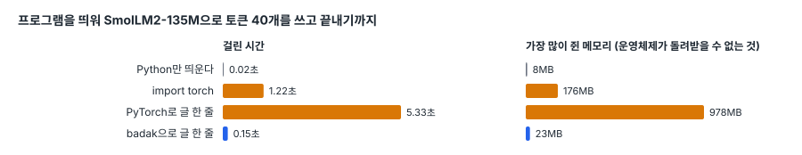
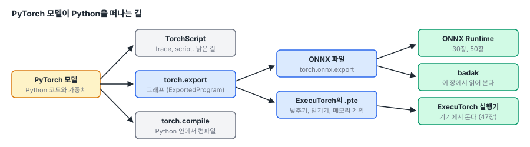

# 왜 PyTorch를 그대로 배포하지 않는가

이 책의 첫 장에서 질문 하나를 뒤로 미뤘습니다. 모델은 PyTorch로
만듭니다. PyTorch도 순전파를 계산합니다. **그러면 추론도 PyTorch로 하면
되지 않는가.** 1.4절은 안 되는 까닭 넷을 들었습니다. 크기, 실행 환경,
하드웨어, 효율. 그리고 "51장에서 측정과 함께 다시 다룬다"고 적었습니다.

그때는 잴 것이 없었습니다. 견줄 엔진이 없었으니까요. 이제 있습니다.
쉰 장에 걸쳐 만든 엔진을 PyTorch 옆에 놓고, 그 넷을 숫자로 봅니다.

이 책에서 PyTorch는 줄곧 **정답을 주는 쪽**이었습니다. 엔진의 계산이
맞는지를 PyTorch의 답과 견줘 확인했습니다. 이 장에서 처음으로 PyTorch를
빠르기와 크기로 봅니다. PyTorch가 못 만든 프로그램이라는 이야기가
아닙니다. **다른 문제를 푸는 프로그램**이라는 이야기이고, 그것이
숫자에서 어떻게 보이는지입니다.

이 장은 네 가지를 합니다.

- PyTorch를 그대로 쓸 때 **무엇을 얼마나 치르는지** 잽니다. 디스크,
  시작하는 시간, 메모리, 연산 하나를 부르는 값.
- 같은 모델을 PyTorch와 우리 엔진으로 돌려 **어디에서 차이가 나고
  어디에서 나지 않는지** 봅니다.
- PyTorch 모델을 **Python 밖으로 내보내는 길들**을 걸어 봅니다. 추적,
  스크립트, `torch.export`, ONNX. 내보낸 것을 우리 엔진으로 읽습니다.
- PyTorch가 스스로 내놓은 답, **ExecuTorch**를 읽고 돌려 봅니다.

숫자는 저자의 맥(M4 Max)에서 PyTorch 2.15.0으로 잰 것입니다. PyTorch는
맥의 CPU에서 돌렸습니다. GPU(MPS)는 쓰지 않았습니다.

결과를 미리 적어 둡니다.

- PyTorch는 디스크에서 **561MB**입니다. 우리 엔진은 폰용 라이브러리가
  1.4MB였습니다([47장](../part6/ch47_on_device_llm.md)).
- 프로그램을 띄워 글 한 줄을 쓰고 끝내는 데 PyTorch는 **5.3초와 메모리
  1GB**, 우리 엔진은 **0.15초와 23MB**입니다.
- **큰 계산에서는 PyTorch가 우리만큼 빠릅니다.** 프롬프트 256토큰을
  처리하는 속도가 초당 2,798토큰 대 2,888토큰입니다. PyTorch는 그것을
  스레드 하나로도 합니다. Apple의 행렬 라이브러리에 맡기기 때문입니다.
- **작은 계산이 이어질 때 차이가 납니다.** 토큰을 하나씩 쓸 때 PyTorch는
  초당 97토큰, 우리는 358토큰입니다. 토큰 하나에 PyTorch는 연산을
  6,225번 부릅니다.
- 내보내는 길 가운데 가장 오래된 것(추적)은 **틀린 답을 말없이** 냅니다.
  새 길(`torch.export`)은 같은 코드를 거절합니다.
- PyTorch에서 ONNX로 내보낸 모델을 우리 엔진이 읽어 같은 답을 냅니다.
- ExecuTorch는 이 책이 4부와 6부에서 한 일들(그래프, 메모리 계획,
  델리게이트)을 PyTorch 쪽에서 한 것입니다.

## 51.1 즉시 실행

PyTorch가 계산하는 방식을 **즉시 실행**(eager execution)이라고 합니다.
Python이 줄을 읽는 대로 그 줄의 계산이 일어납니다.

```python
h = x @ w1 + b1      # 이 줄에서 곱하고 더한다
h = torch.relu(h)    # 이 줄에서 음수를 0으로 만든다
if h.sum() > 10:     # 값을 보고 갈 길을 정할 수 있다
    h = h / 2
```

모델이 "프로그램"입니다. 미리 정해 둔 그래프가 없습니다. 계산의 순서는
Python이 실행되면서 그때그때 정해집니다. PyTorch를 내놓은 논문은 이것을
설계의 중심에 뒀습니다.[^pytorch] 모델을 보통의 Python 코드로 쓰고, 중간
값을 `print`로 찍어 보고, 디버거로 한 줄씩 따라갈 수 있습니다. 연구하고
학습시키는 사람에게 필요한 것입니다.

이 책의 엔진은 반대쪽에 있습니다. 2부의 순전파는 모델의 모양이 코드에
박혀 있고, 4부의 그래프 해석기는 계산의 순서를 파일에서 읽어 **실행하기
전에** 다 압니다. 미리 알기 때문에 미리 할 수 있는 일들이 있었습니다.
메모리를 계획하고([26장](../part4/ch26_graph_interpreter.md)), 연산을 합치고([30장](../part4/ch30_graph_optimization.md)), 가속기에 맡길 부분을
떼어 냅니다([45장](../part6/ch45_gpu_npu.md)).

즉시 실행은 그 "미리"를 내주고 유연함을 얻은 것입니다. 무엇을 내줬는지를
이제 잽니다.

## 51.2 크기와 시작

1.4절의 첫째와 둘째, **크기**와 **실행 환경**입니다.

설치된 PyTorch가 디스크에서 차지하는 크기입니다.

| | 크기 |
|---|---:|
| `torch` 꾸러미 전체 | 561MB |
| 그 가운데 `libtorch_cpu.dylib` (C++로 쓴 몸통) | 422MB |
| `transformers` (모델의 구조와 토크나이저) | 53MB |
| badak, 폰용 동적 라이브러리 ([47장](../part6/ch47_on_device_llm.md)) | 1.4MB |
| badak, 브라우저용 모듈 ([49장](../part6/ch49_browser_gpu.md)) | 1.1MB |

400배입니다. 이 PyTorch에 든 연산자를 세어 보면 이름으로 1,737개,
인자의 꼴에 따른 갈래까지 세면 3,765개입니다(`torch._C._jit_get_all_schemas()`
가운데 `aten::`으로 시작하는 것). 연산자마다 자료형과 장치에 따른 구현이
있고, 미분이 있습니다. 추론에 쓰는 것은 그
가운데 몇십 개입니다. 폰의 앱에 561MB를 싣거나 브라우저로 내려보낼 수는
없습니다. 거기에 Python 자체가 더해집니다.

다음은 시작하는 값입니다. 프로그램을 띄워서 끝날 때까지의 시간과,
가장 많이 쥐었던 메모리를 밖에서 쟀습니다(`/usr/bin/time -l`).



| 하는 일 | 걸린 시간 | 메모리 (돌려받을 수 없는 것) | 메모리 (파일을 비춘 것까지) |
|---|---:|---:|---:|
| Python만 띄운다 | 0.02초 | 8MB | 17MB |
| `import torch` | 1.22초 | 176MB | 235MB |
| `import torch, transformers` | 1.70초 | 197MB | 256MB |
| PyTorch로 SmolLM2-135M을 열어 토큰 40개를 쓴다 | 5.33초 | 978MB | 1,265MB |
| badak으로 같은 일을 한다 | 0.15초 | 23MB | 293MB |

- **`import torch` 한 줄이 1.2초와 176MB입니다.** 422MB짜리 라이브러리를
  메모리에 올리고 연산자들을 등록하는 값입니다. 모델을 읽기도 전입니다.
- **글 한 줄에 5.3초가 걸립니다.** 그 가운데 글을 쓰는 시간은 0.5초가 안
  됩니다. 나머지는 띄우고, 읽고, 준비하는 시간입니다. 우리 엔진은 처음부터
  끝까지 0.15초입니다.
- **메모리는 40배입니다** (978MB 대 23MB). 우리 엔진의 23MB는 [22장](../part3/ch22_memory.md)에서
  만든 것입니다. 가중치 파일을 메모리에 비추고(운영체제가 언제든 도로
  가져갈 수 있습니다), 16비트 가중치를 펼치지 않고 그 자리에서 읽습니다.
  PyTorch는 269MB짜리 16비트 가중치를 32비트로 펼쳐(538MB) 자기 메모리에
  둡니다.

서버라면 5초는 한 번만 치르면 됩니다. 폰의 앱이 사용자가 누를 때마다
5초를 기다리게 할 수는 없고, 1GB를 쥔 앱은 운영체제가 먼저
내립니다([43장](../part6/ch43_device_constraints.md)).

## 51.3 연산 하나를 부르는 값

1.4절의 넷째, **효율**로 갑니다. 먼저 가장 작은 것부터 잽니다. 값이
하나뿐인 텐서 둘을 더합니다. 계산은 덧셈 한 번입니다.

```python
{{#include ../../../reference/ch51_eager.py:op}}
```

| 더하는 것 | 한 번에 |
|---|---:|
| Python의 실수 둘 | 10ns |
| NumPy 배열 둘 (값 하나씩) | 181ns |
| PyTorch 텐서 둘 (값 하나씩) | 353ns |
| 같은 것, 기울기를 끄고 (`inference_mode`) | 325ns |
| PyTorch 텐서 둘 (값 576개씩) | 352ns |
| PyTorch 텐서 둘 (값 331,776개씩) | 42,704ns |

덧셈 한 번에 0.35µs입니다. 값이 576개여도 0.35µs입니다. **이 시간은
계산이 아니라 "덧셈을 부르는 일"에 듭니다.**

`a + b` 한 줄 뒤에서 PyTorch는 여러 가지를 합니다. Python에서 C++로
건너갑니다. 두 텐서의 자료형과 장치를 보고 어느 구현을 부를지 고릅니다.
기울기를 따라가야 하는지 봅니다. 형상을 맞춰 보고, 결과를 담을 텐서를
새로 만들고, 그것을 Python의 객체로 감쌉니다. 무엇이 올지 모르는 채로
한 줄씩 실행하는 값입니다. 기울기를 꺼도(`inference_mode`) 8%밖에 줄지
않습니다. 대부분은 기울기와 상관없는 일입니다.

0.35µs는 작습니다. 마지막 줄처럼 계산이 크면 보이지도 않습니다. 문제는
이것이 **몇 번** 드는가입니다.

## 51.4 모델에서

SmolLM2-135M으로 갑니다. 측정은 [23장](../part3/ch23_gpu.md)과 [49장](../part6/ch49_browser_gpu.md)의 그것입니다. 프롬프트
256토큰을 한꺼번에 처리하고, 이어서 토큰 32개를 하나씩 처리합니다.

```python
{{#include ../../../reference/ch51_eager.py:model}}
```

| | 스레드 | 프롬프트 처리 (토큰/초) | 토큰 생성 (토큰/초) |
|---|---:|---:|---:|
| PyTorch | 12 (기본값) | 2,798 | 97 |
| PyTorch | 8 | 2,968 | 108 |
| PyTorch | 1 | 2,532 | 143 |
| badak | 16 (기본값) | 2,888 | 358 |
| badak | 1 | 323 | 186 |

두 열이 다른 이야기를 합니다.

### 큰 계산: 차이가 없다

프롬프트를 처리하는 속도는 PyTorch와 우리 엔진이 같습니다(2,798 대
2,888). 256토큰을 한꺼번에 넣으면 연산 하나하나가 큽니다. 부르는 값은
묻히고, 행렬 곱셈의 속도가 전부입니다.

눈에 띄는 것은 PyTorch의 셋째 줄입니다. **스레드 하나로 2,532토큰**을
처리합니다. 우리 엔진은 스레드 하나로 323토큰입니다. PyTorch가 커널을
더 잘 짠 것이 아닙니다. 맥에서 PyTorch는 행렬 곱셈을 Apple의 라이브러리
(Accelerate)에 맡깁니다(설정을 찍어 보면 `BLAS_INFO=accelerate`입니다).
그 라이브러리는 스레드 수와 상관없이 이 맥의 행렬 전용 명령을 쓰는
것으로 보입니다([17장](../part3/ch17_simd.md)). [16장](../part3/ch16_matmul.md)에서 그 속도를 봤고, 이 책은 그 길로 가지
않았습니다. 우리는 코어 열여섯으로 같은 속도에 닿았습니다.

1.4절의 셋째, **하드웨어**가 여기에 있습니다. PyTorch가 맥에서 빠른
것은 맥에 좋은 행렬 라이브러리가 있기 때문입니다. 폰의 CPU나 NPU에서는
그 자리를 누가 채워 줘야 합니다. PyTorch의 몸통은 서버의 GPU와 CPU에
맞춰 다듬어져 있습니다.

### 작은 계산이 이어질 때: 3.7배

토큰을 하나씩 쓰는 속도는 PyTorch가 초당 97토큰, 우리가 358토큰입니다.
3.7배입니다. 그리고 PyTorch는 **스레드를 줄일수록 빨라집니다**(97 →
108 → 143). 나눌 만한 일이 없는데 나누려다 값만 치르는 것입니다.

토큰 하나를 쓰는 동안 PyTorch가 무엇을 하는지 세어 봤습니다
(`torch.profiler`).

| | |
|---|---:|
| 토큰 하나에 걸리는 시간 | 10.35ms |
| 그동안 부른 연산의 수 | 6,225번 |
| 연산의 종류 | 41가지 |

| 연산 | 부른 횟수 | 시간의 몫 |
|---|---:|---:|
| 행렬 곱셈 (`mm`) | 211 | 40.6% |
| 이어 붙이기 (`cat`) | 121 | 27.3% |
| 어텐션 | 30 | 14.4% |
| 그 밖의 서른여덟 가지 | 5,863 | 17.7% |

**토큰 하나에 연산을 6,225번 부릅니다.** 정작 일을 하는 행렬 곱셈은
211번입니다(블록 30개에 선형 층 일곱씩, 그리고 마지막 층). 나머지
6,000번은 형상을 바꾸고, 축을 바꾸고, 잘라 내고, 자료형을 바꾸는 작은
연산들입니다. 앞 절에서 잰 대로 하나에 0.3µs씩만 잡아도 2ms입니다. 토큰
하나에 걸리는 시간의 5분의 1이 **아무 계산도 하지 않고 부르기만 하는
데** 듭니다.

우리 엔진의 순전파에는 그 6,000번이 없습니다. 형상을 바꾸는 일은
숫자 몇 개를 고쳐 쓰는 것이고([4장](../part1/ch04_tensor.md)), 블록 하나는 함수 하나입니다.

둘째 줄도 봐 둘 만합니다. **이어 붙이기(`cat`)가 시간의 27%입니다.**
KV 캐시입니다. `transformers`는 토큰이 하나 늘 때마다 지금까지의 캐시와
새 토큰의 키·값을 이어 붙여 **새 텐서를 만듭니다.** 블록 30개에 키와
값이니 60번이고, 그때마다 캐시 전체가 복사됩니다. [11장](../part2/ch11_kv_cache.md)에서 캐시를
만들 때 자리를 미리 잡아 두고 뒤에 적어 넣기만 하게 한 까닭이
이것입니다. 대화가 길어질수록 차이는 커집니다.

토큰 하나에 PyTorch는 10.35ms, 우리는 2.8ms입니다. 차이 7.5ms의 속을
거칠게 나누면 부르는 값 2ms, 캐시를 복사하는 값 3ms, 나머지입니다.
어느 것도 "PyTorch의 행렬 곱셈이 느려서"가 아닙니다.

## 51.5 Python 밖으로

크기와 시작과 부르는 값은 모두 한곳에서 나옵니다. **모델이 Python
프로그램이라는 것.** 그래서 PyTorch 쪽에서도 오래전부터 "모델을 Python
밖으로 꺼내는" 길을 만들어 왔습니다. 꺼낸다는 것은 프로그램에서
**그래프**를 얻는다는 뜻입니다. 어떤 연산을 어떤 순서로 하는지를
Python 없이도 읽을 수 있는 자료로 만드는 것입니다.



쉽지 않은 까닭은 51.1절의 그 유연함입니다. Python 코드는 값을 보고 갈
길을 정할 수 있습니다. 작은 함수 하나로 세 가지 길을 걸어 봅니다.

```python
{{#include ../../../reference/ch51_export.py:branch}}
```

```text
{{#include ../../../bench/ch51/export.txt:1:7}}
```

**추적**(`torch.jit.trace`)은 가장 오래된 길입니다. 예시 입력으로 함수를
한 번 실행하고, 지나간 연산을 받아 적습니다. 예시의 합이 양수였으므로
"두 배"만 적혔습니다. 받아 적은 것은 음수가 들어와도 두 배를 합니다.
`[-1, -2]`에 `[-2, -4]`를 답합니다. **틀린 답이고, 오류는 나지
않습니다.** 경고가 한 줄 나올 뿐입니다("텐서를 Python의 참·거짓으로
바꾸면 추적이 틀릴 수 있다").

**스크립트**(`torch.jit.script`)는 함수를 실행하지 않고 소스를 읽어
옮깁니다. 갈림길이 그대로 남아 맞는 답을 냅니다. 대신 Python의 일부만
읽을 수 있어서, 조금만 자유롭게 쓴 모델은 옮겨지지 않습니다.

이 둘(TorchScript)은 이제 낡은 길입니다. 위의 출력에 PyTorch가 직접
그렇게 적습니다. "`torch.jit.trace`는 낡았다. `torch.compile`이나
`torch.export`로 옮겨라."

**`torch.export`**가 지금의 길입니다. 추적의 한 가지이지만 한 가지가
다릅니다. 입력의 값에 따라 갈리는 곳을 만나면 **멈추고 거절합니다.**
위의 여섯째 줄입니다. 문서는 이것을 "건전함의 보장"이라고
부릅니다.[^torch-export] 내보낸 그래프가 다른 입력에도 맞다는 것을
보일 수 없으면 내보내지 않습니다. 틀린 답보다 오류가 낫다는
판단입니다.

거절당한 코드는 고쳐 써야 합니다. 갈림길을 Python의 `if`가 아니라 텐서
연산(`torch.where`)으로 적으면 통과합니다. 마지막 줄입니다. 모델을
내보낸다는 것은 대개 이런 일입니다. 내보내는 도구가 받아 주는 꼴로
모델의 코드를 다듬는 일.

`torch.compile`은 방향이 다릅니다. Python을 떠나지 않습니다. 모델이
처음 불릴 때 지나가는 연산들을 받아 적어 기계어로 옮겨 두고, 다음부터
그것을 씁니다. 재 보면 이렇습니다.

| SmolLM2-135M | 프롬프트 처리 (토큰/초) | 토큰 생성 (토큰/초) | 처음 부를 때 |
|---|---:|---:|---:|
| PyTorch 그대로 | 2,798 | 97 | |
| `torch.compile`을 거쳐 | 3,177 | 104 | 컴파일에 17초 |

프롬프트 처리가 14% 빨라집니다. 토큰 생성은 거의 그대로이고, 처음에
17초를 기다립니다. Python도 PyTorch도 그대로 있어야 하므로 크기와
시작의 문제는 풀지 않습니다. 서버에서 오래 도는 모델을 위한 길입니다.

## 51.6 내보낸 그래프

[7장](../part1/ch07_mnist.md)의 신경망(784 → 128 → 10)을 `torch.export`로 내보냅니다.

```python
{{#include ../../../reference/ch51_export.py:export}}
```

```text
{{#include ../../../bench/ch51/export.txt:8:20}}
```

마디가 셋입니다. 선형 층, ReLU, 선형 층. [26장](../part4/ch26_graph_interpreter.md)에서 `.tflite` 파일을 열었을
때 본 것과 같은 그림입니다. 입력이 다섯 개인데 넷은 가중치(`PARAMETER`)
이고 하나가 사용자의 입력입니다. Python의 `forward` 함수는 사라지고
"이 값에 이 연산을"의 목록이 남았습니다.

묶음의 크기는 정하지 않고 내보냈습니다(`Dim("batch")`). 그래프에는
"첫 축은 0 이상의 어떤 수"라는 제약이 함께 적힙니다(`s77: VR[0,
int_oo]`). 네 장으로 내보낸 것을 일곱 장으로 돌려도 같은 답이 나옵니다.

이 그래프(`ExportedProgram`)가 요즘 PyTorch의 **나가는 문**입니다.
ONNX로 가는 길도, ExecuTorch로 가는 길도 여기에서 시작합니다.

## 51.7 PyTorch에서 badak으로

내보낸 그래프를 파일로 적습니다. ONNX입니다([30장](../part4/ch30_graph_optimization.md)).

```text
{{#include ../../../bench/ch51/export.txt:21:22}}
```

411KB짜리 파일이고 마디는 셋입니다(`Gemm`은 ONNX에서 선형 층을 가리키는
이름입니다). ONNX Runtime으로 돌리면 PyTorch의 답과 100만 분의 1 안쪽으로
같습니다.

이 파일을 우리 엔진이 읽습니다. [30장](../part4/ch30_graph_optimization.md)에서 만든 ONNX 읽기와 [26장](../part4/ch26_graph_interpreter.md)의
그래프 해석기 그대로입니다.

```rust
{{#include ../../../crates/badak_graph/examples/ch51_onnx.rs:run}}
```

```text
{{#include ../../../bench/ch51/export.txt:26:29}}
```

같은 답입니다(차이는 100만 분의 1). 이로써 길 하나가 처음부터 끝까지
이어집니다. **PyTorch로 학습하고([7장](../part1/ch07_mnist.md)), 그래프로 내보내고, 파일로 적고,
PyTorch가 없는 프로그램으로 읽어 실행한다.** 이 책의 4부가 내내 서 있던
자리가 이 길의 끝이었습니다. [26장](../part4/ch26_graph_interpreter.md)부터 읽어 온 `.tflite`와 ONNX 파일들은
누군가 이렇게 내보낸 것입니다.

같은 사진 한 장을 알아보는 데 걸리는 시간입니다.

| | 사진 한 장에 |
|---|---:|
| PyTorch (즉시 실행) | 7µs |
| badak (ONNX 파일을 읽어서) | 5.1µs |
| ExecuTorch, 기본 연산자 (다음 절) | 299µs |
| ExecuTorch, XNNPACK에 맡겨서 (다음 절) | 18µs |

연산 셋짜리 모델에서는 PyTorch도 빠릅니다. 부르는 값이 세 번뿐입니다.
(ExecuTorch의 두 줄은 Python에서 실행기를 부른 시간이어서 부르는 값이
섞여 있습니다. 기기에서 C++로 부를 때의 숫자가 아닙니다.)

## 51.8 ExecuTorch

PyTorch를 만드는 쪽의 답이 **ExecuTorch**입니다.[^executorch] 47.7절에서
언어 모델을 돌려 본 그 엔진입니다. 여기에서는 만드는 쪽을 봅니다.

생각은 이 장의 제목과 같습니다. PyTorch를 그대로 기기에 보내지 않습니다.
**컴퓨터에서 미리 할 수 있는 일을 다 해 두고**, 기기에는 실행만 하는
작은 프로그램을 보냅니다. 문서의 말로는 "미리 컴파일하고 메모리를
계획해 두어, 실행기는 실행만 책임진다"입니다.[^executorch-how]

```python
{{#include ../../../reference/ch51_export.py:executorch}}
```

네 단계입니다. 단계마다 이 책에서 한 일이 하나씩 대응합니다.

| ExecuTorch의 단계 | 하는 일 | 이 책에서 |
|---|---|---|
| 1. `torch.export` | 프로그램에서 그래프를 얻는다 | (남이 내보낸 파일을 읽었다) |
| 2. 기기용 연산자로 낮춘다 | 2,000개의 연산자를 작은 집합으로 풀어 쓴다 | [26장](../part4/ch26_graph_interpreter.md)의 연산자 표 |
| 3. 가속기에 맡길 부분을 뗀다 | 그래프를 나눠 XNNPACK, Core ML, NPU에 맡긴다 | [45장](../part6/ch45_gpu_npu.md)의 델리게이트 |
| 4. `.pte` 파일로 적는다 | 메모리 계획을 세워 파일에 적는다 | [26장](../part4/ch26_graph_interpreter.md)의 메모리 계획 |

```text
{{#include ../../../bench/ch51/export.txt:23:25}}
```

둘째 줄과 셋째 줄에 2단계와 3단계가 보입니다.

- **맡기지 않으면**(`portable`) 그래프에 연산자 다섯이 남습니다. 선형 층
  하나가 "축 바꾸기"와 "곱하고 더하기"로 풀렸습니다. 실행기에 든 기본
  구현이 이것들을 계산합니다. 사진 한 장에 299µs입니다. 느립니다. 어느
  기기에서나 도는 것이 목적인 구현입니다.
- **XNNPACK에 맡기면** 그래프에 마디가 하나만 남습니다.
  `executorch_call_delegate`. 모델 전체가 한 덩이로 떼어져
  넘어갔습니다. 45.2절에서 우리가 그래프를 나눠 Core ML에 넘긴 것과 같은
  일입니다. 18µs입니다.

파일은 둘 다 409KB입니다. 가중치가 407KB이니 거의 가중치뿐입니다.

47.7절의 숫자를 다시 가져옵니다. 같은 맥에서 SmolLM2-135M을
ExecuTorch(XNNPACK, 32비트 가중치)로 돌렸을 때 초당 17토큰이었습니다.
그때 적은 대로 꾸러미의 기본 설정이었고, 스레드 수를 손보지 않은
숫자입니다. ExecuTorch의 값은 맥의 CPU에서 빠른 데에 있지 않습니다.
**폰의 NPU, 마이크로컨트롤러, 가속기 회사들의 칩**에 같은 모델을
보낼 수 있다는 데에 있습니다. 그쪽은 이 책이 재지 못한 곳입니다.

## 51.9 한자리에

SmolLM2-135M을 이 맥의 CPU에서 돌린 것들을 모읍니다.

| | 프롬프트 처리 (토큰/초) | 토큰 생성 (토큰/초) | 필요한 것 |
|---|---:|---:|---|
| PyTorch (즉시 실행) | 2,798 | 97 | Python, PyTorch 561MB |
| PyTorch (`torch.compile`) | 3,177 | 104 | 위와 같음 |
| ONNX Runtime (Python에서 부름) | 1,950 | 169 | ONNX Runtime 83MB |
| ExecuTorch ([47장](../part6/ch47_on_device_llm.md)) | — | 17 | 실행기 |
| llama.cpp ([47장](../part6/ch47_on_device_llm.md), 4비트) | — | 687 | 실행 파일 |
| badak | 2,888 | 358 | 1.4MB |

([47장](../part6/ch47_on_device_llm.md)의 두 줄은 재는 방법이 달랐습니다. 프롬프트 쪽은 견줄 수 없어
비웠습니다.)

1.4절의 넷을 다시 읽습니다.

- **크기.** 561MB 대 1.4MB.
- **실행 환경.** Python이 있어야 하고, 띄우는 데 1.2초와 176MB가 듭니다.
- **하드웨어.** 맥에서는 Accelerate 덕에 큰 행렬 곱셈이 우리만큼
  빠릅니다. 그 자리를 채워 줄 것이 없는 기기에서는 다릅니다.
- **효율.** 가중치가 고정이고 그래프를 미리 안다는 것을 쓰면, 토큰 하나에
  6,225번 부르던 것이 사라지고, 캐시를 복사하던 것이 사라지고, 가중치를
  펼치던 것이 사라집니다. 3.7배와 40배가 거기에서 나왔습니다.

PyTorch를 그대로 배포하지 않는 까닭은 PyTorch가 느려서가 아닙니다. 큰
계산에서는 느리지 않습니다. **PyTorch가 지키려는 것(무엇이든 한 줄씩
실행할 수 있음)이 추론에는 필요 없고, 그것을 지키는 값이 작은 기기에서
너무 크기 때문**입니다.

## 51.10 남긴 것

- **GPU.** PyTorch를 맥의 GPU(MPS)나 서버의 GPU에서 돌리지 않았습니다.
  서버의 GPU에서는 사정이 다를 것입니다. 큰 묶음을 처리하는 동안에는
  51.4절의 "큰 계산"처럼 부르는 값이 묻힙니다.
- **언어 모델을 직접 내보내기.** SmolLM2를 `torch.export`로 내보내는 일은
  하지 않았습니다. 남이 내보낸 ONNX 파일([50장](../part6/ch50_web_ecosystem.md))과 `.pte` 파일([47장](../part6/ch47_on_device_llm.md))을
  썼습니다. KV 캐시처럼 걸음마다 자라는 값을 그래프에 어떻게 적는지가
  어려운 곳입니다.
- **우리 엔진이 읽는 ONNX의 폭.** 연산자 열아홉 가지만 읽습니다([30장](../part4/ch30_graph_optimization.md), [32장](../part4/ch32_vit_detection.md)).
  PyTorch가 내보내는 아무 모델이나 읽지는 못합니다.
- **ExecuTorch를 기기에서.** 폰에서 C++로 부르는 속도는 재지 않았습니다.

## 51.11 실전에서는

**내보내는 일이 따로 직업이 됩니다.** 모델을 만드는 사람은 PyTorch로
자유롭게 씁니다. 기기에 싣는 사람은 그것을 내보내는 도구가 받아 주는
꼴로 고칩니다. 51.5절의 `if`를 `where`로 바꾸는 일이 실제 모델에서는
훨씬 큰 일이 됩니다. Hugging Face의 Optimum 같은 도구가 널리 쓰이는
모델들의 "내보내는 법"을 모아 둡니다. [47장](../part6/ch47_on_device_llm.md)에서 받아 쓴 `.pte` 파일이
그렇게 만들어진 것이었습니다.

**엔진마다 나가는 문이 있습니다.** ONNX는 여러 엔진이 읽는
형식이고(ONNX Runtime, 그리고 이 책의 엔진), ExecuTorch는 PyTorch에서
곧장 가는 길이며, LiteRT 쪽에는 PyTorch 모델을 `.tflite`로 바꾸는 도구가
있습니다. 그 도구도 `torch.export` 위에 지어졌습니다.[^litert-torch] llama.cpp는 그래프를
받지 않고 가중치만 받습니다(GGUF, [6장](../part1/ch06_model_files.md)). 모델의 모양을 엔진이 코드로
알고 있기 때문입니다. 이 책의 2부가 간 길입니다.

**그래프를 얻은 다음에는 두 길이 있습니다.** 그래프를 읽어 가며
실행하거나(해석), 그래프를 그 기계의 코드로 미리 옮기거나(컴파일).
이 책의 엔진과 ONNX Runtime과 ExecuTorch의 기본 실행기는 앞의 것이고,
[50장](../part6/ch50_web_ecosystem.md)의 WebLLM과 이 장의 `torch.compile`은 뒤의 것입니다. 다음 장이 그
뒤의 길입니다.

## 정리

- PyTorch는 **즉시 실행**합니다. 모델이 Python 프로그램이고, 계산의
  순서는 실행하면서 정해집니다. 연구와 학습에 맞는 설계입니다.
- 그 값을 쟀습니다. 디스크 561MB, 띄우는 데 1.2초, 글 한 줄에 5.3초와
  1GB. 우리 엔진은 1.4MB, 0.15초, 23MB입니다.
- **큰 계산에서는 차이가 없습니다.** 프롬프트 처리는 PyTorch와 우리가
  같고, PyTorch는 맥의 행렬 라이브러리 덕에 스레드 하나로 그것을
  합니다.
- **작은 계산이 이어지면 3.7배 차이가 납니다.** 토큰 하나에 연산을
  6,225번 부르고, KV 캐시를 걸음마다 복사합니다.
- Python 밖으로 나가려면 그래프를 얻어야 합니다. 추적은 틀린 답을
  말없이 낼 수 있고, `torch.export`는 그런 코드를 거절합니다.
- PyTorch가 내보낸 ONNX 파일을 우리 엔진이 읽어 같은 답을 냈습니다.
- ExecuTorch는 미리 할 일을 컴퓨터에서 다 하고 기기에는 실행만
  남깁니다. 그래프, 연산자 낮추기, 델리게이트, 메모리 계획. 이 책이
  손으로 한 일들입니다.

## 연습 문제

1. `python reference/ch51_eager.py op`를 자기 기계에서 돌려 보십시오.
   텐서의 크기를 1에서 100만까지 늘려 가며 "부르는 값"이 묻히는 크기를
   찾아보십시오.
2. `ch51_eager.py`의 `profile`이 적는 연산 6,225번 가운데 가장 자주
   부르는 것(`as_strided`, 936번)은 무엇을 하는 연산입니까? 이 책의 [4장](../part1/ch04_tensor.md)에서
   같은 일을 하는 코드를 찾아 견줘 보십시오.
3. KV 캐시를 이어 붙이는 값은 캐시가 길수록 커집니다. `model`의 프롬프트를
   1,024토큰으로 늘려 토큰 생성의 속도를 재 보십시오. 우리 엔진
   (`ch49_native`)은 얼마나 달라집니까?
4. `clip_or_double`에 반복문을 넣어 보십시오(예를 들어 "합이 100을 넘을
   때까지 두 배"). 추적, 스크립트, `torch.export`가 각각 어떻게
   답합니까?
5. [27장](../part4/ch27_convolution.md)의 합성곱 신경망 하나를 PyTorch로 쓰고 ONNX로 내보내 `ch51_onnx`가
   읽게 해 보십시오. 우리 엔진이 모르는 연산자가 나옵니까? [30장](../part4/ch30_graph_optimization.md)의 연산자
   표에 무엇을 더해야 합니까?
6. ExecuTorch의 `portable` 파일과 `xnnpack` 파일을 [26장](../part4/ch26_graph_interpreter.md)의 방법으로 열어
   보십시오(FlatBuffers입니다). 메모리 계획이 어디에 어떻게 적혀
   있습니까?

## 참고 문헌

[^pytorch]: Adam Paszke 외, "PyTorch: An Imperative Style, High-Performance
    Deep Learning Library" (2019). arXiv:1912.01703.
    <https://arxiv.org/abs/1912.01703>. 초록까지만 읽었습니다.

[^torch-export]: PyTorch 2.15.0, `torch.export.export`의 설명글(설치된
    꾸러미에서 읽음). "produces a traced graph representing only the Tensor
    computation of the function in an Ahead-of-Time (AOT) fashion", "has
    eliminated all Python control flow and data structures (with certain
    exceptions)", "Soundness Guarantee". 추적의 한계는 같은 꾸러미의
    `torch.jit.trace` 설명글에 있습니다. "Tracing only correctly records
    functions and modules which are not data dependent (e.g., do not have
    conditionals on data in tensors)".

[^executorch]: ExecuTorch 문서, "ExecuTorch Overview".
    <https://docs.pytorch.org/executorch/stable/intro-overview.html>.
    "ExecuTorch is an end-to-end solution for enabling on-device inference
    capabilities across mobile and edge devices including wearables,
    embedded devices and microcontrollers." (2026-11-21에 읽음.) 돌린 것은
    PyPI의 `executorch` 1.6.0입니다.

[^executorch-how]: ExecuTorch 문서, "How ExecuTorch Works".
    <https://docs.pytorch.org/executorch/stable/intro-how-it-works.html>.
    "It is also able to run at low latency because of ahead-of-time
    compilation and memory planning stages, with the runtime responsible
    only for execution", "ExecuTorch has a standardized interface for
    delegation to compilers." (2026-11-21에 읽음.)

[^litert-torch]: google-ai-edge/ai-edge-torch의 README (커밋 `6b403ad672d5`).
    <https://github.com/google-ai-edge/ai-edge-torch/tree/6b403ad672d5>.
    "LiteRT Torch is a python library that supports converting PyTorch models
    into a .tflite format … building on top of torch.export()".
